# Verifiable Public Registry v5 Specification

**Latest draft:** [spec v5-draft4](https://verana-labs.github.io/verifiable-trust-vpr-spec/)

**Latest stable:** [spec v4](https://verana-labs.github.io/verifiable-trust-vpr-spec/versions/v4/)

**Previous stable:** [spec v3](https://verana-labs.github.io/verifiable-trust-vpr-spec/versions/v3/)

**Editors:**

~ [Fabrice Rochette](https://www.linkedin.com/in/fabricerochette) ([The Verana Foundation](https://veranafoundation.org))

**Contributors:**

~ [Ariel Gentile](https://www.linkedin.com/in/aogentile/)
~ [Mathieu Gauthron](https://www.linkedin.com/in/mathieugauthron/)
~ [Pratik Kumar](https://www.linkedin.com/in/pratik-kumar-/)
~ [Tarun Vadde](https://www.linkedin.com/in/tarunvadde/)

**Participate:**

~ [GitHub repo](https://github.com/verana-labs/verifiable-trust-vpr-spec)

~ [File a bug](https://github.com/verana-labs/verifiable-trust-vpr-spec/issues)

~ [Commit history](https://github.com/verana-labs/verifiable-trust-vpr-spec/commits/main)

---

## Abstract

Decentralized trust ecosystems need shared infrastructure to answer a fundamental question: who is authorized to issue, verify, or govern credentials in a given context? Without a common registry layer, each ecosystem operates in isolation, trust decisions depend on ad hoc configurations, and there is no interoperable way for Verifiable Services and Verifiable User Agents to resolve the legitimacy of a credential or its issuer.

The **Verifiable Public Registry (VPR)** is a decentralized "registry of registries" that provides this foundational infrastructure. It allows ecosystems to create and manage their own ecosystems, define credential schemas with fine-grained permission policies, and assign roles — issuers, verifiers, grantors — through a transparent, on-chain governance model.

The VPR exposes a standardized query API that Verifiable Services and Verifiable User Agents use during trust resolution to confirm, in real time, whether a given accreditation is authorized to perform a specific action under a specific credential schema. This is what makes the trust in [Verifiable Trust](https://verana-labs.github.io/verifiable-trust-spec/) actually verifiable.

The VPR is DID-method-agnostic — it stores registrations, not validations — leaving trust decisions and cryptographic verification where they belong: with the relying parties. It supports flexible permission management modes (open, ecosystem-controlled, or grantor-delegated), enabling ecosystems to tailor governance to their specific requirements.

This specification defines the data model, API, and normative requirements for implementing and interacting with a Verifiable Public Registry.

## About this Document

In order to fully understand the concepts developed in this document, you should have some basic knowledge of [[ref:DID]], [[ref:DIDComm]], [[ref:VS]], [[ref:ecosystem]], ledger-based applications, and more generally, all terms present in the [Terminology](#terminology) section.

:::note
Before exploring this spec, it is highly recommended to **first read** the [Verifiable Trust Spec](https://verana-labs.github.io/verifiable-trust-spec/).
:::

## Introduction

### What is an Ecosystem?

*This section is non-normative.*

An ecosystem is an approved list of recognized participants, such as ecosystem operators, credential [[ref: issuers]] and [[ref: verifiers]], that are authorized to onboard ecosystem participants, and or issue/verify certain credentials in an ecosystem.

An ecosystem typically expose APIs that are consumed by services that would like to [[ref: query]] its database, and take decisions based on the returned result:

- can [[ref: participant]] #1 issue credential for `schema` ABC of `ecosystem` E1?
- can [[ref: participant]] #2 request credential presentation of credential issued by `issuer` DEF from `schema` GHI of `ecosystem` E2 in `context` CONTEXT?

### What is a Verifiable Public Registry?

*This section is non-normative.*

A Verifiable Public Registry (VPR) is a “registry of registries”, a public service that provides foundational infrastructure for decentralized trust ecosystems. It offers:

- [[ref: corporation]] lifecycle and directory:
  - corporation onboarding, with associated [[ref: DID]] and [[ref: corporation governance framework]] publication
  - multi-member governance through an on-chain `policy_address` (e.g., a Cosmos SDK group policy account)
  - a public corporation directory queryable by indexers, [[ref: verifiable services]], and [[ref: verifiable user agents]]
  - corporations are the foundational actors of the VPR: they control [[ref: participants]] and may themselves control [[ref: ecosystems]].

- ecosystem management:  
  - governance framework publication and versionning
  - [[ref: credential schemas]] publication
  - accreditation onboarding
  - custom business models and permission policies
  - and more.

- query API for trust resolution:  
  A standardized API used by [[ref: verifiable services]] (VSs) and [[ref: verifiable user agents]] (VUAs) to perform trust resolution, enabling them to query registry data and validate roles and permissions in real time.

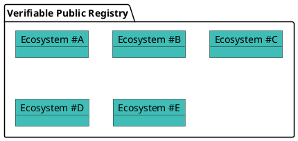

Accreditation directory is intended to be **crawled by indexers**, which resolve the listed DIDs, identify associated [[ref: verifiable services]], and index them.

Indexers may expose this data through APIs for querying the indexed services or use it to build a search engine for querying the database of indexed [[ref: verifiable services]].

### Conformance

As well as sections marked as non-normative, all authoring guidelines, diagrams, examples, and notes in this specification are non-normative. Everything else in this specification is normative.
The key words MAY, MUST, MUST NOT, OPTIONAL, RECOMMENDED, REQUIRED, SHOULD, and SHOULD NOT in this document are to be interpreted as described in [BCP 14](https://datatracker.ietf.org/doc/html/bcp14) [RFC2119](https://w3c.github.io/vc-data-model/#bib-rfc2119) [RFC8174](https://w3c.github.io/vc-data-model/#bib-rfc8174) when, and only when, they appear in all capitals, as shown here.

## Terminology

[[def: account, accounts]]:
~ A [[ref: verifiable public registry]] account.

[[def: active accreditation, active accreditations]]:
~ A `Accreditation` entry whose `effective_from` is not null and lower than or equal to the current timestamp, whose `effective_until` is null or greater than the current timestamp, and whose participation and corporation are not [[ref: barred]]. A revoked or expired entry no longer exists.

[[def: applicant, applicants]]:
~ A [[ref: account]] that starts a [[ref: onboarding process]].

[[def: barred, barred participation, barred corporation]]:
~ A participation is **barred** while its [ParticipationTrustDeposit](#participationtrustdeposit) carries a slash debt (`unrepaid_slash` > 0) or is `excluded`; a corporation is barred while its [TrustDeposit](#trustdeposit) carries a slash debt (`unrepaid_slash` > 0) or is `excluded`. A barred participation creates no entry, is not validated, renewed or minted to, and runs no exchange; a barred corporation can do none of these for any of its participations, cannot register or transfer a service entry, and none of its entries is active. A debt is lifted by repayment ([[MOD-TD-MSG-6]](#mod-td-msg-6-repay-slash)), an exclusion of a participation by the ecosystem controller ([[MOD-AC-MSG-13]](#mod-ac-msg-13-set-participation-exclusion)), of a corporation by network governance ([[MOD-TD-MSG-8]](#mod-td-msg-8-set-corporation-exclusion)). A debt bars; only an exclusion also withdraws trust from what the party issued or validated before ([[ref: VT spec]]).

[[def: bonded tokens, bonded native denom]]:
~ [[ref: native denom]] bonded through the bonding mechanism of [[DIST-2]](#dist-2-bonding) (subject to `unbonding_period`) in order to accrue the capped, fee-funded, pro-rata yield from the [[ref: distribution pool]]. Bonding confers **no consensus power and no governance power**: it is reward accounting only.

[[def: corporation, corporations]]:
~ A legal/organizational entity that controls Accreditations in zero or more [[ref: ecosystems]] and may itself be the controller of zero or more [[ref: ecosystems]]. A `Corporation` is a VPR-level entity with VPR-specific attributes (identifier, governance framework, lifecycle) anchored on-chain by a `policy_address` account that signs on its behalf.

[[def: corporation governance framework, CGF]]:
~ The governance framework (GF) of a [[ref: corporation]].

[[def: council, Council]]:
~ The [[ref: governance authority]] of a [[ref: VPR]]: a group of the chain (x/group) whose members are [[ref: corporations]], each represented by its `policy_address`. It decides every network-level act of the VPR, the [[ref: governance proposals]] of this specification and the software upgrades, consensus and module parameters of the chain included; staking confers no governance right ([Network Governance](#network-governance)).

[[def: council account]]:
~ The group policy account of the [[ref: council]], `GlobalVariables.council_account`: the authority that executes the messages a [[ref: governance proposal]] carries.

[[def: credential schema, credential schemas]]:
~ An [[ref: VPR]] resource which represents a verifiable credential definition and the associated permissions and business rules for issuing, verifying or holding a credential linked to this credential schema.

[[def: credential schema accreditation, credential schema accreditations, CSA]]:
~ A `Accreditation` entry, linked to a [[ref: credential schema]], that represents, in a given [[ref: ecosystem]], a grant for being [[ref: issuer]], [[ref: verifier]], [[ref: issuer grantor]], or [[ref: verifier grantor]] of a [[ref: credential schema]].

[[def: decentralized identifier, DID, DIDs]]:
~ A decentralized identifier, as specified in [[spec-norm:DID-CORE]].

[[def: decentralized identifier communication, DIDComm]]:
~ [DIDComm](https://identity.foundation/didcomm-messaging/spec/) uses [[ref: DIDs]] to establish confidential, ongoing connections.

[[def: denom, denoms]]:
~ Token that has been configured and is recognized in a [[ref: VPR]], example: uvna, USDC.  

[[def: distribution pool]]:
~ The module account that collects, each [[ref: epoch]], all deposit-bound [[ref: native denom]] amounts and [[ref: network fees]]. At epoch end it is paid out in a fixed order (validator budgets, council budget, foundation budget, capped yield to bonded native denom holders) and the **residual is burned**.

[[def: ecosystem, ecosystems]]:
~ A network of interacting entities, both technical and human, that work together to establish and maintain digital trust. It encompasses applications, credentials, governance frameworks, and the underlying technical infrastructure, all designed to facilitate trustworthy interactions.

[[def: ecosystem governance authority, EGA]]:
~ The governance authority (GA) of an [[ref: ecosystem]].

[[def: ecosystem governance framework, EGF]]:
~ The governance framework (GF) of an ecosystem.

[[def: entity, entities]]:
~ An [[ref: account]] controller.

[[def: epoch, epochs]]:
~ A fixed-length period (`epoch_length`, e.g. 1 day) at whose boundary the [[ref: trust unit peg value]] index is updated, the [[ref: distribution pool]] is paid out and the [[ref: network gas price]] is converted into [[ref: native denom]] for the next epoch.

[[def: estimated transaction fees]]:
~ The fee a [[ref: transaction]] declares, in [[ref: native denom]]: at least the [[ref: transaction fees]] it requires ([[NET-FEE-2]](#net-fee-2-required-fee)), usually with a margin so that a slightly low gas estimate does not get the transaction rejected. Only the required fee is deducted: the declared excess is never deducted, and gas declared but not used is not refunded.

[[def: funding account, funding accounts]]:
~ The account a VPR method debits or credits for a [[ref: corporation]]: the `policy_address` of its active [[ref: sponsor]] when one exists, else its own `policy_address`. Resolved at execution time by [[FUND-CHECK]](#fund-check-funding-account-resolution).

[[def: future accreditation, future accreditations]]:
~ A `Accreditation` entry whose `effective_from` is higher than the current timestamp, whose `effective_until` is null or greater than `effective_from`, and whose participation and corporation are not [[ref: barred]].

[[def: governance authority, GA]]:
~ The body that governs a [[ref: VPR]] (its [[ref: council]]), an [[ref: ecosystem]] (its controller corporation, the [[ref: EGA]]) or a [[ref: corporation]] (its own group of members): each decides through the group mechanism of the chain, at its level.

[[def: governance framework, GF]]:
~ A set of rules that bind the parties of a [[ref: VPR]] ([[ref: NGF]]), of an [[ref: ecosystem]] ([[ref: EGF]]) or of a [[ref: corporation]] ([[ref: CGF]]), anchored on the ledger as versions and documents ([GovernanceFrameworkVersion](#governanceframeworkversion)).

[[def: governance proposal, governance proposals]]:
~ A proposal of the [[ref: council]] group carrying one or more messages, voted by the member corporations and executed by the [[ref: council account]] when the council's decision policy is met ([Network Governance](#network-governance)).

[[def: grantor, grantors]]:
~ A role an [[ref: entity]] is granted by an [[ref: ecosystem]] for operating its [[ref: ecosystem]].

[[def: group, groups]]:
~ A Cosmos SDK `x/group` on-chain membership group with an associated decision policy. Each [[ref: corporation]] is realized as a group whose group policy account is the corporation's `policy_address` (see [[MOD-CO-MSG-1]](#mod-co-msg-1-create-corporation)).

[[def: holder, holders]]:
~ A role an entity might perform by possessing one or more verifiable credentials and generating verifiable presentations from them. A holder is often, but not always, a [[ref: subject]] of the verifiable credentials they are holding. Holders store their credentials in credential repositories. Example holders include organizations, persons, things.

[[def: issuer, issuers]]:
~ A role an [[ref: entity]] is granted by an [[ref: ecosystem]] or an [[ref: issuer grantor]] for issuing credentials of a given [[ref: credential schema]] to [[ref: holders]].

[[def: issuer grantor, issuer grantors]]:
~ An ecosystem operator role an [[ref: entity]] is granted by an [[ref: ecosystem]] for a given [[ref: credential schema]] for adding or revoking issuers.

[[def: json schema, json schemas, Json Schema, Json Schemas]]
~ a Json Schema, as specified in [https://json-schema.org/specification](https://json-schema.org/specification).

[[def: linked-vp]]:
~ A presentation of a [[ref: verifiable credential]] as specified in [LINKED-VP](https://identity.foundation/linked-vp/).

[[def: main fiat currency]]:
~ The ISO-4217 fiat currency, defined in the genesis state and immutable thereafter, used to denominate the [[ref: trust unit peg value]], distribution budgets, slash debts and the [[ref: network gas price]]. Fee pricing MAY use other fiat currencies (multi-fiat), but protocol-level accounting uses the main fiat currency. Every fiat amount the VPR stores, compares or converts, in this currency or in a pricing fiat currency, is expressed in the ISO-4217 **minor unit** of that currency (cents for USD or EUR); the examples of this specification read them in major units.

[[def: native denom]]:
~ Native token of a [[ref: VPR]], example: uvna.

[[def: network fee, network fees]]:
~ Fees paid in [[ref: native denom]] for the execution of a [[ref: transaction]]: the transaction's gas limit times the [[ref: network gas price]] ([[NET-FEE-2]](#net-fee-2-required-fee)), deducted before execution and routed to the [[ref: distribution pool]].

[[def: network gas price]]:
~ The price of one unit of gas, a network parameter expressed in the [[ref: main fiat currency]] (`GlobalVariables.network_gas_price`) and converted into [[ref: native denom]] once per [[ref: epoch]] ([[NET-FEE-1]](#net-fee-1-network-gas-price)). It is the same for every validator and every block of an epoch: the VPR has no fee market and no validator-local price.

[[def: network governance framework, NGF]]:
~ The governance framework (GF) of the [[ref: VPR]] itself: the rules that bind its validators, its [[ref: governance proposals]] and its participants network-wide. Anchored on the ledger as the [GovernanceFrameworkVersion](#governanceframeworkversion) entries that have no owner, listed in `GlobalVariables.network_governance_framework_versions`; the version in force is the last listed one whose `active_since` is set ([[NGG]](#ngg-genesis-network-governance-framework)).

[[def: onboarding process]]:
~ A process run by [[ref: applicants]] that want to, for a specific [[ref: credential schema]], be a [[ref: issuer]], be a [[ref: verifier]], or simply hold a verifiable credential linked to the [[ref: credential schema]].

[[def: participant, participants]]:
~ An entity that is recognized by one or several ecosystem(s) in a [[ref: VPR]].

[[def: participation, participations]]:
~ A service entry taking part in a [[ref: credential schema]] in a role: the triple (`vs_id`, `schema_id`, `role`) that keys its [ParticipationTrustDeposit](#participationtrustdeposit) and groups its `Accreditation` entries, successive or concurrent; a participation outlives its entries, and the ecosystem's sanctions apply to it.

[[def: query]]:
~ A read-only action that perform some reading in an [[ref: VPR]] and returns value.

[[def: sponsor, sponsors, sponsorship, sponsored corporation]]:
~ A [[ref: corporation]] that has agreed, through a `Sponsorship` entry, to pay the on-chain fund movements and, optionally, the [[ref: network fees]] of another corporation (the sponsored corporation) from its own `policy_address`. A sponsorship moves money only: trust units, `Accreditation` entries, slash debts and authorizations stay with the sponsored corporation. See [Sponsored Corporations](#sponsored-corporations).

[[def: subject, subjects]]:
~ A thing about which claims are made. Example subjects include human beings, animals, things, and organization, a [[ref: DID]]...

[[def: transaction, transactions]]:
~ An action that modifies the ledger of an [[ref: VPR]] and which execution requires transaction fees.

[[def: transaction fees]]:
~ The [[ref: network fees]] required to execute a [[ref: transaction]] in an [[ref: VPR]]: its gas limit times the [[ref: network gas price]], in [[ref: native denom]] ([[NET-FEE-2]](#net-fee-2-required-fee)).

[[def: trust deposit, trust deposits]]:
~ The [[ref: trust unit]] balance of a [[ref: corporation]], used as its trust guarantee and the basis of its trust score. A trust deposit grows through paid usage: whenever a deposit-bound amount of [[ref: native denom]] is spent by or for a corporation (onboarding processes, credential issuance, presentation,...), trust units are minted to its deposit at the current [[ref: trust unit peg value]]. Trust units in a deposit are non-transferable and non-convertible; a trust deposit can be slashed but never withdrawn.

[[def: trust fee, trust fees]]:
~ Fees paid by a [[ref: participant]] that are distributed to other [[ref: participants]].

[[def: trust unit, trust units, TU, TUs]]:
~ A non-transferable, non-convertible accounting unit that is the only balance held in a [[ref: trust deposit]]. Trust units are minted when a deposit-bound amount of [[ref: native denom]] is spent: the [[ref: native denom]] amount is routed to the [[ref: distribution pool]] (never held in reserve) and the corresponding trust units are credited to the payer's [[ref: trust deposit]] at the current [[ref: trust unit peg value]]. Trust units are **not** a token and **not** a pricing asset: they cannot be transferred, cannot be redeemed for tokens, and cannot be used to define fees. Their sole use is the computation of trust scores, which decay over time through the declining [[ref: trust unit peg value]] index.

[[def: trust unit peg value, tu_peg_value]]:
~ The value of one [[ref: trust unit]] expressed in the [[ref: main fiat currency]]. Set at genesis and declining **deterministically** each [[ref: epoch]] by `tu_decay_rate` (a protocol schedule, **not** oracle-fed). Because trust units are minted at the current peg value, a static trust deposit balance loses fiat value at exactly `tu_decay_rate`: maintaining a trust score requires ongoing paid activity ("trust decay").

[[def: validator]]:
~ A role an [[ref: entity]] performs by participating in onboarding processes with [[ref: applicants]] in order to register them as [[ref: issuer]], or [[ref: verifier]] of a [[ref: credential schema]], or to deliver a verifiable credential to them.

[[def: verifiable credential, verifiable credentials]]:
~ A verifiable credential as defined in [[spec-norm:VC-DATA-MODEL]].

[[def: verifiable identifier, VID, VIDs]]:
~ A digital identifier bound to cryptographic key material, such that another party can verify control of the identifier and resolve it to keys and, when in public use, to endpoint addresses, as specified in the [Trust Spanning Protocol (TSP) Specification](https://trustoverip.github.io/tswg-tsp-specification/). [[ref: DIDs]] are one **type** of VID; other examples include KERI AIDs and X.509-backed identifiers. The [[ref: VPR]] stores VIDs without resolving them; which types of VID a [[ref: VS]] or [[ref: VUA]] accepts in trust resolution is defined by the [[ref: VT spec]], which currently requires [[ref: DIDs]].

[[def: verifiable public registry, VPR, VPRs]]:
~ a public, normally decentralized, ledger-based network, which provides: ecosystem features, that can be used by all its [[ref: participants]]: create ecosystems, for each ecosystem, define its credential schemas, who can issue, verify credential of a specific credential schema,... and a tokenized business model for charging/rewarding [[ref: participants]].

[[def: verifiable service, verifiable services, VS, VSs]]:
~ A service, identified by a resolvable [[ref: DID]] that can be deployed anywhere by its owner, and that is conforming to this spec and has a resolvable Proof-of-Trust. See [[ref: VT Spec]].

[[def: verifiable service entry, verifiable service entries]]:
~ A `VerifiableService` entry: the registration of a [[ref: VID]] in a [[ref: VPR]], owned by a single [[ref: corporation]], that every other entity binding that identifier (`Corporation`, `Ecosystem`, `Accreditation`) references by `vs_id`. See [VerifiableService](#verifiableservice).

[[def: Verifiable Trust Specification, Verifiable Trust Spec, VT Specs, VT Spec]]:
~ see [VT Spec](https://github.com/verana-labs/verifiable-trust-spec).

[[def: verifiable user agent, verifiable user agents, VUA, VUAs]]:
~ A user agent for accessing and using [[ref: VSs]]. To be considered a [[ref: VUA]], a user agent must conform and enforce this spec, such as presenting a proof of trust to end user before accepting connecting to [[ref: VS]] compliant services, and refuse connecting to not compliant services. See [[ref: VT Spec]].

[[def: verifier, verifiers]]:
~ A role an [[ref: entity]] is granted by an [[ref: ecosystem]] or a [[ref: verifier grantor]] for verifying credentials of a given [[ref: credential schema]].

[[def: verifier grantor, verifier grantors]]:
~ An ecosystem operator role an [[ref: entity]] is granted by an [[ref: ecosystem]] for a given [[ref: credential schema]] for adding or revoking verifiers.

## Naming Conventions

### In this spec

- For clarity, Camel Case is used for naming Modules, Entities, Objects, etc.

### In Implementations

- All APIs MUST return valid JSON.
- All JSON content MUST use Snake Case for object, attribute... names.
- Object attributes and Json Content in general can be returned in any order.

## Features of a Verifiable Public Registry (VPR)

### Ecosystem Management

*This section is non-normative.*

In an [[ref: VPR]], any [[ref: corporation]] can create an `Ecosystem` entry to represent an [[ref: ecosystem]] it controls. Each `Ecosystem` entry MUST provide, at a minimum:

- an ecosystem controlled resolvable [[ref: DID]];
- one or more [[ref: ecosystem governance framework]] document(s);
- zero or more [[ref: credential schemas]].

The Verifiable Public Registry (VPR) is agnostic to the specific DID methods used. Trust resolution is performed externally, outside the VPR, allowing flexibility and interoperability across ecosystems.

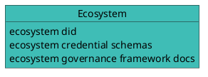

### Credential Schemas and Accreditations

*This section is non-normative.*

[[ref: Credential schemas]] are created and managed by [[ref: ecosystems]] (i.e., by the [[ref: corporation]] controlling each [[ref: ecosystem]]). Each [[ref: Credential schema]] includes, at a minimum:

- A **Json Schema** that defines the structure of the corresponding [[ref: verifiable credential]].
- A **SubjectKind** (`SERVICE` or `PERSON`), a **PresentationMode** (for service credentials: `PUBLIC`, `ON_REQUEST` or `ON_APPROVAL`) a single **CredentialFormat** (`W3C_JSONLD`, `ANONCREDS`, `SD_JWT` or, for persons, `MDOC`) and a **CredentialAnchoring** (`NONE`, `DIGEST` or `REVOCABLE_DIGEST`) that declare what credentials of this schema are for and how agents handle them; see [CredentialSchema](#credentialschema).
- An **IssuerOnboardingMode** for **issuance policy**, which determines how `ISSUER` `Accreditation` entries are created. Modes include:
  - `OPEN`: `ISSUER` Accreditations can be self-created by any [[ref: corporation]].
  - `ECOSYSTEM_ONBOARDING_PROCESS`: `ISSUER` Accreditations are created directly by the controlling [[ref: ecosystem]] through an [[ref: onboarding process]].
  - `GRANTOR_ONBOARDING_PROCESS`: `ISSUER` Accreditations are created by one or several [[ref: issuer grantor]](s) — ecosystem operators responsible for onboarding issuers for the credential schema of this [[ref: ecosystem]] — selected by the [[ref: ecosystem]] through an [[ref: onboarding process]].
- A **VerifierOnboardingMode** for **verification policy**, which determines how `VERIFIER` `Accreditation` entries are created. Modes include:
  - `OPEN`: any [[ref: corporation]] verifies without an entry, and MAY self-create a `VERIFIER` entry.
  - `CREDENTIAL`: any [[ref: corporation]] whose service holds a credential of one of the schemas listed in `verifier_credential_schema_ids` verifies without an entry, as under `OPEN`.
  - `ECOSYSTEM_ONBOARDING_PROCESS`: `VERIFIER` Accreditations are created directly by the controlling [[ref: ecosystem]] through an [[ref: onboarding process]].
  - `GRANTOR_ONBOARDING_PROCESS`: `VERIFIER` Accreditations are created by one or several [[ref: verifier grantor]](s) — ecosystem operators responsible for onboarding verifiers for the credential schema of this [[ref: ecosystem]] — selected by the [[ref: ecosystem]] through an [[ref: onboarding process]].
- A **HolderOnboardingMode** for **holder policy**, which determines how `HOLDER` `Accreditation` entries are created. Modes include:
  - `ISSUER_ONBOARDING_PROCESS`: `HOLDER` Accreditations are created for holders through an [[ref: onboarding process]] validated by the [[ref: issuers]].
  - `PERMISSIONLESS`: a holder that wants to obtain credentials from an [[ref: issuer]] does not require a `Accreditation` entry in the VPR.
- A **Accreditation tree** that defines the roles and relationships involved in managing the schema’s lifecycle. Each `Accreditation` entry in the tree can define business rules; see [Business Models](#business-models) below.

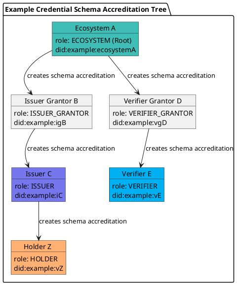

Accreditation roles are defined in the table below:

| **Accreditation Role**   | **Description**                                                  |
|-----------------------|------------------------------------------------------------------|
| **Ecosystem**    | Create and control [[ref: ecosystems]] and credential schemas. Recognize other participants by validating them onto the schema (creating their `Accreditation` entries).        |
| **Issuer Grantor**    | Ecosystem operator that creates `ISSUER` `Accreditation` entries for candidate issuers.                   |
| **Verifier Grantor**  | Ecosystem operator that creates `VERIFIER` `Accreditation` entries for candidate verifiers.               |
| **Issuer**            | Can issue credentials of this schema.                            |
| **Verifier**          | Can request presentation of credentials of this schema.          |
| **Holder**            | Holds a credential. `HOLDER` `Accreditation` entries carry credential status (active, revoked, ...). |

Example of a Json Schema credential schema:

```json
{
  "$id": "vpr:verana:mainnet:cs:VPR_CREDENTIAL_SCHEMA_ID", // ignored, will be generated
  "$schema": "https://json-schema.org/draft/2020-12/schema",
  "title": "ExampleCredential",
  "description": "ExampleCredential using JsonSchema",
  "type": "object",
  "properties": {
    "credentialSubject": {
      "type": "object",
      "properties": {
        "id": {
          "type": "string",
          "format": "uri"
        },
        "firstName": {
          "type": "string",
          "minLength": 0,
          "maxLength": 256
        },
        "lastName": {
          "type": "string",
          "minLength": 1,
          "maxLength": 256
        },
        "expirationDate": {
          "type": "string",
          "format": "date"
        },
        "countryOfResidence": {
          "type": "string",
          "minLength": 2,
          "maxLength": 2
        }
      },
      "required": [
        "id",
        "lastName",
        "birthDate",
        "expirationDate",
        "countryOfResidence"
      ]
    }
  }
}
```

To participate in an [[ref: ecosystem]] and assume a role associated with a specific [[ref: credential schema]]:

- if the schema is `OPEN` for issuance and/or verification: a [[ref: corporation]] MUST have a registered `Corporation` entry in the [[ref: VPR]] and a registered verifiable service entry for its identifier; a `Accreditation` entry is optional under `OPEN` (an issuer self-creates one to declare fees, either party to bound its participation with a window) (see `presentation_mode` in [CredentialSchema](#credentialschema)).

- if the schema is not `OPEN` for issuance and/or verification: a [[ref: corporation]] MUST have a registered `Corporation` entry in the [[ref: VPR]] and complete an [[ref: onboarding process]] to obtain its `Accreditation` entry.

The [[ref: onboarding process]] involves two parties:

- The [[ref: applicant]] — the [[ref: corporation]] requesting a `Accreditation` entry for a credential schema within the ecosystem.
- The [[ref: validator]] — a corporation that already holds a `Accreditation` entry for the same credential schema and has been delegated authority to validate applicants and create new `Accreditation` entries.

Running an [[ref: onboarding process]] **typically involves the payment of [[ref: trust fees]]**. The [[ref: trust fee]] amount to be paid by the [[ref: applicant]] is defined in the [[ref: validator]]'s `Accreditation` entry:

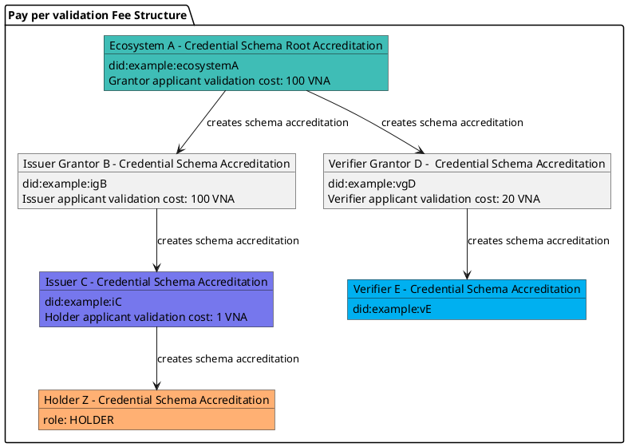

### Corporation Management

*This section is non-normative.*

A [[ref: corporation]] is the VPR-level entity that represents an authority acting in the registry. A `Corporation` carries VPR-specific attributes — the [[ref: verifiable service entry]] of its identifier, a [[ref: corporation governance framework]] (CGF), and lifecycle metadata — and is anchored on-chain by a `policy_address` account that signs on its behalf. The `Corporation` entry has its own `id`, and every other VPR entity points to it through a `corporation_id` foreign key.

A corporation interacts with the VPR in two complementary ways:

- as the **controller** of zero or more [[ref: ecosystems]] — i.e., the corporation owns the corresponding `Ecosystem` entries. The controlling corporation manages each ecosystem's [[ref: EGF]], its [[ref: credential schemas]], and the root `ECOSYSTEM` `Accreditation` entries of those schemas.
- as the **owner of zero or more `Accreditation` entries** in zero or more [[ref: ecosystems]] — i.e., the corporation acts as `ISSUER`, `VERIFIER`, `ISSUER_GRANTOR`, `VERIFIER_GRANTOR`, `HOLDER`, or root `ECOSYSTEM` for [[ref: credential schemas]] of those ecosystems.

The two roles are **independent**: a corporation MAY control no ecosystem at all and only hold `Accreditation` entries in third-party ecosystems; or it MAY control several ecosystems and additionally hold `Accreditation` entries in others; or any combination of the two.


The same `Corporation` entry is the single entry point for the corporation's governance (the CGF), authorization delegation (via `OperatorAuthorization` to one or more `operator` accounts), and trust-deposit accounting (`TrustDeposit`). See the [Corporation Module](#corporation-module) for the methods that manage `Corporation` entries.

A corporation that must not hold [[ref: native denom]] itself (a public entity, for example) MAY be **sponsored** by another corporation: the sponsor's `policy_address` then funds the sponsored corporation's escrows, exchange payments, slash repayments and, optionally, its network fees, while every `Accreditation` entry, trust unit, slash obligation and authorization remains the sponsored corporation's own. See [Sponsored Corporations](#sponsored-corporations).

### DID Indexing

*This section is non-normative.*

The `Accreditation` registry is the foundation for building **searchable indexes of [[ref: verifiable services]] and the verifiable metadata they expose**. Crawlers iterate over `Accreditation` entries, resolve each service identifier (currently a [[ref: DID]], extensible in the future), verify that the service is a [[ref: verifiable service]], and extract its verifiable metadata — most notably the credentials presented through [[ref: linked-vp]] — together with the [[ref: ecosystem]] memberships, [[ref: credential schema]] permissions, and [[ref: trust deposit]] level associated with the controlling [[ref: corporation]].

Unlike a traditional web index, this index is **trust-typed**: every entry carries cryptographically verifiable claims about *what* the service is, *who* operates it, and *under which governance frameworks* it is accredited. This unlocks a class of discovery use cases that traditional search engines cannot serve.

#### AI agent discovery

AI agents are first-class consumers of the index. Before delegating a task or accepting a connection, an agent needs to find counterparts whose **presented credentials match the capabilities required for the interaction**. Querying the index, an AI agent can:

- find [[ref: verifiable services]] qualified for a specific task — for example, a payment processor accredited in a given jurisdiction, a KYC issuer recognized by a target [[ref: ecosystem]], or an MCP-style service whose operator holds a recognized organization credential;
- discover other AI agents whose credentials prove the right scope, authority, or operator;
- restrict the search to a specific [[ref: ecosystem]] or to services that comply with a chosen [[ref: credential schema]];
- rank candidates by [[ref: trust deposit]] size, accreditations held, slashing history, or credential freshness, in order to bias selection toward parties with stronger economic accountability.

Because every indexed claim is anchored in the [[ref: VPR]], an AI agent can verify a counterpart end-to-end *before* initiating the interaction, avoiding spoofed services and unaccredited issuers.

#### Verifiable User Agent content discovery

[[ref: Verifiable user agents]] (VUAs) — such as social browsers, agentic browsers, or CDN-aware clients — use the index to **find content and services that are compatible with the user's context**: the credentials the user holds, the [[ref: ecosystems]] the user trusts, the jurisdictions and languages that apply, and the schemas that the user's wallet can satisfy.

Typical VUA queries include:

- *"Show only services accredited under ecosystem X"* — filter by [[ref: ecosystem]] membership.
- *"Show services that accept the credentials currently in my wallet"* — match the holder's credentials against each [[ref: VS]]'s expected presentations.
- *"Show issuers of schema Y operating in jurisdiction Z"* — combine [[ref: credential schema]] permissions with corporation metadata.
- *"Show services my user has previously interacted with successfully"* — combine the index with the VUA's local history.

The result is a feed of [[ref: VSs]] for which a proof of trust can be displayed to the user *before* connection, in line with the VUA enforcement obligations defined in this spec and in the [[ref: VT Spec]].

#### Other consumers

The same index serves additional consumers:

- **Trust-aware and traditional, form-based search engines**, which can return ordinary links to [[ref: VSs]] enriched with verifiable trust signals (issuer accreditations, [[ref: ecosystem]] memberships, [[ref: trust deposit]] level).
- **Ecosystem operators and governance authorities**, which use the index to monitor accredited issuers, verifiers, and grantors, observe schema adoption across [[ref: ecosystems]], and detect rogue or expired accreditations.
- **Auditors, regulators, and compliance tools**, which rely on the index to map the supply chain of trust behind a given service or credential, and to verify that participants are still in good standing.
- **Analytics and reputation services**, which combine indexed metadata with on-chain history (trust-deposit movements, slashing events, exchange volumes) to produce reputational signals at the [[ref: corporation]] level.

#### Indexing pipeline


### Business models

#### Trust Deposit

*This section is non-normative.*

In a [[ref: VPR]], each [[ref: corporation]] is associated with a [[ref: trust deposit]], which holds [[ref: trust units]] (TU).

The trust deposit is automatically funded through transactions involving **trust operations**, such as onboarding processes, credential issuance, or presentation: each time a deposit-bound amount of [[ref: native denom]] is spent, the [[ref: native denom]] is routed to the [[ref: distribution pool]] and the equivalent trust units, computed at the current [[ref: trust unit peg value]], are minted to the corporation's trust deposit. No [[ref: native denom]] is ever held in reserve: trust units are **not collateralized**. The [[ref: native denom]] MAY be paid by a [[ref: sponsor]] on the corporation's behalf; the trust units are always minted to the corporation that performs the trust operation, never to its sponsor.

The trust deposit is fundamental to the **"Proof-of-Trust" (PoT)** mechanism of the [[ref: Verifiable Trust Specification]], and it operates as follows:

- The more a [[ref: corporation]] uses the [[ref: VPR]], the more its [[ref: trust deposit]] grows.
- **Trust is a subscription**: because the [[ref: trust unit peg value]] declines each [[ref: epoch]] by `tu_decay_rate`, a static deposit loses fiat value over time. The trust score therefore reflects **recent** paid usage: earned, never bought, and gone if not maintained.
- **network-level penalties**: If a participant violates the [[ref: NGF]] or engages in **fraudulent activity**, their **trust deposit may be partially or fully slashed** by the [[ref: VPR]]'s governance authority. The debt is recorded in [[ref: main fiat currency]] at the **mint-time cost basis** of the slashed trust units — what was originally paid for them, not their decayed value: trust scores decay, **liabilities do not**, and misbehavior costs the same whether the deposit was funded yesterday or a year ago.
- **ecosystem-level penalties**: If a participant operates within an ecosystem (e.g., as a [[ref: grantor]], [[ref: issuer]], [[ref: verifier]], or [[ref: holder]],...) and **fails to comply** with that ecosystem’s governance framework (EGF), the **portion of its trust deposit minted in the context of that ecosystem** can be slashed by the corresponding [[ref: ecosystem governance authority]].
- While a slash debt is unrepaid, the slashed participation (ecosystem slash) or every participation of the corporation (network slash) is **barred**: its entries are not active and no new trust units can be minted to it. The debt is recorded on the slashed [ParticipationTrustDeposit](#participationtrustdeposit) or [TrustDeposit](#trustdeposit) entry, at the mint-time cost basis. Repayment is made in [[ref: native denom]] worth that cost basis at current rates, and **restores the slashed trust units** at their decayed current value: the gap between the basis paid and the value restored is the penalty premium, and restoring trust costs **more tokens when the token is cheap**.
- A slash MAY also **exclude**, by decision of the slashing governance: the participation, or the whole corporation, stays barred after repayment until the exclusion is lifted, and everything it issued or validated resolves as untrusted while the exclusion stands ([[ref: VT spec]]). A debt alone withdraws nothing from the past.
- Holding a large trust deposit **does not grant governance rights** in the [[ref: VPR]]: participants who generate high transaction volume **cannot gain control** over the governance of the [[ref: VPR]] solely through usage or deposit size. Nor does staking: a VPR is governed by its [[ref: council]] ([Network Governance](#network-governance)).

This system ensures that participation in the trust ecosystem is backed by economic accountability, reinforcing the integrity, governability and verifiability of the [[ref: VPR]].

#### Why Trust Deposits Are Non-Withdrawable

*This section is non-normative.*

A [[ref: trust deposit]] cannot be withdrawn. This is structural, not merely a policy choice:

- **Trust units are not money.** Trust units are non-transferable and non-convertible; the [[ref: native denom]] spent to mint them was distributed or burned through the [[ref: distribution pool]] and is not held in reserve. There is no redemption path, and therefore **no run risk**.
- **Lasting accountability to the ecosystem.** A trust deposit is bound to the ecosystems it was accumulated in. Choosing to stop using an ecosystem does not release a participant from its obligations toward it — a participant cannot simply walk away and harm the ecosystem because they no longer need it. Since the accumulated trust units cannot be moved or cashed out, the participant remains economically accountable: any harmful behavior can still be slashed, lowering their trust score and creating a fiat-fixed repayment obligation.
- **Recurring demand instead of locked value.** Trust decay makes trust a subscription: keeping a trust score requires ongoing paid activity, which creates recurring demand for the token that scales with adoption — rather than a one-time locked amount that could be gamed through exit-and-rejoin timing.

#### Onboarding Process Trust Fees

*This section is non-normative.*

We've explained in the [Credential Schemas and Accreditations](#credential-schemas-and-accreditations) section above what is an onboarding process.

The table below summarizes the possible combinations of applicants and validators:

| Payee → Payer ↓  | Ecosystem                      | Issuer Grantor                        | Verifier Grantor                    | Issuer                              | Verifier | Holder                                  |
|------------------|-------------------------------------|---------------------------------------|-------------------------------------|-------------------------------------|----------|-----------------------------------------|
| Issuer Grantor   | renewable subscription (1)          |                                       |                                     |                                     |          |                                         |
| Verifier Grantor | renewable subscription (2)          |                                       |                                     |                                     |          |                                         |
| Issuer           | renewable subscription (3)          | renewable subscription (1)            |                                     |                                     |          |                                         |
| Verifier         | renewable subscription (4)          |                                       | renewable subscription (2)          |                                     |          |                                         |
| Holder           |                                     |                                       |                                     | renewable subscription  (5)         |          |                                         |

- (1): if *issuer onboarding mode* is set to GRANTOR_ONBOARDING_PROCESS.
- (2): if *verifier onboarding mode* is set to GRANTOR_ONBOARDING_PROCESS.
- (3): if *issuer onboarding mode* is set to ECOSYSTEM_ONBOARDING_PROCESS.
- (4): if *verifier onboarding mode* is set to ECOSYSTEM_ONBOARDING_PROCESS.
- (5): if *holder onboarding mode* is set to ISSUER_ONBOARDING_PROCESS.

Onboarding process is started by the applicant.

*Example of a candidate [[ref: issuer]] ([[ref: applicant]]) that would like to obtain an `ISSUER` `Accreditation` entry for a credential schema of an ecosystem, validated by a [[ref: validator]] that holds an `ISSUER_GRANTOR` `Accreditation` entry:*

```plantuml
scale max 800 width
actor "Applicant\n(issuer candidate)\nAccount" as ApplicantAccount 
actor "Applicant\n(issuer candidate)\nVUA" as ApplicantBrowser 

actor "Validator\n(issuer grantor)\nVS" as ValidatorVS
actor "Validator\n(issuer grantor)\nAccount" as ValidatorAccount

participant "Verifiable Public Registry" as VPR #3fbdb6

ApplicantAccount --> VPR: start onboarding process with Validator
VPR <-- VPR: create applicant Accreditation entry\n(op_state = PENDING)
ApplicantAccount <-- VPR: applicant Accreditation entry created
ApplicantBrowser --> ValidatorVS: connect to validator VS DID found in\napplicant_accreditation.validator_accreditation\nby creating a DIDComm connection
ApplicantBrowser <-- ValidatorVS: DIDComm connection established.
ApplicantBrowser --> ValidatorVS: I want to proceed with applicant_accreditation.id=...
ValidatorVS --> ValidatorVS: load applicant Accreditation with this id\nand verify validator_accreditation_id refers to me
ApplicantBrowser <-- ValidatorVS: request proof of control\nof applicant_accreditation.corporation_id account (blind sign)
ApplicantBrowser --> ValidatorVS: send blind sign proof of operator account
ApplicantBrowser <-- ValidatorVS: proof accepted, you are an operator\nof the applicant Accreditation, I trust you.
ApplicantBrowser <-- ValidatorVS: which DID do you want to register as an issuer?
ApplicantBrowser --> ValidatorVS: send DID
ValidatorVS --> ValidatorVS: resolve DID and get pub keys
ApplicantBrowser <-- ValidatorVS: request proof of ownership\nof the DID to be registered on your `ISSUER` `Accreditation` entry (blind sign)
ApplicantBrowser --> ValidatorVS: send blind sign proofs
ApplicantBrowser <-- ValidatorVS: proof accepted, you are the controller of this DID, I trust you.
note over ApplicantBrowser, ValidatorVS #EEEEEE: (*optional*) repeat the following until tasks completed
ApplicantBrowser <-- ValidatorVS: Are you a legitimate issuer?\nProve it, by filling forms, sending documents...
ApplicantBrowser --> ValidatorVS: perform requested tasks...
note over ApplicantBrowser, ValidatorVS #EEEEEE: tasks completed
ApplicantBrowser <-- ValidatorVS: You are a legitimate candidate. I'll now finalize your `ISSUER` `Accreditation` entry.
ValidatorAccount --> VPR #3fbdb6: set applicant_accreditation.op_state to VALIDATED\n(finalize the `ISSUER` `Accreditation` entry)
VPR --> ValidatorAccount: Receive trust fees.
ApplicantBrowser <-- ValidatorVS: notify `ISSUER` `Accreditation` entry validated for your corporation and DID.\nDID can now issue credentials of this schema.
```

The **total amount** paid by the applicant consists of:

- The validation [[ref: trust fees]] defined in the validator's `Accreditation` entry (the one acting as the validator in the onboarding process), **plus**
- an additional amount equal to the `trust_deposit_rate` of that validation [[ref: trust fees]] (the applicant's deposit-bound amount), **plus**
- [[ref: network fees]] (not part of the escrowed amount).

While the onboarding process is PENDING, both the validation fees **and** the deposit-bound amount are **held in the escrow account**: no trust units are minted and nothing enters the [[ref: distribution pool]]. If the process is cancelled, the escrowed amount is refunded as-is — this is the only refund path; trust deposits themselves are never freed.

Example, using 5% for `trust_deposit_rate` and validation fees of 100 VNA:

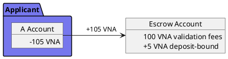

Upon completion of the onboarding process (VALIDATED), **the escrow is settled** as follows:

- the validator receives its validation fees minus their deposit-bound portion (`trust_deposit_rate`) **directly in its wallet**;
- the deposit-bound amounts — `trust_deposit_rate` of the validation fees for the validator, plus the applicant's surcharge — are converted: [[ref: trust units]] are minted to the validator's and the applicant's trust deposits at the current [[ref: trust unit peg value]], and the corresponding [[ref: native denom]] is routed to the [[ref: distribution pool]].

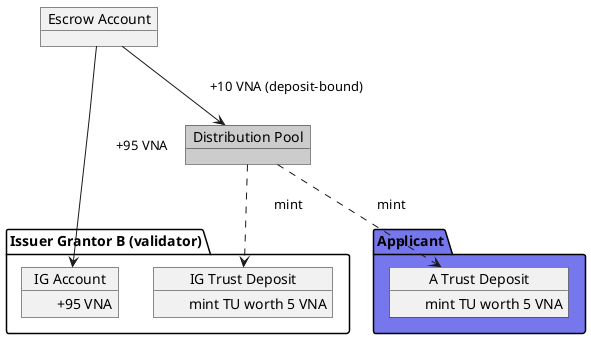

#### "Pay-Per" trust fees

*This section is non-normative.*

**Pay-per-issuance** and **pay-per-verification** [[ref: trust fees]] are defined **on each `Accreditation` entry** for each role within the ecosystem. Fees are priced in the credential schema's pricing asset — a COIN (e.g. the [[ref: native denom]] or a stablecoin) or a FIAT currency; [[ref: trust units]] are **not** a pricing asset. In the examples below, the schema prices fees in VNA (the native denom).

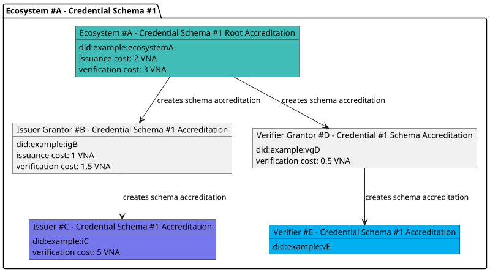

[[ref: Corporations]] acting as **issuers** or **verifiers** for a given credential schema **may be required to pay trust fees** based on the schema's configuration and `Accreditation` tree.

If trust fee payment is required, or the schema sets a presentation validity period, or the verifier anchors the presentation digest, or a credential of a schema whose `credential_anchoring` is not NONE is issued (its digest is anchored through the exchange), the entity **must execute a transaction** in the [[ref: VPR]] to pay the appropriate [[ref: trust fees]] **before issuing or verifying a credential**, else HOLDER agent will not accept the operation.

Key Points for "Pay-Per" Business Models

- For a given credential schema, the **ecosystem** and its participants may define **pay-per-issuance** (or **pay-per-verification**) [[ref: trust fees]] on their respective `Accreditation` entries.

- In such cases, an `ISSUER` (or `VERIFIER`) `Accreditation` **must pay**:
  - the corresponding **issuance** (or **verification**) trust fees for each involved `Accreditation` entry along the `Accreditation` tree;
  - an additional amount equal to the `trust_deposit_rate` of the calculated trust fees, which is deposit-bound: minted as [[ref: trust units]] to the **payer's [[ref: trust deposit]]**;
  - (optional) an amount equal to the `vua_reward_rate` of the calculated trust fees, used to **reward the Verifiable User Agent** of the peer: paid to the vendor that issued its User Agent credential, at the rate that vendor declares on its `ISSUER` entry, at most `GlobalVariables.vua_reward_rate`.

Fee Distribution Model

Trust fees are **consistently distributed** across participants:

- A portion defined by `trust_deposit_rate` of each payee's share is deposit-bound: it is minted as [[ref: trust units]] to the **payee's trust deposit** and the corresponding [[ref: native denom]] is routed to the [[ref: distribution pool]].
- The remaining portion is **transferred directly to the payee's wallet** — ordinary flow-through revenue, neither burned nor restricted.

:::note
Agents that implement the [[ref: VT spec]] **must verify** that the ISSUER or VERIFIER has fulfilled the required trust fee payment, or has sent the required `CredentialExchange` transaction whenever [[MOD-AC-MSG-10]](#mod-ac-msg-10-record-credential-exchange) requires one (a `presentation_validity_period` greater than 0, or a presentation digest to anchor).  
If not, they **must reject** the issuance or verification request.

:::

Distribution example for the issuance by `ISSUER` #C of a credential, using the `Accreditation` tree above, 5% for `trust_deposit_rate` and 5% for `vua_reward_rate`. Total fees along the tree: 2 + 1 = 3 VNA; the issuer pays 3 × (1 + 0.05 + 0.05) = 3.30 VNA. Deposit-bound amounts (payer surcharge and 5% of each payee share, the VUA issuer's included) total 0.3075 VNA, routed to the [[ref: distribution pool]] with the equivalent trust units minted to each party's deposit.

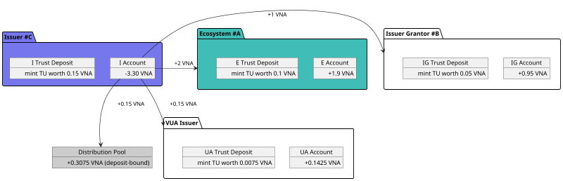

Distribution example for the verification by `VERIFIER` #E of a credential issued by `ISSUER` #C, using the `Accreditation` tree above, 5% for `trust_deposit_rate` and 5% for `vua_reward_rate`. Total fees along the tree: 3 + 0.5 + 1.5 + 5 = 10 VNA; the verifier pays 10 × 1.10 = 11 VNA. Deposit-bound amounts total 1.025 VNA, routed to the [[ref: distribution pool]] with the equivalent trust units minted to each party's deposit.

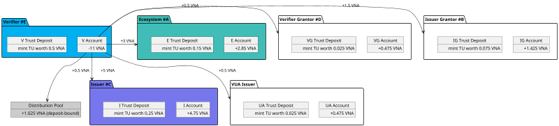

## Governance of a VPR

*This section is non-normative.*

The [[ref: NGF]] defines the governance rules that apply to a [[ref: VPR]]; it is anchored on the ledger like every governance framework ([GovernanceFrameworkVersion](#governanceframeworkversion), [[NGG]](#ngg-genesis-network-governance-framework)).

The [[ref: council]], a group of member corporations ([Network Governance](#network-governance)), is responsible for **enforcing these rules** and, when necessary, **applying financial sanctions** to participants who violate the rules.

:::note
**Ecosystem Governance Frameworks (EGFs)** operate **independently** from the [[ref: NGF]].

While the **network governance framework** defines the global rules for operating the Verifiable Public Registry (e.g., trust deposits, fee distribution, slashing conditions), each **ecosystem** must define its own **EGF** to govern roles, permissions, credential policies, and compliance within its specific domain.

This separation ensures that ecosystems remain autonomous and can tailor governance to their unique needs, without being constrained by the global rules of the VPR.
:::

## Data model

For simplicity, the data model is presented using an **object-relational structure**. However, this representation may not be optimal for all implementation scenarios.

Implementors are responsible for **adapting the data model** to suit their chosen architecture.  
For example, a **key-value store** may be more appropriate for a **ledger-based implementation** than a relational model.

```plantuml

@startuml
scale max 800 width

entity "Ecosystem" as tr {
  *id: uint64
  +created: timestamp
  +archived: boolean
  +active_version: int
  +language: string
}

entity "Corporation" as corp {
  *id: uint64
  +created: timestamp
  +active_version: int
  +language: string
  sponsor_corporation_id: uint64
}

entity "GovernanceFrameworkVersion" as gfv {
  *id: uint64
  +created: timestamp
  +version: integer
}

entity "GovernanceFrameworkDocument" as gfd {
  *id: uint64
  +created: timestamp
  +language: string
  +url: string
  +digest_sri: string
}


entity "CredentialSchema" as cs {
  *id: uint64
  +created: timestamp
  +archived: boolean
  +json_schema: string
  +issuer_grantor_validation_validity_period: number
  +verifier_grantor_validation_validity_period: number
  +issuer_validation_validity_period: number
  +verifier_validation_validity_period: number
  +holder_validation_validity_period: number
  verifier_credential_schema_ids: uint64[]
  presentation_validity_period: duration
  +pricing_asset: string
  +digest_algorithm: string
}



enum "IssuerOnboardingMode" as iom {
  OPEN
  GRANTOR_ONBOARDING_PROCESS
  ECOSYSTEM_ONBOARDING_PROCESS
}

enum "VerifierOnboardingMode" as vom {
  OPEN
  GRANTOR_ONBOARDING_PROCESS
  ECOSYSTEM_ONBOARDING_PROCESS
  CREDENTIAL
}

enum "HolderOnboardingMode" as hom {
  ISSUER_ONBOARDING_PROCESS
  PERMISSIONLESS
}
enum "SubjectKind" as subjectkind {
  SERVICE
  PERSON
}
enum "PresentationMode" as presentationmode {
  PUBLIC
  ON_REQUEST
  ON_APPROVAL
}
enum "CredentialFormat" as credentialformat {
  W3C_JSONLD
  ANONCREDS
  SD_JWT
  MDOC
}
enum "CredentialAnchoring" as credentialanchoring {
  NONE
  DIGEST
  REVOCABLE_DIGEST
}


entity "(SDK) Account" as account {
}

enum "MsgType" as msgtype {
  UpdateCorporation
  CreateEcosystem
  UpdateEcosystem
  ArchiveEcosystem
  AddGovernanceFrameworkDocument
  IncreaseActiveGovernanceFrameworkVersion
  CreateCredentialSchema
  UpdateCredentialSchema
  ArchiveCredentialSchema
  StartAccreditationOP
  RenewAccreditationOP
  SetAccreditationOPtoValidated
  CancelAccreditationOPLastRequest
  CreateRootAccreditation
  SetAccreditationEffectiveUntil
  RevokeAccreditation
  RecordCredentialExchange
  SlashParticipationTrustDeposit
  SelfCreateAccreditation
  TriggerResolver
  RepaySlash
  GrantOperatorAuthorization
  RevokeOperatorAuthorization
  StoreDigest
  RevokeDigest
  RegisterVerifiableService
  UpdateVerifiableService
  RotateVerifiableIdentifier
  TransferVerifiableService
  AcceptVerifiableServiceTransfer
  SetParticipationExclusion
  RevokeSponsorship
}

entity "OperatorAuthorization" as oauthz {
   expiration: timestamp
   period: duration
}

entity "VsOperatorBudget" as obudget {
   expiration: timestamp
}

entity "VerifiableService" as vs {
  *id: uint64
  +vid: string
  period: duration
  +created: timestamp
  transfer_to_corporation_id: uint64
}

entity "DenomAmount" as da {
  denom: string
  amount: number
}

enum "PricingAssetType" as pricingassettype {
  COIN
  FIAT
}

entity "ExchangeRate" as xr {
  *id: uint64
  +base_asset: string
  +quote_asset: string
  +rate: string
  +rate_scale: uint32
  +updated: timestamp
  +expires: timestamp
  +validity_duration: duration
  +state: boolean
}

entity "FeeGrant" as fg {
  expiration: timestamp
  period: duration
}

entity "Sponsorship" as sp {
  +covers_fees: boolean
  expiration: timestamp
  period: duration
  +created: timestamp
}

entity "ExchangeRateAuthorization" as xrauthz {
   +expiration: timestamp
   min_interval: duration
   max_deviation_bps: uint32
}


entity "Accreditation" as csp {
  *id: uint64
  +created: timestamp
  effective_from: timestamp
  effective_until: timestamp
  +validation_fees: number
  +issuance_fees: number
  +verification_fees: number
  op_exp: timestamp
  +op_last_state_change: timestamp
  +op_current_fees: number
  +op_current_deposit: number
  op_summary_digest: bytes
  +issuance_fee_discount: number
  +verification_fee_discount: number
  +vua_reward_rate: decimal
}

entity "ParticipationTrustDeposit" as pdep {
  *(vs_id, schema_id, role)
  +tu: decimal
  +fiat_cost: decimal
  +unrepaid_slash: decimal
  +unrepaid_fiat: decimal
  +slash_count: number
  +excluded: boolean
}


enum "OnboardingState" as valstate {
  PENDING
  VALIDATED
}

entity "Digest" as digest {
  *digest: bytes
  +created: timestamp
  revoked: timestamp
  expires: timestamp
}

enum "AccreditationRole" as cspt {
  ISSUER
  VERIFIER
  ISSUER_GRANTOR
  VERIFIER_GRANTOR
  ECOSYSTEM
  HOLDER
}


entity "GlobalVariables" as gv {
  +credential_schema_schema_max_size: number
  +credential_schema_issuer_grantor_validation_validity_period_max_days: number
  +credential_schema_verifier_grantor_validation_validity_period_max_days: number
  +credential_schema_issuer_validation_validity_period_max_days: number
  +credential_schema_verifier_validation_validity_period_max_days: number
  +credential_schema_holder_validation_validity_period_max_days: number
  +credential_schema_presentation_validity_period_max_days: number
  +trust_deposit_rate:number
  +main_fiat_currency: string
  +tu_peg_value_genesis: decimal
  +tu_decay_rate: decimal
  +epoch_length: duration
  +vua_reward_rate:number
  +validator_node_budget: decimal
  +validator_target_uptime: decimal
  +validator_min_uptime: decimal
  +council_budget: decimal
  +foundation_budget: decimal
  +vna_holder_max_yield_rate: decimal
  +unbonding_period: duration
  +bonding_enabled: boolean
  +vna_total_supply: number
  +twap_window: duration
  +vs_operator_fee_period: duration
  +vs_registration_deposit: number
  +ecosystem_creation_deposit: number
  +vid_rotation_max_transition: duration
  +network_gas_price: decimal
  +max_gas_per_msg_type: map<string, number>
}

entity "TrustDeposit" as td {
  +tu: decimal
  +fiat_cost: decimal
  +unrepaid_slash: decimal
  +unrepaid_fiat: decimal
  +slash_count: number
  +excluded: boolean
}


corp --o fg: grantor_corporation_id
account --o fg: grantee
fg o-- "0..n" msgtype: msg_types
fg "1" --- "0..n" da: spend_limit
fg "1" --- "0..n" da: remaining_spend

corp --o sp: sponsor_corporation_id
corp --o sp: sponsored_corporation_id
sp o-- "0..n" msgtype: msg_types
corp o-- "0..1" corp: sponsor_corporation_id
sp "1" --- "0..n" da: spend_limit
sp "1" --- "0..n" da: remaining_spend
sp "1" --- "0..n" da: fee_spend_limit

xrauthz o-- xr
xrauthz o-- account: operator

xr o-- pricingassettype: base_asset_type
xr o-- pricingassettype: quote_asset_type

cs o-- pricingassettype: pricing_asset_type 
cs o-- subjectkind: subject_kind
cs o-- presentationmode: presentation_mode
cs o-- credentialformat: credential_format
cs o-- credentialanchoring: credential_anchoring
cs o-- iom: issuer_onboarding_mode
cs o-- vom: verifier_onboarding_mode
cs o-- hom: holder_onboarding_mode

corp --o oauthz: corporation_id
account --o oauthz: operator
oauthz o-- "0..n" msgtype: msg_types

vs "1" --- "0..1" obudget: vs_id
vs o-- "0..n" msgtype: msg_types

csp o-- cspt: role
csp o-- cs: schema_id
cs o-- "0..n" csp: root_accreditation_ids
csp o-- "0..1" csp: validator_accreditation_id
cs o-- tr: ecosystem_id



oauthz "1" --- "0..n" da: spend_limit
oauthz "1" --- "0..n" da: remaining_spend

obudget "1" --- "0..n" da: spend_limit
vs "1" --- "0..n" da: fee_spend_limit
obudget "1" --- "0..n" da: remaining_spend

tr "1" --- "0..n" gfv: versions (ecosystem_id)
corp "1" --- "0..n" gfv: versions (corporation_id)
gv "1" --- "0..n" gfv: network_governance_framework_versions
gfv "1" --- "1..n" gfd: documents

account "1" --- "1" corp : policy_address


corp --o vs: corporation_id
account --o vs: vs_operator
account --o gv: council_account
vs --o corp: vs_id
vs --o tr: vs_id
vs --o csp: vs_id
account --o csp: op_funding_account

valstate --o csp: op_state
corp --o td: corporation_id
pdep o-- "0..n" csp: accreditation_ids
vs --o pdep: vs_id
cs --o pdep: schema_id
pdep o-- cspt: role
vs --o digest: vs_id
cs --o digest: schema_id

@enduml

```

### Identifier conventions

Unless otherwise stated, every entity's `id` field is:

- a server-assigned, strictly monotonically increasing `uint64`;
- globally unique within the entity class (the entity's primary key);
- assigned at the entity's creation by the corresponding Create-* Msg, and immutable thereafter;
- never reused after deletion: if a new entry is later created for the same logical referent (e.g. the same `(corporation_id, operator)` pair after a revoke followed by a fresh grant), it is a brand-new entry with a brand-new `id`; the previous `id` is never re-issued.

Clients MAY rely on `id` ordering as a deterministic cursor for keyset pagination.

Several entities deviate from this convention and document their own key scheme explicitly: `Digest` (bytes PK on its `digest` content), `TrustDeposit` (single-field PK on `corporation_id`), `OperatorAuthorization` (composite PK on `(corporation_id, operator)`), `ParticipationTrustDeposit` (composite PK on `(vs_id, schema_id, role)`), `Sponsorship` (composite PK on `(sponsor_corporation_id, sponsored_corporation_id)`), `VsOperatorBudget` (single-field PK on `vs_id`), `FeeGrant` (composite PK on `(grantor_corporation_id, grantee)`), and `ExchangeRateAuthorization` (composite PK on `(xr_id, operator)`). In every case the `(key)` annotation on a field marks the entity's primary key.

**Indexes.** Besides primary keys, the VPR maintains only the lookups its checks need: `Corporation` by `policy_address` ([[AUTHZ-CHECK-5]](#authz-check-5-corporation-registration-check), on every delegable message), `VerifiableService` by `vid` ([VID ownership](#vid-ownership)) and by `vs_operator` ([[MOD-DE-MSG-5-2]](#mod-de-msg-5-2-set-vs-operator-authorization-basic-checks)), and nothing on `Accreditation`: the current entries of a participation are listed on its [ParticipationTrustDeposit](#participationtrustdeposit) (`accreditation_ids`), which the sibling checks and the exchange guards read by key, and the deposits of a service entry are a key-prefix scan ([[MOD-AC-QRY-1]](#mod-ac-qry-1-list-accreditations)). Lookups that would need an index over a large entity are replaced by a few ids kept on the parent, as the root entries of a schema (`CredentialSchema.root_accreditation_ids`). Every other way of finding entries, by corporation, by schema, by validator, by state or by time, is an indexer function (verana-spec#121): the queries of this specification expose primary keys and these three indexes, nothing else. A secondary index entry costs as much state as the row it points to. Receipts are not state at all: a [CredentialExchange](#credentialexchange) exists only as the event of its transaction. Composite primary keys serve the remaining lookups: `OperatorAuthorization` by (`corporation_id`, `operator`), `FeeGrant` by (`grantor_corporation_id`, `grantee`), `Sponsorship` by (`sponsor_corporation_id`, `sponsored_corporation_id`), `ParticipationTrustDeposit` by (`vs_id`, `schema_id`, `role`), whose sanctions every guard reads by key. Entities that stay few, `Ecosystem` and `CredentialSchema`, are scanned by the checks that need them.

### VID ownership

Every [[ref: VID]] known to the VPR is registered once, as a [VerifiableService](#verifiableservice) entry owned by a single `Corporation` (`VerifiableService.corporation_id`). The entities that bind an identifier, `Corporation` (`vs_id`), `Ecosystem` (`vs_id`) and `Accreditation` (`vs_id`), never store the identifier string: they reference the entry, and MUST reference an entry owned by their own corporation (for a `Corporation`, by itself; an `Ecosystem` or a `Accreditation` stores no corporation of its own: the owner of the entry is its corporation). The **owner `Corporation`** of an identifier is therefore a total function given by the entry, and a `vs_id` reference is checked with a single lookup at every binding message: [[MOD-CO-MSG-1-2-1]](#mod-co-msg-1-2-1-create-corporation-basic-checks) / [[MOD-CO-MSG-2-2-1]](#mod-co-msg-2-2-1-update-corporation-basic-checks), [[MOD-ES-MSG-1-2-1]](#mod-es-msg-1-2-1-create-ecosystem-basic-checks) / [[MOD-ES-MSG-2-2-1]](#mod-es-msg-2-2-1-update-ecosystem-basic-checks), [[MOD-AC-MSG-1-2-1]](#mod-ac-msg-1-2-1-start-accreditation-op-basic-checks), [[MOD-AC-MSG-7-2-1]](#mod-ac-msg-7-2-1-create-root-accreditation-basic-checks) and [[MOD-AC-MSG-14-2-1]](#mod-ac-msg-14-2-1-self-create-accreditation-basic-checks).

Uniqueness is enforced on the identifier string by [[MOD-VS-MSG-1]](#mod-vs-msg-1-register-verifiable-service), [[MOD-CO-MSG-1]](#mod-co-msg-1-create-corporation) and [[MOD-VS-MSG-3]](#mod-vs-msg-3-rotate-verifiable-identifier): at any block height, a string is the current `vid` of at most one entry. The VPR stores only the current string. The former strings of an entry, and the transition window during which each of them remains acceptable to trust resolution, are known from the events emitted at registration and rotation; indexers keep that history and apply the continuity rules of the [[ref: VT spec]]. An entry MAY be referenced by several `Ecosystem` and `Accreditation` entries of its owner and by the owner `Corporation` itself: one service, one identifier, many roles.

> Rationale: an identifier is attached to a single agent and thus controlled by a single organization; two corporations claiming the same identifier anywhere in the registry is always an error or an attack. Registering the identifier once also gives off-chain consumers (indexers, resolvers, trust graphs) the owner function directly, lets a [[ref: VS]] exist in the registry before it holds any `Accreditation` entry, and makes identifier rotation ([[MOD-VS-MSG-3]](#mod-vs-msg-3-rotate-verifiable-identifier)) a change of one string instead of a re-creation of every entry that named it.

> Transitional note: an implementation upgrading a chain whose state predates the `VerifiableService` entity MUST build the entries at upgrade time (or genesis import) from the distinct identifier strings of the existing `Corporation`, `Ecosystem` and `Accreditation` entries, one entry per string owned by the corporation those entries resolve to, assigning ids in the order of first appearance, rewriting the `vs_id` references, and MUST reject or repair any string claimed by two corporations before enabling the checks. The `vs_operator` of each new entry is the `vs_operator` of the migrated `Accreditation` entries sharing the string, which MUST be unique per string; their per-entry authorization records of the previous version are merged into the operator configuration of the entry, with the union of the message types and the sum of the limits.

### VerifiableService

A [[ref: verifiable service entry]] (`VerifiableService`) registers a [[ref: VID]] in the VPR: who owns it, which agent account operates it, and what that agent may do. The registration fee is paid to the [[ref: distribution pool]] and never refunded. It is the single place where an identifier string is stored; `Corporation`, `Ecosystem` and `Accreditation` entries reference it by `vs_id`. An entry MAY exist with no `Accreditation` entry at all: a registered service is indexable and can request trust resolution ([[MOD-AC-MSG-15]](#mod-ac-msg-15-trigger-resolver)) before, or without ever, taking a role in an ecosystem.

`VerifiableService`:

- `id` (uint64) (*mandatory*) (key): the id of this entry.
- `corporation_id` (uint64) (*mandatory*): id of the [[ref: corporation]] that owns the identifier. Changed only by an accepted transfer ([[MOD-VS-MSG-5]](#mod-vs-msg-5-accept-verifiable-service-transfer)).
- `vid` (string) (*mandatory*): the current identifier string. MUST be a URI conforming to [[spec-norm:RFC3986]], at most 512 characters. Globally unique among current `vid` values (see [VID ownership](#vid-ownership)). Changed only by [[MOD-VS-MSG-3]](#mod-vs-msg-3-rotate-verifiable-identifier), which emits the former value; the VPR does not keep former values.
- `vs_operator` (account) (*optional*): the agent account that operates the service identified by `vid`, authorized to execute the entry's `msg_types` in the context of this entry and of every `Accreditation` entry that references it ([[AUTHZ-CHECK-3]](#authz-check-3-vs-operator-authorization-checks)); null when none is set. One account MAY operate many entries of the same corporation; an entry has at most one operator.
- `msg_types` ([MsgType](#msgtype)[]) (*optional*): the delegable message types `vs_operator` is authorized to execute on behalf of the owner corporation in the context of this entry and of every `Accreditation` entry that references it ([[AUTHZ-CHECK-3]](#authz-check-3-vs-operator-authorization-checks)). Permitted values: `RecordCredentialExchange`, `SetAccreditationOPtoValidated`, `StoreDigest`, `RevokeDigest`, `TriggerResolver`. Empty when the operator is authorized for nothing. With `period` and `fee_spend_limit`, this is the operator configuration of the entry: set with the operator by [[MOD-VS-MSG-1]](#mod-vs-msg-1-register-verifiable-service), [[MOD-CO-MSG-1]](#mod-co-msg-1-create-corporation), [[MOD-VS-MSG-2]](#mod-vs-msg-2-update-verifiable-service) and [[MOD-VS-MSG-5]](#mod-vs-msg-5-accept-verifiable-service-transfer), changed only when the corporation changes it. The role-specific checks of each message decide what the operator can actually do with a given `Accreditation` entry. What an operation changes, the running budget, is kept apart in [VsOperatorBudget](#vsoperatorbudget), so that consuming it never rewrites the entry.
- `period` (duration) (*optional*): length of the operation-budget cycle of the entry's [VsOperatorBudget](#vsoperatorbudget). Requires a budget. Does not apply to fees: the fee budget cycles on the network-wide `GlobalVariables.vs_operator_fee_period`.
- `fee_spend_limit` (DenomAmount[]) (*optional*): the entry's **contribution** to the transaction fee allowance the corporation grants to `vs_operator`: added to the per-period limit of that allowance, per `GlobalVariables.vs_operator_fee_period`, when the configuration is set and subtracted when it is cleared or replaced ([[MOD-DE-MSG-5-5]](#mod-de-msg-5-5-adjust-vs-operator-fee-allowance)). The allowance is per account: it pays the fees of every transaction `vs_operator` signs with the corporation as granter, whichever entry the messages concern. Empty when the corporation does not pay the agent's transaction fees; when set, every amount is strictly positive, the entry contributes to the allowance, and [[AUTHZ-CHECK-4]](#authz-check-4-vs-operator-fee-grant-checks) accepts corporation-paid fees for messages executed in the context of this entry.
- `transfer_to_corporation_id` (uint64) (*optional*): id of the corporation to which the owner offers this entry ([[MOD-VS-MSG-4]](#mod-vs-msg-4-transfer-verifiable-service)); null when no transfer is pending.
- `created` (timestamp) (*mandatory*): registration timestamp.

> Note: `vs_operator` is an attribute of the identifier, not of a role: the agent that controls the identifier performs every operation the identifier performs. The authorization configuration of that agent (message types, spend limits, fee grant) is carried by the entry itself (`msg_types`, `period`, `fee_spend_limit`) and its [VsOperatorBudget](#vsoperatorbudget); the transaction fee allowance of the account is the sum of the contributions of the entries it operates ([[MOD-DE-MSG-5-5]](#mod-de-msg-5-5-adjust-vs-operator-fee-allowance)).

### Corporation

A `Corporation` is the VPR-level entity representing an authority that acts in the registry. It references the [VerifiableService](#verifiableservice) entry of its identifier, carries a governance framework, and lifecycle attributes, and is anchored on-chain by a `policy_address` account that signs on its behalf. A Corporation may control [[ref: participants]] in zero or more [[ref: ecosystems]] and may itself be the controller of zero or more [[ref: ecosystems]].

`Corporation`:

- `id` (uint64) (*mandatory*) (key): the id of the Corporation.
- `policy_address` (account) (*mandatory*): the on-chain account that signs on behalf of this Corporation. MUST be **globally unique** across all `Corporation` entries (1:1): at any block height, no two `Corporation` entries MAY share the same `policy_address`. (Can be, for example, a Cosmos SDK `group_policy_address`; see [[MOD-CO-MSG-1]](#mod-co-msg-1-create-corporation).)
- `vs_id` (uint64) (*mandatory*): id of the [VerifiableService](#verifiableservice) entry of the Corporation's own identifier. The referenced entry MUST be owned by this Corporation (`VerifiableService.corporation_id` = `id`), which makes it unique across `Corporation` entries, since only the owner may reference an entry. Set at creation by [[MOD-CO-MSG-1]](#mod-co-msg-1-create-corporation), which registers the entry in the same transaction, and changed by [[MOD-CO-MSG-2]](#mod-co-msg-2-update-corporation). The identifier string itself is `VerifiableService.vid`; it is rotated through [[MOD-VS-MSG-3]](#mod-vs-msg-3-rotate-verifiable-identifier) (see [VID ownership](#vid-ownership)).
- `created` (timestamp) (*mandatory*): timestamp this Corporation has been created.
- `language` (string) (*mandatory*): primary language tag ([BCP 47](https://www.rfc-editor.org/info/bcp47)) of this Corporation.
- `active_version` (int) (*mandatory*): active [[ref: CGF]] version.
- `sponsor_corporation_id` (uint64) (*optional*): id of the [[ref: corporation]] elected as [[ref: sponsor]] by this Corporation ([[MOD-CO-MSG-4]](#mod-co-msg-4-set-sponsor)); null when the Corporation funds itself. The sponsorship is **active** only while a `Sponsorship` entry exists for (`sponsor_corporation_id`, `id`) and is not expired (see [[FUND-CHECK]](#fund-check-funding-account-resolution)).

> Note: every other VPR entity that points to a Corporation does so through `corporation_id` (uint64), the FK referencing `Corporation.id`. The `policy_address` is the on-chain identity that signs Msgs on behalf of the Corporation; how that account is provisioned (single key, multisig, Cosmos SDK group policy, …) is an implementation concern out of scope for the data model.

### Ecosystem

`Ecosystem`:

- `id` (uint64) (*mandatory*) (key): the id of the ecosystem.
- `vs_id` (uint64) (*mandatory*): id of the [VerifiableService](#verifiableservice) entry of the ecosystem's identifier. The referenced entry MUST be owned by the corporation that creates or updates the entry. MAY be shared with other `Ecosystem` entries of the same corporation (a single identifier MAY be the identifier of several ecosystems); the `Ecosystem` identity is its `id`. Set by [[MOD-ES-MSG-1]](#mod-es-msg-1-create-ecosystem) and changed by [[MOD-ES-MSG-2]](#mod-es-msg-2-update-ecosystem); the identifier string is rotated through [[MOD-VS-MSG-3]](#mod-vs-msg-3-rotate-verifiable-identifier). The corporation of an ecosystem is not stored: for an entry `ecosystem`, `ecosystem.corporation_id` denotes `VerifiableService[ecosystem.vs_id].corporation_id` throughout this specification (one lookup).
- `created` (timestamp) (*mandatory*): timestamp this Ecosystem has been created.
- `archived` (boolean) (*mandatory*): whether this Ecosystem is archived. Initialized to `false` at creation by [[MOD-ES-MSG-1-3]](#mod-es-msg-1-3-create-ecosystem-execution) and toggled by [[MOD-ES-MSG-3]](#mod-es-msg-3-archive-ecosystem). MUST never be null.
- `language` (string) (*mandatory*): primary language tag ([BCP 47](https://www.rfc-editor.org/info/bcp47)) of this ecosystem.
- `active_version` (int): (*mandatory*) active governance framework version.

### GovernanceFrameworkVersion

A `GovernanceFrameworkVersion` represents a single version of an [[ref: EGF]], of a [[ref: CGF]] or of the [[ref: NGF]]. Its owning subject is identified by `ecosystem_id`, by `corporation_id`, or by neither: a version with no owner is a version of the network governance framework, listed in `GlobalVariables.network_governance_framework_versions`.

`GovernanceFrameworkVersion`:

- `id` (uint64) (*mandatory*) (key): the id of the GFV.
- `ecosystem_id` (uint64) (*conditional*): the id of the [[ref: ecosystem]] that controls this `GovernanceFrameworkVersion` entry; null for a [[ref: CGF]] or [[ref: NGF]] version.
- `corporation_id` (uint64) (*conditional*): id of the [[ref: corporation]] that controls this `GovernanceFrameworkVersion` entry; null for an [[ref: EGF]] or [[ref: NGF]] version.
- `created` (timestamp) (*mandatory*): timestamp this GovernanceFrameworkVersion has been created.
- `version` (int) (*mandatory*): version of this GF. MUST Starts with 1.
- `active_since` (timestamp) (*optional*): the datetime from which this version is valid.

> Constraint: at most one of `ecosystem_id` and `corporation_id` MAY be set; both null denotes the [[ref: NGF]].

### GovernanceFrameworkDocument

`GovernanceFrameworkDocument`

- `id` (uint64) (*mandatory*) (key): the id of the GFD.
- `gfv_id` (uint64) (*mandatory*): the id of the `GovernanceFrameworkVersion` entry.
- `created` (timestamp) (*mandatory*): timestamp this GovernanceFrameworkDocument has been created.
- `language` (string) (*mandatory*): primary language tag ([BCP 47](https://www.rfc-editor.org/info/bcp47)) of this governance framework document.
- `url` (string) (*mandatory*): URL where the document is published.
- `digest_sri` (string) (*mandatory*): digest_sri of the document.

### CredentialSchema

`CredentialSchema`:

**General Info**:

- `id` (uint64) (*mandatory*) (key): the id of the schema.
- `ecosystem_id` (uint64) (*mandatory*): the id of the ecosystem that controls this `CredentialSchema` entry.
- `created` (timestamp) (*mandatory*): timestamp this CredentialSchema has been created.
- `archived` (boolean) (*mandatory*): whether this CredentialSchema is archived. Initialized to `false` at creation by [[MOD-CS-MSG-1-3]](#mod-cs-msg-1-3-create-credential-schema-execution) and toggled by [[MOD-CS-MSG-3]](#mod-cs-msg-3-archive-credential-schema). MUST never be null.
- `json_schema` (string) (*mandatory*): Json Schema used for issuing credentials based on this schema.
- `issuer_grantor_validation_validity_period` (number) (*mandatory*): number of days after which an issuer grantor onboarding process expires and must be renewed.
- `verifier_grantor_validation_validity_period` (number) (*mandatory*): number of days after which a verifier grantor onboarding process expires and must be renewed.
- `issuer_validation_validity_period` (number) (*mandatory*): number of days after which an issuer onboarding process expires and must be renewed.
- `verifier_validation_validity_period` (number) (*mandatory*): number of days after which a verifier onboarding process expires and must be renewed.
- `holder_validation_validity_period` (number) (*mandatory*): number of days after which an holder onboarding process expires and must be renewed.
- `issuer_onboarding_mode` (IssuerOnboardingMode) (*mandatory*): defines how permissions are managed for issuers of this `CredentialSchema`. OPEN means anyone can issue credentials of this schema without an onboarding process: an issuer acts under its [VerifiableService](#verifiableservice) entry ([[MOD-AC-MSG-10]](#mod-ac-msg-10-record-credential-exchange)); the [ParticipationTrustDeposit](#participationtrustdeposit) of its participation, created by the first trust units minted on its payments, holds what the ecosystem can slash ([[MOD-AC-MSG-12]](#mod-ac-msg-12-slash-participation-trust-deposit)); it MAY self-create an `ISSUER` entry ([[MOD-AC-MSG-14]](#mod-ac-msg-14-self-create-accreditation)) to declare the `verification_fees` and `validation_fees` it charges; GRANTOR_ONBOARDING_PROCESS means an onboarding process MUST be run between a candidate ISSUER and an ISSUER_GRANTOR in order to create an ISSUER permission; ECOSYSTEM_ONBOARDING_PROCESS means an onboarding process MUST be run between a candidate ISSUER and the ecosystem owner (ecosystem) of the `CredentialSchema` entry in order to create an ISSUER permission;
- `verifier_onboarding_mode` (VerifierOnboardingMode) (*mandatory*): defines how permissions are managed for verifiers of this `CredentialSchema`. OPEN means any service can verify credentials of this schema without an onboarding process: a verifier acts under its [VerifiableService](#verifiableservice) entry ([[MOD-AC-MSG-10]](#mod-ac-msg-10-record-credential-exchange)); the [ParticipationTrustDeposit](#participationtrustdeposit) of its participation, created by the first trust units minted on its payments, holds what the ecosystem can slash; it MAY self-create a `VERIFIER` entry ([[MOD-AC-MSG-14]](#mod-ac-msg-14-self-create-accreditation)); CREDENTIAL means any service whose identifier is the subject of a valid credential of one of the schemas listed in `verifier_credential_schema_ids`, as established by the holder's trust resolution ([[ref: VT spec]]), can verify, under its service entry likewise; GRANTOR_ONBOARDING_PROCESS means an onboarding process MUST be run between a candidate VERIFIER and a VERIFIER_GRANTOR in order to create a VERIFIER permission; ECOSYSTEM_ONBOARDING_PROCESS means an onboarding process MUST be run between a candidate VERIFIER and the ecosystem owner (ecosystem) of the `CredentialSchema` entry in order to create a VERIFIER permission;
- `verifier_credential_schema_ids` (uint64[]) (*conditional*): ids of the `CredentialSchema` entries whose holders are authorized verifiers when `verifier_onboarding_mode` is CREDENTIAL; MUST be set, non-empty, iff the mode is CREDENTIAL. Each id MUST refer to a `CredentialSchema` entry whose `subject_kind` is SERVICE and whose `presentation_mode` is PUBLIC, so that a holder can establish the verifier's credential from its DID Document alone, before any exchange. The VPR stores the list and does not evaluate it; the holder does, per the [[ref: VT spec]]. Updatable through [[MOD-CS-MSG-2]](#mod-cs-msg-2-update-credential-schema); a change applies to the presentations that follow it.
- `holder_onboarding_mode` (HolderOnboardingMode) (*mandatory*): defines how permissions are managed for holders of this `CredentialSchema`. ISSUER_ONBOARDING_PROCESS means an onboarding process MUST be run between a candidate HOLDER and an ISSUER in order to create a HOLDER permission; PERMISSIONLESS means no onboarding is required to take place on the VPR (and thus an ISSUER cannot use the VPR to charge validation fees to candidate holders);
- `subject_kind` (SubjectKind) (*mandatory*): declares to whom credentials of this schema are issued. SERVICE: the subject is a software: a [[ref: VS]] identified by a [[ref: DID]], or an instance of a software such as a Verifiable User Agent (the UserAgent credential identifies a running instance of a wallet software, not its user); the credential is held by that software. PERSON: the subject is a natural person, and the credential is held in the person's Verifiable User Agent (user wallet); a PERSON schema sets `holder_onboarding_mode` to PERMISSIONLESS, since a natural person holds no `Accreditation` entry. Immutable.
- `presentation_mode` (PresentationMode) (*conditional*): declares how a credential of this schema is made available to verifiers. MUST be set if `subject_kind` is SERVICE and MUST be null if `subject_kind` is PERSON (a person decides in its wallet what to present). PUBLIC: the credential is published by the holder service as a Linked Verifiable Presentation in its DID Document, and anyone can read it; reading a published credential is not a Credential Verification: no exchange is recorded and no fees are computed, so the `verification_fees` of a PUBLIC schema's `Accreditation` entries SHOULD be 0, since they can never be collected. ON_REQUEST: the credential is not published; the holder service presents it automatically, without the approval of its controller, to any requesting verifier authorized under the schema's `verifier_onboarding_mode` (under OPEN any peer; under CREDENTIAL a peer whose service holds a credential of one of the schemas listed in `verifier_credential_schema_ids`, which the holder establishes itself; under the two onboarding modes the holder of an active VERIFIER `Accreditation` entry), after having verified the exchange transaction when one is required (see [[MOD-AC-MSG-10]](#mod-ac-msg-10-record-credential-exchange)). ON_APPROVAL: as ON_REQUEST, but each presentation requires the approval of the controller of the holder service, given before any payment is made. The VPR stores this declaration; its enforcement is the responsibility of agents, as specified by the [Verifiable Trust Spec](https://verana-labs.github.io/verifiable-trust-spec/). Immutable.
- `credential_format` (CredentialFormat) (*mandatory*): the single format in which credentials of this schema are issued: W3C_JSONLD (W3C Verifiable Credentials in JSON-LD), ANONCREDS, SD_JWT, or MDOC (ISO/IEC 18013-5 mobile documents, `mso_mdoc`). MDOC is only allowed when `subject_kind` is PERSON. A PUBLIC credential is necessarily W3C_JSONLD, since it is published as a Linked Verifiable Presentation; a presented (non-published) service credential MAY use ANONCREDS or SD_JWT when selective disclosure or unlinkability matters, as the UserAgent credential does. An ecosystem that needs the same claims in several formats creates one schema per format. Future versions of this specification MAY add values. Immutable.
- `credential_anchoring` (CredentialAnchoring) (*mandatory*): declares what the VPR holds of every credential of this schema. NONE: no credential digest is anchored; the container's native mechanisms apply and trust in the credential requires a currently authorized issuer. DIGEST: the issuer anchors the credential digest, as defined by the [Verifiable Trust Spec](https://verana-labs.github.io/verifiable-trust-spec/) for the container, through the issuance `CredentialExchange` before delivering the credential; the event of the issuance transaction gives the credential's effective issuance time and the entry it was issued under; nothing is written, and revocation, if any, uses a mechanism native to the container. REVOCABLE_DIGEST: as DIGEST, and the issuance transaction persists the digest as a [Digest](#digest) entry, revocable by the owner of the anchoring entry, by a grantor above the issuer's current entries or by the ecosystem controlling the schema ([[MOD-DI-MSG-2]](#mod-di-msg-2-revoke-digest)) and kept until the credential expires; the credential MUST carry an expiry ([[ref: VT spec]]) and the issuance transaction MUST give it (`credential_valid_until`). MUST be DIGEST or REVOCABLE_DIGEST when `credential_format` is W3C_JSONLD and MUST be NONE when it is ANONCREDS (a verifier never sees an AnonCreds credential, only a proof derived from it); an ecosystem chooses for SD_JWT and MDOC. [[MOD-AC-MSG-10]](#mod-ac-msg-10-record-credential-exchange) requires the `digest` of a Credential Issuance unless the value is NONE, and refuses one under NONE. Immutable.
- `presentation_validity_period` (duration) (*optional*): the duration in seconds during which a presentation of a credential of this schema is valid evidence of a verification; null or 0 means no reliance period and no digest requirement. MUST be null or 0 when `presentation_mode` is PUBLIC (published credentials are read, not presented, and produce no receipt). At most `GlobalVariables.credential_schema_presentation_validity_period_max_days` days (3,650 by default), a network governance parameter ([[MOD-CS-MSG-4]](#mod-cs-msg-4-update-module-parameters)). A value greater than 0 makes a `CredentialExchange` transaction carrying the presentation digest mandatory for every verification of the schema: [[MOD-AC-MSG-10]](#mod-ac-msg-10-record-credential-exchange) reads the value in force at the block to require the digest. The end of the reliance period of a presentation is not stored: it is the block time of the exchange transaction that carried the presentation digest plus the value of this attribute in force at that time, computed by the parties, and by indexers from the schema's update history. Updatable through [[MOD-CS-MSG-2]](#mod-cs-msg-2-update-credential-schema): a change applies to the verifications that follow it and does not change the reliance period of the presentations already anchored; agents read the value in force at the time of the verification. The legal effect of the period is stated by the ecosystem in its governance framework.
- `pricing_asset_type` (PricingAssetType) (*mandatory*): used asset for pricing business fees. Can be COIN (a token available on the VPR chain) or FIAT (fees are priced in a fiat currency; the fee itself is settled off-chain, while deposit-bound amounts and Verifiable User Agent rewards are settled on-chain in [[ref: native denom]] at the oracle rate). [[ref: Trust units]] are **not** a pricing asset: a decaying unit cannot label prices. Note that in all cases, deposit-bound amounts are always paid in [[ref: native denom]] and minted as [[ref: trust units]].
- `pricing_asset` (string) (*mandatory*): examples: COIN: `denom` `"uvna"`, `"ufoo"`, `"ibc/3A0F9C2E4E2A9B7D6F..."`, `"factory/verana1.../ueurv"`, FIAT: `"USD"`, `"GBP"`,... (multi-fiat pricing is supported; protocol-level accounting uses the [[ref: main fiat currency]]).
- `digest_algorithm` (string) (*mandatory*): algorithm used to compute the credential digests of credentials issued under this schema (when `credential_anchoring` is not NONE) and the presentation digests anchored by [[MOD-AC-MSG-10]](#mod-ac-msg-10-record-credential-exchange), as defined in [W3C VTCs: Determining Credential Issuance Time](https://verana-labs.github.io/verifiable-trust-spec/#w3c-vtcs-determining-credential-issuance-time). MUST be one of the lowercase tokens `sha384` or `sha512`. This attribute is immutable: it is set when the entry is created and cannot be updated (see [[MOD-CS-MSG-2-1]](#mod-cs-msg-2-1-update-credential-schema-parameters)).
- `root_accreditation_ids` (uint64[]) (*optional*): the root ECOSYSTEM `Accreditation` entries of this schema, in creation order, appended by [[MOD-AC-MSG-7]](#mod-ac-msg-7-create-root-accreditation) and removed when the entry is deleted; absent until the first is created. At most one of them is an [[ref: active accreditation]] at any time ([[MOD-AC-MSG-7-2-4]](#mod-ac-msg-7-2-4-create-root-accreditation-overlap-checks)): that one is the **active root entry** of the schema, read by [[MOD-AC-QRY-4]](#mod-ac-qry-4-find-beneficiaries) and [[MOD-AC-MSG-10]](#mod-ac-msg-10-record-credential-exchange). A few ids per schema, in place of an index of `Accreditation` entries by schema.

### Accreditation

`Accreditation`:

- `id` (uint64) (*mandatory*) (key): the id of the accreditation. An entry exists while it is pending, effective or future: it is deleted when it expires (the expiry sweep below), when it is revoked ([[MOD-AC-MSG-9]](#mod-ac-msg-9-revoke-accreditation)) or by an ecosystem slash ([[MOD-AC-MSG-12]](#mod-ac-msg-12-slash-participation-trust-deposit)), or when a never-validated onboarding process is cancelled ([[MOD-AC-MSG-6]](#mod-ac-msg-6-cancel-accreditation-op-last-request)); a new entry for the same participation is created afresh and shares its [ParticipationTrustDeposit](#participationtrustdeposit). The VPR keeps no expired or revoked entry; they live in the transaction history that indexers serve.
- `schema_id` (uint64) (*mandatory*): the id of the related `CredentialSchema` entry.
- `role` (AccreditationRole) (*mandatory*): ISSUER, VERIFIER, ISSUER_GRANTOR, VERIFIER_GRANTOR, ECOSYSTEM, HOLDER. Set at create time and never rotated thereafter.
- `vs_id` (uint64) (*mandatory*): id of the [VerifiableService](#verifiableservice) entry of the [[ref: VS]] this permission refers to. The referenced entry MUST be owned by the corporation that creates the entry (see [VID ownership](#vid-ownership)). MAY be shared with other `Accreditation` entries (a single identifier MAY hold several roles, and several entries for one role, under different validators or successive windows); the `Accreditation` identity is its `id`, its participation is (`vs_id`, `schema_id`, `role`). Set at create time and never changed thereafter; the identifier string is read from `VerifiableService[vs_id].vid` and rotated through [[MOD-VS-MSG-3]](#mod-vs-msg-3-rotate-verifiable-identifier) without touching this entry. The corporation of an entry is not stored: for an entry `p`, `p.corporation_id` denotes `VerifiableService[p.vs_id].corporation_id` throughout this specification (one lookup).
- `created` (timestamp) (*mandatory*): timestamp this `Accreditation` has been created.
- `effective_from` (timestamp) (*optional*): timestamp from which (inclusive) this `Accreditation` is effective. It is null if, and only if, the entry has never been validated by [[MOD-AC-MSG-3]](#mod-ac-msg-3-set-accreditation-op-to-validated): that is, `op_state` is PENDING (an onboarding process started by [[MOD-AC-MSG-1]](#mod-ac-msg-1-start-accreditation-op) and not yet validated), or the entry is deleted at cancellation ([[MOD-AC-MSG-6]](#mod-ac-msg-6-cancel-accreditation-op-last-request)) of a never-validated onboarding process. Entries created by [[MOD-AC-MSG-7]](#mod-ac-msg-7-create-root-accreditation) and [[MOD-AC-MSG-14]](#mod-ac-msg-14-self-create-accreditation) always have `effective_from` set at creation time.
- `effective_until` (timestamp) (*optional*): timestamp until when (exclusive) this `Accreditation` is effective, null if no time limit has been set for this permission.
- `validation_fees` (number) (*mandatory*): price to pay by an applicant to a validator (`corporation` grantee of this perm) for running an onboarding process for a given validation period. Must be an integer. Default to 0. Considered unit depends on `pricing_asset_type` and `pricing_asset` configuration of related schema.
- `issuance_fees` (number) (*mandatory*): fees requested by grantee `corporation` of this perm when a credential is issued. Must be an integer. Default to 0. Considered unit depends on `pricing_asset_type` and `pricing_asset` configuration of related schema.
- `verification_fees` (number) (*mandatory*): fees requested by grantee `corporation` of this perm when a credential is verified. Must be an integer. Default to 0. Considered unit depends on `pricing_asset_type` and `pricing_asset` configuration of related schema.
- `validator_accreditation_id` (uint64) (*optional*): permission of the validator assigned to the onboarding process of this permission, ie *parent node* in the `Accreditation` tree.
- `op_state` (enum) (*mandatory*): one of PENDING, VALIDATED.
- `op_exp` (timestamp) (*optional*): validation expiration timestamp. This expiration timestamp is for the onboarding process itself, not for the issued credential or `Accreditation` expiration timestamp.
- `op_last_state_change` (timestamp) (*mandatory*)
- `op_current_fees` (number) (*mandatory*): current action escrowed fees that will be paid to [[ref: validator]] upon onboarding process completion, in [[ref: denom]].
- `op_current_deposit` (number) (*mandatory*): current action deposit-bound amount, in [[ref: native denom]], **held in the escrow account** while the onboarding process is PENDING. No trust units are minted and nothing is routed to the [[ref: distribution pool]] while PENDING: upon completion (VALIDATED), this amount is converted to trust units (minted to the applicant's and validator's [ParticipationTrustDeposit](#participationtrustdeposit) entries) and the [[ref: native denom]] is routed to the [[ref: distribution pool]]; upon cancellation, it is refunded as-is from escrow.
- `op_funding_account` (account) (*optional*): the account that funded the escrowed `op_current_fees` and `op_current_deposit` of the current onboarding process (the [[ref: funding account]] selected by [[FUND-CHECK-1]](#fund-check-1-debit) at [[MOD-AC-MSG-1]](#mod-ac-msg-1-start-accreditation-op) or [[MOD-AC-MSG-2]](#mod-ac-msg-2-renew-accreditation-op)); the escrow is refunded to this account by [[MOD-AC-MSG-6]](#mod-ac-msg-6-cancel-accreditation-op-last-request). Null while nothing is escrowed.
- `op_summary_digest` (bytes) (*optional*): an optional digest, set by the [[ref: validator]], of a summary of the information, proofs... provided by the [[ref: applicant]]; computed with the `digest_algorithm` of the schema, given in SRI form at the API and stored as the decoded 48 or 64 bytes.
- `issuance_fee_discount`: (number) (*mandatory*): default to 0 (no discount). Maximum 1 (100% discount). Can be set to an ISSUER_GRANTOR or ISSUER `Accreditation` entry (if GRANTOR_ONBOARDING_PROCESS mode) or to an ISSUER `Accreditation` entry (ECOSYSTEM_ONBOARDING_PROCESS mode) to reduce (or void) calculated issuance fees for the subtree of `Accreditation` entries. Note: this should generally not be used because it reduces or void commission of all related ecosystem participants.
- `verification_fee_discount`: (number) (*mandatory*): default to 0 (no discount). Maximum 1 (100% discount). Can be set to a VERIFIER_GRANTOR or VERIFIER `Accreditation` entry (if GRANTOR_ONBOARDING_PROCESS mode) and/or to a VERIFIER `Accreditation` entry (ECOSYSTEM_ONBOARDING_PROCESS mode) to reduce (or void) calculated fees for the subtree of `Accreditation` entries. Note: this should generally not be used because it reduces or void commission of all related ecosystem participants.
- `vua_reward_rate` (decimal) (*optional*): on an `ISSUER` entry of a User Agent schema, the rate of the reward the vendor claims on the trust fees of the exchanges its Verifiable User Agents take part in ([[MOD-AC-MSG-10]](#mod-ac-msg-10-record-credential-exchange)), between 0 and `GlobalVariables.vua_reward_rate`; null means the global rate. Declared by the applicant at [[MOD-AC-MSG-1]](#mod-ac-msg-1-start-accreditation-op) like its fees, fixed for the life of the entry (a renewal keeps it); meaningless, and null, on any other entry.

**Expiry.** At the end of every block, the accreditation module deletes every entry whose `op_state` is VALIDATED and whose `effective_until` is not null and not later than the block time (implementations keep an expiry queue, bucketed by time, written whenever `effective_until` is set or changed), removes its id from its [ParticipationTrustDeposit](#participationtrustdeposit) and, for a root entry, from `CredentialSchema.root_accreditation_ids`, and emits an event for each. An entry whose `op_state` is PENDING (a renewal in progress) is not swept: it ends at validation, with its new `effective_until`, or at cancellation, which deletes it at once if its window has already ended.

> Note: the agent account that operates a `Accreditation` entry is `VerifiableService[vs_id].vs_operator`, and its authorization settings (message types, spend limits, operation-budget cycle, fee grant) are the entry's own `msg_types`, `period` and `fee_spend_limit`, with its [VsOperatorBudget](#vsoperatorbudget). A `Accreditation` entry carries no operator configuration of its own. See [[MOD-DE-MSG-5]](#mod-de-msg-5-set-vs-operator-authorization) and [[AUTHZ-CHECK-3]](#authz-check-3-vs-operator-authorization-checks).

### ParticipationTrustDeposit

A `ParticipationTrustDeposit` is the part of a corporation's single [[ref: trust deposit]] attributed to a **participation**: a service entry, a schema and a role; the corporation is the owner of the service entry. Every `Accreditation` entry of that participation, successive or concurrent, uses the same deposit: the trust units minted on its onboarding, on its validations as a validator and on its exchanges accrue here, the ecosystem slashes here ([[MOD-AC-MSG-12]](#mod-ac-msg-12-slash-participation-trust-deposit)), and a party acting under an OPEN or CREDENTIAL mode without any entry has a deposit all the same, created by its first mint. The deposit outlives its entries and is the lasting record of a slash: an ecosystem slash revokes the participation's validated entries, leaves a debt until repaid and, when the ecosystem so decides, excludes the participation until the ecosystem lifts it; the participation is [[ref: barred]] meanwhile.

`ParticipationTrustDeposit`:

- `vs_id` (uint64) (*mandatory*) (key): the [VerifiableService](#verifiableservice) entry of the participation; first component of the key, so that the deposits of a service entry are a key-prefix scan ([[MOD-AC-QRY-1]](#mod-ac-qry-1-list-accreditations)). The corporation of the deposit is the owner of this entry, and the deposit follows the entry through a transfer ([[MOD-VS-MSG-5]](#mod-vs-msg-5-accept-verifiable-service-transfer)).
- `schema_id` (uint64) (*mandatory*) (key): the `CredentialSchema` entry of the participation.
- `role` (AccreditationRole) (*mandatory*) (key): the role of the participation.
- `tu` (decimal) (*mandatory*): accumulated [[ref: trust units]] minted to the corporation's [[ref: trust deposit]] in the context of this participation. Never freed on revocation or expiry; reduced only by an ecosystem slash ([[MOD-AC-MSG-12]](#mod-ac-msg-12-slash-participation-trust-deposit)) and restored by its repayment ([[MOD-TD-MSG-6]](#mod-td-msg-6-repay-slash)); a network slash ([[MOD-TD-MSG-5]](#mod-td-msg-5-slash-trust-deposit)) does not touch it.
- `fiat_cost` (decimal) (*mandatory*): cumulative **cost basis** of `tu`, in [[ref: main fiat currency]]: the sum of the fiat value, at mint time, of the trust units currently held here. Maintained by the trust deposit module together with `tu`; used to denominate slash debts at mint-time cost.
- `unrepaid_slash` (decimal) (*mandatory*): [[ref: trust units]] slashed from this deposit by an ecosystem ([[MOD-AC-MSG-12]](#mod-ac-msg-12-slash-participation-trust-deposit)) and not yet repaid, accumulated over successive slashes; set back to 0 by repayment ([[MOD-TD-MSG-6]](#mod-td-msg-6-repay-slash)). The participation is [[ref: barred]] while it is greater than 0. A network slash ([[MOD-TD-MSG-5]](#mod-td-msg-5-slash-trust-deposit)) leaves it untouched: the network debt is on the [TrustDeposit](#trustdeposit).
- `unrepaid_fiat` (decimal) (*mandatory*): the mint-time cost basis of `unrepaid_slash`, in [[ref: main fiat currency]], fixed at each slash and accumulated with it; what its repayment costs ([[MOD-TD-MSG-6]](#mod-td-msg-6-repay-slash)): trust scores decay, liabilities do not. 0 when `unrepaid_slash` is 0.
- `slash_count` (number) (*mandatory*): the number of times this participation has been slashed by an ecosystem ([[MOD-AC-MSG-12]](#mod-ac-msg-12-slash-participation-trust-deposit)); never reset. It follows the deposit when the service entry is transferred ([[MOD-VS-MSG-5]](#mod-vs-msg-5-accept-verifiable-service-transfer)). Network slashes are counted on the [TrustDeposit](#trustdeposit).
- `excluded` (boolean) (*mandatory*): set to true by an ecosystem slash whose `exclude` parameter is true ([[MOD-AC-MSG-12]](#mod-ac-msg-12-slash-participation-trust-deposit)) or directly by the ecosystem controller ([[MOD-AC-MSG-13]](#mod-ac-msg-13-set-participation-exclusion)): the ecosystem's decision to withdraw trust from what the participation issued or validated before ([[ref: VT spec]]). The participation is [[ref: barred]]: it can no longer take part in the schema, neither through a new entry ([[MOD-AC-MSG-1]](#mod-ac-msg-1-start-accreditation-op), [[MOD-AC-MSG-14]](#mod-ac-msg-14-self-create-accreditation)), a renewal ([[MOD-AC-MSG-2]](#mod-ac-msg-2-renew-accreditation-op)) or a validation ([[MOD-AC-MSG-3]](#mod-ac-msg-3-set-accreditation-op-to-validated)), nor through entry-less exchanges ([[MOD-AC-MSG-10]](#mod-ac-msg-10-record-credential-exchange)), until the ecosystem controller lifts it ([[MOD-AC-MSG-13]](#mod-ac-msg-13-set-participation-exclusion)), the repayment of its debt notwithstanding. A network slash does not set it: the corporation's own flag is on its [TrustDeposit](#trustdeposit). It follows the deposit when the service entry is transferred.
- `accreditation_ids` (uint64[]) (*mandatory*): the ids of the current `Accreditation` entries of the participation (pending, future or effective), a few at most; appended when an entry is created ([[MOD-AC-MSG-1]](#mod-ac-msg-1-start-accreditation-op), [[MOD-AC-MSG-7]](#mod-ac-msg-7-create-root-accreditation), [[MOD-AC-MSG-14]](#mod-ac-msg-14-self-create-accreditation)), removed when it is deleted. It is how the sibling checks, the exchange guards ([[MOD-AC-MSG-10]](#mod-ac-msg-10-record-credential-exchange)) and the revocation of digests ([[MOD-DI-MSG-2]](#mod-di-msg-2-revoke-digest)) find the entries of a participation: the VPR keeps no index of `Accreditation` entries.

A deposit is created by the first entry of its participation, by the first mint to it or by an exclusion ([[MOD-AC-MSG-13]](#mod-ac-msg-13-set-participation-exclusion)), whichever comes first, with `tu`, `fiat_cost`, `unrepaid_slash`, `unrepaid_fiat` and `slash_count` at 0 and `excluded` false. It is deleted by the method that empties it when `accreditation_ids` is empty, `tu` = 0, `unrepaid_slash` = 0 and `slash_count` = 0 and `excluded` false (a slashed or excluded participation keeps its deposit, repaid or not: its count and its exclusion are its record). For an entry `p`, **deposit(`p`)** denotes `ParticipationTrustDeposit[(p.vs_id, p.schema_id, p.role)]`.

### CredentialExchange

A `CredentialExchange` is the record of a credential exchange, an issuance or a verification, that a `vs_operator` records under an identifier agreed with its peer. It is a receipt, not state: [[MOD-AC-MSG-10]](#mod-ac-msg-10-record-credential-exchange) checks it, routes its fees and deposits, anchors the credential digest of an issuance, and emits it as an event; the VPR stores nothing for it. Indexers serve the exchange records from the events, by `exchange_id`, and notify the parties ([[ref: VT spec]]); the evidence of an exchange is its transaction, which both parties retain by hash. Each event of [[MOD-AC-MSG-10]](#mod-ac-msg-10-record-credential-exchange) carries one record:

- `exchange_id` (uuid): the exchange identifier, chosen by the agent that opens the exchange and shared with its peer before the transaction.
- `schema_id` (uint64): the `CredentialSchema` entry of the credential.
- `issuer_accreditation_id` (uint64) or `issuer_vs_id` (uint64): the `ISSUER` `Accreditation` entry of the issuer of the credential (the payer's own entry in a Credential Issuance; in a Credential Verification, the entry the credential was anchored under or a current entry of the issuer for the schema), or the `VerifiableService` entry of an issuer that holds no active entry for the schema. Exactly one is set.
- `verifier_accreditation_id` (uint64) or `verifier_vs_id` (uint64): in a Credential Verification, the `VERIFIER` entry of the verifier, or the `VerifiableService` entry of a verifier acting without an entry (OPEN or CREDENTIAL verifier mode).
- `vua_issuer_accreditation_id` (uint64): in an exchange with a Verifiable User Agent, the `ISSUER` entry, under the User Agent schema, of the issuer of the VUA's User Agent credential, set by the payer from the credential it verified at connection ([[ref: VT spec]]), when applicable.
- `digest` (bytes): in a Credential Issuance, the credential digest, also persisted as a [Digest](#digest) entry when the schema's `credential_anchoring` is REVOCABLE_DIGEST; in a Credential Verification, the presentation digest, carried by the event only.
- the block time of the transaction: the effective issuance time of the credential, or the effective presentation time of the presentation.

### TrustDeposit

`TrustDeposit`:

- `corporation_id` (uint64) (*mandatory*) (key): id of the [[ref: corporation]] this trust deposit belongs to.
- `tu` (decimal) (*mandatory*): total [[ref: trust unit]] balance of this trust deposit: the sum of `tu` over the corporation's [ParticipationTrustDeposit](#participationtrustdeposit) entries, less its own `unrepaid_slash`. Increased by minting ([[MOD-TD-MSG-1]](#mod-td-msg-1-mint-trust-units)) and by repayment ([[MOD-TD-MSG-6]](#mod-td-msg-6-repay-slash)), moved with a service entry by [[MOD-VS-MSG-5]](#mod-vs-msg-5-accept-verifiable-service-transfer); decreased only by slashing ([[MOD-TD-MSG-5]](#mod-td-msg-5-slash-trust-deposit), [[MOD-TD-MSG-7]](#mod-td-msg-7-record-ecosystem-slash)). Because the [[ref: trust unit peg value]] declines each epoch, raw `tu` balances grow over time (~×1.44/year at the default `tu_decay_rate`): implementations MUST use 128-bit or arbitrary-precision decimal arithmetic.
- `fiat_cost` (decimal) (*mandatory*): cumulative **cost basis** of the current `tu` balance, in [[ref: main fiat currency]]: the sum of `fiat_cost` over the corporation's [ParticipationTrustDeposit](#participationtrustdeposit) entries, less its own `unrepaid_fiat`. Because the [[ref: trust unit peg value]] only declines, `fiat_cost` ≥ `tu × tu_peg_value(now)` always.
- `unrepaid_slash` (decimal) (*mandatory*): [[ref: trust units]] removed from this trust deposit by network slashes ([[MOD-TD-MSG-5]](#mod-td-msg-5-slash-trust-deposit)) and not yet repaid, accumulated over successive slashes; set back to 0 by repayment ([[MOD-TD-MSG-6]](#mod-td-msg-6-repay-slash)). The corporation is [[ref: barred]] while it is greater than 0: none of its participations can act, and none of its entries is active.
- `unrepaid_fiat` (decimal) (*mandatory*): the mint-time cost basis of `unrepaid_slash`, in [[ref: main fiat currency]], fixed at each slash and accumulated with it; what its repayment costs ([[MOD-TD-MSG-6]](#mod-td-msg-6-repay-slash)). 0 when `unrepaid_slash` is 0.
- `slash_count` (number) (*mandatory*): the number of network slashes of this corporation ([[MOD-TD-MSG-5]](#mod-td-msg-5-slash-trust-deposit)); never reset.
- `excluded` (boolean) (*mandatory*): set to true by a network slash whose `exclude` parameter is true ([[MOD-TD-MSG-5]](#mod-td-msg-5-slash-trust-deposit)) or directly by network governance ([[MOD-TD-MSG-8]](#mod-td-msg-8-set-corporation-exclusion)): the network's decision to withdraw trust from everything the corporation issued or validated ([[ref: VT spec]]). The corporation is [[ref: barred]] until network governance lifts it ([[MOD-TD-MSG-8]](#mod-td-msg-8-set-corporation-exclusion)), the repayment of its debt notwithstanding.

The trust deposit module owns the [ParticipationTrustDeposit](#participationtrustdeposit) entries (their ledger fields `tu`, `fiat_cost`, `unrepaid_slash`, `unrepaid_fiat`, `slash_count` and `excluded` are written only through this module; the accreditation module maintains their `accreditation_ids` and sets or clears `excluded` through [[MOD-AC-MSG-13]](#mod-ac-msg-13-set-participation-exclusion)) and the `TrustDeposit` entries, whose totals the transfer of a service entry also moves ([[MOD-VS-MSG-5]](#mod-vs-msg-5-accept-verifiable-service-transfer)); the accreditation module calls the trust deposit module, never the reverse.

Invariants: `td.tu` + `td.unrepaid_slash` = Σ `d.tu` and `td.fiat_cost` + `td.unrepaid_fiat` = Σ `d.fiat_cost` over the `ParticipationTrustDeposit` entries `d` of the corporation's service entries, the parts, which a network slash leaves untouched; all values are ≥ 0. While a network debt is open the trust deposit holds less than its parts say, which is why an ecosystem slash waits for its repayment ([[MOD-AC-MSG-12]](#mod-ac-msg-12-slash-participation-trust-deposit)). Divisions and multiplications in [[MOD-TD-MSG-1]](#mod-td-msg-1-mint-trust-units), [[MOD-TD-MSG-5]](#mod-td-msg-5-slash-trust-deposit) and [[MOD-AC-MSG-12]](#mod-ac-msg-12-slash-participation-trust-deposit) round down to the ledger precision ([Trust Unit Index](#trust-unit-index)). Every write goes through [[MOD-TD-MSG-1]](#mod-td-msg-1-mint-trust-units), [[MOD-TD-MSG-5]](#mod-td-msg-5-slash-trust-deposit), [[MOD-TD-MSG-6]](#mod-td-msg-6-repay-slash), [[MOD-TD-MSG-7]](#mod-td-msg-7-record-ecosystem-slash) or the transfer of a service entry ([[MOD-VS-MSG-5]](#mod-vs-msg-5-accept-verifiable-service-transfer)), which update the `TrustDeposit` and the `ParticipationTrustDeposit` entries together, except the `excluded` flags, which the two exclusion messages ([[MOD-TD-MSG-8]](#mod-td-msg-8-set-corporation-exclusion), [[MOD-AC-MSG-13]](#mod-ac-msg-13-set-participation-exclusion)) write alone.

### DenomAmount

- `denom` (string) (*mandatory*): token denomination, as explain in [[ref: denom]].
- `amount` (number) (*mandatory*): amount expressed in the given denomination.

### Digest

- `digest` (bytes) (*mandatory*) (key): the raw digest bytes, 48 for `sha384` and 64 for `sha512`, decoded from the base64 form defined by the Verifiable Trust specification; the API accepts and returns that base64 form. Globally unique across all `Digest` entries. For a digest anchored at credential issuance, this is the credential digest defined by the Verifiable Trust specification for the container (the `digestJCS` of a W3C credential, the digest of the issuer-signed JWT of an SD-JWT credential), computed as defined in [W3C VTCs: Determining Credential Issuance Time](https://verana-labs.github.io/verifiable-trust-spec/#w3c-vtcs-determining-credential-issuance-time).
- `vs_id` (uint64) (*mandatory*): the [VerifiableService](#verifiableservice) entry under which the digest was anchored: the issuer's entry when the digest is stored by [[MOD-AC-MSG-10]](#mod-ac-msg-10-record-credential-exchange), the entry named by the signer when stored directly with [[MOD-DI-MSG-1]](#mod-di-msg-1-store-digest). The **owner** of the digest is the corporation of this entry (`VerifiableService.corporation_id`); a digest follows the entry through a transfer ([[MOD-VS-MSG-5]](#mod-vs-msg-5-accept-verifiable-service-transfer)).
- `schema_id` (uint64) (*optional*): the `CredentialSchema` entry of the credential, set when the digest is stored by [[MOD-AC-MSG-10]](#mod-ac-msg-10-record-credential-exchange); null for a direct notarization. With `vs_id`, it names the issuer's participation, whose current entries and their validator chains determine who may revoke the digest besides the owner and the ecosystem ([[MOD-DI-MSG-2]](#mod-di-msg-2-revoke-digest)). The digest outlives the issuer's entries.
- `created` (timestamp) (*mandatory*): block execution timestamp at which this digest was first persisted. For a digest anchored at credential issuance, this timestamp is the **effective issuance time** of the credential.
- `revoked` (timestamp) (*optional*): block execution timestamp at which this digest was revoked by [[MOD-DI-MSG-2]](#mod-di-msg-2-revoke-digest); null if the digest has not been revoked. For a digest anchored at credential issuance, a non-null value means that the owning corporation, the corporation of an active ancestor of the issuer's current entries or the ecosystem controlling the schema ([[MOD-DI-MSG-2]](#mod-di-msg-2-revoke-digest)) has revoked the credential as of this timestamp; trust resolution takes it into account together with its check that the anchoring entry is the issuer's (Verifiable Trust specification).
- `expires` (timestamp) (*optional*): block time after which the entry is deleted by the expiry sweep ([Digests Module](#digests-module)): the expiry of the credential (`credential_valid_until` of the issuance transaction) for a credential digest, the value chosen by the owner for a direct notarization; null keeps the entry indefinitely.

A digest stored directly with [[MOD-DI-MSG-1]](#mod-di-msg-1-store-digest) carries `vs_id` only, no `schema_id`: it has no anchoring context of a credential and is not a valid anchor of one (Verifiable Trust specification). It serves the other needs of its owner, such as a dated proof of the existence of a document, and is kept until the `expires` its owner gave, or indefinitely when none.

:::note
A `Digest` entry records the digest, its anchoring context (the [VerifiableService](#verifiableservice) entry under which it was anchored, whose corporation owns the digest, and, for a credential, the schema), the timestamp at which it was first persisted, its revocation timestamp (if any) and its expiry (if any): it does not record which operator [[ref: account]] anchored it, and the VPR does not verify a digest against any content. A digest is revoked by its owner corporation, by the corporation of an active ancestor of the issuer's current entries or by the ecosystem controlling the schema ([[MOD-DI-MSG-2]](#mod-di-msg-2-revoke-digest)). Credential digests exist for schemas whose `credential_anchoring` is REVOCABLE_DIGEST: their revocation is anchored here, their issuance time in the event of the issuance transaction like that of every anchored credential; other schemas carry their own revocation mechanisms or none.
:::

### MsgType

`MsgType` enumerates the delegable messages of the VPR: the messages a `corporation` executes through an `operator` under an [OperatorAuthorization](#operatorauthorization) or, in the context of a [VerifiableService](#verifiableservice) entry, through its `vs_operator` under the entry's `msg_types`; the same values scope a [FeeGrant](#feegrant). Every `msg_types` list of the data model and of the message parameters is a list of `MsgType` values, never of message names or protobuf type URLs: a configured entry exists per registered service, and a type URL costs about fifty bytes per value where an enumeration value costs one.

Values and their numbers, which are stable and only ever appended to (0 is reserved for an unspecified value):

| # | Value | Message |
|---|---|---|
| 1 | `UpdateCorporation` | [[MOD-CO-MSG-2]](#mod-co-msg-2-update-corporation) |
| 2 | `CreateEcosystem` | [[MOD-ES-MSG-1]](#mod-es-msg-1-create-ecosystem) |
| 3 | `UpdateEcosystem` | [[MOD-ES-MSG-2]](#mod-es-msg-2-update-ecosystem) |
| 4 | `ArchiveEcosystem` | [[MOD-ES-MSG-3]](#mod-es-msg-3-archive-ecosystem) |
| 5 | `AddGovernanceFrameworkDocument` | [[MOD-GF-MSG-1]](#mod-gf-msg-1-add-governance-framework-document) |
| 6 | `IncreaseActiveGovernanceFrameworkVersion` | [[MOD-GF-MSG-2]](#mod-gf-msg-2-increase-active-governance-framework-version) |
| 7 | `CreateCredentialSchema` | [[MOD-CS-MSG-1]](#mod-cs-msg-1-create-credential-schema) |
| 8 | `UpdateCredentialSchema` | [[MOD-CS-MSG-2]](#mod-cs-msg-2-update-credential-schema) |
| 9 | `ArchiveCredentialSchema` | [[MOD-CS-MSG-3]](#mod-cs-msg-3-archive-credential-schema) |
| 10 | `StartAccreditationOP` | [[MOD-AC-MSG-1]](#mod-ac-msg-1-start-accreditation-op) |
| 11 | `RenewAccreditationOP` | [[MOD-AC-MSG-2]](#mod-ac-msg-2-renew-accreditation-op) |
| 12 | `SetAccreditationOPtoValidated` | [[MOD-AC-MSG-3]](#mod-ac-msg-3-set-accreditation-op-to-validated) |
| 13 | `CancelAccreditationOPLastRequest` | [[MOD-AC-MSG-6]](#mod-ac-msg-6-cancel-accreditation-op-last-request) |
| 14 | `CreateRootAccreditation` | [[MOD-AC-MSG-7]](#mod-ac-msg-7-create-root-accreditation) |
| 15 | `SetAccreditationEffectiveUntil` | [[MOD-AC-MSG-8]](#mod-ac-msg-8-set-accreditation-effective-until) |
| 16 | `RevokeAccreditation` | [[MOD-AC-MSG-9]](#mod-ac-msg-9-revoke-accreditation) |
| 17 | `RecordCredentialExchange` | [[MOD-AC-MSG-10]](#mod-ac-msg-10-record-credential-exchange) |
| 18 | `SlashParticipationTrustDeposit` | [[MOD-AC-MSG-12]](#mod-ac-msg-12-slash-participation-trust-deposit) |
| 19 | `SelfCreateAccreditation` | [[MOD-AC-MSG-14]](#mod-ac-msg-14-self-create-accreditation) |
| 20 | `TriggerResolver` | [[MOD-AC-MSG-15]](#mod-ac-msg-15-trigger-resolver) |
| 21 | `RepaySlash` | [[MOD-TD-MSG-6]](#mod-td-msg-6-repay-slash) |
| 22 | `GrantOperatorAuthorization` | [[MOD-DE-MSG-3]](#mod-de-msg-3-grant-operator-authorization) |
| 23 | `RevokeOperatorAuthorization` | [[MOD-DE-MSG-4]](#mod-de-msg-4-revoke-operator-authorization) |
| 24 | `StoreDigest` | [[MOD-DI-MSG-1]](#mod-di-msg-1-store-digest) |
| 25 | `RevokeDigest` | [[MOD-DI-MSG-2]](#mod-di-msg-2-revoke-digest) |
| 26 | `RegisterVerifiableService` | [[MOD-VS-MSG-1]](#mod-vs-msg-1-register-verifiable-service) |
| 27 | `UpdateVerifiableService` | [[MOD-VS-MSG-2]](#mod-vs-msg-2-update-verifiable-service) |
| 28 | `RotateVerifiableIdentifier` | [[MOD-VS-MSG-3]](#mod-vs-msg-3-rotate-verifiable-identifier) |
| 29 | `TransferVerifiableService` | [[MOD-VS-MSG-4]](#mod-vs-msg-4-transfer-verifiable-service) |
| 30 | `AcceptVerifiableServiceTransfer` | [[MOD-VS-MSG-5]](#mod-vs-msg-5-accept-verifiable-service-transfer) |
| 31 | `SetParticipationExclusion` | [[MOD-AC-MSG-13]](#mod-ac-msg-13-set-participation-exclusion) |
| 32 | `RevokeSponsorship` | [[MOD-DE-MSG-11]](#mod-de-msg-11-revoke-sponsorship) |

> Note: the realization of fee allowances through `x/feegrant` ([Delegation Module](#delegation-module)) requires protobuf type URLs. The implementation maps each `MsgType` value to the type URL of its message when it creates or updates an allowance, and maps the type URL of an incoming message to its `MsgType` value when it checks an authorization ([[AUTHZ-CHECK-1]](#authz-check-1-operator-authorization-checks), [[AUTHZ-CHECK-3]](#authz-check-3-vs-operator-authorization-checks)). Which values a list may contain is stated by each message: every value except `RecordCredentialExchange` in an [OperatorAuthorization](#operatorauthorization) ([[MOD-DE-MSG-3]](#mod-de-msg-3-grant-operator-authorization)), the values listed by [VerifiableService](#verifiableservice) in an entry's `msg_types`.

### OperatorAuthorization

- `corporation_id` (uint64) (*mandatory*) (key): id of the [[ref: corporation]] granting the authorization. With `operator`, forms the composite key: at most one entry exists for a given (`corporation_id`, `operator`).
- `operator` (account) (*mandatory*) (key): the operator account receiving the authorization. With `corporation_id`, forms the composite key.
- `msg_types` ([MsgType](#msgtype)[]) (*mandatory*): the delegable messages this authorization applies to; any value except `RecordCredentialExchange`, which is reserved to VS operators ([[MOD-DE-MSG-3]](#mod-de-msg-3-grant-operator-authorization)).
- `spend_limit` (DenomAmount[]) (*optional*): maximum amount of funds that the grantee is allowed to spend
  as a direct consequence of executing authorized messages.
- `remaining_spend` (DenomAmount[]) (*conditional*): runtime balance for `spend_limit`. Present iff `spend_limit` is set. Initialized to `spend_limit` at create time. Decremented per matching `denom` after each authorized operation. Reset to `spend_limit` when the current cycle ends (see `expiration` and `period` below).
- `expiration` (timestamp) (*optional*): authorization window boundary. If `period` is unset, this is the absolute end-of-life: when `now() >= expiration`, the authorization is dead. If `period` is set, this is the end of the current cycle: when `now() >= expiration`, `remaining_spend` is reset to `spend_limit` and `expiration` is advanced to `now() + period` (the authorization auto-renews until the corporation revokes it).
- `period` (duration) (*optional*): reset period for `spend_limit`. If set, `expiration` MUST also be set.

### FeeGrant

`FeeGrant`:

- `grantor_corporation_id` (uint64) (*mandatory*) (key): id of the [[ref: corporation]] granting the fee allowance. Together with `grantee`, forms the composite key.
- `grantee` (account) (*mandatory*) (key): the account that receives the fee grant from the corporation referenced by `grantor_corporation_id`. Together with `grantor_corporation_id`, forms the composite key.
- `msg_types` ([MsgType](#msgtype)[]) (*mandatory*): list of VPR delegable message types for which the fee allowance applies.
- `spend_limit` (DenomAmount[]) (*optional*): maximum amount of fees that can be spent using this grant.
- `remaining_spend` (DenomAmount[]) (*conditional*): runtime balance for `spend_limit`. Present iff `spend_limit` is set. Initialized to `spend_limit` at create time. Decremented per matching `denom` after each authorized operation. Reset to `spend_limit` when the current cycle ends (see `expiration` and `period` below).
- `expiration` (timestamp) (*optional*): grant window boundary. If `period` is unset, this is the absolute end-of-life: when `now() >= expiration`, the grant is dead. If `period` is set, this is the end of the current cycle: when `now() >= expiration`, `remaining_spend` is reset to `spend_limit` and `expiration` is advanced to `now() + period` (the grant auto-renews until the grantor revokes it).
- `period` (duration) (*optional*): reset period for `spend_limit`. If set, `expiration` MUST also be set.

### Sponsorship

A `Sponsorship` records the agreement of a [[ref: sponsor]] corporation to fund another corporation. It is created by the sponsor ([[MOD-DE-MSG-10]](#mod-de-msg-10-grant-sponsorship)) and takes effect only once the sponsored corporation elects it ([[MOD-CO-MSG-4]](#mod-co-msg-4-set-sponsor)). The `(sponsor_corporation_id, sponsored_corporation_id)` tuple MUST be **unique** across all `Sponsorship` entries.

`Sponsorship`:

- `sponsor_corporation_id` (uint64) (*mandatory*) (key): id of the [[ref: corporation]] that pays; with `sponsored_corporation_id`, forms the composite key. Its `policy_address` is the [[ref: funding account]] of the sponsored corporation while the sponsorship is active.
- `sponsored_corporation_id` (uint64) (*mandatory*) (key): id of the [[ref: corporation]] whose fund movements are paid; with `sponsor_corporation_id`, forms the composite key. MUST differ from `sponsor_corporation_id`.
- `msg_types` ([MsgType](#msgtype)[]) (*optional*): the paying message types covered by this sponsorship, among those of [[MOD-AC-MSG-1]](#mod-ac-msg-1-start-accreditation-op), [[MOD-AC-MSG-2]](#mod-ac-msg-2-renew-accreditation-op), [[MOD-AC-MSG-10]](#mod-ac-msg-10-record-credential-exchange), [[MOD-TD-MSG-6]](#mod-td-msg-6-repay-slash), [[MOD-VS-MSG-1]](#mod-vs-msg-1-register-verifiable-service), [[MOD-VS-MSG-5]](#mod-vs-msg-5-accept-verifiable-service-transfer) and [[MOD-ES-MSG-1]](#mod-es-msg-1-create-ecosystem). Absent means all of them.
- `spend_limit` (DenomAmount[]) (*optional*): maximum amount the sponsor pays, per cycle, for the operation fund movements of the sponsored corporation (escrows, exchange payments, Verifiable User Agent rewards, slash repayments). Network fees are not counted here (see `covers_fees`).
- `remaining_spend` (DenomAmount[]) (*conditional*): runtime balance for `spend_limit`. Present iff `spend_limit` is set. Initialized to `spend_limit`. Decremented per matching `denom` by each debit paid by the sponsor ([[FUND-CHECK-1]](#fund-check-1-debit)). Reset to `spend_limit` when the current cycle ends (see `expiration` and `period` below).
- `expiration` (timestamp) (*optional*): window boundary, with the same semantics as `OperatorAuthorization.expiration`: absolute end of the sponsorship when `period` is unset; end of the current cycle when `period` is set (`remaining_spend` is reset and `expiration` advanced by `period`; the sponsorship auto-renews until revoked).
- `period` (duration) (*optional*): reset period for `spend_limit`. If set, `spend_limit` and `expiration` MUST also be set.
- `covers_fees` (boolean) (*mandatory*): if true, the sponsor also pays the [[ref: network fees]] of the transactions whose fee `granter` is the sponsored corporation's `policy_address`, through an on-chain allowance from the sponsor's `policy_address` to the sponsored corporation's `policy_address` (see the [Delegation Module](#delegation-module) note). The amount paid per transaction is bounded by the network: the required fee of [[NET-FEE-2]] and the per-message gas cap of [[NET-FEE-3]] (network fees, Model C) apply to every fee-granted transaction, so the sponsorship carries no cap of its own.
- `fee_spend_limit` (DenomAmount[]) (*optional*): maximum network fees the sponsor pays per `period` (or in total when `period` is unset) under `covers_fees`; unlimited when absent. Ignored if `covers_fees` is false.
- `created` (timestamp) (*mandatory*): creation timestamp.

A `Sponsorship` entry is immutable except for **raise-only** updates by the sponsor ([[MOD-DE-MSG-10]](#mod-de-msg-10-grant-sponsorship)): every other change of terms requires a revocation, which clears the sponsored corporation's election, and a fresh grant that the sponsored corporation elects again.

> Note: a sponsorship moves money only. Trust units minted by a sponsor-funded operation are credited to the corporations that performed the trust operation, never to the sponsor (the payer's sponsor also funds the payees' and agents' deposit-bound amounts under FIAT and foreign-coin pricing, and those trust units go to the payees and agents); slash debts, excludes, `Accreditation` entries, `OperatorAuthorization` and `FeeGrant` entries and the operator configuration of `VerifiableService` entries are unaffected by the existence, change or end of a sponsorship. Nothing owned by the sponsored corporation references the sponsor: the sponsor is resolved at execution time from `Corporation.sponsor_corporation_id`.

### VsOperatorBudget

The running operation budget of the `vs_operator` of a [VerifiableService](#verifiableservice) entry: one row per entry whose operator was given a spend limit, created when the operator configuration is set with one, kept with its balance while the limit is unchanged, and deleted when the configuration is cleared or the limit removed ([[MOD-DE-MSG-5]](#mod-de-msg-5-set-vs-operator-authorization), [[MOD-DE-MSG-6]](#mod-de-msg-6-revoke-vs-operator-authorization)). It is the only state written when an authorized operation consumes budget ([[AUTHZ-CHECK-3]](#authz-check-3-vs-operator-authorization-checks) steps 5 and 6): a few bytes, apart from the entry and its identifier string.

- `vs_id` (uint64) (*mandatory*) (key): the `VerifiableService` entry.
- `spend_limit` (DenomAmount[]) (*mandatory*): maximum amount `vs_operator` is allowed to spend, in the context of the entry, as a direct consequence of executing authorized messages: per cycle when the entry's `period` is set, in total otherwise.
- `remaining_spend` (DenomAmount[]) (*mandatory*): runtime balance for `spend_limit`. Initialized to `spend_limit` when the row is created. Decremented per matching `denom` after each authorized operation. Reset to `spend_limit` when the current cycle ends.
- `expiration` (timestamp) (*conditional*): end of the current **operation-budget cycle**. Set if, and only if, the entry's `period` is set: written to `now() + period` when the row is created and advanced by [[AUTHZ-CHECK-3]](#authz-check-3-vs-operator-authorization-checks) step 5. Carries no window semantics: the configuration is usable as long as it is set.

### ExchangeRate

Represents an on-chain exchange rate between two assets.

`ExchangeRate`:

- `id` (uint64) (*mandatory*) (key): the id of this `ExchangeRate`.
- `base_asset_type` (PricingAssetType) (*mandatory*): Type of the base asset.
- `base_asset` (string) (*mandatory*): Identifier of the base asset (a [[ref: denom]] for COIN, an ISO-4217 code for FIAT).
- `quote_asset_type` (PricingAssetType) (*mandatory*): Type of the quote asset.
- `quote_asset` (string) (*mandatory*): Identifier of the quote asset.
- `rate` (uint64) (*mandatory*): fixed-point integer representing the exchange rate from base asset to quote asset, in base units of both (the ISO-4217 minor unit for FIAT, the base denomination for COIN): one base unit of `base_asset` is worth `rate` / 10^`rate_scale` base units of `quote_asset`.
- `rate_scale` (uint32) (*mandatory*): Number of decimal digits used to scale rate.
- `validity_duration` (duration) (*mandatory*): when updated, set `expires` to block time plus `validity_duration`.
- `updated` (timestamp) (*mandatory*): Timestamp of the last exchange rate update.
- `expires` (timestamp) (*mandatory*): Timestamp after which the exchange rate is considered invalid.
- `state` (boolean) (*mandatory*): true means enabled, false means disabled.

### ExchangeRateAuthorization

Represents the authorization granted by network governance to a specific operator account to execute [[MOD-XR-MSG-2]](#mod-xr-msg-2-update-exchange-rate) Update Exchange Rate on a given `ExchangeRate` entry.

Exchange rates are a *protocol-level oracle*: they are consumed by [[MOD-XR-QRY-3]](#mod-xr-qry-3-get-price) Get Price and used across the protocol (trust unit minting, fee settlement, distribution budgets, slash repayment). Therefore, ownership and update permission of an `ExchangeRate` is scoped to the network (governance), not to a corporation. `ExchangeRateAuthorization` is the on-chain record that designates which operator account is authorized to push fresh values for a given `ExchangeRate`, and under what runtime constraints.

`ExchangeRateAuthorization`:

- `xr_id` (uint64) (*mandatory*) (key): id of the `ExchangeRate` this authorization applies to. Together with `operator`, forms the composite key.
- `operator` (account) (*mandatory*) (key): account authorized to execute [[MOD-XR-MSG-2]](#mod-xr-msg-2-update-exchange-rate) on `xr_id`. Together with `xr_id`, forms the composite key.
- `expiration` (timestamp) (*mandatory*): authorization end-of-life. When `now() >= expiration`, the authorization is dead and [[MOD-XR-MSG-2]](#mod-xr-msg-2-update-exchange-rate) MUST be rejected.
- `min_interval` (duration) (*optional*): anti-spam guard. If set, two successive successful [[MOD-XR-MSG-2]](#mod-xr-msg-2-update-exchange-rate) calls under this authorization MUST be separated by at least `min_interval`.
- `max_deviation_bps` (uint32) (*optional*): circuit breaker, expressed in basis points (1 bps = 0.01%). If set, [[MOD-XR-MSG-2]](#mod-xr-msg-2-update-exchange-rate) MUST be rejected if the relative change between the new `rate` and the current `xr.rate` exceeds `max_deviation_bps / 10000`. A larger move requires a fresh [[ref: governance proposal]] (typically a new [[MOD-XR-MSG-1]](#mod-xr-msg-1-create-exchange-rate) or an updated authorization).

### GlobalVariables

`GlobalVariables`:

Amounts in [[ref: main fiat currency]] below are in its minor units ([[ref: main fiat currency]]).

Each group below is owned by the module whose Update Module Parameters message changes it: Credential Schema by [[MOD-CS-MSG-4]](#mod-cs-msg-4-update-module-parameters); Trust Deposit and Trust Unit Index, Native denom and Network fees by [[MOD-TD-MSG-4]](#mod-td-msg-4-update-module-parameters); Distribution by [[MOD-DS-MSG-1]](#mod-ds-msg-1-update-module-parameters); Exchange Rate by [[MOD-XR-MSG-6]](#mod-xr-msg-6-update-module-parameters); Delegation and Verifiable Service by [[MOD-VS-MSG-7]](#mod-vs-msg-7-update-module-parameters). The Network governance group is set at genesis and maintained by the Governance Framework module; no Update Module Parameters message changes it. The immutable parameters, `main_fiat_currency`, `tu_peg_value_genesis`, `epoch_length`, `vna_total_supply` and `council_account`, are refused by every Update Module Parameters message.

**Credential Schema:**

- `credential_schema_schema_max_size` (number) (*mandatory*): maximum size of the `schema` string attribute for a `CredentialSchema`.
- `credential_schema_issuer_grantor_validation_validity_period_max_days` (number) (*mandatory*): maximum number of days an issuer grantor validation can be valid for.
- `credential_schema_verifier_grantor_validation_validity_period_max_days` (number) (*mandatory*): maximum number of days an verifier grantor validation can be valid for.
- `credential_schema_issuer_validation_validity_period_max_days` (number) (*mandatory*): maximum number of days an issuer validation can be valid for.
- `credential_schema_verifier_validation_validity_period_max_days` (number) (*mandatory*): maximum number of days an verifier validation can be valid for.
- `credential_schema_holder_validation_validity_period_max_days` (number) (*mandatory*): maximum number of days an [[ref: holder]] validation can be valid for.
- `credential_schema_presentation_validity_period_max_days` (number) (*mandatory*): maximum number of days a `CredentialSchema.presentation_validity_period` can span ([[MOD-CS-MSG-1]](#mod-cs-msg-1-create-credential-schema), [[MOD-CS-MSG-2]](#mod-cs-msg-2-update-credential-schema)); a change applies to the schemas created or updated after it.

**Trust Deposit and Trust Unit Index:**

- `trust_deposit_rate`(number) (*mandatory*): Rate used for dynamically calculating trust deposits from trust fees. Default value: 5% (0.05). Adjustable by [[ref: governance proposal]].
- `main_fiat_currency` (string) (*mandatory*): ISO-4217 code of the [[ref: main fiat currency]], defined in the genesis state and **immutable** thereafter (a change would re-denominate every fiat-fixed obligation and budget). Used to denominate the trust unit peg value, distribution budgets, slash debts and the network gas price. The genesis state MUST also contain the exchange rate between this currency and the [[ref: native denom]] ([[XRG]](#xrg-genesis-exchange-rate)).
- `tu_peg_value_genesis` (decimal) (*mandatory*): value of one [[ref: trust unit]] in minor units of the [[ref: main fiat currency]] at genesis (index start): 10^e, e being the ISO-4217 exponent of the main fiat currency (100 for a currency with two decimals), so that at genesis one trust unit equals one unit of [[ref: main fiat currency]] and a trust score reads directly as recent fiat-equivalent spend. Immutable: the index only moves through decay.
- `tu_decay_rate` (decimal) (*mandatory*): per-[[ref: epoch]] decline of the [[ref: trust unit peg value]]. Default value: 0.001 (0.1% per epoch; with the default 1-day `epoch_length`, an index half-life of ≈ 693 days ≈ 23 months). A governance change is **prospective only**: it applies from the next epoch; the index path already elapsed, past mints, and fiat-fixed slash debts are never recomputed.
- `epoch_length` (duration) (*mandatory*): trust unit index update / distribution payout period. Default value: 1 day. Set at genesis and **immutable**: epochs are numbered from the genesis time ([Trust Unit Index](#trust-unit-index)).
- `vua_reward_rate` (number) (*mandatory*): default and maximum rate of the reward a payer adds to its trust fees for the Verifiable User Agent of its peer, paid to the vendor that issued the VUA's User Agent credential at the rate declared on its `ISSUER` entry (`Accreditation.vua_reward_rate`, [[MOD-AC-MSG-10]](#mod-ac-msg-10-record-credential-exchange)). Default value: 5% (0.05). Adjustable by [[ref: governance proposal]].

**Distribution:**

- `validator_node_budget` (decimal) (*mandatory*): target payment per active validator node per [[ref: epoch]], in [[ref: main fiat currency]] (sized to cover node operating costs). Docked by uptime, see the [Distribution Module](#distribution-module).
- `validator_target_uptime` (decimal) (*mandatory*): signed-block ratio at or above which a node receives its full epoch payment. Example value: 0.99.
- `validator_min_uptime` (decimal) (*mandatory*): signed-block ratio below which the epoch payment is zero. Example value: 0.90.
- `council_budget` (decimal) (*mandatory*): council treasury budget per [[ref: epoch]], in [[ref: main fiat currency]]. Set and reviewed by the council through [[ref: governance proposals]].
- `foundation_budget` (decimal) (*mandatory*): foundation treasury budget per [[ref: epoch]], in [[ref: main fiat currency]]. Set and reviewed by the council through [[ref: governance proposals]].
- `vna_holder_max_yield_rate` (decimal) (*mandatory*): yearly cap on the fee-funded yield paid to [[ref: bonded tokens]], expressed as a fraction of the bonded amount. No oracle needed. Converted to a per-epoch cap by linear pro-rata, × `epoch_length` / 365 days ([[DIST-1]](#dist-1-epoch-payout-order)).
- `unbonding_period` (duration) (*mandatory*): staking exit delay for [[ref: bonded tokens]]. Default value: 28 days.
- `bonding_enabled` (boolean) (*mandatory*): whether item 4 of [[DIST-1]](#dist-1-epoch-payout-order), the yield to [[ref: bonded tokens]], is active. False at genesis; set to true by [[ref: governance proposal]] only once the bonding mechanism of [[DIST-2]](#dist-2-bonding) is specified and implemented and legal counsel has reviewed the yield. While false, bonding is not available and the pool remainder after the budgets is burned in full.

**Native denom:**

- `vna_total_supply` (number) (*mandatory*): total [[ref: native denom]] supply at genesis, in base units. Immutable.

**Exchange Rate:**

- `twap_window` (duration) (*mandatory*): averaging window of the source price feed for [[MOD-XR-MSG-2]](#mod-xr-msg-2-update-exchange-rate). Adjustable by [[ref: governance proposal]].

**Delegation:**

- `vs_operator_fee_period` (duration) (*mandatory*): network-wide cycle length of the VS-operator fee allowance (see [[MOD-DE-MSG-5-5]](#mod-de-msg-5-5-adjust-vs-operator-fee-allowance)): each entry's `fee_spend_limit` is a budget contribution per `vs_operator_fee_period`. Default value: 1 day.

**Verifiable Service:**

- `vs_registration_deposit` (number) (*mandatory*): non-refundable amount, in [[ref: main fiat currency]] and paid in [[ref: native denom]] at the rate of the block ([[MOD-XR-QRY-3]](#mod-xr-qry-3-get-price)) to the [[ref: distribution pool]], once per `VerifiableService` entry at registration ([[MOD-VS-MSG-1]](#mod-vs-msg-1-register-verifiable-service), [[MOD-CO-MSG-1]](#mod-co-msg-1-create-corporation)) and at an accepted transfer ([[MOD-VS-MSG-5]](#mod-vs-msg-5-accept-verifiable-service-transfer)). A state fee against registration spam, not a proof of control; never refunded.
- `ecosystem_creation_deposit` (number) (*mandatory*): non-refundable amount, in [[ref: main fiat currency]] and paid in [[ref: native denom]] at the rate of the block ([[MOD-XR-QRY-3]](#mod-xr-qry-3-get-price)) to the [[ref: distribution pool]], once per `Ecosystem` entry at creation ([[MOD-ES-MSG-1]](#mod-es-msg-1-create-ecosystem)). Same nature as `vs_registration_deposit`.
- `vid_rotation_max_transition` (duration) (*mandatory*): maximum, and default, transition window of an identifier rotation ([[MOD-VS-MSG-3]](#mod-vs-msg-3-rotate-verifiable-identifier)).

**Network fees:**

- `network_gas_price` (decimal) (*mandatory*): price of one unit of gas in [[ref: main fiat currency]] ([[NET-FEE-1]](#net-fee-1-network-gas-price)). Converted once per [[ref: epoch]] into the derived state `network_gas_price_native`, which every validator applies to every transaction of the epoch. Adjustable by [[ref: governance proposal]]; a change takes effect at the next epoch boundary.
- `max_gas_per_msg_type` (map<string, number>) (*mandatory*): maximum gas per message type, keyed by the protobuf type URL of the message, that a transaction may declare when its fee is paid by an account other than its signer ([[NET-FEE-3]](#net-fee-3-gas-cap-for-fee-granted-transactions)). Keyed by type URL rather than by [MsgType](#msgtype) because it MUST list every VPR message, delegable or not (Create Corporation, Set Sponsor, Grant Sponsorship, Update Exchange Rate and the governance messages included), and the messages of the group module (proposal submission, vote, execution, withdrawal, membership update); a message type absent from the map cannot be fee-granted. Set at genesis from the measured gas profile of each message type with a margin for state-dependent messages, and adjusted by [[ref: governance proposal]].

**Network governance:**

- `council_account` (account) (*mandatory*): the group policy account of the [[ref: council]] ([GOV-1](#network-governance)); set at genesis, immutable.
- `network_governance_framework_versions` (uint64[]) (*mandatory*): the ids of the `GovernanceFrameworkVersion` entries of the [[ref: NGF]], in version order, a few ids ever: the version in force is the last one whose `active_since` is set, a draft in preparation is a last one with `active_since` null ([[MOD-GF-MSG-1]](#mod-gf-msg-1-add-governance-framework-document), [[MOD-GF-MSG-2]](#mod-gf-msg-2-increase-active-governance-framework-version)). Set at genesis ([[NGG]](#ngg-genesis-network-governance-framework)).

## Network Governance

A [[ref: VPR]] is governed by its [[ref: council]], a group of [[ref: corporations]]. This section is normative.

- [GOV-1] **The council is a group of corporations.** The [[ref: council]] is an x/group of the chain whose members are [[ref: corporations]]: each member address MUST be the `policy_address` of a `Corporation` entry, and a membership update that would add any other address MUST be rejected. Its group policy account is the [[ref: council account]], `GlobalVariables.council_account`, set at genesis and immutable: the members and the decision policy change, the account does not. Realization: the group module's membership messages that target the council group (`MsgUpdateGroupMembers`, `MsgLeaveGroup`) are intercepted by the VPR: every member address MUST resolve to a `Corporation` through the index of [[AUTHZ-CHECK-5]](#authz-check-5-corporation-registration-check), and a member leaves only by council decision ([GOV-4](#network-governance)); the council account is the admin of the council group and of its policy, as a corporation's policy account is of its own group.
- [GOV-2] **Every network-level decision is a council decision.** The [[ref: council account]] is the sole authority of every message this specification reserves to a [[ref: governance proposal]]: the Update Module Parameters message of every module, [[MOD-TD-MSG-5]](#mod-td-msg-5-slash-trust-deposit), [[MOD-TD-MSG-8]](#mod-td-msg-8-set-corporation-exclusion), the network path of [[MOD-GF-MSG-1]](#mod-gf-msg-1-add-governance-framework-document) and [[MOD-GF-MSG-2]](#mod-gf-msg-2-increase-active-governance-framework-version), [[MOD-XR-MSG-1]](#mod-xr-msg-1-create-exchange-rate), [[MOD-XR-MSG-3]](#mod-xr-msg-3-set-exchange-rate-state), [[MOD-XR-MSG-4]](#mod-xr-msg-4-grant-exchange-rate-authorization) and [[MOD-XR-MSG-5]](#mod-xr-msg-5-revoke-exchange-rate-authorization). It is also the authority of everything the chain's own modules reserve to a governance authority: software upgrades, consensus and module parameters, and the rules of the validator set. A VPR MUST NOT submit any of these to a vote weighted by bonded or held tokens: holding or bonding tokens confers no governance right, as holding a trust deposit confers none; who validates is itself a council decision under the [[ref: NGF]].
- [GOV-3] **Proposals and votes.** A [[ref: governance proposal]] is a proposal of the council group carrying the messages to execute, submitted by a member corporation. A vote is cast by a member corporation and signed by its `policy_address`: the corporation decides its vote under its own decision policy first, then casts it. The proposal passes when the council's decision policy is met (threshold or percentage, quorum, voting period) and its messages are executed by the [[ref: council account]] in one [[ref: transaction]]; a message that fails aborts the execution.
- [GOV-4] **Membership and policy.** Adding or removing a member and changing the decision policy are council decisions. The criteria to sit on the council, the terms, the quorum and the majorities are stated by the [[ref: NGF]]; this specification requires only that every member be a corporation. The NGF SHOULD state what becomes of the seat of a corporation that is [[ref: barred]]; the VPR does not remove it by itself.
- [GOV-5] **Genesis.** The genesis state MUST contain the council group with at least three member corporations (`Corporation` entries created at genesis) and its decision policy, and `GlobalVariables.council_account` MUST be its policy account ([GCO](#gco-genesis-council)).
- [GOV-6] **Ecosystems and corporations.** The same mechanism applies one level down: the [[ref: EGA]] of an ecosystem is its controller corporation, which decides through its own group, and a corporation's own acts are decided by its members under its decision policy ([Corporation](#corporation)). Nothing in an ecosystem's governance goes through the council.

## Module Requirements

### Authorization and Fee Grants

#### Delegable Module Messages

Most VPR module messages (Msg) **support delegation** and follow the pattern described below.

Delegable messages are defined as messages that can be executed by an `operator` account on behalf of a `corporation`, provided that the appropriate authorization has been granted.

Such messages conceptually involve **two roles**:

- `corporation` (account):  
  The `policy_address` of the `Corporation` that owns the created or manipulated resource. This account signs the Msg as the corporation; on-chain it MAY be backed by any signing primitive (single key, multisig, Cosmos SDK group policy, …).  
  The corporation is represented in the Msg through an authorization granted to an `operator` account.

- `operator` (account):  
  The `account` that executes the Msg on behalf of the `corporation`.  
  The operator MUST be explicitly authorized for the given message type.

When a delegable message is executed **directly by an operator account**, both roles are authenticated and enforced by the authorization system.

Using this model makes it possible to:

- identify, within the Msg, both the authenticated `corporation` and the executing `operator`,
- allow network fees to be paid either by the `operator` account or by the `corporation` account via a fee grant.

For the execution of delegable messages:

- the `operator` account MUST have a valid authorization from the `corporation` for the specific message type being executed.

A `corporation` is not required to delegate all message types to the same `operator`.  
It is entirely up to the `corporation` to decide **which accounts may execute which messages**.

- Authorizations are granted to individual `account`s through corporation-level proposals (a Cosmos SDK group proposal, the `policy_address` being a group policy account) or by an operator that holds the `GrantOperatorAuthorization` authorization ([[MOD-DE-MSG-3]](#mod-de-msg-3-grant-operator-authorization)).
- Authorizations MAY include an optional `spend_limit` and an optional `expiration` date.

#### Not Delegable Module Messages

Some module messages specify only a `corporation`:

- `corporation` (account):  
  The `policy_address` of the `Corporation` that owns the manipulated resource.

Such messages **cannot be delegated** and MUST be executed exclusively through a **corporation proposal**.

#### Governance-Signed Module Messages

Some module messages can be executed **only through a VPR council [[ref: governance proposal]]**.

These messages do not support delegation and are not executable by accounts, whether directly or via group authorization.

#### Fee Grants

A `corporation` MAY allow its `operator`s to pay **network transaction fees** using the `corporation`’s funds.

The fee grants of this specification, the `FeeGrant` entries, are **not created directly**.  
They are created, updated, and revoked **exclusively by Delegation module messages**.  
When an authorization is created or updated, it MAY optionally include an associated fee grant.

Every fee-granted transaction pays the required fee of [[NET-FEE-2]](#net-fee-2-required-fee), never the declared excess, and is subject to the per-message gas cap of [[NET-FEE-3]](#net-fee-3-gas-cap-for-fee-granted-transactions).

#### Sponsored Corporations

A `corporation` MAY be funded by another `corporation`, its [[ref: sponsor]]. The sponsor declares the budget it is willing to pay ([[MOD-DE-MSG-10]](#mod-de-msg-10-grant-sponsorship)); the sponsored corporation elects that sponsor ([[MOD-CO-MSG-4]](#mod-co-msg-4-set-sponsor)); either side can end the arrangement at any time ([[MOD-DE-MSG-11]](#mod-de-msg-11-revoke-sponsorship), or [[MOD-CO-MSG-4]](#mod-co-msg-4-set-sponsor) with a null sponsor). Both the grant and the election are treasury decisions and are executed through corporation proposals only; revocation is delegable.

While a sponsorship is active, every fund movement a VPR method performs for the sponsored corporation (escrow funding and refund, exchange payments and Verifiable User Agent rewards, slash repayment, fee receipts) is performed on its [[ref: funding account]], resolved by [[FUND-CHECK]](#fund-check-funding-account-resolution) at execution time, and the sponsored corporation's `policy_address` never needs to hold [[ref: native denom]]. The sponsorship changes **who pays**, nothing else:

- trust units are minted to the sponsored corporation, which keeps its trust score, its slash debts and its bars ([[ref: barred]]);
- `Accreditation` entries, `OperatorAuthorization` and `FeeGrant` entries, the operator configuration of `VerifiableService` entries, and their spend limits, are untouched: the sponsor adds a payer in front of the corporation's own account and never widens what an operator may do;
- the sponsor's own trust deposit and debts are unaffected by what it funds; its exposure is bounded by the sponsorship's `spend_limit`, `fee_spend_limit` and `expiration`, and by its right to revoke.

Network fees are covered through the standard fee-grant machinery: the grantee keeps naming the sponsored corporation's `policy_address` as fee `granter`, the corporation's own allowance is checked as usual, and the debit is then taken from the funding account (see the [Delegation Module](#delegation-module) note). What a transaction can draw is bounded by the network, not by the sponsorship: the required fee of [[NET-FEE-2]] is deducted exactly, and the per-message gas cap of [[NET-FEE-3]] applies to every fee-granted transaction. Resolution is one level deep: a sponsor pays from its own `policy_address`; its own sponsor, if any, is never consulted.

#### [AUTHZ-CHECK] Common Authorization and Fee Grant Checks

For any **delegable message** executed by an `operator` on behalf of a `corporation`, the checks of the authorization mode in use MUST hold: [[AUTHZ-CHECK-5]](#authz-check-5-corporation-registration-check) then [[AUTHZ-CHECK-1]](#authz-check-1-operator-authorization-checks) for an operator acting under an [OperatorAuthorization](#operatorauthorization), [[AUTHZ-CHECK-5]](#authz-check-5-corporation-registration-check) then [[AUTHZ-CHECK-3]](#authz-check-3-vs-operator-authorization-checks) for a vs-agent where the method names that path (the two modes are exclusive for a given account, [[MOD-DE-MSG-3-2]](#mod-de-msg-3-2-grant-operator-authorization-basic-checks)); if any fails, the [[ref: transaction]] MUST abort. The authorization checks ([[AUTHZ-CHECK-1]](#authz-check-1-operator-authorization-checks), [[AUTHZ-CHECK-3]](#authz-check-3-vs-operator-authorization-checks), [[AUTHZ-CHECK-5]](#authz-check-5-corporation-registration-check) — existence, message-type membership, cycle reset, corporation registration, and the operation `spend_limit`) are **preconditions** verified by the VPR method before any method-specific checks. The fee-grant checks ([[AUTHZ-CHECK-2]](#authz-check-2-fee-grant-checks) and the fee-payment part of [[AUTHZ-CHECK-4]](#authz-check-4-vs-operator-fee-grant-checks)) are instead realized at **transaction-fee-processing time** (see the note below), not as VPR preconditions.

> Note: the grantee elects corporation-paid fees by setting the transaction's fee `granter` to the corporation's `policy_address`; the corporation's `x/feegrant` allowance then performs the fee-grant checks ([[AUTHZ-CHECK-2]](#authz-check-2-fee-grant-checks), and the fee-payment part of [[AUTHZ-CHECK-4]](#authz-check-4-vs-operator-fee-grant-checks)) during fee processing — see the [Delegation Module](#delegation-module) note. The VPR method does not re-check or deduct those fees.

##### [AUTHZ-CHECK-1] Operator Authorization checks

1. An `OperatorAuthorization` `oauthz` MUST exist where `oauthz.corporation_id` = `co.id` (where `co` is the `Corporation` entry resolved from the signing `corporation` account by [[AUTHZ-CHECK-5]](#authz-check-5-corporation-registration-check)), `oauthz.operator` = `operator`, and `oauthz.msg_types` includes the current message type.
2. If `oauthz.expiration` is set:
   - if `oauthz.period` is set and `now() >= oauthz.expiration`:
     - if `oauthz.spend_limit` is set, set `oauthz.remaining_spend := oauthz.spend_limit`.
     - set `oauthz.expiration := now() + oauthz.period`.
   - else, `oauthz.expiration` MUST be strictly greater than `now()`. Abort otherwise.
3. If `oauthz.spend_limit` is set, `oauthz.remaining_spend` MUST be sufficient for the operation. After successful execution, the consumed amount MUST be deducted from `oauthz.remaining_spend` (per matching `denom` entry).

##### [AUTHZ-CHECK-2] Fee Grant checks

If the transaction fees are paid by the `corporation` account (via fee grant) instead of the `operator` account:

> Realization: this check is performed by the corporation's `x/feegrant` allowance during standard transaction-fee processing (see the [Delegation Module](#delegation-module) note), not by the VPR message handler. The allowance enforces steps 1–3 below — existence + message-type filter (step 1), cycle reset (step 2), and sufficiency (step 3) — and the fee-deduction path performs the debit from the corporation's account, or from its sponsor's under the sponsored-fees rule of the [Delegation Module](#delegation-module). Steps 1–3 therefore specify the behaviour the allowance MUST realize, not separate handler logic; `fg.remaining_spend` reflects the allowance's running balance (see the [FeeGrant](#feegrant) entity). The same fee-processing step enforces the per-message gas cap of [[NET-FEE-3]](#net-fee-3-gas-cap-for-fee-granted-transactions) and deducts the required fee of [[NET-FEE-2]](#net-fee-2-required-fee).

1. A `FeeGrant` `fg` MUST exist where `fg.grantor_corporation_id` = `co.id` (where `co` is the `Corporation` entry resolved from the signing `corporation` account by [[AUTHZ-CHECK-5]](#authz-check-5-corporation-registration-check)), `fg.grantee` = `operator`, and `fg.msg_types` includes the current message type.
2. If `fg.expiration` is set:
   - if `fg.period` is set and `now() >= fg.expiration`:
     - if `fg.spend_limit` is set, set `fg.remaining_spend := fg.spend_limit`.
     - set `fg.expiration := now() + fg.period`.
   - else, `fg.expiration` MUST be strictly greater than `now()`. Abort otherwise.
3. If `fg.spend_limit` is set, `fg.remaining_spend` MUST be sufficient for the required fee of [[NET-FEE-2]](#net-fee-2-required-fee), the only amount deducted. The fee is then deducted from `fg.remaining_spend` (per matching `denom`) **by the `x/feegrant` allowance during fee processing — the VPR method MUST NOT deduct it again** (a second, handler-side deduction would double-charge the corporation).

##### [AUTHZ-CHECK-3] VS Operator Authorization checks

A second authorization grant mode exists for vs-agents. It is used when a corporation delegates to the `vs_operator` of one of its [VerifiableService](#verifiableservice) entries a set of message types, scoped to that entry and to the `Accreditation` entries that reference it. The authorization model differs from other delegable messages: it relies on the operator fields of the [VerifiableService](#verifiableservice) entry and its [VsOperatorBudget](#vsoperatorbudget) instead of [OperatorAuthorization](#operatorauthorization) entries, and the operator account is the one recorded on the `VerifiableService` entry.

> Note: the set of messages a `vs_operator` is authorized to execute in the context of an entry is declared when the configuration is set ([[MOD-VS-MSG-1]](#mod-vs-msg-1-register-verifiable-service), [[MOD-CO-MSG-1]](#mod-co-msg-1-create-corporation)) or replaced ([[MOD-VS-MSG-2]](#mod-vs-msg-2-update-verifiable-service), [[MOD-VS-MSG-5]](#mod-vs-msg-5-accept-verifiable-service-transfer)) and stored in `vs.msg_types`. One configuration covers every role the identifier holds: the role-specific checks of each message decide what the operator can do with a given `Accreditation` entry.

Given a `corporation`, an `operator` (the `vs_operator`), a **primary permission** `perm` (a `Accreditation` entry determined by the calling method, or null when the calling method takes a `vs_id` directly, as [[MOD-AC-MSG-15]](#mod-ac-msg-15-trigger-resolver) does or as [[MOD-AC-MSG-10]](#mod-ac-msg-10-record-credential-exchange) does for a party acting without an entry), the `VerifiableService` entry `vs` (`VerifiableService[perm.vs_id]`, or the entry identified by the given `vs_id`) and the current message type `msg_type`:

1. If `perm` is not null, it MUST be an [[ref: active accreditation]]. Abort otherwise.
2. `vs.corporation_id` MUST equal `co.id` (where `co` is the `Corporation` entry resolved from the signing `corporation` account by [[AUTHZ-CHECK-5]](#authz-check-5-corporation-registration-check)), and `vs.vs_operator` MUST equal `operator`. Abort otherwise.
3. `vs.msg_types` MUST be non-empty. Abort otherwise (step 2 already ties the entry to `co` and `operator`).
4. `msg_type` MUST be in `vs.msg_types`. Abort otherwise.
5. Operation-budget cycle. If `vs.period` is set (which implies an [VsOperatorBudget](#vsoperatorbudget) exists for `vs.id`), load that `budget`; if `now() >= budget.expiration`:
   - set `budget.remaining_spend := budget.spend_limit`.
   - set `budget.expiration := now() + vs.period`.

   This step never aborts: `budget.expiration` is the end of the current budget cycle, not a validity window (an entry has none; step 1 enforces the window of the primary permission when there is one). The advance is `now() + vs.period`, so cycles drift with usage — intentional: drift never yields more budget per unit of time.
6. If an [VsOperatorBudget](#vsoperatorbudget) `budget` exists for `vs.id` (loading it if step 5 did not), `budget.remaining_spend` MUST be sufficient for the operation. After successful execution, the consumed amount MUST be deducted from `budget.remaining_spend` (per matching `denom` entry); the entry itself is not written.

> Note: step 1 is what prevents the use of a `Accreditation` entry that is not, or is no longer, an [[ref: active accreditation]]: an entry that has never been validated has no `effective_from` yet, a revoked or expired entry no longer exists, and a slashed participation fails the definition. The configuration itself is unaffected by the state of any single `Accreditation` entry: the same agent keeps operating the identifier's other entries. A renewal is unaffected too: [[MOD-AC-MSG-2]](#mod-ac-msg-2-renew-accreditation-op) sets `op_state` back to PENDING, but the entry stays active until its `effective_until`.

##### [AUTHZ-CHECK-4] VS Operator Fee Grant checks

If the [[ref: transaction]] fees are paid by the `corporation` account (via fee grant) instead of the `operator` account, using the same entry `vs` resolved in [[AUTHZ-CHECK-3]](#authz-check-3-vs-operator-authorization-checks):

> Realization: the corporation's fee **payment and its periodic cap** are both enforced by the account's `x/feegrant` allowance at transaction-fee-processing time — an `AllowedMsgAllowance` over every [MsgType](#msgtype) value, wrapping a `PeriodicAllowance` whose `period` is `GlobalVariables.vs_operator_fee_period` and whose per-period limit is the **sum** of the `fee_spend_limit` of the entries the account operates with a non-empty `fee_spend_limit` ([[MOD-DE-MSG-5-5]](#mod-de-msg-5-5-adjust-vs-operator-fee-allowance)). The `PeriodicAllowance` resets itself during fee deduction, so a transaction arriving after a fee-cycle boundary needs no prior reset. There is no per-entry fee ledger: no VPR-side fee check or deduction is performed. The per-message gas cap of [[NET-FEE-3]](#net-fee-3-gas-cap-for-fee-granted-transactions) applies to every transaction paid through this allowance.

1. `vs.fee_spend_limit` MUST be non-empty, else abort (the corporation has not enabled fee payment for this entry).

> Ordering caveat: the corporation's fee is paid by the `x/feegrant` allowance **during fee processing, before** the VPR method runs. If the method then aborts (any failed precondition, including [[AUTHZ-CHECK-3]](#authz-check-3-vs-operator-authorization-checks) step 1), the already-paid fee is **NOT** refunded (the reverted transaction still consumed gas). The periodic cap bounds this exposure to the allowance's per-period limit, whichever entry or message type the failed transaction concerned.

##### [AUTHZ-CHECK-5] Corporation Registration check

A `Corporation` entry `co` MUST exist whose `co.policy_address` equals the signing `corporation` account. If none exists, the [[ref: transaction]] MUST abort with an error indicating that the signing account has not yet been registered as the `policy_address` of a [[ref: corporation]] (see [[MOD-CO-MSG-1]](#mod-co-msg-1-create-corporation)). The resolved `co.id` is the `corporation_id` used by the message.

> Exception: this check MUST NOT be applied for [[MOD-CO-MSG-1]](#mod-co-msg-1-create-corporation), whose explicit purpose is to register a new `Corporation` and bind a `policy_address` to it. That method enforces the inverse precondition (no `Corporation` entry MUST yet exist for that `policy_address`) in its own basic checks.

This check applies to every delegable message that invokes [[AUTHZ-CHECK]](#authz-check-common-authorization-and-fee-grant-checks). As a result, all Create-* methods (and every other delegable Msg) implicitly require the signing `corporation` account to be the `policy_address` of a registered `Corporation`.

#### [FUND-CHECK] Funding Account Resolution

Given a `Corporation` entry `co`, its **active sponsor** `sp` is the `Corporation` entry whose `id` equals `co.sponsor_corporation_id`, provided that `co.sponsor_corporation_id` is not null and a `Sponsorship` entry `s` exists with `s.sponsor_corporation_id` = `sp.id`, `s.sponsored_corporation_id` = `co.id`, and (`s.period` is set, or `s.expiration` is null, or `s.expiration` > `now()`). Otherwise `co` has no active sponsor. Before any use of `s`, if `s.period` is set and `now() >= s.expiration`, the cycle is reset: if `s.spend_limit` is set, `s.remaining_spend` := `s.spend_limit`; `s.expiration` := `now() + s.period`.

##### [FUND-CHECK-1] Debit

A method that debits funds **from** a corporation `co` resolves its funding account **once per message**. Let `totals` be the set of amounts the method must debit, summed per [[ref: denom]] (for instance the deposit-bound amounts, the Verifiable User Agent rewards and, under COIN pricing, the fees, all added per denom), and let `msg_type` be the type of the message being executed. The accounts below are tried in order; the first account that qualifies pays **every** amount of `totals`, and the method MUST abort if none does:

1. the active sponsor's `policy_address` `sp.policy_address`, if `co` has an active sponsor `s`, `msg_type` is in `s.msg_types` (or `s.msg_types` is absent), and, for every denom of `totals`, `s.remaining_spend` (when `s.spend_limit` is set) covers the total for that denom and `sp.policy_address` has an available balance of at least that total. A denom absent from `s.spend_limit` is not covered. After the debits, if `s.spend_limit` is set, `s.remaining_spend` MUST be decremented by each total for its denom, exactly once, by the calling method;
2. the corporation's own `co.policy_address`, if it has an available balance of at least the total for every denom of `totals`.

The account selected in step 1 or 2 is the **funding account** of the message: every transfer and every [[MOD-TD-MSG-1]](#mod-td-msg-1-mint-trust-units) call of the method names it as source, and the called methods only transfer, they never resolve or decrement. When the debit funds an escrow, the method records the selected account (see `Accreditation.op_funding_account`), so that one escrow always has one funder.

> Note: step 2 is the pre-sponsorship behaviour. A sponsorship is strictly additive: it never lets an operator spend more than its own authorization allows, and a corporation that keeps its `policy_address` empty is simply blocked, with an explicit error, whenever its sponsor cannot pay. Implementations SHOULD emit an event when step 1 fails for a corporation that has an active sponsor, so that the sponsor can be alerted. A precondition of the form "the funding account of `corporation` MUST cover …" means that this resolution succeeds for the message's totals.

##### [FUND-CHECK-2] Credit

When a method MUST credit an amount **to** a corporation `co` (fees received as a validator or as a beneficiary, Verifiable User Agent rewards), the amount MUST be transferred to `sp.policy_address` if `co` has an active sponsor `sp`, else to `co.policy_address`. Escrow refunds are the exception: they return to the recorded `Accreditation.op_funding_account`, whoever the sponsor is at refund time.

> Note: the credit rule keeps a sponsored corporation free of [[ref: native denom]] and of other on-chain assets under any schema pricing; the sponsor and the sponsored corporation settle such receipts off-chain under their agreement. Trust units are never affected by this rule: they are minted to the corporation that performed the trust operation.

#### Example

A corporation `corporationABC` wants to authorize an operator account `accountABC` to execute the  
[Start Accreditation OP](#mod-ac-msg-1-start-accreditation-op),
[Set Accreditation OP to Validated](#mod-ac-msg-3-set-accreditation-op-to-validated), and
[Trigger Resolver](#mod-ac-msg-15-trigger-resolver)
 messages.

Additionally, the corporation wants `accountABC` to pay the transaction fees for this message using the corporation's funds.

To achieve this, `corporationABC` MUST:

- create an **authorization** from `corporationABC` to `accountABC` for the  
  [Start Accreditation OP](#mod-ac-msg-1-start-accreditation-op),
[Set Accreditation OP to Validated](#mod-ac-msg-3-set-accreditation-op-to-validated), and
[Trigger Resolver](#mod-ac-msg-15-trigger-resolver) message types, optionally enabling an associated fee grant.

As a result, `accountABC` is authorized to:

- execute the specified messages type on behalf of `corporationABC`, including any state changes and fund movements that are a direct consequence of that message, and
- pay the network transaction fees for that message using the funds of `corporationABC`, via the associated fee grant.

### Method List

| Module                         | Method Name                             | Relative REST API path           | Type   |Requirements      | Signers |
|--------------------------------|-----------------------------------------|----------------------------------|--------|------------------|---|
| Corporation               | Create Corporation                       | N/A (Tx)                         | Msg    | [[MOD-CO-MSG-1]](#mod-co-msg-1-create-corporation)   | any account |
|                                | Update Corporation                           | N/A (Tx)                         | Msg    | [[MOD-CO-MSG-2]](#mod-co-msg-2-update-corporation)   | corporation + operator |
|                                | Update Corporation Module Parameters         | N/A (Tx)                         | Msg    | [[MOD-CO-MSG-3]](#mod-co-msg-3-update-module-parameters)   | [[ref: governance proposal]] |
|                                | Set Sponsor                                  | N/A (Tx)                         | Msg    | [[MOD-CO-MSG-4]](#mod-co-msg-4-set-sponsor)   | corporation (group proposal) |
|                                | Get Corporation                              | /co/v1/get                       | Query  | [[MOD-CO-QRY-1]](#mod-co-qry-1-get-corporation)   | N/A |
|                                | List Corporation Module Parameters           | /co/v1/params                    | Query  | [[MOD-CO-QRY-3]](#mod-co-qry-3-list-module-parameters)   | N/A |
| Ecosystem                 | Create Ecosystem                 |    N/A (Tx)                    | Msg    | [[MOD-ES-MSG-1]](#mod-es-msg-1-create-ecosystem)   | corporation + operator |
|                                | Update Ecosystem                   |       N/A (Tx)                   | Msg    | [[MOD-ES-MSG-2]](#mod-es-msg-2-update-ecosystem)   |corporation + operator |
|                                | Archive Ecosystem                  |        N/A (Tx)                 | Msg    | [[MOD-ES-MSG-3]](#mod-es-msg-3-archive-ecosystem)   |corporation + operator |
|                                | Update Ecosystem Module Parameters             |         N/A (Tx)                 | Msg    | [[MOD-ES-MSG-4]](#mod-es-msg-4-update-module-parameters)   |[[ref: governance proposal]] |
|                                | Get Ecosystem                      | /ec/v1/get                  | Query  | [[MOD-ES-QRY-1]](#mod-es-qry-1-get-ecosystem)   |N/A |
|                                | List Ecosystem Module Parameters               | /ec/v1/params                 | Query  | [[MOD-ES-QRY-3]](#mod-es-qry-3-list-module-parameters)   |N/A |
| Governance Framework      | Add Governance Framework Document            | N/A (Tx)                         | Msg    | [[MOD-GF-MSG-1]](#mod-gf-msg-1-add-governance-framework-document)   | corporation + operator, or [[ref: governance proposal]] (NGF) |
|                                | Increase Active Governance Framework Version | N/A (Tx)                         | Msg    | [[MOD-GF-MSG-2]](#mod-gf-msg-2-increase-active-governance-framework-version)   | corporation + operator, or [[ref: governance proposal]] (NGF) |
|                                | Get Governance Framework Version             | /gf/v1/get                       | Query  | [[MOD-GF-QRY-1]](#mod-gf-qry-1-get-governance-framework-version)   | N/A |
| Credential Schema              | Create Credential Schema              |       N/A (Tx)                   | Msg    | [[MOD-CS-MSG-1]](#mod-cs-msg-1-create-credential-schema)   |corporation + operator |
|                                | Update a Credential Schema              |      N/A (Tx)                     | Msg    | [[MOD-CS-MSG-2]](#mod-cs-msg-2-update-credential-schema)   |corporation + operator |
|                                | Archive Credential Schema               |       N/A (Tx)                      | Msg    | [[MOD-CS-MSG-3]](#mod-cs-msg-3-archive-credential-schema)   |corporation + operator |
|                                | Update CS Module Parameters             |       N/A (Tx)                      | Msg    | [[MOD-CS-MSG-4]](#mod-cs-msg-4-update-module-parameters)   |[[ref: governance proposal]] |
|                                | List Credential Schemas                 | /cs/v1/list                 | Query  | [[MOD-CS-QRY-1]](#mod-cs-qry-1-list-credential-schemas)   |N/A  |
|                                | Get a Credential Schema                 | /cs/v1/get                  | Query  | [[MOD-CS-QRY-2]](#mod-cs-qry-2-get-credential-schema)   |N/A  |
|                                | Render Json Schema                      | /cs/v1/js/{id}               | Query  | [[MOD-CS-QRY-3]](#mod-cs-qry-3-render-json-schema)   |N/A  |
|                                | List CS Module Parameters               | /cs/v1/params                 | Query  | [[MOD-CS-QRY-4]](#mod-cs-qry-4-list-module-parameters)   |N/A  |
| Accreditation                    | Start Accreditation OP                     |     N/A (Tx)                       | Msg    | [[MOD-AC-MSG-1]](#mod-ac-msg-1-start-accreditation-op)    |corporation + operator |
|                                | Renew an Accreditation OP                   |       N/A (Tx)                     | Msg    | [[MOD-AC-MSG-2]](#mod-ac-msg-2-renew-accreditation-op)    |corporation + operator |
|                                | Set Accreditation OP to Validated          |        N/A (Tx)                     | Msg    | [[MOD-AC-MSG-3]](#mod-ac-msg-3-set-accreditation-op-to-validated)    |corporation + operator |
|                                | Cancel Accreditation OP Last Request       |         N/A (Tx)                    | Msg    | [[MOD-AC-MSG-6]](#mod-ac-msg-6-cancel-accreditation-op-last-request)    |corporation + operator |
|                                | Create Root Accreditation                  |         N/A (Tx)                | Msg    | [[MOD-AC-MSG-7]](#mod-ac-msg-7-create-root-accreditation)   |corporation + operator |
|                                | Set Accreditation Effective Until                       |         N/A (Tx)            | Msg    | [[MOD-AC-MSG-8]](#mod-ac-msg-8-set-accreditation-effective-until)  |corporation + operator |
|                                | Revoke Accreditation                       |          N/A (Tx)              | Msg    | [[MOD-AC-MSG-9]](#mod-ac-msg-9-revoke-accreditation)  |corporation + operator |
|                                | Record Credential Exchange     |           N/A (Tx)              | Msg    | [[MOD-AC-MSG-10]](#mod-ac-msg-10-record-credential-exchange)  |corporation + vs_operator (VS Operator Authorization) |
|                                | Update Accreditation Module Parameters     |           N/A (Tx)             | Msg    | [[MOD-AC-MSG-11]](#mod-ac-msg-11-update-accreditation-module-parameters) |[[ref: governance proposal]] |
|                                | Slash Participation Trust Deposit          |                N/A (Tx)       | Msg    | [[MOD-AC-MSG-12]](#mod-ac-msg-12-slash-participation-trust-deposit) |corporation + operator |
|                                | Set Participation Exclusion                  |                N/A (Tx)       | Msg    | [[MOD-AC-MSG-13]](#mod-ac-msg-13-set-participation-exclusion) |corporation + operator |
|                                | Self Create Accreditation (OPEN / CREDENTIAL modes) |         N/A (Tx)              | Msg    | [[MOD-AC-MSG-14]](#mod-ac-msg-14-self-create-accreditation) |corporation + operator  |
|                                | Trigger Resolver                        |         N/A (Tx)              | Msg    | [[MOD-AC-MSG-15]](#mod-ac-msg-15-trigger-resolver) |corporation + operator OR corporation + vs_operator |
|                                | List Accreditations                        | /pp/v1/list                | Query  | [[MOD-AC-QRY-1]](#mod-ac-qry-1-list-accreditations)    |N/A |
|                                | Get an Accreditation                        | /pp/v1/get                 | Query  | [[MOD-AC-QRY-2]](#mod-ac-qry-2-get-accreditation)    |N/A |
|                                | Find Beneficiaries                      | /pp/v1/beneficiaries       | Query  | [[MOD-AC-QRY-4]](#mod-ac-qry-4-find-beneficiaries)  |N/A |
|                                | List Accreditation Module Parameters     |  /pp/v1/params         | Query    | [[MOD-AC-QRY-6]](#mod-ac-qry-6-list-accreditation-module-parameters)   |N/A |
| Trust Deposit                  | Mint Trust Units                    |   N/A (Tx)                       | Msg    | [[MOD-TD-MSG-1]](#mod-td-msg-1-mint-trust-units)   | module call |
|                                | Update TD Module Parameters             |      N/A (Tx)               | Msg  | [[MOD-TD-MSG-4]](#mod-td-msg-4-update-module-parameters)   |[[ref: governance proposal]] |
|                                | Slash Trust Deposit             |           N/A (Tx)               | Msg  | [[MOD-TD-MSG-5]](#mod-td-msg-5-slash-trust-deposit)   |[[ref: governance proposal]] |
|                                | Repay Slash          |         N/A (Tx)                    | Msg  | [[MOD-TD-MSG-6]](#mod-td-msg-6-repay-slash)   |corporation + operator |
|                                | Record Ecosystem Slash          |     N/A (Tx)               | Msg  | [[MOD-TD-MSG-7]](#mod-td-msg-7-record-ecosystem-slash)   | module call|
|                                | Set Corporation Exclusion           |     N/A (Tx)               | Msg  | [[MOD-TD-MSG-8]](#mod-td-msg-8-set-corporation-exclusion)   | [[ref: governance proposal]] |
|                                | Get Trust Deposit                       | /td/v1/get                  | Query  | [[MOD-TD-QRY-1]](#mod-td-qry-1-get-trust-deposit)   |N/A |
|                                | List TD Module Parameters               | /td/v1/params                 | Query  | [[MOD-TD-QRY-2]](#mod-td-qry-2-list-module-parameters)   |N/A |
|                                | Get Network Gas Price                   | /td/v1/gas-price              | Query  | [[MOD-TD-QRY-4]](#mod-td-qry-4-get-network-gas-price)   |N/A  |
|                                | Get Participation Trust Deposit                 | /td/v1/deposit/get            | Query  | [[MOD-TD-QRY-5]](#mod-td-qry-5-get-participation-trust-deposit)   |N/A  |
| Distribution                   | Update Module Parameters                | N/A (Tx)                      | Msg    | [[MOD-DS-MSG-1]](#mod-ds-msg-1-update-module-parameters)   | [[ref: governance proposal]] |
| Delegation  | Grant Fee Allowance         |   N/A (Tx)  | Msg  | [[MOD-DE-MSG-1]](#mod-de-msg-1-grant-fee-allowance)   |module call|
|             | Revoke Fee Allowance        |    N/A (Tx)  | Msg  | [[MOD-DE-MSG-2]](#mod-de-msg-2-revoke-fee-allowance)   |module call|
|             | Grant Operator Authorization         |     N/A (Tx)| Msg  | [[MOD-DE-MSG-3]](#mod-de-msg-3-grant-operator-authorization)   |corporation (group proposal) OR corporation + operator|
|             | Revoke Operator Authorization        |     N/A (Tx) | Msg  | [[MOD-DE-MSG-4]](#mod-de-msg-4-revoke-operator-authorization)   |corporation (group proposal) OR corporation + operator|
|             | Set VS Operator Authorization         |     N/A (Tx)| Msg  | [[MOD-DE-MSG-5]](#mod-de-msg-5-set-vs-operator-authorization)   |module call|
|             | Revoke VS Operator Authorization        |     N/A (Tx) | Msg  | [[MOD-DE-MSG-6]](#mod-de-msg-6-revoke-vs-operator-authorization)   |module call|
|             | Grant Sponsorship | N/A (Tx) | Msg | [[MOD-DE-MSG-10]](#mod-de-msg-10-grant-sponsorship) |corporation (group proposal)|
|             | Revoke Sponsorship | N/A (Tx) | Msg | [[MOD-DE-MSG-11]](#mod-de-msg-11-revoke-sponsorship) |corporation (group proposal) OR corporation + operator|
|             | List Operator Authorizations              | /de/v1/authz/list | Query  | [[MOD-DE-QRY-1]](#mod-de-qry-1-list-operator-authorizations)   |N/A |
|             | Get Operator Authorization                | /de/v1/authz/get | Query  | [[MOD-DE-QRY-3]](#mod-de-qry-3-get-operator-authorization)   |N/A |
|             | Get Sponsorship                           | /de/v1/sponsorship/get | Query  | [[MOD-DE-QRY-5]](#mod-de-qry-5-get-sponsorship)   |N/A |
|             | List Sponsorships                         | /de/v1/sponsorship/list | Query  | [[MOD-DE-QRY-6]](#mod-de-qry-6-list-sponsorships)   |N/A |
| Digests  | Store Digest         |   N/A (Tx) | Msg  | [[MOD-DI-MSG-1]](#mod-di-msg-1-store-digest)   |corporation + operator, or vs-agent of the entry, OR module call|
|          | Revoke Digest        |   N/A (Tx) | Msg  | [[MOD-DI-MSG-2]](#mod-di-msg-2-revoke-digest)   |corporation + operator of the owner, of an active ancestor or of the schema's ecosystem (OperatorAuthorization), or vs_operator of the anchoring entry or of an active ancestor |
|          | Get Digest           | /di/v1/get | Query  | [[MOD-DI-QRY-1]](#mod-di-qry-1-get-digest)   |N/A |
| Exchange Rate     | Create Exchange Rate              | N/A (Tx)                         | Msg    | [[MOD-XR-MSG-1]](#mod-xr-msg-1-create-exchange-rate)   | [[ref: governance proposal]]|
|                   | Update Exchange Rate              | N/A (Tx)                         | Msg    | [[MOD-XR-MSG-2]](#mod-xr-msg-2-update-exchange-rate)   | operator |
|                   | Set Exchange Rate State           | N/A (Tx)                         | Msg    | [[MOD-XR-MSG-3]](#mod-xr-msg-3-set-exchange-rate-state)   |[[ref: governance proposal]]|
|                   | Grant Exchange Rate Authorization |     N/A (Tx)                     | Msg    | [[MOD-XR-MSG-4]](#mod-xr-msg-4-grant-exchange-rate-authorization)   |[[ref: governance proposal]]|
|                   | Revoke Exchange Rate Authorization|     N/A (Tx)                     | Msg    | [[MOD-XR-MSG-5]](#mod-xr-msg-5-revoke-exchange-rate-authorization)   |[[ref: governance proposal]]|
|                   | Get Exchange Rate                 | /xr/v1/get                  | Query  | [[MOD-XR-QRY-1]](#mod-xr-qry-1-get-exchange-rate)   |N/A |
|                   | Get Price               | /xr/v1/price                 | Query  | [[MOD-XR-QRY-3]](#mod-xr-qry-3-get-price)   |N/A |
|                   | Update XR Module Parameters       | N/A (Tx)                         | Msg    | [[MOD-XR-MSG-6]](#mod-xr-msg-6-update-module-parameters)   | [[ref: governance proposal]] |
|                   | List XR Module Parameters         | /xr/v1/params               | Query  | [[MOD-XR-QRY-4]](#mod-xr-qry-4-list-module-parameters)   |N/A |
| Verifiable Service        | Register Verifiable Service              | N/A (Tx)                         | Msg    | [[MOD-VS-MSG-1]](#mod-vs-msg-1-register-verifiable-service)   | corporation + operator |
|                                | Update Verifiable Service               | N/A (Tx)                         | Msg    | [[MOD-VS-MSG-2]](#mod-vs-msg-2-update-verifiable-service)   | corporation + operator |
|                                | Rotate Verifiable Identifier            | N/A (Tx)                         | Msg    | [[MOD-VS-MSG-3]](#mod-vs-msg-3-rotate-verifiable-identifier)   | corporation + operator |
|                                | Transfer Verifiable Service             | N/A (Tx)                         | Msg    | [[MOD-VS-MSG-4]](#mod-vs-msg-4-transfer-verifiable-service)   | corporation + operator |
|                                | Accept Verifiable Service Transfer      | N/A (Tx)                         | Msg    | [[MOD-VS-MSG-5]](#mod-vs-msg-5-accept-verifiable-service-transfer)   | corporation + operator |
|                                | Update VS Module Parameters             | N/A (Tx)                         | Msg    | [[MOD-VS-MSG-7]](#mod-vs-msg-7-update-module-parameters)   | [[ref: governance proposal]] |
|                                | Get Verifiable Service                  | /vs/v1/get                       | Query  | [[MOD-VS-QRY-1]](#mod-vs-qry-1-get-verifiable-service)   | N/A |
|                                | List Verifiable Services                | /vs/v1/list                      | Query  | [[MOD-VS-QRY-2]](#mod-vs-qry-2-list-verifiable-services)   | N/A |
|                                | List VS Module Parameters               | /vs/v1/params                    | Query  | [[MOD-VS-QRY-3]](#mod-vs-qry-3-list-module-parameters)   | N/A |

:::note
Any method failure in the precondition/basic checks SHOULD lead to a CLI ERROR / HTTP BAD REQUEST error with a human readable message giving a clue of the reason why method failed.
:::

### Corporation Module

This module manages [[ref: corporation]] entries — the VPR-level entity that references the verifiable service entry of its identifier and carries a governance framework and lifecycle attributes, and is anchored on-chain by a `policy_address` account that signs on its behalf. A `Corporation` entry MUST exist before its `policy_address` can sign as the `corporation` in any other VPR Create-* method, and before its `id` can be referenced as `corporation_id` (see [[MOD-CO-MSG-1]](#mod-co-msg-1-create-corporation)).

**Group lifecycle operations:** Membership management (adding/removing members), proposal submission, voting, and proposal execution are handled directly via the Cosmos SDK `x/group` module. VPR does not wrap these operations (except for the membership messages of the council group, [GOV-1](#network-governance)). Implementations MUST refer to the `x/group` specification for `MsgUpdateGroupMembers`, `MsgSubmitProposal`, `MsgVote`, `MsgWithdrawProposal`, and `MsgExec`. Discovery queries (`GroupsByMember`, `ProposalsByGroupPolicy`, `VotesByProposal`) from `x/group` apply directly. Because `group_policy_as_admin` is always `true` (see [[MOD-CO-MSG-1]](#mod-co-msg-1-create-corporation)), the group policy address is the admin of the group — not the account that created it. Therefore all group lifecycle operations, including member updates, MUST go through the group's own proposal and voting process (`MsgSubmitProposal` → `MsgVote` → `MsgExec`); no account can bypass this by calling group admin messages directly.

#### [MOD-CO-MSG-1] Create Corporation

Any [[ref: account]] CAN execute this method to atomically create a new on-chain `policy_address` account (in this implementation, a Cosmos SDK [[ref: group]] policy account) register a `Corporation` VPR entry bound to it, and register the Corporation's own identifier as a [VerifiableService](#verifiableservice) entry owned by the new Corporation, in a single [[ref: transaction]]. This eliminates any window between policy-address creation and VPR registration, ensuring [[AUTHZ-CHECK-5]](#authz-check-5-corporation-registration-check) can never observe an unregistered `policy_address`.

There is no special "admin" role required to create a corporation: the signer is just the [[ref: account]] that submits the transaction, and that account holds no ongoing privileges over the resulting Corporation, group, or group policy.

##### [MOD-CO-MSG-1-1] Create Corporation parameters

An [[ref: account]] that would like to create a new [[ref: corporation]] MUST call this method by specifying:

- `signer` (account): (Signer) the account that submits this transaction. Any [[ref: account]] MAY play this role; no pre-existing privilege is required. This value is forwarded as the `admin` field of the underlying `MsgCreateGroupWithPolicy`. After creation, `signer` holds no ongoing admin privileges over the group, group policy, or Corporation — the `group_policy_address` becomes the admin of both the group and the group policy immediately, and the Corporation is governed exclusively through that group policy.
- `members` (list of MemberRequest): (*mandatory*) initial members of the group; each entry specifies `address`, `weight` (non-zero decimal string, e.g. `"1"`), and optional `metadata`. MUST contain at least one member.
- `group_metadata` (string): (*optional*) opaque metadata for the Cosmos SDK group.
- `group_policy_metadata` (string): (*optional*) opaque metadata for the Cosmos SDK group policy.
- `decision_policy` (DecisionPolicy): (*mandatory*) the decision policy for the group policy. MUST be either a `ThresholdDecisionPolicy` (minimum weighted sum of YES votes) or a `PercentageDecisionPolicy` (minimum percentage of total weight).

> `group_policy_as_admin` is not a caller parameter — it is always set to `true` by the implementation. The group policy address becomes the admin of both the group and the group policy immediately upon creation; the `signer` account retains no admin rights thereafter.
- `vid` (string) (*mandatory*): the [[ref: VID]] of the Corporation, registered as a `VerifiableService` entry owned by the new Corporation.
- `vs_operator` (account) (*optional*): the agent account that operates the service identified by `vid`, stored on the registered entry (see [VerifiableService](#verifiableservice)). Null when no software acts for the corporation's identifier, the common case for a legal entity known by its DID that operates through its group policy and operators; such an entry cannot run exchanges.
- `language` (string) (*mandatory*): primary language tag ([BCP 47](https://www.rfc-editor.org/info/bcp47)) of this Corporation.
- `doc_url` (string) (*mandatory*): URL where the v1 [[ref: CGF]] document is published.
- `doc_digest_sri` (string) (*mandatory*): digest_sri of the v1 [[ref: CGF]] document.

Provided document MUST be of the same language as the primary `language` of the Corporation.

The following VS Operator Authorization parameters are **optional** and collectively define the initial operator configuration of the registered entry: its `msg_types`, `period` and `fee_spend_limit`, and its operation budget ([VsOperatorBudget](#vsoperatorbudget)) when `vs_operator_authz_spend_limit` is given. Presence of `vs_operator_authz_msg_types` is the trigger for the whole group, budget included, and implies that `vs_operator` is provided: no configuration, and no budget, can be set without an agent to apply it to. If `vs_operator_authz_msg_types` is not provided, no other parameter of the group MAY be, `msg_types` stays empty and the entry has no VS operator authorization until [[MOD-VS-MSG-2]](#mod-vs-msg-2-update-verifiable-service) sets one.

- `vs_operator_authz_msg_types[]` ([MsgType](#msgtype)[]) (*optional*): list of VPR delegable message types `vs_operator` is authorized to execute on behalf of the new Corporation in the context of the entry, among `RecordCredentialExchange`, `SetAccreditationOPtoValidated`, `StoreDigest`, `RevokeDigest` and `TriggerResolver`. If provided, `vs_operator` MUST be specified.
- `vs_operator_authz_spend_limit` (DenomAmount[]) (*optional*): maximum amount of funds `vs_operator` is allowed to spend in the context of the entry as a direct consequence of executing authorized messages.
- `vs_operator_authz_fee_spend_limit` (DenomAmount[]) (*optional*): the entry's contribution to the fee allowance of `vs_operator`, per `GlobalVariables.vs_operator_fee_period` (see [VerifiableService](#verifiableservice)). When provided, the corporation pays the agent's transaction fees and every amount MUST be strictly positive.
- `vs_operator_authz_period` (duration) (*optional*): operation-budget cycle length for `vs_operator_authz_spend_limit` (requires it to be provided). Does not apply to fees.

##### [MOD-CO-MSG-1-2] Create Corporation precondition checks

If any of these precondition checks fail, method MUST abort.

###### [MOD-CO-MSG-1-2-1] Create Corporation basic checks

- if a mandatory parameter is not present, method MUST abort.

- `signer` (account): (Signer) signature must be verified. No further restriction — any [[ref: account]] MAY be the signer.
- `members`: MUST contain at least one entry. Each entry's `address` MUST be a valid account address. Each entry's `weight` MUST be a non-zero decimal string representing a positive number (e.g. `"1"`, `"10"`).
- `decision_policy`: MUST be a valid `ThresholdDecisionPolicy` or `PercentageDecisionPolicy`.
- `vid` (string) (*mandatory*): MUST be a URI conforming to [[spec-norm:RFC3986]], at most 512 characters.
- `vid` MUST NOT be the current `vid` of any existing `VerifiableService` entry; else method MUST abort ([VID ownership](#vid-ownership)).
- VS Operator Authorization parameters: if any of `vs_operator_authz_*` parameters is provided, `vs_operator_authz_msg_types` MUST also be provided and `vs_operator` MUST NOT be null, else abort. If `vs_operator_authz_msg_types` is provided, it MUST be a non-empty list of the permitted message types of `VerifiableService.msg_types`; if `vs_operator_authz_fee_spend_limit` is provided, every amount MUST be strictly positive; if `vs_operator_authz_period` is provided, `vs_operator_authz_spend_limit` MUST be provided.
- `vs_operator`, if provided, MUST NOT be the `policy_address` of the Corporation being created, and no `VerifiableService` entry owned by another corporation MAY have it as its `vs_operator` (a vs-agent account cannot be controlled by multiple corporations); else abort ([[MOD-DE-MSG-5-2]](#mod-de-msg-5-2-set-vs-operator-authorization-basic-checks)).
- `language` (string(17)) (*mandatory*): MUST be a language tag ([BCP 47](https://www.rfc-editor.org/info/bcp47)).
- `doc_url` (string) (*mandatory*): MUST be a valid URL.
- `doc_digest_sri` (string) (*mandatory*): MUST be a valid digest_sri as specified in [integrity of related resources spec](https://www.w3.org/TR/vc-data-model-2.0/#integrity-of-related-resources). Example: `sha384-GOp0dicJ4ufacOQxQfQojCyGoC7RJClOzqb23pJubmG2z3cqD/73j1+3kYNSrxUP`.

###### [MOD-CO-MSG-1-2-2] Create Corporation fee checks

Fee payer MUST have the required [[ref: estimated transaction fees]] in its [[ref: account]], and `signer` MUST have an available balance of at least the [[ref: native denom]] value of `GlobalVariables.vs_registration_deposit` at the rate of the block ([[MOD-XR-QRY-3]](#mod-xr-qry-3-get-price)): the registration deposit of the Corporation's identifier is paid by `signer`, the only account that exists before the Corporation does.

##### [MOD-CO-MSG-1-3] Create Corporation execution

If all precondition checks passed, method is executed.

Method execution MUST perform the following tasks in a [[ref: transaction]], and rollback if any error occurs.

- create a new Cosmos SDK [[ref: group]] and group policy via `MsgCreateGroupWithPolicy` with `admin = signer`, `members`, `group_metadata`, `group_policy_metadata`, and `decision_policy`, with `group_policy_as_admin` hardcoded to `true`; let `group_policy_address` be the `group_policy_address` returned in `MsgCreateGroupWithPolicyResponse`. The `group_policy_address` becomes the admin of both the group and the group policy, and is the on-chain account that subsequently signs as `corporation` for all VPR messages.

- create and persist a new `Corporation` entry `co`:

- `co.id`: auto-incremented uint64
- `co.policy_address`: `group_policy_address`
- `co.vs_id`: `vs.id` (the `VerifiableService` entry registered below; the two entries reference each other and are persisted in the same transaction)
- `co.created`: current timestamp
- `co.language`: `language`
- `co.active_version`: 1

- create and persist a new `GovernanceFrameworkVersion` entry `gfv`:

- `gfv.id`: auto-incremented uint64
- `gfv.ecosystem_id`: null
- `gfv.corporation_id`: `co.id`
- `gfv.created`: current timestamp
- `gfv.version`: 1
- `gfv.active_since`: current timestamp

- create and persist a new `GovernanceFrameworkDocument` entry `gfd`:

- `gfd.id`: auto-incremented uint64
- `gfd.gfv_id`: `gfv.id`
- `gfd.created`: current timestamp
- `gfd.language`: `language`
- `gfd.url`: `doc_url`
- `gfd.digest_sri`: `doc_digest_sri`

> Subsequent governance framework documents and version activations for this `Corporation` MUST be managed through [[MOD-GF-MSG-1]](#mod-gf-msg-1-add-governance-framework-document) and [[MOD-GF-MSG-2]](#mod-gf-msg-2-increase-active-governance-framework-version).

- register the Corporation's identifier: transfer the [[ref: native denom]] value of `GlobalVariables.vs_registration_deposit` at the rate of the block ([[MOD-XR-QRY-3]](#mod-xr-qry-3-get-price)) from `signer` to the [[ref: distribution pool]] account, then create and persist a new `VerifiableService` entry `vs`:

- `vs.id`: auto-incremented uint64
- `vs.corporation_id`: `co.id`
- `vs.vid`: `vid`
- `vs.vs_operator`: `vs_operator`
- `vs.transfer_to_corporation_id`: null
- `vs.created`: current timestamp

If `vs_operator_authz_msg_types` is provided, set the entry's operator configuration by calling [[MOD-DE-MSG-5]](#mod-de-msg-5-set-vs-operator-authorization) Set VS Operator Authorization with:

- `corporation_id`: `co.id`
- `vs_operator`: `vs_operator`
- `vs_id`: `vs.id`
- `msg_types`: `vs_operator_authz_msg_types`
- `spend_limit`: `vs_operator_authz_spend_limit`
- `period`: `vs_operator_authz_period`
- `fee_spend_limit`: `vs_operator_authz_fee_spend_limit`

#### [MOD-CO-MSG-2] Update Corporation

Any authorized `operator` CAN execute this method on behalf of a `corporation`.

##### [MOD-CO-MSG-2-1] Update Corporation parameters

- `corporation` (account): (Signer) the `policy_address` of the corporation on whose behalf this message is executed.
- `operator` (account): (Signer) the account authorized by the `corporation` to run this Msg.
- `vs_id` (uint64) (*mandatory*): id of the `VerifiableService` entry that becomes the Corporation's own identifier. To rotate the identifier string itself, use [[MOD-VS-MSG-3]](#mod-vs-msg-3-rotate-verifiable-identifier) instead: it changes the string on the entry without touching this `Corporation` entry or any `Accreditation` entry.

> Note: `language` is set at creation time by [[MOD-CO-MSG-1]](#mod-co-msg-1-create-corporation) and is **immutable** thereafter; it cannot be updated through this method.

##### [MOD-CO-MSG-2-2] Update Corporation precondition checks

If any of these precondition checks fail, method MUST abort.

###### [MOD-CO-MSG-2-2-1] Update Corporation basic checks

- if a mandatory parameter is not present, method MUST abort.

- `corporation` (account): (Signer) signature must be verified.
- `operator` (account): (Signer) signature must be verified.
- [[AUTHZ-CHECK]](#authz-check-common-authorization-and-fee-grant-checks) MUST pass for this (`corporation`, `operator`) pair and this message type.
- A `Corporation` entry `co` whose `co.policy_address` equals the signing `corporation` account MUST exist; if none exists, method MUST abort.
- `vs_id` (uint64) (*mandatory*): a `VerifiableService` entry `vs` with this id MUST exist and `vs.corporation_id` MUST equal `co.id`; else method MUST abort ([VID ownership](#vid-ownership)).
- Setting the value `co.vs_id` already holds is a no-op that succeeds. No other `Corporation` entry can reference the entry, since only its owner may.

###### [MOD-CO-MSG-2-2-2] Update Corporation fee checks

Fee payer MUST have available balance in its [[ref: account]] to cover the required [[ref: transaction fees]].

##### [MOD-CO-MSG-2-3] Update Corporation execution

If all precondition checks passed, method is executed.

Method execution MUST perform the following tasks in a [[ref: transaction]], and rollback if any error occurs.

- load `Corporation` entry `co` whose `co.policy_address` equals the signing `corporation` account and set:

- `co.vs_id`: `vs_id`

#### [MOD-CO-MSG-3] Update Module Parameters

Update Module Parameters.

Can only be executed through a [[ref: governance proposal]].

##### [MOD-CO-MSG-3-1] Update Module Parameters parameters

- `params` (KeySet<String, String>): the parameters to update and their values.

##### [MOD-CO-MSG-3-2] Update Module Parameters precondition checks

If any of these precondition checks fail, [[ref: transaction]] MUST abort.

###### [MOD-CO-MSG-3-2-1] Update Module Parameters basic checks

- `params`: size of `params` MUST be greater than 0. For each `param` <`key`, `value`>, `key` MUST exist, else abort.

###### [MOD-CO-MSG-3-2-2] Update Module Parameters fee checks

provided transaction fees MUST be sufficient for execution.

##### [MOD-CO-MSG-3-3] Update Module Parameters execution

If all precondition checks passed, [[ref: transaction]] is executed.

Method execution MUST perform the following tasks in a [[ref: transaction]], and rollback if any error occurs.

for each parameter `param` <`key`, `value`> in `parameters`:

- update parameter set value = `value` where key = `key`.

#### [MOD-CO-MSG-4] Set Sponsor

This method is **not delegable**: the `corporation` executes it alone through a corporation proposal, to elect a [[ref: sponsor]] among the corporations that granted it a `Sponsorship` ([[MOD-DE-MSG-10]](#mod-de-msg-10-grant-sponsorship)), or to stop being sponsored. Electing a sponsor redirects the corporation's receipts to it ([[FUND-CHECK-2]](#fund-check-2-credit)), which is a treasury decision of the corporation itself, not of an operator.

##### [MOD-CO-MSG-4-1] Set Sponsor parameters

- `corporation` (account): (Signer) the `policy_address` of the corporation on whose behalf this message is executed.
- `sponsor_corporation_id` (uint64) (*optional*): id of the `Corporation` to elect as sponsor; null to clear the current sponsor.

##### [MOD-CO-MSG-4-2] Set Sponsor precondition checks

If any of these precondition checks fail, method MUST abort.

###### [MOD-CO-MSG-4-2-1] Set Sponsor basic checks

- `corporation` (account): (Signer) signature must be verified; [[AUTHZ-CHECK-5]](#authz-check-5-corporation-registration-check) MUST pass for `corporation`.
- let `co` be the `Corporation` entry resolved from the signing `corporation` account.
- if `sponsor_corporation_id` is not null:
  - a `Corporation` entry `sp` with `sp.id` = `sponsor_corporation_id` MUST exist, and `sp.id` MUST differ from `co.id`;
  - a `Sponsorship` entry `s` MUST exist with `s.sponsor_corporation_id` = `sp.id` and `s.sponsored_corporation_id` = `co.id`, and MUST NOT be expired (`s.period` is set, or `s.expiration` is null, or `s.expiration` > `now()`).

###### [MOD-CO-MSG-4-2-2] Set Sponsor fee checks

Fee payer MUST have available balance in its [[ref: account]] to cover the required [[ref: transaction fees]].

##### [MOD-CO-MSG-4-3] Set Sponsor execution

If all precondition checks passed, method is executed.

Method execution MUST perform the following tasks in a [[ref: transaction]], and rollback if any error occurs.

- set `co.sponsor_corporation_id` to `sponsor_corporation_id` (null clears the sponsor).

> Note: this is the only state the sponsored corporation writes about its sponsor. Changing or clearing the sponsor takes effect at the next fund movement ([[FUND-CHECK]](#fund-check-funding-account-resolution)) and at the next fee deduction; no `Accreditation`, authorization, fee grant or allowance of `co` is rewritten. An onboarding process whose escrow was funded by a previous sponsor keeps that sponsor as refund target (`Accreditation.op_funding_account`).

#### [MOD-CO-QRY-1] Get Corporation

Anyone CAN execute this method.

##### [MOD-CO-QRY-1-1] Get Corporation query parameters

- `corporation_id` (uint64) (*mandatory*): id of the [[ref: corporation]] to fetch.
- `active_gf_only` (boolean) (*optional*): if true, include only current governance framework data. If false or null, returns everything.
- `preferred_language` (string) (*optional*): if set, return only one document per version, preferring `preferred_language`.

##### [MOD-CO-QRY-1-2] Get Corporation query checks

If any of these checks fail, [[ref: query]] MUST fail.

- `corporation_id` (uint64) (*mandatory*): MUST be a valid uint64.

##### [MOD-CO-QRY-1-3] Get Corporation execution

Return the `Corporation` entry whose `id` equals `corporation_id` (if any), as well as *all its nested* `GovernanceFrameworkVersion` and `GovernanceFrameworkDocument` entries. If `active_gf_only` is true, return only nested `GovernanceFrameworkVersion` and `GovernanceFrameworkDocument` entries for the active version.

#### [MOD-CO-QRY-2] Void

> Note: listing is an indexer function; the chain keeps no index for it ([Indexes](#identifier-conventions)).

#### [MOD-CO-QRY-3] List Module Parameters

Anyone CAN run this [[ref: query]].

##### [MOD-CO-QRY-3-3] List Module Parameters execution

Return the list of parameters of this module as a json file:

```json
{
  "params": {
    "key1": "value1",
    "key2": "value2",
    ...
    ...
  }
}
```

### Ecosystem Module

#### [MOD-ES-MSG-1] Create Ecosystem

Any authorized `operator` CAN execute this method on behalf of a `corporation`.

##### [MOD-ES-MSG-1-1] Create Ecosystem parameters

An authorized `operator` that would like to create a [[ref: ecosystem]] MUST call this method by specifying:

- `corporation` (account): (Signer) the `policy_address` of the corporation on whose behalf this message is executed.
- `operator` (account): (Signer) the account authorized by the `corporation` to run this Msg.
- `vs_id` (uint64) (*mandatory*): id of the `VerifiableService` entry of the ecosystem's identifier, registered beforehand by [[MOD-VS-MSG-1]](#mod-vs-msg-1-register-verifiable-service) (or at the creation of the corporation) and owned by `corporation`.
- `language` (string) (*mandatory*): primary language tag ([BCP 47](https://www.rfc-editor.org/info/bcp47)) of this ecosystem.
- `doc_url` (string) (*mandatory*): URL where the document is published.
- `doc_digest_sri` (string) (*mandatory*): digest_sri of the document.

Provided document must be of the same language that the primary language of the ecosystem.

##### [MOD-ES-MSG-1-2] Create Ecosystem precondition checks

If any of these precondition checks fail, method MUST abort.

###### [MOD-ES-MSG-1-2-1] Create Ecosystem basic checks

- if a mandatory parameter is not present, method MUST abort.

- `corporation` (account): (Signer) signature must be verified.
- `operator` (account): (Signer) signature must be verified.
- [[AUTHZ-CHECK]](#authz-check-common-authorization-and-fee-grant-checks) MUST pass for this (`corporation`, `operator`) pair and this message type.
- `vs_id` (uint64) (*mandatory*): a `VerifiableService` entry `vs` with this id MUST exist and `vs.corporation_id` MUST equal `co.id` (where `co` is the `Corporation` entry resolved from the signing `corporation` account by [[AUTHZ-CHECK-5]](#authz-check-5-corporation-registration-check)); else method MUST abort ([VID ownership](#vid-ownership)).
- `language` (string(17)) (*mandatory*): MUST be a language tag ([BCP 47](https://www.rfc-editor.org/info/bcp47)).
- `doc_url` (string) (*mandatory*): MUST be a valid URL .
- `doc_digest_sri` (string) (*mandatory*): MUST be a valid digest_sri as specified in [integrity of related resources spec](https://www.w3.org/TR/vc-data-model-2.0/#integrity-of-related-resources). Example: `sha384-GOp0dicJ4ufacOQxQfQojCyGoC7RJClOzqb23pJubmG2z3cqD/73j1+3kYNSrxUP`.

:::note
Several `Ecosystem` entries MAY share the same identifier. The identifier of an `Ecosystem` is its `id`, and the Verifiable Trust Spec includes the `id` of the `Ecosystem` in the DID Document; proof of control of the identifier is verified by resolving it, outside the VPR.
:::

###### [MOD-ES-MSG-1-2-2] Create Ecosystem fee checks

Fee payer MUST have an available balance to cover the [[ref: estimated transaction fees]], and [[FUND-CHECK-1]](#fund-check-1-debit) MUST pass for `co` with the [[ref: native denom]] value of `GlobalVariables.ecosystem_creation_deposit` at the rate of the block ([[MOD-XR-QRY-3]](#mod-xr-qry-3-get-price)).

##### [MOD-ES-MSG-1-3] Create Ecosystem execution

If all precondition checks passed, method is executed.

Method execution MUST perform the following tasks in a [[ref: transaction]], and rollback if any error occurs.

- debit the [[ref: native denom]] value of `GlobalVariables.ecosystem_creation_deposit` at the rate of the block ([[MOD-XR-QRY-3]](#mod-xr-qry-3-get-price)) from `co` per [[FUND-CHECK-1]](#fund-check-1-debit) and transfer it to the [[ref: distribution pool]] account; the deposit is never refunded.

- create and persist a new `Ecosystem` entry `ecosystem`:

- `ecosystem.id` : auto-incremented uint64
- `ecosystem.vs_id`: `vs_id`
- `ecosystem.created`: current timestamp
- `ecosystem.archived`: false
- `ecosystem.language`: `language`
- `ecosystem.active_version`: 1

- create and persist a new `GovernanceFrameworkVersion` entry `gfv`:

- `gfv.id`: auto-incremented uint64
- `gfv.ecosystem_id`: `ecosystem.id`
- `gfv.corporation_id`: null
- `gfv.created`: current timestamp
- `gfv.version`: 1
- `gfv.active_since`: current timestamp

- create and persist a new `GovernanceFrameworkDocument` entry `gfd`:

- `gfd.id`: auto-incremented uint64
- `gfd.gfv_id`: `gfv.id`
- `gfd.created`: current timestamp
- `gfd.language`: `language`
- `gfd.url`: `doc_url`
- `gfd.digest_sri`: `doc_digest_sri`

> Subsequent governance framework documents and version activations for this ecosystem MUST be managed through [[MOD-GF-MSG-1]](#mod-gf-msg-1-add-governance-framework-document) and [[MOD-GF-MSG-2]](#mod-gf-msg-2-increase-active-governance-framework-version).

#### [MOD-ES-MSG-2] Update Ecosystem

Any authorized `operator` CAN execute this method on behalf of a `corporation`.

##### [MOD-ES-MSG-2-1] Update Ecosystem parameters

- `corporation` (account): (Signer) the `policy_address` of the corporation on whose behalf this message is executed.
- `operator` (account): (Signer) the account authorized by the `corporation` to run this Msg.
- `id` (uint64) (*mandatory*): the id of the ecosystem.
- `vs_id` (uint64) (*mandatory*): id of the `VerifiableService` entry that becomes the ecosystem's identifier. To rotate the identifier string itself, use [[MOD-VS-MSG-3]](#mod-vs-msg-3-rotate-verifiable-identifier).

##### [MOD-ES-MSG-2-2] Update Ecosystem precondition checks

If any of these precondition checks fail, method MUST abort.

###### [MOD-ES-MSG-2-2-1] Update Ecosystem basic checks

- if a mandatory parameter is not present, method MUST abort.

- `corporation` (account): (Signer) signature must be verified.
- `operator` (account): (Signer) signature must be verified.
- [[AUTHZ-CHECK]](#authz-check-common-authorization-and-fee-grant-checks) MUST pass for this (`corporation`, `operator`) pair and this message type.
- `id` (uint64) (*mandatory*): a `Ecosystem` entry `ecosystem` with id `id` MUST exist and `co.id` MUST equal `ecosystem.corporation_id` (where `co` is the `Corporation` entry resolved from the signing `corporation` account by [[AUTHZ-CHECK-5]](#authz-check-5-corporation-registration-check)).
- `vs_id` (uint64) (*mandatory*): a `VerifiableService` entry `vs` with this id MUST exist and `vs.corporation_id` MUST equal `co.id`; else method MUST abort ([VID ownership](#vid-ownership)).

###### [MOD-ES-MSG-2-2-2] Update Ecosystem fee checks

Fee payer must have available balance in its [[ref: account]] to cover the required [[ref: transaction fees]].

##### [MOD-ES-MSG-2-3] Update Ecosystem execution

If all precondition checks passed, method is executed.

Method execution MUST perform the following tasks in a [[ref: transaction]], and rollback if any error occurs.

- load `Ecosystem` entry `ecosystem` from `id` and set:

- `ecosystem.vs_id`: `vs_id`

#### [MOD-ES-MSG-3] Archive Ecosystem

Any authorized `operator` CAN execute this method on behalf of a `corporation`.

##### [MOD-ES-MSG-3-1] Archive Ecosystem parameters

- `corporation` (account): (Signer) the `policy_address` of the corporation on whose behalf this message is executed.
- `operator` (account): (Signer) the account authorized by the `corporation` to run this Msg.
- `id` (uint64) (*mandatory*) id of the ecosystem (*mandatory*);
- `archive` (boolean) (*mandatory*), true means archive, false means unarchive.

##### [MOD-ES-MSG-3-2] Archive Ecosystem precondition checks

If any of these precondition checks fail, method MUST abort.

###### [MOD-ES-MSG-3-2-1] Archive Ecosystem basic checks

- if a mandatory parameter is not present, method MUST abort.

- `corporation` (account): (Signer) signature must be verified.
- `operator` (account): (Signer) signature must be verified.
- [[AUTHZ-CHECK]](#authz-check-common-authorization-and-fee-grant-checks) MUST pass for this (`corporation`, `operator`) pair and this message type.
- load `Ecosystem` `ecosystem` from `id`. `ecosystem.corporation_id` MUST equal `co.id` (where `co` is the `Corporation` entry resolved from the signing `corporation` account), else MUST abort.
- `archive` (boolean) (*mandatory*) MUST be a boolean.
  - If `archive` is true and `ecosystem.archived` is true, MUST abort as `Ecosystem` is already archived.
  - If `archive` is false and `ecosystem.archived` is false, MUST abort as `Ecosystem` is already not archived.

###### [MOD-ES-MSG-3-2-2] Archive Ecosystem fee checks

Fee payer MUST have an available balance in its [[ref: account]] to cover the required [[ref: transaction fees]].

##### [MOD-ES-MSG-3-3] Archive Ecosystem execution

If all precondition checks passed, method is executed.

Method execution MUST perform the following tasks in a [[ref: transaction]], and rollback if any error occurs.

- update `Ecosystem` entry `ecosystem` with `ecosystem.id` equal to `id`:
- set `ecosystem.archived` to `archive` (the boolean message parameter).

#### [MOD-ES-MSG-4] Update Module Parameters

Update Module Parameters.

Can only be executed through a [[ref: governance proposal]].

##### [MOD-ES-MSG-4-1] Update Module Parameters parameters

- `params` (KeySet<String, String>): the parameters to update and their values.

##### [MOD-ES-MSG-4-2] Update Module Parameters precondition checks

If any of these precondition checks fail, [[ref: transaction]] MUST abort.

###### [MOD-ES-MSG-4-2-1] Update Module Parameters basic checks

- `params`: size of `params` MUST be greater than 0. For each `param` <`key`, `value`> `key` MUST exist, else abort.

###### [MOD-ES-MSG-4-2-2] Update Module Parameters fee checks

provided transaction fees MUST be sufficient for execution

##### [MOD-ES-MSG-4-3] Update Module Parameters execution

If all precondition checks passed, [[ref: transaction]] is executed.

Method execution MUST perform the following tasks in a [[ref: transaction]], and rollback if any error occurs.

for each parameter `param` <`key`, `value`> in `parameters`:

- update parameter set value = `value` where key = `key`.

#### [MOD-ES-QRY-1] Get Ecosystem

Anyone CAN execute this method.

##### [MOD-ES-QRY-1-1] Get Ecosystem parameters

- `id` (uint64) (*mandatory*): id of the [[ref: ecosystem]].
- `active_gf_only` (boolean) (*optional*): if true, include only current governance framework data. If false or null, returns everything.
- `preferred_language` (string) (*optional*): if set, return only one document per version, with language=`preferred_language` when possible, else if no document exist with this language, return language. If not set, return all documents of all languages.

##### [MOD-ES-QRY-1-2] Get Ecosystem checks

##### [MOD-ES-QRY-1-3] Get Ecosystem execution

return found `Ecosystem` entry (if any), as well as *all its nested* `GovernanceFrameworkVersion` and `GovernanceFrameworkDocument` entries. If `active_gf_only` is true, return only nested `GovernanceFrameworkVersion` and `GovernanceFrameworkDocument` entries for the active version.

#### [MOD-ES-QRY-2] Void

> Note: listing is an indexer function; the chain keeps no index for it ([Indexes](#identifier-conventions)).

#### [MOD-ES-QRY-3] List Module Parameters

Anyone CAN run this [[ref: query]].

##### [MOD-ES-QRY-3-2] List Module Parameters parameters and query checks

##### [MOD-ES-QRY-3-3] List Module Parameters execution of the query

Return the list of the existing parameters and their values.

##### [MOD-ES-QRY-3-4] List Module Parameters API result example

```json
{
  "params": {
    "key1": "value1",
    "key2": "value2",
    ...
    ...
  }
}
```

### Governance Framework Module

This module handles [[ref: governance framework]] documents and version activation for both [[ref: ecosystems]] and [[ref: corporations]]. Methods are polymorphic over the owning subject: every message takes an optional `ecosystem_id` parameter to designate whose governance framework is being modified — if set, the target subject is that `Ecosystem` (and the signing `corporation` MUST be its controller, i.e., the `Corporation` resolved from the signing account MUST equal `Ecosystem.corporation_id`); if not set, the target subject is the signing `corporation`'s own [[ref: CGF]] (a Corporation may only edit its own CGF, so no extra parameter is needed).

The initial `GovernanceFrameworkVersion` and its first `GovernanceFrameworkDocument` are created atomically by [Create Ecosystem](#mod-es-msg-1-create-ecosystem) (and, by parallel construction, by [Create Corporation](#mod-co-msg-1-create-corporation)). After that, subsequent versions and documents are added through this module.

#### [MOD-GF-MSG-1] Add Governance Framework Document

Any authorized `operator` CAN execute this method on behalf of a `corporation`. For the [[ref: NGF]] (`network` true) it can only be executed through a [[ref: governance proposal]].

##### [MOD-GF-MSG-1-1] Add Governance Framework Document parameters

- `corporation` (account): (Signer) the `policy_address` of the corporation on whose behalf this message is executed.
- `operator` (account): (Signer) the account authorized by the `corporation` to run this Msg.
- `ecosystem_id` (uint64) (*optional*): id of the target [[ref: ecosystem]] whose governance framework will be modified. If set, the signing `corporation` MUST be the controller of the target `Ecosystem`. If not set, the target subject is the signing `corporation`'s own [[ref: CGF]].
- `network` (boolean) (*optional*): if true, the target subject is the [[ref: NGF]]: `ecosystem_id` MUST be absent, `corporation` and `operator` are absent, and the message is executed through a [[ref: governance proposal]].
- `doc_language` (string) (*mandatory*): language tag ([BCP 47](https://www.rfc-editor.org/info/bcp47)) of the governance framework document.
- `doc_url` (string) (*mandatory*): URL where the document is published.
- `doc_digest_sri` (string) (*mandatory*): digest_sri of the document.
- `version` (int) (*mandatory*): targeted version.

If for a given language, a document already exists, the execution of this transaction will replace the corresponding entry. Else, a new entry is created. It is only possible to edit future versions. Active version cannot be modified.

##### [MOD-GF-MSG-1-2] Add Governance Framework Document precondition checks

If any of these precondition checks fail, method MUST abort.

###### [MOD-GF-MSG-1-2-1] Add Governance Framework Document basic checks

if a mandatory parameter is not present, method MUST abort. When `network` is true the message MUST be carried by a [[ref: governance proposal]], else abort; the signer and authorization checks below then do not apply.

- `corporation` (account): (Signer) signature must be verified.
- `operator` (account): (Signer) signature must be verified.
- [[AUTHZ-CHECK]](#authz-check-common-authorization-and-fee-grant-checks) MUST pass for this (`corporation`, `operator`) pair and this message type.
- Define `subject` as:
  - if `network` is true: the [[ref: NGF]]; `ecosystem_id` MUST be absent.
  - if `ecosystem_id` is set: the `Ecosystem` entry with this id. The entry MUST exist and `subject.corporation_id` MUST equal `co.id` (where `co` is the `Corporation` entry resolved from the signing `corporation` account).
  - if `ecosystem_id` is not set: the `Corporation` entry `co` whose `co.policy_address` equals the signing `corporation` account. The entry MUST exist (a Corporation may only edit its own governance framework, so no further check is required).
- `version`: there MUST exist a `GovernanceFrameworkVersion` entry `gfv` whose owner matches `subject` (i.e., `gfv.ecosystem_id = ecosystem_id` if subject is an Ecosystem, else `gfv.corporation_id = co.id`) and `gfv.version = version`, OR `version` MUST be exactly equal to the biggest `gfv.version` + 1 of all `GovernanceFrameworkVersion` entries owned by `subject`. `version` MUST be greater than `subject.active_version`. For the network, let `last` be the entry of `GlobalVariables.network_governance_framework_versions` with the highest `version`: `version` MUST equal `last.version` when `last.active_since` is null (a draft in preparation), or `last.version` + 1 otherwise; no lookup by owner is needed.
- `doc_language` (string) (*mandatory*): MUST be a language tag ([BCP 47](https://www.rfc-editor.org/info/bcp47)).
- `doc_url` (string) (*mandatory*): MUST be a valid URL.
- `doc_digest_sri` (string) (*mandatory*): MUST be a valid digest_sri as specified in [integrity of related resources spec](https://www.w3.org/TR/vc-data-model-2.0/#integrity-of-related-resources). Example: `sha384-GOp0dicJ4ufacOQxQfQojCyGoC7RJClOzqb23pJubmG2z3cqD/73j1+3kYNSrxUP`.

###### [MOD-GF-MSG-1-2-2] Add Governance Framework Document fee checks

Fee payer MUST have the required [[ref: estimated transaction fees]] in its [[ref: account]].

##### [MOD-GF-MSG-1-3] Add Governance Framework Document execution

If all precondition checks passed, method is executed.

Method execution MUST perform the following tasks in a [[ref: transaction]], and rollback if any error occurs.

- if a `GovernanceFrameworkVersion` entry `gfv` matching `subject` and `version` does not exist, create and persist a new one:
  - `gfv.id`: auto-incremented uint64
  - `gfv.ecosystem_id`: `ecosystem_id` (null if subject is a Corporation or the network)
  - `gfv.corporation_id`: `co.id` (where `co` is the `Corporation` entry resolved from the signing `corporation` account; null if subject is an Ecosystem or the network)
  - `gfv.created`: current timestamp
  - `gfv.version`: `version`
  - `gfv.active_since`: null
  - for the network, append `gfv.id` to `GlobalVariables.network_governance_framework_versions`.

- if a `GovernanceFrameworkDocument` entry `gfd` exists with `gfd.gfv_id = gfv.id` and `gfd.language = doc_language`, update it:
  - `gfd.url`: `doc_url`
  - `gfd.digest_sri`: `doc_digest_sri`

- else, create and persist a new `GovernanceFrameworkDocument` entry `gfd`:
  - `gfd.id`: auto-incremented uint64
  - `gfd.gfv_id`: `gfv.id`
  - `gfd.created`: current timestamp
  - `gfd.language`: `doc_language`
  - `gfd.url`: `doc_url`
  - `gfd.digest_sri`: `doc_digest_sri`

#### [MOD-GF-MSG-2] Increase Active Governance Framework Version

Any authorized `operator` CAN execute this method on behalf of a `corporation`. For the [[ref: NGF]] (`network` true) it can only be executed through a [[ref: governance proposal]].

##### [MOD-GF-MSG-2-1] Increase Active Governance Framework Version parameters

- `corporation` (account): (Signer) the `policy_address` of the corporation on whose behalf this message is executed.
- `operator` (account): (Signer) the account authorized by the `corporation` to run this Msg.
- `ecosystem_id` (uint64) (*optional*): id of the target [[ref: ecosystem]]. If set, the signing `corporation` MUST be its controller. If not set, the target subject is the signing `corporation`'s own [[ref: CGF]].
- `network` (boolean) (*optional*): if true, the target subject is the [[ref: NGF]]: `ecosystem_id` MUST be absent, `corporation` and `operator` are absent, and the message is executed through a [[ref: governance proposal]].

##### [MOD-GF-MSG-2-2] Increase Active Governance Framework Version precondition checks

If any of these precondition checks fail, method MUST abort.

###### [MOD-GF-MSG-2-2-1] Increase Active Governance Framework Version basic checks

- if a mandatory parameter is not present, method MUST abort. When `network` is true the message MUST be carried by a [[ref: governance proposal]], else abort; the signer and authorization checks below then do not apply.

- `corporation` (account): (Signer) signature must be verified.
- `operator` (account): (Signer) signature must be verified.
- [[AUTHZ-CHECK]](#authz-check-common-authorization-and-fee-grant-checks) MUST pass for this (`corporation`, `operator`) pair and this message type.
- Define `subject` as:
  - if `network` is true: the [[ref: NGF]]; `ecosystem_id` MUST be absent.
  - if `ecosystem_id` is set: the `Ecosystem` entry with this id. The entry MUST exist and `subject.corporation_id` MUST equal `co.id` (where `co` is the `Corporation` entry resolved from the signing `corporation` account).
  - if `ecosystem_id` is not set: the `Corporation` entry `co` whose `co.policy_address` equals the signing `corporation` account. The entry MUST exist.
- Find a `GovernanceFrameworkVersion` entry `gfv` owned by `subject` (matching `gfv.ecosystem_id` or `gfv.corporation_id` as appropriate) whose `gfv.version` is equal to `subject.active_version` + 1. If none is found, transaction MUST abort. For the network, `gfv` is the entry of `GlobalVariables.network_governance_framework_versions` with the highest `version`; its `active_since` MUST be null, else abort.
- Find a `GovernanceFrameworkDocument` `gfd` for `gfd.gfv_id` = `gfv.id` and `gfd.language` = `subject.language`. If no document is found (and thus no document exists for the default language of this version for this subject), transaction MUST abort. For the network, at least one document MUST exist for `gfv`, whatever its language.

###### [MOD-GF-MSG-2-2-2] Increase Active Governance Framework Version fee checks

Fee payer MUST have the required [[ref: estimated transaction fees]] in its [[ref: account]].

##### [MOD-GF-MSG-2-3] Increase Active Governance Framework Version execution

If all precondition checks passed, method is executed.

Method execution MUST perform the following tasks in a [[ref: transaction]], and rollback if any error occurs.

- Load `subject` (`Ecosystem` or `Corporation` as identified above).
- For the network (`network` true): `gfv` is the entry of `GlobalVariables.network_governance_framework_versions` with the highest `version`; set `gfv.active_since` to the current timestamp, persist, and skip the steps below.
- Find a `GovernanceFrameworkVersion` entry `gfv` owned by `subject` whose `gfv.version` is equal to `subject.active_version` + 1.
- Update `subject.active_version` to `subject.active_version` + 1.
- Set `gfv.active_since` to current timestamp.
- Persist changes.

#### [MOD-GF-QRY-1] Get Governance Framework Version

Anyone CAN execute this method.

##### [MOD-GF-QRY-1-1] Get Governance Framework Version query parameters

- `id` (uint64) (*mandatory*): the id of the `GovernanceFrameworkVersion`.
- `preferred_language` (string) (*optional*): if set, return only one document per version, preferring `preferred_language`. If not set, return all documents of all languages.

##### [MOD-GF-QRY-1-2] Get Governance Framework Version query checks

If any of these checks fail, [[ref: query]] MUST fail.

- `id` (uint64) (*mandatory*): MUST be a valid uint64.

##### [MOD-GF-QRY-1-3] Get Governance Framework Version execution

Return the `GovernanceFrameworkVersion` entry with `id`, including its owning subject reference (`ecosystem_id`, `corporation_id`, or neither for a version of the [[ref: NGF]]) and its nested `GovernanceFrameworkDocument` entries (filtered by `preferred_language` if set).

#### [MOD-GF-QRY-2] Void

> Note: listing is an indexer function; the chain keeps no index for it ([Indexes](#identifier-conventions)).

### [NGG] Genesis Network Governance Framework

The genesis state MUST contain one `GovernanceFrameworkVersion` entry with neither `ecosystem_id` nor `corporation_id`, `version` 1 and `active_since` equal to the genesis time, at least one `GovernanceFrameworkDocument` for it, and `GlobalVariables.network_governance_framework_versions` listing its id: the [[ref: NGF]] is in force from the first block, like the [[ref: main fiat currency]], the [[ref: network gas price]] and the genesis exchange rate ([XRG](#xrg-genesis-exchange-rate)). Later versions are prepared with [[MOD-GF-MSG-1]](#mod-gf-msg-1-add-governance-framework-document) and activated with [[MOD-GF-MSG-2]](#mod-gf-msg-2-increase-active-governance-framework-version) through [[ref: governance proposals]]; the version in force at any block is the last listed version whose `active_since` is not later than the block time.

### Credential Schema Module

#### [MOD-CS-MSG-1] Create Credential Schema

Any authorized `operator` CAN execute this method on behalf of a `corporation`.

##### [MOD-CS-MSG-1-1] Create Credential Schema parameters

An [[ref: account]] that would like to create a [[ref: credential schema]] MUST call this method by specifying:

- `corporation` (account): (Signer) the `policy_address` of the corporation on whose behalf this message is executed.
- `operator` (account): (Signer) the account authorized by the `corporation` to run this Msg.
- `ecosystem_id` id of the ecosystem (*mandatory*);
- `json_schema` the [[ref: Json Schema]] of the credential (*mandatory*).
- `issuer_grantor_validation_validity_period` (*mandatory*), default to 0 (days).
- `verifier_grantor_validation_validity_period` (*mandatory*), default to 0 (days).
- `issuer_validation_validity_period` (*mandatory*), default to 0 (days).
- `verifier_validation_validity_period` (*mandatory*), default to 0 (days).
- `holder_validation_validity_period` (*mandatory*), default to 0 (days).
- `issuer_onboarding_mode` (IssuerOnboardingMode) (*mandatory*).
- `verifier_onboarding_mode` (VerifierOnboardingMode) (*mandatory*).
- `verifier_credential_schema_ids` (uint64[]) (*conditional*): MUST be provided, non-empty, iff `verifier_onboarding_mode` is CREDENTIAL.
- `holder_onboarding_mode` (HolderOnboardingMode) (*mandatory*).
- `subject_kind` (SubjectKind) (*mandatory*).
- `presentation_mode` (PresentationMode) (*conditional*): mandatory if `subject_kind` is SERVICE, MUST be absent otherwise.
- `credential_format` (CredentialFormat) (*mandatory*).
- `credential_anchoring` (CredentialAnchoring) (*conditional*): mandatory unless `credential_format` is ANONCREDS, where it is NONE if absent.
- `presentation_validity_period` (duration) (*optional*): seconds, default to null (no reliance period).
- `pricing_asset_type` (PricingAssetType) (*mandatory*).
- `pricing_asset` (string) (*mandatory*).
- `digest_algorithm` (string) (*mandatory*): MUST be one of the lowercase tokens `sha384` or `sha512`, as defined in [W3C VTCs: Determining Credential Issuance Time](https://verana-labs.github.io/verifiable-trust-spec/#w3c-vtcs-determining-credential-issuance-time).

##### [MOD-CS-MSG-1-2] Create Credential Schema precondition checks

If any of these precondition checks fail, method MUST abort.

###### [MOD-CS-MSG-1-2-1] Create Credential Schema basic checks

- if a mandatory parameter is not present, method MUST abort.

- `corporation` (account): (Signer) signature must be verified.
- `operator` (account): (Signer) signature must be verified.
- [[AUTHZ-CHECK]](#authz-check-common-authorization-and-fee-grant-checks) MUST pass for this (`corporation`, `operator`) pair and this message type.
- `ecosystem_id` MUST represent an existing `Ecosystem` entry `ecosystem` and `ecosystem.corporation_id` MUST equal `co.id` (where `co` is the `Corporation` entry resolved from the signing `corporation` account).
- `json_schema` MUST be a valid [[ref: Json Schema]], and size must not be greater than `GlobalVariables.credential_schema_schema_max_size`. `$id` of the [[ref: Json Schema]] is ignored and will be replaced during execution by the auto-generated id of this `CredentialSchema`.
- `issuer_grantor_validation_validity_period` must be between 0 (never expire) and `GlobalVariables.credential_schema_issuer_grantor_validation_validity_period_max_days` days.
- `verifier_grantor_validation_validity_period` must be between 0 (never expire) and `GlobalVariables.credential_schema_verifier_grantor_validation_validity_period_max_days` days.
- `issuer_validation_validity_period` must be between 0 (never expire) and `GlobalVariables.credential_schema_issuer_validation_validity_period_max_days` days.
- `verifier_validation_validity_period` must be between 0 (never expire) and `GlobalVariables.credential_schema_verifier_validation_validity_period_max_days` days.
- `holder_validation_validity_period` must be between 0 (never expire) and `GlobalVariables.credential_schema_holder_validation_validity_period_max_days` days.
- `issuer_onboarding_mode` (IssuerOnboardingMode) (*mandatory*). MUST be a valid IssuerOnboardingMode.
- `verifier_onboarding_mode` (VerifierOnboardingMode) (*mandatory*). MUST be a valid VerifierOnboardingMode.
- `verifier_credential_schema_ids` (uint64[]) (*conditional*): if `verifier_onboarding_mode` is CREDENTIAL, MUST be present and non-empty, and each id MUST refer to an existing, non-archived `CredentialSchema` entry whose `subject_kind` is SERVICE and whose `presentation_mode` is PUBLIC; if the mode is not CREDENTIAL, MUST be absent; else abort.
- `holder_onboarding_mode` (HolderOnboardingMode) (*mandatory*). MUST be a valid HolderOnboardingMode.
- `subject_kind` (SubjectKind) (*mandatory*). MUST be a valid SubjectKind.
- `presentation_mode` (PresentationMode) (*conditional*): if `subject_kind` is SERVICE, MUST be present and MUST be a valid PresentationMode; if `subject_kind` is PERSON, MUST be absent; else abort.
- if `subject_kind` is PERSON, `holder_onboarding_mode` MUST be PERMISSIONLESS (a natural person holds no `Accreditation` entry), else abort.
- `credential_format` (CredentialFormat) (*mandatory*). MUST be a valid CredentialFormat. If `presentation_mode` is PUBLIC, `credential_format` MUST be W3C_JSONLD (a published credential is a Linked Verifiable Presentation), else abort. If `credential_format` is MDOC, `subject_kind` MUST be PERSON, else abort.
- `credential_anchoring` (CredentialAnchoring) (*conditional*): if present, MUST be a valid CredentialAnchoring. MUST be NONE or absent when `credential_format` is ANONCREDS, DIGEST or REVOCABLE_DIGEST when it is W3C_JSONLD, and present otherwise; else abort.
- `presentation_validity_period` (duration) (*optional*): if present, MUST be between 0 and `GlobalVariables.credential_schema_presentation_validity_period_max_days` × 86,400 seconds. If `presentation_mode` is PUBLIC, MUST be 0 or absent, else abort.
- `digest_algorithm` (string) (*mandatory*) MUST be one of the lowercase tokens `sha384` or `sha512`, as defined in [W3C VTCs: Determining Credential Issuance Time](https://verana-labs.github.io/verifiable-trust-spec/#w3c-vtcs-determining-credential-issuance-time).

- `pricing_asset_type` (PricingAssetType) (*mandatory*): used asset for pricing business fees. Can be COIN (a token available on the VPR chain) or FIAT (fees are settled off-chain; deposit-bound amounts and Verifiable User Agent rewards are settled on-chain in [[ref: native denom]]). [[ref: Trust units]] are not a pricing asset. Note that in all cases, deposit-bound amounts are always paid in [[ref: native denom]] and minted as [[ref: trust units]].
- `pricing_asset` (string) (*mandatory*): examples: COIN: `denom` `"uvna"`, `"ufoo"`, `"ibc/3A0F9C2E4E2A9B7D6F..."`, `"factory/verana1.../ueurv"`, FIAT: `"EUR"`, `"GBP"`,...

:::note
When `pricing_asset_type` is set to FIAT, `pricing_asset` MUST be an ISO-4217 currency code.
The number of decimals and minor unit semantics MUST follow the ISO-4217 standard for that currency.
FIAT amounts MUST be expressed in minor units and MUST NOT be represented as on-chain coins.
FIAT metadata SHOULD be pulled from a standard library. It MUST NOT be stored on chain.
:::

###### [MOD-CS-MSG-1-2-2] Create Credential Schema fee checks

Fee payer MUST have an available balance in its [[ref: account]], to cover the required [[ref: estimated transaction fees]].

##### [MOD-CS-MSG-1-3] Create Credential Schema execution

If all precondition checks passed, method is executed.

Method execution MUST perform the following tasks in a [[ref: transaction]], and rollback if any error occurs.

- create and persist a new `CredentialSchema` entry `cs`:

  - `cs.id`: auto-incremented uint64.
  - `cs.ecosystem_id`: id of the `Ecosystem` entry that will be the owner of `cs`.
  - `cs.json_schema`: `json_schema`, with VPR_CREDENTIAL_SCHEMA_ID string replaced by generated `cs.id`, and then canonicalize it using the [JSON Canonicalization Scheme (JCS)](https://www.rfc-editor.org/rfc/rfc8785) as defined in RFC 8785. Schema MUST be saved canonized.
  - `cs.issuer_grantor_validation_validity_period`: `issuer_grantor_validation_validity_period`
  - `cs.verifier_grantor_validation_validity_period`: `verifier_grantor_validation_validity_period`
  - `cs.issuer_validation_validity_period`: `issuer_validation_validity_period`
  - `cs.verifier_validation_validity_period`: `verifier_validation_validity_period`
  - `cs.holder_validation_validity_period`: `holder_validation_validity_period`
  - `cs.issuer_onboarding_mode`: `issuer_onboarding_mode`
  - `cs.verifier_onboarding_mode`: `verifier_onboarding_mode`
  - `cs.verifier_credential_schema_ids`: `verifier_credential_schema_ids` (null unless the mode is CREDENTIAL)
  - `cs.holder_onboarding_mode`: `holder_onboarding_mode`
  - `cs.subject_kind`: `subject_kind`
  - `cs.presentation_mode`: `presentation_mode` (null if `subject_kind` is PERSON)
  - `cs.credential_format`: `credential_format`
  - `cs.credential_anchoring`: `credential_anchoring` if present, else NONE (ANONCREDS)
  - `cs.presentation_validity_period`: `presentation_validity_period` (null if absent)
  - `cs.created`: current timestamp
  - `cs.archived`: false
  - `cs.pricing_asset_type`: `pricing_asset_type`
  - `cs.pricing_asset`: `pricing_asset`
  - `cs.digest_algorithm`: `digest_algorithm`

:::note
If needed, depending on configuration mode, Ecosystem controller MAY need to create a ECOSYSTEM `Accreditation` so that onboarding processes can be run.
:::

#### [MOD-CS-MSG-2] Update Credential Schema

Any authorized `operator` CAN execute this method on behalf of a `corporation`.

##### [MOD-CS-MSG-2-1] Update Credential Schema parameters

An [[ref: account]] that would like to update a [[ref: credential schema]] MUST call this method by specifying:

- `corporation` (account): (Signer) the `policy_address` of the corporation on whose behalf this message is executed.
- `operator` (account): (Signer) the account authorized by the `corporation` to run this Msg.
- `id` id of the credential schema (*mandatory*);
- `issuer_grantor_validation_validity_period` (*mandatory*), default to 0 (days).
- `verifier_grantor_validation_validity_period` (*mandatory*), default to 0 (days).
- `issuer_validation_validity_period` (*mandatory*), default to 0 (days).
- `verifier_validation_validity_period` (*mandatory*), default to 0 (days).
- `holder_validation_validity_period` (*mandatory*), default to 0 (days).
- `presentation_validity_period` (duration) (*optional*): seconds; if absent, the attribute is unchanged.
- `verifier_credential_schema_ids` (uint64[]) (*optional*): the new list, replacing the current one; only when `cs.verifier_onboarding_mode` is CREDENTIAL; if absent, the attribute is unchanged.

other attributes (including `subject_kind`, `presentation_mode`, `credential_format` and `credential_anchoring`) are immutable and cannot be updated.

##### [MOD-CS-MSG-2-2] Update Credential Schema precondition checks

If any of these precondition checks fail, method MUST abort.

###### [MOD-CS-MSG-2-2-1] Update Credential Schema basic checks

- if a mandatory parameter is not present, method MUST abort.

- `corporation` (account): (Signer) signature must be verified.
- `operator` (account): (Signer) signature must be verified.
- [[AUTHZ-CHECK]](#authz-check-common-authorization-and-fee-grant-checks) MUST pass for this (`corporation`, `operator`) pair and this message type.
- `id` MUST represent an existing `CredentialSchema` entry `cs`.
- load `Ecosystem` `ecosystem` from `cs.ecosystem_id`. `ecosystem.corporation_id` MUST equal `co.id` (where `co` is the `Corporation` entry resolved from the signing `corporation` account), else MUST abort.
- `issuer_grantor_validation_validity_period` MUST be between 0 (never expire) and `GlobalVariables.credential_schema_issuer_grantor_validation_validity_period_max_days` days.
- `verifier_grantor_validation_validity_period` MUST be between 0 (never expire) and `GlobalVariables.credential_schema_verifier_grantor_validation_validity_period_max_days` days.
- `issuer_validation_validity_period` MUST be between 0 (never expire) and `GlobalVariables.credential_schema_issuer_validation_validity_period_max_days` days.
- `verifier_validation_validity_period` MUST be between 0 (never expire) and `GlobalVariables.credential_schema_verifier_validation_validity_period_max_days` days.
- `holder_validation_validity_period` MUST be between 0 (never expire) and `GlobalVariables.credential_schema_holder_validation_validity_period_max_days` days.
- `presentation_validity_period`, if present, MUST be between 0 and `GlobalVariables.credential_schema_presentation_validity_period_max_days` × 86,400 seconds; if `cs.presentation_mode` is PUBLIC, it MUST be 0, else MUST abort.
- `verifier_credential_schema_ids`, if present, MUST be non-empty, `cs.verifier_onboarding_mode` MUST be CREDENTIAL, and each id MUST satisfy the checks of [[MOD-CS-MSG-1-2-1]](#mod-cs-msg-1-2-1-create-credential-schema-basic-checks); else MUST abort.

###### [MOD-CS-MSG-2-2-2] Update Credential Schema fee checks

Fee payer MUST have an available balance in its [[ref: account]] to cover the required [[ref: transaction fees]].

##### [MOD-CS-MSG-2-3] Update Credential Schema execution

If all precondition checks passed, method is executed.

Method execution MUST perform the following tasks in a [[ref: transaction]], and rollback if any error occurs.

- update `CredentialSchema` entry `cs` with `cs.id` equal to `id`:

  - `cs.issuer_grantor_validation_validity_period`: `issuer_grantor_validation_validity_period`
  - `cs.verifier_grantor_validation_validity_period`: `verifier_grantor_validation_validity_period`
  - `cs.issuer_validation_validity_period`: `issuer_validation_validity_period`
  - `cs.verifier_validation_validity_period`: `verifier_validation_validity_period`
  - `cs.holder_validation_validity_period`: `holder_validation_validity_period`
  - `cs.presentation_validity_period`: `presentation_validity_period` if present, else unchanged
  - `cs.verifier_credential_schema_ids`: `verifier_credential_schema_ids` if present, else unchanged

#### [MOD-CS-MSG-3] Archive Credential Schema

Any authorized `operator` CAN execute this method on behalf of a `corporation`.

##### [MOD-CS-MSG-3-1] Archive Credential Schema parameters

An [[ref: account]] that would like to archive or unarchive a [[ref: credential schema]] MUST call this method by specifying:

- `corporation` (account): (Signer) the `policy_address` of the corporation on whose behalf this message is executed.
- `operator` (account): (Signer) the account authorized by the `corporation` to run this Msg.
- `id` (uint64) (*mandatory*) id of the credential schema (*mandatory*);
- `archive` (boolean) (*mandatory*), true means archive, false means unarchive.

##### [MOD-CS-MSG-3-2] Archive Credential Schema precondition checks

If any of these precondition checks fail, method MUST abort.

###### [MOD-CS-MSG-3-2-1] Archive Credential Schema basic checks

- if a mandatory parameter is not present, method MUST abort.

- `corporation` (account): (Signer) signature must be verified.
- `operator` (account): (Signer) signature must be verified.
- [[AUTHZ-CHECK]](#authz-check-common-authorization-and-fee-grant-checks) MUST pass for this (`corporation`, `operator`) pair and this message type.
- `id` MUST represent an existing `CredentialSchema` entry `cs`.
- load `Ecosystem` `ecosystem` from `cs.ecosystem_id`. `ecosystem.corporation_id` MUST equal `co.id` (where `co` is the `Corporation` entry resolved from the signing `corporation` account), else MUST abort.
- `archive` (boolean) (*mandatory*) MUST be a boolean. 
  - If `archive` is true and `cs.archived` is true, MUST abort as Credential Schema is already archived.
  - If `archive` is false and `cs.archived` is false, MUST abort as Credential Schema is already not archived.

###### [MOD-CS-MSG-3-2-2] Archive Credential Schema fee checks

Fee payer MUST have an available balance in its [[ref: account]] to cover the required [[ref: transaction fees]].

##### [MOD-CS-MSG-3-3] Archive Credential Schema execution

If all precondition checks passed, method is executed.

Method execution MUST perform the following tasks in a [[ref: transaction]], and rollback if any error occurs.

- update `CredentialSchema` entry `cs` with `cs.id` equal to `id`:

- set `cs.archived` to `archive` (the boolean message parameter).

#### [MOD-CS-MSG-4] Update Module Parameters

Update Module Parameters.

Can only be executed through a [[ref: governance proposal]].

##### [MOD-CS-MSG-4-1] Update Module Parameters parameters

- `params` (KeySet<String, String>): the parameters to update and their values.

##### [MOD-CS-MSG-4-2] Update Module Parameters precondition checks

If any of these precondition checks fail, [[ref: transaction]] MUST abort.

###### [MOD-CS-MSG-4-2-1] Update Module Parameters basic checks

- `params`: size of `params` MUST be greater than 0. For each `param` <`key`, `value`> `key` MUST exist, else abort.

###### [MOD-CS-MSG-4-2-2] Update Module Parameters fee checks

provided transaction fees MUST be sufficient for execution

##### [MOD-CS-MSG-4-3] Update Module Parameters execution

If all precondition checks passed, [[ref: transaction]] is executed.

Method execution MUST perform the following tasks in a [[ref: transaction]], and rollback if any error occurs.

for each parameter `param` <`key`, `value`> in `parameters`:

- update parameter set value = `value` where key = `key`.

#### [MOD-CS-MSG-5] Void

#### [MOD-CS-MSG-6] Void

#### [MOD-CS-MSG-7] Void

> Note: the `SchemaAuthorizationPolicy` entity, its messages ([MOD-CS-MSG-5] to [MOD-CS-MSG-7]) and its queries ([MOD-CS-QRY-5], [MOD-CS-QRY-6]) are deferred to v6. In v5, accreditation criteria are published by the ecosystem governance framework, and the presentation validity period is the `presentation_validity_period` attribute of the `CredentialSchema` entry.

#### [MOD-CS-QRY-1] List Credential Schemas

##### [MOD-CS-QRY-1-1] List Credential Schemas parameters

- `ecosystem_id` (uint64) (*optional*): to filter by ecosystem id.
- `response_max_size` (small number) (*optional*): default to 64. Max 1,024.
- `only_active` (boolean): if set to true, returns only not archived entries.

##### [MOD-CS-QRY-1-2] List Credential Schemas checks

- `response_max_size` must be between 1 and 1,024.

##### [MOD-CS-QRY-1-3] List Credential Schemas execution

Return the matching entries ordered by `id`, or an empty list if nothing found. Credential schemas are few: this query scans them and keeps no index. Filtering by declaration values or by time is an indexer function ([Indexes](#identifier-conventions)).

#### [MOD-CS-QRY-2] Get Credential Schema

Anyone CAN execute this method.

##### [MOD-CS-QRY-2-1] Get Credential Schema parameters

- `id` of the [[ref: credential schema]] (*mandatory*);

##### [MOD-CS-QRY-2-2] Get Credential Schema checks

- `id` must be a uint64.

##### [MOD-CS-QRY-2-3] Get Credential Schema execution

return found entry (if any).

#### [MOD-CS-QRY-3] Render Json Schema

Anyone CAN execute this method.

##### [MOD-CS-QRY-3-1] Render Json Schema parameters

- `id` of the [[ref: credential schema]] (*mandatory*);

##### [MOD-CS-QRY-3-2] Render Json Schema checks

- `id` must be a uint64.

##### [MOD-CS-QRY-3-3] Render Json Schema execution

Render found entry (if any). In case value is returned by a REST API, content type MUST be set to "application/schema+json".

Schema MUST be rendered cononized, even if it was not created canonized using the [JSON Canonicalization Scheme (JCS)](https://www.rfc-editor.org/rfc/rfc8785) as defined in RFC 8785.

#### [MOD-CS-QRY-4] List Module Parameters

Anyone CAN run this [[ref: query]].

##### [MOD-CS-QRY-4-2] List Module Parameters parameters and query checks

##### [MOD-CS-QRY-4-3] List Module Parameters execution of the query

Return the list of the existing parameters and their values.

##### [MOD-CS-QRY-4-4] List Module Parameters API result example

```json
{
  "params": {
    "key1": "value1",
    "key2": "value2",
    ...
    ...
  }
}
```

#### [MOD-CS-QRY-5] Void

#### [MOD-CS-QRY-6] Void

### Accreditation Module

#### Accreditation Module Overview

*This section is non-normative.*

Accreditations are linked to a Credential Schema and representable as a tree.

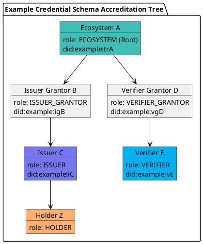

`ECOSYSTEM` Accreditations are created directly by the [[ref: credential schema]] owner. All other Accreditations are created by running an [[ref: onboarding process]], except under the `OPEN` and `CREDENTIAL` modes, where no entry is required at all:

- when `issuer_onboarding_mode` is `OPEN`, any service issues under its [VerifiableService](#verifiableservice) entry: its [ParticipationTrustDeposit](#participationtrustdeposit) for the schema is created by the first trust units minted on its payments ([[MOD-TD-MSG-1]](#mod-td-msg-1-mint-trust-units)) and holds what the ecosystem can slash; it MAY self-create an `ISSUER` entry ([[MOD-AC-MSG-14]](#mod-ac-msg-14-self-create-accreditation)) to declare the fees it charges;
- when `verifier_onboarding_mode` is `OPEN` or `CREDENTIAL`, any authorized service verifies under its `VerifiableService` entry likewise; it MAY self-create a `VERIFIER` entry.

Entries are not kept once they end: an expired or revoked entry is deleted, and the deposit of its participation remains ([ParticipationTrustDeposit](#participationtrustdeposit)).

An [[ref: onboarding process]] (OP) involves an [[ref: applicant]] (the [[ref: corporation]] of a given Accreditation entry) and a [[ref: validator]] Accreditation. It MAY require the applicant to pay `validation_fees` in addition to [[ref: transaction fees]].

An [[ref: onboarding process]] is run by [[ref: applicants]] that want to:

- be an [[ref: issuer]] of a specific [[ref: credential schema]];
- be a [[ref: verifier]] of a specific [[ref: credential schema]];
- be an [[ref: issuer grantor]] of a specific [[ref: credential schema]];
- be a [[ref: verifier grantor]] of a specific [[ref: credential schema]];
- get issued a credential of a specific [[ref: credential schema]];
- obtain a `HOLDER` Accreditation entry from an [[ref: issuer]] of a specific [[ref: credential schema]] and be issued a verifiable credential of that schema (the `HOLDER` entry is the relationship the issuer validated, and bounds the credential's trust).

In all cases, the process is very similar. Example execution of an [[ref: onboarding process]]:

1. The [[ref: applicant]] starts an [[ref: onboarding process]] by running [[MOD-AC-MSG-1]](#mod-ac-msg-1-start-accreditation-op). The process MAY be subject to paying `validation_fees`, as defined in the [[ref: validator]]'s Accreditation entry.
2. The [[ref: applicant]] connects to the [[ref: validator]]'s [[ref: VS]] (identified by its [[ref: DID]]) and executes the validation steps required for the [[ref: onboarding process]] to conclude.
3. If the [[ref: applicant]] qualifies, the [[ref: validator]] runs [[MOD-AC-MSG-3]](#mod-ac-msg-3-set-accreditation-op-to-validated) to update the Accreditation entry; the [[ref: applicant]] is then granted the new `Accreditation` entries and/or issued a credential.

Once in the `VALIDATED` state, a Accreditation entry remains valid for a specific period (e.g., 365 days), configured in the [[ref: credential schema]].

:::note
Even when the Accreditation entry remains in the `VALIDATED` state for the configured period, the resulting `Accreditation` entry or issued credential MAY have a shorter expiration timestamp because the validated attribute(s) might expire earlier. In this case, the [[ref: applicant]] MUST provide updated information to the [[ref: validator]] before attribute expiration in order to be issued an updated `Accreditation` entry and/or credential.
:::

If the `VALIDATED` state is set to expire, an [[ref: applicant]] that wishes to extend the expiration timestamp MUST renew its [[ref: onboarding process]] (see [[MOD-AC-MSG-2]](#mod-ac-msg-2-renew-accreditation-op)).

At any time, the [[ref: applicant]] CAN cancel the [[ref: onboarding process]] (see [[MOD-AC-MSG-6]](#mod-ac-msg-6-cancel-accreditation-op-last-request)).

Some unexpected situations may arise and MUST be mitigated. Examples:

- if the selected [[ref: validator]] Accreditation entry is revoked while the [[ref: applicant]] is in `PENDING` state: applicant CAN cancel the [[ref: onboarding process]] (see [[MOD-AC-MSG-6]](#mod-ac-msg-6-cancel-accreditation-op-last-request));
- if the selected [[ref: validator]] Accreditation entry is revoked while the [[ref: applicant]] is in `VALIDATED` state: the applicant's entry stays effective until its own `effective_until` but cannot be renewed, since renewal requires the same validator ([[MOD-AC-MSG-2]](#mod-ac-msg-2-renew-accreditation-op)); to keep its role, the applicant performs a new [[ref: onboarding process]] with another validator.

#### [MOD-AC-MSG-1] Start Accreditation OP

Any authorized `operator` CAN execute this method on behalf of a `corporation`.

##### [MOD-AC-MSG-1-1] Start Accreditation OP parameters

An Applicant that would like to start an onboarding process MUST execute this method by specifying:

- `corporation` (account): (Signer) the `policy_address` of the corporation on whose behalf this message is executed.
- `operator` (account): (Signer) the account authorized by the `corporation` to run this Msg.
- `role` (AccreditationRole) (*mandatory*): (ISSUER_GRANTOR, VERIFIER_GRANTOR, ISSUER, VERIFIER, HOLDER): the Accreditation role that the applicant would like to get;
- `validator_accreditation_id` (uint64) (*mandatory*): the [[ref: validator]] accreditation (parent accreditation in the tree), chosen by the applicant; its entry MUST exist (an expired or revoked validator entry no longer does).
- `validation_fees` (number) (*optional*): Requested validation_fees for this accreditation (can be modified by validator).
- `issuance_fees` (number) (*optional*): Requested issuance_fees for this `Accreditation` entry (can be modified by validator).
- `verification_fees` (number) (*optional*): Requested verification_fees for this `Accreditation` entry (can be modified by validator).
- `vua_reward_rate` (decimal) (*optional*): for an `ISSUER` entry of a User Agent schema, the reward rate the vendor claims ([Accreditation](#accreditation)); absent means the global rate.
- `vs_id` (uint64) (*mandatory*): id of the `VerifiableService` entry of the [[ref: VS]] this `Accreditation` entry refers to, registered beforehand by [[MOD-VS-MSG-1]](#mod-vs-msg-1-register-verifiable-service) and owned by `corporation`.

Available compatible perms can be found by using an indexer and presented in a front-end so applicant can choose its validator.

##### [MOD-AC-MSG-1-2] Start Accreditation OP precondition checks

If any of these precondition checks fail, [[ref: transaction]] MUST abort.

###### [MOD-AC-MSG-1-2-1] Start Accreditation OP basic checks

if a mandatory parameter is not present, [[ref: transaction]] MUST abort.

- `corporation` (account): (Signer) signature must be verified.
- `operator` (account): (Signer) signature must be verified.
- [[AUTHZ-CHECK]](#authz-check-common-authorization-and-fee-grant-checks) MUST pass for this (`corporation`, `operator`) pair and this message type.
- `role` (AccreditationRole) (*mandatory*) MUST be a valid AccreditationRole: ISSUER_GRANTOR, VERIFIER_GRANTOR, ISSUER, VERIFIER, HOLDER.
- `validator_accreditation_id` (uint64) (*mandatory*): see [MOD-AC-MSG-1-2-2](#mod-ac-msg-1-2-2-start-accreditation-op-permission-checks).
- `validation_fees` (number) (*optional*): Requested validation_fees for this `Accreditation` entry (can be modified by validator).
- `issuance_fees` (number) (*optional*): Requested issuance_fees for this `Accreditation` entry (can be modified by validator).
- `verification_fees` (number) (*optional*): Requested verification_fees for this `Accreditation` entry (can be modified by validator).
- `vua_reward_rate` (decimal) (*optional*): if given, MUST be between 0 and `GlobalVariables.vua_reward_rate` inclusive, else abort.
- `vs_id` (uint64) (*mandatory*): a `VerifiableService` entry `vs` with this id MUST exist and `vs.corporation_id` MUST equal `co.id` (where `co` is the `Corporation` entry resolved from the signing `corporation` account); else method MUST abort ([VID ownership](#vid-ownership)).

:::note
A holder MAY directly connect to the DID VS of an issuer in order to get issued a credential. When the schema's `holder_onboarding_mode` is `ISSUER_ONBOARDING_PROCESS`, the onboarding process MUST have reached `VALIDATED` before the credential is issued: the Verifiable Trust specification requires an active `HOLDER` entry at issuance, and trust resolution requires it to stay active. When it is `PERMISSIONLESS`, no `HOLDER` entry exists and the issuer applies its own checks.
:::

###### [MOD-AC-MSG-1-2-2] Start Accreditation OP permission checks

- Load `Accreditation` entry `validator_accreditation` from `validator_accreditation_id`. It MUST be a [[ref: active accreditation]] else transaction MUST abort.
- Load `CredentialSchema` entry `cs` from `validator_accreditation.schema_id`. It MUST exist.

- if `role` (AccreditationRole) is equal to ISSUER:

  - if `cs.issuer_onboarding_mode` is equal to GRANTOR_ONBOARDING_PROCESS: `validator_accreditation.role` MUST be ISSUER_GRANTOR, else MUST abort.
  
  - else if `cs.issuer_onboarding_mode` is equal to ECOSYSTEM_ONBOARDING_PROCESS: `validator_accreditation.role` MUST be ECOSYSTEM, else MUST abort.

  - else MUST abort.

- else if `role` (AccreditationRole) is equal to ISSUER_GRANTOR:

  - if `cs.issuer_onboarding_mode` is equal to GRANTOR_ONBOARDING_PROCESS:  `validator_accreditation.role` MUST be ECOSYSTEM, else MUST abort.
  
  - else abort.

- else if `role` (AccreditationRole) is equal to VERIFIER:

  - if `cs.verifier_onboarding_mode` is equal to GRANTOR_ONBOARDING_PROCESS: `validator_accreditation.role` MUST be VERIFIER_GRANTOR, else MUST abort.
  
  - else if `cs.verifier_onboarding_mode` is equal to ECOSYSTEM_ONBOARDING_PROCESS: `validator_accreditation.role` MUST be ECOSYSTEM, else MUST abort.

  - else abort.

- else if `role` (AccreditationRole) is equal to VERIFIER_GRANTOR:

  - if `cs.verifier_onboarding_mode` is equal to GRANTOR_ONBOARDING_PROCESS: `validator_accreditation.role` MUST be ECOSYSTEM, else MUST abort.
  
  - else abort.

- else if `role` (AccreditationRole) is equal to HOLDER:

  - if `cs.holder_onboarding_mode` is equal to ISSUER_ONBOARDING_PROCESS: `validator_accreditation.role` MUST be ISSUER, else MUST abort.
  
  - else abort.


###### [MOD-AC-MSG-1-2-3] Start Accreditation OP fee checks

- Load `Accreditation` entry `validator_accreditation` from `validator_accreditation_id`.
- Load `CredentialSchema` entry `cs` from `validator_accreditation.schema_id`.

- Fee payer MUST have an available balance in its [[ref: account]], to cover the [[ref: estimated transaction fees]];

> If a conversion is needed below, use [Get Price](#mod-xr-qry-3-get-price) to convert amounts to [[ref: native denom]]:

- For trust fees:

if `(cs.pricing_asset_type, cs.pricing_asset)` is set to `(COIN, [[ref: native denom]])`:

- the [[ref: funding account]] of `corporation` MUST be able to cover the following trust fees ([[FUND-CHECK-1]](#fund-check-1-debit)).
  - the required `validation_fees_in_denom` = `validator_accreditation.validation_fees` in [[ref: native denom]].
  - the required `validation_trust_deposit_in_native_denom`: `validation_fees_in_denom` * `GlobalVariables.trust_deposit_rate`, rounded down, in [[ref: native denom]].

else if `(cs.pricing_asset_type, cs.pricing_asset)` is set to an arbitrary coin `(COIN, [[ref: denom]])`:

- the [[ref: funding account]] of `corporation` MUST be able to cover the following trust fees ([[FUND-CHECK-1]](#fund-check-1-debit)).
  - the required `validation_fees_in_denom` = `validator_accreditation.validation_fees` − (`validator_accreditation.validation_fees` × `GlobalVariables.trust_deposit_rate`, rounded down) in specified (cs.pricing_asset_type, cs.pricing_asset) — the portion paid to the validator's account. The deposit-bound portion of the fee is **not** paid in the pricing asset:
  - the required `validation_trust_deposit_in_native_denom`: getPrice(`cs.pricing_asset_type`, `cs.pricing_asset`, `COIN`, `[[ref: native denom]]`, `validator_accreditation.validation_fees`) * `GlobalVariables.trust_deposit_rate` * 2, rounded down, in [[ref: native denom]] (the validator's deposit-bound portion **plus** the applicant's surcharge, both minted as trust units at validation).

else if `(cs.pricing_asset_type, cs.pricing_asset)` is set to a fiat currency `(FIAT, <fiat_currency>)`:

- the [[ref: funding account]] of `corporation` MUST be able to cover the following trust fees ([[FUND-CHECK-1]](#fund-check-1-debit)).
  - the required `validation_fees_in_denom` = 0 in [[ref: native denom]] (fiat-priced fees are settled off-chain).
  - the required `validation_trust_deposit_in_native_denom`: getPrice(`cs.pricing_asset_type`, `cs.pricing_asset`, `COIN`, `[[ref: native denom]]`, `validator_accreditation.validation_fees`) * `GlobalVariables.trust_deposit_rate` * 2, rounded down, in [[ref: native denom]] (the validator's deposit-bound portion **plus** the applicant's surcharge). The off-chain settlement SHOULD be for `validation_fees` × (1 - `GlobalVariables.trust_deposit_rate`) so that the net economics match the on-chain pricing cases.

:::note
Deposit-bound amounts MUST always be paid in [[ref: native denom]]. While the onboarding process is PENDING, both the validation fees and the deposit-bound amount are **held in the escrow account**: no [[ref: trust units]] are minted and nothing is routed to the [[ref: distribution pool]] until validation (see [[MOD-AC-MSG-3]](#mod-ac-msg-3-set-accreditation-op-to-validated)); on cancellation the escrow is refunded as-is (see [[MOD-AC-MSG-6]](#mod-ac-msg-6-cancel-accreditation-op-last-request)).
:::

###### [MOD-AC-MSG-1-2-4] Start Accreditation OP overlap checks

An applicant `corporation` MUST NOT have two onboarding processes running at the same time for the same `vs_id` and `role` with the same validator. This does not prevent a `corporation` from running concurrent OPs with different validators for the same `vs_id` and `role`, nor concurrent OPs with the same validator for different identifiers. A completed (VALIDATED) onboarding process does not prevent starting a new one: overlapping *effectiveness* of the resulting `Accreditation` entries is prevented at validation time by [MOD-AC-MSG-3-2-4](#mod-ac-msg-3-2-4-set-accreditation-op-to-validated-overlap-checks).

Let `d` be `ParticipationTrustDeposit[(vs_id, validator_accreditation.schema_id, role)]`, if it exists, and `accreditations[]` the entries listed in `d.accreditation_ids` where:

- `p.validator_accreditation_id` = `validator_accreditation_id`,
- `p.op_state` = PENDING.

if size of `accreditations[]` > 0, an onboarding process is already running in this context, so [[ref: transaction]] MUST abort.

Additionally, if any entry of `d.accreditation_ids` matches the same validator with `op_state` = VALIDATED and `effective_until` = NULL, [[ref: transaction]] MUST abort: that entry never expires, so a successor entry could never pass [MOD-AC-MSG-3-2-4](#mod-ac-msg-3-2-4-set-accreditation-op-to-validated-overlap-checks); `corporation` MUST first use [Set Accreditation Effective Until](#mod-ac-msg-8-set-accreditation-effective-until) to set an `effective_until`.

> Note: the candidates are the current entries of the participation, listed on its deposit; no index of entries exists. `role` and `vs_id` are those of the key; all entries sharing a `validator_accreditation_id` share its `schema_id` by construction.

###### [MOD-AC-MSG-1-2-5] Start Accreditation OP unrepaid slash checks

A [[ref: barred]] corporation MUST NOT start an onboarding process, nor may a corporation start one for a barred participation: a slash debt is repaid first ([[MOD-TD-MSG-6]](#mod-td-msg-6-repay-slash)), an exclusion is lifted by the ecosystem controller ([[MOD-AC-MSG-13]](#mod-ac-msg-13-set-participation-exclusion)) or by network governance ([[MOD-TD-MSG-8]](#mod-td-msg-8-set-corporation-exclusion)).

- `TrustDeposit[co.id]`, if it exists, MUST have `unrepaid_slash` = 0 and `excluded` false, else [[ref: transaction]] MUST abort: a [[ref: barred]] corporation repays its network debt first ([[MOD-TD-MSG-6]](#mod-td-msg-6-repay-slash)) and waits for the exclusion to be lifted ([[MOD-TD-MSG-8]](#mod-td-msg-8-set-corporation-exclusion)).
- the participation MUST NOT have been slashed: `ParticipationTrustDeposit[(vs_id, cs.id, role)]`, if it exists, MUST have `unrepaid_slash` = 0 and `excluded` false; else abort. The exclusion is the ecosystem's sanction on a participation and stands after repayment, until the ecosystem lifts it ([[MOD-AC-MSG-13]](#mod-ac-msg-13-set-participation-exclusion)); an expired or revoked entry alone does not prevent a new one.

##### [MOD-AC-MSG-1-3] Start Accreditation OP execution

If all precondition checks passed, [[ref: transaction]] is executed.

Method execution MUST perform the following tasks in a [[ref: transaction]], and rollback if any error occurs.

- Load `Accreditation` entry `validator_accreditation` of the selected validator.

- calculate `validation_fees_in_denom` and `validation_trust_deposit_in_native_denom` as explained above in fee checks.
- debit `validation_fees_in_denom` + `validation_trust_deposit_in_native_denom` from `corporation` per [[FUND-CHECK-1]](#fund-check-1-debit) and send it to the validation escrow [[ref: account]], if greater than 0; the selected funding account is recorded in `applicant_accreditation.op_funding_account` below (null if nothing was escrowed). No [[ref: trust units]] are minted at this stage (mint-at-validation, see [[MOD-AC-MSG-3]](#mod-ac-msg-3-set-accreditation-op-to-validated)).

- define `now`: current timestamp.

- create an persist a new `Accreditation` entry `applicant_accreditation`:

  - `applicant_accreditation.id`: auto-incremented uint64.
  - `applicant_accreditation.schema_id` = `validator_accreditation.schema_id`
  - `applicant_accreditation.role`: `role`.
  - `applicant_accreditation.vs_id`: `vs_id`.
  - `applicant_accreditation.created`: `now`
  - `applicant_accreditation.validation_fees`: `validation_fees`.
  - `applicant_accreditation.issuance_fees`: `issuance_fees`.
  - `applicant_accreditation.verification_fees`: `verification_fees`.
  - `applicant_accreditation.vua_reward_rate`: `vua_reward_rate` if given, else null.
  - `applicant_accreditation.validator_accreditation_id`: `validator_accreditation_id`.
  - `applicant_accreditation.op_last_state_change`: `now`
  - `applicant_accreditation.op_state`: PENDING.
  - `applicant_accreditation.op_current_fees` (number): `validation_fees_in_denom`.
  - `applicant_accreditation.op_current_deposit` (number): `validation_trust_deposit_in_native_denom` (held in escrow).
  - `applicant_accreditation.op_funding_account`: the funding account selected above, or null if nothing was escrowed.
  - `applicant_accreditation.op_summary_digest`: null.
  - `applicant_accreditation.issuance_fee_discount`: 0 (overwritten at first validation by [[MOD-AC-MSG-3]](#mod-ac-msg-3-set-accreditation-op-to-validated)).
  - `applicant_accreditation.verification_fee_discount`: 0 (overwritten at first validation by [[MOD-AC-MSG-3]](#mod-ac-msg-3-set-accreditation-op-to-validated)).

- register `applicant_accreditation.id` in `ParticipationTrustDeposit[(vs_id, applicant_accreditation.schema_id, role)].accreditation_ids`, creating the deposit with an empty ledger if it does not exist.

The method MUST emit an event carrying the new entry's `id`, `schema_id`, `role`, `validator_accreditation_id` and `vs_id`, so that indexers build the `Accreditation` tree of the schema without a query.

> Note: the agent that will run exchanges for this entry is `VerifiableService[vs_id].vs_operator`, and its authorization is the entry's `msg_types`: nothing is created here. It cannot be used in the context of `applicant_accreditation` until [[MOD-AC-MSG-3]](#mod-ac-msg-3-set-accreditation-op-to-validated) sets its `effective_from` ([[AUTHZ-CHECK-3]](#authz-check-3-vs-operator-authorization-checks) step 1).

#### Connecting to the VS of the Validator

*This section is non-normative, and provided for understanding only.*

This action must be initiated by the [[ref: applicant]].

During an onboarding process, if the associated `validator_accreditation` refers to a resolvable identifier (`VerifiableService[validator_accreditation.vs_id].vid`), the [[ref: applicant]] should establish a secure connection with the validator's [[ref: VS]] (Verifiable Service) using a secure communication protocol such as [[ref: DIDComm]].

Upon connecting to the [[ref: VS]], the [[ref: applicant]] should be required by the [[ref: validator]] to complete one or more of the following tasks:

1. **Prove control** over the `vs_operator` [[ref: account]] of the applicant's `VerifiableService` entry (e.g., via blind signature or cryptographic challenge).
2. **Provide requested information**, such as filling out forms, submitting documents, or other forms of disclosure as required by the validation [[ref: VS]].
3. The [[ref: applicant]] should prove control over the identifier of its `VerifiableService` entry to the validator's [[ref: VS]].

Once the [[ref: validator]] determines that the process is complete, they may terminate the onboarding process and create the `Accreditation` entry accordingly. This `Accreditation`-entry configuration usually includes:

- `validation_fees`  
- `issuance_fees`  
- `verification_fees`  
- `Accreditation` expiration

The [[ref: validator]] may compile a summary file of the onboarding process, documenting exchanged data, proofs, and decisions, and share it with the [[ref: applicant]] via the [[ref: VS]] connection or another secure channel.

For audit or governance purposes, the [[ref: validator]] should register a digest (e.g., hash or SRI) of this summary in `applicant_accreditation.op_summary_digest`.

#### [MOD-AC-MSG-2] Renew Accreditation OP

Any authorized `operator` CAN execute this method on behalf of a `corporation`.

*This section is non-normative.*

- Requesting a renewal has no effect on `Accreditation` expiration or issued credentials.
- Renewal is only possible with the same validator.
- Renewal only applies to entries managed by an [[ref: onboarding process]]: root ([[MOD-AC-MSG-7]](#mod-ac-msg-7-create-root-accreditation)) and self-created ([[MOD-AC-MSG-14]](#mod-ac-msg-14-self-create-accreditation)) entries cannot renew; use [[MOD-AC-MSG-8]](#mod-ac-msg-8-set-accreditation-effective-until) to adjust their `effective_until`.
- If validator `Accreditation` is not valid anymore, applicant MUST perform a new onboarding process with another validator.
- Renewal does not allow changing the `Accreditation.validation_fees`, `Accreditation.issuance_fees`, `Accreditation.verification_fees` or `Accreditation.vua_reward_rate`. To change these values, applicant MUST start a new onboarding process.
- if the participation is [[ref: barred]] (`unrepaid_slash` > 0 or `excluded` on its deposit), method MUST fail; a revoked entry no longer exists.
- if `corporation` is [[ref: barred]] (a network debt or exclusion on its trust deposit), method MUST fail (see [MOD-AC-MSG-2-2-4](#mod-ac-msg-2-2-4-renew-accreditation-op-unrepaid-slash-checks)).

##### [MOD-AC-MSG-2-1] Renew Accreditation OP parameters

- `corporation` (account): (Signer) the `policy_address` of the corporation on whose behalf this message is executed.
- `operator` (account): (Signer) the account authorized by the `corporation` to run this Msg.
- `id` (uint64) (*mandatory*): id of the `Accreditation` entry for which applicant would like to renew the onboarding process;

##### [MOD-AC-MSG-2-2] Renew Accreditation OP precondition checks

If any of these precondition checks fail, [[ref: transaction]] MUST abort.

###### [MOD-AC-MSG-2-2-1] Renew Accreditation OP basic checks

if a mandatory parameter is not present, [[ref: transaction]] MUST abort.

- `corporation` (account): (Signer) signature must be verified.
- `operator` (account): (Signer) signature must be verified.
- [[AUTHZ-CHECK]](#authz-check-common-authorization-and-fee-grant-checks) MUST pass for this (`corporation`, `operator`) pair and this message type.
- `id` MUST be a valid uint64 and a `Accreditation` entry with the same id MUST exist (an expired or revoked entry no longer does).
- the `op_state` of that entry MUST be VALIDATED: a renewal cannot be started while an onboarding process is PENDING (its escrow, and the account that funded it, would otherwise be overwritten).

###### [MOD-AC-MSG-2-2-2] Renew Accreditation OP permission checks

- Load `Accreditation` entry `applicant_accreditation`. `co.id` MUST equal `applicant_accreditation.corporation_id` (where `co` is the `Corporation` entry resolved from the signing `corporation` account), else MUST abort. `applicant_accreditation` MUST be a [[ref: active accreditation]].
- Load `Accreditation` entry `validator_accreditation` from `applicant_accreditation.validator_accreditation_id`. It MUST exist (a validator whose entry expired or was revoked cannot renew its applicants), and be a [[ref: active accreditation]], else MUST abort.
- Load `CredentialSchema` entry `cs` from `validator_accreditation.schema_id`. It MUST exist.

- if `applicant_accreditation.role` (AccreditationRole) is equal to ISSUER:

  - if `cs.issuer_onboarding_mode` is equal to GRANTOR_ONBOARDING_PROCESS: `validator_accreditation.role` MUST be ISSUER_GRANTOR, else MUST abort.

  - else if `cs.issuer_onboarding_mode` is equal to ECOSYSTEM_ONBOARDING_PROCESS: `validator_accreditation.role` MUST be ECOSYSTEM, else MUST abort.

  - else MUST abort.

- else if `applicant_accreditation.role` (AccreditationRole) is equal to ISSUER_GRANTOR:

  - if `cs.issuer_onboarding_mode` is equal to GRANTOR_ONBOARDING_PROCESS:  `validator_accreditation.role` MUST be ECOSYSTEM, else MUST abort.

  - else abort.

- else if `applicant_accreditation.role` (AccreditationRole) is equal to VERIFIER:

  - if `cs.verifier_onboarding_mode` is equal to GRANTOR_ONBOARDING_PROCESS: `validator_accreditation.role` MUST be VERIFIER_GRANTOR, else MUST abort.

  - else if `cs.verifier_onboarding_mode` is equal to ECOSYSTEM_ONBOARDING_PROCESS: `validator_accreditation.role` MUST be ECOSYSTEM, else MUST abort.

  - else abort.

- else if `applicant_accreditation.role` (AccreditationRole) is equal to VERIFIER_GRANTOR:

  - if `cs.verifier_onboarding_mode` is equal to GRANTOR_ONBOARDING_PROCESS: `validator_accreditation.role` MUST be ECOSYSTEM, else MUST abort.

  - else abort.

- else if `applicant_accreditation.role` (AccreditationRole) is equal to HOLDER:

  - if `cs.holder_onboarding_mode` is equal to ISSUER_ONBOARDING_PROCESS: `validator_accreditation.role` MUST be ISSUER, else MUST abort.

  - else abort.

- else MUST abort.

> Note: these are the same mode/role compatibility checks as [MOD-AC-MSG-1-2-2](#mod-ac-msg-1-2-2-start-accreditation-op-permission-checks), with `role` read from `applicant_accreditation.role`. Because onboarding modes are immutable ([[MOD-CS-MSG-2]](#mod-cs-msg-2-update-credential-schema)), a self-created entry ([[MOD-AC-MSG-14]](#mod-ac-msg-14-self-create-accreditation)) can never renew: its mode is OPEN or CREDENTIAL, which always falls through to abort. Root ECOSYSTEM entries are blocked by the `validator_accreditation` existence check above (`validator_accreditation_id` is null).
- the participation MUST NOT have been slashed, as in [MOD-AC-MSG-1-2-5](#mod-ac-msg-1-2-5-start-accreditation-op-unrepaid-slash-checks).

###### [MOD-AC-MSG-2-2-3] Renew Accreditation OP fee checks

- Load `Accreditation` entry `validator_accreditation` from `applicant_accreditation.validator_accreditation_id`.
- Load `CredentialSchema` entry `cs` from `validator_accreditation.schema_id`.

- Fee payer MUST have an available balance in its [[ref: account]], to cover the [[ref: estimated transaction fees]];

> If a conversion is needed below, use [Get Price](#mod-xr-qry-3-get-price) to convert amounts to [[ref: native denom]]:

- For trust fees:

if `(cs.pricing_asset_type, cs.pricing_asset)` is set to `(COIN, [[ref: native denom]])`:

- the [[ref: funding account]] of `corporation` MUST be able to cover the following trust fees ([[FUND-CHECK-1]](#fund-check-1-debit)).
  - the required `validation_fees_in_denom` = `validator_accreditation.validation_fees` in [[ref: native denom]].
  - the required `validation_trust_deposit_in_native_denom`: `validation_fees_in_denom` * `GlobalVariables.trust_deposit_rate`, rounded down, in [[ref: native denom]].

else if `(cs.pricing_asset_type, cs.pricing_asset)` is set to an arbitrary coin `(COIN, [[ref: denom]])`:

- the [[ref: funding account]] of `corporation` MUST be able to cover the following trust fees ([[FUND-CHECK-1]](#fund-check-1-debit)).
  - the required `validation_fees_in_denom` = `validator_accreditation.validation_fees` − (`validator_accreditation.validation_fees` × `GlobalVariables.trust_deposit_rate`, rounded down) in specified (cs.pricing_asset_type, cs.pricing_asset) — the portion paid to the validator's account. The deposit-bound portion of the fee is **not** paid in the pricing asset:
  - the required `validation_trust_deposit_in_native_denom`: getPrice(`cs.pricing_asset_type`, `cs.pricing_asset`, `COIN`, `[[ref: native denom]]`, `validator_accreditation.validation_fees`) * `GlobalVariables.trust_deposit_rate` * 2, rounded down, in [[ref: native denom]] (the validator's deposit-bound portion **plus** the applicant's surcharge, both minted as trust units at validation).

else if `(cs.pricing_asset_type, cs.pricing_asset)` is set to a fiat currency `(FIAT, <fiat_currency>)`:

- the [[ref: funding account]] of `corporation` MUST be able to cover the following trust fees ([[FUND-CHECK-1]](#fund-check-1-debit)).
  - the required `validation_fees_in_denom` = 0 in [[ref: native denom]] (fiat-priced fees are settled off-chain).
  - the required `validation_trust_deposit_in_native_denom`: getPrice(`cs.pricing_asset_type`, `cs.pricing_asset`, `COIN`, `[[ref: native denom]]`, `validator_accreditation.validation_fees`) * `GlobalVariables.trust_deposit_rate` * 2, rounded down, in [[ref: native denom]] (the validator's deposit-bound portion **plus** the applicant's surcharge). The off-chain settlement SHOULD be for `validation_fees` × (1 - `GlobalVariables.trust_deposit_rate`) so that the net economics match the on-chain pricing cases.

:::note
Deposit-bound amounts MUST always be paid in [[ref: native denom]]. While the renewal onboarding process is PENDING, both the validation fees and the deposit-bound amount are **held in the escrow account**: no [[ref: trust units]] are minted and nothing is routed to the [[ref: distribution pool]] until validation; on cancellation the escrow is refunded as-is.
:::

###### [MOD-AC-MSG-2-2-4] Renew Accreditation OP unrepaid slash checks

Same as [MOD-AC-MSG-1-2-5](#mod-ac-msg-1-2-5-start-accreditation-op-unrepaid-slash-checks), for the corporation and the participation of the entry being renewed:

- `TrustDeposit[co.id]`, if it exists, MUST have `unrepaid_slash` = 0 and `excluded` false, else [[ref: transaction]] MUST abort: a [[ref: barred]] corporation repays its network debt first ([[MOD-TD-MSG-6]](#mod-td-msg-6-repay-slash)) and waits for the exclusion to be lifted ([[MOD-TD-MSG-8]](#mod-td-msg-8-set-corporation-exclusion)).
- deposit(`applicant_accreditation`) MUST have `unrepaid_slash` = 0 and `excluded` false, else [[ref: transaction]] MUST abort.

##### [MOD-AC-MSG-2-3] Renew Accreditation OP execution

If all precondition checks passed, [[ref: transaction]] is executed.

Method execution MUST perform the following tasks in a [[ref: transaction]], and rollback if any error occurs.

- Load `Accreditation` entry `applicant_accreditation`. 
- Load `Accreditation` entry `validator_accreditation` from `applicant_accreditation.validator_accreditation_id`.

- calculate `validation_fees_in_denom` and `validation_trust_deposit_in_native_denom` as explained above in fee checks.
- debit `validation_fees_in_denom` + `validation_trust_deposit_in_native_denom` from `corporation` per [[FUND-CHECK-1]](#fund-check-1-debit) and send it to the validation escrow [[ref: account]], if greater than 0; the selected funding account is recorded in `applicant_accreditation.op_funding_account` below (null if nothing was escrowed). No [[ref: trust units]] are minted at this stage (mint-at-validation, see [[MOD-AC-MSG-3]](#mod-ac-msg-3-set-accreditation-op-to-validated)).

- define `now`: current timestamp.

- update `Accreditation` entry:

  - `applicant_accreditation.op_state`: PENDING.
  - `applicant_accreditation.op_last_state_change`: current timestamp.
  - `applicant_accreditation.op_current_fees` (number): `validation_fees_in_denom`.
  - `applicant_accreditation.op_current_deposit` (number): `validation_trust_deposit_in_native_denom` (held in escrow; the participation's deposit is only incremented at validation time).
  - `applicant_accreditation.op_funding_account`: the funding account selected above, or null if nothing was escrowed.

#### [MOD-AC-MSG-3] Set Accreditation OP to Validated

Any authorized `operator` CAN execute this method on behalf of a `corporation`.

##### [MOD-AC-MSG-3-1] Set Accreditation OP to Validated parameters

An [[ref: account]] that would like to set a validation entry to VALIDATED MUST execute this method by specifying:

- `corporation` (account): (Signer) the `policy_address` of the corporation on whose behalf this message is executed.
- `operator` (account): (Signer) the account authorized by the `corporation` to run this Msg.
- `id` (uint64) (*mandatory*): id of the onboarding process;
- `effective_until` (timestamp) (*optional*): timestamp until when (exclusive) this `Accreditation` is effective, null if no time limit should been set for this `Accreditation` entry or if we want it to be aligned with the onboarding process expiration timestamp calculated by this method.
- `validation_fees` (number) (*mandatory*): Agreed validation_fees for this `Accreditation` entry. Can be set only the first time this method is called (cannot be set for renewals). Use 0 for no fees.
- `issuance_fees` (number) (*mandatory*): Agreed issuance_fees for this `Accreditation` entry. Can be set only the first time this method is called (cannot be set for renewals). Use 0 for no fees.
- `verification_fees` (number) (*mandatory*): Agreed verification_fees for this `Accreditation` entry. Can be set only the first time this method is called (cannot be set for renewals). Use 0 for no fees.
- `op_summary_digest` (bytes, SRI form in the API) (*optional*): an optional digest, set by [[ref: validator]], of a summary of the information, proofs... provided by the [[ref: applicant]].
- `issuance_fee_discount`: (number) (*mandatory*): use 0 for no discount. Maximum 1 (100% discount). Can be set to an ISSUER_GRANTOR or ISSUER `Accreditation` entry (if GRANTOR_ONBOARDING_PROCESS mode) or to an ISSUER `Accreditation` entry (ECOSYSTEM_ONBOARDING_PROCESS mode) to reduce (or void) calculated issuance fees for the subtree of `Accreditation` entries. Note: this should generally not be used because it reduces or void commission of all related ecosystem participants.
- `verification_fee_discount`: (number) (*mandatory*): use 0 for no discount. Maximum 1 (100% discount). Can be set to a VERIFIER_GRANTOR or VERIFIER `Accreditation` entry (if GRANTOR_ONBOARDING_PROCESS mode) and/or to a VERIFIER `Accreditation` entry (ECOSYSTEM_ONBOARDING_PROCESS mode) to reduce (or void) calculated fees for the subtree of `Accreditation` entries. Note: this should generally not be used because it reduces or void commission of all related ecosystem participants.

##### [MOD-AC-MSG-3-2] Set Accreditation OP to Validated precondition checks

If any of these precondition checks fail, [[ref: transaction]] MUST abort.

###### [MOD-AC-MSG-3-2-1] Set Accreditation OP to Validated basic checks

if a mandatory parameter is not present, [[ref: transaction]] MUST abort.

- `corporation` (account): (Signer) signature must be verified.
- `operator` (account): (Signer) signature must be verified.
- `id` MUST be a valid uint64.
- Load `Accreditation` entry `applicant_accreditation` from `id`. If no entry found, abort.
- Load `Accreditation` entry `validator_accreditation` from `applicant_accreditation.validator_accreditation_id`.
- Authorization:

either (executed by any operator of corporation):
[[AUTHZ-CHECK-1]](#authz-check-1-operator-authorization-checks) MUST pass for this (`corporation`, `operator`) tuple and `SetAccreditationOPtoValidated` message.
[[AUTHZ-CHECK-2]](#authz-check-2-fee-grant-checks) MUST pass for this (`corporation`, `operator`) tuple and `SetAccreditationOPtoValidated` message.
OR (executed by the vs-agent of the validator's entry, `VerifiableService[validator_accreditation.vs_id].vs_operator`):
[[AUTHZ-CHECK-3]](#authz-check-3-vs-operator-authorization-checks) MUST pass for this (`corporation`, `operator`, `validator_accreditation`) tuple.
[[AUTHZ-CHECK-4]](#authz-check-4-vs-operator-fee-grant-checks) MUST pass for this (`corporation`, `operator`, `validator_accreditation`) tuple.
else MUST abort.

- `applicant_accreditation.op_state` MUST be equal to PENDING, else abort.
- `validation_fees` (number) (*mandatory*): MUST be zero or a positive integer. If `applicant_accreditation.effective_from` is not null (we are in renewal) `validation_fees` MUST be equal to `applicant_accreditation.validation_fees`, else abort.
- `issuance_fees` (number) (*mandatory*): MUST be zero or a positive integer.  If `applicant_accreditation.effective_from` is not null (we are in renewal) `issuance_fees` MUST be equal to `applicant_accreditation.issuance_fees` or, else abort.
- `verification_fees` (number) (*mandatory*): MUST be zero or a positive integer.  If `applicant_accreditation.effective_from` is not null (we are in renewal) `verification_fees` MUST be equal to `applicant_accreditation.verification_fees`, else abort.
- `op_summary_digest` (bytes, SRI form in the API) (*optional*): MUST be the digest of the summary computed with the `digest_algorithm` of the schema, given in SRI form (for example `sha384-GOp0dicJ4ufacOQxQfQojCyGoC7RJClOzqb23pJubmG2z3cqD/73j1+3kYNSrxUP`) and stored as the decoded bytes, 48 for `sha384` and 64 for `sha512`.

- Load `CredentialSchema` `cs` from `applicant_accreditation.schema_id`.
- Load `Accreditation` `validator_accreditation` from `applicant_accreditation.validator_accreditation_id`.

- `issuance_fee_discount` : (number) (*mandatory*):
  - if `applicant_accreditation.effective_from` is not null (renewal), then `issuance_fee_discount` must be equal to `applicant_accreditation.issuance_fee_discount` else MUST abort.
  - otherwise (first validation), the allowed range depends on `applicant_accreditation.role` (the onboarding mode of `cs` is implied by the existence of the onboarding process, see [[MOD-AC-MSG-1-2-2]](#mod-ac-msg-1-2-2-start-accreditation-op-permission-checks)):
    - if `applicant_accreditation.role` == ISSUER_GRANTOR: `issuance_fee_discount` MUST be between 0 (no discount) and 1 (100% discount) inclusive, else MUST abort.
    - if `applicant_accreditation.role` == ISSUER: `issuance_fee_discount` MUST be between 0 (no discount) and `max_discount` inclusive, else MUST abort, where `max_discount` is `validator_accreditation.issuance_fee_discount` if `cs.issuer_onboarding_mode` is GRANTOR_ONBOARDING_PROCESS (the validator is a ISSUER_GRANTOR) and 1 if it is ECOSYSTEM_ONBOARDING_PROCESS.
    - for any other role: `issuance_fee_discount` MUST be 0, else MUST abort.

- `verification_fee_discount` : (number) (*mandatory*):
  - if `applicant_accreditation.effective_from` is not null (renewal), then `verification_fee_discount` must be equal to `applicant_accreditation.verification_fee_discount` else MUST abort.
  - otherwise (first validation), the allowed range depends on `applicant_accreditation.role` (the onboarding mode of `cs` is implied by the existence of the onboarding process, see [[MOD-AC-MSG-1-2-2]](#mod-ac-msg-1-2-2-start-accreditation-op-permission-checks)):
    - if `applicant_accreditation.role` == VERIFIER_GRANTOR: `verification_fee_discount` MUST be between 0 (no discount) and 1 (100% discount) inclusive, else MUST abort.
    - if `applicant_accreditation.role` == VERIFIER: `verification_fee_discount` MUST be between 0 (no discount) and `max_discount` inclusive, else MUST abort, where `max_discount` is `validator_accreditation.verification_fee_discount` if `cs.verifier_onboarding_mode` is GRANTOR_ONBOARDING_PROCESS (the validator is a VERIFIER_GRANTOR) and 1 if it is ECOSYSTEM_ONBOARDING_PROCESS.
    - for any other role: `verification_fee_discount` MUST be 0, else MUST abort.

A HOLDER applicant, and any applicant whose `cs.issuer_onboarding_mode` (resp. `cs.verifier_onboarding_mode`) is OPEN, carries no issuance (resp. verification) discount: the mandatory parameter MUST be 0; a value of 0 MUST be accepted, and the method MUST NOT abort because of the schema's onboarding mode.

Calculation of `op_exp`, the onboarding process expiration timestamp, required to verify provided `effective_until`:

- let's define `validity_period` = `cs.issuer_grantor_validation_validity_period` (if `applicant_accreditation.role` is ISSUER_GRANTOR), `cs.verifier_grantor_validation_validity_period` (if `applicant_accreditation.role` is VERIFIER_GRANTOR), `cs.issuer_validation_validity_period` (if `applicant_accreditation.role` is ISSUER), `cs.verifier_validation_validity_period` (if `applicant_accreditation.role` is VERIFIER), or `cs.holder_validation_validity_period` (if `applicant_accreditation.role` is HOLDER).

- if `validity_period` is null or 0 (never expire): `op_exp` = NULL.
- else if `applicant_accreditation.op_exp` is null, `op_exp` =  timestamp of now() plus `validity_period`.
- else `op_exp` =  `applicant_accreditation.op_exp` plus `validity_period`

Now, let's verify `effective_until`:

- if `effective_until` is NULL, no issue.
- else if `applicant_accreditation.effective_until` is NULL, `effective_until` MUST be greater than current current timestamp AND, if `op_exp` is not null, lower or equal to `op_exp`.
- else `effective_until` MUST be greater than `applicant_accreditation.effective_until` AND, if `op_exp` is not null, lower or equal to `op_exp`.

###### [MOD-AC-MSG-3-2-2] Set Accreditation OP to Validated validator perms

- load `validator_accreditation` from `applicant_accreditation.validator_accreditation_id`. `validator_accreditation` MUST be a [[ref: active accreditation]].
- `co.id` MUST equal `validator_accreditation.corporation_id` (where `co` is the `Corporation` entry resolved from the signing `corporation` account).
- neither deposit(`applicant_accreditation`) nor `TrustDeposit[applicant_accreditation.corporation_id]` MAY be [[ref: barred]] (`unrepaid_slash` > 0 or `excluded`), else abort: a slashed participation or corporation is not validated until its debt is repaid and its exclusion lifted ([[MOD-AC-MSG-13]](#mod-ac-msg-13-set-participation-exclusion), [[MOD-TD-MSG-8]](#mod-td-msg-8-set-corporation-exclusion)).

If `validator_accreditation` is not a [[ref: active accreditation]] (expired, revoked, slashed...) then applicant MUST start a new onboarding process.

###### [MOD-AC-MSG-3-2-3] Set Accreditation OP to Validated fee checks

- Fee payer MUST have the required [[ref: estimated transaction fees]] in its [[ref: account]], else [[ref: transaction]] MUST abort.

###### [MOD-AC-MSG-3-2-4] Set Accreditation OP to Validated overlap checks

Two `Accreditation` entries of the same applicant (`corporation_id`, `vs_id`) MUST NOT be effective at the same time under the same `validator_accreditation_id` for the same `role`. That should not occur if [MOD-AC-MSG-1-2-4](#mod-ac-msg-1-2-4-start-accreditation-op-overlap-checks) is enforced, but better do the check anyway.

Let `accreditations[]` be the validated entries (`effective_from` set, whether or not their participation or corporation is [[ref: barred]]: a bar suspends an entry, it does not end it) listed in deposit(`applicant_accreditation`).`accreditation_ids` where:

- `p.id` is not equal to `applicant_accreditation.id`,
- `p.validator_accreditation_id` = `applicant_accreditation.validator_accreditation_id`.

for each `Accreditation` entry `p` from `accreditations[]`, [[ref: transaction]] MUST abort if:

- `p.effective_from` is not later than `now` and (`p.effective_until` is NULL or later than `now`): `p` is effective now, and the entry being validated becomes effective at `now`; OR
- `p.effective_from` is later than `now` and (`effective_until` is NULL or `p.effective_from` is lower than `effective_until`).

> Note: excluding `applicant_accreditation` itself is required: on a renewal, the entry being validated is itself effective and would otherwise always match. The candidates are the current entries of the same participation (same `vs_id`, `schema_id` and `role`), read from its deposit.

##### [MOD-AC-MSG-3-3] Set Accreditation OP to Validated execution

If all precondition checks passed, [[ref: transaction]] is executed.

Method execution MUST perform the following tasks in a [[ref: transaction]], and rollback if any error occurs.

- Load `Accreditation` entry `applicant_accreditation` from `id`.
- Load `Accreditation` entry `validator_accreditation` from `applicant_accreditation.validator_accreditation_id`.
- define `now` timestamp of now().

Calculate `op_exp`:

- Load `CredentialSchema` `cs` from `applicant_accreditation.schema_id`.
- let's define `validity_period` = `cs.issuer_grantor_validation_validity_period` (if `applicant_accreditation.role` is ISSUER_GRANTOR), `cs.verifier_grantor_validation_validity_period` (if `applicant_accreditation.role` is VERIFIER_GRANTOR), `cs.issuer_validation_validity_period` (if `applicant_accreditation.role` is ISSUER), `cs.verifier_validation_validity_period` (if `applicant_accreditation.role` is VERIFIER), or `cs.holder_validation_validity_period` (if `applicant_accreditation.role` is HOLDER).

- if `validity_period` is null or 0 (never expire): `op_exp` = NULL.
- else if `applicant_accreditation.op_exp` is null, `op_exp` =  timestamp of now() plus `validity_period`.
- else `op_exp` =  `applicant_accreditation.op_exp` plus `validity_period`.

Change value of provided `effective_until` if needed, and abort if needed:

- if provided  `effective_until` is NULL:
  - change value of provided `effective_until` to `op_exp`.

- else if `applicant_accreditation.effective_until` is NULL:
  - verify that provided `effective_until` is greater than `now` else MUST abort
  - if `op_exp` is not null, verify that provided `effective_until` is lower or equal to `op_exp` else MUST abort

- else:
  - `effective_until` MUST be greater than `applicant_accreditation.effective_until` else MUST abort
  - if `op_exp` is not null, verify that provided `effective_until` is lower or equal to `op_exp` else MUST abort.

Fees and Trust Deposits — settle the escrow (mint-at-validation):

- if `(cs.pricing_asset_type, cs.pricing_asset)` is `(COIN, [[ref: native denom]])`:
  - calculate `validator_deposit_bound` = `applicant_accreditation.op_current_fees` × `GlobalVariables.trust_deposit_rate`, rounded down, and `applicant_deposit_bound` = `applicant_accreditation.op_current_deposit`;
  - transfer `applicant_accreditation.op_current_fees` − `validator_deposit_bound` from the escrow [[ref: account]] to the [[ref: funding account]] of the validator corporation `Corporation[validator_accreditation.corporation_id]` ([[FUND-CHECK-2]](#fund-check-2-credit)).
- else (pricing in an arbitrary COIN or in FIAT):
  - calculate `validator_deposit_bound` = `applicant_accreditation.op_current_deposit` / 2, rounded down, and `applicant_deposit_bound` = `applicant_accreditation.op_current_deposit` − `validator_deposit_bound` (the applicant escrowed both, see fee checks);
  - transfer the full amount `applicant_accreditation.op_current_fees` in the pricing [[ref: denom]] from the escrow [[ref: account]] to the [[ref: funding account]] of the validator corporation `Corporation[validator_accreditation.corporation_id]` ([[FUND-CHECK-2]](#fund-check-2-credit)) (for COIN pricing this already equals the fee minus its deposit-bound portion, see fee checks; 0 if FIAT).
- if `validator_deposit_bound` > 0, use [[MOD-TD-MSG-1]](#mod-td-msg-1-mint-trust-units) Mint Trust Units with (`corporation_id` = `validator_accreditation.corporation_id`, `vs_id` = `validator_accreditation.vs_id`, `schema_id` = `cs.id`, `role` = `validator_accreditation.role`, `source_account` = escrow account, `amount` = `validator_deposit_bound`).
- if `applicant_deposit_bound` > 0, use [[MOD-TD-MSG-1]](#mod-td-msg-1-mint-trust-units) Mint Trust Units with (`corporation_id` = `applicant_accreditation.corporation_id`, `vs_id` = `applicant_accreditation.vs_id`, `schema_id` = `cs.id`, `role` = `applicant_accreditation.role`, `source_account` = escrow account, `amount` = `applicant_deposit_bound`).

Update `Accreditation` `applicant_accreditation`:

- set `applicant_accreditation.op_state` to VALIDATED.
- set `applicant_accreditation.op_last_state_change` to `now`.
- set `applicant_accreditation.op_current_fees` to 0;
- set `applicant_accreditation.op_current_deposit` to 0;
- set `applicant_accreditation.op_funding_account` to null;
- set `applicant_accreditation.op_summary_digest` to `op_summary_digest`.
- set `applicant_accreditation.op_exp` to `op_exp`.
- set `applicant_accreditation.effective_until` to `effective_until`, and file the entry in the expiry queue accordingly ([Accreditation](#accreditation)).
- if `applicant_accreditation.effective_from` IS NULL (first time method is called for this perm, and thus we are not in a renewal):
  - set `applicant_accreditation.validation_fees` to `validation_fees`;
  - set `applicant_accreditation.issuance_fees` to `issuance_fees`;
  - set `applicant_accreditation.verification_fees` to `verification_fees`;
  - set `applicant_accreditation.effective_from` to `now`.
  - set `applicant_accreditation.issuance_fee_discount` to `issuance_fee_discount`.
  - set `applicant_accreditation.verification_fee_discount` to `verification_fee_discount`.

> Note: no VS Operator Authorization step is needed: the applicant's agent is `VerifiableService[applicant_accreditation.vs_id].vs_operator`, whose `msg_types` become usable in the context of this entry as soon as `effective_from` is set ([[AUTHZ-CHECK-3]](#authz-check-3-vs-operator-authorization-checks) step 1).

#### [MOD-AC-MSG-4] Void

#### [MOD-AC-MSG-5] Void

#### [MOD-AC-MSG-6] Cancel Accreditation OP Last Request

Any authorized `operator` CAN execute this method on behalf of a `corporation`.

At any time, [[ref: applicant]] of an onboarding process may request cancellation of the process, provided state is PENDING. Upon method execution, the pending validation is cancelled and the escrowed [[ref: trust fees]] and deposit-bound amount are refunded. If `effective_from` is set (a renewal), `op_state` is set back to VALIDATED; else the entry, never validated, is deleted.

##### [MOD-AC-MSG-6-1] Cancel Accreditation OP Last Request parameters

- `corporation` (account): (Signer) the `policy_address` of the corporation on whose behalf this message is executed.
- `operator` (account): (Signer) the account authorized by the `corporation` to run this Msg.
- `id` (uint64) (*mandatory*): id of the `Accreditation` entry;

##### [MOD-AC-MSG-6-2] Cancel Accreditation OP Last Request precondition checks

If any of these precondition checks fail, [[ref: transaction]] MUST abort.

###### [MOD-AC-MSG-6-2-1] Cancel Accreditation OP Last Request basic checks

if a mandatory parameter is not present, [[ref: transaction]] MUST abort.

- `corporation` (account): (Signer) signature must be verified.
- `operator` (account): (Signer) signature must be verified.
- [[AUTHZ-CHECK]](#authz-check-common-authorization-and-fee-grant-checks) MUST pass for this (`corporation`, `operator`) pair and this message type.
- `id` MUST be a valid uint64.
- Load `Accreditation` entry `applicant_accreditation` with this id. It MUST exist.
- `co.id` MUST equal `applicant_accreditation.corporation_id` (where `co` is the `Corporation` entry resolved from the signing `corporation` account).
- `applicant_accreditation.op_state` MUST be PENDING.

###### [MOD-AC-MSG-6-2-2] Cancel Accreditation OP Last Request fee checks

Fee payer MUST have the required [[ref: estimated transaction fees]] in its [[ref: account]], else [[ref: transaction]] MUST abort.

##### [MOD-AC-MSG-6-3] Cancel Accreditation OP Last Request execution

If all precondition checks passed, [[ref: transaction]] is executed.

Method execution MUST perform the following tasks in a [[ref: transaction]], and rollback if any error occurs.

- Load `Accreditation` entry `applicant_accreditation` with `id`. It MUST exist.
- define `now`: current timestamp.

- if `applicant_accreditation.op_current_fees` > 0:
  - transfer `applicant_accreditation.op_current_fees` in proper [[ref: denom]] back from escrow [[ref: account]] to `applicant_accreditation.op_funding_account`, the account that funded the escrow ([[FUND-CHECK-2]](#fund-check-2-credit)).
  - set `applicant_accreditation.op_current_fees` to 0;

- if `applicant_accreditation.op_current_deposit` > 0:
  - transfer `applicant_accreditation.op_current_deposit` in [[ref: native denom]] back from the escrow [[ref: account]] to `applicant_accreditation.op_funding_account` ([[FUND-CHECK-2]](#fund-check-2-credit)). No trust deposit adjustment is needed: nothing was minted while PENDING (mint-at-validation).
  - set `applicant_accreditation.op_current_deposit` to 0.

- set `applicant_accreditation.op_funding_account` to null.
- if `applicant_accreditation.effective_from` is null (validation never completed): delete the entry, removing its id from deposit(`applicant_accreditation`).`accreditation_ids` ([Accreditation](#accreditation)).
- else: set `applicant_accreditation.op_state` to VALIDATED and `applicant_accreditation.op_last_state_change` to `now`; if `applicant_accreditation.effective_until` is not null and not later than `now`, the entry has expired meanwhile: delete it likewise.

The method MUST emit an event carrying `id` and the outcome.

#### [MOD-AC-MSG-7] Create Root Accreditation

Any authorized `operator` CAN execute this method on behalf of a `corporation`.

This method is used by controller authorities of Ecosystems. When they create a Credential Schema, they need to create (a) `Accreditation` entry(ies) of role ECOSYSTEM so that other participants can run onboarding processes (if schema mode is ECOSYSTEM) or self create their `Accreditation` entries (schema mode set to OPEN).

##### [MOD-AC-MSG-7-1] Create Root Accreditation parameters

An [[ref: account]] that would like to create a `Accreditation` entry MUST call this method by specifying:

- `corporation` (account): (Signer) the `policy_address` of the corporation on whose behalf this message is executed.
- `operator` (account): (Signer) the account authorized by the `corporation` to run this Msg.
- `schema_id` (uint64) (*mandatory*)
- `vs_id` (uint64) (*mandatory*): id of the `VerifiableService` entry of the [[ref: VS]] this `Accreditation` entry refers to, registered beforehand by [[MOD-VS-MSG-1]](#mod-vs-msg-1-register-verifiable-service) and owned by `corporation`.
- `effective_from` (timestamp) (*optional*): timestamp from which (inclusive) this `Accreditation` entry is effective. If present, MUST NOT be lower than the current block timestamp. If absent, the VPR MUST set it to the current block timestamp during execution.
- `effective_until` (timestamp) (*optional*): timestamp until when (exclusive) this Perm is effective, null if it doesn't expire. If not null, MUST be greater than `effective_from_r` (see [MOD-AC-MSG-7-2-1](#mod-ac-msg-7-2-1-create-root-accreditation-basic-checks)).
- `validation_fees` (number) (*mandatory*): price to pay by applicant to validator for running an onboarding process that uses this perm as validator, for a given validation period, in the denom specified in the credential schema. Default to 0. Note that setting validation fees for OPEN schemas has no effect and does not mean an onboarding process must take place. For enabling onboarding processes, at least one of the two issuer, verifier mode must be different than OPEN.
- `issuance_fees` (number) (*mandatory*): price to pay by the issuer of a credential of this schema to the grantee of this perm when a credential is issued, in the denom specified in the credential schema. Default to 0.
- `verification_fees` (number) (*mandatory*): price to pay by the verifier of a credential of this schema to the grantee of this perm when a credential is verified, in the denom specified in the credential schema. Default to 0.

##### [MOD-AC-MSG-7-2] Create Root Accreditation precondition checks

If any of these precondition checks fail, [[ref: transaction]] MUST abort.

###### [MOD-AC-MSG-7-2-1] Create Root Accreditation basic checks

if a mandatory parameter is not present, [[ref: transaction]] MUST abort.

- `corporation` (account): (Signer) signature must be verified.
- `operator` (account): (Signer) signature must be verified.
- [[AUTHZ-CHECK]](#authz-check-common-authorization-and-fee-grant-checks) MUST pass for this (`corporation`, `operator`) pair and this message type.
- `schema_id` MUST be a valid uint64 and a [[ref: credential schema]] entry with this id MUST exist.
- `vs_id` (uint64) (*mandatory*): a `VerifiableService` entry `vs` with this id MUST exist and `vs.corporation_id` MUST equal `co.id` (where `co` is the `Corporation` entry resolved from the signing `corporation` account); else method MUST abort ([VID ownership](#vid-ownership)).
- define `effective_from_r`: `effective_from` if present, else the current block timestamp.
- if `effective_from` is present, it MUST NOT be lower than the current block timestamp.
- `effective_until`, if not null, MUST be greater than `effective_from_r`.
- `validation_fees` (number) (*mandatory*): MUST be zero or a positive integer.
- `issuance_fees` (number) (*mandatory*): MUST be zero or a positive integer.
- `verification_fees` (number) (*mandatory*): MUST be zero or a positive integer.

###### [MOD-AC-MSG-7-2-2] Create Root Accreditation permission checks

To execute this method, [[ref: account]] MUST match at least one these rules, else [[ref: transaction]] MUST abort.

- The related `CredentialSchema` entry is loaded with `schema_id`, and will be named `cs` in this section.
- The related `Ecosystem` entry `ecosystem` is loaded from `cs.ecosystem_id`.
- `co.id` MUST equal `ecosystem.corporation_id` (where `co` is the `Corporation` entry resolved from the signing `corporation` account).
- else MUST abort.

###### [MOD-AC-MSG-7-2-3] Create Root Accreditation fee checks

Fee payer MUST have the required [[ref: estimated transaction fees]] available.

###### [MOD-AC-MSG-7-2-4] Create Root Accreditation overlap checks

Two root ECOSYSTEM `Accreditation` entries MUST NOT be effective at the same time for the same `schema_id`. If `corporation` wishes to create a new `Accreditation` entry but the existing one never expires (or expires too far from now), `corporation` MUST use first the [Set Accreditation Effective Until](#mod-ac-msg-8-set-accreditation-effective-until) to set or adjust the `effective_until` value.

Let `accreditations[]` be the entries of `cs.root_accreditation_ids` (all validated at creation; a barred one is suspended, not ended, and counts).

> Note: unlike overlap checks from other methods, here we do not need to check for `validator_accreditation_id`, as for ECOSYSTEM-role `Accreditation` entries it is NULL, nor for `vs_id` or `corporation_id`: a root entry represents the ecosystem itself for the schema, and only the corporation controlling the ecosystem creates one. The candidates are read from the schema, not from an index of entries.

for each `Accreditation` entry `p` from `accreditations[]`, [[ref: transaction]] MUST abort if:

- (`effective_until` is NULL or `p.effective_from` is lower than `effective_until`), AND
- (`p.effective_until` is NULL or `p.effective_until` is greater than `effective_from_r`).

###### [MOD-AC-MSG-7-2-5] Create Root Accreditation unrepaid slash checks

- `TrustDeposit[co.id]`, if it exists, MUST have `unrepaid_slash` = 0 and `excluded` false, else [[ref: transaction]] MUST abort: a [[ref: barred]] corporation repays its network debt first ([[MOD-TD-MSG-6]](#mod-td-msg-6-repay-slash)) and waits for the exclusion to be lifted ([[MOD-TD-MSG-8]](#mod-td-msg-8-set-corporation-exclusion)).
- `ParticipationTrustDeposit[(vs_id, schema_id, ECOSYSTEM)]`, if it exists, MUST have `unrepaid_slash` = 0 and `excluded` false, else abort: a [[ref: barred]] participation creates no entry.

##### [MOD-AC-MSG-7-3] Create Root Accreditation execution

If all precondition checks passed, method is executed.

Method execution MUST perform the following tasks in a [[ref: transaction]], and rollback if any error occurs.

- define `now`: current timestamp.

A new entry `Accreditation` `perm` MUST be created:

- `perm.id`: auto-incremented uint64.
- `perm.schema_id`: `schema_id`.
- `perm.role`: ECOSYSTEM.
- `perm.vs_id`: `vs_id`.
- `perm.created`: `now`
- `perm.effective_from`: `effective_from_r` (`effective_from` if provided, else `now`)
- `perm.effective_until`: `effective_until`
- `perm.validation_fees`: `validation_fees`
- `perm.issuance_fees`: `issuance_fees`
- `perm.verification_fees`: `verification_fees`
- `perm.op_state`: VALIDATED
- `perm.op_last_state_change`: `now`
- `perm.op_current_fees`: 0
- `perm.op_current_deposit`: 0
- `perm.issuance_fee_discount`: 0
- `perm.verification_fee_discount`: 0

Then append `perm.id` to `cs.root_accreditation_ids`, and register it in `ParticipationTrustDeposit[(vs_id, schema_id, ECOSYSTEM)].accreditation_ids`, creating the deposit with an empty ledger if it does not exist.

The method MUST emit an event carrying the new entry's `id`, `schema_id`, `role`, `validator_accreditation_id` (null for a root entry) and `vs_id`, so that indexers build the `Accreditation` tree of the schema without a query.

> Note: an entry created by this method never runs an [[ref: onboarding process]]: `op_state` is `VALIDATED` from creation, never takes the `PENDING` value, and the `op_*` escrow fields stay at 0. The fee discounts are 0: [[MOD-AC-MSG-3]](#mod-ac-msg-3-set-accreditation-op-to-validated) negotiates them for OP-managed entries only.

#### [MOD-AC-MSG-8] Set Accreditation Effective Until

Any authorized `operator` CAN execute this method on behalf of a `corporation`.

This method can be called:

- by the corporation that owns the `Accreditation` entry (i.e., `Corporation[accreditation.corporation_id]`), if the `Accreditation` entry has role ECOSYSTEM.
- by the corporation that owns the `Accreditation` entry (i.e., `Corporation[accreditation.corporation_id]`), if it is a self-created `Accreditation` entry (schema configuration is open).
- by the corporation of a validator `Accreditation`, if the `Accreditation` entry is managed by an OP.

##### [MOD-AC-MSG-8-1] Set Accreditation Effective Until parameters

- `corporation` (account): (Signer) the `policy_address` of the corporation on whose behalf this message is executed.
- `operator` (account): (Signer) the account authorized by the `corporation` to run this Msg.
- `id` (uint64) (*mandatory*): id of the `Accreditation` entry;
- `effective_until` (timestamp) (*mandatory*): timestamp until when (exclusive) this `Accreditation` will be effective.

##### [MOD-AC-MSG-8-2] Set Accreditation Effective Until precondition checks

If any of these precondition checks fail, [[ref: transaction]] MUST abort.

###### [MOD-AC-MSG-8-2-1] Set Accreditation Effective Until basic checks

if a mandatory parameter is not present, [[ref: transaction]] MUST abort.

- `corporation` (account): (Signer) signature must be verified.
- `operator` (account): (Signer) signature must be verified.
- [[AUTHZ-CHECK]](#authz-check-common-authorization-and-fee-grant-checks) MUST pass for this (`corporation`, `operator`) pair and this message type.
- `id` MUST be a valid uint64.
- Load `Accreditation` entry `applicant_accreditation` from `id`. If no entry found, abort.
- `applicant_accreditation.effective_from` MUST be set (a validated entry; its window may be current or future, and the entries of a barred participation or corporation may still be adjusted).
- `effective_until` MUST be greater than `applicant_accreditation.effective_from`, else abort.

> Note: This method can be used to both Extend or Reduce the `effective_until`, or set an `effective_until` if it was null.

###### [MOD-AC-MSG-8-2-2] Set Accreditation Effective Until advanced checks

1. ECOSYSTEM `Accreditation` entries

- if `applicant_accreditation.validator_accreditation_id` is null and `applicant_accreditation.role` is ECOSYSTEM, `co.id` MUST equal `applicant_accreditation.corporation_id` (where `co` is the `Corporation` entry resolved from the signing `corporation` account).

2. Self-created `Accreditation` entries: `applicant_accreditation.validator_accreditation_id` is set and the schema's mode for `applicant_accreditation.role` allows self-creation (`issuer_onboarding_mode` OPEN for an ISSUER, `verifier_onboarding_mode` OPEN or CREDENTIAL for a VERIFIER)

- let `validator_accreditation` be the active root entry of the schema (the entry of `cs.root_accreditation_ids` that is an [[ref: active accreditation]], where `cs` is `CredentialSchema[applicant_accreditation.schema_id]`; the entry's `validator_accreditation_id` may name a root since replaced). It MUST exist. `co.id` MUST equal `applicant_accreditation.corporation_id` (where `co` is the `Corporation` entry resolved from the signing `corporation` account). If `validator_accreditation.effective_until` is not null, `effective_until` MUST be lower or equal to it, else abort (the bound of [[MOD-AC-MSG-14-2-1]](#mod-ac-msg-14-2-1-self-create-accreditation-basic-checks), under the root in force).

3. OP-managed `Accreditation` entries: every other entry with a `validator_accreditation_id`

- if `applicant_accreditation.op_exp` is not null, `effective_until` MUST be lower or equal to it, else MUST abort.
- load `validator_accreditation` from `applicant_accreditation.validator_accreditation_id`. `validator_accreditation` MUST be a [[ref: active accreditation]]. `co.id` MUST equal `validator_accreditation.corporation_id` (where `co` is the `Corporation` entry resolved from the signing `corporation` account).

###### [MOD-AC-MSG-8-2-3] Set Accreditation Effective Until fee checks

Fee payer MUST have the required [[ref: estimated transaction fees]] in its [[ref: account]], else [[ref: transaction]] MUST abort.

###### [MOD-AC-MSG-8-2-4] Set Accreditation Effective Until overlap checks

Adjusting `effective_until` MUST NOT make this entry's effectiveness period overlap the period of a sibling entry of the same applicant (`corporation_id`, `vs_id`) with the same `schema_id`, `role` and `validator_accreditation_id`; for a root ECOSYSTEM entry the rule is that of [[MOD-AC-MSG-7-2-4]](#mod-ac-msg-7-2-4-create-root-accreditation-overlap-checks): no two root entries of the schema MAY be effective at the same time, whatever their `vs_id`.

Let `accreditations[]` be the validated entries (`effective_from` set, whether or not their participation or corporation is [[ref: barred]]: a bar suspends an entry, it does not end it) listed in deposit(`applicant_accreditation`).`accreditation_ids`, or in `CredentialSchema[applicant_accreditation.schema_id].root_accreditation_ids` when `applicant_accreditation.role` is ECOSYSTEM, where:

- `p.id` is not equal to `applicant_accreditation.id`,
- `p.validator_accreditation_id` = `applicant_accreditation.validator_accreditation_id` (both NULL for root ECOSYSTEM entries).

for each `Accreditation` entry `p` from `accreditations[]`, [[ref: transaction]] MUST abort if:

- `p.effective_from` is lower than `effective_until` (the new value being set), AND
- `p.effective_until` is NULL or `p.effective_until` is greater than `applicant_accreditation.effective_from`.

> Note: excluding `applicant_accreditation` itself is required, as the entry being adjusted would otherwise always match. The candidates are the current entries of the same participation, read from its deposit, or the root entries of the schema.

##### [MOD-AC-MSG-8-3] Set Accreditation Effective Until execution

If all precondition checks passed, [[ref: transaction]] is executed.

Method execution MUST perform the following tasks in a [[ref: transaction]], and rollback if any error occurs.

- define `now`: current timestamp.

- Load `Accreditation` entry `applicant_accreditation` from `id`.
- set `applicant_accreditation.effective_until` to `effective_until`, and file the entry in the expiry queue accordingly ([Accreditation](#accreditation)).

#### [MOD-AC-MSG-9] Revoke Accreditation

Any authorized `operator` CAN execute this method on behalf of a `corporation`.

This method can only be called:

- by an ancestor (`corporation` of a validator in the `Accreditation` branch until the root `Accreditation` entry (GRANTOR, ECOSYSTEM, OPEN schema mode)).
- by the grantee `corporation` (OPEN, GRANTOR, ECOSYSTEM schema mode).
- by the `Ecosystem` `corporation` (owner of the credential schema).

##### [MOD-AC-MSG-9-1] Revoke Accreditation parameters

- `corporation` (account): (Signer) the `policy_address` of the corporation on whose behalf this message is executed.
- `operator` (account): (Signer) the account authorized by the `corporation` to run this Msg.
- `id` (uint64) (*mandatory*): id of the `Accreditation` entry;

##### [MOD-AC-MSG-9-2] Revoke Accreditation precondition checks

If any of these precondition checks fail, [[ref: transaction]] MUST abort.

###### [MOD-AC-MSG-9-2-1] Revoke Accreditation basic checks

if a mandatory parameter is not present, [[ref: transaction]] MUST abort.

- `corporation` (account): (Signer) signature must be verified.
- `operator` (account): (Signer) signature must be verified.
- [[AUTHZ-CHECK]](#authz-check-common-authorization-and-fee-grant-checks) MUST pass for this (`corporation`, `operator`) pair and this message type.
- `id` MUST be a valid uint64.
- Load `Accreditation` entry `applicant_accreditation` from `id`. If no entry found, abort.
- `applicant_accreditation.effective_from` MUST be set, else abort: an entry under its initial onboarding process, never validated, is cancelled by its applicant ([[MOD-AC-MSG-6]](#mod-ac-msg-6-cancel-accreditation-op-last-request)), which refunds its escrow and deletes it; a validated entry can be revoked whatever its window (current or future), whether or not its participation is slashed, and whether or not a renewal is pending for it (the escrow of the renewal is then refunded, see execution).

###### [MOD-AC-MSG-9-2-2] Revoke Accreditation advanced checks

Either Option #1, #2 or #3 MUST return true, else abort.

*Option #1*: executed by a validator ancestor

if `applicant_accreditation.validator_accreditation_id` is defined:

- set `validator_accreditation` = `applicant_accreditation`
- while `validator_accreditation.validator_accreditation_id` is defined, 
  - load `validator_accreditation` from `validator_accreditation.validator_accreditation_id`; if it no longer exists, return false.
  - if `validator_accreditation` is a [[ref: active accreditation]] and `validator_accreditation.corporation_id` equals `co.id` (where `co` is the `Corporation` entry resolved from the signing `corporation` account), => return true.
- end
- return false.

*Option #2*: executed by `Ecosystem` controller

- load `CredentialSchema` `cs` from `applicant_accreditation.schema_id`
- load `Ecosystem` `ecosystem` from `cs.ecosystem_id`
- if `co.id` equals `ecosystem.corporation_id` (where `co` is the `Corporation` entry resolved from the signing `corporation` account), return true.
- else return false.

*Option #3*: executed by the corporation that owns `applicant_accreditation` (i.e., `co.id` equals `applicant_accreditation.corporation_id`): return true.

Example:

In the following `Accreditation` tree, the "Verifier E" `Accreditation` entry can be revoked:

- by "Verifier E", while its `Accreditation` entry exists;
- by "Verifier Grantor D", if the corresponding `Accreditation` entry is a [[ref: active accreditation]];
- by "Ecosystem A", if the corresponding root `Accreditation` entry is a [[ref: active accreditation]];
- by the `Ecosystem` object controller, obtained by resolving perm => credential schema => ecosystem.

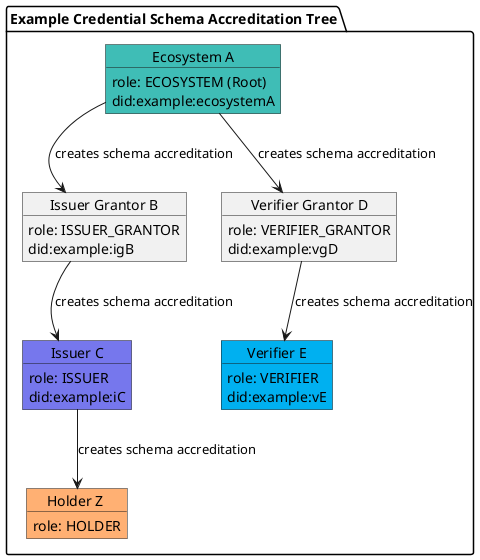

###### [MOD-AC-MSG-9-2-3] Revoke Accreditation fee checks

Fee payer MUST have the required [[ref: estimated transaction fees]] in its [[ref: account]], else [[ref: transaction]] MUST abort.

##### [MOD-AC-MSG-9-3] Revoke Accreditation execution

If all precondition checks passed, [[ref: transaction]] is executed.

Method execution MUST perform the following tasks in a [[ref: transaction]], and rollback if any error occurs.

- define `now`: current timestamp.

- Load `Accreditation` entry `applicant_accreditation` from `id`.
- if `applicant_accreditation.op_state` is PENDING (a renewal in progress): transfer `applicant_accreditation.op_current_fees` (in its denom) and `applicant_accreditation.op_current_deposit` (in [[ref: native denom]]) back from the escrow [[ref: account]] to `applicant_accreditation.op_funding_account`, as [[MOD-AC-MSG-6-3]](#mod-ac-msg-6-3-cancel-accreditation-op-last-request-execution) does: nothing was minted for them.
- delete `applicant_accreditation`, removing its id from deposit(`applicant_accreditation`).`accreditation_ids` and, for a root entry, from `CredentialSchema[applicant_accreditation.schema_id].root_accreditation_ids` ([Accreditation](#accreditation)).

The method MUST emit an event carrying `id`, `schema_id`, `role`, `vs_id` and `now`: the revocation is recorded by the transaction, the VPR keeps no revoked entry.

#### [MOD-AC-MSG-10] Record Credential Exchange

Only the `vs_operator` of the primary party's [VerifiableService](#verifiableservice) entry (the entry referenced by the primary `Accreditation` entry, or given directly by a party acting without an entry) CAN execute this method on behalf of a `corporation` (a VS Operator Authorization; [[MOD-DE-MSG-3]](#mod-de-msg-3-grant-operator-authorization) excludes this message from OperatorAuthorizations). The digest of a credential of a schema whose `credential_anchoring` is not NONE is anchored through the issuance transaction only: such an issuer MUST hold a VS Operator Authorization for its agent.

Any credential exchange that requires issuer or verifier to pay fees, anchor a digest, or produce a proof implies a `CredentialExchange` transaction. A Credential Verification implies a `CredentialExchange` transaction when the fees computed for it are greater than 0, when the schema's `presentation_validity_period` is greater than 0 or when the verifier anchors the presentation digest; a verification with zero fees and no digest to anchor needs no exchange record and leaves no transaction (see [CredentialSchema](#credentialschema)).

If the peer wants to issue a credential, the `agent`, the Verifiable User Agent or Verifiable Service that receive the request MUST send to peer:

- an `exchange_id` (uuid) for exchange identification;

If the peer wants to verify a credential, agent must send to peer:

- an `exchange_id` (uuid) for exchange identification;
- *mandatory*: a map of compatible found credentials in available wallets for the requested schema_id, with at least one entry (an empty map means that the agent holds no matching credential and the exchange ends without an exchange record): for each matching credential, the reference of its issuer: the id of the `ISSUER` `Accreditation` entry its digest was anchored under while that entry exists, or of a current `ISSUER` entry of the issuer for the schema, else the `vs_id` of the issuer's service entry (for a credential of a schema whose `credential_anchoring` is NONE, an active `ISSUER` entry of the issuer, else its service entry); the VPR refuses the service-entry form while the issuer holds an active entry, so that the issuer's branch is paid. The payer selects from it the issuer reference of the exchange.
- *mandatory*: whether the agent requires a `CredentialExchange` for this verification: it does when the `presentation_validity_period` of the schema, read at that time, is greater than 0, or when the fees it computes with [[MOD-AC-QRY-4]](#mod-ac-qry-4-find-beneficiaries) (for the schema, the issuer reference of each credential of the map and the verifier reference named in the request: the verifier's `VERIFIER` entry, which the agent checks belongs to the verifier's service entry, or that service entry when it holds none) are greater than 0 for any credential of the map; when the agent requires one, the payer MUST create it whatever its own reading.
- *mandatory* when the schema's `presentation_validity_period` is greater than 0 (the agent reads the `CredentialSchema` entry at the time of the verification, the VPR evaluates the value at the block), otherwise *optional* and only if the verifier asked for it in its request: the **presentation digest**, computed by the agent over the presentation it is about to send (the signed presentation as it will be transmitted: canonicalized with [JCS](https://www.rfc-editor.org/rfc/rfc8785) when it is a JSON document, its exact bytes otherwise; hashed with the `digest_algorithm` of the schema). The agent builds and signs the presentation first and sends only its digest at this step; the verifier anchors it through the `digest` parameter of the exchange transaction. When it sends a presentation digest, the agent has selected the credential it will present, and the map of compatible credentials above contains that single credential. Unless the schema's `presentation_validity_period` is greater than 0, anchoring a presentation digest is decided by the verifier: a verifier that did not ask for it MUST NOT expect one, and a verifier that asked for it MUST anchor it, since the agent sends the presentation only after checking the exchange transaction. The presentation MUST be a Verifiable Presentation signed by the holder and bound to the exchange identifier (or to the verifier's nonce), so that its digest differs from the credential's `digestJCS` and from any earlier presentation.

In an exchange with a **Verifiable User Agent**, the payer sets `vua_issuer_accreditation_id` itself, from the User Agent credential it verified at connection ([[ref: VT spec]]); the agent sends nothing for it, and the parameter is absent when the peer is a **Verifiable Service**.

When an exchange record is required (fees greater than 0; a `presentation_validity_period` of the schema greater than 0; a presentation digest requested by the verifier; or a Credential Issuance under a schema whose `credential_anchoring` is not NONE, since the digest is anchored through the exchange), `payer` MUST create it using the above information, then `agent` MUST check, through the notification of an indexer of its whitelist ([[ref: VT spec]]), that the exchange transaction was included and is valid: signed for the payer's entry, carrying the `exchange_id`, the schema, for a User Agent its vendor's entry as `vua_issuer_accreditation_id`, and, in a Credential Verification, the issuer reference of the credential it is about to present (fees are routed by that reference) and the presentation digest it sent, before performing the action (storing the issued credential, or sending the presentation). The VPR stores no exchange: the transaction is the receipt ([CredentialExchange](#credentialexchange)).

```plantuml
scale max 800 width
actor "Agent\nVUA or VS" as Issued 
participant "Payer\nVS" as Issuer 
participant "VPR" as vpr 
participant "Indexer" as indexer


Issued <-- Issuer: I want to issue a credential from schema id ... to you
Issued --> Issuer: Here is the exchange_id
Issuer --> vpr: record the exchange
Issued <-- Issuer: exchange recorded, you can verify
vpr --> indexer: exchange event
Issued <-- indexer: exchange notification
Issued --> Issuer: I verified the exchange transaction, you can send the credential
Issued <-- Issuer: Send credential
Issued <-- Issued: Store credential

```

See [[ref: VT spec]].

##### [MOD-AC-MSG-10-1] Record Credential Exchange parameters

An [[ref: account]] that would like to run a `CredentialExchange` MUST send a Msg by specifying:

- `corporation` (account): (Signer) the `policy_address` of the corporation on whose behalf this message is executed.
- `operator` (account): (Signer) the account authorized by the `corporation` to run this Msg.
- `exchange_id` (uuid) (*mandatory*): the exchange identifier agreed with the peer, in canonical textual form; a correlation key carried by the event ([CredentialExchange](#credentialexchange)), not stored.
- `schema_id` (uint64) (*mandatory*): the id of the `CredentialSchema` entry of the credential.
- `issuer_accreditation_id` (uint64) (*conditional*): the id of the `ISSUER` `Accreditation` entry of the issuer of the credential: the payer's own entry in a Credential Issuance, the entry the credential was anchored under, or a current entry of the issuer, in a Credential Verification. Exactly one of `issuer_accreditation_id` and `issuer_vs_id` MUST be provided.
- `issuer_vs_id` (uint64) (*conditional*): the `VerifiableService` entry of the issuer, when the issuer holds no active `ISSUER` entry for the schema: the payer's own entry in a Credential Issuance (the schema's `issuer_onboarding_mode` is OPEN), the issuer's entry in a Credential Verification (an issuer acting under OPEN, or whose accreditation has since ended); the issuer branch of the fees is then the schema's root ([[MOD-AC-QRY-4]](#mod-ac-qry-4-find-beneficiaries)).
- `verifier_accreditation_id` (uint64) (*conditional*): the id of the `VERIFIER` entry of the verifier, in a Credential Verification. At most one of `verifier_accreditation_id` and `verifier_vs_id` MAY be provided; the presence of either makes the operation a Credential Verification.
- `verifier_vs_id` (uint64) (*conditional*): the payer's own `VerifiableService` entry in a Credential Verification, when the verifier holds no active `VERIFIER` entry for the schema (the schema's `verifier_onboarding_mode` is OPEN or CREDENTIAL).
- `vua_issuer_accreditation_id` (uint64) (*optional*): in an exchange with a Verifiable User Agent, the `ISSUER` entry, under the User Agent schema, of the issuer of the User Agent credential the VUA presented at connection, as identified by the payer's own trust resolution of that credential ([[ref: VT spec]]): the vendor that receives the Verifiable User Agent reward. Absent when the peer is a Verifiable Service.
- `digest` (bytes, base64 in the API) (*conditional*): in a Credential Issuance, the credential digest defined by the Verifiable Trust specification for the container (the `digestJCS` of a W3C credential, the digest of the issuer-signed JWT of an SD-JWT credential), mandatory unless the schema's `credential_anchoring` is NONE, absent then (its anchoring fixes the effective issuance time, see [Digest](#digest)); in a Credential Verification, the presentation digest sent by the agent (see above): mandatory when `cs.presentation_validity_period` > 0 (see precondition checks), otherwise present when the verifier decided to anchor it.
- `credential_valid_until` (timestamp) (*conditional*): in a Credential Issuance under a schema whose `credential_anchoring` is REVOCABLE_DIGEST, the expiry of the credential (`validUntil`, `exp` or `validityInfo.validUntil`, see the [[ref: VT spec]]), mandatory; absent otherwise. The `Digest` entry is kept until then ([Digests Module](#digests-module)).

##### [MOD-AC-MSG-10-2] Record Credential Exchange precondition checks

If any of these precondition checks fail, [[ref: transaction]] MUST abort.

- `corporation` (account): (Signer) signature must be verified.
- `operator` (account): (Signer) signature must be verified.
- `id` MUST be a valid UUID.

- `schema_id` MUST refer to an existing `CredentialSchema` entry `cs`, else abort.
- exactly one of `issuer_accreditation_id` and `issuer_vs_id` MUST be provided, and at most one of `verifier_accreditation_id` and `verifier_vs_id`; else abort.

Determine the operation type:

- if `verifier_accreditation_id` or `verifier_vs_id` is provided, the operation is a **Credential Verification**: the caller is the `vs_operator` of the verifier, and the issuer reference identifies the issuer branch that is a fee beneficiary of the verification (see [[MOD-AC-QRY-4]](#mod-ac-qry-4-find-beneficiaries)).
- else, the operation is a **Credential Issuance**: the caller is the `vs_operator` of the issuer.

- define `issuer_accreditation`, `verifier_accreditation` as null.

Primary party (the payer): let `R` be VERIFIER in a Credential Verification, ISSUER in a Credential Issuance, and the primary reference be the verifier's in a Credential Verification, the issuer's in a Credential Issuance.

- if the primary reference is an entry id: load `perm` from it (abort if not found); `perm.role` MUST be `R` and `perm.schema_id` MUST equal `schema_id`, and `perm` MUST be an [[ref: active accreditation]], else abort. Let `vs` = `VerifiableService[perm.vs_id]`.
- else (a service entry `vs_id`): `vs` = `VerifiableService[vs_id]` MUST exist, else abort. The schema's mode MUST allow a party without an entry: `cs.issuer_onboarding_mode` MUST be OPEN for an issuer, `cs.verifier_onboarding_mode` MUST be OPEN or CREDENTIAL for a verifier, else abort. Let `d` be `ParticipationTrustDeposit[(vs.id, schema_id, R)]` if it exists: `d.accreditation_ids` MUST list no [[ref: active accreditation]] (the caller MUST reference it instead), and `d` MUST NOT be [[ref: barred]] (`d.unrepaid_slash` = 0 and `d.excluded` false), else abort: the exclusion is the ecosystem's sanction on a participation it did not onboard. `TrustDeposit[co.id]`, if it exists, MUST NOT be barred either (`unrepaid_slash` = 0 and `excluded` false), else abort. `perm` is null.
- `vs.corporation_id` MUST equal `co.id` (where `co` is the `Corporation` entry resolved from the signing `corporation` account), and `vs.vs_operator` MUST equal `operator`, else abort.

[[AUTHZ-CHECK-3]](#authz-check-3-vs-operator-authorization-checks) MUST pass for this (`corporation`, `operator`, `perm`, `vs`) tuple (`perm` MAY be null).
[[AUTHZ-CHECK-4]](#authz-check-4-vs-operator-fee-grant-checks) MUST pass for the same tuple.

Issuer reference:

- in a Credential Issuance, `issuer_accreditation` = `perm`.
- in a Credential Verification, if `issuer_accreditation_id` is provided: load `issuer_accreditation` from it (abort if not found); `issuer_accreditation.role` MUST be ISSUER and `issuer_accreditation.schema_id` MUST equal `schema_id`, else abort; `issuer_accreditation.effective_from` MUST be non-null and not later than now (the entry has been validated and became effective), else abort. No other state is required of it: the validity of the credential is established by trust resolution at its issuance time, and the unrepaid-slash filter of [[MOD-AC-QRY-4]](#mod-ac-qry-4-find-beneficiaries) decides whether the issuer branch is paid.
- in a Credential Verification, else (`issuer_vs_id` provided): `VerifiableService[issuer_vs_id]` MUST exist, else abort; let `d_i` be `ParticipationTrustDeposit[(issuer_vs_id, schema_id, ISSUER)]` if it exists: `d_i.accreditation_ids` MUST list no [[ref: active accreditation]], else abort (the caller MUST reference it, so that the issuer's branch is paid). `issuer_accreditation` stays null: the issuer branch is the schema's root.

> Note: the `vs_operator` and `corporation_id` checks apply to the primary party only. In a Credential Verification, the issuer reference generally belongs to another [[ref: corporation]]: it is referenced so that the issuer branch receives its verification fees, and is checked for role, schema and prior validation only. An issuer whose entry has since expired or been revoked holds none, and is referenced by its service entry.

Verifier reference (Credential Verification only): `verifier_accreditation` = `perm`.

- in a Credential Verification: if `cs.presentation_validity_period` > 0 and `digest` is absent, abort: the ecosystem requires a dated receipt of every verification of this schema.

- in a Credential Issuance: if `cs.credential_anchoring` is not NONE and `digest` is absent, abort (the credential digest is anchored through this exchange); if it is NONE and `digest` is present, abort (no credential digest is anchored for this schema).
- in a Credential Issuance: if `cs.credential_anchoring` is REVOCABLE_DIGEST, `credential_valid_until` MUST be present and later than `now()`, else abort; otherwise `credential_valid_until` MUST be absent.
- in a Credential Issuance under a schema whose `credential_anchoring` is REVOCABLE_DIGEST, if a `Digest` entry `d` with the value of `digest` already exists: `d.vs_id` MUST equal `vs.id` and `d.schema_id` MUST equal `schema_id`, else abort (another corporation, or another entry of the issuer, anchored this digest first, or the issuer notarized it directly with [[MOD-DI-MSG-1]](#mod-di-msg-1-store-digest): the entry would not be the credential's anchor and, for another corporation, would give it control of the revocation; the issuer re-issues the credential with changed content, as the Verifiable Trust specification requires). An identical anchoring is a re-send: [[MOD-DI-MSG-1]](#mod-di-msg-1-store-digest) is then a no-op and the entry keeps its `created`.
- if `digest` is present, its decoded length MUST be the output size of `cs.digest_algorithm` (48 bytes for `sha384`, 64 for `sha512`), else abort.

VUA issuer:

- if `vua_issuer_accreditation_id` is set: load `vua_issuer_accreditation` from `vua_issuer_accreditation_id`; if `vua_issuer_accreditation.role` is not ISSUER, abort; if `vua_issuer_accreditation` is not a [[ref: active accreditation]], abort. Define `vua_rate` = min(`vua_issuer_accreditation.vua_reward_rate`, `GlobalVariables.vua_reward_rate`) when the entry sets a rate, else `GlobalVariables.vua_reward_rate`.

:::warning
The VPR cannot check that the schema of `vua_issuer_accreditation` is a User Agent schema. The payer derives the entry from the User Agent credential it verified at connection and pays the reward itself, so it has no reason to name another entry; and the User Agent, which checks the exchange transaction before completing the exchange, refuses to proceed unless `vua_issuer_accreditation_id` is its vendor's entry ([[ref: VT spec]]).
:::

##### [MOD-AC-MSG-10-3] Record Credential Exchange fee checks

- Load `CredentialSchema` entry `cs` from `schema_id`.
- Fee payer MUST have sufficient available balance for the required [[ref: estimated transaction fees]].

For trust fees, the funding account of `corporation` ([[FUND-CHECK-1]](#fund-check-1-debit)) MUST cover the totals computed below.

**Step 1: Calculate total beneficiary fees in credential schema pricing asset**

Use "Find Beneficiaries" ([[MOD-AC-QRY-4]](#mod-ac-qry-4-find-beneficiaries)) with `schema_id`, the issuer and verifier references (entry or service entry) and `verification` = true for a Credential Verification, to get the set of beneficiary `Accreditation` entries `found_accreditation_set` (in a Credential Verification the issuer entry, when the issuer holds one, and the ancestors of both branches; in a Credential Issuance the ancestors of the issuer branch only; a party without an entry sits directly under the schema's root ECOSYSTEM entry; filtered as defined there).

- define `issuer_discount` = `issuer_accreditation.issuance_fee_discount` if `issuer_accreditation` is not null, else 0; define `verifier_discount` = `verifier_accreditation.verification_fee_discount` if `verifier_accreditation` is not null, else 0.

- define `total_beneficiary_fees` = 0

If **Credential Issuance** (no verifier reference was given):

- for each `perm` in `found_accreditation_set`:
  - `total_beneficiary_fees` = `total_beneficiary_fees` + `perm.issuance_fees` × (1 - `issuer_discount`)

If **Credential Verification** (a verifier reference was given):

- for each `perm` in `found_accreditation_set`:
  - `total_beneficiary_fees` = `total_beneficiary_fees` + `perm.verification_fees` × (1 - `verifier_discount`)

> Note: `total_beneficiary_fees` is expressed in the credential schema pricing asset `(cs.pricing_asset_type, cs.pricing_asset)`.

**Step 2: Calculate amounts payer must have available**

Based on the credential schema pricing configuration, calculate the total amounts the payer (the signing `corporation` account) must have available.

Define the following variables:

| Variable | Description |
|----------|-------------|
| `total_fees_in_pricing_asset` | Total fees to be distributed to beneficiaries (in pricing asset) |
| `total_fees_in_native_denom` | Total fees converted to [[ref: native denom]] (if needed) |
| `total_payer_trust_deposit` | Trust deposit payer must stake for themselves |
| `total_payees_trust_deposit` | Trust deposit payer must stake on behalf of payees |
| `total_payees_fees_to_account` | Fees to be transferred to payees' accounts |
| `total_vua_reward` | Reward for the Verifiable User Agent (in [[ref: native denom]]) |

Initialize:

- `total_fees_in_pricing_asset` = `total_beneficiary_fees`
- `total_fees_in_native_denom` = 0
- `total_payer_trust_deposit` = 0
- `total_payees_trust_deposit` = 0
- `total_payees_fees_to_account` = 0
- `total_vua_reward` = 0

> If a conversion is needed below, use [Get Price](#mod-xr-qry-3-get-price) to convert amounts.

---

**Case A: `(cs.pricing_asset_type, cs.pricing_asset)` = `(COIN, [[ref: native denom]])`**

Pricing is in native token. No conversion needed.

Calculate:

- `total_fees_in_native_denom` = `total_fees_in_pricing_asset`
- `total_payer_trust_deposit` = `total_fees_in_native_denom` × `GlobalVariables.trust_deposit_rate`, rounded down
- `total_payees_trust_deposit` = `total_payer_trust_deposit`
- `total_payees_fees_to_account` = `total_fees_in_native_denom` − `total_payer_trust_deposit`

if `vua_issuer_accreditation_id` is set:

- `total_vua_reward` = `total_fees_in_native_denom` × `vua_rate`, rounded down

Required balance check:

- the [[ref: funding account]] of `corporation` MUST cover `total_fees_in_native_denom` + `total_payer_trust_deposit` + `total_vua_reward` in [[ref: native denom]] ([[FUND-CHECK-1]](#fund-check-1-debit)).

---

**Case B: `(cs.pricing_asset_type, cs.pricing_asset)` = `(COIN, <arbitrary_denom>)`**

Pricing is in an arbitrary on-chain coin (e.g., USDC). Fees to payees are paid in that coin; deposits and the VUA reward are converted to native denom.

Calculate:

- `total_fees_in_native_denom` = getPrice(`COIN`, `<arbitrary_denom>`, `COIN`, `[[ref: native denom]]`, `total_fees_in_pricing_asset`)
- `total_payer_trust_deposit` = `total_fees_in_native_denom` × `GlobalVariables.trust_deposit_rate`, rounded down
- `total_payees_trust_deposit` = `total_payer_trust_deposit`
- `total_payees_fees_to_account` = `total_fees_in_pricing_asset` − (`total_fees_in_pricing_asset` × `GlobalVariables.trust_deposit_rate`, rounded down)

if `vua_issuer_accreditation_id` is set:

- `total_vua_reward` = `total_fees_in_native_denom` × `vua_rate`, rounded down

Required balance check:

- the [[ref: funding account]] of `corporation` MUST cover `total_payer_trust_deposit` + `total_payees_trust_deposit` + `total_vua_reward` in [[ref: native denom]] ([[FUND-CHECK-1]](#fund-check-1-debit)).
- AND the [[ref: funding account]] of `corporation` MUST cover `total_payees_fees_to_account` in `<arbitrary_denom>` ([[FUND-CHECK-1]](#fund-check-1-debit)).

---

**Case C: `(cs.pricing_asset_type, cs.pricing_asset)` = `(FIAT, <fiat_denom>)`**

Pricing is in fiat currency (e.g., USD). Fiat fees are settled off-chain; only deposits and the VUA reward are paid on-chain in native denom.

Calculate:

- `total_fees_in_native_denom` = getPrice(`FIAT`, `<fiat_denom>`, `COIN`, `[[ref: native denom]]`, `total_fees_in_pricing_asset`)
- `total_payer_trust_deposit` = `total_fees_in_native_denom` × `GlobalVariables.trust_deposit_rate`, rounded down
- `total_payees_trust_deposit` = `total_payer_trust_deposit`
- `total_payees_fees_to_account` = 0 (FIAT payments are managed off-chain)

if `vua_issuer_accreditation_id` is set:

- `total_vua_reward` = `total_fees_in_native_denom` × `vua_rate`, rounded down

Required balance check:

- the [[ref: funding account]] of `corporation` MUST cover `total_payer_trust_deposit` + `total_payees_trust_deposit` + `total_vua_reward` in [[ref: native denom]] ([[FUND-CHECK-1]](#fund-check-1-debit)).

---

:::warning
- Deposit-bound amounts MUST always be paid in [[ref: native denom]] (trust units are minted from native denom only).
- Every amount this method debits from `corporation` is taken from its [[ref: funding account]] ([[FUND-CHECK-1]](#fund-check-1-debit), for this message type), and every amount it credits to a payee or agent corporation goes to that corporation's funding account ([[FUND-CHECK-2]](#fund-check-2-credit)). Trust units are minted to the corporations themselves, whoever paid.
- When paying with COIN ≠ [[ref: native denom]] or with FIAT, the payer pays the deposit-bound amounts on behalf of payees (since payees receive non-native assets that cannot be deposit-bound), and pays correspondingly less in the pricing asset: net economics match the native-denom case. For FIAT pricing, the off-chain settlement SHOULD likewise be for the fee minus its deposit-bound portion.
:::

##### [MOD-AC-MSG-10-4] Record Credential Exchange execution

If all precondition checks passed, method is executed.

- Load all `Accreditation` and `VerifiableService` entries as in basic checks.
- Load `CredentialSchema` entry `cs` from `schema_id`.
- define `now`: current timestamp.
- use "Find Beneficiaries" to build `found_accreditation_set`, as in fee checks.

> Note: All funds are transferred from the funding account of the `corporation` executing the method, resolved once for this message per [[FUND-CHECK-1]](#fund-check-1-debit). The steps below describe what each recipient must receive. Implementation details (batching, order of transfers) are left to the implementer.

---

**Step 1: Process fee distribution to each beneficiary**

Initialize the accumulator of the VUA reward:

- `accumulated_vua_reward` = 0

Determine the operation type and applicable discount:

- If **Credential Issuance** (no verifier reference was given):
  - `fee_field` = `issuance_fees`
  - `discount` = `issuer_discount`
  - `payer` = (`vs.id`, `schema_id`, ISSUER), the deposit key of the primary party's participation

- Else if **Credential Verification** (a verifier reference was given):
  - `fee_field` = `verification_fees`
  - `discount` = `verifier_discount`
  - `payer` = (`vs.id`, `schema_id`, VERIFIER), the deposit key of the primary party's participation

**For each beneficiary `Accreditation` `perm` in `found_accreditation_set`:**

If `perm.[fee_field]` > 0:

1. Calculate the discounted fee for this beneficiary:
   - `beneficiary_fee_in_pricing_asset` = `perm.[fee_field]` × (1 - `discount`)

2. Calculate amounts based on pricing configuration (same logic as fee checks):

   **Case A: `(cs.pricing_asset_type, cs.pricing_asset)` = `(COIN, [[ref: native denom]])`**
   
   - `fee_in_native_denom` = `beneficiary_fee_in_pricing_asset`
   - `payer_trust_deposit` = `fee_in_native_denom` × `GlobalVariables.trust_deposit_rate`, rounded down
   - `payee_trust_deposit` = `payer_trust_deposit`
   - `payee_fees_to_account` = `fee_in_native_denom` − `payee_trust_deposit`

  if `vua_issuer_accreditation_id` is set:
    - `vua_reward_portion` = `fee_in_native_denom` × `vua_rate`, rounded down

  
   **Case B: `(cs.pricing_asset_type, cs.pricing_asset)` = `(COIN, <arbitrary_denom>)`**
   
   - `fee_in_native_denom` = getPrice(`COIN`, `<arbitrary_denom>`, `COIN`, `[[ref: native denom]]`, `beneficiary_fee_in_pricing_asset`)
   - `payer_trust_deposit` = `fee_in_native_denom` × `GlobalVariables.trust_deposit_rate`, rounded down
   - `payee_trust_deposit` = `payer_trust_deposit`
   - `payee_fees_to_account` = `beneficiary_fee_in_pricing_asset` − (`beneficiary_fee_in_pricing_asset` × `GlobalVariables.trust_deposit_rate`, rounded down) *(in `<arbitrary_denom>`)*

  if `vua_issuer_accreditation_id` is set:
    - `vua_reward_portion` = `fee_in_native_denom` × `vua_rate`, rounded down


   **Case C: `(cs.pricing_asset_type, cs.pricing_asset)` = `(FIAT, <fiat_denom>)`**
   
   - `fee_in_native_denom` = getPrice(`FIAT`, `<fiat_denom>`, `COIN`, `[[ref: native denom]]`, `beneficiary_fee_in_pricing_asset`)
   - `payer_trust_deposit` = `fee_in_native_denom` × `GlobalVariables.trust_deposit_rate`, rounded down
   - `payee_trust_deposit` = `payer_trust_deposit`
   - `payee_fees_to_account` = 0 *(FIAT payments are managed off-chain)*

  if `vua_issuer_accreditation_id` is set:
    - `vua_reward_portion` = `fee_in_native_denom` × `vua_rate`, rounded down

3. Execute transfers and mints for this beneficiary:

   - If `payee_fees_to_account` > 0: transfer `payee_fees_to_account` to the [[ref: funding account]] of `Corporation[perm.corporation_id]` ([[FUND-CHECK-2]](#fund-check-2-credit)) (in the appropriate denom).
   - if `payee_trust_deposit` > 0, use [[MOD-TD-MSG-1]](#mod-td-msg-1-mint-trust-units) Mint Trust Units with (`corporation_id` = `perm.corporation_id`, `vs_id` = `perm.vs_id`, `schema_id` = `perm.schema_id`, `role` = `perm.role`, `source_account` = the payer's [[ref: funding account]] ([[FUND-CHECK-1]](#fund-check-1-debit)), `amount` = `payee_trust_deposit`).
   - if `payer_trust_deposit` > 0, use [[MOD-TD-MSG-1]](#mod-td-msg-1-mint-trust-units) Mint Trust Units with (`corporation_id` = `co.id` (where `co` is the `Corporation` entry resolved from the signing `corporation` account, the payer), (`vs_id`, `schema_id`, `role`) = `payer`, `source_account` = the payer's [[ref: funding account]] ([[FUND-CHECK-1]](#fund-check-1-debit)), `amount` = `payer_trust_deposit`).

4. Accumulate the VUA reward:

   - `accumulated_vua_reward` = `accumulated_vua_reward` + `vua_reward_portion`

---

**Step 2: Process the VUA reward**

After processing all beneficiaries, pay the accumulated reward to the VUA issuer.

**Verifiable User Agent Reward:**

If `vua_issuer_accreditation_id` is set AND `accumulated_vua_reward` > 0 AND `vua_issuer_accreditation` is not barred in the sense of [[MOD-AC-QRY-4]](#mod-ac-qry-4-find-beneficiaries) (otherwise the reward is not paid and no deposit is funded):

- `vua_trust_deposit` = `accumulated_vua_reward` × `GlobalVariables.trust_deposit_rate`
- `vua_fees_to_account` = `accumulated_vua_reward` - `vua_trust_deposit`
- Transfer `vua_fees_to_account` to the [[ref: funding account]] of `Corporation[vua_issuer_accreditation.corporation_id]` ([[FUND-CHECK-2]](#fund-check-2-credit)) in [[ref: native denom]].
- if `vua_trust_deposit` > 0, use [[MOD-TD-MSG-1]](#mod-td-msg-1-mint-trust-units) Mint Trust Units with (`corporation_id` = `vua_issuer_accreditation.corporation_id`, `vs_id` = `vua_issuer_accreditation.vs_id`, `schema_id` = `vua_issuer_accreditation.schema_id`, `role` = `vua_issuer_accreditation.role`, `source_account` = the payer's [[ref: funding account]] ([[FUND-CHECK-1]](#fund-check-1-debit)), `amount` = `vua_trust_deposit`).

---

**Step 3: Report the exchange**

> Now that all transfers have been done, the exchange is reported.

The method MUST emit a `CredentialExchange` event ([CredentialExchange](#credentialexchange)) carrying `exchange_id`, `schema_id`, `issuer_accreditation_id` or `issuer_vs_id` as given, `verifier_accreditation_id` or `verifier_vs_id` as given (none in a Credential Issuance), `vua_issuer_accreditation_id`, `digest` when present, and `now`. Nothing is written for the exchange.

In a Credential Issuance under a schema whose `credential_anchoring` is REVOCABLE_DIGEST, persist `digest` by calling [[MOD-DI-MSG-1]](#mod-di-msg-1-store-digest) on behalf of the signing `corporation`, passing `vs_id` = `vs.id`, `schema_id` = `schema_id` and `expires` = `credential_valid_until`: when the `Digest` entry is created by this transaction, its `created` timestamp is the effective issuance time (a pre-existing entry, necessarily anchored under the same entry and schema after the precondition checks, keeps its `created`, [[MOD-DI-MSG-1]](#mod-di-msg-1-store-digest) being a no-op). Under DIGEST the credential digest is carried by the event only: the block time of the transaction is the effective issuance time, and nothing is written. In a Credential Verification the presentation digest is carried by the event only: the block time of the transaction is the effective presentation time, from which the reliance period of the presentation runs when `cs.presentation_validity_period` is greater than 0.

:::warning
an exchange event always carries `schema_id` and exactly one of `issuer_accreditation_id` and `issuer_vs_id`; `verifier_accreditation_id` or `verifier_vs_id` is set in a Credential Verification only
:::

#### [MOD-AC-MSG-11] Update Accreditation Module Parameters

Update Accreditation Module Parameters.

Can only be executed through a [[ref: governance proposal]].

##### [MOD-AC-MSG-11-1] Update Accreditation Module Parameters parameters

- `params` (KeySet<String, String>): the parameters to update and their values.

##### [MOD-AC-MSG-11-2] Update Accreditation Module Parameters precondition checks

If any of these precondition checks fail, [[ref: transaction]] MUST abort.

###### [MOD-AC-MSG-11-2-1] Update Accreditation Module Parameters basic checks

- `params`: size of `params` MUST be greater than 0. For each `param` <`key`, `value`> `key` MUST exist, else abort.

###### [MOD-AC-MSG-11-2-2] Update Accreditation Module Parameters fee checks

provided transaction fees MUST be sufficient for execution

##### [MOD-AC-MSG-11-3] Update Accreditation Module Parameters execution

If all precondition checks passed, [[ref: transaction]] is executed.

Method execution MUST perform the following tasks in a [[ref: transaction]], and rollback if any error occurs.

for each parameter `param` <`key`, `value`> in `parameters`:

- update parameter set value = `value` where key = `key`.

#### [MOD-AC-MSG-12] Slash Participation Trust Deposit

This method can only be called by either:

- a `corporation` ancestor validator of an entry of this participation;
- the `corporation` controller of the `Ecosystem` object, owner of the corresponding credential schema.

A slash is the ecosystem's sanction on a participation: it removes trust units, which the corporation owes back ([[MOD-TD-MSG-6]](#mod-td-msg-6-repay-slash)), revokes the participation's validated entries (a renewal pending on one of them included) and, when the ecosystem so decides (`exclude`), excludes it until the ecosystem lifts it ([[MOD-AC-MSG-13]](#mod-ac-msg-13-set-participation-exclusion)). The participation is [[ref: barred]] while its debt is unrepaid or its exclusion stands. An ecosystem cannot slash while the corporation carries a network debt ([[MOD-TD-MSG-5]](#mod-td-msg-5-slash-trust-deposit)): the trust deposit then holds less than its parts say, and the network debt is repaid first.

##### [MOD-AC-MSG-12-1] Slash Participation Trust Deposit parameters

- `corporation` (account): (Signer) the `policy_address` of the corporation on whose behalf this message is executed.
- `operator` (account): (Signer) the account authorized by the `corporation` to run this Msg.
- `vs_id` (uint64), `schema_id` (uint64), `role` (AccreditationRole) (*mandatory*): the participation to slash, that is the [ParticipationTrustDeposit](#participationtrustdeposit) `d` = `ParticipationTrustDeposit[(vs_id, schema_id, role)]`.
- `percent` (decimal) (*mandatory*): the fraction of the [[ref: trust units]] currently held by this participation (`d.tu`) to slash, greater than 0 and at most 1. The ecosystem governance framework defines the fractions of its sanction schedule; a corporation holding several participations in the ecosystem is slashed participation by participation, one message each, which lets the ecosystem target the ones that breached.
- `exclude` (boolean) (*mandatory*): the ecosystem's decision to exclude the participation in addition to the debt: true withdraws trust from everything the participation issued or validated before the slash ([[ref: VT spec]]) and bars it until the ecosystem lifts it ([[MOD-AC-MSG-13]](#mod-ac-msg-13-set-participation-exclusion)); false bars it until the debt is repaid only. A later slash with false does not clear an earlier exclusion.

##### [MOD-AC-MSG-12-2] Slash Participation Trust Deposit precondition checks

If any of these precondition checks fail, [[ref: transaction]] MUST abort.

###### [MOD-AC-MSG-12-2-1] Slash Participation Trust Deposit basic checks

if a mandatory parameter is not present, [[ref: transaction]] MUST abort.

- `corporation` (account): (Signer) signature must be verified.
- `operator` (account): (Signer) signature must be verified.
- [[AUTHZ-CHECK]](#authz-check-common-authorization-and-fee-grant-checks) MUST pass for this (`corporation`, `operator`) pair and this message type.
- `vs_id` MUST name an existing `VerifiableService` entry, `schema_id` an existing `CredentialSchema` entry `cs`, and `d` MUST exist, else abort.
- `percent` MUST be greater than 0 and lower or equal to 1, and `d.tu` MUST be greater than 0, else MUST abort (an ecosystem can only slash trust units accumulated in the context of its own schema — never the rest of the corporation's deposit).
- `TrustDeposit[VerifiableService[vs_id].corporation_id]` MUST have `unrepaid_slash` = 0, else abort: the corporation repays its network debt first ([[MOD-TD-MSG-6]](#mod-td-msg-6-repay-slash)).

:::note
A participation keeps its deposit after its entries expired or were revoked: it can still be slashed, by the ecosystem controller (Option #2), since no validator chain exists any more.
:::

###### [MOD-AC-MSG-12-2-2] Slash Participation Trust Deposit validator perms

Either Option #1, or #2 MUST return true, else abort.

*Option #1*: executed by a validator ancestor

for each entry `applicant_accreditation` listed in `d.accreditation_ids` whose `validator_accreditation_id` is defined:

- set `validator_accreditation` = `applicant_accreditation`
- while `validator_accreditation.validator_accreditation_id` is defined, 
  - load `validator_accreditation` from `validator_accreditation.validator_accreditation_id`; if it no longer exists, stop this walk.
  - if `validator_accreditation` is a [[ref: active accreditation]] and `validator_accreditation.corporation_id` equals `co.id` (where `co` is the `Corporation` entry resolved from the signing `corporation` account), => return true.
- end

return false.

*Option #2*: executed by `Ecosystem` controller

- `cs` is the `CredentialSchema` entry of the basic checks.
- load `Ecosystem` `ecosystem` from `cs.ecosystem_id`
- if `co.id` equals `ecosystem.corporation_id` (where `co` is the `Corporation` entry resolved from the signing `corporation` account), return true.
- else return false.

###### [MOD-AC-MSG-12-2-3] Slash Participation Trust Deposit fee checks

Fee payer MUST have the required [[ref: estimated transaction fees]] in its [[ref: account]], else [[ref: transaction]] MUST abort.

##### [MOD-AC-MSG-12-3] Slash Participation Trust Deposit execution

If all precondition checks passed, [[ref: transaction]] is executed.

Method execution MUST perform the following tasks in a [[ref: transaction]], and rollback if any error occurs.

- define `now`: current timestamp.

- calculate `tu_amount` = `d.tu` × `percent`, rounded down to the ledger precision ([Trust Unit Index](#trust-unit-index)): the amount of trust units removed; if it is 0, abort. With `percent` = 1, `tu_amount` equals `d.tu` exactly.
- calculate `slashed_fiat` = `d.fiat_cost` × `tu_amount` / `d.tu` — the debt in [[ref: main fiat currency]], equal to the pro-rata **mint-time cost basis** of the slashed trust units (what was originally paid for them, not their decayed value: trust scores decay, **liabilities do not**).

use [[MOD-TD-MSG-7]](#mod-td-msg-7-record-ecosystem-slash) Record Ecosystem Slash with (`corporation_id` = `VerifiableService[vs_id].corporation_id`, `vs_id`, `schema_id`, `role`, `tu_amount`, `fiat_amount` = `slashed_fiat`, `exclude`), which records the debt on `d`, increments `d.slash_count` and sets `d.excluded` when `exclude` is true. The method MUST emit an event carrying the deposit key (`vs_id`, `schema_id`, `role`), `tu_amount`, `slashed_fiat`, `exclude` and `now`.

- for each entry `p` listed in `d.accreditation_ids` whose `effective_from` is set: delete it exactly as [[MOD-AC-MSG-9]](#mod-ac-msg-9-revoke-accreditation) does (the escrow of a pending renewal refunded to `p.op_funding_account`, the id removed from `d.accreditation_ids`, one event each). An entry under its initial onboarding process (`effective_from` null) stays until its applicant cancels it ([[MOD-AC-MSG-6]](#mod-ac-msg-6-cancel-accreditation-op-last-request)); it cannot be validated while the participation is barred.


#### [MOD-AC-MSG-13] Set Participation Exclusion

Any authorized `operator` CAN execute this method on behalf of the `corporation` controlling the `Ecosystem` of the schema.

This method sets or lifts the exclusion of a [[ref: participation]] (`ParticipationTrustDeposit.excluded`). With `excluded` true, the ecosystem withdraws trust from the participation without slashing it: the participation is [[ref: barred]], its entries stay in state but are not active, and everything it issued or validated resolves as untrusted while the exclusion stands ([[ref: VT spec]]); a slash ([[MOD-AC-MSG-12]](#mod-ac-msg-12-slash-participation-trust-deposit)) sets the same flag while also taking trust units and deleting the validated entries. With `excluded` false, it lifts an exclusion set by a slash or by this method: the participation may again create entries and run entry-less exchanges under the schema, and the entries it still holds resume within their windows. A slash itself is not undone: the trust units stay slashed until repaid ([[MOD-TD-MSG-6]](#mod-td-msg-6-repay-slash)), the participation stays barred while that debt is open, `slash_count` keeps its value, and the entries a slash deleted are not restored; the party onboards or self-creates anew.

##### [MOD-AC-MSG-13-1] Set Participation Exclusion parameters

- `corporation` (account): (Signer) the `policy_address` of the corporation on whose behalf this message is executed.
- `operator` (account): (Signer) the account authorized by the `corporation` to run this Msg.
- `vs_id` (uint64), `schema_id` (uint64), `role` (AccreditationRole) (*mandatory*): the participation, that is the [ParticipationTrustDeposit](#participationtrustdeposit) `d` = `ParticipationTrustDeposit[(vs_id, schema_id, role)]`.
- `excluded` (boolean) (*mandatory*): the new value of the flag.

##### [MOD-AC-MSG-13-2] Set Participation Exclusion precondition checks

If any of these precondition checks fail, [[ref: transaction]] MUST abort.

###### [MOD-AC-MSG-13-2-1] Set Participation Exclusion basic checks

if a mandatory parameter is not present, [[ref: transaction]] MUST abort.

- `corporation` (account): (Signer) signature must be verified.
- `operator` (account): (Signer) signature must be verified.
- [[AUTHZ-CHECK]](#authz-check-common-authorization-and-fee-grant-checks) MUST pass for this (`corporation`, `operator`) pair and this message type.
- `vs_id` MUST name an existing `VerifiableService` entry and `schema_id` an existing `CredentialSchema` entry `cs`, else abort. If `d` exists, `d.excluded` MUST differ from `excluded`, else abort (nothing to change); if `d` does not exist, `excluded` MUST be true, else abort.

###### [MOD-AC-MSG-13-2-2] Set Participation Exclusion permission checks

- load `Ecosystem` `ecosystem` from `cs.ecosystem_id`; `co.id` MUST equal `ecosystem.corporation_id` (where `co` is the `Corporation` entry resolved from the signing `corporation` account), else abort.

###### [MOD-AC-MSG-13-2-3] Set Participation Exclusion fee checks

Fee payer MUST have the required [[ref: estimated transaction fees]] in its [[ref: account]], else [[ref: transaction]] MUST abort.

##### [MOD-AC-MSG-13-3] Set Participation Exclusion execution

If all precondition checks passed, [[ref: transaction]] is executed.

- if `d` does not exist, create it with an empty ledger (`tu`, `fiat_cost`, `unrepaid_slash`, `unrepaid_fiat` and `slash_count` at 0, `excluded` false, no entries).
- set `d.excluded` to `excluded`.
- if `excluded` is false and `d` is now empty (`accreditation_ids` empty, `tu` = 0, `unrepaid_slash` = 0 and `slash_count` = 0), delete `d`.

The method MUST emit an event carrying `vs_id`, `schema_id`, `role`, `excluded` and the current timestamp.

#### [MOD-AC-MSG-14] Self Create Accreditation

Any authorized `operator` CAN execute this method on behalf of a `corporation`.

This simple `Accreditation`-creation method can be used to self-create an ISSUER (resp. VERIFIER) `Accreditation` entry if issuance mode (resp. verification mode) is set to `OPEN` (resp. `OPEN` or `CREDENTIAL`) for a given schema. Such an entry is **optional**: under these modes a service issues or verifies under its [VerifiableService](#verifiableservice) entry alone ([[MOD-AC-MSG-10]](#mod-ac-msg-10-record-credential-exchange)), and the [ParticipationTrustDeposit](#participationtrustdeposit) of its participation, created by its first mint, holds what the [[ref: ecosystem governance authority]] can slash. An issuer self-creates an entry to declare the `verification_fees` and `validation_fees` it charges; either party may self-create one to bound its participation with a window.

:::note
Even if a schema is OPEN, candidate MUST make sure they comply with the EGF else their `Accreditation` entry may be revoked by the [[ref: ecosystem governance authority]] and their deposit slashed; a slashed participation can no longer act under the schema.
:::

##### [MOD-AC-MSG-14-1] Self Create Accreditation parameters

- `corporation` (account): (Signer) the `policy_address` of the corporation on whose behalf this message is executed.
- `operator` (account): (Signer) the account authorized by the `corporation` to run this Msg.
- `role` (AccreditationRole) (*mandatory*): ISSUER or VERIFIER.
- `validator_accreditation_id` (uint64) (*mandatory*): MUST be an ECOSYSTEM [[ref: active accreditation]] or [[ref: future accreditation]].
- `vs_id` (uint64) (*mandatory*): id of the `VerifiableService` entry of the [[ref: VS]] this `Accreditation` entry refers to, registered beforehand by [[MOD-VS-MSG-1]](#mod-vs-msg-1-register-verifiable-service) and owned by `corporation`.
- `effective_from` (timestamp) (*optional*): timestamp from which (inclusive) this `Accreditation` entry is effective. If present, MUST NOT be lower than the current block timestamp. If absent, the VPR MUST set it to the current block timestamp during execution.
- `effective_until` (timestamp) (*optional*): timestamp until when (exclusive) this Perm is effective, null if it doesn't expire. If not null, MUST be greater than `effective_from_r` (see [MOD-AC-MSG-14-2-1](#mod-ac-msg-14-2-1-self-create-accreditation-basic-checks)).
- `verification_fees` (number) (*optional*): price to pay by the verifier of a credential of this schema to the grantee of this ISSUER perm when a credential is verified, in the denom specified in the credential schema. Default to 0.
- `validation_fees` (number) (*optional*): price to pay by the holder of a credential of this schema to the issuer when executing an onboarding process to obtain a credential, in the denom specified in the credential schema. Default to 0.

##### [MOD-AC-MSG-14-2] Self Create Accreditation precondition checks

If any of these precondition checks fail, [[ref: transaction]] MUST abort.

###### [MOD-AC-MSG-14-2-1] Self Create Accreditation basic checks

if a mandatory parameter is not present, [[ref: transaction]] MUST abort.

Load `Accreditation` `validator_accreditation` from `validator_accreditation_id`.

- `corporation` (account): (Signer) signature must be verified.
- `operator` (account): (Signer) signature must be verified.
- [[AUTHZ-CHECK]](#authz-check-common-authorization-and-fee-grant-checks) MUST pass for this (`corporation`, `operator`) pair and this message type.
- `role` (AccreditationRole) (*mandatory*): MUST be ISSUER or VERIFIER, else abort.
- `validator_accreditation_id` (uint64) (*mandatory*): `validator_accreditation` MUST be an ECOSYSTEM [[ref: active accreditation]] or [[ref: future accreditation]].
- `vs_id` (uint64) (*mandatory*): a `VerifiableService` entry `vs` with this id MUST exist and `vs.corporation_id` MUST equal `co.id` (where `co` is the `Corporation` entry resolved from the signing `corporation` account); else method MUST abort ([VID ownership](#vid-ownership)).
- define `effective_from_r`: `effective_from` if present, else the current block timestamp.
- if `effective_from` is present, it MUST NOT be lower than the current block timestamp.
- `effective_from_r` MUST be greater or equal to `validator_accreditation.effective_from` AND, if `validator_accreditation.effective_until` is not null, MUST be lower than `validator_accreditation.effective_until`. Note that when `effective_from` is absent and `validator_accreditation` is a [[ref: future accreditation]], this check aborts: the caller MUST pass an explicit `effective_from` greater or equal to `validator_accreditation.effective_from`.
- `effective_until`:
  - if null, `validator_accreditation.effective_until` MUST be NULL
  - else if not null, must be greater than `effective_from_r` AND if `validator_accreditation.effective_until` is not null, MUST be lower or equal to `validator_accreditation.effective_until`
- `verification_fees` (number) (*optional*): If specified, MUST be zero or a positive integer, and MUST be 0 when `role` is VERIFIER.
- `validation_fees` (number) (*optional*): If specified, MUST be zero or a positive integer, and MUST be 0 when `role` is VERIFIER.

###### [MOD-AC-MSG-14-2-2] Self Create Accreditation permission checks

To execute this method, [[ref: account]] MUST match at least one these rules, else [[ref: transaction]] MUST abort.

- The related `CredentialSchema` entry is loaded with `validator_accreditation.schema_id`, and will be named `cs` in this section.
- if `role` is equal to ISSUER: if `cs.issuer_onboarding_mode` is not equal to OPEN, MUST abort.
- if `role` is equal to VERIFIER: if `cs.verifier_onboarding_mode` is neither OPEN nor CREDENTIAL, MUST abort.
- the participation MUST NOT have been slashed: `ParticipationTrustDeposit[(vs_id, cs.id, role)]`, if it exists, MUST have `unrepaid_slash` = 0 and `excluded` false; else abort. The exclusion is the ecosystem's sanction on a participation and stands after repayment, until the ecosystem lifts it ([[MOD-AC-MSG-13]](#mod-ac-msg-13-set-participation-exclusion)); an expired or revoked entry alone does not prevent a new one.

###### [MOD-AC-MSG-14-2-3] Self Create Accreditation fee checks

Fee payer MUST have the required [[ref: estimated transaction fees]] available.

###### [MOD-AC-MSG-14-2-4] Self Create Accreditation overlap checks

Two `Accreditation` entries of the same applicant (`corporation_id`, `vs_id`) MUST NOT be effective at the same time under the same `validator_accreditation_id` for the same `role`. If `corporation` wishes to create a new `Accreditation` entry but the existing one never expires (or expires too far from now), `corporation` MUST use first the [Set Accreditation Effective Until](#mod-ac-msg-8-set-accreditation-effective-until) to set or adjust the `effective_until` value.

Let `accreditations[]` be the validated entries (`effective_from` set, barred or not) listed in `ParticipationTrustDeposit[(vs_id, cs.id, role)].accreditation_ids`, if that deposit exists, where:

- `p.validator_accreditation_id` = `validator_accreditation_id`.

for each `Accreditation` entry `p` from `accreditations[]`, [[ref: transaction]] MUST abort if:

- (`effective_until` is NULL or `p.effective_from` is lower than `effective_until`), AND
- (`p.effective_until` is NULL or `p.effective_until` is greater than `effective_from_r`).

> Note: the candidates are the current entries of the participation, read from its deposit.

###### [MOD-AC-MSG-14-2-5] Self Create Accreditation unrepaid slash checks

Same as [MOD-AC-MSG-1-2-5](#mod-ac-msg-1-2-5-start-accreditation-op-unrepaid-slash-checks):

- `TrustDeposit[co.id]`, if it exists, MUST have `unrepaid_slash` = 0 and `excluded` false, else [[ref: transaction]] MUST abort: a [[ref: barred]] corporation repays its network debt first ([[MOD-TD-MSG-6]](#mod-td-msg-6-repay-slash)) and waits for the exclusion to be lifted ([[MOD-TD-MSG-8]](#mod-td-msg-8-set-corporation-exclusion)).

##### [MOD-AC-MSG-14-3] Self Create Accreditation execution

If all precondition checks passed, method is executed.

Method execution MUST perform the following tasks in a [[ref: transaction]], and rollback if any error occurs.

- define `now`: current timestamp.
- Load `Accreditation` `validator_accreditation` from `validator_accreditation_id`.

A new entry `Accreditation` `perm` MUST be created:

- `perm.id`: auto-incremented uint64.
- `perm.validator_accreditation_id`: `validator_accreditation_id`
- `perm.schema_id`: `validator_accreditation.schema_id`
- `perm.role`: `role`.
- `perm.vs_id`: `vs_id`.
- `perm.created`: `now`
- `perm.effective_from`: `effective_from_r` (`effective_from` if provided, else `now`)
- `perm.effective_until`: `effective_until`
- `perm.validation_fees`: `validation_fees` if specified and `role` is ISSUER, else 0.
- `perm.issuance_fees`: 0
- `perm.verification_fees`: `verification_fees` if specified and `role` is ISSUER, else 0.
- `perm.op_state`: VALIDATED
- `perm.op_last_state_change`: `now`
- `perm.op_current_fees`: 0
- `perm.op_current_deposit`: 0
- `perm.issuance_fee_discount`: 0
- `perm.verification_fee_discount`: 0

Then register `perm.id` in `ParticipationTrustDeposit[(vs_id, cs.id, role)].accreditation_ids`, creating the deposit with an empty ledger if it does not exist.

The method MUST emit an event carrying the new entry's `id`, `schema_id`, `role`, `validator_accreditation_id` and `vs_id`, so that indexers build the `Accreditation` tree of the schema without a query.

> Note: an entry created by this method never runs an [[ref: onboarding process]]: `op_state` is `VALIDATED` from creation, never takes the `PENDING` value, and the `op_*` escrow fields stay at 0. The fee discounts are 0: [[MOD-AC-MSG-3]](#mod-ac-msg-3-set-accreditation-op-to-validated) negotiates them for OP-managed entries only.

#### [MOD-AC-MSG-15] Trigger Resolver

This method CAN be executed, for a `VerifiableService` entry `vs` identified directly by `vs_id`:

- by the `vs_operator` of `vs`, acting on behalf of `Corporation[vs.corporation_id]` under the entry's `msg_types`; or
- by any `operator` authorized by `Corporation[vs.corporation_id]` for this message type.

and, for a `Accreditation` entry `perm` identified by `id`:

- by the `vs_operator` of `VerifiableService[perm.vs_id]`, acting on behalf of `Corporation[perm.corporation_id]`; or
- by any ancestor validator of `perm` in the `Accreditation` tree (from the direct parent up to the root `Accreditation` entry). For an ancestor validator `v`, the method CAN be executed by the `vs_operator` of `VerifiableService[v.vs_id]`, or by any `operator` authorized by `Corporation[v.corporation_id]` for this message type.

This method is intended to be used by external services (such as the Verana indexer) to be notified that a trust resolution must be performed for the identifier of `vs`, or of the `VerifiableService` entry referenced by `perm`. Typical use cases include:

- a service has been registered, or has published new credentials in its DID Document, and holds no `Accreditation` entry yet: its agent asks for trust to be (re-)evaluated by `vs_id`;
- a new [[ref: verifiable service]] has been onboarded and its credentials are now present in the DID Document, so trust can be (re-)evaluated;
- an issuer has re-issued or changed a credential of a holder: the issuer (the validator of the corresponding HOLDER `Accreditation` entry) asks for the holder's trust to be re-evaluated by `id`, while that entry exists. A revocation needs no trigger: the revoking transaction ([[MOD-AC-MSG-9]](#mod-ac-msg-9-revoke-accreditation), [[MOD-DI-MSG-2]](#mod-di-msg-2-revoke-digest)) is itself the notification;
- an issuer is no longer operating: a parent issuer grantor or root ecosystem `Accreditation` entry triggers a re-evaluation.

The method does not modify the [[ref: VPR]] state; it only emits an event that off-chain components MAY consume.

##### [MOD-AC-MSG-15-1] Trigger Resolver parameters

- `corporation` (account): (Signer) the `policy_address` of the corporation on whose behalf this message is executed.
- `operator` (account): (Signer) the account authorized by the `corporation` to run this Msg.
- `vs_id` (uint64) (*conditional*): id of the `VerifiableService` entry for which a trust resolution must be triggered. Exactly one of `vs_id` and `id` MUST be provided.
- `id` (uint64) (*conditional*): id of the `Accreditation` entry for which a trust resolution must be triggered.

##### [MOD-AC-MSG-15-2] Trigger Resolver precondition checks

If any of these precondition checks fail, [[ref: transaction]] MUST abort.

###### [MOD-AC-MSG-15-2-1] Trigger Resolver basic checks

if a mandatory parameter is not present, [[ref: transaction]] MUST abort.

- `corporation` (account): (Signer) signature must be verified.
- `operator` (account): (Signer) signature must be verified.
- exactly one of `vs_id` and `id` MUST be provided, else abort.
- if `vs_id` is provided: it MUST be a valid uint64, and a `VerifiableService` entry `vs` with this id MUST exist, else abort.
- if `id` is provided: it MUST be a valid uint64; load `Accreditation` entry `perm` from `id` (abort if no entry found); `perm` MUST be an [[ref: active accreditation]], else abort.

###### [MOD-AC-MSG-15-2-2] Trigger Resolver authorization checks

At least one of the authorization paths below MUST pass, else [[ref: transaction]] MUST abort.

*Path 1 — vs_operator of the target entry*

- Let `vs` be the given entry (`vs_id` form) or `VerifiableService[perm.vs_id]` (`id` form).
- `co.id` MUST equal `vs.corporation_id` (where `co` is the `Corporation` entry resolved from the signing `corporation` account).
- [[AUTHZ-CHECK-3]](#authz-check-3-vs-operator-authorization-checks) MUST pass for this (`corporation`, `operator`, `perm` or null, `vs`) tuple.
- [[AUTHZ-CHECK-4]](#authz-check-4-vs-operator-fee-grant-checks) MUST pass for the same tuple.

*Path 2 — operator of the owner (`vs_id` form only)*

- `co.id` MUST equal `vs.corporation_id`.
- [[AUTHZ-CHECK-1]](#authz-check-1-operator-authorization-checks) MUST pass for this (`corporation`, `operator`) tuple and message `TriggerResolver`, and [[AUTHZ-CHECK-2]](#authz-check-2-fee-grant-checks) MUST pass for the same tuple and message.

*Path 3 — ancestor validator in the `Accreditation` tree (`id` form only)*

The target `perm` itself is excluded from this walk; only its ancestors (from the direct parent up to the root) are considered. Walk the tree:

- set `v` = `perm`.
- while `v.validator_accreditation_id` is defined and != `perm.id` :
  - load `v` from `v.validator_accreditation_id`; if it no longer exists, stop: Path 3 fails.
  - if `v` is not a [[ref: active accreditation]], continue with the next iteration.
  - if `co.id` != `v.corporation_id` (where `co` is the `Corporation` entry resolved from the signing `corporation` account), continue with the next iteration.
  - if [AUTHZ-CHECK-1](#authz-check-1-operator-authorization-checks) pass for this (`corporation`, `operator`) tuple and message `TriggerResolver` AND [AUTHZ-CHECK-2](#authz-check-2-fee-grant-checks) pass for this (`corporation`, `operator`) tuple and message `TriggerResolver`, then authorization is granted => match.
  - else if `operator` equals `VerifiableService[v.vs_id].vs_operator` and [[AUTHZ-CHECK-3]](#authz-check-3-vs-operator-authorization-checks) and [[AUTHZ-CHECK-4]](#authz-check-4-vs-operator-fee-grant-checks) pass for (`corporation`, `operator`, `v`, `VerifiableService[v.vs_id]`), authorization is granted => match.

If the walk terminates without a match, Path 3 fails.

###### [MOD-AC-MSG-15-2-3] Trigger Resolver fee checks

Fee payer MUST have the required [[ref: estimated transaction fees]] in its [[ref: account]], else [[ref: transaction]] MUST abort.

##### [MOD-AC-MSG-15-3] Trigger Resolver execution

If all precondition checks passed, [[ref: transaction]] is executed.

This method does not modify the state of the [[ref: VPR]]. It MUST emit an event signaling that a trust resolution has been triggered. The event MUST include at least:

- `vs_id`: the id of the `VerifiableService` entry concerned (`vs_id`, or `perm.vs_id`);
- `vid`: its current identifier string, `VerifiableService[vs_id].vid`;
- `accreditation_id`: equal to `id` when the `id` form was used, absent otherwise.

> Note: the identity of the signers (`corporation`, `operator`), the fee payer, the block height and timestamp, and the full Msg payload are already observable from the transaction itself. Indexers MAY use the `VerifiableService` entry and, when present, the `Accreditation` entry to resolve the owner `corporation`, the `vs_operator` and the ancestor chain without duplicating them in the event payload.

#### [MOD-AC-QRY-1] List Accreditations

Anyone CAN execute this method.

Returns the current `Accreditation` entries of a `VerifiableService` entry: the deposits whose key starts with `vs_id` are a key-prefix scan, and their `accreditation_ids` are the entries. Any other listing, by schema, by validator, by corporation, by state or by time, is an indexer function ([Indexes](#identifier-conventions)).

##### [MOD-AC-QRY-1-1] List Accreditations parameters

- `vs_id` (uint64) (*mandatory*): the `VerifiableService` entry the `Accreditation` entries refer to (to search by identifier string, resolve it first with [[MOD-VS-QRY-1]](#mod-vs-qry-1-get-verifiable-service)).
- `schema_id` (uint64) (*optional*): keep only the entries of this schema.
- `role` (AccreditationRole) (*optional*): keep only the entries of this role.
- `only_valid` (boolean) (*optional*): if true, keep only [[ref: active accreditations]] (pending and future entries otherwise included).
- `response_max_size` (small number) (*optional*): limit to `response_max_size` results. Must be min 1, max 1,024. Default to 64.

##### [MOD-AC-QRY-1-2] List Accreditations checks

If any of these checks fail, [[ref: query]] MUST fail.

- `vs_id` MUST be provided.
- `response_max_size` must be between 1 and 1,024. Default to 64 if unspecified.

##### [MOD-AC-QRY-1-3] List Accreditations execution

Return the entries of `vs_id` that pass the filters, ordered by `id`, or an empty list if nothing found.

#### [MOD-AC-QRY-2] Get Accreditation

Anyone CAN execute this method.

##### [MOD-AC-QRY-2-1] Get Accreditation parameters

- `id` of the [[ref: credential schema accreditation]] (*mandatory*);

##### [MOD-AC-QRY-2-2] Get Accreditation checks

- `id` must be a uint64.

##### [MOD-AC-QRY-2-3] Get Accreditation execution

return found entry (if any).

#### [MOD-AC-QRY-3] Void

Obsoleted by [MOD-AC-QRY-1].

#### [MOD-AC-QRY-4] Find Beneficiaries

Anyone can execute this method.

To calculate the fees required for paying the beneficiaries, it is needed to recurse all involved perms until the root of the `Accreditation` tree (which is the ecosystem perm), starting from the 2 branches `issuer_accreditation` and `verifier_accreditation`, either branch being reduced to the schema's root entry when the party is referenced by its service entry (no active `Accreditation` entry: OPEN or CREDENTIAL mode, or an accreditation that has ended). As both branches may have common ancestors, we can create a Set (unordered collection with no duplicates), and recurse over the 2 branches, adding found perms. In a Credential Issuance (no verifier reference), `issuer_accreditation` is never added to the set. In a Credential Verification (a verifier reference was given), `issuer_accreditation`, if not null, is added to the set unless it is barred; `verifier_accreditation` itself is never added to the set.

Example 1: `verifier_accreditation`: is not set: it's a credential offer, schema configured to have Issuer Grantors.

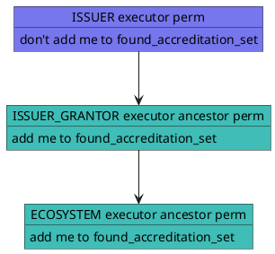

Example 2: `verifier_accreditation`: is not set: it's a credential offer. Schema configured to NOT have Issuer Grantors.

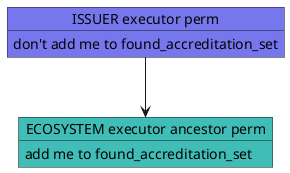

Example 3: `verifier_accreditation` is set, it's a presentation request. Schema configured to have Verifier and Issuer Grantors.

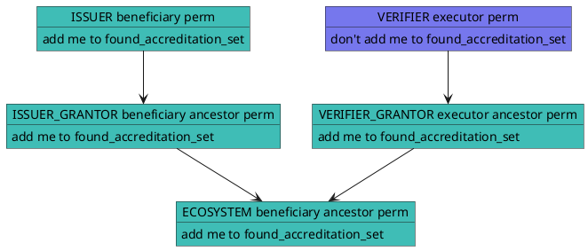

##### [MOD-AC-QRY-4-1] Find Beneficiaries parameters

- `schema_id` (uint64) (*mandatory*): id of the `CredentialSchema` entry.
- `verification` (boolean) (*mandatory*): true for a Credential Verification, false for a Credential Issuance.
- `issuer_accreditation_id` (uint64) (*conditional*): id of the issuer `Accreditation` entry. Exactly one of `issuer_accreditation_id` and `issuer_vs_id` MUST be provided.
- `issuer_vs_id` (uint64) (*conditional*): the issuer's service entry, when the issuer holds no active entry: its branch is the root.
- `verifier_accreditation_id` (uint64) (*conditional*): id of the verifier `Accreditation` entry; in a Credential Verification, exactly one of `verifier_accreditation_id` and `verifier_vs_id` MUST be provided, and none in a Credential Issuance.
- `verifier_vs_id` (uint64) (*conditional*): the verifier's service entry, when the verifier holds no active entry: its branch is the root.

##### [MOD-AC-QRY-4-2] Find Beneficiaries checks

- `schema_id` MUST refer to an existing `CredentialSchema` entry; if `issuer_accreditation_id` (resp. `verifier_accreditation_id`) is specified, the entry's `schema_id` MUST equal `schema_id`; the reference forms MUST be as stated above.
- if `issuer_accreditation_id` is specified, load `issuer_accreditation` from `issuer_accreditation_id`; the `Accreditation` entry MUST exist. Its state does not matter: a future entry (validated, window not yet open) still identifies the branch to pay (see the unrepaid-slash rule below); the exchange method applies its own, stricter, check.
- if `verifier_accreditation_id` is specified, load `verifier_accreditation` from `verifier_accreditation_id`, Accreditation MUST exist and MUST be a [[ref: active accreditation]].

##### [MOD-AC-QRY-4-3] Find Beneficiaries execution

An `Accreditation` entry `p` is **barred** when its participation or its corporation is [[ref: barred]]: a slash debt or an exclusion on deposit(`p`) or on `TrustDeposit[p.corporation_id]`, the condition the definition of [[ref: active accreditation]] reads. Such entries are not added to the set: a barred party receives no fees.


Algorithm. Barred `Accreditation` entries are not added to the set; an expired or revoked entry no longer exists, and a walk that reaches a missing validator stops there.

- create Set `found_accreditation_set`.

- define `current_accreditation` as null.

- load the optional `issuer_accreditation` and `verifier_accreditation` as specified in basic checks above.
- define `root`: the active root entry of `schema_id`, the entry of `CredentialSchema[schema_id].root_accreditation_ids` that is an [[ref: active accreditation]]; null if none is.

Issuer branch:

- if `issuer_accreditation` is not null: set `current_accreditation` = `issuer_accreditation`; while `current_accreditation.validator_accreditation_id` is not null: `current_accreditation` = load(`current_accreditation.validator_accreditation_id`), stopping if it no longer exists; unless `current_accreditation` is barred (see above), add it to `found_accreditation_set`.
- else (the issuer is referenced by its service entry): unless `root` is null or barred, add `root` to `found_accreditation_set`.

Additionally, if `verification` is true:

- if `issuer_accreditation` is not null and not barred (see above), add `issuer_accreditation` to `found_accreditation_set` (an issuer without an entry has no fee terms and receives nothing).
- if `verifier_accreditation` is not null: set `current_accreditation` = `verifier_accreditation`; while `current_accreditation.validator_accreditation_id` is not null: `current_accreditation` = load(`current_accreditation.validator_accreditation_id`), stopping if it no longer exists; unless `current_accreditation` is barred, add it to `found_accreditation_set`.
- else (the verifier is referenced by its service entry): unless `root` is null or barred, add `root` to `found_accreditation_set`.

In every case, unless `root` is null or barred, add `root` to `found_accreditation_set`: the ecosystem is a beneficiary of every exchange. A walk that stops at a deleted validator (a replaced root entry included) pays the ancestors it reached and the current root.

return `found_accreditation_set`.

:::note
A party acting under an OPEN or CREDENTIAL mode, with a self-created entry or none, sits directly under the root: it pays the ecosystem's fees and nothing to any grantor.
:::

#### [MOD-AC-QRY-5] Void

> Note: exchange records are not stored ([CredentialExchange](#credentialexchange)); indexers serve them from the events.

#### [MOD-AC-QRY-6] List Accreditation Module Parameters

##### [MOD-AC-QRY-6-2] List Accreditation Module Parameters parameters and query checks

##### [MOD-AC-QRY-6-3] List Accreditation Module Parameters execution of the query

Return the list of the existing parameters and their values.

##### [MOD-AC-QRY-6-4] List Accreditation Module Parameters API result example

```json
{
  "params": {
    "key1": "value1",
    "key2": "value2",
    ...
    ...
  }
}
```

#### Validation Examples

##### Getting a Credential from an Authorized Issuer

*This section is non-normative.*

Example of an Applicant that would like to get issued a credential (HOLDER):

```plantuml
scale max 800 width
actor "Applicant" as Applicant 
actor "Validator" as CE
participant "Verifiable Public Registry" as VPR #3fbdb6
autonumber "<font color='#7677ed'><b>(run start method)"
Applicant --> VPR #3fbdb6: Create Validation Entry (and pay required Trust Fees).
autonumber stop
VPR <-- VPR: Assign Validator (or use provided Validator).
autonumber "<font color='#7677ed'><b>(end start method)"
Applicant <-- VPR: Transaction completed and Validation entry created
autonumber stop
autonumber "<font color='#7677ed'><b>(connects to Certification Entity Validation VS)"
Applicant --> CE: share id of Accreditation
autonumber stop
Applicant <-- CE: Request proof of account and DID ownership (blind sign)
Applicant --> CE: send blind sign proofs 
note over Applicant, CE #EEEEEE: (*optional*) repeat the following until tasks completed
Applicant <-- CE: Form fill-ins, request proof documents
Applicant --> CE: fill-in forms, provides requested documents...
note over Applicant, CE #EEEEEE: tasks completed
autonumber "<font color='#7677ed'><b>(run validated method)"
CE --> VPR #3fbdb6: Update Validation Entry. Applicant VALIDATED, fees transferred to Validator.
autonumber stop
CE --> VPR #3fbdb6: Record Credential Exchange (digest = credential digestJCS, anchored before delivery).
CE --> Applicant #3fbdb6: Issue Credential.
autonumber stop
```

##### Add a DID to the List of Granted Issuers of a Credential Schema

*This section is non-normative.*

```plantuml
scale max 800 width
actor "Applicant\n(issuer candidate)\nAccount" as ApplicantAccount 
actor "Applicant\n(issuer candidate)\nVS Browser" as ApplicantBrowser 

actor "Validator\n(issuer grantor)\nVS" as ValidatorVS
actor "Validator\n(issuer grantor)\nAccount" as ValidatorAccount

participant "Verifiable Public Registry" as VPR #3fbdb6

ApplicantAccount --> VPR: Start Accreditation OP
VPR <-- VPR: create `Accreditation` entry.
ApplicantAccount <-- VPR: `Accreditation` entry created,\nassigned accreditation.validator_accreditation_id from ISSUER_GRANTOR `Accreditation` entries.
ApplicantBrowser --> ValidatorVS: connect to validator VS DID found in VerifiableService[validator_accreditation.vs_id].vid\nby creating a DIDComm connection
ApplicantBrowser <-- ValidatorVS: DIDComm connection established.
ApplicantBrowser --> ValidatorVS: I want to proceed with accreditation.id=...
ValidatorVS --> ValidatorVS: load perm with id=...\nand verify the associated accreditation.validator_accreditation_id is referring to me
ApplicantBrowser <-- ValidatorVS: request proof of control\nof accreditation.applicant account (blind sign)
ApplicantBrowser --> ValidatorVS: send blind sign proof of account
ApplicantBrowser <-- ValidatorVS: proof accepted, you are the controller\nof validation entry, I trust you.
ApplicantBrowser <-- ValidatorVS: which DID do you want to register as an issuer?
ApplicantBrowser --> ValidatorVS: send DID
ValidatorVS --> ValidatorVS: resolve DID and get pub keys
ApplicantBrowser <-- ValidatorVS: request proof of ownership\nof the DID to be added in an ISSUER `Accreditation` entry (blind sign)
ApplicantBrowser --> ValidatorVS: send blind sign proofs
ApplicantBrowser <-- ValidatorVS: proof accepted, you are the controller of the DID, I trust you.
note over ApplicantBrowser, ValidatorVS #EEEEEE: (*optional*) repeat the following until tasks completed
ApplicantBrowser <-- ValidatorVS: Are you a legitimate issuer?\nProve it, by filling forms, sending documents...
ApplicantBrowser --> ValidatorVS: perform requested tasks...
note over ApplicantBrowser, ValidatorVS #EEEEEE: tasks completed
ApplicantBrowser <-- ValidatorVS: Your are a legitimate issuer. I'll now create an ISSUER `Accreditation` entry for your account and DID.
ValidatorAccount --> VPR #3fbdb6: Set Accreditation OP to Validated\nset validation.state to VALIDATED\n.
VPR --> ValidatorAccount: Receive trust fees.
ApplicantBrowser <-- ValidatorVS: notify `Accreditation` entry added for your DID.\nDID can now issue credentials of this schema.
```

### Trust Deposit Module

#### Trust Deposit Module Overview

*This section is non-normative.*

Concept: the [[ref: trust deposit]] holds the [[ref: trust units]] (TU) of a [[ref: corporation]] and is the basis of its trust score. Trust units are minted when deposit-bound [[ref: native denom]] amounts are spent: the module computes the trust units equivalent at the current [[ref: trust unit peg value]], credits them to the corporation's deposit (per-ecosystem attribution is derivable from its `ParticipationTrustDeposit` entries), and routes the full [[ref: native denom]] amount to the [[ref: distribution pool]]. Alongside each `tu` balance, the module tracks its cumulative [[ref: main fiat currency]] **cost basis** (`fiat_cost`): slashing liabilities are denominated at mint-time cost, not at decayed value. **No [[ref: native denom]] is retained by this module**: trust units are not collateralized, non-transferable and non-convertible. The [[ref: native denom]] spent MAY come from a [[ref: sponsor]] ([[FUND-CHECK]](#fund-check-funding-account-resolution)): trust units are always credited to the corporation that performed the trust operation, never to the account that paid.

Because the [[ref: trust unit peg value]] declines each [[ref: epoch]], a deposit that is not fed by new paid activity loses fiat value at exactly `tu_decay_rate` ("trust decay"): trust is a subscription. Decay is implemented through the single global index — there are **no per-account updates**: a deposit's fiat value at time `T` is `td.tu × tu_peg_value(T)`, and relative rankings compare raw `td.tu` directly (the common factor cancels).

Trust deposits generate **no yield**: the fee-funded yield of the [[ref: VPR]] accrues to [[ref: bonded tokens]] through the [Distribution Module](#distribution-module) mechanism, not to trust deposit holders.

#### Trust Unit Index

The module maintains a single global index, the [[ref: trust unit peg value]] `tu_peg_value(t)`, expressed in [[ref: main fiat currency]] per trust unit:

- At genesis, `tu_peg_value` MUST be initialized to `GlobalVariables.tu_peg_value_genesis`.
- Epochs are counted from genesis: epoch `n` covers the block timestamps from `genesis_time + n × epoch_length` (inclusive) to `genesis_time + (n+1) × epoch_length` (exclusive). The **boundary block** of epoch `n` is the first block whose timestamp falls in epoch `n+1` or later. In that block, after its transactions have executed, the following MUST be performed for epoch `n`, in this order: (1) compute each validator's signed-block ratio over epoch `n`; (2) pay out the [[ref: distribution pool]] per [[DIST-1]](#dist-1-epoch-payout-order), or skip the payout and carry the pool forward when no valid exchange rate is available; (3) update the index: `tu_peg_value = tu_peg_value × (1 - GlobalVariables.tu_decay_rate)`; (4) apply any change of `tu_decay_rate` enacted during epoch `n` (the pending value stored by [[MOD-TD-MSG-4]](#mod-td-msg-4-update-module-parameters)), so that it first affects the decline performed at the boundary of epoch `n+1`; (5) recompute `network_gas_price_native` for epoch `n+1` per [[NET-FEE-1]](#net-fee-1-network-gas-price). The transactions of the boundary block therefore mint at the peg value of epoch `n` and pay fees at the gas price of epoch `n`.
- The module keeps the number of the **last closed epoch** in state (no epoch is closed at genesis). In every block, after its transactions have executed, while the epoch following the last closed epoch has ended (its end timestamp is at or before the block timestamp), the module processes the boundary of that epoch with the five steps above and advances the last closed epoch. A block normally processes one boundary. A block produced after the chain missed `k` boundaries processes them **in sequence**, each with the five steps: decay follows wall-clock time, and a `tu_decay_rate` change enacted before the halt is applied at step (4) of the first missed boundary and governs the declines that follow.
- The index never pauses: a stale exchange rate skips the payout (step 2), never the decline (step 3). An epoch during which no block was produced has no signed blocks: its payout is skipped and the pool carries over, since the budgets compensate validators for running the network.
- `tu_decay_rate` MUST satisfy 0 ≤ `tu_decay_rate` < 1, at genesis and on every update. The index half-life in epochs is ln 2 / −ln(1 − `tu_decay_rate`); the default 0.001 with a one-day epoch gives about 693 days.
- A governance change of `tu_decay_rate` is **prospective only**: it is applied at step (4) of the next boundary and first affects the decline that follows. The index path already elapsed MUST NOT be recomputed: past mints, scores, and fiat-fixed slash debts are unaffected; only the future decline steepens or flattens.
- The price of one trust unit in [[ref: native denom]] is derived from the oracle: `price_tu_in_native_denom(t) = tu_peg_value(t) / P(t)`, where `P(t)` is the current price of one base unit of [[ref: native denom]] in minor units of the [[ref: main fiat currency]], derived from the genesis exchange rate entry `xr` of [[XRG]](#xrg-genesis-exchange-rate) (base (FIAT, `main_fiat_currency`), quote (COIN, native denom): `xr.rate` base units of native denom per minor unit of fiat, scaled by `xr.rate_scale`): `P(t)` = 10^`xr.rate_scale` / `xr.rate`, computed at the ledger precision. It is not obtained through [Get Price](#mod-xr-qry-3-get-price), which converts whole amounts in the stored direction and rounds them down to base units (the price of one base unit of native denom would round to 0). If `xr` is disabled or expired, minting and repayment operations MUST abort.
- **Ledger precision.** `tu_peg_value`, every `tu` and `fiat_cost` balance, and every amount derived from them (minted, slashed, restored) are decimals with exactly 18 fractional digits: the **ledger precision**. Every operation that produces such an amount rounds down to the ledger precision; an amount that rounds to 0 is 0. A fraction of a trust unit is an ordinary balance (at the genesis peg, a deposit-bound amount worth 0.15 units of [[ref: main fiat currency]], 15 minor units of a two-decimal currency, mints 0.15 trust units) and is slashed like any other. Implementations MUST use 128-bit or arbitrary-precision decimal arithmetic: raw balances grow as the index declines (~×1.44/year at the default `tu_decay_rate`). A redenomination MAY be performed at a chain upgrade.
- **Native denom and pricing-coin amounts.** Amounts in [[ref: native denom]] or in a pricing coin are integers of base units. An amount a method derives by a multiplication, a division or a conversion (a deposit-bound portion, a Verifiable User Agent reward, a half of an escrowed deposit) is rounded down to an integer; when an amount is split into parts, every part but the last is rounded down and the last part takes the remainder, so that the parts sum to the whole: in [[MOD-AC-MSG-3-3]](#mod-ac-msg-3-3-set-accreditation-op-to-validated-execution) the validator's half of the escrowed deposit is rounded down and the applicant's half takes the remainder; in [[MOD-AC-MSG-10-4]](#mod-ac-msg-10-4-record-credential-exchange-execution) the deposit-bound portion of a share is rounded down and the part transferred to the payee takes the remainder.

#### [MOD-TD-MSG-1] Mint Trust Units

This method credits [[ref: trust units]] to the [[ref: trust deposit]] of a specific [[ref: corporation]] in exchange for a deposit-bound [[ref: native denom]] amount, and routes that amount to the [[ref: distribution pool]].

Only the modules that require trust deposit manipulation CAN call this method (it is not directly executable by an [[ref: account]]). Callers MUST only invoke it for amounts that are **final**: escrowed amounts of PENDING onboarding processes MUST NOT be minted (they are minted at validation time, or refunded on cancellation — see [[MOD-AC-MSG-3]](#mod-ac-msg-3-set-accreditation-op-to-validated) and [[MOD-AC-MSG-6]](#mod-ac-msg-6-cancel-accreditation-op-last-request)).

##### [MOD-TD-MSG-1-1] Mint Trust Units method parameters

- `corporation_id` (uint64) (*mandatory*): id of the corporation owner of the [[ref: trust deposit]]; `vs_id` MUST be owned by it.
- `vs_id` (uint64), `schema_id` (uint64), `role` (AccreditationRole) (*mandatory*): the participation the mint is attributed to, that is the [ParticipationTrustDeposit](#participationtrustdeposit) `ParticipationTrustDeposit[(vs_id, schema_id, role)]`, created with an empty ledger (`slash_count` 0, `excluded` false) and no entries when it does not exist (a party acting under an OPEN or CREDENTIAL mode without an entry).
- `source_account` (account) (*mandatory*): account funding the mint (the payer's [[ref: funding account]], or the escrow account at validation time).
- `amount` (number) (*mandatory*): deposit-bound amount, in [[ref: native denom]].

##### [MOD-TD-MSG-1-2] Mint Trust Units precondition checks

If any of these precondition checks fail, [[ref: transaction]] MUST abort.

###### [MOD-TD-MSG-1-2-1] Mint Trust Units basic checks

- if a mandatory parameter is not present, [[ref: transaction]] MUST abort.
- `amount` MUST be strictly positive.
- neither `TrustDeposit[corporation_id]` (if it exists) nor `ParticipationTrustDeposit[(vs_id, schema_id, role)]` (if it exists) MAY be [[ref: barred]] (`unrepaid_slash` > 0 or `excluded`), else [[ref: transaction]] MUST abort: no trust units are minted to a barred participation or corporation.
- the exchange rate entry of [[XRG]](#xrg-genesis-exchange-rate) MUST be enabled and not expired ([Trust Unit Index](#trust-unit-index)), else [[ref: transaction]] MUST abort.

###### [MOD-TD-MSG-1-2-2] Mint Trust Units fee checks

- `source_account` MUST have `amount` in its [[ref: account]], else [[ref: transaction]] MUST abort.

##### [MOD-TD-MSG-1-3] Mint Trust Units execution of the method

If all precondition checks passed, method is executed in a [[ref: transaction]].

Method execution MUST perform the following tasks in a [[ref: transaction]], and rollback if any error occurs.

- if a `TrustDeposit` entry `td` whose `td.corporation_id` equals the supplied `corporation_id` does not exist, create entry `td`:
  - set `td.corporation_id` to `corporation_id`;
  - set `td.tu` to 0; set `td.fiat_cost` to 0;
- calculate `minted_fiat` = `amount` × `P(now)`, at the ledger precision — the [[ref: main fiat currency]] cost of this mint, in minor units.
- calculate `minted_tu` = `minted_fiat` / `tu_peg_value(now)`, rounded down to the ledger precision ([Trust Unit Index](#trust-unit-index)) (equivalently `amount` / `price_tu_in_native_denom(now)`).
- set `td.tu` to `td.tu` + `minted_tu`; set `td.fiat_cost` to `td.fiat_cost` + `minted_fiat`.
- let `d` be `ParticipationTrustDeposit[(vs_id, schema_id, role)]`, created with `tu`, `fiat_cost`, `unrepaid_slash` and `slash_count` at 0, `excluded` false and an empty `accreditation_ids` if it does not exist; set `d.tu` to `d.tu` + `minted_tu`; set `d.fiat_cost` to `d.fiat_cost` + `minted_fiat`.
- transfer `amount` from `source_account` to the [[ref: distribution pool]] account.
- return `minted_tu` and `minted_fiat` to the calling module.

:::note
There is no negative adjustment path: trust units are never un-minted. Refunds only exist at the escrow level, **before** minting (Option: mint-at-validation). Trust units only decrease through slashing.
:::

#### [MOD-TD-MSG-2] Void

#### [MOD-TD-MSG-3] Void

#### [MOD-TD-MSG-4] Update Module Parameters

Update Module Parameters.

Can only be executed through a [[ref: governance proposal]].

##### [MOD-TD-MSG-4-1] Update Module Parameters parameters

- `params` (KeySet<String, String>): the parameters to update and their values.

##### [MOD-TD-MSG-4-2] Update Module Parameters precondition checks

If any of these precondition checks fail, [[ref: transaction]] MUST abort.

###### [MOD-TD-MSG-4-2-1] Update Module Parameters basic checks

- `params`: size of `params` MUST be greater than 0. For each `param` <`key`, `value`> `key` MUST exist, else abort.
- `tu_peg_value_genesis`, `main_fiat_currency`, `epoch_length` and `vna_total_supply` MUST NOT be updatable ([GlobalVariables](#globalvariables)): the index only moves through decay, and the other three would re-denominate or re-index everything.
- `network_gas_price` and `max_gas_per_msg_type`, if updated, take effect as stated by [[NET-FEE-1]](#net-fee-1-network-gas-price) and [[NET-FEE-3]](#net-fee-3-gas-cap-for-fee-granted-transactions).
- `tu_decay_rate`, if updated, MUST satisfy 0 ≤ value < 1, else abort.
- an update of `tu_decay_rate` MUST be applied prospectively, at step (4) of the next epoch boundary (see [Trust Unit Index](#trust-unit-index)).

###### [MOD-TD-MSG-4-2-2] Update Module Parameters fee checks

provided transaction fees MUST be sufficient for execution

##### [MOD-TD-MSG-4-3] Update Module Parameters execution

If all precondition checks passed, [[ref: transaction]] is executed.

Method execution MUST perform the following tasks in a [[ref: transaction]], and rollback if any error occurs.

for each parameter `param` <`key`, `value`> in `parameters`:

- update parameter set value = `value` where key = `key`.

A new value of `tu_decay_rate` is not written to `GlobalVariables.tu_decay_rate` by this method: it is stored as the module's pending rate and written at step (4) of the next epoch boundary ([Trust Unit Index](#trust-unit-index)), so that the decline of step (3) never reads an unapplied value.

#### [MOD-TD-MSG-5] Slash Trust Deposit

This method is used by the network governance authority to **globally slash** the trust deposit of a [[ref: corporation]], under the rules of the [[ref: NGF]].

This method can only be called by a [[ref: governance proposal]]. Slashing removes [[ref: trust units]] from the corporation's [[ref: trust deposit]] and records a debt denominated in [[ref: main fiat currency]], equal to their **mint-time cost basis** — what was originally paid for them, not their decayed value: reputation decays, **liabilities do not** (misbehavior against the network costs the same whether the deposit was funded yesterday or a year ago). A slashed corporation MUST repay the debt ([[MOD-TD-MSG-6]](#mod-td-msg-6-repay-slash)) in order to continue to use the services provided by the VPR: while the debt is unrepaid the corporation is [[ref: barred]], none of its entries is active and no trust units can be minted to its deposit. Network governance MAY also exclude the corporation (`exclude`): it then stays barred after repayment until the exclusion is lifted ([[MOD-TD-MSG-8]](#mod-td-msg-8-set-corporation-exclusion)), and everything it issued or validated resolves as untrusted while the exclusion stands ([[ref: VT spec]]).

The parts of the trust deposit, the [ParticipationTrustDeposit](#participationtrustdeposit) entries, are not touched: a network slash takes a fraction of what the trust deposit currently holds, after any ecosystem slash, and the corporation repays it in one payment. For ecosystem slash, see [Slash Participation Trust Deposit](#mod-ac-msg-12-slash-participation-trust-deposit).

##### [MOD-TD-MSG-5-1] Slash Trust Deposit method parameters

- `corporation_id` (uint64) (*mandatory*): id of the corporation we want to slash.
- `percent` (decimal) (*mandatory*): the fraction of the corporation's [[ref: trust deposit]] to slash, greater than 0 and at most 1.
- `exclude` (boolean) (*mandatory*): the network's decision to exclude the corporation in addition to the debt: true withdraws trust from everything the corporation issued or validated ([[ref: VT spec]]) and bars it until network governance lifts it ([[MOD-TD-MSG-8]](#mod-td-msg-8-set-corporation-exclusion)); false bars it until the debt is repaid only. A later slash with false does not clear an earlier exclusion.

##### [MOD-TD-MSG-5-2] Slash Trust Deposit precondition checks

If any of these precondition checks fail, [[ref: transaction]] MUST abort.

###### [MOD-TD-MSG-5-2-1] Slash Trust Deposit basic checks

if any of these conditions is not satisfied, [[ref: transaction]] MUST abort.

- `percent` MUST be greater than 0 and lower or equal to 1.
- `TrustDeposit` entry `td` whose `td.corporation_id` equals the supplied `corporation_id` MUST exist, and `td.tu` MUST be greater than 0.

###### [MOD-TD-MSG-5-2-2] Slash Trust Deposit fee checks

Fee payer MUST have the required [[ref: estimated transaction fees]] in its [[ref: account]], else [[ref: transaction]] MUST abort.

##### [MOD-TD-MSG-5-3] Slash Trust Deposit execution of the method

Method execution MUST perform the following tasks in a [[ref: transaction]], and rollback if any error occurs.

- define `now`: current timestamp.
- load the `TrustDeposit` entry `td` whose `td.corporation_id` equals the supplied `corporation_id`.
- calculate `tu_amount` = `td.tu` × `percent`, rounded down to the ledger precision ([Trust Unit Index](#trust-unit-index)): the amount of trust units removed; if it is 0, abort. With `percent` = 1, `tu_amount` equals `td.tu` exactly.
- calculate `fiat_amount` = `td.fiat_cost` × `tu_amount` / `td.tu`, rounded down to the ledger precision: the mint-time cost basis of the removed units; with `percent` = 1, `fiat_amount` equals `td.fiat_cost` exactly.
- set `td.tu` to `td.tu` - `tu_amount`; set `td.fiat_cost` to `td.fiat_cost` - `fiat_amount`.
- set `td.unrepaid_slash` to `td.unrepaid_slash` + `tu_amount`; set `td.unrepaid_fiat` to `td.unrepaid_fiat` + `fiat_amount`; set `td.slash_count` to `td.slash_count` + 1; if `exclude` is true, set `td.excluded` to true. The `ParticipationTrustDeposit` entries of the corporation are not touched.
- emit an event carrying `corporation_id`, `tu_amount`, `fiat_amount`, `exclude` and `now`.


:::note
Nothing is burned here: [[ref: trust units]] are not a token. The economic penalty is the loss of trust score plus the cost-basis repayment debt — which, because the peg only declines, is always at least (and typically more than) the slashed units' current value.
:::

#### [MOD-TD-MSG-6] Repay Slash

Any authorized `operator` CAN execute this method on behalf of a `corporation` to repay a slash debt: the debt of one of its participations (an ecosystem slash, [[MOD-AC-MSG-12]](#mod-ac-msg-12-slash-participation-trust-deposit)) or its network debt ([[MOD-TD-MSG-5]](#mod-td-msg-5-slash-trust-deposit)). Repayment is made in [[ref: native denom]] worth the debt's mint-time cost basis (`unrepaid_fiat`) at current rates, routed to the [[ref: distribution pool]]; the slashed trust units and their cost basis are restored to the [ParticipationTrustDeposit](#participationtrustdeposit) entry, or to the [TrustDeposit](#trustdeposit) for a network debt, and the debt is cleared; the slash count and any exclusion stay. No trust units are minted. A debt is repaid in full in one message, successive unrepaid slashes having accumulated into it; partial repayment (installments) is a candidate for a later version.

##### [MOD-TD-MSG-6-1] Repay Slash method parameters

- `corporation` (account): (Signer) the `policy_address` of the corporation on whose behalf this message is executed.
- `operator` (account): (Signer) the account authorized by the `corporation` to run this Msg.
- `vs_id` (uint64), `schema_id` (uint64), `role` (AccreditationRole) (*conditional*): the participation whose debt is repaid, `ParticipationTrustDeposit[(vs_id, schema_id, role)]`; all three present, or none to repay the corporation's network debt.

##### [MOD-TD-MSG-6-2] Repay Slash precondition checks

If any of these precondition checks fail, [[ref: transaction]] MUST abort.

###### [MOD-TD-MSG-6-2-1] Repay Slash basic checks

if any of these conditions is not satisfied, [[ref: transaction]] MUST abort.

- `corporation` (account): (Signer) signature must be verified.
- `operator` (account): (Signer) signature must be verified.
- [[AUTHZ-CHECK]](#authz-check-common-authorization-and-fee-grant-checks) MUST pass for this (`corporation`, `operator`) pair and this message type.
- if `vs_id` is given: `d` = `ParticipationTrustDeposit[(vs_id, schema_id, role)]` MUST exist, `VerifiableService[vs_id].corporation_id` MUST equal `co.id` (where `co` is the `Corporation` entry resolved from the signing `corporation` account), and `d.unrepaid_slash` MUST be greater than 0; else: `td` = `TrustDeposit[co.id]` MUST exist, with `td.unrepaid_slash` greater than 0. Let `debt_tu` and `debt_fiat` be the `unrepaid_slash` and `unrepaid_fiat` of that entry.
- the exchange rate entry of [[XRG]](#xrg-genesis-exchange-rate) MUST be enabled and not expired ([Trust Unit Index](#trust-unit-index)).

###### [MOD-TD-MSG-6-2-2] Repay Slash fee checks

- Fee payer MUST have the required [[ref: estimated transaction fees]] in its [[ref: account]];
- calculate `repay_amount` = `debt_fiat` / `P(now)`, rounded up to an integer number of [[ref: native denom]] base units, where `P(now)` is the price defined in [Trust Unit Index](#trust-unit-index). The [[ref: funding account]] of `co` MUST cover `repay_amount` ([[FUND-CHECK-1]](#fund-check-1-debit)), else [[ref: transaction]] MUST abort.

##### [MOD-TD-MSG-6-3] Repay Slash execution of the method

Method execution MUST perform the following tasks in a [[ref: transaction]], and rollback if any error occurs.

- define `now`: current timestamp.
- calculate `repay_amount` as in fee checks.
- debit `repay_amount` from `co` per [[FUND-CHECK-1]](#fund-check-1-debit) and transfer it to the [[ref: distribution pool]] account.
- if `vs_id` is given: set `d.tu` to `d.tu` + `debt_tu`; set `d.fiat_cost` to `d.fiat_cost` + `debt_fiat`; set `d.unrepaid_slash` and `d.unrepaid_fiat` to 0; for the `TrustDeposit` entry `td` of `co`: set `td.tu` to `td.tu` + `debt_tu`; set `td.fiat_cost` to `td.fiat_cost` + `debt_fiat`.
- else: set `td.tu` to `td.tu` + `debt_tu`; set `td.fiat_cost` to `td.fiat_cost` + `debt_fiat`; set `td.unrepaid_slash` and `td.unrepaid_fiat` to 0.
- emit an event carrying `co.id`, the participation key when given, `debt_tu`, `debt_fiat` and `now`.

#### [MOD-TD-MSG-7] Record Ecosystem Slash

Removes [[ref: trust units]] slashed by [[MOD-AC-MSG-12]](#mod-ac-msg-12-slash-participation-trust-deposit) from the corporation's [[ref: trust deposit]] and records the debt, and the exclusion when decided, on the participation's [ParticipationTrustDeposit](#participationtrustdeposit). This method can only be called by the accreditation module.

:::warning
Make sure to **properly protect access to the execution of this method** else it may lead to very destructive actions.
:::

##### [MOD-TD-MSG-7-1] Record Ecosystem Slash method parameters

- `corporation_id` (uint64) (*mandatory*): id of the corporation of the [[ref: trust deposit]].
- `vs_id` (uint64), `schema_id` (uint64), `role` (AccreditationRole) (*mandatory*): the slashed participation, `ParticipationTrustDeposit[(vs_id, schema_id, role)]`, whose service entry belongs to `corporation_id`.
- `tu_amount` (decimal) (*mandatory*): amount of [[ref: trust units]] removed.
- `fiat_amount` (decimal) (*mandatory*): cost basis of the removed trust units, in [[ref: main fiat currency]], as computed by the caller.
- `exclude` (boolean) (*mandatory*): whether the participation is excluded as well ([[MOD-AC-MSG-12]](#mod-ac-msg-12-slash-participation-trust-deposit)).

##### [MOD-TD-MSG-7-2] Record Ecosystem Slash precondition checks

If any of these precondition checks fail, [[ref: transaction]] MUST abort.

###### [MOD-TD-MSG-7-2-1] Record Ecosystem Slash basic checks

if any of these conditions is not satisfied, [[ref: transaction]] MUST abort.

- `tu_amount` must be > 0 and `fiat_amount` must be ≥ 0.
- `TrustDeposit` entry `td` whose `td.corporation_id` equals the supplied `corporation_id` MUST exist, with `td.tu` ≥ `tu_amount`, `td.fiat_cost` ≥ `fiat_amount` and `td.unrepaid_slash` = 0 (no open network debt).
- the deposit `d` = `ParticipationTrustDeposit[(vs_id, schema_id, role)]` MUST exist, with `d.tu` ≥ `tu_amount` and `d.fiat_cost` ≥ `fiat_amount`.

###### [MOD-TD-MSG-7-2-2] Record Ecosystem Slash fee checks

Fee payer running the [[ref: transaction]] MUST have the required [[ref: estimated transaction fees]] in its [[ref: account]] else [[ref: transaction]] MUST abort.

##### [MOD-TD-MSG-7-3] Record Ecosystem Slash execution of the method

Method execution MUST perform the following tasks in a [[ref: transaction]], and rollback if any error occurs.

- define `now`: current timestamp.
- set `td.tu` to `td.tu` - `tu_amount`; set `td.fiat_cost` to `td.fiat_cost` - `fiat_amount`.
- set `d.tu` to `d.tu` - `tu_amount`; set `d.fiat_cost` to `d.fiat_cost` - `fiat_amount`; set `d.unrepaid_slash` to `d.unrepaid_slash` + `tu_amount`; set `d.unrepaid_fiat` to `d.unrepaid_fiat` + `fiat_amount`; set `d.slash_count` to `d.slash_count` + 1; if `exclude` is true, set `d.excluded` to true.

#### [MOD-TD-MSG-8] Set Corporation Exclusion

This method can only be called by a [[ref: governance proposal]]. It sets or lifts the exclusion of a [[ref: corporation]] (`TrustDeposit.excluded`). With `excluded` true, the network withdraws trust from the corporation without slashing it: the corporation is [[ref: barred]], none of its entries is active, and everything it issued or validated resolves as untrusted while the exclusion stands ([[ref: VT spec]]); a network slash ([[MOD-TD-MSG-5]](#mod-td-msg-5-slash-trust-deposit)) sets the same flag while also taking trust units. With `excluded` false, it lifts an exclusion set by a slash or by this method: the network's decision that the corporation may take part again. A slash itself is not undone: the corporation stays barred while its debt is unrepaid ([[MOD-TD-MSG-6]](#mod-td-msg-6-repay-slash)), and `slash_count` keeps its value.

##### [MOD-TD-MSG-8-1] Set Corporation Exclusion method parameters

- `corporation_id` (uint64) (*mandatory*): id of the corporation.
- `excluded` (boolean) (*mandatory*): the new value of the flag.

##### [MOD-TD-MSG-8-2] Set Corporation Exclusion precondition checks

If any of these precondition checks fail, [[ref: transaction]] MUST abort.

###### [MOD-TD-MSG-8-2-1] Set Corporation Exclusion basic checks

- `Corporation[corporation_id]` MUST exist, else abort. If the `TrustDeposit` entry `td` whose `td.corporation_id` equals `corporation_id` exists, `td.excluded` MUST differ from `excluded`, else abort (nothing to change); if it does not exist, `excluded` MUST be true, else abort.

###### [MOD-TD-MSG-8-2-2] Set Corporation Exclusion fee checks

Fee payer MUST have the required [[ref: estimated transaction fees]] in its [[ref: account]], else [[ref: transaction]] MUST abort.

##### [MOD-TD-MSG-8-3] Set Corporation Exclusion execution of the method

Method execution MUST perform the following tasks in a [[ref: transaction]], and rollback if any error occurs.

- if `td` does not exist, create it with `tu`, `fiat_cost`, `unrepaid_slash`, `unrepaid_fiat` and `slash_count` at 0 and `excluded` false.
- set `td.excluded` to `excluded`.

The method MUST emit an event carrying `corporation_id`, `excluded` and the current timestamp.

#### [MOD-TD-QRY-1] Get Trust Deposit

Any [[ref: account]] CAN run this [[ref: query]]. As this method does not modify data, it does not require a [[ref: transaction]].

##### [MOD-TD-QRY-1-1] Get Trust Deposit query parameters

- `corporation_id` (uint64) (*mandatory*): id of the [[ref: corporation]] for which we want to get the [[ref: trust deposit]] value.

##### [MOD-TD-QRY-1-2] Get Trust Deposit query checks

If any of these checks fail, [[ref: query]] MUST fail.

- `corporation_id` must be a valid uint64.

##### [MOD-TD-QRY-1-3] Get Trust Deposit execution of the query

Return the `TrustDeposit` entry whose `corporation_id` equals the supplied `corporation_id`, if any, together with the current `tu_peg_value` (so consumers can derive the fiat score `tu × tu_peg_value`). If no entry exists, return not found.

#### [MOD-TD-QRY-2] List Module Parameters

Anyone CAN run this [[ref: query]].

##### [MOD-TD-QRY-2-2] List Module Parameters parameters and query checks

##### [MOD-TD-QRY-2-3] List Module Parameters execution of the query

Return the list of the existing parameters and their values.

##### [MOD-TD-QRY-2-4] List Module Parameters API result example

```json
{
  "params": {
    "key1": "value1",
    "key2": "value2",
    ...
    ...
  }
}
```

#### [MOD-TD-QRY-4] Get Network Gas Price

Anyone CAN run this [[ref: query]]. Clients use it to compute the fee of a transaction ([[NET-FEE-2]](#net-fee-2-required-fee)).

##### [MOD-TD-QRY-4-1] Get Network Gas Price parameters

None.

##### [MOD-TD-QRY-4-3] Get Network Gas Price execution of the query

Return:

- `network_gas_price` (decimal): `GlobalVariables.network_gas_price`, in [[ref: main fiat currency]] per unit of gas;
- `network_gas_price_native` (decimal): the price of one unit of gas in [[ref: native denom]] base units for the current [[ref: epoch]] ([[NET-FEE-1]](#net-fee-1-network-gas-price));
- `epoch` (number): the current epoch number, and `epoch_ends` (timestamp): the start of the next epoch, after which `network_gas_price_native` may change;
- `max_gas_per_msg_type` (map<string, number>): `GlobalVariables.max_gas_per_msg_type`.

#### [MOD-TD-QRY-5] Get Participation Trust Deposit

Any [[ref: account]] CAN run this [[ref: query]].

##### [MOD-TD-QRY-5-1] Get Participation Trust Deposit query parameters

- `vs_id` (uint64), `schema_id` (uint64), `role` (AccreditationRole) (*mandatory*): the participation; the corporation of the deposit is the owner of `vs_id`.

##### [MOD-TD-QRY-5-2] Get Participation Trust Deposit query checks

- `vs_id` and `schema_id` MUST be valid uint64, `role` a valid AccreditationRole.

##### [MOD-TD-QRY-5-3] Get Participation Trust Deposit execution of the query

Return the [ParticipationTrustDeposit](#participationtrustdeposit) entry `ParticipationTrustDeposit[(vs_id, schema_id, role)]`, if any, with the current `tu_peg_value`. If no entry exists, return not found.

### Network Fees

#### Network Fees Overview

*This section is non-normative.*

Every [[ref: transaction]] pays [[ref: network fees]] in [[ref: native denom]], and all of them flow into the [[ref: distribution pool]]. The VPR is a council-run proof-of-authority network whose validators are paid budgets from that pool ([[DIST-1]](#dist-1-epoch-payout-order)): validators do not compete on fees, so there is neither a fee market nor a validator-local price. The price of gas is a network parameter expressed in the [[ref: main fiat currency]] and converted into [[ref: native denom]] once per [[ref: epoch]]. Three consequences follow. The cost of a message is constant in fiat for a whole epoch and identical for every validator and every block, which lets corporations and their sponsors budget in fiat. The fee a transaction carries is a **maximum**: the network deducts the required fee and never the declared excess, so a client can sign generously and pay exactly. And because the price is fixed, the only lever left to the payer of a fee is the gas limit, which is why fee-granted transactions are capped per message type.

#### [NET-FEE-1] Network Gas Price

- `GlobalVariables.network_gas_price` is the price of one unit of gas in [[ref: main fiat currency]].
- The module maintains the derived state `network_gas_price_native`, the price of one unit of gas in [[ref: native denom]] base units for the current [[ref: epoch]], computed as `network_gas_price × rate / 10^rate_scale` from the `ExchangeRate` entry with base (FIAT, `main_fiat_currency`) and quote (COIN, [[ref: native denom]]) required by [[XRG]](#xrg-genesis-exchange-rate). Implementations MUST use 128-bit or arbitrary-precision decimal arithmetic: the price of one unit of gas is a small fraction of one base unit.
- At genesis, `network_gas_price_native` MUST be computed from the genesis values of `network_gas_price` and of that `ExchangeRate` entry. The genesis state MUST therefore define `GlobalVariables.main_fiat_currency`, `GlobalVariables.network_gas_price` and the exchange rate between the main fiat currency and the native denom: without them no transaction fee can be computed and no transaction can be executed.
- In the boundary block of each epoch, as step (5) of the boundary sequence defined in [Trust Unit Index](#trust-unit-index), `network_gas_price_native` MUST be recomputed for the next epoch. If no valid (non-expired) exchange rate is available at that moment, the last stored rate MUST be used even if expired: unlike minting and repayment, fee computation never aborts for lack of a rate, so that the chain, and the exchange-rate update transaction itself, keep working.
- Within an epoch `network_gas_price_native` MUST NOT change. A governance change of `network_gas_price` takes effect at the next boundary.
- The current values are returned by [[MOD-TD-QRY-4]](#mod-td-qry-4-get-network-gas-price).

#### [NET-FEE-2] Required Fee

- The required fee of a transaction is `required_fee` = `gas_limit × network_gas_price_native`, rounded up to an integer number of [[ref: native denom]] base units. Network fees MUST be paid in [[ref: native denom]] only.
- A transaction whose declared fee is lower than `required_fee` MUST be rejected, at mempool admission and at block execution, by every validator. Validators MUST NOT apply a local minimum gas price, whether higher or lower: the [[ref: network gas price]] is the only price, and a block containing a transaction paying less than its required fee is invalid.
- The declared fee is a **maximum**. The amount deducted from the fee payer MUST be `required_fee`; the declared excess MUST NOT be deducted. The fee payer is the transaction's signer, or the fee `granter` it names when the corresponding allowance accepts the draw ([[AUTHZ-CHECK-2]](#authz-check-2-fee-grant-checks), [[AUTHZ-CHECK-4]](#authz-check-4-vs-operator-fee-grant-checks)), or that granter's sponsor under the sponsored-fees rule of the [Delegation Module](#delegation-module).
- The fee is deducted before execution. A transaction that fails during execution still pays `required_fee`. Gas declared but not used is not refunded; a refund of unused gas for successful transactions MAY be introduced in a later version.
- The whole fee is routed to the [[ref: distribution pool]].

> Realization: the standard fee decorator deducts the fee returned by its fee checker; a VPR fee checker returns `required_fee` after verifying that the declared fee covers it, in both admission and execution modes. Simulation is unaffected. This replaces the validator-local minimum-gas-prices configuration, which MUST be ignored. Changing the fee checker is consensus-breaking and ships with a chain upgrade.

#### [NET-FEE-3] Gas Cap for Fee-Granted Transactions

When the account paying the fee is not the transaction's signer (an operator fee grant per [[AUTHZ-CHECK-2]](#authz-check-2-fee-grant-checks), the VS operator allowance per [[AUTHZ-CHECK-4]](#authz-check-4-vs-operator-fee-grant-checks), or any other allowance granted by a corporation's `policy_address`), the transaction's `gas_limit` MUST NOT exceed the sum, over the messages it carries, of `GlobalVariables.max_gas_per_msg_type[type URL of the message]`, a message type absent from the map counting as 0. Otherwise the fee draw MUST be refused and the transaction rejected before any deduction. Transactions paid by their own signer are not subject to this cap.

> Rationale: with a fixed network gas price, the gas limit is the only part of the fee a grantee controls. The cap bounds what any grantee can draw from a corporation's account to `max_gas × network_gas_price_native` per message, whatever caps the corporation set or forgot to set on its own grants, which protects it from a misconfigured front end or a compromised operator key. The per-period budgets of the fee grants bound the volume; this rule bounds the unit.

#### Client guidance

*This section is non-normative.*

A client estimates gas by simulation, applies its usual gas adjustment, reads `network_gas_price_native` through [[MOD-TD-QRY-4]](#mod-td-qry-4-get-network-gas-price) and signs `fee = gas_limit × network_gas_price_native`. Within an epoch the required fee does not move. A transaction signed just before a boundary and executed just after it is rejected before any deduction if the new price is higher, and is simply resubmitted; a client MAY sign with a small margin to avoid even that, since the excess is never deducted, and the exchange-rate authorization bounds how far the rate can move per update. Wallets SHOULD display the signed fee as a maximum. A fee-granted client keeps `gas_limit` under the sum of the caps of [[NET-FEE-3]](#net-fee-3-gas-cap-for-fee-granted-transactions) for the messages it batches.

### Distribution Module

#### Distribution Overview

*This section is non-normative.*

All deposit-bound [[ref: native denom]] (see [[MOD-TD-MSG-1]](#mod-td-msg-1-mint-trust-units)) and all [[ref: network fees]] (see [Network Fees](#network-fees)) flow into a single [[ref: distribution pool]]. At each [[ref: epoch]] boundary the pool is paid out in a fixed order — budgets first, then a capped yield, then **the residual is burned**. Structural sell pressure is therefore **bounded by construction** (operating budgets plus a capped yield), while the burn is the elastic residual that grows automatically with adoption. Because budgets and the burn are fiat-denominated, the burn is **self-damping** (price up → fewer tokens burned) and **countercyclical** (price down → more tokens burned).

#### [DIST-1] Epoch payout order

In the boundary block of each [[ref: epoch]], at step (2) of the boundary sequence defined in [Trust Unit Index](#trust-unit-index), the [[ref: distribution pool]] balance MUST be paid out in the following order. Epochs during which no block was produced are not paid: the pool carries over. Fiat-denominated amounts are converted to [[ref: native denom]] at the current oracle rate ([Get Price](#mod-xr-qry-3-get-price)); if no valid rate is available, the payout MUST be skipped and retried at the next epoch (amounts remain in the pool).

1. **Validators** — each active validator node receives `validator_node_budget` (in [[ref: main fiat currency]], oracle-converted), **docked by uptime**. The KPI is the node's signed-block ratio over the elapsed epoch, obtained from consensus signing info (objective, no oracle):
   - ratio ≥ `validator_target_uptime`: full payment;
   - `validator_min_uptime` ≤ ratio < `validator_target_uptime`: linear pro-ration between zero and full payment;
   - ratio < `validator_min_uptime`: zero.
   Docked amounts remain in the pool (they join the burn residual). Persistent under-performance escalates to the council's governance processes (term review) — separate from payment docking.
2. **Council treasury** — `council_budget` (oracle-converted).
3. **Foundation treasury** — `foundation_budget` (oracle-converted).
4. **Bonded token holders** — a **capped, fee-funded, pro-rata** yield: it accrues only to [[ref: native denom]] bonded through the bonding mechanism of [[DIST-2]](#dist-2-bonding) (subject to `unbonding_period`), pro-rata to each holder's time-weighted bonded amount over the closed epoch (as tracked by a stake-seconds accumulator, so that bonding just before the boundary earns nothing), and hard-capped: a holder's cap for the epoch is its time-weighted bonded amount × `vna_holder_max_yield_rate` × `epoch_length` / 365 days (linear pro-rata of the yearly rate, no compounding, no oracle needed). Per epoch, the payout equals min(pool remainder after budgets, sum of per-holder caps), distributed pro-rata to those amounts; the excess joins the residual. This item applies only while `GlobalVariables.bonding_enabled` is true; otherwise it is skipped and the remainder is burned.
5. **Residual → burned.** Whatever remains after 1–4 MUST be burned. Burn is not a parameter: it is the automatic pool residual.

The [[ref: native denom]] supply is `GlobalVariables.vna_total_supply` at genesis. Native denom MUST NOT be minted after network launch; the supply is strictly non-increasing.

If the pool balance is insufficient to cover items 1–3 (bootstrap phase), the available balance MUST be distributed in order (validators first) and the shortfall is covered off-protocol by treasuries or vesting grants — **never by token emission**.

Payouts SHOULD stream linearly over the epoch rather than in a single burst; treasuries are expected to publish sale policies (e.g. TWAP-based).

#### [DIST-2] Bonding

Bonding is available only while `GlobalVariables.bonding_enabled` is true. It uses staking-style reward accounting (O(1) distribution accumulator, yield follows time-in-bond, exit behind `unbonding_period`), but **bonding MUST NOT alter consensus power or governance power**: it is therefore not a plain delegation to the validators through the standard staking module, whose delegations carry voting power, but a dedicated bonding mechanism reusing the accumulator. The network remains council-run Proof-of-Authority, one member one vote; bonded tokens are reward accounting only. Validators are ordinary holders too: they MAY bond their own tokens and earn the capped yield on top of the node budget, under exactly the same rules and cap as everyone else.

:::todo
**Open design question**: the bonding mechanism (a dedicated bonding module reusing the distribution accumulator, or staking hooks that leave validator power unchanged) is intentionally left open at this stage and will be specified before `bonding_enabled` can be set to true.
:::

:::note
**Pending legal review**: distribution of fee revenue to passive bonded holders is dividend-like and strengthens a securities analysis of the token. The cap, the fee funding (no emission), and the bonding requirement mitigate but do not settle this. `bonding_enabled` MUST NOT be set to true before legal counsel has reviewed it.
:::

#### [MOD-DS-MSG-1] Update Module Parameters

Update the Distribution parameters of [[GLO]](#glo-global-variables): `validator_node_budget`, `validator_target_uptime`, `validator_min_uptime`, `council_budget`, `foundation_budget`, `vna_holder_max_yield_rate`, `unbonding_period` and `bonding_enabled`.

Can only be executed through a [[ref: governance proposal]].

##### [MOD-DS-MSG-1-1] Update Module Parameters parameters

- `params` (KeySet<String, String>): the parameters to update and their values.

##### [MOD-DS-MSG-1-2] Update Module Parameters precondition checks

If any of these precondition checks fail, [[ref: transaction]] MUST abort.

###### [MOD-DS-MSG-1-2-1] Update Module Parameters basic checks

- `params`: size of `params` MUST be greater than 0. For each `param` <`key`, `value`>, `key` MUST be one of the Distribution parameters listed above, else abort.
- `validator_node_budget`, `council_budget` and `foundation_budget`, if updated, MUST be ≥ 0, in [[ref: main fiat currency]].
- `validator_target_uptime` and `validator_min_uptime`: the resulting values MUST satisfy 0 ≤ `validator_min_uptime` ≤ `validator_target_uptime` ≤ 1, else abort.
- `vna_holder_max_yield_rate`, if updated, MUST be ≥ 0.
- `unbonding_period`, if updated, MUST be a duration greater than 0.
- `bonding_enabled`, if updated, MUST be a boolean. It MUST NOT be set to true before the bonding mechanism of [[DIST-2]](#dist-2-bonding) is specified and the legal review recorded there is completed: this is a condition on the [[ref: governance proposal]], which the protocol cannot verify.

###### [MOD-DS-MSG-1-2-2] Update Module Parameters fee checks

provided transaction fees MUST be sufficient for execution

##### [MOD-DS-MSG-1-3] Update Module Parameters execution

If all precondition checks passed, [[ref: transaction]] is executed.

Method execution MUST perform the following tasks in a [[ref: transaction]], and rollback if any error occurs.

for each parameter `param` <`key`, `value`> in `parameters`:

- update parameter set value = `value` where key = `key`.

The values in force in a boundary block apply to the payout performed in that block ([[DIST-1]](#dist-1-epoch-payout-order)): a change made during an epoch first affects the payout of that epoch.

### Delegation Module

**Transaction-fee payment on behalf of a corporation (fee grants):** When a `corporation` pays the transaction fees for a grantee (an `operator` per [[AUTHZ-CHECK-2]](#authz-check-2-fee-grant-checks), or a `vs_operator` per [[AUTHZ-CHECK-4]](#authz-check-4-vs-operator-fee-grant-checks)), fee payment is handled via the Cosmos SDK `x/feegrant` module; the VPR keeps no fee ledger of its own, and its only additions to fee processing are the fee checker of [[NET-FEE-2]](#net-fee-2-required-fee), the gas cap of [[NET-FEE-3]](#net-fee-3-gas-cap-for-fee-granted-transactions) and the sponsored-fees decorator below. Implementations MUST realize each on-chain `FeeGrant` as an `x/feegrant` allowance granted by the corporation's `policy_address` (the granter) to the `grantee`: an `AllowedMsgAllowance` (whose `allowed_messages` is the `FeeGrant.msg_types`) wrapping a `PeriodicAllowance` when both a `spend_limit` and a `period` are set — the operator path of [[MOD-DE-MSG-3]](#mod-de-msg-3-grant-operator-authorization), and always the `vs_operator` path, whose allowance is capped at the sum of the `fee_spend_limit` of the entries the account operates, per `GlobalVariables.vs_operator_fee_period` (see [[MOD-DE-MSG-5-5]](#mod-de-msg-5-5-adjust-vs-operator-fee-allowance)) — otherwise a `BasicAllowance`. The allowance is created (or updated) when the `FeeGrant` is granted ([[MOD-DE-MSG-1]](#mod-de-msg-1-grant-fee-allowance)) and removed when it is revoked ([[MOD-DE-MSG-2]](#mod-de-msg-2-revoke-fee-allowance)). A grantee elects corporation-paid fees by setting the transaction fee's `granter` field (the `--fee-granter`) to the corporation's `policy_address`; `x/feegrant` then validates the draw and enforces the `spend_limit`, the periodic reset, and the message-type filter, while the auth fee ante handler performs the actual debit from the corporation's account. Every fee-granted transaction is additionally subject to the per-message gas cap of [[NET-FEE-3]](#net-fee-3-gas-cap-for-fee-granted-transactions), and the amount debited is the required fee of [[NET-FEE-2]](#net-fee-2-required-fee) (gas limit × network gas price), never the declared excess.

Mapping of the auto-renewing `FeeGrant.expiration`: when `period` is set, the cycle boundary maps to the allowance's `period_reset` (the allowance carries NO absolute `x/feegrant` expiration, so it auto-renews until revoked, matching `FeeGrant.expiration`); when `period` is unset, `FeeGrant.expiration` maps to the allowance's absolute expiration. If multiple periods elapse with no activity, the `period_reset` skips ahead per the `x/feegrant` `PeriodicAllowance` rule rather than accumulating each skipped period. Accordingly, `FeeGrant.remaining_spend` MAY be sourced from the underlying allowance's running balance (it tracks the fees the allowance has paid) rather than persisted and decremented as a separate field; the normative requirement is the balance's behaviour (initialize at the limit, decrement per fee payment, reset at the end of each cycle), not its physical storage. It is queryable via the standard `x/feegrant` allowance query. On the `vs_operator` path, per-entry `fee_spend_limit` values are **summands** of the account allowance's per-period limit; there is no separate VPR-side fee ledger ([[AUTHZ-CHECK-4]](#authz-check-4-vs-operator-fee-grant-checks)). Design rule: **cycling that gates fee payment lives in `x/feegrant` (fee-processing side); the VPR side hard-gates operations only.**

Authority and scope: the `x/feegrant` allowance is created and revoked by the VPR Delegation module **on the corporation's behalf** — from within [[MOD-DE-MSG-1]](#mod-de-msg-1-grant-fee-allowance) / [[MOD-DE-MSG-2]](#mod-de-msg-2-revoke-fee-allowance), which are module calls invoked only after the corporation has authorized the enclosing operation (e.g. the group proposal that authorizes [[MOD-DE-MSG-3]](#mod-de-msg-3-grant-operator-authorization)); no separate `MsgGrantAllowance` is submitted. Corporation-paid fees apply to **operator-signed** delegable transactions, where the signing `operator`/`vs_operator` sets `fee_granter` to the corporation's `policy_address`; operations executed through the corporation's group (`MsgSubmitProposal` → `MsgVote` → `MsgExec`) are paid by the proposer or by the policy account directly and never through a `FeeGrant` entry; a corporation MAY nonetheless grant plain `x/feegrant` allowances from its `policy_address` to its member accounts through its own group proposals, outside this module, which the sponsored-fees rule below and [[NET-FEE-3]](#net-fee-3-gas-cap-for-fee-granted-transactions) cover like any other allowance of a `policy_address`. Because the allowance is an `AllowedMsgAllowance`, **every** message in a fee-granted transaction MUST be in `FeeGrant.msg_types`, or the fee draw is rejected.

**Sponsored fees:** when the fee `granter` named by a transaction is the `policy_address` of a `Corporation` `co` whose active sponsor `sp` ([[FUND-CHECK]](#fund-check-funding-account-resolution)) has `covers_fees` true, the fee-deduction step MUST proceed in this order: (1) the corporation's own allowance to the signer MUST accept the draw as above, and the network bounds MUST hold (the fee to deduct is the required fee of [[NET-FEE-2]]; the gas cap of [[NET-FEE-3]] applies, since the payer is not the signer); (2) `sp.policy_address` MUST have a spendable balance of at least that fee, checked **before** anything is consumed, so that a sponsor that cannot pay is not charged against its `fee_spend_limit`; (3) the sponsor's allowance granted by `sp.policy_address` to `co.policy_address` ([[MOD-DE-MSG-10]](#mod-de-msg-10-grant-sponsorship)) is consumed; (4) the fee is debited from `sp.policy_address`. If step 2 or 3 fails, the fee is debited from `co.policy_address` as above, and the transaction is rejected if that account cannot pay. Both allowances are consumed on a sponsored payment: the corporation's own caps and message filters stay in force, and the stricter of the two caps wins. A transaction whose handler aborts after the sponsor paid is not refunded, exactly as for a corporation-paid fee: the network bounds and the sponsor's periodic budget bound that exposure. Realization: a VPR-specific fee-deduction decorator replacing the standard one in the ante handler, which resolves `co` from the fee `granter` (the lookup of [[AUTHZ-CHECK-5]](#authz-check-5-corporation-registration-check)); a rejected transaction leaves no state change, so neither allowance is consumed on rejection. Nothing else in fee processing changes, and no allowance of the sponsored corporation is rewritten when its sponsor changes. Transactions executed through the corporation's group are covered the same way when the group has granted plain allowances from its `policy_address` to its member accounts.

#### [MOD-DE-MSG-1] Grant Fee Allowance

This method can only be called directly by the following methods:

- [Grant Operator Authorization](#mod-de-msg-3-grant-operator-authorization)
- the VS Operator Authorization feegrant subroutine [[MOD-DE-MSG-5-5]](#mod-de-msg-5-5-adjust-vs-operator-fee-allowance) (invoked by [[MOD-DE-MSG-5]](#mod-de-msg-5-set-vs-operator-authorization), [[MOD-DE-MSG-6]](#mod-de-msg-6-revoke-vs-operator-authorization))

##### [MOD-DE-MSG-1-1] Grant Fee Allowance method parameters

- `grantor_corporation_id` (uint64) (*mandatory*): id of the corporation that grants the fees.
- `grantee` (account) (*mandatory*): the account that receives the fee grant from `grantor_corporation_id`.
- `msg_types` ([MsgType](#msgtype)[]) (*mandatory*): the type of messages for which we want to grant the fee allowance.
- `expiration` (timestamp) (*optional*): when the grant expires.
- `spend_limit` (DenomAmount[]) (*optional*): maximum spendable
- `period` (duration) (*optional*): can be combined with `spend_limit`

##### [MOD-DE-MSG-1-2] Grant Fee Allowance basic checks

if any of these conditions is not satisfied, [[ref: transaction]] MUST abort.

- `msg_types` ([MsgType](#msgtype)[]) (*mandatory*): MUST be a list of **VPR delegable messages only**.
- `expiration` (timestamp): if specified, MUST be in the future
- `spend_limit` (DenomAmount[]) if specified, MUST be a list of valid DenomAmounts
- `period` (duration): if specified MUST be a valid period.
- `grantee` MUST NOT be the `policy_address` of `Corporation[grantor_corporation_id]`, else abort: x/feegrant does not accept an allowance whose granter and grantee are the same account, and one that existed could never be revoked. Every caller inherits this check.
- if `period` is specified, `expiration` MUST also be specified.

##### [MOD-DE-MSG-1-3] Grant Fee Allowance fee checks

- Fee payer MUST have the required [[ref: estimated transaction fees]] in its [[ref: account]];

##### [MOD-DE-MSG-1-4] Grant Fee Allowance execution of the method

Method execution MUST perform the following tasks in a [[ref: transaction]], and rollback if any error occurs.

Create (or update if it already exist) FeeGrant `feegrant`:

- set `feegrant.grantor_corporation_id` to `grantor_corporation_id`
- set `feegrant.grantee` to `grantee`
- set `feegrant.msg_types` to `msg_types`
- set `feegrant.expiration` to `expiration`
- set `feegrant.spend_limit` to `spend_limit`
- set `feegrant.remaining_spend` to `spend_limit` if it is set, else null
- set `feegrant.period` to `period`

Additionally, realize the on-chain allowance (see the [Delegation Module](#delegation-module) note): create (or update if one already exists) the `x/feegrant` allowance granted by the corporation's `policy_address` (resolved from `grantor_corporation_id`) to `grantee`, as an `AllowedMsgAllowance` over `msg_types` wrapping:

- a `PeriodicAllowance` (`period`; per-period limit `period_spend_limit = spend_limit`; initial `period_can_spend = spend_limit`; first `period_reset = expiration`; no absolute expiration, so it auto-renews until revoked) when both `spend_limit` and `period` are set; or
- a `BasicAllowance` (`spend_limit` when set, otherwise unlimited; `expiration` when set) otherwise.

#### [MOD-DE-MSG-2] Revoke Fee Allowance

This method can only be called directly by the following methods:

- [Grant Operator Authorization](#mod-de-msg-3-grant-operator-authorization)
- [Revoke Operator Authorization](#mod-de-msg-4-revoke-operator-authorization)
- the VS Operator Authorization feegrant subroutine [[MOD-DE-MSG-5-5]](#mod-de-msg-5-5-adjust-vs-operator-fee-allowance) (invoked by [[MOD-DE-MSG-5]](#mod-de-msg-5-set-vs-operator-authorization), [[MOD-DE-MSG-6]](#mod-de-msg-6-revoke-vs-operator-authorization))

##### [MOD-DE-MSG-2-1] Revoke Fee Allowance method parameters

- `grantor_corporation_id` (uint64) (*mandatory*): id of the corporation that originally granted the fees.
- `grantee` (account) (*mandatory*): the grantee we want to revoke.

##### [MOD-DE-MSG-2-2] Revoke Fee Allowance basic checks

MUST abort if one of these conditions fails:

- `grantor_corporation_id` (uint64) (*mandatory*): MUST be specified.
- `grantee` (account) (*mandatory*): MUST be specified.

##### [MOD-DE-MSG-2-3] Revoke Fee Allowance fee checks

- Fee payer MUST have the required [[ref: estimated transaction fees]] in its [[ref: account]];

##### [MOD-DE-MSG-2-4] Revoke Fee Allowance execution of the method

If FeeGrant entry for this (`grantor_corporation_id`, `grantee`) exist, delete it, else do nothing.

In the same [[ref: transaction]], also revoke the corresponding `x/feegrant` allowance granted by the corporation's `policy_address` (resolved from `grantor_corporation_id`) to `grantee`, if one exists (see the [Delegation Module](#delegation-module) note).

#### [MOD-DE-MSG-3] Grant Operator Authorization

- Any authorized `operator` CAN execute this method on behalf of a `corporation`.
- `corporation` CAN execute this method alone through a group proposal

##### [MOD-DE-MSG-3-1] Grant Operator Authorization method parameters

- `corporation` (account) (*mandatory*): (Signer) the `policy_address` of the corporation on whose behalf this message is executed.
- `operator` (account) (*conditional*): (Signer) the account authorized by the `corporation` to run this Msg. Not present when the method is executed through a group proposal: the `corporation` account then signs alone (an implementation whose message carries a single signer field realizes this path by setting `operator` to the `corporation` account itself, which the group policy signs).
- `grantee` (account) (*mandatory*): the account that receives the authorization from `corporation`.
- `msg_types` ([MsgType](#msgtype)[]) (*mandatory*): the type of messages `grantee` is authorized to execute on behalf of `corporation`.
- `expiration` (timestamp) (*optional*): when the authorization expires, or the end of its first cycle when `authz_spend_limit_period` is set ([OperatorAuthorization](#operatorauthorization)); the fee allowance, when one is granted, receives the same `expiration` with the same meaning ([FeeGrant](#feegrant)).
- `authz_spend_limit` (DenomAmount[]) (*optional*): maximum spendable
- `authz_spend_limit_period` (duration) (*optional*): can be combined with `authz_spend_limit`
- `feegrant_spend_limit` (DenomAmount[]) (*optional*): when present, the corporation also pays the network fees of `grantee` for these message types, through a fee allowance ([FeeGrant](#feegrant)) capped at this amount; absent means no fee allowance.
- `feegrant_spend_limit_period` (duration) (*optional*): can be combined with `feegrant_spend_limit`

##### [MOD-DE-MSG-3-2] Grant Operator Authorization basic checks

if any of these conditions is not satisfied, [[ref: transaction]] MUST abort.

- `corporation` (account): (Signer) signature must be verified.
- if `operator` is present: `operator` (account): (Signer) signature must be verified, and [[AUTHZ-CHECK]](#authz-check-common-authorization-and-fee-grant-checks) MUST pass for this (`corporation`, `operator`) pair and this message type. Else (group proposal) [[AUTHZ-CHECK-5]](#authz-check-5-corporation-registration-check) MUST pass for `corporation`.
- `msg_types` ([MsgType](#msgtype)[]) (*mandatory*): MUST be a list of **VPR delegable messages only**, excepted `RecordCredentialExchange` which is not allowed.
- `expiration` (timestamp): if specified, MUST be in the future
- `authz_spend_limit` (DenomAmount[]) if specified, MUST be a list of valid DenomAmounts
- `authz_spend_limit_period` (duration): if specified MUST be a valid period. Ignored if `authz_spend_limit` is not set.
- `feegrant_spend_limit` (DenomAmount[]) if specified, MUST be a non-empty list of valid DenomAmounts.
- `feegrant_spend_limit_period` (duration): if specified MUST be a valid period. Ignored if `feegrant_spend_limit` is not set.
- if `authz_spend_limit_period` or `feegrant_spend_limit_period` is specified, `expiration` MUST also be specified.
- if `feegrant_spend_limit_period` is specified, `authz_spend_limit_period` MUST also be specified: a fee allowance never cycles under an authorization that expires, so that it cannot outlive it.

- `grantee` MUST NOT be the `vs_operator` of any `VerifiableService` entry of the corporation (index of entries by operator account); else abort.
- `grantee` MUST NOT be `co.policy_address` (where `co` is the `Corporation` entry resolved from the signing `corporation` account), with or without a fee grant, else abort: a corporation needs no authorization to itself, and x/feegrant does not accept an allowance whose granter and grantee are the same account, and one that existed could never be revoked.

::: warning
An **Operator Authorization** CAN be granted ONLY IF no **VS Operator Authorization** exists for the same (`corporation_id`, `operator`) pair, that is, if `operator` is not the `vs_operator` of any `VerifiableService` entry of the corporation. **Operator Authorization** and **VS Operator Authorization** are mutually exclusive for a given grantee.
:::

##### [MOD-DE-MSG-3-3] Grant Operator Authorization fee checks

- Fee payer MUST have the required [[ref: estimated transaction fees]] in its [[ref: account]];

##### [MOD-DE-MSG-3-4] Grant Operator Authorization execution of the method

Method execution MUST perform the following tasks in a [[ref: transaction]], and rollback if any error occurs.

Look up an existing `OperatorAuthorization` `authz` whose `authz.corporation_id` equals `co.id` (where `co` is the `Corporation` entry resolved from the signing `corporation` account) AND `authz.operator` equals `grantee`.

If no such entry exists, create it; otherwise reuse it.

Then set / overwrite the following fields on `authz`:

- set `authz.corporation_id` to `co.id`
- set `authz.operator` to `grantee`
- set `authz.msg_types` to `msg_types`
- set `authz.expiration` to `expiration`
- set `authz.spend_limit` to `authz_spend_limit`
- set `authz.remaining_spend` to `authz_spend_limit` if it is set, else null
- set `authz.period` to `authz_spend_limit_period` if `authz_spend_limit` is set, else null

if `feegrant_spend_limit` is absent:

- call Revoke Fee Allowance (`co.id`, `grantee`).

else:

- grant Fee Allowance (`co.id`, `grantee`, `msg_types`, `expiration`, `feegrant_spend_limit`, `feegrant_spend_limit_period`).

#### [MOD-DE-MSG-4] Revoke Operator Authorization

- Any authorized `operator` CAN execute this method on behalf of a `corporation`.
- `corporation` CAN execute this method alone through a group proposal

##### [MOD-DE-MSG-4-1] Revoke Operator Authorization method parameters

- `corporation` (account) (*mandatory*): (Signer) the `policy_address` of the corporation on whose behalf this message is executed.
- `operator` (account) (*conditional*): (Signer) the account authorized by the `corporation` to run this Msg. Not present when the method is executed through a group proposal ([[MOD-DE-MSG-3-1]](#mod-de-msg-3-1-grant-operator-authorization-method-parameters)).
- `grantee` (account) (*mandatory*): the account that will be revoked its authorization`.

##### [MOD-DE-MSG-4-2] Revoke Operator Authorization basic checks

MUST abort if one of these conditions fails:

- `corporation` (account): (Signer) signature must be verified.
- if `operator` is present: `operator` (account): (Signer) signature must be verified, and [[AUTHZ-CHECK]](#authz-check-common-authorization-and-fee-grant-checks) MUST pass for this (`corporation`, `operator`) pair and this message type. Else (group proposal) [[AUTHZ-CHECK-5]](#authz-check-5-corporation-registration-check) MUST pass for `corporation`.
- An `OperatorAuthorization` entry MUST exist for this (`co.id`, `grantee`) (where `co` is the `Corporation` entry resolved from the signing `corporation` account by [[AUTHZ-CHECK-5]](#authz-check-5-corporation-registration-check)).

##### [MOD-DE-MSG-4-3] Revoke Operator Authorization fee checks

- Fee payer MUST have the required [[ref: estimated transaction fees]] in its [[ref: account]];

##### [MOD-DE-MSG-4-4] Revoke Operator Authorization execution of the method

- Delete the `OperatorAuthorization` entry for this (`co.id`, `grantee`).
- revoke Fee Allowance (`co.id`, `grantee`).

#### [MOD-DE-MSG-5] Set VS Operator Authorization

This method can only be called directly by the following methods, with no signer check:

- [Register Verifiable Service](#mod-vs-msg-1-register-verifiable-service)
- [Create Corporation](#mod-co-msg-1-create-corporation)
- [Update Verifiable Service](#mod-vs-msg-2-update-verifiable-service)
- [Accept Verifiable Service Transfer](#mod-vs-msg-5-accept-verifiable-service-transfer)

It applies an operator configuration to a `VerifiableService` entry, incrementally: it writes `vs_operator`, `msg_types`, `period` and `fee_spend_limit`, keeps the balance of the [VsOperatorBudget](#vsoperatorbudget) when the spend limit is unchanged, and adjusts the on-chain `FeeGrant` only by what changed, on the former account when the operator changes. Called with unchanged values, it writes the entry and nothing else.

All authorization configuration is provided by the caller, which has already checked that `VerifiableService[vs_id]` is owned by `corporation_id`. `vs_operator` is the account to set: it MAY differ from the entry's current one ([[MOD-VS-MSG-2]](#mod-vs-msg-2-update-verifiable-service)).

##### [MOD-DE-MSG-5-1] Set VS Operator Authorization method parameters

- `corporation_id` (uint64) (*mandatory*): id of the corporation delegating the authorization.
- `vs_operator` (account) (*mandatory*): the account receiving the authorization; becomes the entry's `vs_operator`.
- `vs_id` (uint64) (*mandatory*): id of the `VerifiableService` entry.
- `msg_types` ([MsgType](#msgtype)[]) (*mandatory*): the message types to authorize.
- `spend_limit` (DenomAmount[]) (*optional*): the operation budget, creating an [VsOperatorBudget](#vsoperatorbudget).
- `period` (duration) (*optional*): the operation-budget cycle; requires `spend_limit`.
- `fee_spend_limit` (DenomAmount[]) (*optional*): the contribution; empty when the corporation does not pay the agent's fees.

##### [MOD-DE-MSG-5-2] Set VS Operator Authorization basic checks

If any of these conditions is not satisfied, [[ref: transaction]] MUST abort.

- `corporation_id` and `vs_operator` MUST NOT be null.
- `vs_operator` MUST NOT be the `policy_address` of `Corporation[corporation_id]`, else abort: the corporation acts for itself through its own account, and x/feegrant does not accept an allowance whose granter and grantee are the same account, and one that existed could never be revoked ([[MOD-DE-MSG-1-2]](#mod-de-msg-1-2-grant-fee-allowance-basic-checks)).
- `msg_types` MUST be non-empty and MUST contain only VPR delegable message types.
- if `fee_spend_limit` is set, every amount MUST be strictly positive (the fee allowance is never unlimited nor zero).
- if `period` is set, `spend_limit` MUST be set.
- No `OperatorAuthorization` `oauthz` where `oauthz.corporation_id` = `corporation_id` and `oauthz.operator` = `vs_operator` MUST exist.
- No `VerifiableService` entry owned by a corporation other than `corporation_id` MAY have `vs_operator` as its `vs_operator` (implementations keep an index of entries by operator account). In other words, a vs-agent account cannot be controlled by multiple corporations.

::: warning
A **VS Operator Authorization** CAN be set ONLY IF no **OperatorAuthorization** exists for the same `(corporation, vs_operator)` pair. **VS Operator Authorization** and **Operator Authorization** are mutually exclusive for a given grantee.
:::

##### [MOD-DE-MSG-5-3] Set VS Operator Authorization fee checks

- Fee payer MUST have the required [[ref: estimated transaction fees]] in its [[ref: account]].

##### [MOD-DE-MSG-5-4] Set VS Operator Authorization execution of the method

Method execution MUST perform the following tasks in a [[ref: transaction]], and rollback if any error occurs.

- Define `vs` = `VerifiableService[vs_id]`, `old_operator` = `vs.vs_operator`, `old_contribution` = `vs.fee_spend_limit` and `new_contribution` = `fee_spend_limit` (empty when not set).
- Fee allowance. If `old_operator` is not null and differs from `vs_operator`: if `old_contribution` is not empty, call **[Adjust VS Operator Fee Allowance](#mod-de-msg-5-5-adjust-vs-operator-fee-allowance)** for (`corporation_id`, `old_operator`, −`old_contribution`); if `new_contribution` is not empty, call it for (`corporation_id`, `vs_operator`, +`new_contribution`). Otherwise, if `new_contribution` differs from `old_contribution`, call it once for (`corporation_id`, `vs_operator`, `new_contribution` − `old_contribution`), per denom. Otherwise the allowance is not touched.
- Operation budget. Let `budget` = the [VsOperatorBudget](#vsoperatorbudget) of `vs_id`, if any. If `spend_limit` is not set: delete `budget` if it exists. Else if `budget` does not exist: create it with `spend_limit` := `spend_limit`, `remaining_spend` := `spend_limit`, `expiration` := `now() + period` if `period` is set, else null. Else if `budget.spend_limit` differs from `spend_limit`: set `budget.spend_limit` := `spend_limit`, `budget.remaining_spend` := `spend_limit` and `budget.expiration` := `now() + period` if `period` is set, else null (the corporation re-budgeted, the balance restarts). Else if `period` differs from `vs.period`: set `budget.expiration` := `now() + period` if `period` is set, else null, keeping `budget.remaining_spend`. Otherwise `budget` is not touched.
- Set `vs.vs_operator` := `vs_operator`, `vs.msg_types` := `msg_types`, `vs.period` := `period`, `vs.fee_spend_limit` := `fee_spend_limit`.

##### [MOD-DE-MSG-5-5] Adjust VS Operator Fee Allowance

This is a shared subroutine taking a `corporation_id`, a `vs_operator` and a signed contribution `delta` (DenomAmount[]): the `fee_spend_limit` of an entry with a non-empty `fee_spend_limit`, positive when it is set ([[MOD-DE-MSG-5]](#mod-de-msg-5-set-vs-operator-authorization)) and negative when it is cleared ([[MOD-DE-MSG-6]](#mod-de-msg-6-revoke-vs-operator-authorization), invoked before it is cleared). It maintains the `x/feegrant` allowance that realizes [[AUTHZ-CHECK-4]](#authz-check-4-vs-operator-fee-grant-checks) for (`corporation_id`, `vs_operator`). The VPR keeps no aggregate of its own: the running total is the `spend_limit` of the [FeeGrant](#feegrant) entry of (`corporation_id`, `vs_operator`).

- load the `FeeGrant` entry `fg` of (`corporation_id`, `vs_operator`); define `total` = `fg.spend_limit` if `fg` exists, else empty; set `total` := `total` + `delta`, per denom, dropping a denom whose amount reaches zero. `total` MUST NOT contain a negative amount; abort otherwise.
- if `total` is empty: call [Revoke Fee Allowance](#mod-de-msg-2-revoke-fee-allowance)(`corporation_id`, `vs_operator`) (no-op when none exists).
- else: call [Grant Fee Allowance](#mod-de-msg-1-grant-fee-allowance)(`corporation_id`, `vs_operator`, every [MsgType](#msgtype) value, `now() + GlobalVariables.vs_operator_fee_period`, `total`, `GlobalVariables.vs_operator_fee_period`).

The resulting allowance is an `AllowedMsgAllowance` over every delegable message, wrapping a `PeriodicAllowance` with `period = GlobalVariables.vs_operator_fee_period` and a per-period limit equal to `total`. Which messages the account may execute, and in the context of which entries, is decided by the entries' configuration at execution ([[AUTHZ-CHECK-3]](#authz-check-3-vs-operator-authorization-checks), [[AUTHZ-CHECK-4]](#authz-check-4-vs-operator-fee-grant-checks) step 1): the allowance only pays the fees, and a transaction that fails those checks has still consumed its fee, within the period limit (see the ordering caveat of [[AUTHZ-CHECK-4]](#authz-check-4-vs-operator-fee-grant-checks)).

The `PeriodicAllowance` resets itself during fee deduction, so no VPR action is needed at fee-cycle boundaries. Re-granting mid-cycle resets the running `period_can_spend`: any change of a contribution refreshes the current period's fee budget early — **accepted slack**, bounded by one period's budget per mutation, and mutations are corporation-controlled.

> Note: a mutation costs one `FeeGrant` read and one write, whatever the number of entries the account operates: there is no aggregate entity and no scan. Because the configuration is bound to the `VerifiableService` entry and not to `Accreditation` entries, no entry expiry can silently change the total. Whether a given `Accreditation` entry may be operated is decided at use time by [[AUTHZ-CHECK-3]](#authz-check-3-vs-operator-authorization-checks) step 1.

#### [MOD-DE-MSG-6] Revoke VS Operator Authorization

This method can only be called directly by the following methods, with no signer check:

- [Update Verifiable Service](#mod-vs-msg-2-update-verifiable-service) (when the operator or its authorization is changed or cleared)
- [Accept Verifiable Service Transfer](#mod-vs-msg-5-accept-verifiable-service-transfer)

It clears the operator configuration of the `VerifiableService` entry `vs_id` (`msg_types`, `period`, `fee_spend_limit`), deletes its [VsOperatorBudget](#vsoperatorbudget) if any and, when the configuration contributed to it, adjusts the on-chain `FeeGrant` of the entry's `vs_operator` by subtracting the contribution.

##### [MOD-DE-MSG-6-1] Revoke VS Operator Authorization method parameters

- `vs_id` (uint64) (*mandatory*): id of the `VerifiableService` entry whose operator configuration is cleared.

##### [MOD-DE-MSG-6-2] Revoke VS Operator Authorization basic checks

- `vs_id` MUST be a valid uint64.

> Note: an empty `msg_types` is NOT an error. The method is a no-op in that case (the entry was never VS-operator-authorized, or was already revoked).

##### [MOD-DE-MSG-6-3] Revoke VS Operator Authorization fee checks

- Fee payer MUST have the required [[ref: estimated transaction fees]] in its [[ref: account]].

##### [MOD-DE-MSG-6-4] Revoke VS Operator Authorization execution of the method

- Define `vs` = `VerifiableService[vs_id]`. If `vs.msg_types` is empty, EXIT (no-op).
- Define `vs_operator` = `vs.vs_operator`: the configuration applies to the entry's current operator, and the callers clear it before the owner changes ([[MOD-VS-MSG-5]](#mod-vs-msg-5-accept-verifiable-service-transfer)) or when the operator is cleared ([[MOD-VS-MSG-2]](#mod-vs-msg-2-update-verifiable-service)); a change of account with a new configuration goes through [[MOD-DE-MSG-5]](#mod-de-msg-5-set-vs-operator-authorization), which moves the allowance itself.
- If `vs.fee_spend_limit` is not empty, call **[Adjust VS Operator Fee Allowance](#mod-de-msg-5-5-adjust-vs-operator-fee-allowance)** for (`vs.corporation_id`, `vs_operator`, −`vs.fee_spend_limit`).
- Delete the [VsOperatorBudget](#vsoperatorbudget) of `vs_id` if it exists; set `vs.msg_types` := [], `vs.period` := null, `vs.fee_spend_limit` := null.

#### [MOD-DE-MSG-7] Void

#### [MOD-DE-MSG-8] Void

#### [MOD-DE-MSG-9] Void

#### [MOD-DE-MSG-10] Grant Sponsorship

This method is **not delegable**: the `corporation` (the [[ref: sponsor]]) executes it alone through a corporation proposal, since it commits the corporation's funds to be spent by another corporation's operators, outside any operator spend limit.

The sponsor declares the budget it is willing to pay for another corporation. The sponsorship takes effect only once the sponsored corporation elects it with [[MOD-CO-MSG-4]](#mod-co-msg-4-set-sponsor). A `Sponsorship` entry is **create-only**: an existing (`sponsor`, `sponsored`) pair can only be re-granted with terms that are at least as generous (raise-only update, see the execution); any reduction requires [[MOD-DE-MSG-11]](#mod-de-msg-11-revoke-sponsorship), which clears the sponsored corporation's election, followed by a fresh grant and a fresh election.

##### [MOD-DE-MSG-10-1] Grant Sponsorship method parameters

- `corporation` (account) (*mandatory*): (Signer) the `policy_address` of the sponsor corporation.
- `sponsored_corporation_id` (uint64) (*mandatory*): id of the `Corporation` to sponsor.
- `msg_types` ([MsgType](#msgtype)[]) (*optional*): covered paying message types (see [Sponsorship](#sponsorship)); all of them when absent.
- `spend_limit` (DenomAmount[]) (*optional*): maximum operation funds paid per cycle.
- `period` (duration) (*optional*): cycle length for `spend_limit`.
- `expiration` (timestamp) (*optional*): end of the sponsorship, or end of the first cycle when `period` is set.
- `covers_fees` (boolean) (*mandatory*): whether the sponsor also pays the [[ref: network fees]] of the sponsored corporation, within the network bounds of [[NET-FEE-2]] and [[NET-FEE-3]].
- `fee_spend_limit` (DenomAmount[]) (*optional*): maximum network fees paid per `period` (or in total when `period` is unset). Ignored if `covers_fees` is false.

##### [MOD-DE-MSG-10-2] Grant Sponsorship basic checks

if any of these conditions is not satisfied, [[ref: transaction]] MUST abort.

- `corporation` (account): (Signer) signature must be verified; [[AUTHZ-CHECK-5]](#authz-check-5-corporation-registration-check) MUST pass for `corporation`.
- let `co` be the `Corporation` entry resolved from the signing `corporation` account (the sponsor).
- `sponsored_corporation_id`: a `Corporation` entry MUST exist with this `id`, and it MUST differ from `co.id`.
- if a `Sponsorship` entry `s` already exists with `s.sponsor_corporation_id` = `co.id` and `s.sponsored_corporation_id` = `sponsored_corporation_id`, the new terms MUST be at least as generous as the current ones, else abort with an error indicating that the sponsorship must be revoked first: `period` MUST be unchanged; `msg_types` MUST be absent or a superset of `s.msg_types` (absent counts as all); `spend_limit` MUST be absent or, for every denom of `s.spend_limit`, at least `s.spend_limit` (an absent `s.spend_limit` cannot be set); `expiration` MUST be null or later than `s.expiration` (a null `s.expiration` cannot be set); `covers_fees` MUST NOT change from true to false; `fee_spend_limit` MUST be absent or at least `s.fee_spend_limit` per denom (an absent `s.fee_spend_limit` cannot be set).
- `msg_types`, if specified: MUST be a non-empty list of message types among those of [[MOD-AC-MSG-1]](#mod-ac-msg-1-start-accreditation-op), [[MOD-AC-MSG-2]](#mod-ac-msg-2-renew-accreditation-op), [[MOD-AC-MSG-10]](#mod-ac-msg-10-record-credential-exchange), [[MOD-TD-MSG-6]](#mod-td-msg-6-repay-slash), [[MOD-VS-MSG-1]](#mod-vs-msg-1-register-verifiable-service), [[MOD-VS-MSG-5]](#mod-vs-msg-5-accept-verifiable-service-transfer) and [[MOD-ES-MSG-1]](#mod-es-msg-1-create-ecosystem) (the list of the [Sponsorship](#sponsorship) entity).
- `spend_limit`, if specified: MUST be a list of valid DenomAmounts.
- `period`, if specified: MUST be a valid duration, and `spend_limit` and `expiration` MUST also be specified.
- `expiration`, if specified: MUST be in the future.
- `fee_spend_limit`, if specified: MUST be a list of valid DenomAmounts.

##### [MOD-DE-MSG-10-3] Grant Sponsorship fee checks

- Fee payer MUST have the required [[ref: estimated transaction fees]] in its [[ref: account]];

##### [MOD-DE-MSG-10-4] Grant Sponsorship execution of the method

Method execution MUST perform the following tasks in a [[ref: transaction]], and rollback if any error occurs.

- define `now`: current timestamp.
- if a `Sponsorship` entry `s` exists with `s.sponsor_corporation_id` = `co.id` and `s.sponsored_corporation_id` = `sponsored_corporation_id`, update it in place (raise-only, see basic checks; the election of the sponsored corporation, if any, is kept, since no term became less favourable to it); else create it with `s.sponsor_corporation_id` = `co.id`, `s.sponsored_corporation_id` = `sponsored_corporation_id` and `s.created` = `now`. In both cases set:
  - `s.msg_types`: `msg_types`;
  - `s.spend_limit`: `spend_limit`; `s.remaining_spend`: on creation, `spend_limit` if set, else absent; on update, `s.remaining_spend` + (`spend_limit` − `s.spend_limit`) per denom when both are set, `spend_limit` when `s.spend_limit` was absent, absent when `spend_limit` is absent;
  - `s.period`: `period`; `s.expiration`: `expiration`;
  - `s.covers_fees`: `covers_fees`; `s.fee_spend_limit`: `fee_spend_limit` if `covers_fees` is true, else absent;
- realize the fee coverage. Let `sponsored` be the `Corporation` entry of `sponsored_corporation_id`. If `covers_fees` is true, create (or replace) the on-chain `x/feegrant` allowance granted by `co.policy_address` to `sponsored.policy_address`: an `AllowedMsgAllowance` whose message filter is the set of message types listed in `GlobalVariables.max_gas_per_msg_type` ([[NET-FEE-3]]), wrapping a `PeriodicAllowance` (`period`, per-period limit `fee_spend_limit`, first `period_reset` = `expiration`, no absolute expiration) when both `fee_spend_limit` and `period` are set, else a `BasicAllowance` (`fee_spend_limit` when set, otherwise unlimited; `expiration` when set and `period` unset). If `covers_fees` is false, revoke that allowance if one exists.

> Note: the allowance is consumed by the sponsored-fees rule of the [Delegation Module](#delegation-module) note: the sponsored corporation's `policy_address` remains the fee `granter` named by the transaction, its own `FeeGrant` is checked first, the network bounds apply, and the sponsor's allowance is checked on top. Granting a sponsorship rewrites nothing owned by the sponsored corporation.

#### [MOD-DE-MSG-11] Revoke Sponsorship

- Any authorized `operator` CAN execute this method on behalf of a `corporation` (the [[ref: sponsor]]).
- `corporation` CAN execute this method alone through a group proposal.

##### [MOD-DE-MSG-11-1] Revoke Sponsorship method parameters

- `corporation` (account) (*mandatory*): (Signer) the `policy_address` of the sponsor corporation.
- `operator` (account): (Signer) the account authorized by the `corporation` to run this Msg. Not present when the method is executed through a group proposal.
- `sponsored_corporation_id` (uint64) (*mandatory*): id of the sponsored `Corporation`.

##### [MOD-DE-MSG-11-2] Revoke Sponsorship basic checks

if any of these conditions is not satisfied, [[ref: transaction]] MUST abort.

- `corporation` (account): (Signer) signature must be verified.
- if `operator` is present: `operator` (account): (Signer) signature must be verified, and [[AUTHZ-CHECK]](#authz-check-common-authorization-and-fee-grant-checks) MUST pass for this (`corporation`, `operator`) pair and this message type. Else [[AUTHZ-CHECK-5]](#authz-check-5-corporation-registration-check) MUST pass for `corporation`.
- let `co` be the `Corporation` entry resolved from the signing `corporation` account (the sponsor).
- a `Sponsorship` entry `s` MUST exist with `s.sponsor_corporation_id` = `co.id` and `s.sponsored_corporation_id` = `sponsored_corporation_id`.

##### [MOD-DE-MSG-11-3] Revoke Sponsorship fee checks

- Fee payer MUST have the required [[ref: estimated transaction fees]] in its [[ref: account]];

##### [MOD-DE-MSG-11-4] Revoke Sponsorship execution of the method

Method execution MUST perform the following tasks in a [[ref: transaction]], and rollback if any error occurs.

- define `now`: current timestamp.
- delete `s`.
- let `sponsored` be the `Corporation` entry of `sponsored_corporation_id`: revoke the on-chain `x/feegrant` allowance granted by `co.policy_address` to `sponsored.policy_address`, if one exists.
- if `sponsored.sponsor_corporation_id` = `co.id`: set `sponsored.sponsor_corporation_id` to null.

> Note: revocation is immediate: the next fund movement of the sponsored corporation falls back to its own `policy_address` ([[FUND-CHECK-1]](#fund-check-1-debit)) and its next fee deduction to its own `FeeGrant`. Escrows already funded by the sponsor keep it as refund target (`Accreditation.op_funding_account`). Open slash debts of the sponsored corporation are its own and remain open. Revocation is the only way to reduce the terms of a sponsorship: after it, a new grant needs a new election by the sponsored corporation.

#### [MOD-DE-QRY-1] List Operator Authorizations

Anyone CAN execute this method.

##### [MOD-DE-QRY-1-1] List Operator Authorizations parameters

- `corporation_id` (uint64) (*mandatory*): the corporation whose authorizations are listed (key prefix).
- `response_max_size` (small number) (*optional*): limit to `response_max_size` results. Must be min 1, max 1,024. Default to 64.

##### [MOD-DE-QRY-1-2] List Operator Authorizations checks

Basic type check arg SHOULD be applied.

If any of these checks fail, [[ref: query]] MUST fail.

- `response_max_size` must be between 1 and 1,024. Default to 64 if unspecified.

##### [MOD-DE-QRY-1-3] List Operator Authorizations execution

Return a list of `OperatorAuthorization` entries matching the filter criteria, or an empty list if nothing found.

#### [MOD-DE-QRY-2] Void

#### [MOD-DE-QRY-3] Get Operator Authorization

Anyone CAN execute this method.

##### [MOD-DE-QRY-3-1] Get Operator Authorization parameters

- `corporation_id` (uint64) (*mandatory*) and `operator` (account) (*mandatory*): the key of the `OperatorAuthorization` entry to retrieve.

##### [MOD-DE-QRY-3-2] Get Operator Authorization checks

If any of these checks fail, [[ref: query]] MUST fail.

- if a mandatory parameter is not present, [[ref: query]] MUST fail.
- an `OperatorAuthorization` entry MUST exist for (`corporation_id`, `operator`).

##### [MOD-DE-QRY-3-3] Get Operator Authorization execution

Return the `OperatorAuthorization` entry of (`corporation_id`, `operator`).

#### [MOD-DE-QRY-4] Void

#### [MOD-DE-QRY-5] Get Sponsorship

Anyone CAN execute this method.

##### [MOD-DE-QRY-5-1] Get Sponsorship parameters

- `sponsor_corporation_id` (uint64) (*mandatory*) and `sponsored_corporation_id` (uint64) (*mandatory*): the key of the `Sponsorship` entry to retrieve.

##### [MOD-DE-QRY-5-2] Get Sponsorship checks

If any of these checks fail, [[ref: query]] MUST fail.

- if a mandatory parameter is not present, [[ref: query]] MUST fail.
- a `Sponsorship` entry MUST exist for (`sponsor_corporation_id`, `sponsored_corporation_id`).

##### [MOD-DE-QRY-5-3] Get Sponsorship execution

Return the `Sponsorship` entry of (`sponsor_corporation_id`, `sponsored_corporation_id`).

#### [MOD-DE-QRY-6] List Sponsorships

Anyone CAN execute this method.

##### [MOD-DE-QRY-6-1] List Sponsorships parameters

- `sponsor_corporation_id` (uint64) (*mandatory*): the sponsor whose sponsorships are listed (key prefix). The sponsor elected by a corporation is read on the corporation entry (`sponsor_corporation_id`); listing by sponsored corporation is an indexer function.
- `response_max_size` (small number) (*optional*): limit to `response_max_size` results. Must be min 1, max 1,024. Default to 64.

##### [MOD-DE-QRY-6-2] List Sponsorships checks

Basic type check arg SHOULD be applied.

If any of these checks fail, [[ref: query]] MUST fail.

- `response_max_size` must be between 1 and 1,024. Default to 64 if unspecified.

##### [MOD-DE-QRY-6-3] List Sponsorships execution

Return a list of `Sponsorship` entries matching the filter criteria, or an empty list if nothing found. Each returned entry MUST carry a derived boolean `active`, true if, and only if, the sponsored corporation's `sponsor_corporation_id` equals the entry's `sponsor_corporation_id` and the entry is not expired, that is the full test of [[FUND-CHECK]](#fund-check-funding-account-resolution).

### Digests Module

The Digests module keeps the [Digest](#digest) entries: the credential digests of schemas whose `credential_anchoring` is REVOCABLE_DIGEST, written by the issuance transaction so that the credential can be revoked ([[MOD-DI-MSG-2]](#mod-di-msg-2-revoke-digest)), and the notarizations of [[MOD-DI-MSG-1]](#mod-di-msg-1-store-digest). An entry lives until its `expires`: at the end of every block, the module deletes the entries whose `expires` is not null and not later than the block time (implementations keep an expiry queue, bucketed by time, written when the entry is created). A credential digest therefore exists exactly while the credential it anchors can be valid, revoked ones included, as a tombstone that stops the identical credential from being re-anchored; after expiry the credential is rejected on its own expiry and its anchoring remains in the transaction history. Credential digests of schemas whose `credential_anchoring` is DIGEST are never written: the event of the issuance transaction anchors them. Under DIGEST the chain detects no second anchoring of the same digest: the issuance events are the anchoring record, and trust resolution takes the earliest issuance transaction under the issuer's entry and schema as the anchoring, later ones being duplicates, as indexers serve them ([[ref: VT spec]]).

#### [MOD-DI-MSG-1] Store Digest

- Any authorized `operator` CAN execute this method on behalf of a `corporation`, in the context of one of the corporation's [VerifiableService](#verifiableservice) entries: a corporation operator under an OperatorAuthorization, or the vs-agent of that entry under a VS Operator Authorization whose entry's `msg_types` include `StoreDigest`.
- This method can be called directly by [Record Credential Exchange](#mod-ac-msg-10-record-credential-exchange) module with no checks.

The agent of an issuer does not call this method itself: it anchors the digest of a credential it issues through the issuance transaction ([[MOD-AC-MSG-10]](#mod-ac-msg-10-record-credential-exchange), `digest` parameter), which it runs even when no fees are due, so that the anchoring entry of the digest is recorded; the entry is written only under a schema whose `credential_anchoring` is REVOCABLE_DIGEST. Called directly, this method anchors a digest for the owner's other needs (a dated proof of the existence of a document, a retention record): such a digest has no anchoring context of a credential.

##### [MOD-DI-MSG-1-1] Store Digest method parameters

- `corporation` (account) (*mandatory*): (Signer) the `policy_address` of the corporation on whose behalf this message is executed.
- `operator` (account) (*mandatory*): (Signer) the account authorized by the `corporation` to run this Msg.
- `vs_id` (uint64) (*mandatory*): the `VerifiableService` entry under which the digest is anchored; MUST be owned by `corporation`.
- `digest` (bytes, base64 in the API) (*mandatory*): digest to store.
- `expires` (timestamp) (*optional*): block time after which the entry is deleted ([Digests Module](#digests-module)); null keeps it indefinitely.

Module-call inputs, set only when the method is called by [[MOD-AC-MSG-10]](#mod-ac-msg-10-record-credential-exchange) and MUST be absent on a direct Msg: `schema_id` (the schema of the exchange); `vs_id` is then the issuer's service entry, `expires` the credential's expiry, and the authorization checks below are those of the exchange message.

##### [MOD-DI-MSG-1-2] Store Digest precondition checks

If any of these precondition checks fail, [[ref: transaction]] MUST abort.

###### [MOD-DI-MSG-1-2-1] Store Digest basic checks

if any of these conditions is not satisfied, [[ref: transaction]] MUST abort.

- `corporation` (account): (Signer) signature must be verified.
- `operator` (account): (Signer) signature must be verified.
- `vs_id` (uint64): a `VerifiableService` entry `vs` with this id MUST exist and `vs.corporation_id` MUST equal `co.id` (where `co` is the `Corporation` entry resolved from the signing `corporation` account by [[AUTHZ-CHECK-5]](#authz-check-5-corporation-registration-check)), else abort.
- Authorization: either [[AUTHZ-CHECK-1]](#authz-check-1-operator-authorization-checks) and [[AUTHZ-CHECK-2]](#authz-check-2-fee-grant-checks) MUST pass for this (`corporation`, `operator`) pair and `StoreDigest`; or [[AUTHZ-CHECK-3]](#authz-check-3-vs-operator-authorization-checks) and [[AUTHZ-CHECK-4]](#authz-check-4-vs-operator-fee-grant-checks) MUST pass for the (`corporation`, `operator`, null, `vs`) tuple; else abort.
- if `digest` is not present, abort.
- if `digest` decodes to neither 48 nor 64 bytes, abort.
- if `expires` is present, it MUST be later than `now()`, else abort.

###### [MOD-DI-MSG-1-2-2] Store Digest fee checks

- Fee payer MUST have the required [[ref: estimated transaction fees]] in its [[ref: account]];

##### [MOD-DI-MSG-1-3] Store Digest execution of the method

Method execution MUST perform the following tasks in a [[ref: transaction]], and rollback if any error occurs.

- define `now`: current timestamp.
- if a `Digest` entry `d` already exists with `d.digest` = `digest`, the method is a no-op (idempotent): execution returns success without modifying state (the existing entry keeps its `vs_id`, `schema_id` and `expires`, even if its owner differs from `co.id`).
- else create `Digest` entry `d`:
  - set `d.digest` to `digest`.
  - set `d.vs_id` to `vs_id`.
  - set `d.schema_id` to `schema_id` when called by [[MOD-AC-MSG-10]](#mod-ac-msg-10-record-credential-exchange), null on a direct Msg.
  - set `d.created` to `now`.
  - set `d.revoked` to null.
  - set `d.expires` to `expires` (the `credential_valid_until` of the exchange when called by [[MOD-AC-MSG-10]](#mod-ac-msg-10-record-credential-exchange)), null when absent, and file the entry in the expiry queue when not null.

#### [MOD-DI-MSG-2] Revoke Digest

This method revokes a digest. It can be executed on behalf of:

- the `corporation` that owns the `Digest` entry (the corporation of the anchoring `VerifiableService` entry `d.vs_id`): by any of its operators under an OperatorAuthorization, or by the vs-agent of the anchoring `VerifiableService` entry `d.vs_id` under a VS Operator Authorization whose entry's `msg_types` include `RevokeDigest` (giving no `accreditation_id`), whether or not the issuer still holds an `ISSUER` entry: revoking a credential is always open to the corporation that owns the anchoring entry, the issuer unless it transferred the service entry ([[MOD-VS-MSG-5]](#mod-vs-msg-5-accept-verifiable-service-transfer));
- the `corporation` of an **ancestor** of a current `ISSUER` entry of the issuer's participation (an entry listed in `ParticipationTrustDeposit[(d.vs_id, d.schema_id, ISSUER)].accreditation_ids`, and a validator in its branch up to the root ECOSYSTEM entry), while that ancestor is an [[ref: active accreditation]]: by any of its operators under an OperatorAuthorization, or by the vs-agent of that ancestor entry under a VS Operator Authorization whose entry's `msg_types` include `RevokeDigest`;
- the `corporation` controlling the `Ecosystem` of `d.schema_id`, by any of its operators under an OperatorAuthorization, whatever the state of the tree (as for [[MOD-AC-MSG-9]](#mod-ac-msg-9-revoke-accreditation)).

Revoking a digest is the on-chain revocation mechanism for an individual credential whose issuance was anchored through its issuance transaction ([[MOD-AC-MSG-10]](#mod-ac-msg-10-record-credential-exchange)); revoking the holder's `HOLDER` `Accreditation` entry ([[MOD-AC-MSG-9]](#mod-ac-msg-9-revoke-accreditation)) withdraws trust from every credential of that relationship instead. The authority structure mirrors [[MOD-AC-MSG-9]](#mod-ac-msg-9-revoke-accreditation): the issuer, its grantors and the ecosystem can revoke, and the ecosystem governance framework bounds the use of the ancestor path. Trust resolution of a credential whose `digestJCS` has a `Digest` entry with a non-null `revoked` timestamp MUST consider the credential revoked as of that timestamp, whoever set it. Revocation is irreversible.

Since any corporation may store any digest and the first to store it owns it, the Verifiable Trust specification requires the issuer of a credential of a schema whose `credential_anchoring` is not NONE to anchor its digest through the issuance transaction before delivering the credential, so that no other corporation can anchor it first and hold the right to revoke it.

##### [MOD-DI-MSG-2-1] Revoke Digest method parameters

- `corporation` (account) (*mandatory*): (Signer) the `policy_address` of the corporation on whose behalf this message is executed.
- `operator` (account) (*mandatory*): (Signer) the account authorized by the `corporation` to run this Msg.
- `accreditation_id` (uint64) (*optional*): the `Accreditation` entry in whose context a `vs_operator` executes this message: a current `ISSUER` entry of the issuer's participation, or one of its ancestors (VS Operator Authorization path). Absent when the operator acts under an OperatorAuthorization, or when the vs-agent acts in the context of `d.vs_id` alone.
- `digest` (bytes, base64 in the API) (*mandatory*): digest to revoke.

##### [MOD-DI-MSG-2-2] Revoke Digest precondition checks

If any of these precondition checks fail, [[ref: transaction]] MUST abort.

###### [MOD-DI-MSG-2-2-1] Revoke Digest basic checks

- `corporation` (account): (Signer) signature must be verified.
- `operator` (account): (Signer) signature must be verified.
- if `digest` is not present, abort.
- if `digest` decodes to neither 48 nor 64 bytes, abort.
- a `Digest` entry `d` with `d.digest` = `digest` MUST exist, else abort.
- `d.expires` MUST be null or later than `now()`, else abort (the credential it anchored has expired and the entry is about to be swept).
- [[AUTHZ-CHECK-5]](#authz-check-5-corporation-registration-check) MUST pass: `co` is the `Corporation` entry whose `policy_address` is the signing `corporation` account.
- define `authority_set`: the empty set if `d.schema_id` is null or no `ParticipationTrustDeposit[(d.vs_id, d.schema_id, ISSUER)]` exists; else the entries listed in its `accreditation_ids` and every ancestor reached from them by following `validator_accreditation_id` until null or a missing entry, keeping only the entries that are [[ref: active accreditations]] (a slashed participation confers no authority; an expired or revoked entry no longer exists).
- Authorization:

either (executed by an operator under an OperatorAuthorization; `accreditation_id` absent):
- `co.id` (where `co` is the `Corporation` entry resolved from the signing `corporation` account) MUST equal `VerifiableService[d.vs_id].corporation_id`, or equal the `corporation_id` of an entry of `authority_set`, or, when `d.schema_id` is not null, equal `Ecosystem[cs.ecosystem_id].corporation_id` where `cs` is `CredentialSchema[d.schema_id]`, else abort.
[[AUTHZ-CHECK-1]](#authz-check-1-operator-authorization-checks) MUST pass for this (`corporation`, `operator`) tuple and `RevokeDigest` message.
[[AUTHZ-CHECK-2]](#authz-check-2-fee-grant-checks) MUST pass for this (`corporation`, `operator`) tuple and `RevokeDigest` message.
OR (executed by a vs-agent under a VS Operator Authorization):
- if `accreditation_id` is present: `Accreditation[accreditation_id]` MUST be an entry of `authority_set`, else abort; define it as `context_accreditation`, and `context_vs` = `VerifiableService[context_accreditation.vs_id]`. `context_accreditation.corporation_id` MUST equal `co.id`, else abort. Else (`accreditation_id` absent): `VerifiableService[d.vs_id].corporation_id` MUST equal `co.id`, else abort; define `context_accreditation` as null and `context_vs` = `VerifiableService[d.vs_id]`.
[[AUTHZ-CHECK-3]](#authz-check-3-vs-operator-authorization-checks) MUST pass for this (`corporation`, `operator`, `context_accreditation`, `context_vs`) tuple.
[[AUTHZ-CHECK-4]](#authz-check-4-vs-operator-fee-grant-checks) MUST pass for the same tuple.
else MUST abort.

> Note: a digest stored directly with [[MOD-DI-MSG-1]](#mod-di-msg-1-store-digest) has no anchoring context of a credential (`d.schema_id` is null): only the owner corporation can revoke it, through its operators or the vs-agent of `d.vs_id`. Such a digest is not a valid anchor of a Verifiable Trust credential, whose digest is anchored through the issuance transaction; it serves other uses. Under an OPEN schema the issuer's entry, when it holds one, sits directly under the root: its digests are revocable by the issuer's operators or vs-agent and by the ecosystem controlling the schema.

###### [MOD-DI-MSG-2-2-2] Revoke Digest fee checks

- Fee payer MUST have the required [[ref: estimated transaction fees]] in its [[ref: account]];

##### [MOD-DI-MSG-2-3] Revoke Digest execution of the method

Method execution MUST perform the following tasks in a [[ref: transaction]], and rollback if any error occurs.

- define `now`: current timestamp.
- if `d.revoked` is not null, the method is a no-op (idempotent): execution returns success without modifying state.
- else set `d.revoked` to `now`.

#### [MOD-DI-QRY-1] Get Digest

Anyone CAN execute this method.

##### [MOD-DI-QRY-1-1] Get Digest parameters

- `digest` (bytes, base64 in the API) (*mandatory*): the digest to look up.

##### [MOD-DI-QRY-1-2] Get Digest checks

If any of these checks fail, [[ref: query]] MUST fail.

- `digest` MUST not be empty.

##### [MOD-DI-QRY-1-3] Get Digest execution

If all checks passed, [[ref: query]] is executed.

Return found `Digest` entry (if any) matching `digest`.

##### [MOD-DI-QRY-1-4] Get Digest API result example

```json
{
  "digest": {
    "digest": "GOp0dicJ4ufacOQxQfQojCyGoC7RJClOzqb23pJubmG2z3cqD/73j1+3kYNSrxUP",
    "vs_id": 77,
    "schema_id": 3,
    "created": "2025-01-14T19:40:37.967Z",
    "revoked": null,
    "expires": "2026-01-14T19:40:37.967Z"
  }
}
```

### Exchange Rate Module

Exchange rates MAY be defined for multiple fiat currencies and coins (multi-fiat pricing is supported). A valid, non-expired rate between the [[ref: native denom]] and the [[ref: main fiat currency]] is REQUIRED for protocol-level operations (trust unit minting, distribution payouts, slash repayment): while it is expired, those operations MUST halt until a fresh rate is pushed. The genesis state provides the first such rate ([[XRG]](#xrg-genesis-exchange-rate)).

#### [MOD-XR-MSG-1] Create Exchange Rate

The **Create Exchange Rate** method allows creating an `ExchangeRate` entry for a given `(base_asset_type, base_asset, quote_asset_type, quote_asset)` pair.

- Only a [[ref: governance proposal]] CAN execute this method.

##### [MOD-XR-MSG-1-1] Create Exchange Rate method parameters

- `base_asset_type` (PricingAssetType) (*mandatory*)  
- `base_asset` (string) (*mandatory*)  
- `quote_asset_type` (PricingAssetType) (*mandatory*)  
- `quote_asset` (string) (*mandatory*)  
- `rate` (uint64) (*mandatory*)
- `rate_scale` (uint32) (*mandatory*)  
- `validity_duration` (duration) (*mandatory*)

##### [MOD-XR-MSG-1-2] Create Exchange Rate precondition checks

If any of these precondition checks fail, [[ref: transaction]] MUST abort.

###### [MOD-XR-MSG-1-2-1] Create Exchange Rate basic checks

If any of the following conditions is not satisfied, [[ref: transaction]] MUST abort.

- if a mandatory parameter is not present, method MUST abort.
- **Asset type validity**
  - `base_asset_type` MUST be a valid `PricingAssetType` value.
  - `quote_asset_type` MUST be a valid `PricingAssetType` value.

- **Asset identifier basic validity**
  - `base_asset` MUST be non-empty.
  - `quote_asset` MUST be non-empty.
  
- **Asset type / identifier consistency**
  - If `base_asset_type = COIN`:
    - `base_asset` MUST be a valid Cosmos-SDK denom string.
    - `base_asset` MUST correspond to an asset that exists on-chain (i.e., denom is recognized by the chain and can be held in balances).
    - If `base_asset` starts with `ibc/`, a denom trace for this denom MUST exist in the IBC transfer module store.
    - If `base_asset` starts with `factory/`, the denom MUST be a valid tokenfactory denom and the corresponding token MUST exist.
  - If `quote_asset_type = COIN`:
    - `quote_asset` MUST be a valid Cosmos-SDK denom string.
    - `quote_asset` MUST correspond to an asset that exists on-chain.
    - If `quote_asset` starts with `ibc/`, a denom trace for this denom MUST exist in the IBC transfer module store.
    - If `quote_asset` starts with `factory/`, the denom MUST be a valid tokenfactory denom and the corresponding token MUST exist.

  - If `base_asset_type = FIAT`:
    - `base_asset` MUST be a valid ISO-4217 currency code.
  - If `quote_asset_type = FIAT`:
    - `quote_asset` MUST be a valid ISO-4217 currency code.

- **Pair validity**
  - The pair `(base_asset_type, base_asset, quote_asset_type, quote_asset)` MUST NOT be identical on both sides (base and quote MUST NOT represent the same asset).
  - The pair `(base_asset_type, base_asset, quote_asset_type, quote_asset)` MUST be unique in storage. If an entry already exists, execution MUST abort.

- **Rate validity**
  - `rate` MUST be a base-10 encoded unsigned integer string.
  - `rate` MUST be strictly greater than `"0"`.
  - `rate_scale` MUST be within protocol-defined limits (e.g., `rate_scale <= 18`).

- **validity_duration**
  - `validity_duration` MUST be greater or equal to `1 minute`.
  
###### [MOD-XR-MSG-1-2-2] Create Exchange Rate fee checks

Fee payer MUST have sufficient [[ref: estimated transaction fees]].

##### [MOD-XR-MSG-1-3] Create Exchange Rate execution of the method

Create `ExchangeRate` entry `xr`:

- `xr.id` = auto generated id
- `xr.base_asset_type` = `base_asset_type`
- `xr.base_asset` = `base_asset`
- `xr.quote_asset_type` = `quote_asset_type`
- `xr.quote_asset` = `quote_asset`
- `xr.rate` = `rate`
- `xr.rate_scale` = `rate_scale`
- `xr.validity_duration` = `validity_duration`
- `xr.expires` = block timestamp + `validity_duration`
- `xr.state` = false
- `xr.updated` = block timestamp

#### [MOD-XR-MSG-2] Update Exchange Rate

The **Update Exchange Rate** method allows an operator authorized by network governance (via an `ExchangeRateAuthorization`) to push a fresh `rate` for a given `ExchangeRate` entry.

- Only the `operator` designated in an `ExchangeRateAuthorization` matching the target `ExchangeRate` CAN execute this method.
- `rate` MUST be the time-weighted average of the operator's source price over `GlobalVariables.twap_window`.

##### [MOD-XR-MSG-2-1] Update Exchange Rate method parameters

- `operator` (account) (*mandatory*): (Signer) the account pushing the new rate.
- `id` (uint64) (*mandatory*): id of the target `ExchangeRate` entry.
- `rate` (uint64) (*mandatory*): the new fixed-point integer rate value.

##### [MOD-XR-MSG-2-2] Update Exchange Rate precondition checks

If any of these precondition checks fail, [[ref: transaction]] MUST abort.

###### [MOD-XR-MSG-2-2-1] Update Exchange Rate basic checks

If any of the following conditions is not satisfied, [[ref: transaction]] MUST abort.

- if a mandatory parameter is not present, method MUST abort.
- `operator` (account): (Signer) signature must be verified.
- `id` MUST refer to an existing `ExchangeRate` entry `xr` with `xr.state` = true.
- `rate` MUST be strictly greater than `"0"`.
- **Authorization**:
  - An `ExchangeRateAuthorization` `xrauthz` MUST exist where `xrauthz.xr_id` = `id` and `xrauthz.operator` = `operator`.
  - `xrauthz.expiration` MUST be in the future (`now() < xrauthz.expiration`).
  - If `xrauthz.min_interval` is set, then `now() - xr.updated` MUST be greater than or equal to `xrauthz.min_interval`.
  - If `xrauthz.max_deviation_bps` is set, then `|rate - xr.rate| * 10000` MUST be less than or equal to `xrauthz.max_deviation_bps * xr.rate` (i.e., the relative change between the new `rate` and `xr.rate` MUST NOT exceed `xrauthz.max_deviation_bps` basis points). Both values share the same `xr.rate_scale`, since `MOD-XR-MSG-2` does not update the scale.

###### [MOD-XR-MSG-2-2-2] Update Exchange Rate fee checks

Fee payer MUST have sufficient [[ref: estimated transaction fees]].

##### [MOD-XR-MSG-2-3] Update Exchange Rate execution of the method

Load `ExchangeRate` `xr`.

- `xr.rate` = `rate`
- `xr.expires` = block time + `xr.validity_duration`
- `xr.updated` = block time

#### [MOD-XR-MSG-3] Set Exchange Rate State

The **Set Exchange Rate State** method allows an authorized actor to enable or disable an exchange rate.

##### [MOD-XR-MSG-3-1] Set Exchange Rate State method parameters

- `id` (uint64) (*mandatory*): id of the exchange rate.
- `state` (boolean) (*mandatory*): true to set enabled, false to set disabled.

##### [MOD-XR-MSG-3-2] Set Exchange Rate State precondition checks

If any of these precondition checks fail, [[ref: transaction]] MUST abort.

###### [MOD-XR-MSG-3-2-1] Set Exchange Rate State basic checks

If any of the following conditions is not satisfied, [[ref: transaction]] MUST abort.

- if a mandatory parameter is not present, method MUST abort.
- **Authorization**
  - Only a [[ref: governance proposal]] can enable or disable an exchange rate.
- `id` MUST refer to an existing `ExchangeRate` entry.

###### [MOD-XR-MSG-3-2-2] Set Exchange Rate State fee checks

Fee payer MUST have sufficient [[ref: estimated transaction fees]].

##### [MOD-XR-MSG-3-3] Set Exchange Rate State execution of the method

Load `ExchangeRate` `xr`.

- set `xr.state` to `state`.
- set `xr.updated` to block time.

#### [MOD-XR-MSG-4] Grant Exchange Rate Authorization

The **Grant Exchange Rate Authorization** method creates (or updates) an `ExchangeRateAuthorization` record designating a network-level operator allowed to push fresh rates for a given `ExchangeRate` via [[MOD-XR-MSG-2]](#mod-xr-msg-2-update-exchange-rate).

- Only a [[ref: governance proposal]] CAN execute this method.

##### [MOD-XR-MSG-4-1] Grant Exchange Rate Authorization method parameters

- `xr_id` (uint64) (*mandatory*): id of the target `ExchangeRate`.
- `operator` (account) (*mandatory*): the account receiving the authorization.
- `expiration` (timestamp) (*mandatory*): authorization end-of-life.
- `min_interval` (duration) (*optional*): minimum time between two successive [[MOD-XR-MSG-2]](#mod-xr-msg-2-update-exchange-rate) calls under this authorization.
- `max_deviation_bps` (uint32) (*optional*): maximum relative change per update, in basis points.

##### [MOD-XR-MSG-4-2] Grant Exchange Rate Authorization precondition checks

If any of these precondition checks fail, [[ref: transaction]] MUST abort.

###### [MOD-XR-MSG-4-2-1] Grant Exchange Rate Authorization basic checks

If any of the following conditions is not satisfied, [[ref: transaction]] MUST abort.

- if a mandatory parameter is not present, method MUST abort.
- **Authorization**
  - Only a [[ref: governance proposal]] can grant an `ExchangeRateAuthorization`.
- `xr_id` MUST refer to an existing `ExchangeRate` entry.
- `operator` MUST be a valid account.
- `expiration` MUST be in the future.
- `min_interval`, if specified, MUST be a valid, strictly positive duration.
- `max_deviation_bps`, if specified, MUST be strictly greater than `0` and less than or equal to `10000`.

###### [MOD-XR-MSG-4-2-2] Grant Exchange Rate Authorization fee checks

Fee payer MUST have sufficient [[ref: estimated transaction fees]].

##### [MOD-XR-MSG-4-3] Grant Exchange Rate Authorization execution of the method

Create (or update if it already exists) `ExchangeRateAuthorization` `xrauthz` keyed by (`xr_id`, `operator`):

- `xrauthz.xr_id` = `xr_id`
- `xrauthz.operator` = `operator`
- `xrauthz.expiration` = `expiration`
- `xrauthz.min_interval` = `min_interval` (if provided, else unset)
- `xrauthz.max_deviation_bps` = `max_deviation_bps` (if provided, else unset)

#### [MOD-XR-MSG-5] Revoke Exchange Rate Authorization

The **Revoke Exchange Rate Authorization** method deletes an existing `ExchangeRateAuthorization` record, immediately preventing the designated operator from executing further [[MOD-XR-MSG-2]](#mod-xr-msg-2-update-exchange-rate) calls on the target `ExchangeRate`.

- Only a [[ref: governance proposal]] CAN execute this method.

##### [MOD-XR-MSG-5-1] Revoke Exchange Rate Authorization method parameters

- `xr_id` (uint64) (*mandatory*): id of the target `ExchangeRate`.
- `operator` (account) (*mandatory*): the account whose authorization is revoked.

##### [MOD-XR-MSG-5-2] Revoke Exchange Rate Authorization precondition checks

If any of these precondition checks fail, [[ref: transaction]] MUST abort.

###### [MOD-XR-MSG-5-2-1] Revoke Exchange Rate Authorization basic checks

If any of the following conditions is not satisfied, [[ref: transaction]] MUST abort.

- if a mandatory parameter is not present, method MUST abort.
- **Authorization**
  - Only a [[ref: governance proposal]] can revoke an `ExchangeRateAuthorization`.
- An `ExchangeRateAuthorization` entry MUST exist for (`xr_id`, `operator`).

###### [MOD-XR-MSG-5-2-2] Revoke Exchange Rate Authorization fee checks

Fee payer MUST have sufficient [[ref: estimated transaction fees]].

##### [MOD-XR-MSG-5-3] Revoke Exchange Rate Authorization execution of the method

- Delete `ExchangeRateAuthorization` entry for (`xr_id`, `operator`).

#### [MOD-XR-QRY-1] Get Exchange Rate

Any [[ref: account]] CAN run this [[ref: query]].

##### [MOD-XR-QRY-1-1] Get Exchange Rate query parameters

- `state` (boolean) (*optional*): to force state, enabled or disabled.
- `expires` (timestamp) (*optional*): only return entries whose `xr.expires` is strictly greater than `expires` (i.e., entries still valid at this timestamp).

AND:

(

- `id` (uint64) (*mandatory*): the id of the exchange rate to get

OR:

- `base_asset_type` (PricingAssetType) (*mandatory*)  
- `base_asset` (string) (*mandatory*)  
- `quote_asset_type` (PricingAssetType) (*mandatory*)  
- `quote_asset` (string) (*mandatory*)  
)

##### [MOD-XR-QRY-1-2] Get Exchange Rate query checks

If any of these checks fail, [[ref: query]] MUST fail.

- `id` (uint64) (*mandatory*): MUST exist,

OR

an ExchangeRate entry with `base_asset_type`, `base_asset`, `quote_asset_type`, `quote_asset` MUST exist.

##### [MOD-XR-QRY-1-3] Get Exchange Rate execution of the query

If found, returns ExchangeRate entry, else return not found.

#### [MOD-XR-QRY-2] Void

> Note: listing is an indexer function; the chain keeps no index for it ([Indexes](#identifier-conventions)).

#### [MOD-XR-QRY-3] Get Price

Anyone CAN run this [[ref: query]], through module call or using the API.

##### Get Price Example

```text
base_asset_type  = FIAT
base_asset       = "USD"
quote_asset_type = COIN
quote_asset      = "uvna"
rate             = R
rate_scale       = S
```

If a valid `ExchangeRate` entry exists with:

- `base_asset_type = FIAT`
- `base_asset = "USD"`
- `quote_asset_type = COIN`
- `quote_asset = "uvna"`

then the price of **`amount` (in cents, the minor unit of USD) expressed in uvna** MUST be computed using the following formula:

```text
price_uvna = floor(amount * rate / 10^rate_scale)
```

Where:

- `rate` and `rate_scale` are the values stored in the corresponding `ExchangeRate` entry.
- `price_uvna` is expressed in **micro-denominated VNA units (`uvna`)**.
- Rounding MUST always be performed **downwards**.

If the corresponding `ExchangeRate` entry is expired or missing, the conversion MUST fail, except for an `amount` of 0, which converts to 0 in any asset, and for identical base and quote assets, which need no `ExchangeRate` entry.

##### [MOD-XR-QRY-3-1] Get Price parameters

- `base_asset_type` (PricingAssetType) (*mandatory*): type of the base asset.
- `base_asset` (string) (*mandatory*): identifier of the base asset (a [[ref: denom]] for COIN, an ISO-4217 code for FIAT).
- `quote_asset_type` (PricingAssetType) (*mandatory*): type of the quote asset.
- `quote_asset` (string) (*mandatory*): identifier of the quote asset (a [[ref: denom]] for COIN, an ISO-4217 code for FIAT).
- `amount` (number) (*mandatory*): amount in base-asset units to convert into quote-asset units.

##### [MOD-XR-QRY-3-2] Get Price query checks

If the corresponding `ExchangeRate` entry is expired or missing, the conversion MUST fail and an error is returned — unless `amount` is 0 or the base and quote assets are identical (see execution).

##### [MOD-XR-QRY-3-3] Get Price execution of the query

- if `amount` is 0: `price` = 0, whatever the assets and whether or not an `ExchangeRate` entry exists (a zero fee or deposit on a FIAT-priced schema MUST NOT require an exchange rate).
- if (base_asset_type, base_asset) == (quote_asset_type, quote_asset): `price` = `amount`.
- else load (base_asset_type, base_asset, quote_asset_type, quote_asset).
  - if entry doesn't exist or is not active or expired, abort and generate an error.
  - else return `price` = floor(amount * rate / 10^rate_scale)

::: warning

- Conversions use base units only: the ISO-4217 minor unit for FIAT, the base denomination for COIN.
- Integer arithmetic MUST be used.
- `quote_amount = floor(base_amount × rate / 10^rate_scale)`.
- Expired rates MUST NOT be used.

:::

#### [MOD-XR-MSG-6] Update Module Parameters

Update Module Parameters.

Can only be executed through a [[ref: governance proposal]].

##### [MOD-XR-MSG-6-1] Update Module Parameters parameters

- `params` (KeySet<String, String>): the parameters to update and their values.

##### [MOD-XR-MSG-6-2] Update Module Parameters precondition checks

If any of these precondition checks fail, [[ref: transaction]] MUST abort.

###### [MOD-XR-MSG-6-2-1] Update Module Parameters basic checks

- `params`: size of `params` MUST be greater than 0. For each `param` <`key`, `value`> `key` MUST exist, else abort.
- `twap_window` MUST be a strictly positive duration.

###### [MOD-XR-MSG-6-2-2] Update Module Parameters fee checks

provided transaction fees MUST be sufficient for execution

##### [MOD-XR-MSG-6-3] Update Module Parameters execution

If all precondition checks passed, [[ref: transaction]] is executed.

for each parameter `param` <`key`, `value`> in `parameters`:

- update parameter set value = `value` where key = `key`.

#### [MOD-XR-QRY-4] List Module Parameters

Anyone CAN run this [[ref: query]].

##### [MOD-XR-QRY-4-3] List Module Parameters execution of the query

Return the list of the existing parameters and their values.

### Verifiable Service Module

The Verifiable Service module keeps the [VerifiableService](#verifiableservice) entries: the registration of every [[ref: VID]] known to the VPR, its owner [[ref: corporation]], its agent account and the agent's configuration. All other entities that bind an identifier reference these entries by `vs_id` (see [VID ownership](#vid-ownership)). The identifier of a corporation is registered by [[MOD-CO-MSG-1]](#mod-co-msg-1-create-corporation) in the same transaction as the corporation; every other identifier is registered here.

#### [MOD-VS-MSG-1] Register Verifiable Service

Any authorized `operator` CAN execute this method on behalf of a `corporation`.

##### [MOD-VS-MSG-1-1] Register Verifiable Service parameters

- `corporation` (account): (Signer) the `policy_address` of the corporation on whose behalf this message is executed.
- `operator` (account): (Signer) the account authorized by the `corporation` to run this Msg.
- `vid` (string) (*mandatory*): the [[ref: VID]] to register.
- `vs_operator` (account) (*optional*): the agent account that operates the service identified by `vid`. Null when no software acts for the identifier, which is the common case for the identifier of a legal entity or of an ecosystem, or for a validator that works through corporation operators: such an entry holds its `Accreditation` entries but cannot run exchanges ([[MOD-AC-MSG-10]](#mod-ac-msg-10-record-credential-exchange) is reserved to a vs-agent), so it neither issues nor verifies through the VPR.

The following VS Operator Authorization parameters are **optional** and collectively define the initial operator configuration of the registered entry: its `msg_types`, `period` and `fee_spend_limit`, and its operation budget ([VsOperatorBudget](#vsoperatorbudget)) when `vs_operator_authz_spend_limit` is given. Presence of `vs_operator_authz_msg_types` is the trigger for the whole group, budget included, and implies that `vs_operator` is provided: no configuration, and no budget, can be set without an agent to apply it to. If `vs_operator_authz_msg_types` is not provided, no other parameter of the group MAY be, `msg_types` stays empty and the entry has no VS operator authorization until [[MOD-VS-MSG-2]](#mod-vs-msg-2-update-verifiable-service) sets one.

- `vs_operator_authz_msg_types[]` ([MsgType](#msgtype)[]) (*optional*): list of VPR delegable message types `vs_operator` is authorized to execute on behalf of `corporation` in the context of the entry, among `RecordCredentialExchange`, `SetAccreditationOPtoValidated`, `StoreDigest`, `RevokeDigest` and `TriggerResolver`. If provided, `vs_operator` MUST be specified.
- `vs_operator_authz_spend_limit` (DenomAmount[]) (*optional*): maximum amount of funds `vs_operator` is allowed to spend in the context of the entry as a direct consequence of executing authorized messages.
- `vs_operator_authz_fee_spend_limit` (DenomAmount[]) (*optional*): the entry's contribution to the fee allowance of `vs_operator`, per `GlobalVariables.vs_operator_fee_period` (see [VerifiableService](#verifiableservice)). When provided, the corporation pays the agent's transaction fees and every amount MUST be strictly positive.
- `vs_operator_authz_period` (duration) (*optional*): operation-budget cycle length for `vs_operator_authz_spend_limit` (requires it to be provided). Does not apply to fees.

##### [MOD-VS-MSG-1-2] Register Verifiable Service precondition checks

If any of these precondition checks fail, [[ref: transaction]] MUST abort.

###### [MOD-VS-MSG-1-2-1] Register Verifiable Service basic checks

- if a mandatory parameter is not present, method MUST abort.
- `corporation` (account): (Signer) signature must be verified.
- `operator` (account): (Signer) signature must be verified.
- [[AUTHZ-CHECK]](#authz-check-common-authorization-and-fee-grant-checks) MUST pass for this (`corporation`, `operator`) pair and this message type.
- `vid` (string) (*mandatory*): MUST be a URI conforming to [[spec-norm:RFC3986]], at most 512 characters.
- `vid` MUST NOT be the current `vid` of any existing `VerifiableService` entry; else method MUST abort ([VID ownership](#vid-ownership)).
- `TrustDeposit[co.id]`, if it exists, MUST have `unrepaid_slash` = 0 and `excluded` false, else abort: a [[ref: barred]] corporation registers no service entry.
- VS Operator Authorization parameters: if any of `vs_operator_authz_*` parameters is provided, `vs_operator_authz_msg_types` MUST also be provided and `vs_operator` MUST NOT be null, else abort. If `vs_operator_authz_msg_types` is provided, it MUST be a non-empty list of the permitted message types of `VerifiableService.msg_types`; if `vs_operator_authz_fee_spend_limit` is provided, every amount MUST be strictly positive; if `vs_operator_authz_period` is provided, `vs_operator_authz_spend_limit` MUST be provided.
- if `vs_operator` is provided: it MUST NOT be `co.policy_address` ([[MOD-DE-MSG-5-2]](#mod-de-msg-5-2-set-vs-operator-authorization-basic-checks)), no `OperatorAuthorization` `oauthz` where `oauthz.corporation_id` = `co.id` and `oauthz.operator` = `vs_operator` MUST exist, and no `VerifiableService` entry owned by another corporation MAY have `vs_operator` as its `vs_operator` (a vs-agent account cannot be controlled by multiple corporations, see [[MOD-DE-MSG-5-2]](#mod-de-msg-5-2-set-vs-operator-authorization-basic-checks)).

###### [MOD-VS-MSG-1-2-2] Register Verifiable Service fee checks

Fee payer MUST have the required [[ref: estimated transaction fees]] in its [[ref: account]], and [[FUND-CHECK-1]](#fund-check-1-debit) MUST pass for `co` with the [[ref: native denom]] value of `GlobalVariables.vs_registration_deposit` at the rate of the block ([[MOD-XR-QRY-3]](#mod-xr-qry-3-get-price)).

##### [MOD-VS-MSG-1-3] Register Verifiable Service execution

If all precondition checks passed, method is executed.

Method execution MUST perform the following tasks in a [[ref: transaction]], and rollback if any error occurs.

- debit the [[ref: native denom]] value of `GlobalVariables.vs_registration_deposit` at the rate of the block ([[MOD-XR-QRY-3]](#mod-xr-qry-3-get-price)) from `co` per [[FUND-CHECK-1]](#fund-check-1-debit) and transfer it to the [[ref: distribution pool]] account; the deposit is never refunded.
- create and persist a new `VerifiableService` entry `vs`:

- `vs.id`: auto-incremented uint64
- `vs.corporation_id`: `co.id`
- `vs.vid`: `vid`
- `vs.vs_operator`: `vs_operator`
- `vs.transfer_to_corporation_id`: null
- `vs.created`: current timestamp

If `vs_operator_authz_msg_types` is provided, set the entry's operator configuration by calling [[MOD-DE-MSG-5]](#mod-de-msg-5-set-vs-operator-authorization) Set VS Operator Authorization with:

- `corporation_id`: `co.id`
- `vs_operator`: `vs_operator`
- `vs_id`: `vs.id`
- `msg_types`: `vs_operator_authz_msg_types`
- `spend_limit`: `vs_operator_authz_spend_limit`
- `period`: `vs_operator_authz_period`
- `fee_spend_limit`: `vs_operator_authz_fee_spend_limit`

The method MUST emit an event carrying `vs.id`, `vs.vid` and `co.id`, so that indexers learn the identifier without a query.

> Note: registration is a declaration. The VPR never resolves `vid` and never verifies that `corporation` controls the identifier; trust in a registered service comes from the credentials its DID Document presents, verified by the [[ref: VT spec]] trust resolution. The registration fee is a state fee: it prices the entry and is not refunded; a registration that violates the governance framework is sanctioned on the corporation's trust deposit ([[MOD-TD-MSG-5]](#mod-td-msg-5-slash-trust-deposit)).

#### [MOD-VS-MSG-2] Update Verifiable Service

Any authorized `operator` CAN execute this method on behalf of a `corporation`. It sets, replaces or clears the agent account of an entry together with its operator configuration.

##### [MOD-VS-MSG-2-1] Update Verifiable Service parameters

- `corporation` (account): (Signer) the `policy_address` of the corporation on whose behalf this message is executed.
- `operator` (account): (Signer) the account authorized by the `corporation` to run this Msg.
- `vs_id` (uint64) (*mandatory*): id of the `VerifiableService` entry to update.
- `vs_operator` (account) (*optional*): the new agent account, or the current one when only the configuration changes. Null clears the operator together with its configuration and budget: the entry keeps its `Accreditation` entries, but no exchange can be run for it until an agent is set again.
- the VS Operator Authorization parameters of [[MOD-VS-MSG-1-1]](#mod-vs-msg-1-1-register-verifiable-service-parameters), with the same semantics: presence of `vs_operator_authz_msg_types` triggers the whole group, budget included, and implies that `vs_operator` is provided; the configuration is then applied incrementally by [[MOD-DE-MSG-5]](#mod-de-msg-5-set-vs-operator-authorization), unchanged values leaving the budget balance and the fee allowance untouched. If `vs_operator_authz_msg_types` is not provided, no other parameter of the group MAY be, and the configuration and budget are cleared, whether or not `vs_operator` is provided.

##### [MOD-VS-MSG-2-2] Update Verifiable Service precondition checks

If any of these precondition checks fail, [[ref: transaction]] MUST abort.

###### [MOD-VS-MSG-2-2-1] Update Verifiable Service basic checks

- if a mandatory parameter is not present, method MUST abort.
- `corporation` (account): (Signer) signature must be verified.
- `operator` (account): (Signer) signature must be verified.
- [[AUTHZ-CHECK]](#authz-check-common-authorization-and-fee-grant-checks) MUST pass for this (`corporation`, `operator`) pair and this message type.
- `vs_id` (uint64) (*mandatory*): a `VerifiableService` entry `vs` with this id MUST exist and `vs.corporation_id` MUST equal `co.id`; else abort.
- `vs.transfer_to_corporation_id` MUST be null (no transfer pending), else abort.
- the VS Operator Authorization parameters MUST satisfy the checks of [[MOD-VS-MSG-1-2-1]](#mod-vs-msg-1-2-1-register-verifiable-service-basic-checks), including the policy-address and mutual-exclusion checks on `vs_operator` when it is provided.

###### [MOD-VS-MSG-2-2-2] Update Verifiable Service fee checks

Fee payer MUST have the required [[ref: estimated transaction fees]] in its [[ref: account]].

##### [MOD-VS-MSG-2-3] Update Verifiable Service execution

If all precondition checks passed, method is executed.

Method execution MUST perform the following tasks in a [[ref: transaction]], and rollback if any error occurs.

- if `vs_operator` is null or `vs_operator_authz_msg_types` is not provided: call [[MOD-DE-MSG-6]](#mod-de-msg-6-revoke-vs-operator-authorization) Revoke VS Operator Authorization with `vs_id` (no-op if the entry has no operator configuration), then set `vs.vs_operator` := `vs_operator`.
- else: call [[MOD-DE-MSG-5]](#mod-de-msg-5-set-vs-operator-authorization) Set VS Operator Authorization with `vs_operator` and the parameters, exactly as in [[MOD-VS-MSG-1-3]](#mod-vs-msg-1-3-register-verifiable-service-execution): it changes the account if it differs, keeps the budget balance when the spend limit is unchanged, and adjusts the fee allowance only by the difference. An update that changes nothing writes the entry and nothing else.

> Note: exchanges are run for the entry, not for the account ([CredentialExchange](#credentialexchange)): an exchange begun under the previous operator is continued by the new one (its transactions are correlated by the `exchange_id`), and the previous account can no longer act for this entry.

#### [MOD-VS-MSG-3] Rotate Verifiable Identifier

Any authorized `operator` CAN execute this method on behalf of a `corporation`. It replaces the identifier string of an entry. Every `Corporation`, `Ecosystem` and `Accreditation` entry that references the entry, every accreditation, fee term, deposit and operator configuration, is unaffected: they reference `vs_id`, never the string.

##### [MOD-VS-MSG-3-1] Rotate Verifiable Identifier parameters

- `corporation` (account): (Signer) the `policy_address` of the corporation on whose behalf this message is executed.
- `operator` (account): (Signer) the account authorized by the `corporation` to run this Msg.
- `vs_id` (uint64) (*mandatory*): id of the `VerifiableService` entry whose identifier is rotated.
- `vid` (string) (*mandatory*): the new identifier string.
- `transition` (duration) (*optional*): length of the transition window during which the former string remains acceptable to trust resolution for credentials issued under it as defined by the [[ref: VT spec]]. Defaults to `GlobalVariables.vid_rotation_max_transition`; 0 ends the former string at once, for instance after a key compromise. The window is carried by the event of this method and applied by indexers; the VPR does not store it.

##### [MOD-VS-MSG-3-2] Rotate Verifiable Identifier precondition checks

If any of these precondition checks fail, [[ref: transaction]] MUST abort.

###### [MOD-VS-MSG-3-2-1] Rotate Verifiable Identifier basic checks

- if a mandatory parameter is not present, method MUST abort.
- `corporation` (account): (Signer) signature must be verified.
- `operator` (account): (Signer) signature must be verified.
- [[AUTHZ-CHECK]](#authz-check-common-authorization-and-fee-grant-checks) MUST pass for this (`corporation`, `operator`) pair and this message type.
- `vs_id` (uint64) (*mandatory*): a `VerifiableService` entry `vs` with this id MUST exist and `vs.corporation_id` MUST equal `co.id`; else abort.
- `vs.transfer_to_corporation_id` MUST be null, else abort.
- `vid` (string) (*mandatory*): MUST be a URI conforming to [[spec-norm:RFC3986]], at most 512 characters, and MUST differ from `vs.vid`.
- `vid` MUST NOT be the current `vid` of any existing `VerifiableService` entry; else abort ([VID ownership](#vid-ownership)).
- `transition` (duration) (*optional*): if provided, MUST be between 0 and `GlobalVariables.vid_rotation_max_transition` (inclusive).

###### [MOD-VS-MSG-3-2-2] Rotate Verifiable Identifier fee checks

Fee payer MUST have the required [[ref: estimated transaction fees]] in its [[ref: account]].

##### [MOD-VS-MSG-3-3] Rotate Verifiable Identifier execution

If all precondition checks passed, method is executed.

Method execution MUST perform the following tasks in a [[ref: transaction]], and rollback if any error occurs.

- define `now`: current timestamp; define `transition_r`: `transition` if provided, else `GlobalVariables.vid_rotation_max_transition`; define `former`: `vs.vid`.
- set `vs.vid` = `vid`.

The method MUST emit an event carrying `vs.id`, `former`, `vid` and `transition_until` = `now` + `transition_r`. This event is the only record of the former string: indexers MUST keep it, MUST re-evaluate trust for the entry under the new string and MUST treat `former` as rotated, valid evidence only for credentials issued before `now` and only until `transition_until`, as specified by the [[ref: VT spec]]. A string rotated away MAY be registered or rotated to again at once, by the same entry or by another; while the window of the former holder is open, trust resolution keeps matching the string to the former holder.

> Note: the VPR does not re-validate anything at rotation. The ecosystems that accredited the service validated an organization, not a string; an [[ref: ecosystem governance authority]] whose framework binds accreditation to a particular identifier (a method, a domain) learns the rotation from the event and keeps its usual remedy, revocation of the `Accreditation` entry. Credentials that carry the former string, as issuer or as subject, are re-issued by their issuers during the transition window, and the former DID Document SHOULD stay resolvable until then so that proofs made with its keys still verify.

#### [MOD-VS-MSG-4] Transfer Verifiable Service

Any authorized `operator` CAN execute this method on behalf of a `corporation`. It offers an entry to another corporation, or withdraws a pending offer. Ownership changes only when the receiving corporation accepts ([[MOD-VS-MSG-5]](#mod-vs-msg-5-accept-verifiable-service-transfer)).

##### [MOD-VS-MSG-4-1] Transfer Verifiable Service parameters

- `corporation` (account): (Signer) the `policy_address` of the corporation on whose behalf this message is executed.
- `operator` (account): (Signer) the account authorized by the `corporation` to run this Msg.
- `vs_id` (uint64) (*mandatory*): id of the `VerifiableService` entry to transfer.
- `to_corporation_id` (uint64) (*optional*): id of the receiving corporation; null withdraws a pending offer.

##### [MOD-VS-MSG-4-2] Transfer Verifiable Service precondition checks

If any of these precondition checks fail, [[ref: transaction]] MUST abort.

###### [MOD-VS-MSG-4-2-1] Transfer Verifiable Service basic checks

- if a mandatory parameter is not present, method MUST abort.
- `corporation` (account): (Signer) signature must be verified.
- `operator` (account): (Signer) signature must be verified.
- [[AUTHZ-CHECK]](#authz-check-common-authorization-and-fee-grant-checks) MUST pass for this (`corporation`, `operator`) pair and this message type.
- `vs_id` (uint64) (*mandatory*): a `VerifiableService` entry `vs` with this id MUST exist and `vs.corporation_id` MUST equal `co.id`; else abort.
- `vs` MUST NOT be referenced: `Corporation[vs.corporation_id].vs_id` MUST differ from `vs.id`, no `Ecosystem` entry MAY reference it (ecosystems are few; this check scans them) and no [ParticipationTrustDeposit](#participationtrustdeposit) whose key starts with `vs.id` (a key-prefix scan) MAY list an entry or carry a slash debt (`unrepaid_slash` > 0: the owner repays first), and neither the owner corporation nor the receiving one MAY be [[ref: barred]]; else abort. The deposits themselves, their trust units, their slash count and their exclusion, are keyed by the entry and follow it ([[MOD-VS-MSG-5-3]](#mod-vs-msg-5-3-accept-verifiable-service-transfer-execution)) (entries belong to their corporation and do not move: the owner first revokes them or lets them expire, or keeps the service). `Digest` entries anchored under `vs` are not references: they follow the entry, and their owner becomes the receiving corporation when the transfer is accepted ([[MOD-VS-MSG-5]](#mod-vs-msg-5-accept-verifiable-service-transfer)).
- `to_corporation_id` (uint64) (*optional*): if provided, a `Corporation` entry with this id MUST exist and MUST differ from `co.id`.

###### [MOD-VS-MSG-4-2-2] Transfer Verifiable Service fee checks

Fee payer MUST have the required [[ref: estimated transaction fees]] in its [[ref: account]].

##### [MOD-VS-MSG-4-3] Transfer Verifiable Service execution

- set `vs.transfer_to_corporation_id` = `to_corporation_id`.

#### [MOD-VS-MSG-5] Accept Verifiable Service Transfer

Any authorized `operator` CAN execute this method on behalf of a `corporation`, the receiving corporation of a pending offer.

##### [MOD-VS-MSG-5-1] Accept Verifiable Service Transfer parameters

- `corporation` (account): (Signer) the `policy_address` of the corporation on whose behalf this message is executed.
- `operator` (account): (Signer) the account authorized by the `corporation` to run this Msg.
- `vs_id` (uint64) (*mandatory*): id of the offered `VerifiableService` entry.
- `vs_operator` (account) (*optional*) and the VS Operator Authorization parameters of [[MOD-VS-MSG-1-1]](#mod-vs-msg-1-1-register-verifiable-service-parameters), with the same semantics: the agent and configuration of the entry under its new owner; presence of `vs_operator_authz_msg_types` triggers the whole group, budget included, and implies that `vs_operator` is provided.

##### [MOD-VS-MSG-5-2] Accept Verifiable Service Transfer precondition checks

If any of these precondition checks fail, [[ref: transaction]] MUST abort.

###### [MOD-VS-MSG-5-2-1] Accept Verifiable Service Transfer basic checks

- if a mandatory parameter is not present, method MUST abort.
- `corporation` (account): (Signer) signature must be verified.
- `operator` (account): (Signer) signature must be verified.
- [[AUTHZ-CHECK]](#authz-check-common-authorization-and-fee-grant-checks) MUST pass for this (`corporation`, `operator`) pair and this message type.
- `vs_id` (uint64) (*mandatory*): a `VerifiableService` entry `vs` with this id MUST exist and `vs.transfer_to_corporation_id` MUST equal `co.id`; else abort.
- `vs` MUST NOT be referenced: `Corporation[vs.corporation_id].vs_id` MUST differ from `vs.id`, no `Ecosystem` entry MAY reference it (ecosystems are few; this check scans them) and no [ParticipationTrustDeposit](#participationtrustdeposit) whose key starts with `vs.id` (a key-prefix scan) MAY list an entry or carry a slash debt (`unrepaid_slash` > 0: the owner repays first), and neither the owner corporation nor the receiving one MAY be [[ref: barred]]; else abort. The deposits themselves, their trust units, their slash count and their exclusion, are keyed by the entry and follow it ([[MOD-VS-MSG-5-3]](#mod-vs-msg-5-3-accept-verifiable-service-transfer-execution)).
- the VS Operator Authorization parameters MUST satisfy the checks of [[MOD-VS-MSG-1-2-1]](#mod-vs-msg-1-2-1-register-verifiable-service-basic-checks).

###### [MOD-VS-MSG-5-2-2] Accept Verifiable Service Transfer fee checks

Fee payer MUST have the required [[ref: estimated transaction fees]] in its [[ref: account]], and [[FUND-CHECK-1]](#fund-check-1-debit) MUST pass for `co` with the [[ref: native denom]] value of `GlobalVariables.vs_registration_deposit` at the rate of the block ([[MOD-XR-QRY-3]](#mod-xr-qry-3-get-price)): the receiving corporation pays its own registration deposit; the previous owner's payment is not refunded.

##### [MOD-VS-MSG-5-3] Accept Verifiable Service Transfer execution

If all precondition checks passed, method is executed.

Method execution MUST perform the following tasks in a [[ref: transaction]], and rollback if any error occurs.

- call [[MOD-DE-MSG-6]](#mod-de-msg-6-revoke-vs-operator-authorization) Revoke VS Operator Authorization with `vs_id` (no-op if the entry has no operator configuration).
- debit the [[ref: native denom]] value of `GlobalVariables.vs_registration_deposit` at the rate of the block ([[MOD-XR-QRY-3]](#mod-xr-qry-3-get-price)) from `co` per [[FUND-CHECK-1]](#fund-check-1-debit) and transfer it to the [[ref: distribution pool]] account.
- let `former` be `vs.corporation_id`. For each [ParticipationTrustDeposit](#participationtrustdeposit) `d` whose key starts with `vs.id` (a key-prefix scan): set `TrustDeposit[former].tu` to `TrustDeposit[former].tu` - `d.tu` and `.fiat_cost` to `.fiat_cost` - `d.fiat_cost`; set `TrustDeposit[co.id].tu` (the entry created with 0 if absent) to `TrustDeposit[co.id].tu` + `d.tu` and `.fiat_cost` to `.fiat_cost` + `d.fiat_cost`. The deposits are keyed by the service entry and need no change: the trust units of the service and the record of its slashes follow it; a network debt or exclusion of `former` would stay with `former`, which is why the transfer is refused while one is open.
- set `vs.corporation_id` = `co.id`, `vs.vs_operator` = `vs_operator`, `vs.transfer_to_corporation_id` = null.
- if `vs_operator_authz_msg_types` is provided, set the configuration by calling [[MOD-DE-MSG-5]](#mod-de-msg-5-set-vs-operator-authorization) exactly as in [[MOD-VS-MSG-1-3]](#mod-vs-msg-1-3-register-verifiable-service-execution).

The method MUST emit an event carrying `vs.id`, `vs.vid`, the previous and the new `corporation_id`.

#### [MOD-VS-MSG-6] Void

> Note: there is no message to remove a `VerifiableService` entry. Once registered, an entry is permanent: the credential digests anchored under it, the exchanges run in its context and the `Accreditation` entries bound to it, while they exist, reference its `id`, and trust resolution resolves the issuer of a credential through that link to the entry's identifier for as long as the credential may be evaluated, which the registry cannot know. A wrong identifier string is corrected by [[MOD-VS-MSG-3]](#mod-vs-msg-3-rotate-verifiable-identifier) Rotate Verifiable Identifier, with a transition of 0 when nothing was issued under it; an identifier that is no longer operated has its operator cleared by [[MOD-VS-MSG-2]](#mod-vs-msg-2-update-verifiable-service); an identifier its owner no longer needs is transferred ([[MOD-VS-MSG-4]](#mod-vs-msg-4-transfer-verifiable-service)) or kept. The registration deposit is never refunded.

#### [MOD-VS-MSG-7] Update Module Parameters

Update the Verifiable Service and Delegation parameters of [[GLO]](#glo-global-variables): `vs_registration_deposit`, `ecosystem_creation_deposit`, `vid_rotation_max_transition` and `vs_operator_fee_period`.

Can only be executed through a [[ref: governance proposal]].

##### [MOD-VS-MSG-7-1] Update Module Parameters parameters

- `params` (KeySet<String, String>): the parameters to update and their values.

##### [MOD-VS-MSG-7-2] Update Module Parameters precondition checks

If any of these precondition checks fail, [[ref: transaction]] MUST abort.

###### [MOD-VS-MSG-7-2-1] Update Module Parameters basic checks

- `params`: size of `params` MUST be greater than 0. For each `param` <`key`, `value`>, `key` MUST exist, else abort.

###### [MOD-VS-MSG-7-2-2] Update Module Parameters fee checks

provided transaction fees MUST be sufficient for execution.

##### [MOD-VS-MSG-7-3] Update Module Parameters execution

for each parameter `param` <`key`, `value`> in `parameters`:

- update parameter set value = `value` where key = `key`.

#### [MOD-VS-QRY-1] Get Verifiable Service

Anyone CAN execute this method.

##### [MOD-VS-QRY-1-1] Get Verifiable Service query parameters

- `id` (uint64) (*conditional*): the id of the `VerifiableService` entry.
- `vid` (string) (*conditional*): an identifier string; matches the entry whose current `vid` is the string. Exactly one of `id` and `vid` MUST be provided.

##### [MOD-VS-QRY-1-2] Get Verifiable Service query checks

If any of these checks fail, [[ref: query]] MUST fail.

- exactly one of `id` and `vid` MUST be provided.

##### [MOD-VS-QRY-1-3] Get Verifiable Service execution

Return the matching `VerifiableService` entry with, if any, its [VsOperatorBudget](#vsoperatorbudget), or an error if none is found. Former identifier strings are not resolvable through this query: they are served by indexers from the rotation events ([[MOD-VS-MSG-3]](#mod-vs-msg-3-rotate-verifiable-identifier)).

#### [MOD-VS-QRY-2] List Verifiable Services

Anyone CAN execute this method.

##### [MOD-VS-QRY-2-1] List Verifiable Services query parameters

The following parameters are optional:

- `vs_operator` (account) (*optional*): if specified, filter by agent account, served by the index the one-corporation rule requires ([[MOD-DE-MSG-5-2]](#mod-de-msg-5-2-set-vs-operator-authorization-basic-checks)). Listing by corporation or by time is an indexer function.
- `response_max_size` (small number) (*optional*): default to 64. Max 1,024.

##### [MOD-VS-QRY-2-2] List Verifiable Services query checks

If any of these checks fail, [[ref: query]] MUST fail.

- `response_max_size` must be between 1 and 1,024. Default to 64 if unspecified.

##### [MOD-VS-QRY-2-3] List Verifiable Services execution

Return a list of `VerifiableService` entries matching the filter criteria, ordered by `id`, or an empty list if nothing found.

#### [MOD-VS-QRY-3] List Module Parameters

Anyone CAN execute this method.

##### [MOD-VS-QRY-3-3] List Module Parameters execution

Return the module parameters: `vs_registration_deposit`, `ecosystem_creation_deposit`, `vid_rotation_max_transition` and `vs_operator_fee_period`.


## Initial Data Requirements

### [GLO] Global Variables

Global variables CAN only be changed by the [[ref: governance authority]] through proposals, except the immutable ones ([GlobalVariables](#globalvariables)).

Default values MUST be set at VPR initialization (genesis). Below you'll find some possible values. These values will have to be defined in the [[ref: governance framework]].

**Credential Schema:**

- `credential_schema_schema_max_size` (number) (*mandatory*): 8192.
- `credential_schema_issuer_grantor_validation_validity_period_max_days` (number) (*mandatory*): 3650.
- `credential_schema_verifier_grantor_validation_validity_period_max_days` (number) (*mandatory*): 3650.
- `credential_schema_issuer_validation_validity_period_max_days` (number) (*mandatory*): 3650.
- `credential_schema_verifier_validation_validity_period_max_days` (number) (*mandatory*): 3650.
- `credential_schema_holder_validation_validity_period_max_days` (number) (*mandatory*): 3650.
- `credential_schema_presentation_validity_period_max_days` (number) (*mandatory*): 3650.

**Trust Deposit and Trust Unit Index:**

- `trust_deposit_rate`(number) (*mandatory*): 0.05.
- `main_fiat_currency` (string) (*mandatory*): to be defined in the genesis state (ISO-4217 code); immutable.
- `tu_peg_value_genesis` (decimal) (*mandatory*): 10^e, the number of minor units in one unit of the main fiat currency (100 for USD or EUR), so that one trust unit equals one unit of main fiat currency at genesis.
- `tu_decay_rate` (decimal) (*mandatory*): 0.001 (0.1% per epoch; ≈ 23-month index half-life with a 1-day epoch).
- `epoch_length` (duration) (*mandatory*): 1 day; immutable.
- `vua_reward_rate` (number) (*mandatory*): 0.05.

**Distribution:**

- `validator_node_budget` (decimal) (*mandatory*): to be defined in the governance framework, in [[ref: main fiat currency]].
- `validator_target_uptime` (decimal) (*mandatory*): 0.99.
- `validator_min_uptime` (decimal) (*mandatory*): 0.90.
- `council_budget` (decimal) (*mandatory*): to be defined in the governance framework, in [[ref: main fiat currency]].
- `foundation_budget` (decimal) (*mandatory*): to be defined in the governance framework, in [[ref: main fiat currency]].
- `vna_holder_max_yield_rate` (decimal) (*mandatory*): to be defined in the governance framework.
- `unbonding_period` (duration) (*mandatory*): 28 days.
- `bonding_enabled` (boolean) (*mandatory*): false.

**Native denom:**

- `vna_total_supply` (number) (*mandatory*): 1,000,000,000 VNA (10^15 uvna).

**Exchange Rate:**

- `twap_window` (duration) (*mandatory*): to be defined in the governance framework.

**Delegation:**

- `vs_operator_fee_period` (duration) (*mandatory*): 1 day.

**Verifiable Service:**

- `vs_registration_deposit` (number) (*mandatory*): in [[ref: main fiat currency]]; to be defined in the governance framework, as a state fee: low enough for an integrator to register the identifiers of every service it hosts.
- `ecosystem_creation_deposit` (number) (*mandatory*): in [[ref: main fiat currency]]; to be defined in the governance framework.
- `vid_rotation_max_transition` (duration) (*mandatory*): 180 days.

**Network fees:**

- `network_gas_price` (decimal) (*mandatory*): to be defined in the governance framework, in [[ref: main fiat currency]] per unit of gas.
- `max_gas_per_msg_type` (map<string, number>) (*mandatory*): to be set at genesis from the measured gas profile of each message type, with a margin for state-dependent messages (exchanges with many beneficiaries, large schemas, VS operator allowance adjustments, group executions).

**Network governance:**

- `council_account` (account) (*mandatory*): the policy account of the genesis council group ([GCO](#gco-genesis-council)).
- `network_governance_framework_versions` (uint64[]) (*mandatory*): the id of the genesis version ([[NGG]](#ngg-genesis-network-governance-framework)).

### [XRG] Genesis Exchange Rate

The genesis state MUST contain one `ExchangeRate` entry with base (FIAT, `main_fiat_currency`) and quote (COIN, [[ref: native denom]]), its `rate` being the number of base units of native denom per minor unit of the main fiat currency, scaled by `rate_scale`, with `state` = true and a valid, non-expired `rate`, and one `ExchangeRateAuthorization` designating the launch oracle operator for that entry. Without this state no [[ref: trust unit]] can be minted and no slash debt repaid until governance creates the rate and an operator pushes it. Before the native denom is listed on a market, the [[ref: governance framework]] declares the reference price that the operator pushes (typically the last sale price); the time-weighted-average rule of [[MOD-XR-MSG-2]](#mod-xr-msg-2-update-exchange-rate) applies once a market exists.

### [GCO] Genesis Council

The genesis state MUST contain the [[ref: council]] group, with at least three member corporations created at genesis and a decision policy, and `GlobalVariables.council_account` MUST be its group policy account and the admin of both the group and the policy ([GOV-5](#network-governance)). Without it no network-level decision can be taken: no parameter change, no sanction, no new framework version, no upgrade.

## References

### Normative References

[[spec-norm]]
