# Verifiable Public Registry v5 Specification

**Latest draft:** [spec v5-draft4](https://verana-labs.github.io/verifiable-trust-vpr-spec/)

**Latest stable:** [spec v4](https://verana-labs.github.io/verifiable-trust-vpr-spec/versions/v4/)

**Previous stable:** [spec v3](https://verana-labs.github.io/verifiable-trust-vpr-spec/versions/v3/)

**Editors:**

~ [Fabrice Rochette](https://www.linkedin.com/in/fabricerochette) ([The Verana Foundation](https://veranafoundation.org))

**Contributors:**

~ [Ariel Gentile](https://www.linkedin.com/in/aogentile/)
~ [Mathieu Gauthron](https://www.linkedin.com/in/mathieugauthron/)
~ [Pratik Kumar](https://www.linkedin.com/in/pratik-kumar-/)
~ [Tarun Vadde](https://www.linkedin.com/in/tarunvadde/)

**Participate:**

~ [GitHub repo](https://github.com/verana-labs/verifiable-trust-vpr-spec)

~ [File a bug](https://github.com/verana-labs/verifiable-trust-vpr-spec/issues)

~ [Commit history](https://github.com/verana-labs/verifiable-trust-vpr-spec/commits/main)

---

## Abstract

Decentralized trust ecosystems need shared infrastructure to answer a fundamental question: who is authorized to issue, verify, or govern credentials in a given context? Without a common registry layer, each ecosystem operates in isolation, trust decisions depend on ad hoc configurations, and there is no interoperable way for Verifiable Services and Verifiable User Agents to resolve the legitimacy of a credential or its issuer.

The **Verifiable Public Registry (VPR)** is a decentralized "registry of registries" that provides this foundational infrastructure. It allows ecosystems to create and manage their own ecosystems, define credential schemas with fine-grained permission policies, and assign roles — issuers, verifiers, grantors — through a transparent, on-chain governance model.

The VPR exposes a standardized query API that Verifiable Services and Verifiable User Agents use during trust resolution to confirm, in real time, whether a given participant is authorized to perform a specific action under a specific credential schema. This is what makes the trust in [Verifiable Trust](https://verana-labs.github.io/verifiable-trust-spec/) actually verifiable.

The VPR is DID-method-agnostic — it stores registrations, not validations — leaving trust decisions and cryptographic verification where they belong: with the relying parties. It supports flexible permission management modes (open, ecosystem-controlled, or grantor-delegated), enabling ecosystems to tailor governance to their specific requirements.

This specification defines the data model, API, and normative requirements for implementing and interacting with a Verifiable Public Registry.

## About this Document

In order to fully understand the concepts developed in this document, you should have some basic knowledge of [[ref:DID]], [[ref:DIDComm]], [[ref:VS]], [[ref:ecosystem]], ledger-based applications, and more generally, all terms present in the [Terminology](#terminology) section.

:::note
Before exploring this spec, it is highly recommended to **first read** the [Verifiable Trust Spec](https://verana-labs.github.io/verifiable-trust-spec/).
:::

## Introduction

### What is an Ecosystem?

*This section is non-normative.*

An ecosystem is an approved list of recognized participants, such as ecosystem operators, credential [[ref: issuers]] and [[ref: verifiers]], that are authorized to onboard ecosystem participants, and or issue/verify certain credentials in an ecosystem.

An ecosystem typically expose APIs that are consumed by services that would like to [[ref: query]] its database, and take decisions based on the returned result:

- can [[ref: participant]] #1 issue credential for `schema` ABC of `ecosystem` E1?
- can [[ref: participant]] #2 request credential presentation of credential issued by `issuer` DEF from `schema` GHI of `ecosystem` E2 in `context` CONTEXT?

### What is a Verifiable Public Registry?

*This section is non-normative.*

A Verifiable Public Registry (VPR) is a “registry of registries”, a public service that provides foundational infrastructure for decentralized trust ecosystems. It offers:

- [[ref: corporation]] lifecycle and directory:
  - corporation onboarding, with associated [[ref: DID]] and [[ref: corporation governance framework]] publication
  - multi-member governance through an on-chain `policy_address` (e.g., a Cosmos SDK group policy account)
  - a public corporation directory queryable by indexers, [[ref: verifiable services]], and [[ref: verifiable user agents]]
  - corporations are the foundational actors of the VPR: they control [[ref: participants]] and may themselves control [[ref: ecosystems]].

- ecosystem management:  
  - governance framework publication and versionning
  - [[ref: credential schemas]] publication
  - participant onboarding
  - custom business models and permission policies
  - and more.

- query API for trust resolution:  
  A standardized API used by [[ref: verifiable services]] (VSs) and [[ref: verifiable user agents]] (VUAs) to perform trust resolution, enabling them to query registry data and validate roles and permissions in real time.

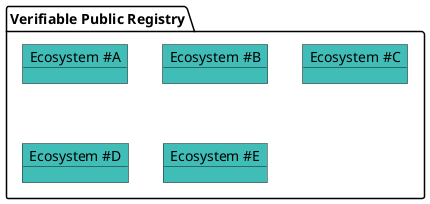

Participant directory is intended to be **crawled by indexers**, which resolve the listed DIDs, identify associated [[ref: verifiable services]], and index them.

Indexers may expose this data through APIs for querying the indexed services or use it to build a search engine for querying the database of indexed [[ref: verifiable services]].

### Conformance

As well as sections marked as non-normative, all authoring guidelines, diagrams, examples, and notes in this specification are non-normative. Everything else in this specification is normative.
The key words MAY, MUST, MUST NOT, OPTIONAL, RECOMMENDED, REQUIRED, SHOULD, and SHOULD NOT in this document are to be interpreted as described in [BCP 14](https://datatracker.ietf.org/doc/html/bcp14) [RFC2119](https://w3c.github.io/vc-data-model/#bib-rfc2119) [RFC8174](https://w3c.github.io/vc-data-model/#bib-rfc8174) when, and only when, they appear in all capitals, as shown here.

## Terminology

[[def: account, accounts]]:
~ A [[ref: verifiable public registry]] account.

[[def: applicant, applicants]]:
~ A [[ref: account]] that starts a [[ref: onboarding process]].

[[def: corporation, corporations]]:
~ A legal/organizational entity that controls Participants in zero or more [[ref: ecosystems]] and may itself be the controller of zero or more [[ref: ecosystems]]. A `Corporation` is a VPR-level entity with VPR-specific attributes (identifier, governance framework, lifecycle) anchored on-chain by a `policy_address` account that signs on its behalf.

[[def: corporation governance framework, CGF]]:
~ The governance framework (GF) of a [[ref: corporation]].

[[def: credential schema, credential schemas]]:
~ An [[ref: VPR]] resource which represents a verifiable credential definition and the associated permissions and business rules for issuing, verifying or holding a credential linked to this credential schema.

[[def: credential schema participant, credential schema participants, CSP]]:
~ A `Participant` entry, linked to a [[ref: credential schema]], that represents, in a given [[ref: ecosystem]], a grant for being [[ref: issuer]], [[ref: verifier]], [[ref: issuer grantor]], or [[ref: verifier grantor]] of a [[ref: credential schema]].

[[def: decentralized identifier, DID, DIDs]]:
~ A decentralized identifier, as specified in [[spec-norm:DID-CORE]].

[[def: verifiable identifier, VID, VIDs]]:
~ A digital identifier bound to cryptographic key material, such that another party can verify control of the identifier and resolve it to keys and, when in public use, to endpoint addresses, as specified in the [Trust Spanning Protocol (TSP) Specification](https://trustoverip.github.io/tswg-tsp-specification/). [[ref: DIDs]] are one **type** of VID; other examples include KERI AIDs and X.509-backed identifiers. The [[ref: VPR]] stores VIDs without resolving them; which types of VID a [[ref: VS]] or [[ref: VUA]] accepts in trust resolution is defined by the [[ref: VT spec]], which currently requires [[ref: DIDs]].

[[def: verifiable service entry, verifiable service entries]]:
~ A `VerifiableService` entry: the registration of a [[ref: VID]] in a [[ref: VPR]], owned by a single [[ref: corporation]], that every other entity binding that identifier (`Corporation`, `Ecosystem`, `Participant`) references by `vs_id`. See [VerifiableService](#verifiableservice).

[[def: decentralized identifier communication, DIDComm]]:
~ [DIDComm](https://identity.foundation/didcomm-messaging/spec/) uses [[ref: DIDs]] to establish confidential, ongoing connections.

[[def: denom, denoms]]:
~ Token that has been configured and is recognized in a [[ref: VPR]], example: uvna, USDC.  

[[def: native denom]]:
~ Native token of a [[ref: VPR]], example: uvna.

[[def: ecosystem, ecosystems]]: a network of interacting entities, both technical and human, that work together to establish and maintain digital trust. It encompasses applications, credentials, governance frameworks, and the underlying technical infrastructure, all designed to facilitate trustworthy interactions.

[[def: ecosystem governance framework, EGF]]:
~ The governance framework (GF) of an ecosystem].

[[def: ecosystem governance authority, EGA]]:
~ The governance authority (GA) of an [[ref: ecosystem]].

[[def: entity, entities]]:
~ An [[ref: account]] controller.

[[def: estimated transaction fees]]:
~ Estimated fees required, in [[ref: denom]], that is passed when execute a [[ref: transaction]] in an [[ref: VPR]]. Usually, a estimated transaction fees are always slightly greater than [[ref: transaction fees]], to make sure the execution of the transaction will not be aborted for an out-of-gas situation. Unused gas is refunded to account.

[[def: governance framework, GF]]:
~ The governance framework (GF) of a [[ref: VPR]].

[[def: governance authority, GA]]:
~ The governance authority (GA) of a [[ref: VPR]].

[[def: grantor, grantors]]:
~ A role an [[ref: entity]] is granted by an [[ref: ecosystem]] for operating its [[ref: ecosystem]].

[[def: group, groups]]:
~ A Cosmos SDK `x/group` on-chain membership group with an associated decision policy. Each [[ref: corporation]] is realized as a group whose group policy account is the corporation's `policy_address` (see [[MOD-CO-MSG-1]](#mod-co-msg-1-create-corporation)).

[[def: holder, holders]]:
~ A role an entity might perform by possessing one or more verifiable credentials and generating verifiable presentations from them. A holder is often, but not always, a [[ref: subject]] of the verifiable credentials they are holding. Holders store their credentials in credential repositories. Example holders include organizations, persons, things.

[[def: issuer, issuers]]:
~ A role an [[ref: entity]] is granted by an [[ref: ecosystem]] or an [[ref: issuer grantor]] for issuing credentials of a given [[ref: credential schema]] to [[ref: holders]].

[[def: issuer grantor, issuer grantors]]:
~ An ecosystem operator role an [[ref: entity]] is granted by an [[ref: ecosystem]] for a given [[ref: credential schema]] for adding or revoking issuers.

[[def: json schema, json schemas, Json Schema, Json Schemas]]
~ a Json Schema, as specified in [https://json-schema.org/specification](https://json-schema.org/specification).

[[def: keeper]]:
~ A storage map(key, value) in the ledger of an [[ref: VPR]].

[[def: linked-vp]]:
~ A presentation of a [[ref: verifiable credential]] as specified in [LINKED-VP](https://identity.foundation/linked-vp/).

[[def: participant, participants]]:
~ An entity that is recognized by one or several ecosystem(s) in a [[ref: VPR]].

[[def: query]]:
~ A read-only action that perform some reading in an [[ref: VPR]] and returns value.

[[def: subject, subjects]]:
~ A thing about which claims are made. Example subjects include human beings, animals, things, and organization, a [[ref: DID]]...

[[def: transaction, transactions]]:
~ An action that modifies the ledger of an [[ref: VPR]] and which execution requires transaction fees.

[[def: transaction fees]]:
~ Fees required, in [[ref: denom]], to execute a [[ref: transaction]] in an [[ref: VPR]].

[[def: trust deposit, trust deposits]]:
~ A financial deposit that is used as a trust guarantee. For a given [[ref: corporation]], its trust deposit is increased when running onboarding process (either as an [[ref: applicant]] or as a [[ref: validator]]).

[[def: trust fee, trust fees]]:
~ Fees paid by a [[ref: participant]] that are distributed to other [[ref: participants]].

[[def: network fee, network fees]]:
~ Fees paid by a [[ref: participant]] that are distributed to network validators and trust deposit holders.

[[def: trust unit, trust units, TU, TUs]]:
~ A fake denom that is not usable as a token (cannot be transferred, or used for paying in transactions). Trust unit is used to define fees in Permissions. Fees defined in trust units are automatically converted to [[ref: native denom]] when a transaction is executed, using an exchange rate `TU/[[ref: native denom]]`. Trust unit is used to compensate [[ref: native denom]] fluctuation.

[[def:ecosystem, ecosystems]]
~ An approved list of [[ref: participants]] that are authorized to issue/verify certain credentials in an ecosystem.

[[def: URI, URIs]]:
~ A Universal Resource Identifier, as specified in [rfc3986](https://datatracker.ietf.org/doc/html/rfc3986).

[[def: active participant, active participants]]:
~ A participant of a given role, which effective_from timestamp is lower than or equal to current timestamp, and (effective_until timestamp is null or greater than current timestamp), and revoked is null and unrepaid_slash is 0.

[[def: future participant, future participants]]:
~ A participant of a given role, which effective_from timestamp is higher than current timestamp, and (effective_until timestamp is null or greater than effective_from timestamp), and revoked is null and unrepaid_slash is 0.

[[def: onboarding process]]:
~ A process run by [[ref: applicants]] that want to, for a specific [[ref: credential schema]], be a [[ref: issuer]], be a [[ref: verifier]], or simply hold a verifiable credential linked to the [[ref: credential schema]].

[[def: validator]]:
~ A role an [[ref: entity]] performs by participating in onboarding processes with [[ref: applicants]] in order to register them as [[ref: issuer]], or [[ref: verifier]] of a [[ref: credential schema]], or to deliver a verifiable credential to them.

[[def: verifiable public registry, VPR, VPRs]]:
~ a public, normally decentralized, ledger-based network, which provides: ecosystem features, that can be used by all its [[ref: participants]]: create ecosystems, for each ecosystem, define its credential schemas, who can issue, verify credential of a specific credential schema,... and a tokenized business model for charging/rewarding [[ref: participants]].

[[def: verifiable service, verifiable services, VS, VSs]]:
~ A service, identified by a resolvable [[ref: DID]] that can be deployed anywhere by its owner, and that is conforming to this spec and has a resolvable Proof-of-Trust. See [[ref: VT Spec]].

[[def: verifiable user agent, verifiable user agents, VUA, VUAs]]:
~ A user agent for accessing and using [[ref: VSs]]. To be considered a [[ref: VUA]], a user agent must conform and enforce this spec, such as presenting a proof of trust to end user before accepting connecting to [[ref: VS]] compliant services, and refuse connecting to not compliant services. See [[ref: VT Spec]].

[[def: Verifiable Trust Specification, Verifiable Trust Spec, VT Specs, VT Spec]]:
~ see [VT Spec](https://github.com/verana-labs/verifiable-trust-spec).

[[def: verifier, verifiers]]:
~ A role an [[ref: entity]] is granted by an [[ref: ecosystem]] or a [[ref: verifier grantor]] for verifying credentials of a given [[ref: credential schema]].

[[def: verifier grantor, verifier grantors]]:
~ An ecosystem operator role an [[ref: entity]] is granted by an [[ref: ecosystem]] for a given [[ref: credential schema]] for adding or revoking verifiers.

[[def: verifiable credential, verifiable credentials]]:
~ A verifiable credential as defined in [[spec-norm:VC-DATA-MODEL]].

## Naming Conventions

### In this spec

- For clarity, Camel Case is used for naming Modules, Entities, Objects, etc.

### In Implementations

- All APIs MUST return valid JSON.
- All JSON content MUST use Snake Case for object, attribute... names.
- Object attributes and Json Content in general can be returned in any order.

## Features of a Verifiable Public Registry (VPR)

### Ecosystem Management

*This section is non-normative.*

In an [[ref: VPR]], any [[ref: corporation]] can create an `Ecosystem` entry to represent an [[ref: ecosystem]] it controls. Each `Ecosystem` entry MUST provide, at a minimum:

- an ecosystem controlled resolvable [[ref: DID]];
- one or more [[ref: ecosystem governance framework]] document(s);
- zero or more [[ref: credential schemas]].

The Verifiable Public Registry (VPR) is agnostic to the specific DID methods used. Trust resolution is performed externally, outside the VPR, allowing flexibility and interoperability across ecosystems.

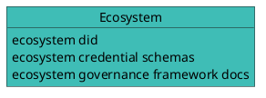

### Credential Schemas and Participants

*This section is non-normative.*

[[ref: Credential schemas]] are created and managed by [[ref: ecosystems]] (i.e., by the [[ref: corporation]] controlling each [[ref: ecosystem]]). Each [[ref: Credential schema]] includes, at a minimum:

- A **Json Schema** that defines the structure of the corresponding [[ref: verifiable credential]].
- A **SubjectKind** (`SERVICE` or `PERSON`), a **PresentationMode** (for service credentials: `PUBLIC`, `ACCREDITED_AUTOMATIC` or `ACCREDITED_APPROVAL`) a single **CredentialFormat** (`W3C_JSONLD`, `ANONCREDS`, `SD_JWT` or, for persons, `MDOC`) a **VerificationSessionMode** (`WHEN_FEES` or `REQUIRED`) and a **CredentialAnchoring** (`DIGEST` or `NONE`) that declare what credentials of this schema are for and how agents handle them; see [CredentialSchema](#credentialschema).
- An **IssuerOnboardingMode** for **issuance policy**, which determines how `ISSUER` `Participant` entries are created. Modes include:
  - `OPEN`: `ISSUER` Participants can be self-created by any [[ref: corporation]].
  - `ECOSYSTEM_ONBOARDING_PROCESS`: `ISSUER` Participants are created directly by the controlling [[ref: ecosystem]] through an [[ref: onboarding process]].
  - `GRANTOR_ONBOARDING_PROCESS`: `ISSUER` Participants are created by one or several [[ref: issuer grantor]](s) — ecosystem operators responsible for onboarding issuers for the credential schema of this [[ref: ecosystem]] — selected by the [[ref: ecosystem]] through an [[ref: onboarding process]].
- A **VerifierOnboardingMode** for **verification policy**, which determines how `VERIFIER` `Participant` entries are created. Modes include:
  - `OPEN`: `VERIFIER` Participants can be self-created by any [[ref: corporation]].
  - `ECOSYSTEM_ONBOARDING_PROCESS`: `VERIFIER` Participants are created directly by the controlling [[ref: ecosystem]] through an [[ref: onboarding process]].
  - `GRANTOR_ONBOARDING_PROCESS`: `VERIFIER` Participants are created by one or several [[ref: verifier grantor]](s) — ecosystem operators responsible for onboarding verifiers for the credential schema of this [[ref: ecosystem]] — selected by the [[ref: ecosystem]] through an [[ref: onboarding process]].
- A **HolderOnboardingMode** for **holder policy**, which determines how `HOLDER` `Participant` entries are created. Modes include:
  - `ISSUER_ONBOARDING_PROCESS`: `HOLDER` Participants are created for holders through an [[ref: onboarding process]] validated by the [[ref: issuers]].
  - `PERMISSIONLESS`: a holder that wants to obtain credentials from an [[ref: issuer]] does not require a `Participant` entry in the VPR.
- A **Participant tree** that defines the roles and relationships involved in managing the schema’s lifecycle. Each `Participant` entry in the tree can define business rules; see [Business Models](#business-models) below.

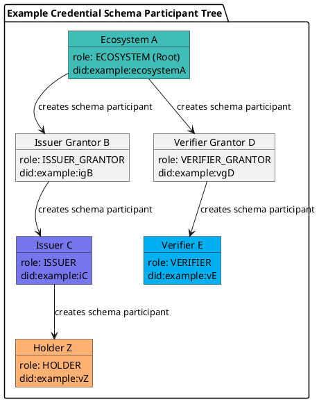

Participant roles are defined in the table below:

| **Participant Role**   | **Description**                                                  |
|-----------------------|------------------------------------------------------------------|
| **Ecosystem**    | Create and control [[ref: ecosystems]] and credential schemas. Recognize other participants by validating them onto the schema (creating their `Participant` entries).        |
| **Issuer Grantor**    | Ecosystem operator that creates `ISSUER` `Participant` entries for candidate issuers.                   |
| **Verifier Grantor**  | Ecosystem operator that creates `VERIFIER` `Participant` entries for candidate verifiers.               |
| **Issuer**            | Can issue credentials of this schema.                            |
| **Verifier**          | Can request presentation of credentials of this schema.          |
| **Holder**            | Holds a credential. `HOLDER` `Participant` entries carry credential status (active, revoked, ...). |

Example of a Json Schema credential schema:

```json
{
  "$id": "vpr:verana:mainnet:cs:VPR_CREDENTIAL_SCHEMA_ID", // ignored, will be generated
  "$schema": "https://json-schema.org/draft/2020-12/schema",
  "title": "ExampleCredential",
  "description": "ExampleCredential using JsonSchema",
  "type": "object",
  "properties": {
    "credentialSubject": {
      "type": "object",
      "properties": {
        "id": {
          "type": "string",
          "format": "uri"
        },
        "firstName": {
          "type": "string",
          "minLength": 0,
          "maxLength": 256
        },
        "lastName": {
          "type": "string",
          "minLength": 1,
          "maxLength": 256
        },
        "expirationDate": {
          "type": "string",
          "format": "date"
        },
        "countryOfResidence": {
          "type": "string",
          "minLength": 2,
          "maxLength": 2
        }
      },
      "required": [
        "id",
        "lastName",
        "birthDate",
        "expirationDate",
        "countryOfResidence"
      ]
    }
  }
}
```

To participate in an [[ref: ecosystem]] and assume a role associated with a specific [[ref: credential schema]]:

- if the schema is `OPEN` for issuance and/or verification: a [[ref: corporation]] MUST have a registered `Corporation` entry in the [[ref: VPR]] and a registered verifiable service entry for its identifier; a `Participant` entry is optional under `OPEN` (an issuer self-creates one to declare fees, either party to carry a deposit) (see `presentation_mode` in [CredentialSchema](#credentialschema)).

- if the schema is not `OPEN` for issuance and/or verification: a [[ref: corporation]] MUST have a registered `Corporation` entry in the [[ref: VPR]] and complete an [[ref: onboarding process]] to obtain its `Participant` entry.

The [[ref: onboarding process]] involves two parties:

- The [[ref: applicant]] — the [[ref: corporation]] requesting a `Participant` entry for a credential schema within the ecosystem.
- The [[ref: validator]] — a corporation that already holds a `Participant` entry for the same credential schema and has been delegated authority to validate applicants and create new `Participant` entries.

Running an [[ref: onboarding process]] **typically involves the payment of [[ref: trust fees]]**. The [[ref: trust fee]] amount to be paid by the [[ref: applicant]] is defined in the [[ref: validator]]'s `Participant` entry:


### Corporation Management

*This section is non-normative.*

A [[ref: corporation]] is the VPR-level entity that represents an authority acting in the registry. A `Corporation` carries VPR-specific attributes — the [[ref: verifiable service entry]] of its identifier, a [[ref: corporation governance framework]] (CGF), and lifecycle metadata — and is anchored on-chain by a `policy_address` account that signs on its behalf. The `Corporation` entry has its own `id`, and every other VPR entity points to it through a `corporation_id` foreign key.

A corporation interacts with the VPR in two complementary ways:

- as the **controller** of zero or more [[ref: ecosystems]] — i.e., the corporation owns the corresponding `Ecosystem` entries. The controlling corporation manages each ecosystem's [[ref: EGF]], its [[ref: credential schemas]], and the root `ECOSYSTEM` `Participant` entries of those schemas.
- as the **owner of zero or more `Participant` entries** in zero or more [[ref: ecosystems]] — i.e., the corporation acts as `ISSUER`, `VERIFIER`, `ISSUER_GRANTOR`, `VERIFIER_GRANTOR`, `HOLDER`, or root `ECOSYSTEM` for [[ref: credential schemas]] of those ecosystems.

The two roles are **independent**: a corporation MAY control no ecosystem at all and only hold `Participant` entries in third-party ecosystems; or it MAY control several ecosystems and additionally hold `Participant` entries in others; or any combination of the two.

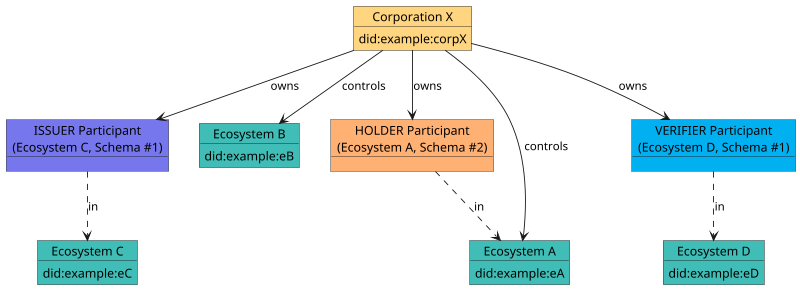

The same `Corporation` entry is the single entry point for the corporation's governance (the CGF), authorization delegation (via `OperatorAuthorization` to one or more `operator` accounts), and trust-deposit accounting (`TrustDeposit`). See the [Corporation Module](#corporation-module) for the methods that manage `Corporation` entries.

### DID Indexing

*This section is non-normative.*

The `Participant` registry is the foundation for building **searchable indexes of [[ref: verifiable services]] and the verifiable metadata they expose**. Crawlers iterate over `Participant` entries, resolve each service identifier (currently a [[ref: DID]], extensible in the future), verify that the service is a [[ref: verifiable service]], and extract its verifiable metadata — most notably the credentials presented through [[ref: linked-vp]] — together with the [[ref: ecosystem]] memberships, [[ref: credential schema]] permissions, and [[ref: trust deposit]] level associated with the controlling [[ref: corporation]].

Unlike a traditional web index, this index is **trust-typed**: every entry carries cryptographically verifiable claims about *what* the service is, *who* operates it, and *under which governance frameworks* it is accredited. This unlocks a class of discovery use cases that traditional search engines cannot serve.

#### AI agent discovery

AI agents are first-class consumers of the index. Before delegating a task or accepting a connection, an agent needs to find counterparts whose **presented credentials match the capabilities required for the interaction**. Querying the index, an AI agent can:

- find [[ref: verifiable services]] qualified for a specific task — for example, a payment processor accredited in a given jurisdiction, a KYC issuer recognized by a target [[ref: ecosystem]], or an MCP-style service whose operator holds a recognized organization credential;
- discover other AI agents whose credentials prove the right scope, authority, or operator;
- restrict the search to a specific [[ref: ecosystem]] or to services that comply with a chosen [[ref: credential schema]];
- rank candidates by [[ref: trust deposit]] size, accreditations held, slashing history, or credential freshness, in order to bias selection toward parties with stronger economic accountability.

Because every indexed claim is anchored in the [[ref: VPR]], an AI agent can verify a counterpart end-to-end *before* initiating the interaction, avoiding spoofed services and unaccredited issuers.

#### Verifiable User Agent content discovery

[[ref: Verifiable user agents]] (VUAs) — such as social browsers, agentic browsers, or CDN-aware clients — use the index to **find content and services that are compatible with the user's context**: the credentials the user holds, the [[ref: ecosystems]] the user trusts, the jurisdictions and languages that apply, and the schemas that the user's wallet can satisfy.

Typical VUA queries include:

- *"Show only services accredited under ecosystem X"* — filter by [[ref: ecosystem]] membership.
- *"Show services that accept the credentials currently in my wallet"* — match the holder's credentials against each [[ref: VS]]'s expected presentations.
- *"Show issuers of schema Y operating in jurisdiction Z"* — combine [[ref: credential schema]] permissions with corporation metadata.
- *"Show services my user has previously interacted with successfully"* — combine the index with the VUA's local history.

The result is a feed of [[ref: VSs]] for which a proof of trust can be displayed to the user *before* connection, in line with the VUA enforcement obligations defined in this spec and in the [[ref: VT Spec]].

#### Other consumers

The same index serves additional consumers:

- **Trust-aware and traditional, form-based search engines**, which can return ordinary links to [[ref: VSs]] enriched with verifiable trust signals (issuer accreditations, [[ref: ecosystem]] memberships, [[ref: trust deposit]] level).
- **Ecosystem operators and governance authorities**, which use the index to monitor accredited issuers, verifiers, and grantors, observe schema adoption across [[ref: ecosystems]], and detect rogue or expired participants.
- **Auditors, regulators, and compliance tools**, which rely on the index to map the supply chain of trust behind a given service or credential, and to verify that participants are still in good standing.
- **Analytics and reputation services**, which combine indexed metadata with on-chain history (trust-deposit movements, slashing events, session volumes) to produce reputational signals at the [[ref: corporation]] level.

#### Indexing pipeline


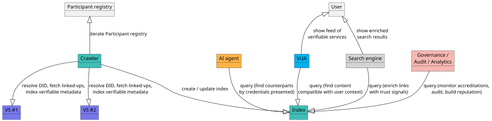

### Business models

#### Trust Deposit

*This section is non-normative.*

In a [[ref: VPR]], each [[ref: corporation]] is associated with a [[ref: trust deposit]].

This [[ref: trust deposit]] is automatically funded through transactions involving **trust operations**, such as onboarding processes, credential issuance, or presentation...

The trust deposit is fundamental to the **"Proof-of-Trust" (PoT)** mechanism of the [[ref: Verifiable Trust Specification]], and it operates as follows:

- The more a [[ref: corporation]] uses the [[ref: VPR]], the more its [[ref: trust deposit]] grows.
- Trust deposits **generate yield**: block execution fees are distributed not only to network validators, but also to **trust deposit holders**.
- **network-level penalties**: If a participant violates the [[ref: governance framework]] of the [[ref: VPR]] or engages in **fraudulent activity**, their **trust deposit may be partially or fully slashed** by the [[ref: VPR]]'s governance authority.
- **ecosystem-level penalties**: If a participant operates within an ecosystem (e.g., as a [[ref: grantor]], [[ref: issuer]], [[ref: verifier]], or [[ref: holder]],...) and **fails to comply** with that ecosystem’s governance framework (EGF), their **ecosystem-specific trust deposit can be slashed** by the corresponding [[ref: ecosystem governance authority]].
- A slashed deposit must be **refilled** to continue using the services that triggered the penalty.
- Holding a large trust deposit **does not grant governance rights** in the [[ref: VPR]]: participants who generate high transaction volume **cannot gain control** over the governance of the [[ref: VPR]] solely through usage or deposit size.

This system ensures that participation in the trust ecosystem is backed by economic accountability, reinforcing the integrity, governability and verifiability of the [[ref: VPR]].

#### Why Trust Deposits Are Non-Withdrawable

*This section is non-normative.*

A [[ref: trust deposit]] cannot be withdrawn. This is a deliberate design choice, motivated by the following rationale:

- **Lasting accountability to the ecosystem.** A trust deposit is bound to the ecosystem it was accumulated in. Choosing to stop using that ecosystem does not release a participant from its obligations toward it — a participant cannot simply walk away and harm the ecosystem because they no longer need it. Since the accumulated deposit cannot be moved, the participant remains economically accountable: any harmful behavior can still be slashed, lowering their trust score.
- **Sustained token demand.** Making deposits non-withdrawable locks value into the system, creating ongoing demand for the token rather than allowing it to flow back out.
- **No exit-and-rejoin arbitrage.** Token value fluctuates over time, so a deposit made in the past typically represents more value today. If deposits were withdrawable, a participant could leave the ecosystem solely to withdraw their appreciated deposit and then rejoin — gaming the mechanism. Non-withdrawability removes this incentive.

#### Onboarding Process Trust Fees

*This section is non-normative.*

We've explained in the [Credential Schemas and Participants](#credential-schemas-and-participants) section above what is an onboarding process.

The table below summarizes the possible combinations of applicants and validators:

| Payee → Payer ↓  | Ecosystem                      | Issuer Grantor                        | Verifier Grantor                    | Issuer                              | Verifier | Holder                                  |
|------------------|-------------------------------------|---------------------------------------|-------------------------------------|-------------------------------------|----------|-----------------------------------------|
| Issuer Grantor   | renewable subscription (1)          |                                       |                                     |                                     |          |                                         |
| Verifier Grantor | renewable subscription (2)          |                                       |                                     |                                     |          |                                         |
| Issuer           | renewable subscription (3)          | renewable subscription (1)            |                                     |                                     |          |                                         |
| Verifier         | renewable subscription (4)          |                                       | renewable subscription (2)          |                                     |          |                                         |
| Holder           |                                     |                                       |                                     | renewable subscription  (5)         |          |                                         |

- (1): if *issuer onboarding mode* is set to GRANTOR_ONBOARDING_PROCESS.
- (2): if *verifier onboarding mode* is set to GRANTOR_ONBOARDING_PROCESS.
- (3): if *issuer onboarding mode* is set to ECOSYSTEM_ONBOARDING_PROCESS.
- (4): if *verifier onboarding mode* is set to ECOSYSTEM_ONBOARDING_PROCESS.
- (5): if *holder onboarding mode* is set to ISSUER_ONBOARDING_PROCESS.

Onboarding process is started by the applicant.

*Example of a candidate [[ref: issuer]] ([[ref: applicant]]) that would like to obtain an `ISSUER` `Participant` entry for a credential schema of an ecosystem, validated by a [[ref: validator]] that holds an `ISSUER_GRANTOR` `Participant` entry:*

```plantuml
scale max 800 width
actor "Applicant\n(issuer candidate)\nAccount" as ApplicantAccount 
actor "Applicant\n(issuer candidate)\nVUA" as ApplicantBrowser 

actor "Validator\n(issuer grantor)\nVS" as ValidatorVS
actor "Validator\n(issuer grantor)\nAccount" as ValidatorAccount

participant "Verifiable Public Registry" as VPR #3fbdb6

ApplicantAccount --> VPR: start onboarding process with Validator
VPR <-- VPR: create applicant Participant entry\n(op_state = PENDING)
ApplicantAccount <-- VPR: applicant Participant entry created
ApplicantBrowser --> ValidatorVS: connect to validator VS DID found in\napplicant_participant.validator_participant\nby creating a DIDComm connection
ApplicantBrowser <-- ValidatorVS: DIDComm connection established.
ApplicantBrowser --> ValidatorVS: I want to proceed with applicant_participant.id=...
ValidatorVS --> ValidatorVS: load applicant Participant with this id\nand verify validator_participant_id refers to me
ApplicantBrowser <-- ValidatorVS: request proof of control\nof applicant_participant.corporation_id account (blind sign)
ApplicantBrowser --> ValidatorVS: send blind sign proof of operator account
ApplicantBrowser <-- ValidatorVS: proof accepted, you are an operator\nof the applicant Participant, I trust you.
ApplicantBrowser <-- ValidatorVS: which DID do you want to register as an issuer?
ApplicantBrowser --> ValidatorVS: send DID
ValidatorVS --> ValidatorVS: resolve DID and get pub keys
ApplicantBrowser <-- ValidatorVS: request proof of ownership\nof the DID to be registered on your `ISSUER` `Participant` entry (blind sign)
ApplicantBrowser --> ValidatorVS: send blind sign proofs
ApplicantBrowser <-- ValidatorVS: proof accepted, you are the controller of this DID, I trust you.
note over ApplicantBrowser, ValidatorVS #EEEEEE: (*optional*) repeat the following until tasks completed
ApplicantBrowser <-- ValidatorVS: Are you a legitimate issuer?\nProve it, by filling forms, sending documents...
ApplicantBrowser --> ValidatorVS: perform requested tasks...
note over ApplicantBrowser, ValidatorVS #EEEEEE: tasks completed
ApplicantBrowser <-- ValidatorVS: You are a legitimate candidate. I'll now finalize your `ISSUER` `Participant` entry.
ValidatorAccount --> VPR #3fbdb6: set applicant_participant.op_state to VALIDATED\n(finalize the `ISSUER` `Participant` entry)
VPR --> ValidatorAccount: Receive trust fees.
ApplicantBrowser <-- ValidatorVS: notify `ISSUER` `Participant` entry validated for your corporation and DID.\nDID can now issue credentials of this schema.
```

The **total fees** paid by the applicant consist of:

- The validation [[ref: trust fees]] defined in the validator's `Participant` entry (the one acting as the validator in the onboarding process), **plus**
- an additional amount equal to the `trust_deposit_rate` of that validation [[ref: trust fees]], which is **allocated to the applicant's [[ref: trust deposit]]** when the onboarding process begins, **plus**
- [[ref: network fees]] (not part of the escrowed amount).

Example, using 5% for `trust_deposit_rate`:

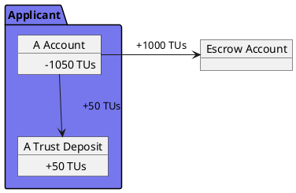

Upon completion of the onboarding process, **escrowed trust fees are distributed to the validator** as follows:

- A portion defined by `trust_deposit_rate` is allocated to the **validator’s trust deposit**.  
- The remaining amount is **transferred directly to the validator’s wallet**.

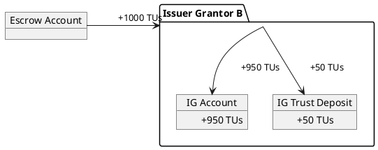

#### "Pay-Per" trust fees

*This section is non-normative.*

**Pay-per-issuance** and **pay-per-verification** [[ref: trust fees]] are defined **on each `Participant` entry** for each role within the ecosystem.


[[ref: Corporations]] acting as **issuers** or **verifiers** for a given credential schema **may be required to pay trust fees** based on the schema's configuration and `Participant` tree.

If trust fee payment is required, or the schema sets `verification_session` to REQUIRED, or the schema sets a presentation validity period, or a credential of a schema whose `credential_anchoring` is DIGEST is issued (its digest is anchored through the session), the entity **must execute a transaction** in the [[ref: VPR]] to pay the appropriate [[ref: trust fees]] **before issuing or verifying a credential**, else HOLDER agent will not accept the operation.

Key Points for "Pay-Per" Business Models

- For a given credential schema, the **ecosystem** and its participants may define **pay-per-issuance** (or **pay-per-verification**) [[ref: trust fees]] on their respective `Participant` entries.

- In such cases, an `ISSUER` (or `VERIFIER`) `Participant` **must pay**:
  - the corresponding **issuance** (or **verification**) trust fees for each involved `Participant` entry along the `Participant` tree;
  - an additional amount equal to the `trust_deposit_rate` of the calculated trust fees, allocated to the **payer's [[ref: trust deposit]]**;
  - (optional) an amount equal to `wallet_user_agent_reward_rate` of the calculated trust fees, used to **reward the Wallet User Agent**;
  - (optional) an amount equal to `user_agent_reward_rate` of the calculated trust fees, used to **reward the User Agent**.

Fee Distribution Model

Trust fees are **consistently distributed** across participants:

- A portion defined by `trust_deposit_rate` is allocated to the **participant’s trust deposit**.  
- The remaining portion is **transferred directly to the participant’s wallet**.

:::note
Agents that implement the [[ref: VT spec]] **must verify** that the ISSUER or VERIFIER has fulfilled the required trust fee payment, or has created the required `ParticipantSession` whenever [[MOD-PP-MSG-10]](#mod-pp-msg-10-create-or-update-participant-session) requires one (`verification_session` set to REQUIRED, a `presentation_validity_period` greater than 0, or a presentation digest to anchor).  
If not, they **must reject** the issuance or verification request.

Note: The **User Agent** and **Wallet User Agent** may refer to the same implementation.
:::

Distribution example for the issuance by `ISSUER` #C of a credential, using the `Participant` tree above, 5% for `trust_deposit_rate`, 5% for `wallet_user_agent_reward_rate` and `user_agent_reward_rate`.

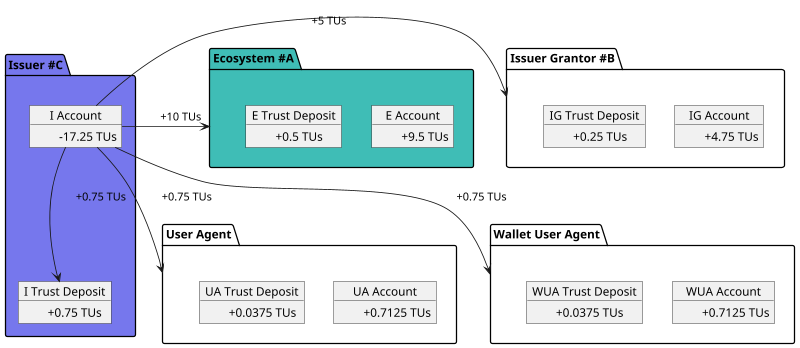

Distribution example for the verification by `VERIFIER` #E of a credential issued by `ISSUER` #C, using the `Participant` tree above, 5% for `trust_deposit_rate`, 5% for `wallet_user_agent_reward_rate` and `user_agent_reward_rate`.

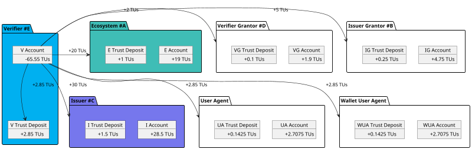

## Governance of a VPR

*This section is non-normative.*

A [[ref: governance framework]] must define the governance rules that apply to a [[ref: VPR]].

A designated [[ref: governance authority]] (aka a council) is responsible for **enforcing these rules** and, when necessary, **applying financial sanctions** to participants who violate the rules.

:::note
**Ecosystem Governance Frameworks (EGFs)** operate **independently** from the [[ref: VPR]] [[ref: governance framework]].

While the **VPR governance framework** defines the global rules for operating the Verifiable Public Registry (e.g., trust deposits, fee distribution, slashing conditions), each **ecosystem** must define its own **EGF** to govern roles, permissions, credential policies, and compliance within its specific domain.

This separation ensures that ecosystems remain autonomous and can tailor governance to their unique needs, without being constrained by the global rules of the VPR.
:::

## Data model

For simplicity, the data model is presented using an **object-relational structure**. However, this representation may not be optimal for all implementation scenarios.

Implementors are responsible for **adapting the data model** to suit their chosen architecture.  
For example, a **key-value store** may be more appropriate for a **ledger-based implementation** than a relational model.

```plantuml

@startuml
scale max 800 width

entity "Ecosystem" as tr {
  *id: uint64
  +created: timestamp
  +archived: boolean
  +active_version: int
  +language: string
}

entity "Corporation" as corp {
  *id: uint64
  +created: timestamp
  +active_version: int
  +language: string
}

entity "GovernanceFrameworkVersion" as gfv {
  *id: uint64
  +created: timestamp
  +version: integer
}

entity "GovernanceFrameworkDocument" as gfd {
  *id: uint64
  +created: timestamp
  +language: string
  +url: string
  +digest_sri: string
}


entity "CredentialSchema" as cs {
  *id: uint64
  +created: timestamp
  +archived: boolean
  +json_schema: string
  +issuer_grantor_validation_validity_period: number
  +verifier_grantor_validation_validity_period: number
  +issuer_validation_validity_period: number
  +verifier_validation_validity_period: number
  +holder_validation_validity_period: number
  +issuer_onboarding_mode: IssuerOnboardingMode
  +verifier_onboarding_mode: VerifierOnboardingMode
  verifier_credential_schema_ids: uint64[]
  +holder_onboarding_mode: HolderOnboardingMode
  presentation_validity_period: duration
  +pricing_asset: string
  +digest_algorithm: string
}



enum "IssuerOnboardingMode" as iom {
  OPEN
  GRANTOR_ONBOARDING_PROCESS
  ECOSYSTEM_ONBOARDING_PROCESS
}

enum "VerifierOnboardingMode" as vom {
  OPEN
  GRANTOR_ONBOARDING_PROCESS
  ECOSYSTEM_ONBOARDING_PROCESS
  CREDENTIAL
}

enum "HolderOnboardingMode" as hom {
  ISSUER_ONBOARDING_PROCESS
  PERMISSIONLESS
}
enum "SubjectKind" as subjectkind {
  SERVICE
  PERSON
}
enum "PresentationMode" as presentationmode {
  PUBLIC
  ACCREDITED_AUTOMATIC
  ACCREDITED_APPROVAL
}
enum "CredentialFormat" as credentialformat {
  W3C_JSONLD
  ANONCREDS
  SD_JWT
  MDOC
}
enum "VerificationSessionMode" as verificationsessionmode {
  REQUIRED
  WHEN_FEES
}

enum "CredentialAnchoring" as credentialanchoring {
  DIGEST
  NONE
}

enum "CredentialRevocation" as credentialrevocation {
  VPR
  NONE
}


entity "(SDK) Account" as account {
}

enum "MsgType" as msgtype {
  UpdateCorporation
  CreateEcosystem
  UpdateEcosystem
  ArchiveEcosystem
  AddGovernanceFrameworkDocument
  IncreaseActiveGovernanceFrameworkVersion
  CreateCredentialSchema
  UpdateCredentialSchema
  ArchiveCredentialSchema
  StartParticipantOP
  RenewParticipantOP
  SetParticipantOPtoValidated
  CancelParticipantOPLastRequest
  CreateRootParticipant
  SetParticipantEffectiveUntil
  RevokeParticipant
  CreateOrUpdateParticipantSession
  SlashParticipantTrustDeposit
  RepayParticipantSlashedTrustDeposit
  SelfCreateParticipant
  TriggerResolver
  ReclaimTrustDepositYield
  RepaySlashedTrustDeposit
  GrantOperatorAuthorization
  RevokeOperatorAuthorization
  StoreDigest
  RevokeDigest
  RegisterVerifiableService
  UpdateVerifiableService
  RotateVerifiableIdentifier
  TransferVerifiableService
  AcceptVerifiableServiceTransfer
}

entity "OperatorAuthorization" as oauthz {
   +msg_types: MsgType[]
   expiration: timestamp
   period: duration
}

entity "VsOperatorBudget" as obudget {
   expiration: timestamp
}

entity "VerifiableService" as vs {
  *id: uint64
  +vid: string
  +msg_types: MsgType[]
  period: duration
  +created: timestamp
  transfer_to_corporation_id: uint64
}

entity "DenomAmount" as da {
  denom: string
  amount: number
}

enum "PricingAssetType" as pricingassettype {
  TU
  COIN
  FIAT
}

entity "ExchangeRate" as xr {
  *id: uint64
  +base_asset: string
  +quote_asset: string
  +rate: string
  +rate_scale: uint32
  +updated: timestamp
  +expires: timestamp
  +validity_duration: duration
  +state: boolean
}

entity "FeeGrant" as fg {
  +msg_types: MsgType[]
  expiration: timestamp
  period: duration
}

entity "ExchangeRateAuthorization" as xrauthz {
   +expiration: timestamp
   min_interval: duration
   max_deviation_bps: uint32
}


entity "Participant" as csp {
  *id: uint64
  +created: timestamp
  effective_from: timestamp
  effective_until: timestamp
  +validation_fees: number
  +issuance_fees: number
  +verification_fees: number
  +deposit: number
  +unrepaid_slash: number
  revoked: timestamp
  op_exp: timestamp
  +op_last_state_change: timestamp
  +op_current_fees: number
  +op_current_deposit: number
  op_summary_digest: bytes
  +issuance_fee_discount: number
  +verification_fee_discount: number
}


enum "OnboardingState" as valstate {
  PENDING
  VALIDATED
  TERMINATED
}

entity "Digest" as digest {
  *digest: bytes
  +created: timestamp
  revoked: timestamp
  expires: timestamp
}

enum "ParticipantRole" as cspt {
  ISSUER
  VERIFIER
  ISSUER_GRANTOR
  VERIFIER_GRANTOR
  ECOSYSTEM
  HOLDER
}


entity "GlobalVariables" as gv {
  +credential_schema_schema_max_size: number
  +credential_schema_issuer_grantor_validation_validity_period_max_days: number
  +credential_schema_verifier_grantor_validation_validity_period_max_days: number
  +credential_schema_issuer_validation_validity_period_max_days: number
  +credential_schema_verifier_validation_validity_period_max_days: number
  +credential_schema_holder_validation_validity_period_max_days: number
  +trust_deposit_share_value: number
  +trust_deposit_rate:number
  +trust_deposit_max_yield_rate:number
  +trust_deposit_block_reward_share:number
  +user_agent_reward_rate:number
  +wallet_user_agent_reward_rate:number
  +vs_operator_fee_period: duration
  +vs_registration_deposit: number
  +ecosystem_creation_deposit: number
  +vid_rotation_max_transition: duration
}

entity "TrustDeposit" as td {
  +share: number
  +deposit: number
  +refunded: number
  +slashed_deposit: number
  +repaid_deposit: number
}

entity "UnrepaidEcosystemSlashCount" as uesc {
  +count: number
}

corp --o fg: grantor_corporation_id
account --o fg: grantee
fg "1" --- "0..n" da: spend_limit
fg "1" --- "0..n" da: remaining_spend

xrauthz o-- xr
xrauthz o-- account: operator

xr o-- pricingassettype: base_asset_type
xr o-- pricingassettype: quote_asset_type

cs o-- pricingassettype: pricing_asset_type 
cs o-- subjectkind: subject_kind
cs o-- presentationmode: presentation_mode
cs o-- credentialformat: credential_format
cs o-- verificationsessionmode: verification_session
cs o-- credentialanchoring: credential_anchoring
cs o-- credentialrevocation: credential_revocation

corp --o oauthz: corporation_id
account --o oauthz: operator

vs "1" --- "0..1" obudget: vs_id

csp o-- cspt: role
csp o-- cs: schema_id
cs o-- "0..n" csp: root_participant_ids
csp o-- "0..1" csp: validator_participant_id
cs o-- tr: ecosystem_id



oauthz "1" --- "0..n" da: spend_limit
oauthz "1" --- "0..n" da: remaining_spend

obudget "1" --- "0..n" da: spend_limit
vs "1" --- "0..n" da: fee_spend_limit
obudget "1" --- "0..n" da: remaining_spend

tr "1" --- "0..n" gfv: versions (ecosystem_id)
corp "1" --- "0..n" gfv: versions (corporation_id)
gfv "1" --- "1..n" gfd: documents

account "1" --- "1" corp : policy_address

corp --o tr: corporation_id
corp --o csp: corporation_id

corp --o vs: corporation_id
account --o vs: vs_operator
vs --o corp: vs_id
vs --o tr: vs_id
vs --o csp: vs_id

valstate --o csp: op_state
corp --o td: corporation_id
corp --o uesc: corporation_id
tr --o uesc: ecosystem_id
csp --o digest: participant_id
vs --o digest: vs_id
cs --o digest: schema_id

@enduml

```

### Identifier conventions

Unless otherwise stated, every entity's `id` field is:

- a server-assigned, strictly monotonically increasing `uint64`;
- globally unique within the entity class (the entity's primary key);
- assigned at the entity's creation by the corresponding Create-* Msg, and immutable thereafter;
- never reused after deletion: if a new entry is later created for the same logical referent (e.g. the same `(corporation_id, operator)` pair after a revoke followed by a fresh grant), it is a brand-new entry with a brand-new `id`; the previous `id` is never re-issued.

Clients MAY rely on `id` ordering as a deterministic cursor for keyset pagination.

Several entities deviate from this convention and document their own key scheme explicitly: `Digest` (bytes PK on its `digest` content), `TrustDeposit` (single-field PK on `corporation_id`), `OperatorAuthorization` (composite PK on `(corporation_id, operator)`), `VsOperatorBudget` (single-field PK on `vs_id`), `FeeGrant` (composite PK on `(grantor_corporation_id, grantee)`), and `ExchangeRateAuthorization` (composite PK on `(xr_id, operator)`). In every case the `(key)` annotation on a field marks the entity's primary key.

**Indexes.** Besides primary keys, the VPR maintains only the lookups its checks need: `VerifiableService` by `vid` ([VID ownership](#vid-ownership)) and by `vs_operator` ([[MOD-DE-MSG-5-2]](#mod-de-msg-5-2-set-vs-operator-authorization-basic-checks)), and `Participant` by `vs_id` (the sibling, session and materialization checks). Lookups that would need an index over a large entity are replaced by a few ids kept on the parent, as the root entries of a schema (`CredentialSchema.root_participant_ids`). Every other way of finding entries, by corporation, by schema, by validator, by state or by time, is an indexer function (verana-spec#121): the queries of this specification expose primary keys and these three indexes, nothing else. A secondary index entry costs as much state as the row it points to. Receipts are not state at all: a [ParticipantSession](#participantsession) exists only as the event of its transaction. Composite primary keys serve the remaining lookups: `OperatorAuthorization` by (`corporation_id`, `operator`), `FeeGrant` by (`grantor_corporation_id`, `grantee`), `UnrepaidEcosystemSlashCount` by (`corporation_id`, `ecosystem_id`). Entities that stay few, `Ecosystem` and `CredentialSchema`, are scanned by the checks that need them.

### VID ownership

Every [[ref: VID]] known to the VPR is registered once, as a [VerifiableService](#verifiableservice) entry owned by a single `Corporation` (`VerifiableService.corporation_id`). The entities that bind an identifier, `Corporation` (`vs_id`), `Ecosystem` (`vs_id`) and `Participant` (`vs_id`), never store the identifier string: they reference the entry, and MUST reference an entry owned by their own corporation (for a `Corporation`, by itself). The **owner `Corporation`** of an identifier is therefore a total function given by the entry, and a `vs_id` reference is checked with a single lookup at every binding message: [[MOD-CO-MSG-1-2-1]](#mod-co-msg-1-2-1-create-corporation-basic-checks) / [[MOD-CO-MSG-2-2-1]](#mod-co-msg-2-2-1-update-corporation-basic-checks), [[MOD-ES-MSG-1-2-1]](#mod-es-msg-1-2-1-create-ecosystem-basic-checks) / [[MOD-ES-MSG-2-2-1]](#mod-es-msg-2-2-1-update-ecosystem-basic-checks), [[MOD-PP-MSG-1-2-1]](#mod-pp-msg-1-2-1-start-participant-op-basic-checks), [[MOD-PP-MSG-7-2-1]](#mod-pp-msg-7-2-1-create-root-participant-basic-checks) and [[MOD-PP-MSG-14-2-1]](#mod-pp-msg-14-2-1-self-create-participant-basic-checks).

Uniqueness is enforced on the identifier string by [[MOD-VS-MSG-1]](#mod-vs-msg-1-register-verifiable-service), [[MOD-CO-MSG-1]](#mod-co-msg-1-create-corporation) and [[MOD-VS-MSG-3]](#mod-vs-msg-3-rotate-verifiable-identifier): at any block height, a string is the current `vid` of at most one entry. The VPR stores only the current string. The former strings of an entry, and the transition window during which each of them remains acceptable to trust resolution, are known from the events emitted at registration and rotation; indexers keep that history and apply the continuity rules of the [[ref: VT spec]]. An entry MAY be referenced by several `Ecosystem` and `Participant` entries of its owner and by the owner `Corporation` itself: one service, one identifier, many roles.

> Rationale: an identifier is attached to a single agent and thus controlled by a single organization; two corporations claiming the same identifier anywhere in the registry is always an error or an attack. Registering the identifier once also gives off-chain consumers (indexers, resolvers, trust graphs) the owner function directly, lets a [[ref: VS]] exist in the registry before it holds any `Participant` entry, and makes identifier rotation ([[MOD-VS-MSG-3]](#mod-vs-msg-3-rotate-verifiable-identifier)) a change of one string instead of a re-creation of every entry that named it.

> Transitional note: an implementation upgrading a chain whose state predates the `VerifiableService` entity MUST build the entries at upgrade time (or genesis import) from the distinct identifier strings of the existing `Corporation`, `Ecosystem` and `Participant` entries, one entry per string owned by the corporation those entries resolve to, assigning ids in the order of first appearance, rewriting the `vs_id` references, and MUST reject or repair any string claimed by two corporations before enabling the checks. The `vs_operator` of each new entry is the `vs_operator` of the migrated `Participant` entries sharing the string, which MUST be unique per string; their per-entry authorization records of the previous version are merged into the operator configuration of the entry, with the union of the message types and the sum of the limits.

### VerifiableService

A [[ref: verifiable service entry]] (`VerifiableService`) registers a [[ref: VID]] in the VPR: who owns it, which agent account operates it, and what that agent may do. The registration deposit is paid into the owner's [[ref: trust deposit]] and recorded there. It is the single place where an identifier string is stored; `Corporation`, `Ecosystem` and `Participant` entries reference it by `vs_id`. An entry MAY exist with no `Participant` entry at all: a registered service is indexable and can request trust resolution ([[MOD-PP-MSG-15]](#mod-pp-msg-15-trigger-resolver)) before, or without ever, taking a role in an ecosystem.

`VerifiableService`:

- `id` (uint64) (*mandatory*) (key): the id of this entry.
- `corporation_id` (uint64) (*mandatory*): id of the [[ref: corporation]] that owns the identifier. Changed only by an accepted transfer ([[MOD-VS-MSG-5]](#mod-vs-msg-5-accept-verifiable-service-transfer)).
- `vid` (string) (*mandatory*): the current identifier string. MUST be a URI conforming to [[spec-norm:RFC3986]], at most 512 characters. Globally unique among current `vid` values (see [VID ownership](#vid-ownership)). Changed only by [[MOD-VS-MSG-3]](#mod-vs-msg-3-rotate-verifiable-identifier), which emits the former value; the VPR does not keep former values.
- `vs_operator` (account) (*optional*): the agent account that operates the service identified by `vid`, authorized to execute the entry's `msg_types` in the context of this entry and of every `Participant` entry that references it ([[AUTHZ-CHECK-3]](#authz-check-3-vs-operator-authorization-checks)); null when none is set. One account MAY operate many entries of the same corporation; an entry has at most one operator.
- `msg_types` ([MsgType](#msgtype)[]) (*optional*): the delegable message types `vs_operator` is authorized to execute on behalf of the owner corporation in the context of this entry and of every `Participant` entry that references it ([[AUTHZ-CHECK-3]](#authz-check-3-vs-operator-authorization-checks)). Permitted values: `CreateOrUpdateParticipantSession`, `SetParticipantOPtoValidated`, `StoreDigest`, `RevokeDigest`, `TriggerResolver`. Empty when the operator is authorized for nothing. With `period` and `fee_spend_limit`, this is the operator configuration of the entry: set with the operator by [[MOD-VS-MSG-1]](#mod-vs-msg-1-register-verifiable-service), [[MOD-CO-MSG-1]](#mod-co-msg-1-create-corporation), [[MOD-VS-MSG-2]](#mod-vs-msg-2-update-verifiable-service) and [[MOD-VS-MSG-5]](#mod-vs-msg-5-accept-verifiable-service-transfer), changed only when the corporation changes it. The role-specific checks of each message decide what the operator can actually do with a given `Participant` entry. What an operation changes, the running budget, is kept apart in [VsOperatorBudget](#vsoperatorbudget), so that consuming it never rewrites the entry.
- `period` (duration) (*optional*): length of the operation-budget cycle of the entry's [VsOperatorBudget](#vsoperatorbudget). Requires a budget. Does not apply to fees: the fee budget cycles on the network-wide `GlobalVariables.vs_operator_fee_period`.
- `fee_spend_limit` (DenomAmount[]) (*optional*): the entry's **contribution** to the transaction fee allowance the corporation grants to `vs_operator`: added to the per-period limit of that allowance, per `GlobalVariables.vs_operator_fee_period`, when the configuration is set and subtracted when it is cleared or replaced ([[MOD-DE-MSG-5-5]](#mod-de-msg-5-5-adjust-vs-operator-fee-allowance)). The allowance is per account: it pays the fees of every transaction `vs_operator` signs with the corporation as granter, whichever entry the messages concern. Empty when the corporation does not pay the agent's transaction fees; when set, every amount is strictly positive, the entry contributes to the allowance, and [[AUTHZ-CHECK-4]](#authz-check-4-vs-operator-fee-grant-checks) accepts corporation-paid fees for messages executed in the context of this entry.
- `transfer_to_corporation_id` (uint64) (*optional*): id of the corporation to which the owner offers this entry ([[MOD-VS-MSG-4]](#mod-vs-msg-4-transfer-verifiable-service)); null when no transfer is pending.
- `created` (timestamp) (*mandatory*): registration timestamp.

> Note: `vs_operator` is an attribute of the identifier, not of a role: the agent that controls the identifier performs every operation the identifier performs. The authorization configuration of that agent (message types, spend limits, fee grant) is carried by the entry itself (`msg_types`, `period`, `fee_spend_limit`) and its [VsOperatorBudget](#vsoperatorbudget); the transaction fee allowance of the account is the sum of the contributions of the entries it operates ([[MOD-DE-MSG-5-5]](#mod-de-msg-5-5-adjust-vs-operator-fee-allowance)).

### Corporation

A `Corporation` is the VPR-level entity representing an authority that acts in the registry. It references the [VerifiableService](#verifiableservice) entry of its identifier, carries a governance framework, and lifecycle attributes, and is anchored on-chain by a `policy_address` account that signs on its behalf. A Corporation may control [[ref: participants]] in zero or more [[ref: ecosystems]] and may itself be the controller of zero or more [[ref: ecosystems]].

`Corporation`:

- `id` (uint64) (*mandatory*) (key): the id of the Corporation.
- `policy_address` (account) (*mandatory*): the on-chain account that signs on behalf of this Corporation. MUST be **globally unique** across all `Corporation` entries (1:1): at any block height, no two `Corporation` entries MAY share the same `policy_address`. (Can be, for example, a Cosmos SDK `group_policy_address`; see [[MOD-CO-MSG-1]](#mod-co-msg-1-create-corporation).)
- `vs_id` (uint64) (*mandatory*): id of the [VerifiableService](#verifiableservice) entry of the Corporation's own identifier. The referenced entry MUST be owned by this Corporation (`VerifiableService.corporation_id` = `id`), which makes it unique across `Corporation` entries, since only the owner may reference an entry. Set at creation by [[MOD-CO-MSG-1]](#mod-co-msg-1-create-corporation), which registers the entry in the same transaction, and changed by [[MOD-CO-MSG-2]](#mod-co-msg-2-update-corporation). The identifier string itself is `VerifiableService.vid`; it is rotated through [[MOD-VS-MSG-3]](#mod-vs-msg-3-rotate-verifiable-identifier) (see [VID ownership](#vid-ownership)).
- `created` (timestamp) (*mandatory*): timestamp this Corporation has been created.
- `language` (string) (*mandatory*): primary language tag ([BCP 47](https://www.rfc-editor.org/info/bcp47)) of this Corporation.
- `active_version` (int) (*mandatory*): active [[ref: CGF]] version.

> Note: every other VPR entity that points to a Corporation does so through `corporation_id` (uint64), the FK referencing `Corporation.id`. The `policy_address` is the on-chain identity that signs Msgs on behalf of the Corporation; how that account is provisioned (single key, multisig, Cosmos SDK group policy, …) is an implementation concern out of scope for the data model.

### Ecosystem

`Ecosystem`:

- `id` (uint64) (*mandatory*) (key): the id of the ecosystem.
- `vs_id` (uint64) (*mandatory*): id of the [VerifiableService](#verifiableservice) entry of the ecosystem's identifier. The referenced entry MUST be owned by `corporation_id`. MAY be shared with other `Ecosystem` entries of the same corporation (a single identifier MAY be the identifier of several ecosystems); the `Ecosystem` identity is its `id`. Set by [[MOD-ES-MSG-1]](#mod-es-msg-1-create-ecosystem) and changed by [[MOD-ES-MSG-2]](#mod-es-msg-2-update-ecosystem); the identifier string is rotated through [[MOD-VS-MSG-3]](#mod-vs-msg-3-rotate-verifiable-identifier).
- `corporation_id` (uint64) (*mandatory*): id of the [[ref: corporation]] that controls this entry. MUST equal `VerifiableService[vs_id].corporation_id`.
- `created` (timestamp) (*mandatory*): timestamp this Ecosystem has been created.
- `archived` (boolean) (*mandatory*): whether this Ecosystem is archived. Initialized to `false` at creation by [[MOD-ES-MSG-1-3]](#mod-es-msg-1-3-create-ecosystem-execution) and toggled by [[MOD-ES-MSG-3]](#mod-es-msg-3-archive-ecosystem). MUST never be null.
- `language` (string) (*mandatory*): primary language tag ([BCP 47](https://www.rfc-editor.org/info/bcp47)) of this ecosystem.
- `active_version` (int): (*mandatory*) active governance framework version.

### GovernanceFrameworkVersion

A `GovernanceFrameworkVersion` represents a single version of either an [[ref: EGF]] or a [[ref: CGF]]. Its owning subject is identified by exactly one of `ecosystem_id` or `corporation_id` (XOR).

`GovernanceFrameworkVersion`:

- `id` (uint64) (*mandatory*) (key): the id of the GFV.
- `ecosystem_id` (uint64) (*conditional*): the id of the [[ref: ecosystem]] that controls this `GovernanceFrameworkVersion` entry. MUST be set if `corporation_id` is null.
- `corporation_id` (uint64) (*conditional*): id of the [[ref: corporation]] that controls this `GovernanceFrameworkVersion` entry. MUST be set if `ecosystem_id` is null.
- `created` (timestamp) (*mandatory*): timestamp this GovernanceFrameworkVersion has been created.
- `version` (int) (*mandatory*): version of this GF. MUST Starts with 1.
- `active_since` (timestamp) (*optional*): the datetime from which this version is valid.

> Constraint: exactly one of `ecosystem_id` and `corporation_id` MUST be set.

### GovernanceFrameworkDocument

`GovernanceFrameworkDocument`

- `id` (uint64) (*mandatory*) (key): the id of the GFD.
- `gfv_id` (uint64) (*mandatory*): the id of the `GovernanceFrameworkVersion` entry.
- `created` (timestamp) (*mandatory*): timestamp this GovernanceFrameworkDocument has been created.
- `language` (string) (*mandatory*): primary language tag ([BCP 47](https://www.rfc-editor.org/info/bcp47)) of this governance framework document.
- `url` (string) (*mandatory*): URL where the document is published.
- `digest_sri` (string) (*mandatory*): digest_sri of the document.

### CredentialSchema

`CredentialSchema`:

**General Info**:

- `id` (uint64) (*mandatory*) (key): the id of the schema.
- `ecosystem_id` (uint64) (*mandatory*): the id of the ecosystem that controls this `CredentialSchema` entry.
- `created` (timestamp) (*mandatory*): timestamp this CredentialSchema has been created.
- `archived` (boolean) (*mandatory*): whether this CredentialSchema is archived. Initialized to `false` at creation by [[MOD-CS-MSG-1-3]](#mod-cs-msg-1-3-create-credential-schema-execution) and toggled by [[MOD-CS-MSG-3]](#mod-cs-msg-3-archive-credential-schema). MUST never be null.
- `json_schema` (string) (*mandatory*): Json Schema used for issuing credentials based on this schema.
- `issuer_grantor_validation_validity_period` (number) (*mandatory*): number of days after which an issuer grantor onboarding process expires and must be renewed.
- `verifier_grantor_validation_validity_period` (number) (*mandatory*): number of days after which a verifier grantor onboarding process expires and must be renewed.
- `issuer_validation_validity_period` (number) (*mandatory*): number of days after which an issuer onboarding process expires and must be renewed.
- `verifier_validation_validity_period` (number) (*mandatory*): number of days after which a verifier onboarding process expires and must be renewed.
- `holder_validation_validity_period` (number) (*mandatory*): number of days after which an holder onboarding process expires and must be renewed.
- `issuer_onboarding_mode` (IssuerOnboardingMode) (*mandatory*): defines how permissions are managed for issuers of this `CredentialSchema`. OPEN means anyone can issue credentials of this schema without any `ISSUER` `Participant` entry: an issuer anchors its credentials and pays the ecosystem's issuance fees under its [VerifiableService](#verifiableservice) entry ([[MOD-PP-MSG-10]](#mod-pp-msg-10-create-or-update-participant-session)), and MAY self-create an `ISSUER` entry ([[MOD-PP-MSG-14]](#mod-pp-msg-14-self-create-participant)) to declare the `verification_fees` and `validation_fees` it charges (an entry is also created for it at its first fee-bearing session); GRANTOR_ONBOARDING_PROCESS means an onboarding process MUST be run between a candidate ISSUER and an ISSUER_GRANTOR in order to create an ISSUER permission; ECOSYSTEM_ONBOARDING_PROCESS means an onboarding process MUST be run between a candidate ISSUER and the ecosystem owner (ecosystem) of the `CredentialSchema` entry in order to create an ISSUER permission;
- `verifier_onboarding_mode` (VerifierOnboardingMode) (*mandatory*): defines how permissions are managed for verifiers of this `CredentialSchema`. OPEN means any service can verify credentials of this schema without any `VERIFIER` `Participant` entry (which does not imply that a payment is not necessary: a verifier pays and anchors under its [VerifiableService](#verifiableservice) entry, and a `VERIFIER` entry is created for it at its first fee-bearing session); CREDENTIAL means any service whose identifier is the subject of a valid credential of one of the schemas listed in `verifier_credential_schema_ids`, as established by the holder's trust resolution ([[ref: VT spec]]), can verify, without any `VERIFIER` entry either; GRANTOR_ONBOARDING_PROCESS means an onboarding process MUST be run between a candidate VERIFIER and a VERIFIER_GRANTOR in order to create a VERIFIER permission; ECOSYSTEM_ONBOARDING_PROCESS means an onboarding process MUST be run between a candidate VERIFIER and the ecosystem owner (ecosystem) of the `CredentialSchema` entry in order to create a VERIFIER permission;
- `verifier_credential_schema_ids` (uint64[]) (*conditional*): ids of the `CredentialSchema` entries whose holders are authorized verifiers when `verifier_onboarding_mode` is CREDENTIAL; MUST be set, non-empty, iff the mode is CREDENTIAL. Each id MUST refer to a `CredentialSchema` entry whose `subject_kind` is SERVICE and whose `presentation_mode` is PUBLIC, so that a holder can establish the verifier's credential from its DID Document alone, before any session. The VPR stores the list and does not evaluate it; the holder does, per the [[ref: VT spec]]. Updatable through [[MOD-CS-MSG-2]](#mod-cs-msg-2-update-credential-schema); a change applies to the presentations that follow it.
- `holder_onboarding_mode` (HolderOnboardingMode) (*mandatory*): defines how permissions are managed for holders of this `CredentialSchema`. ISSUER_ONBOARDING_PROCESS means an onboarding process MUST be run between a candidate HOLDER and an ISSUER in order to create a HOLDER permission. HOLDER permission is used to check credential revocation status; PERMISSIONLESS means no onboarding is required to take place on the VPR (and thus an ISSUER cannot use the VPR to charge validation fees to candidate holders);
- `subject_kind` (SubjectKind) (*mandatory*): declares to whom credentials of this schema are issued. SERVICE: the subject is a software: a [[ref: VS]] identified by a [[ref: DID]], or an instance of a software such as a Verifiable User Agent (the UserAgent credential identifies a running instance of a wallet software, not its user); the credential is held by that software. PERSON: the subject is a natural person, and the credential is held in the person's Verifiable User Agent (user wallet); a PERSON schema sets `holder_onboarding_mode` to PERMISSIONLESS, since a natural person holds no `Participant` entry. Immutable.
- `presentation_mode` (PresentationMode) (*conditional*): declares how a credential of this schema is made available to verifiers. MUST be set if `subject_kind` is SERVICE and MUST be null if `subject_kind` is PERSON (a person decides in its wallet what to present). PUBLIC: the credential is published by the holder service as a Linked Verifiable Presentation in its DID Document, and anyone can read it; reading a published credential is not a Credential Verification: no session is created, no fees are computed and `verification_session` has no effect, so the `verification_fees` of a PUBLIC schema's `Participant` entries SHOULD be 0, since they can never be collected. ACCREDITED_AUTOMATIC: the credential is not published; the holder service presents it automatically, without the approval of its controller, to any requesting verifier authorized under the schema's `verifier_onboarding_mode` (under OPEN any peer, with or without a VERIFIER `Participant` entry (one is self-created only to carry a deposit); under the other modes the holder of an active VERIFIER `Participant` entry), after having verified the `ParticipantSession` when one is required (see `verification_session`). ACCREDITED_APPROVAL: as ACCREDITED_AUTOMATIC, but each presentation requires the approval of the controller of the holder service, given before any payment is made. The VPR stores this declaration; its enforcement is the responsibility of agents, as specified by the [Verifiable Trust Spec](https://verana-labs.github.io/verifiable-trust-spec/). Immutable.
- `credential_format` (CredentialFormat) (*mandatory*): the single format in which credentials of this schema are issued: W3C_JSONLD (W3C Verifiable Credentials in JSON-LD), ANONCREDS, SD_JWT, or MDOC (ISO/IEC 18013-5 mobile documents, `mso_mdoc`). MDOC is only allowed when `subject_kind` is PERSON. A PUBLIC credential is necessarily W3C_JSONLD, since it is published as a Linked Verifiable Presentation; a presented (non-published) service credential MAY use ANONCREDS or SD_JWT when selective disclosure or unlinkability matters, as the UserAgent credential does. An ecosystem that needs the same claims in several formats creates one schema per format. Future versions of this specification MAY add values. Immutable.
- `credential_anchoring` (CredentialAnchoring) (*mandatory*): declares whether the digest of every credential of this schema is anchored in the VPR at issuance. DIGEST: the issuer anchors the credential digest, as defined by the [Verifiable Trust Spec](https://verana-labs.github.io/verifiable-trust-spec/) for the container, through the issuance `ParticipantSession` before delivering the credential; the event of the issuance session gives the credential's effective issuance time and the entry it was issued under and, when `credential_revocation` is VPR, a [Digest](#digest) entry carries its revocation ([[MOD-DI-MSG-2]](#mod-di-msg-2-revoke-digest)). NONE: no credential digest is anchored; the container's native mechanisms apply and trust in the credential requires a currently authorized issuer. MUST be DIGEST when `credential_format` is W3C_JSONLD and MUST be NONE when it is ANONCREDS (a verifier never sees an AnonCreds credential, only a proof derived from it); an ecosystem chooses for SD_JWT and MDOC. [[MOD-PP-MSG-10]](#mod-pp-msg-10-create-or-update-participant-session) requires the `digest` of a Credential Issuance under DIGEST and refuses one under NONE. Immutable.
- `credential_revocation` (CredentialRevocation) (*mandatory*): for a DIGEST schema, declares whether its credentials are revocable through the VPR. VPR: the issuance session persists the credential digest as a [Digest](#digest) entry, revocable by the issuer or by the ecosystem governance ([[MOD-DI-MSG-2]](#mod-di-msg-2-revoke-digest)) and kept until the credential expires; the credential MUST carry an expiry ([[ref: VT spec]]) and the issuance session MUST give it (`credential_valid_until`). NONE: the digest is anchored by the event of the issuance session only, nothing is written, and revocation, if any, uses a mechanism native to the container. MUST be NONE when `credential_anchoring` is NONE. Immutable.
- `verification_session` (VerificationSessionMode) (*mandatory*): declares when a verifier MUST create a `ParticipantSession` ([[MOD-PP-MSG-10]](#mod-pp-msg-10-create-or-update-participant-session)) for a verification of a credential of this schema. WHEN_FEES: only when the fees computed for the verification are greater than 0. REQUIRED: for every verification, even when these fees are 0, so that an on-chain record of the verification exists. Under WHEN_FEES a session MUST be created when the fees are greater than 0 and MAY be created otherwise. MUST be WHEN_FEES for a PUBLIC schema, whose credentials are read, not presented. Independently of this attribute, a session is also mandatory for every verification when the schema's `presentation_validity_period` is greater than 0, and for every Credential Issuance under a schema whose `credential_anchoring` is DIGEST, since the digest is anchored through the session. The VPR stores this attribute and does not read it in [[MOD-PP-MSG-10]](#mod-pp-msg-10-create-or-update-participant-session); agents enforce it as specified by the [Verifiable Trust Spec](https://verana-labs.github.io/verifiable-trust-spec/). Updatable through [[MOD-CS-MSG-2]](#mod-cs-msg-2-update-credential-schema): unlike `subject_kind`, `presentation_mode` and `credential_format`, this attribute is a cost and audit setting of the ecosystem, with no effect on trust resolution, on the credentials already issued or on the sessions already created; a change applies to the verifications that follow it, and agents read the value in force at the time of the verification.
- `presentation_validity_period` (duration) (*optional*): the duration in seconds during which a presentation of a credential of this schema is valid evidence of a verification; null or 0 means no reliance period and no digest requirement. MUST be null or 0 when `presentation_mode` is PUBLIC (published credentials are read, not presented, and produce no receipt). Maximum 315,360,000 seconds (3,650 days). A value greater than 0 makes a `ParticipantSession` transaction carrying the presentation digest mandatory for every verification of the schema, whatever `verification_session` says: [[MOD-PP-MSG-10]](#mod-pp-msg-10-create-or-update-participant-session) reads the value in force at the block to require the digest. The end of the reliance period of a presentation is not stored: it is the block time of the session transaction that carried the presentation digest plus the value of this attribute in force at that time, computed by the parties, and by indexers from the schema's update history. Updatable through [[MOD-CS-MSG-2]](#mod-cs-msg-2-update-credential-schema): a change applies to the verifications that follow it and does not change the reliance period of the presentations already anchored; agents read the value in force at the time of the verification. The legal effect of the period is stated by the ecosystem in its governance framework.
- `pricing_asset_type` (PricingAssetType) (*mandatory*): used asset for paying business fees. Can be TU ([[ref: trust unit]]),  COIN (a token available on the VPR chain), FIAT (means chain is used for settlement only and payment is done off-chain). Not that in all cases, trust deposits are always handled in `denom`.
- `pricing_asset` (string) (*mandatory*): `"tu"` if `pricing_asset_type` is set to TU, else examples: COIN: `denom` `"uvna"`, `"ufoo"`, `"ibc/3A0F9C2E4E2A9B7D6F..."`, `"factory/verana1.../ueurv"`, FIAT: `"USD"`, `"GBP"`,...
- `digest_algorithm` (string) (*mandatory*): algorithm used to compute the credential digests of credentials issued under this schema (when `credential_anchoring` is DIGEST) and the presentation digests anchored by [[MOD-PP-MSG-10]](#mod-pp-msg-10-create-or-update-participant-session), as defined in [W3C VTCs: Determining Credential Issuance Time](https://verana-labs.github.io/verifiable-trust-spec/#w3c-vtcs-determining-credential-issuance-time). MUST be one of the lowercase tokens `sha384` or `sha512`. This attribute is immutable: it is set when the entry is created and cannot be updated (see [[MOD-CS-MSG-2-1]](#mod-cs-msg-2-1-update-credential-schema-parameters)).
- `root_participant_ids` (uint64[]) (*mandatory*): the root ECOSYSTEM `Participant` entries of this schema, in creation order, appended by [[MOD-PP-MSG-7]](#mod-pp-msg-7-create-root-participant); empty until the first is created. At most one of them is an [[ref: active participant]] at any time ([[MOD-PP-MSG-7-2-4]](#mod-pp-msg-7-2-4-create-root-participant-overlap-checks)): that one is the **active root entry** of the schema, read by [[MOD-PP-QRY-4]](#mod-pp-qry-4-find-beneficiaries) and [[MOD-PP-MSG-10]](#mod-pp-msg-10-create-or-update-participant-session). A few ids per schema, in place of an index of `Participant` entries by schema.

### Participant

`Participant`:

- `id` (uint64) (*mandatory*) (key): the id of the participant.
- `schema_id` (uint64) (*mandatory*): the id of the related `CredentialSchema` entry.
- `role` (ParticipantRole) (*mandatory*): ISSUER, VERIFIER, ISSUER_GRANTOR, VERIFIER_GRANTOR, ECOSYSTEM, HOLDER. Set at create time and never rotated thereafter.
- `vs_id` (uint64) (*mandatory*): id of the [VerifiableService](#verifiableservice) entry of the [[ref: VS]] this permission refers to. The referenced entry MUST be owned by `corporation_id` (see [VID ownership](#vid-ownership)). MAY be shared with other `Participant` entries (a single identifier MAY hold several roles); the `Participant` identity is its `id`. Set at create time and never changed thereafter; the identifier string is read from `VerifiableService[vs_id].vid` and rotated through [[MOD-VS-MSG-3]](#mod-vs-msg-3-rotate-verifiable-identifier) without touching this entry.
- `corporation_id` (uint64) (*mandatory*): id of the [[ref: corporation]] that owns this permission. MUST equal `VerifiableService[vs_id].corporation_id`.
- `created` (timestamp) (*mandatory*): timestamp this `Participant` has been created.
- `effective_from` (timestamp) (*optional*): timestamp from which (inclusive) this `Participant` is effective. It is null if, and only if, the entry has never been validated by [[MOD-PP-MSG-3]](#mod-pp-msg-3-set-participant-op-to-validated): that is, `op_state` is PENDING (an onboarding process started by [[MOD-PP-MSG-1]](#mod-pp-msg-1-start-participant-op) and not yet validated), or `op_state` is TERMINATED after cancellation ([[MOD-PP-MSG-6]](#mod-pp-msg-6-cancel-participant-op-last-request)) of a never-validated onboarding process. Entries created by [[MOD-PP-MSG-7]](#mod-pp-msg-7-create-root-participant) and [[MOD-PP-MSG-14]](#mod-pp-msg-14-self-create-participant) always have `effective_from` set at creation time.
- `effective_until` (timestamp) (*optional*): timestamp until when (exclusive) this `Participant` is effective, null if no time limit has been set for this permission.
- `validation_fees` (number) (*mandatory*): price to pay by an applicant to a validator (`corporation` grantee of this perm) for running an onboarding process for a given validation period. Must be an integer. Default to 0. Considered unit depends on `pricing_asset_type` and `pricing_asset` configuration of related schema.
- `issuance_fees` (number) (*mandatory*): fees requested by grantee `corporation` of this perm when a credential is issued. Must be an integer. Default to 0. Considered unit depends on `pricing_asset_type` and `pricing_asset` configuration of related schema.
- `verification_fees` (number) (*mandatory*): fees requested by grantee `corporation` of this perm when a credential is verified. Must be an integer. Default to 0. Considered unit depends on `pricing_asset_type` and `pricing_asset` configuration of related schema.
- `deposit` (number) (*mandatory*): accumulated *grantee* deposit in the context of the *use* of this permission (including the onboarding process), in [[ ref: native denom ]]. Usually, it is incremented when for example, for a ISSUER type `Participant` `perm`, issuer issues credentials that require paying issuance fees: an additional % of the fees is charged to issuer and sent to its deposit, corresponding deposit amount increases this `participant.deposit` value as well. Trust deposits are non-withdrawable (see [Why Trust Deposits Are Non-Withdrawable](#why-trust-deposits-are-non-withdrawable)): if `perm` is revoked or expires, `participant.deposit` remains locked in the corporation's `TrustDeposit`; it can only be reduced by slashing. The only amount ever refunded is the escrowed deposit of a PENDING onboarding process (`op_current_deposit`), credited back to `TrustDeposit.refunded` upon cancellation ([[MOD-PP-MSG-6]](#mod-pp-msg-6-cancel-participant-op-last-request)) and reused for the corporation's next trust deposit spending.
- `unrepaid_slash` (number) (*mandatory*): part of the deposit, in [[ref: native denom]], that has been slashed and not yet repaid; increased by [[MOD-PP-MSG-12]](#mod-pp-msg-12-slash-participant-trust-deposit), set back to 0 by [[MOD-PP-MSG-13]](#mod-pp-msg-13-repay-participant-slashed-trust-deposit). The cumulative slashed and repaid amounts of the corporation live on its [TrustDeposit](#trustdeposit).
- `revoked` (timestamp) (*optional*): manual revocation timestamp of this Perm.
- `validator_participant_id` (uint64) (*optional*): permission of the validator assigned to the onboarding process of this permission, ie *parent node* in the `Participant` tree.
- `op_state` (enum) (*mandatory*): one of PENDING, VALIDATED, TERMINATED.
- `op_exp` (timestamp) (*optional*): validation expiration timestamp. This expiration timestamp is for the onboarding process itself, not for the issued credential or `Participant` expiration timestamp.
- `op_last_state_change` (timestamp) (*mandatory*)
- `op_current_fees` (number) (*mandatory*): current action escrowed fees that will be paid to [[ref: validator]] upon onboarding process completion, in [[ref: denom]].
- `op_current_deposit` (number) (*mandatory*): current action trust deposit, in [[ref: denom]].
- `op_summary_digest` (bytes) (*optional*): an optional digest, set by the [[ref: validator]], of a summary of the information, proofs... provided by the [[ref: applicant]]; computed with the `digest_algorithm` of the schema, given in SRI form at the API and stored as the decoded 48 or 64 bytes.
- `issuance_fee_discount`: (number) (*mandatory*): default to 0 (no discount). Maximum 1 (100% discount). Can be set to an ISSUER_GRANTOR or ISSUER `Participant` entry (if GRANTOR_ONBOARDING_PROCESS mode) or to an ISSUER `Participant` entry (ECOSYSTEM_ONBOARDING_PROCESS mode) to reduce (or void) calculated issuance fees for the subtree of `Participant` entries. Note: this should generally not be used because it reduces or void commission of all related ecosystem participants.
- `verification_fee_discount`: (number) (*mandatory*): default to 0 (no discount). Maximum 1 (100% discount). Can be set to a VERIFIER_GRANTOR or VERIFIER `Participant` entry (if GRANTOR_ONBOARDING_PROCESS mode) and/or to a VERIFIER `Participant` entry (ECOSYSTEM_ONBOARDING_PROCESS mode) to reduce (or void) calculated fees for the subtree of `Participant` entries. Note: this should generally not be used because it reduces or void commission of all related ecosystem participants.

> Note: the agent account that operates a `Participant` entry is `VerifiableService[vs_id].vs_operator`, and its authorization settings (message types, spend limits, operation-budget cycle, fee grant) are the entry's own `msg_types`, `period` and `fee_spend_limit`, with its [VsOperatorBudget](#vsoperatorbudget). A `Participant` entry carries no operator configuration of its own. See [[MOD-DE-MSG-5]](#mod-de-msg-5-set-vs-operator-authorization) and [[AUTHZ-CHECK-3]](#authz-check-3-vs-operator-authorization-checks).

### UnrepaidEcosystemSlashCount

`UnrepaidEcosystemSlashCount`:

- `corporation_id` (uint64) (*mandatory*) (key): the corporation.
- `ecosystem_id` (uint64) (*mandatory*) (key): the ecosystem.
- `count` (uint32) (*mandatory*): the number of `Participant` entries of the corporation whose schema belongs to the ecosystem and whose slash is unrepaid (`unrepaid_slash` > 0). An entry exists only while `count` > 0: it is created or incremented by [[MOD-PP-MSG-12]](#mod-pp-msg-12-slash-participant-trust-deposit) when an entry's slash becomes unrepaid, decremented by [[MOD-PP-MSG-13]](#mod-pp-msg-13-repay-participant-slashed-trust-deposit) when it is repaid, and deleted when the count reaches 0. It is derived state: it lets the onboarding gates ([[MOD-PP-MSG-1-2-5]](#mod-pp-msg-1-2-5-start-participant-op-unrepaid-slash-checks)) and Find Beneficiaries ([[MOD-PP-QRY-4]](#mod-pp-qry-4-find-beneficiaries)) answer "does this corporation carry an unrepaid ecosystem slash in this ecosystem" with one lookup instead of a scan of its `Participant` entries. The network slash needs no index: it is read from the corporation's `TrustDeposit` entry.

### ParticipantSession

A `ParticipantSession` is the set of credential exchanges (issuances, verifications) that a `vs_operator` records under one identifier agreed with its peer. It is a receipt, not state: [[MOD-PP-MSG-10]](#mod-pp-msg-10-create-or-update-participant-session) checks it, routes its fees and deposits, anchors the credential digest of an issuance, and emits it as an event; the VPR stores nothing for it. Indexers build sessions from the events, grouping records by `id`, and notify the parties ([[ref: VT spec]]); the evidence of a session is its transaction, which both parties retain by hash. Each event of [[MOD-PP-MSG-10]](#mod-pp-msg-10-create-or-update-participant-session) carries one record:

- `id` (uuid): the session identifier, chosen by the agent that creates the session and shared with its peer before the transaction.
- `schema_id` (uint64): the `CredentialSchema` entry of the credential.
- `issuer_participant_id` (uint64) or `issuer_vs_id` (uint64): the `ISSUER` `Participant` entry of the issuer of the credential (the payer's own entry in a Credential Issuance, the credential issuer's entry in a Credential Verification), or the `VerifiableService` entry of an issuer that holds no `ISSUER` entry (OPEN issuer mode). Exactly one is set.
- `verifier_participant_id` (uint64) or `verifier_vs_id` (uint64): in a Credential Verification, the `VERIFIER` entry of the verifier, or the `VerifiableService` entry of a verifier that holds no `VERIFIER` entry (OPEN or CREDENTIAL verifier mode).
- `wallet_agent_participant_id` (uint64), `agent_participant_id` (uint64): the wallet agent and agent `Participant` entries, when applicable.
- `digest` (bytes): in a Credential Issuance, the credential digest, also persisted as a [Digest](#digest) entry when the schema's `credential_revocation` is VPR; in a Credential Verification, the presentation digest, carried by the event only.
- the block time of the transaction: the effective issuance time of the credential, or the effective presentation time of the presentation.

### TrustDeposit

`TrustDeposit`:

- `share` (number) (*mandatory*): share of the module total deposit.
- `corporation_id` (uint64) (*mandatory*) (key): id of the [[ref: corporation]] this trust deposit belongs to.
- `deposit` (number) (*mandatory*): amount of deposit in `denom`.
- `refunded` (number) (*mandatory*): amount of refunded trust deposit, in `denom`. Refunded trust deposit is reused as funding for the next trust deposit spending before drawing additional funds from the corporation account.
- `slashed_deposit` (number) (*mandatory*): amount of slashed deposit in `denom`. Initialized to 0 at creation by [[MOD-TD-MSG-1-3]](#mod-td-msg-1-3-adjust-trust-deposit-execution-of-the-method) and incremented by [[MOD-TD-MSG-5]](#mod-td-msg-5-slash-trust-deposit). MUST never be null.
- `repaid_deposit` (number) (*mandatory*): part of the slashed trust deposit, in `denom`, that has been repaid. Initialized to 0 at creation by [[MOD-TD-MSG-1-3]](#mod-td-msg-1-3-adjust-trust-deposit-execution-of-the-method) and incremented by [[MOD-TD-MSG-6]](#mod-td-msg-6-repay-slashed-trust-deposit). MUST never be null.

### DenomAmount

- `denom` (string) (*mandatory*): token denomination, as explain in [[ref: denom]].
- `amount` (number) (*mandatory*): amount expressed in the given denomination.

### Digest

- `digest` (bytes) (*mandatory*) (key): the raw digest bytes, 48 for `sha384` and 64 for `sha512`, decoded from the base64 form defined by the Verifiable Trust specification; the API accepts and returns that base64 form. Globally unique across all `Digest` entries. For a digest anchored at credential issuance, this is the credential digest defined by the Verifiable Trust specification for the container (the `digestJCS` of a W3C credential, the digest of the issuer-signed JWT of an SD-JWT credential), computed as defined in [W3C VTCs: Determining Credential Issuance Time](https://verana-labs.github.io/verifiable-trust-spec/#w3c-vtcs-determining-credential-issuance-time).
- `participant_id` (uint64) (*optional*): the `Participant` entry under which the digest was anchored: the primary participant of the session when the digest is stored by [[MOD-PP-MSG-10]](#mod-pp-msg-10-create-or-update-participant-session) (the `ISSUER` entry); null when the primary party holds no entry (OPEN or CREDENTIAL mode, see `vs_id`) or when stored directly with [[MOD-DI-MSG-1]](#mod-di-msg-1-store-digest). Together with the validator chain of that entry, it determines who may revoke the digest ([[MOD-DI-MSG-2]](#mod-di-msg-2-revoke-digest)).
- `vs_id` (uint64) (*mandatory*): the [VerifiableService](#verifiableservice) entry under which the digest was anchored: the entry of the primary party of the session when the digest is stored by [[MOD-PP-MSG-10]](#mod-pp-msg-10-create-or-update-participant-session) (the issuer's entry), whether or not that party holds a `Participant` entry; the entry named by the signer when stored directly with [[MOD-DI-MSG-1]](#mod-di-msg-1-store-digest). The **owner** of the digest is the corporation of this entry (`VerifiableService.corporation_id`); the digest follows the entry through a transfer ([[MOD-VS-MSG-5]](#mod-vs-msg-5-accept-verifiable-service-transfer)). With `schema_id`, this is the anchoring context of a credential issued under an OPEN schema by an issuer without an `ISSUER` entry.
- `schema_id` (uint64) (*optional*): the `CredentialSchema` entry of the session that anchored the digest; null when stored directly.
- `created` (timestamp) (*mandatory*): block execution timestamp at which this digest was first persisted. For a digest anchored at credential issuance, this timestamp is the **effective issuance time** of the credential.
- `revoked` (timestamp) (*optional*): block execution timestamp at which this digest was revoked by [[MOD-DI-MSG-2]](#mod-di-msg-2-revoke-digest); null if the digest has not been revoked. For a digest anchored at credential issuance, a non-null value means that the owning corporation, or a governance ancestor of the anchoring entry ([[MOD-DI-MSG-2]](#mod-di-msg-2-revoke-digest)), has revoked the credential as of this timestamp; trust resolution takes it into account together with its check that the anchoring entry is the issuer's (Verifiable Trust specification).
- `expires` (timestamp) (*optional*): block time after which the entry is deleted by the expiry sweep ([Digests Module](#digests-module)): the expiry of the credential (`credential_valid_until` of the issuance session) for a credential digest, the value chosen by the owner for a direct notarization; null keeps the entry indefinitely.

A digest stored directly with [[MOD-DI-MSG-1]](#mod-di-msg-1-store-digest) carries `vs_id` only, no `schema_id` and no `participant_id`: it has no anchoring context of a credential and is not a valid anchor of one (Verifiable Trust specification). It serves the other needs of its owner, such as a dated proof of the existence of a document, and is kept until the `expires` its owner gave, or indefinitely when none.

:::note
A `Digest` entry records the digest, the [VerifiableService](#verifiableservice) entry under which it was anchored (whose corporation owns it), the `Participant` entry under which it was anchored (if any), the schema, the timestamp at which it was first persisted, its revocation timestamp (if any) and its expiry (if any): it does not record which operator [[ref: account]] anchored it, and the VPR does not verify a digest against any content. A digest is revoked by its owner corporation or by a governance ancestor of its anchoring entry ([[MOD-DI-MSG-2]](#mod-di-msg-2-revoke-digest)). Credential digests exist for schemas whose `credential_revocation` is VPR: their revocation is anchored here, their issuance time in the event of the issuance session like that of every anchored credential; other schemas carry their own revocation mechanisms or none.
:::

### MsgType

`MsgType` enumerates the delegable messages of the VPR: the messages a `corporation` executes through an `operator` under an [OperatorAuthorization](#operatorauthorization) or, in the context of a [VerifiableService](#verifiableservice) entry, through its `vs_operator` under the entry's `msg_types`; the same values scope a [FeeGrant](#feegrant). Every `msg_types` list of the data model and of the message parameters is a list of `MsgType` values, never of message names or protobuf type URLs: a configured entry exists per registered service, and a type URL costs about fifty bytes per value where an enumeration value costs one.

Values and their numbers, which are stable and only ever appended to (0 is reserved for an unspecified value):

| # | Value | Message |
|---|---|---|
| 1 | `UpdateCorporation` | [[MOD-CO-MSG-2]](#mod-co-msg-2-update-corporation) |
| 2 | `CreateEcosystem` | [[MOD-ES-MSG-1]](#mod-es-msg-1-create-ecosystem) |
| 3 | `UpdateEcosystem` | [[MOD-ES-MSG-2]](#mod-es-msg-2-update-ecosystem) |
| 4 | `ArchiveEcosystem` | [[MOD-ES-MSG-3]](#mod-es-msg-3-archive-ecosystem) |
| 5 | `AddGovernanceFrameworkDocument` | [[MOD-GF-MSG-1]](#mod-gf-msg-1-add-governance-framework-document) |
| 6 | `IncreaseActiveGovernanceFrameworkVersion` | [[MOD-GF-MSG-2]](#mod-gf-msg-2-increase-active-governance-framework-version) |
| 7 | `CreateCredentialSchema` | [[MOD-CS-MSG-1]](#mod-cs-msg-1-create-credential-schema) |
| 8 | `UpdateCredentialSchema` | [[MOD-CS-MSG-2]](#mod-cs-msg-2-update-credential-schema) |
| 9 | `ArchiveCredentialSchema` | [[MOD-CS-MSG-3]](#mod-cs-msg-3-archive-credential-schema) |
| 10 | `StartParticipantOP` | [[MOD-PP-MSG-1]](#mod-pp-msg-1-start-participant-op) |
| 11 | `RenewParticipantOP` | [[MOD-PP-MSG-2]](#mod-pp-msg-2-renew-participant-op) |
| 12 | `SetParticipantOPtoValidated` | [[MOD-PP-MSG-3]](#mod-pp-msg-3-set-participant-op-to-validated) |
| 13 | `CancelParticipantOPLastRequest` | [[MOD-PP-MSG-6]](#mod-pp-msg-6-cancel-participant-op-last-request) |
| 14 | `CreateRootParticipant` | [[MOD-PP-MSG-7]](#mod-pp-msg-7-create-root-participant) |
| 15 | `SetParticipantEffectiveUntil` | [[MOD-PP-MSG-8]](#mod-pp-msg-8-set-participant-effective-until) |
| 16 | `RevokeParticipant` | [[MOD-PP-MSG-9]](#mod-pp-msg-9-revoke-participant) |
| 17 | `CreateOrUpdateParticipantSession` | [[MOD-PP-MSG-10]](#mod-pp-msg-10-create-or-update-participant-session) |
| 18 | `SlashParticipantTrustDeposit` | [[MOD-PP-MSG-12]](#mod-pp-msg-12-slash-participant-trust-deposit) |
| 19 | `RepayParticipantSlashedTrustDeposit` | [[MOD-PP-MSG-13]](#mod-pp-msg-13-repay-participant-slashed-trust-deposit) |
| 20 | `SelfCreateParticipant` | [[MOD-PP-MSG-14]](#mod-pp-msg-14-self-create-participant) |
| 21 | `TriggerResolver` | [[MOD-PP-MSG-15]](#mod-pp-msg-15-trigger-resolver) |
| 22 | `ReclaimTrustDepositYield` | [[MOD-TD-MSG-2]](#mod-td-msg-2-reclaim-trust-deposit-yield) |
| 23 | `RepaySlashedTrustDeposit` | [[MOD-TD-MSG-6]](#mod-td-msg-6-repay-slashed-trust-deposit) |
| 24 | `GrantOperatorAuthorization` | [[MOD-DE-MSG-3]](#mod-de-msg-3-grant-operator-authorization) |
| 25 | `RevokeOperatorAuthorization` | [[MOD-DE-MSG-4]](#mod-de-msg-4-revoke-operator-authorization) |
| 26 | `StoreDigest` | [[MOD-DI-MSG-1]](#mod-di-msg-1-store-digest) |
| 27 | `RevokeDigest` | [[MOD-DI-MSG-2]](#mod-di-msg-2-revoke-digest) |
| 28 | `RegisterVerifiableService` | [[MOD-VS-MSG-1]](#mod-vs-msg-1-register-verifiable-service) |
| 29 | `UpdateVerifiableService` | [[MOD-VS-MSG-2]](#mod-vs-msg-2-update-verifiable-service) |
| 30 | `RotateVerifiableIdentifier` | [[MOD-VS-MSG-3]](#mod-vs-msg-3-rotate-verifiable-identifier) |
| 31 | `TransferVerifiableService` | [[MOD-VS-MSG-4]](#mod-vs-msg-4-transfer-verifiable-service) |
| 32 | `AcceptVerifiableServiceTransfer` | [[MOD-VS-MSG-5]](#mod-vs-msg-5-accept-verifiable-service-transfer) |

> Note: the realization of fee allowances through `x/feegrant` ([Delegation Module](#delegation-module)) requires protobuf type URLs. The implementation maps each `MsgType` value to the type URL of its message when it creates or updates an allowance, and maps the type URL of an incoming message to its `MsgType` value when it checks an authorization ([[AUTHZ-CHECK-1]](#authz-check-1-operator-authorization-checks), [[AUTHZ-CHECK-3]](#authz-check-3-vs-operator-authorization-checks)). Which values a list may contain is stated by each message: every value except `CreateOrUpdateParticipantSession` in an [OperatorAuthorization](#operatorauthorization) ([[MOD-DE-MSG-3]](#mod-de-msg-3-grant-operator-authorization)), the values listed by [VerifiableService](#verifiableservice) in an entry's `msg_types`.

### OperatorAuthorization

- `corporation_id` (uint64) (*mandatory*) (key): id of the [[ref: corporation]] granting the authorization. With `operator`, forms the composite key: at most one entry exists for a given (`corporation_id`, `operator`).
- `operator` (account) (*mandatory*) (key): the operator account receiving the authorization. With `corporation_id`, forms the composite key.
- `msg_types` ([MsgType](#msgtype)[]) (*mandatory*): the delegable messages this authorization applies to; any value except `CreateOrUpdateParticipantSession`, which is reserved to VS operators ([[MOD-DE-MSG-3]](#mod-de-msg-3-grant-operator-authorization)).
- `spend_limit` (DenomAmount[]) (*optional*): maximum amount of funds that the grantee is allowed to spend
  as a direct consequence of executing authorized messages.
- `remaining_spend` (DenomAmount[]) (*conditional*): runtime balance for `spend_limit`. Present iff `spend_limit` is set. Initialized to `spend_limit` at create time. Decremented per matching `denom` after each authorized operation. Reset to `spend_limit` when the current cycle ends (see `expiration` and `period` below).
- `expiration` (timestamp) (*optional*): authorization window boundary. If `period` is unset, this is the absolute end-of-life: when `now() >= expiration`, the authorization is dead. If `period` is set, this is the end of the current cycle: when `now() >= expiration`, `remaining_spend` is reset to `spend_limit` and `expiration` is advanced to `now() + period` (the authorization auto-renews until the corporation revokes it).
- `period` (duration) (*optional*): reset period for `spend_limit`. If set, `expiration` MUST also be set.

### FeeGrant

`FeeGrant`:

- `grantor_corporation_id` (uint64) (*mandatory*) (key): id of the [[ref: corporation]] granting the fee allowance. Together with `grantee`, forms the composite key.
- `grantee` (account) (*mandatory*) (key): the account that receives the fee grant from the corporation referenced by `grantor_corporation_id`. Together with `grantor_corporation_id`, forms the composite key.
- `msg_types` ([MsgType](#msgtype)[]) (*mandatory*): list of VPR delegable message types for which the fee allowance applies.
- `spend_limit` (DenomAmount[]) (*optional*): maximum amount of fees that can be spent using this grant.
- `remaining_spend` (DenomAmount[]) (*conditional*): runtime balance for `spend_limit`. Present iff `spend_limit` is set. Initialized to `spend_limit` at create time. Decremented per matching `denom` after each authorized operation. Reset to `spend_limit` when the current cycle ends (see `expiration` and `period` below).
- `expiration` (timestamp) (*optional*): grant window boundary. If `period` is unset, this is the absolute end-of-life: when `now() >= expiration`, the grant is dead. If `period` is set, this is the end of the current cycle: when `now() >= expiration`, `remaining_spend` is reset to `spend_limit` and `expiration` is advanced to `now() + period` (the grant auto-renews until the grantor revokes it).
- `period` (duration) (*optional*): reset period for `spend_limit`. If set, `expiration` MUST also be set.

### VsOperatorBudget

The running operation budget of the `vs_operator` of a [VerifiableService](#verifiableservice) entry: one row per entry whose operator was given a spend limit, created when the operator configuration is set with one, kept with its balance while the limit is unchanged, and deleted when the configuration is cleared or the limit removed ([[MOD-DE-MSG-5]](#mod-de-msg-5-set-vs-operator-authorization), [[MOD-DE-MSG-6]](#mod-de-msg-6-revoke-vs-operator-authorization)). It is the only state written when an authorized operation consumes budget ([[AUTHZ-CHECK-3]](#authz-check-3-vs-operator-authorization-checks) steps 5 and 6): a few bytes, apart from the entry and its identifier string.

- `vs_id` (uint64) (*mandatory*) (key): the `VerifiableService` entry.
- `spend_limit` (DenomAmount[]) (*mandatory*): maximum amount `vs_operator` is allowed to spend, in the context of the entry, as a direct consequence of executing authorized messages: per cycle when the entry's `period` is set, in total otherwise.
- `remaining_spend` (DenomAmount[]) (*mandatory*): runtime balance for `spend_limit`. Initialized to `spend_limit` when the row is created. Decremented per matching `denom` after each authorized operation. Reset to `spend_limit` when the current cycle ends.
- `expiration` (timestamp) (*conditional*): end of the current **operation-budget cycle**. Set if, and only if, the entry's `period` is set: written to `now() + period` when the row is created and advanced by [[AUTHZ-CHECK-3]](#authz-check-3-vs-operator-authorization-checks) step 5. Carries no window semantics: the configuration is usable as long as it is set.

### ExchangeRate

Represents an on-chain exchange rate between two assets.

`ExchangeRate`:

- `id` (uint64) (*mandatory*) (key): the id of this `ExchangeRate`.
- `base_asset_type` (PricingAssetType) (*mandatory*): Type of the base asset.
- `base_asset` (string) (*conditional*): Identifier of the base asset. MUST be set when `base_asset_type` is COIN or FIAT, MUST be null when `base_asset_type` is TU.
- `quote_asset_type` (PricingAssetType) (*mandatory*): Type of the quote asset.
- `quote_asset` (string) (*mandatory*): Identifier of the quote asset.
- `rate` (uint64) (*mandatory*): fixed-point integer representing the exchange rate from base asset to quote asset.
- `rate_scale` (uint32) (*mandatory*): Number of decimal digits used to scale rate.
- `validity_duration` (duration) (*mandatory*): when updated, set `expires` to block time plus `validity_duration`.
- `updated` (timestamp) (*mandatory*): Timestamp of the last exchange rate update.
- `expires` (timestamp) (*mandatory*): Timestamp after which the exchange rate is considered invalid.
- `state` (boolean) (*mandatory*): true means enabled, false means disabled.

### ExchangeRateAuthorization

Represents the authorization granted by network governance to a specific operator account to execute [[MOD-XR-MSG-2]](#mod-xr-msg-2-update-exchange-rate) Update Exchange Rate on a given `ExchangeRate` entry.

Exchange rates are a *protocol-level oracle*: they are consumed by [[MOD-XR-QRY-3]](#mod-xr-qry-3-get-price) Get Price and used across the protocol (trust deposit pricing, fees). Therefore, ownership and update permission of an `ExchangeRate` is scoped to the network (governance), not to a corporation. `ExchangeRateAuthorization` is the on-chain record that designates which operator account is authorized to push fresh values for a given `ExchangeRate`, and under what runtime constraints.

`ExchangeRateAuthorization`:

- `xr_id` (uint64) (*mandatory*) (key): id of the `ExchangeRate` this authorization applies to. Together with `operator`, forms the composite key.
- `operator` (account) (*mandatory*) (key): account authorized to execute [[MOD-XR-MSG-2]](#mod-xr-msg-2-update-exchange-rate) on `xr_id`. Together with `xr_id`, forms the composite key.
- `expiration` (timestamp) (*mandatory*): authorization end-of-life. When `now() >= expiration`, the authorization is dead and [[MOD-XR-MSG-2]](#mod-xr-msg-2-update-exchange-rate) MUST be rejected.
- `min_interval` (duration) (*optional*): anti-spam guard. If set, two successive successful [[MOD-XR-MSG-2]](#mod-xr-msg-2-update-exchange-rate) calls under this authorization MUST be separated by at least `min_interval`.
- `max_deviation_bps` (uint32) (*optional*): circuit breaker, expressed in basis points (1 bps = 0.01%). If set, [[MOD-XR-MSG-2]](#mod-xr-msg-2-update-exchange-rate) MUST be rejected if the relative change between the new `rate` and the current `xr.rate` exceeds `max_deviation_bps / 10000`. A larger move requires a fresh governance proposal (typically a new [[MOD-XR-MSG-1]](#mod-xr-msg-1-create-exchange-rate) or an updated authorization).

### GlobalVariables

`GlobalVariables`:

**Credential Schema:**

- `credential_schema_schema_max_size` (number) (*mandatory*): maximum size of the `schema` string attribute for a `CredentialSchema`.
- `credential_schema_issuer_grantor_validation_validity_period_max_days` (number) (*mandatory*): maximum number of days an issuer grantor validation can be valid for.
- `credential_schema_verifier_grantor_validation_validity_period_max_days` (number) (*mandatory*): maximum number of days an verifier grantor validation can be valid for.
- `credential_schema_issuer_validation_validity_period_max_days` (number) (*mandatory*): maximum number of days an issuer validation can be valid for.
- `credential_schema_verifier_validation_validity_period_max_days` (number) (*mandatory*): maximum number of days an verifier validation can be valid for.
- `credential_schema_holder_validation_validity_period_max_days` (number) (*mandatory*): maximum number of days an [[ref: holder]] validation can be valid for.

**Trust Deposit:**

- `trust_deposit_share_value`(number) (*mandatory*): Value of one share of trust deposit, in [[ref: native denom]]. Default an initial value: 1. Increase over time, when yield is produced.
- `trust_deposit_rate`(number) (*mandatory*): Rate used for dynamically calculating trust deposits from trust fees. Default value: 5% (0.05)
- `trust_deposit_max_yield_rate`(number) (*mandatory*): Maximum yearly yield, in percent, that a trust deposit holder can obtain by receiving block rewards.
- `trust_deposit_block_reward_share`(number) (*mandatory*): Percentage of block reward that must be distributed to trust deposit holders. Default value: 20% (0.20)
- `wallet_user_agent_reward_rate`(number) (*mandatory*): Rate used for dynamically calculating wallet user agent rewards from trust fees. Default value: 5% (0.05)
- `user_agent_reward_rate`(number) (*mandatory*): Rate used for dynamically calculating user agent rewards from trust fees. Default value: 5% (0.05)

**Delegation:**

- `vs_operator_fee_period` (duration) (*mandatory*): network-wide cycle length of the VS-operator fee allowance (see [[MOD-DE-MSG-5-5]](#mod-de-msg-5-5-adjust-vs-operator-fee-allowance)): each entry's `fee_spend_limit` is a budget contribution per `vs_operator_fee_period`. Default value: 1 day.

**Verifiable Service:**

- `vs_registration_deposit` (number) (*mandatory*): deposit, in [[ref: native denom]], paid once per `VerifiableService` entry at registration ([[MOD-VS-MSG-1]](#mod-vs-msg-1-register-verifiable-service), [[MOD-CO-MSG-1]](#mod-co-msg-1-create-corporation)) and at an accepted transfer ([[MOD-VS-MSG-5]](#mod-vs-msg-5-accept-verifiable-service-transfer)). A state fee against registration spam, not a proof of control; never refunded.
- `ecosystem_creation_deposit` (number) (*mandatory*): deposit, in [[ref: native denom]], paid once per `Ecosystem` entry at creation ([[MOD-ES-MSG-1]](#mod-es-msg-1-create-ecosystem)). Same nature as `vs_registration_deposit`.
- `vid_rotation_max_transition` (duration) (*mandatory*): maximum, and default, transition window of an identifier rotation ([[MOD-VS-MSG-3]](#mod-vs-msg-3-rotate-verifiable-identifier)).

## Module Requirements

All [[ref: VPR]] modules MUST, at least, provide:

- A [[ref: keeper]](s), used to access the module's store(s) and update the state.
- A Msg service, used to process messages when they are routed to the module by BaseApp and trigger state-transitions.
- A [[ref: query]] service, used to process user queries.
- Interfaces, for end users to [[ref: query]] the subset of the state defined by the module and create messages of the custom types defined in the module.

Note about Query REST API:

- all query methods MUST return valid JSON.
- objects MUST be nested when needed, such as when returning an ecosystem.
- JSON formatting MUST obey to data model regarding attribute names. A method that returns a `Ecosystem` entry MUST return an entry called "ecosystem". A method that returns a list of Ecosystems MUST return an entry called "ecosystems" that contain a list of `Ecosystem` entries.

Examples:

Get an `Ecosystem`

```json
"ecosystem": {
  {
    "active_version": 0,
    "corporation_id": 0,
    "created": "2025-01-14T19:40:37.967Z",
    "vs_id": 12,
    "id": "string",
    "language": "string",
    "versions": [
      {
        "active_since": "2025-01-14T19:40:37.967Z",
        "created": "2025-01-14T19:40:37.967Z",
        "id": "string",
        "ecosystem_id": "string",
        "version": 0,
        "documents": [
          {
            "created": "2025-01-14T19:40:37.967Z",
            "gfv_id": "string",
            "digest_sri": "string",
            "id": "string",
            "language": "string",
            "url": "string"
          }
        ]
      }
    ]  
  }
```

```json
"ecosystems": [ {
  {
    "active_version": 0,
    "corporation_id": 0,
    "created": "2025-01-14T19:40:37.967Z",
    "vs_id": 12,
    "id": "string",
    "language": "string",
    "versions": [
      {
        "active_since": "2025-01-14T19:40:37.967Z",
        "created": "2025-01-14T19:40:37.967Z",
        "id": "string",
        "ecosystem_id": "string",
        "version": 0,
        "documents": [
          {
            "created": "2025-01-14T19:40:37.967Z",
            "gfv_id": "string",
            "digest_sri": "string",
            "id": "string",
            "language": "string",
            "url": "string"
          }
        ]
      }
    ]  
  }, {
    "active_version": 0,
    "corporation_id": 0,
    "created": "2025-01-14T19:40:37.967Z",
    "vs_id": 12,
    "id": "string",
    "language": "string",
    "versions": [
      {
        "active_since": "2025-01-14T19:40:37.967Z",
        "created": "2025-01-14T19:40:37.967Z",
        "id": "string",
        "ecosystem_id": "string",
        "version": 0,
        "documents": [
          {
            "created": "2025-01-14T19:40:37.967Z",
            "gfv_id": "string",
            "digest_sri": "string",
            "id": "string",
            "language": "string",
            "url": "string"
          }
        ],
      }
    ]  
  }
]
```

:::warning
For Msg methods, all precondition checks MUST be verified first for accepting the Msg, and MUST be verified **again** upon method execution
:::

A VPR implementation MUST implement all the following requirements.

:::note
The relative REST path is the path suffix. Implementer can set any prefix, like https://example/verana/ec/v1/get.
:::

### Authorization and Fee Grants

#### Delegable Module Messages

Most VPR module messages (Msg) **support delegation** and follow the pattern described below.

Delegable messages are defined as messages that can be executed by an `operator` account on behalf of a `corporation`, provided that the appropriate authorization has been granted.

Such messages conceptually involve **two roles**:

- `corporation` (account):  
  The `policy_address` of the `Corporation` that owns the created or manipulated resource. This account signs the Msg as the corporation; on-chain it MAY be backed by any signing primitive (single key, multisig, Cosmos SDK group policy, …).  
  The corporation is represented in the Msg through an authorization granted to an `operator` account.

- `operator` (account):  
  The `account` that executes the Msg on behalf of the `corporation`.  
  The operator MUST be explicitly authorized for the given message type.

When a delegable message is executed **directly by an operator account**, both roles are authenticated and enforced by the authorization system.

Using this model makes it possible to:

- identify, within the Msg, both the authenticated `corporation` and the executing `operator`,
- allow network fees to be paid either by the `operator` account or by the `corporation` account via a fee grant.

For the execution of delegable messages:

- the `operator` account MUST have a valid authorization from the `corporation` for the specific message type being executed.

A `corporation` is not required to delegate all message types to the same `operator`.  
It is entirely up to the `corporation` to decide **which accounts may execute which messages**.

- Authorizations MUST be granted to individual `account`s through corporation-level proposals (e.g., a Cosmos SDK group proposal when the `policy_address` is backed by a group policy).
- Authorizations MAY include an optional `spend_limit` and an optional `expiration` date.

#### Not Delegable Module Messages

Some module messages specify only a `corporation`:

- `corporation` (account):  
  The `policy_address` of the `Corporation` that owns the manipulated resource.

Such messages **cannot be delegated** and MUST be executed exclusively through a **corporation proposal**.

#### Governance-Signed Module Messages

Some module messages can be executed **only through a VPR council governance proposal**.

These messages do not support delegation and are not executable by accounts, whether directly or via group authorization.

#### Fee Grants

A `corporation` MAY allow its `operator`s to pay **network transaction fees** using the `corporation`’s funds.

Fee grants are **not created directly**.  
They are created, updated, and revoked **exclusively by Delegation module messages**.  
When an authorization is created or updated, it MAY optionally include an associated fee grant.

#### [AUTHZ-CHECK] Common Authorization and Fee Grant Checks

For any **delegable message** executed by an `operator` on behalf of a `corporation`, the following checks MUST hold; if any fails, the [[ref: transaction]] MUST abort. The authorization checks ([[AUTHZ-CHECK-1]](#authz-check-1-operator-authorization-checks), [[AUTHZ-CHECK-3]](#authz-check-3-vs-operator-authorization-checks), [[AUTHZ-CHECK-5]](#authz-check-5-corporation-registration-check) — existence, message-type membership, cycle reset, corporation registration, and the operation `spend_limit`) are **preconditions** verified by the VPR method before any method-specific checks. The fee-grant checks ([[AUTHZ-CHECK-2]](#authz-check-2-fee-grant-checks) and the fee-payment part of [[AUTHZ-CHECK-4]](#authz-check-4-vs-operator-fee-grant-checks)) are instead realized at **transaction-fee-processing time** (see the note below), not as VPR preconditions.

> Note: the grantee elects corporation-paid fees by setting the transaction's fee `granter` to the corporation's `policy_address`; the corporation's `x/feegrant` allowance then performs the fee-grant checks ([[AUTHZ-CHECK-2]](#authz-check-2-fee-grant-checks), and the fee-payment part of [[AUTHZ-CHECK-4]](#authz-check-4-vs-operator-fee-grant-checks)) during fee processing — see the [Delegation Module](#delegation-module) note. The VPR method does not re-check or deduct those fees.

##### [AUTHZ-CHECK-1] Operator Authorization checks

1. An `OperatorAuthorization` `oauthz` MUST exist where `oauthz.corporation_id` = `co.id` (where `co` is the `Corporation` entry resolved from the signing `corporation` account by [[AUTHZ-CHECK-5]](#authz-check-5-corporation-registration-check)), `oauthz.operator` = `operator`, and `oauthz.msg_types` includes the current message type.
2. If `oauthz.expiration` is set:
   - if `oauthz.period` is set and `now() >= oauthz.expiration`:
     - if `oauthz.spend_limit` is set, set `oauthz.remaining_spend := oauthz.spend_limit`.
     - set `oauthz.expiration := now() + oauthz.period`.
   - else, `oauthz.expiration` MUST be strictly greater than `now()`. Abort otherwise.
3. If `oauthz.spend_limit` is set, `oauthz.remaining_spend` MUST be sufficient for the operation. After successful execution, the consumed amount MUST be deducted from `oauthz.remaining_spend` (per matching `denom` entry).

##### [AUTHZ-CHECK-2] Fee Grant checks

If the transaction fees are paid by the `corporation` account (via fee grant) instead of the `operator` account:

> Realization: this check is performed by the corporation's `x/feegrant` allowance during standard transaction-fee processing (see the [Delegation Module](#delegation-module) note), not by the VPR message handler. The allowance enforces steps 1–3 below — existence + message-type filter (step 1), cycle reset (step 2), and sufficiency (step 3) — and the standard fee-deduction path performs the debit from the corporation's account. Steps 1–3 therefore specify the behaviour the allowance MUST realize, not separate handler logic; `fg.remaining_spend` reflects the allowance's running balance (see the [FeeGrant](#feegrant) entity).

1. A `FeeGrant` `fg` MUST exist where `fg.grantor_corporation_id` = `co.id` (where `co` is the `Corporation` entry resolved from the signing `corporation` account by [[AUTHZ-CHECK-5]](#authz-check-5-corporation-registration-check)), `fg.grantee` = `operator`, and `fg.msg_types` includes the current message type.
2. If `fg.expiration` is set:
   - if `fg.period` is set and `now() >= fg.expiration`:
     - if `fg.spend_limit` is set, set `fg.remaining_spend := fg.spend_limit`.
     - set `fg.expiration := now() + fg.period`.
   - else, `fg.expiration` MUST be strictly greater than `now()`. Abort otherwise.
3. If `fg.spend_limit` is set, `fg.remaining_spend` MUST be sufficient for the [[ref: estimated transaction fees]]. The fee is then deducted from `fg.remaining_spend` (per matching `denom`) **by the `x/feegrant` allowance during fee processing — the VPR method MUST NOT deduct it again** (a second, handler-side deduction would double-charge the corporation).

##### [AUTHZ-CHECK-3] VS Operator Authorization checks

A second authorization grant mode exists for vs-agents. It is used when a corporation delegates to the `vs_operator` of one of its [VerifiableService](#verifiableservice) entries a set of message types, scoped to that entry and to the `Participant` entries that reference it. The authorization model differs from other delegable messages: it relies on the operator fields of the [VerifiableService](#verifiableservice) entry and its [VsOperatorBudget](#vsoperatorbudget) instead of [OperatorAuthorization](#operatorauthorization) entries, and the operator account is the one recorded on the `VerifiableService` entry.

> Note: the set of messages a `vs_operator` is authorized to execute in the context of an entry is declared when the configuration is set ([[MOD-VS-MSG-1]](#mod-vs-msg-1-register-verifiable-service), [[MOD-CO-MSG-1]](#mod-co-msg-1-create-corporation)) or replaced ([[MOD-VS-MSG-2]](#mod-vs-msg-2-update-verifiable-service), [[MOD-VS-MSG-5]](#mod-vs-msg-5-accept-verifiable-service-transfer)) and stored in `vs.msg_types`. One configuration covers every role the identifier holds: the role-specific checks of each message decide what the operator can do with a given `Participant` entry.

Given a `corporation`, an `operator` (the `vs_operator`), a **primary permission** `perm` (a `Participant` entry determined by the calling method, or null when the calling method takes a `vs_id` directly, as [[MOD-PP-MSG-15]](#mod-pp-msg-15-trigger-resolver) does), the `VerifiableService` entry `vs` (`VerifiableService[perm.vs_id]`, or the entry identified by the given `vs_id`) and the current message type `msg_type`:

1. If `perm` is not null, it MUST be an [[ref: active participant]]. Abort otherwise.
2. `vs.corporation_id` MUST equal `co.id` (where `co` is the `Corporation` entry resolved from the signing `corporation` account by [[AUTHZ-CHECK-5]](#authz-check-5-corporation-registration-check)), and `vs.vs_operator` MUST equal `operator`. Abort otherwise.
3. `vs.msg_types` MUST be non-empty. Abort otherwise (step 2 already ties the entry to `co` and `operator`).
4. `msg_type` MUST be in `vs.msg_types`. Abort otherwise.
5. Operation-budget cycle. If `vs.period` is set (which implies an [VsOperatorBudget](#vsoperatorbudget) exists for `vs.id`), load that `budget`; if `now() >= budget.expiration`:
   - set `budget.remaining_spend := budget.spend_limit`.
   - set `budget.expiration := now() + vs.period`.

   This step never aborts: `budget.expiration` carries no window semantics (step 1 enforces the entry window). The advance is `now() + vs.period`, so cycles drift with usage — intentional: drift never yields more budget per unit of time.
6. If an [VsOperatorBudget](#vsoperatorbudget) `budget` exists for `vs.id` (loading it if step 5 did not), `budget.remaining_spend` MUST be sufficient for the operation. After successful execution, the consumed amount MUST be deducted from `budget.remaining_spend` (per matching `denom` entry); the entry itself is not written.

> Note: step 1 is what prevents the use of a `Participant` entry that is not, or is no longer, an [[ref: active participant]]: an entry that has never been validated has no `effective_from` yet, and a revoked, slashed or expired entry fails the definition. The configuration itself is unaffected by the state of any single `Participant` entry: the same agent keeps operating the identifier's other entries. A renewal is unaffected too: [[MOD-PP-MSG-2]](#mod-pp-msg-2-renew-participant-op) sets `op_state` back to PENDING, but the entry stays active until its `effective_until`.

##### [AUTHZ-CHECK-4] VS Operator Fee Grant checks

If the [[ref: transaction]] fees are paid by the `corporation` account (via fee grant) instead of the `operator` account, using the same entry `vs` resolved in [[AUTHZ-CHECK-3]](#authz-check-3-vs-operator-authorization-checks):

> Realization: the corporation's fee **payment and its periodic cap** are both enforced by the account's `x/feegrant` allowance at transaction-fee-processing time — an `AllowedMsgAllowance` over every [MsgType](#msgtype) value, wrapping a `PeriodicAllowance` whose `period` is `GlobalVariables.vs_operator_fee_period` and whose per-period limit is the **sum** of the `fee_spend_limit` of the entries the account operates with a non-empty `fee_spend_limit` ([[MOD-DE-MSG-5-5]](#mod-de-msg-5-5-adjust-vs-operator-fee-allowance)). The `PeriodicAllowance` resets itself during fee deduction, so a transaction arriving after a fee-cycle boundary needs no prior reset. There is no per-entry fee ledger: no VPR-side fee check or deduction is performed.

1. `vs.fee_spend_limit` MUST be non-empty, else abort (the corporation has not enabled fee payment for this entry).

> Ordering caveat: the corporation's fee is paid by the `x/feegrant` allowance **during fee processing, before** the VPR method runs. If the method then aborts (any failed precondition, including [[AUTHZ-CHECK-3]](#authz-check-3-vs-operator-authorization-checks) step 1), the already-paid fee is **NOT** refunded (the reverted transaction still consumed gas). The periodic cap bounds this exposure to the allowance's per-period limit, whichever entry or message type the failed transaction concerned.

##### [AUTHZ-CHECK-5] Corporation Registration check

A `Corporation` entry `co` MUST exist whose `co.policy_address` equals the signing `corporation` account. If none exists, the [[ref: transaction]] MUST abort with an error indicating that the signing account has not yet been registered as the `policy_address` of a [[ref: corporation]] (see [[MOD-CO-MSG-1]](#mod-co-msg-1-create-corporation)). The resolved `co.id` is the `corporation_id` used by the message.

> Exception: this check MUST NOT be applied for [[MOD-CO-MSG-1]](#mod-co-msg-1-create-corporation), whose explicit purpose is to register a new `Corporation` and bind a `policy_address` to it. That method enforces the inverse precondition (no `Corporation` entry MUST yet exist for that `policy_address`) in its own basic checks.

This check applies to every delegable message that invokes [[AUTHZ-CHECK]](#authz-check-common-authorization-and-fee-grant-checks). As a result, all Create-* methods (and every other delegable Msg) implicitly require the signing `corporation` account to be the `policy_address` of a registered `Corporation`.

#### Example

A corporation `corporationABC` wants to authorize an operator account `accountABC` to execute the  
[`mod-pp-msg-1-start-participant-op`](#mod-pp-msg-1-start-participant-op),
[`mod-pp-msg-3-set-participant-op-to-validated`](#mod-pp-msg-3-set-participant-op-to-validated), and
[`mod-pp-msg-15-trigger-resolver`](#mod-pp-msg-15-trigger-resolver)
 messages.

Additionally, the corporation wants `accountABC` to pay the transaction fees for this message using the corporation's funds.

To achieve this, `corporationABC` MUST:

- create an **authorization** from `corporationABC` to `accountABC` for the  
  [`mod-pp-msg-1-start-participant-op`](#mod-pp-msg-1-start-participant-op),
[`mod-pp-msg-3-set-participant-op-to-validated`](#mod-pp-msg-3-set-participant-op-to-validated), and
[`mod-pp-msg-15-trigger-resolver`](#mod-pp-msg-15-trigger-resolver) message types, optionally enabling an associated fee grant.

As a result, `accountABC` is authorized to:

- execute the specified messages type on behalf of `corporationABC`, including any state changes and fund movements that are a direct consequence of that message, and
- pay the network transaction fees for that message using the funds of `corporationABC`, via the associated fee grant.

### Method List

| Module                         | Method Name                             | Relative REST API path           | Type   |Requirements      | Signers |
|--------------------------------|-----------------------------------------|----------------------------------|--------|------------------|---|
| Corporation               | Create Corporation                       | N/A (Tx)                         | Msg    | [[MOD-CO-MSG-1]](#mod-co-msg-1-create-corporation)   | any account |
|                                | Update Corporation                           | N/A (Tx)                         | Msg    | [[MOD-CO-MSG-2]](#mod-co-msg-2-update-corporation)   | corporation + operator |
|                                | Update Corporation Module Parameters         | N/A (Tx)                         | Msg    | [[MOD-CO-MSG-3]](#mod-co-msg-3-update-module-parameters)   | governance proposal |
|                                | Get Corporation                              | /co/v1/get                       | Query  | [[MOD-CO-QRY-1]](#mod-co-qry-1-get-corporation)   | N/A |
|                                | List Corporation Module Parameters           | /co/v1/params                    | Query  | [[MOD-CO-QRY-3]](#mod-co-qry-3-list-module-parameters)   | N/A |
| Ecosystem                 | Create Ecosystem                 |    N/A (Tx)                    | Msg    | [[MOD-ES-MSG-1]](#mod-es-msg-1-create-ecosystem)   | corporation + operator |
|                                | Update Ecosystem                   |       N/A (Tx)                   | Msg    | [[MOD-ES-MSG-2]](#mod-es-msg-2-update-ecosystem)   |corporation + operator |
|                                | Archive Ecosystem                  |        N/A (Tx)                 | Msg    | [[MOD-ES-MSG-3]](#mod-es-msg-3-archive-ecosystem)   |corporation + operator |
|                                | Update Ecosystem Module Parameters             |         N/A (Tx)                 | Msg    | [[MOD-ES-MSG-4]](#mod-es-msg-4-update-module-parameters)   |governance proposal |
|                                | Get Ecosystem                      | /ec/v1/get                  | Query  | [[MOD-ES-QRY-1]](#mod-es-qry-1-get-ecosystem)   |N/A |
|                                | List Ecosystem Module Parameters               | /ec/v1/params                 | Query  | [[MOD-ES-QRY-3]](#mod-es-qry-3-list-module-parameters)   |N/A |
| Governance Framework      | Add Governance Framework Document            | N/A (Tx)                         | Msg    | [[MOD-GF-MSG-1]](#mod-gf-msg-1-add-governance-framework-document)   | corporation + operator |
|                                | Increase Active Governance Framework Version | N/A (Tx)                         | Msg    | [[MOD-GF-MSG-2]](#mod-gf-msg-2-increase-active-governance-framework-version)   | corporation + operator |
|                                | Get Governance Framework Version             | /gf/v1/get                       | Query  | [[MOD-GF-QRY-1]](#mod-gf-qry-1-get-governance-framework-version)   | N/A |
| Credential Schema              | Create Credential Schema              |       N/A (Tx)                   | Msg    | [[MOD-CS-MSG-1]](#mod-cs-msg-1-create-credential-schema)   |corporation + operator |
|                                | Update a Credential Schema              |      N/A (Tx)                     | Msg    | [[MOD-CS-MSG-2]](#mod-cs-msg-2-update-credential-schema)   |corporation + operator |
|                                | Archive Credential Schema               |       N/A (Tx)                      | Msg    | [[MOD-CS-MSG-3]](#mod-cs-msg-3-archive-credential-schema)   |corporation + operator |
|                                | Update CS Module Parameters             |       N/A (Tx)                      | Msg    | [[MOD-CS-MSG-4]](#mod-cs-msg-4-update-module-parameters)   |governance proposal |
|                                | List Credential Schemas                 | /cs/v1/list                 | Query  | [[MOD-CS-QRY-1]](#mod-cs-qry-1-list-credential-schemas)   |N/A  |
|                                | Get a Credential Schema                 | /cs/v1/get                  | Query  | [[MOD-CS-QRY-2]](#mod-cs-qry-2-get-credential-schema)   |N/A  |
|                                | Render Json Schema                      | /cs/v1/js/{id}               | Query  | [[MOD-CS-QRY-3]](#mod-cs-qry-3-render-json-schema)   |N/A  |
|                                | List CS Module Parameters               | /cs/v1/params                 | Query  | [[MOD-CS-QRY-4]](#mod-cs-qry-4-list-module-parameters)   |N/A  |
| Participant                    | Start Participant OP                     |     N/A (Tx)                       | Msg    | [[MOD-PP-MSG-1]](#mod-pp-msg-1-start-participant-op)    |corporation + operator |
|                                | Renew a Participant OP                   |       N/A (Tx)                     | Msg    | [[MOD-PP-MSG-2]](#mod-pp-msg-2-renew-participant-op)    |corporation + operator |
|                                | Set Participant OP to Validated          |        N/A (Tx)                     | Msg    | [[MOD-PP-MSG-3]](#mod-pp-msg-3-set-participant-op-to-validated)    |corporation + operator |
|                                | Cancel Participant OP Last Request       |         N/A (Tx)                    | Msg    | [[MOD-PP-MSG-6]](#mod-pp-msg-6-cancel-participant-op-last-request)    |corporation + operator |
|                                | Create Root Participant                  |         N/A (Tx)                | Msg    | [[MOD-PP-MSG-7]](#mod-pp-msg-7-create-root-participant)   |corporation + operator |
|                                | Set Participant Effective Until                       |         N/A (Tx)            | Msg    | [[MOD-PP-MSG-8]](#mod-pp-msg-8-set-participant-effective-until)  |corporation + operator |
|                                | Revoke Participant                       |          N/A (Tx)              | Msg    | [[MOD-PP-MSG-9]](#mod-pp-msg-9-revoke-participant)  |corporation + operator |
|                                | Create or update Participant Session     |           N/A (Tx)              | Msg    | [[MOD-PP-MSG-10]](#mod-pp-msg-10-create-or-update-participant-session)  |corporation + vs_operator (VS Operator Authorization) |
|                                | Update Participant Module Parameters     |           N/A (Tx)             | Msg    | [[MOD-PP-MSG-11]](#mod-pp-msg-11-update-participant-module-parameters) |governance proposal |
|                                | Slash Participant Trust Deposit          |                N/A (Tx)       | Msg    | [[MOD-PP-MSG-12]](#mod-pp-msg-12-slash-participant-trust-deposit) |corporation + operator |
|                                | Repay Participant Slashed Trust Deposit  |     N/A (Tx)                | Msg    | [[MOD-PP-MSG-13]](#mod-pp-msg-13-repay-participant-slashed-trust-deposit) |corporation + operator |
|                                | Self Create Participant (OPEN mode)      |         N/A (Tx)              | Msg    | [[MOD-PP-MSG-14]](#mod-pp-msg-14-self-create-participant) |corporation + operator  |
|                                | Trigger Resolver                        |         N/A (Tx)              | Msg    | [[MOD-PP-MSG-15]](#mod-pp-msg-15-trigger-resolver) |corporation + operator OR corporation + vs_operator |
|                                | List Participants                        | /pp/v1/list                | Query  | [[MOD-PP-QRY-1]](#mod-pp-qry-1-list-participants)    |N/A |
|                                | Get a Participant                        | /pp/v1/get                 | Query  | [[MOD-PP-QRY-2]](#mod-pp-qry-2-get-participant)    |N/A |
|                                | Find Beneficiaries                      | /pp/v1/beneficiaries       | Query  | [[MOD-PP-QRY-4]](#mod-pp-qry-4-find-beneficiaries)  |N/A |
|                                | List Participant Module Parameters     |  /pp/v1/params         | Query    | [[MOD-PP-QRY-6]](#mod-pp-qry-6-list-participant-module-parameters)   |N/A |
| Trust Deposit                  | Adjust Trust Deposit                    |   N/A (Tx)                       | Msg    | [[MOD-TD-MSG-1]](#mod-td-msg-1-adjust-trust-deposit)   | module call |
|                                | Reclaim Trust Deposit Yield         |     N/A (Tx)           | Msg    | [[MOD-TD-MSG-2]](#mod-td-msg-2-reclaim-trust-deposit-yield)   |corporation + operator |
|                                | Update TD Module Parameters             |      N/A (Tx)               | Msg  | [[MOD-TD-MSG-4]](#mod-td-msg-4-update-module-parameters)   |governance proposal |
|                                | Slash Trust Deposit             |           N/A (Tx)               | Msg  | [[MOD-TD-MSG-5]](#mod-td-msg-5-slash-trust-deposit)   |governance proposal |
|                                | Repay Slashed Trust Deposit          |         N/A (Tx)                    | Msg  | [[MOD-TD-MSG-6]](#mod-td-msg-6-repay-slashed-trust-deposit)   |corporation + operator |
|                                | Burn Ecosystem Slashed Trust Deposit          |     N/A (Tx)               | Msg  | [[MOD-TD-MSG-7]](#mod-td-msg-7-burn-ecosystem-slashed-trust-deposit)   | module call|
|                                | Get Trust Deposit                       | /td/v1/get                  | Query  | [[MOD-TD-QRY-1]](#mod-td-qry-1-get-trust-deposit)   |N/A |
|                                | List TD Module Parameters               | /td/v1/params                 | Query  | [[MOD-TD-QRY-2]](#mod-td-qry-2-list-module-parameters)   |N/A |
| Delegation  | Grant Fee Allowance         |   N/A (Tx)  | Msg  | [[MOD-DE-MSG-1]](#mod-de-msg-1-grant-fee-allowance)   |module call|
|             | Revoke Fee Allowance        |    N/A (Tx)  | Msg  | [[MOD-DE-MSG-2]](#mod-de-msg-2-revoke-fee-allowance)   |module call|
|             | Grant Operator Authorization         |     N/A (Tx)| Msg  | [[MOD-DE-MSG-3]](#mod-de-msg-3-grant-operator-authorization)   |corporation (group proposal) OR corporation + operator OR module call|
|             | Revoke Operator Authorization        |     N/A (Tx) | Msg  | [[MOD-DE-MSG-4]](#mod-de-msg-4-revoke-operator-authorization)   |corporation (group proposal) OR corporation + operator OR module call|
|             | Set VS Operator Authorization         |     N/A (Tx)| Msg  | [[MOD-DE-MSG-5]](#mod-de-msg-5-set-vs-operator-authorization)   |module call|
|             | Revoke VS Operator Authorization        |     N/A (Tx) | Msg  | [[MOD-DE-MSG-6]](#mod-de-msg-6-revoke-vs-operator-authorization)   |module call|
|             | List Operator Authorizations              | /de/v1/authz/list | Query  | [[MOD-DE-QRY-1]](#mod-de-qry-1-list-operator-authorizations)   |N/A |
|             | Get Operator Authorization                | /de/v1/authz/get | Query  | [[MOD-DE-QRY-3]](#mod-de-qry-3-get-operator-authorization)   |N/A |
| Digests  | Store Digest         |   N/A (Tx) | Msg  | [[MOD-DI-MSG-1]](#mod-di-msg-1-store-digest)   |corporation + operator, or vs-agent of the entry, OR module call|
|          | Revoke Digest        |   N/A (Tx) | Msg  | [[MOD-DI-MSG-2]](#mod-di-msg-2-revoke-digest)   |corporation + operator of the owner, of an active ancestor or of the schema's ecosystem (OperatorAuthorization), or vs_operator of the active anchoring entry or of an active ancestor |
|          | Get Digest           | /di/v1/get | Query  | [[MOD-DI-QRY-1]](#mod-di-qry-1-get-digest)   |N/A |
| Exchange Rate     | Create Exchange Rate              | N/A (Tx)                         | Msg    | [[MOD-XR-MSG-1]](#mod-xr-msg-1-create-exchange-rate)   | governance proposal|
|                   | Update Exchange Rate              | N/A (Tx)                         | Msg    | [[MOD-XR-MSG-2]](#mod-xr-msg-2-update-exchange-rate)   | operator |
|                   | Set Exchange Rate State           | N/A (Tx)                         | Msg    | [[MOD-XR-MSG-3]](#mod-xr-msg-3-set-exchange-rate-state)   |governance proposal|
|                   | Grant Exchange Rate Authorization |     N/A (Tx)                     | Msg    | [[MOD-XR-MSG-4]](#mod-xr-msg-4-grant-exchange-rate-authorization)   |governance proposal|
|                   | Revoke Exchange Rate Authorization|     N/A (Tx)                     | Msg    | [[MOD-XR-MSG-5]](#mod-xr-msg-5-revoke-exchange-rate-authorization)   |governance proposal|
|                   | Get Exchange Rate                 | /xr/v1/get                  | Query  | [[MOD-XR-QRY-1]](#mod-xr-qry-1-get-exchange-rate)   |N/A |
|                   | Get Price               | /xr/v1/price                 | Query  | [[MOD-XR-QRY-3]](#mod-xr-qry-3-get-price)   |N/A |
| Verifiable Service        | Register Verifiable Service              | N/A (Tx)                         | Msg    | [[MOD-VS-MSG-1]](#mod-vs-msg-1-register-verifiable-service)   | corporation + operator |
|                                | Update Verifiable Service               | N/A (Tx)                         | Msg    | [[MOD-VS-MSG-2]](#mod-vs-msg-2-update-verifiable-service)   | corporation + operator |
|                                | Rotate Verifiable Identifier            | N/A (Tx)                         | Msg    | [[MOD-VS-MSG-3]](#mod-vs-msg-3-rotate-verifiable-identifier)   | corporation + operator |
|                                | Transfer Verifiable Service             | N/A (Tx)                         | Msg    | [[MOD-VS-MSG-4]](#mod-vs-msg-4-transfer-verifiable-service)   | corporation + operator |
|                                | Accept Verifiable Service Transfer      | N/A (Tx)                         | Msg    | [[MOD-VS-MSG-5]](#mod-vs-msg-5-accept-verifiable-service-transfer)   | corporation + operator |
|                                | Update VS Module Parameters             | N/A (Tx)                         | Msg    | [[MOD-VS-MSG-7]](#mod-vs-msg-7-update-module-parameters)   | governance proposal |
|                                | Get Verifiable Service                  | /vs/v1/get                       | Query  | [[MOD-VS-QRY-1]](#mod-vs-qry-1-get-verifiable-service)   | N/A |
|                                | List Verifiable Services                | /vs/v1/list                      | Query  | [[MOD-VS-QRY-2]](#mod-vs-qry-2-list-verifiable-services)   | N/A |
|                                | List VS Module Parameters               | /vs/v1/params                    | Query  | [[MOD-VS-QRY-3]](#mod-vs-qry-3-list-module-parameters)   | N/A |

:::note
Any method failure in the precondition/basic checks SHOULD lead to a CLI ERROR / HTTP BAD REQUEST error with a human readable message giving a clue of the reason why method failed.
:::

### Verifiable Service Module

The Verifiable Service module keeps the [VerifiableService](#verifiableservice) entries: the registration of every [[ref: VID]] known to the VPR, its owner [[ref: corporation]], its agent account and the agent's configuration. All other entities that bind an identifier reference these entries by `vs_id` (see [VID ownership](#vid-ownership)). The identifier of a corporation is registered by [[MOD-CO-MSG-1]](#mod-co-msg-1-create-corporation) in the same transaction as the corporation; every other identifier is registered here.

#### [MOD-VS-MSG-1] Register Verifiable Service

Any authorized `operator` CAN execute this method on behalf of a `corporation`.

##### [MOD-VS-MSG-1-1] Register Verifiable Service parameters

- `corporation` (account): (Signer) the `policy_address` of the corporation on whose behalf this message is executed.
- `operator` (account): (Signer) the account authorized by the `corporation` to run this Msg.
- `vid` (string) (*mandatory*): the [[ref: VID]] to register.
- `vs_operator` (account) (*optional*): the agent account that operates the service identified by `vid`. Null when no software acts for the identifier, which is the common case for the identifier of a legal entity or of an ecosystem, or for a validator that works through corporation operators: such an entry holds its `Participant` entries but cannot create sessions ([[MOD-PP-MSG-10]](#mod-pp-msg-10-create-or-update-participant-session) is reserved to a vs-agent), so it neither issues nor verifies through the VPR.

The following VS Operator Authorization parameters are **optional** and collectively define the initial operator configuration of the registered entry: its `msg_types`, `period` and `fee_spend_limit`, and its operation budget ([VsOperatorBudget](#vsoperatorbudget)) when `vs_operator_authz_spend_limit` is given. Presence of `vs_operator_authz_msg_types` is the trigger for the whole group, budget included, and implies that `vs_operator` is provided: no configuration, and no budget, can be set without an agent to apply it to. If `vs_operator_authz_msg_types` is not provided, no other parameter of the group MAY be, `msg_types` stays empty and the entry has no VS operator authorization until [[MOD-VS-MSG-2]](#mod-vs-msg-2-update-verifiable-service) sets one.

- `vs_operator_authz_msg_types[]` ([MsgType](#msgtype)[]) (*optional*): list of VPR delegable message types `vs_operator` is authorized to execute on behalf of `corporation` in the context of the entry, among `CreateOrUpdateParticipantSession`, `SetParticipantOPtoValidated`, `StoreDigest`, `RevokeDigest` and `TriggerResolver`. If provided, `vs_operator` MUST be specified.
- `vs_operator_authz_spend_limit` (DenomAmount[]) (*optional*): maximum amount of funds `vs_operator` is allowed to spend in the context of the entry as a direct consequence of executing authorized messages.
- `vs_operator_authz_fee_spend_limit` (DenomAmount[]) (*optional*): the entry's contribution to the fee allowance of `vs_operator`, per `GlobalVariables.vs_operator_fee_period` (see [VerifiableService](#verifiableservice)). When provided, the corporation pays the agent's transaction fees and every amount MUST be strictly positive.
- `vs_operator_authz_period` (duration) (*optional*): operation-budget cycle length for `vs_operator_authz_spend_limit` (requires it to be provided). Does not apply to fees.

##### [MOD-VS-MSG-1-2] Register Verifiable Service precondition checks

If any of these precondition checks fail, [[ref: transaction]] MUST abort.

###### [MOD-VS-MSG-1-2-1] Register Verifiable Service basic checks

- if a mandatory parameter is not present, method MUST abort.
- `corporation` (account): (Signer) signature must be verified.
- `operator` (account): (Signer) signature must be verified.
- [[AUTHZ-CHECK]](#authz-check-common-authorization-and-fee-grant-checks) MUST pass for this (`corporation`, `operator`) pair and this message type.
- `vid` (string) (*mandatory*): MUST be a URI conforming to [[spec-norm:RFC3986]], at most 512 characters.
- `vid` MUST NOT be the current `vid` of any existing `VerifiableService` entry; else method MUST abort ([VID ownership](#vid-ownership)).
- VS Operator Authorization parameters: if any of `vs_operator_authz_*` parameters is provided, `vs_operator_authz_msg_types` MUST also be provided and `vs_operator` MUST NOT be null, else abort. If `vs_operator_authz_msg_types` is provided, it MUST be a non-empty list of the permitted message types of `VerifiableService.msg_types`; if `vs_operator_authz_fee_spend_limit` is provided, every amount MUST be strictly positive; if `vs_operator_authz_period` is provided, `vs_operator_authz_spend_limit` MUST be provided.
- if `vs_operator` is provided: no `OperatorAuthorization` `oauthz` where `oauthz.corporation_id` = `co.id` and `oauthz.operator` = `vs_operator` MUST exist, and no `VerifiableService` entry owned by another corporation MAY have `vs_operator` as its `vs_operator` (a vs-agent account cannot be controlled by multiple corporations, see [[MOD-DE-MSG-5-2]](#mod-de-msg-5-2-set-vs-operator-authorization-basic-checks)).

###### [MOD-VS-MSG-1-2-2] Register Verifiable Service fee checks

Fee payer MUST have the required [[ref: estimated transaction fees]] in its [[ref: account]], and `corporation` MUST have an available balance of at least `GlobalVariables.vs_registration_deposit` in [[ref: native denom]].

##### [MOD-VS-MSG-1-3] Register Verifiable Service execution

If all precondition checks passed, method is executed.

Method execution MUST perform the following tasks in a [[ref: transaction]], and rollback if any error occurs.

- transfer `GlobalVariables.vs_registration_deposit` in [[ref: native denom]] from the `corporation` account to the [[ref: trust deposit]] of `co.id` (use [MOD-TD-MSG-1] to increase it by that amount); the deposit is never refunded.
- create and persist a new `VerifiableService` entry `vs`:

- `vs.id`: auto-incremented uint64
- `vs.corporation_id`: `co.id`
- `vs.vid`: `vid`
- `vs.vs_operator`: `vs_operator`
- `vs.transfer_to_corporation_id`: null
- `vs.created`: current timestamp

If `vs_operator_authz_msg_types` is provided, set the entry's operator configuration by calling [[MOD-DE-MSG-5]](#mod-de-msg-5-set-vs-operator-authorization) Set VS Operator Authorization with:

- `corporation_id`: `co.id`
- `vs_operator`: `vs_operator`
- `vs_id`: `vs.id`
- `msg_types`: `vs_operator_authz_msg_types`
- `spend_limit`: `vs_operator_authz_spend_limit`
- `period`: `vs_operator_authz_period`
- `fee_spend_limit`: `vs_operator_authz_fee_spend_limit`

The method MUST emit an event carrying `vs.id`, `vs.vid` and `co.id`, so that indexers learn the identifier without a query.

> Note: registration is a declaration. The VPR never resolves `vid` and never verifies that `corporation` controls the identifier; trust in a registered service comes from the credentials its DID Document presents, verified by the [[ref: VT spec]] trust resolution. The deposit is a state fee: it prices the entry and gives network governance a base to slash ([[MOD-TD-MSG-5]](#mod-td-msg-5-slash-trust-deposit)) if the registration violates the governance framework.

#### [MOD-VS-MSG-2] Update Verifiable Service

Any authorized `operator` CAN execute this method on behalf of a `corporation`. It sets, replaces or clears the agent account of an entry together with its operator configuration.

##### [MOD-VS-MSG-2-1] Update Verifiable Service parameters

- `corporation` (account): (Signer) the `policy_address` of the corporation on whose behalf this message is executed.
- `operator` (account): (Signer) the account authorized by the `corporation` to run this Msg.
- `vs_id` (uint64) (*mandatory*): id of the `VerifiableService` entry to update.
- `vs_operator` (account) (*optional*): the new agent account, or the current one when only the configuration changes. Null clears the operator together with its configuration and budget: the entry keeps its `Participant` entries and sessions but can no longer create sessions until an agent is set again.
- the VS Operator Authorization parameters of [[MOD-VS-MSG-1-1]](#mod-vs-msg-1-1-register-verifiable-service-parameters), with the same semantics: presence of `vs_operator_authz_msg_types` triggers the whole group, budget included, and implies that `vs_operator` is provided; the configuration is then applied incrementally by [[MOD-DE-MSG-5]](#mod-de-msg-5-set-vs-operator-authorization), unchanged values leaving the budget balance and the fee allowance untouched. If `vs_operator_authz_msg_types` is not provided, no other parameter of the group MAY be, and the configuration and budget are cleared, whether or not `vs_operator` is provided.

##### [MOD-VS-MSG-2-2] Update Verifiable Service precondition checks

If any of these precondition checks fail, [[ref: transaction]] MUST abort.

###### [MOD-VS-MSG-2-2-1] Update Verifiable Service basic checks

- if a mandatory parameter is not present, method MUST abort.
- `corporation` (account): (Signer) signature must be verified.
- `operator` (account): (Signer) signature must be verified.
- [[AUTHZ-CHECK]](#authz-check-common-authorization-and-fee-grant-checks) MUST pass for this (`corporation`, `operator`) pair and this message type.
- `vs_id` (uint64) (*mandatory*): a `VerifiableService` entry `vs` with this id MUST exist and `vs.corporation_id` MUST equal `co.id`; else abort.
- `vs.transfer_to_corporation_id` MUST be null (no transfer pending), else abort.
- the VS Operator Authorization parameters MUST satisfy the checks of [[MOD-VS-MSG-1-2-1]](#mod-vs-msg-1-2-1-register-verifiable-service-basic-checks), including the mutual-exclusion checks on `vs_operator` when it is provided.

###### [MOD-VS-MSG-2-2-2] Update Verifiable Service fee checks

Fee payer MUST have the required [[ref: estimated transaction fees]] in its [[ref: account]].

##### [MOD-VS-MSG-2-3] Update Verifiable Service execution

If all precondition checks passed, method is executed.

Method execution MUST perform the following tasks in a [[ref: transaction]], and rollback if any error occurs.

- if `vs_operator` is null or `vs_operator_authz_msg_types` is not provided: call [[MOD-DE-MSG-6]](#mod-de-msg-6-revoke-vs-operator-authorization) Revoke VS Operator Authorization with `vs_id` (no-op if the entry has no operator configuration), then set `vs.vs_operator` := `vs_operator`.
- else: call [[MOD-DE-MSG-5]](#mod-de-msg-5-set-vs-operator-authorization) Set VS Operator Authorization with `vs_operator` and the parameters, exactly as in [[MOD-VS-MSG-1-3]](#mod-vs-msg-1-3-register-verifiable-service-execution): it changes the account if it differs, keeps the budget balance when the spend limit is unchanged, and adjusts the fee allowance only by the difference. An update that changes nothing writes the entry and nothing else.

> Note: sessions are recorded for the entry, not for the account ([ParticipantSession](#participantsession)): the sessions begun under the previous operator are continued by the new one, and the previous account can no longer act for this entry.

#### [MOD-VS-MSG-3] Rotate Verifiable Identifier

Any authorized `operator` CAN execute this method on behalf of a `corporation`. It replaces the identifier string of an entry. Every `Corporation`, `Ecosystem` and `Participant` entry that references the entry, every accreditation, fee term, deposit and operator configuration, is unaffected: they reference `vs_id`, never the string.

##### [MOD-VS-MSG-3-1] Rotate Verifiable Identifier parameters

- `corporation` (account): (Signer) the `policy_address` of the corporation on whose behalf this message is executed.
- `operator` (account): (Signer) the account authorized by the `corporation` to run this Msg.
- `vs_id` (uint64) (*mandatory*): id of the `VerifiableService` entry whose identifier is rotated.
- `vid` (string) (*mandatory*): the new identifier string.
- `transition` (duration) (*optional*): length of the transition window during which the former string remains acceptable to trust resolution for credentials issued under it as defined by the [[ref: VT spec]]. Defaults to `GlobalVariables.vid_rotation_max_transition`; 0 ends the former string at once, for instance after a key compromise. The window is carried by the event of this method and applied by indexers; the VPR does not store it.

##### [MOD-VS-MSG-3-2] Rotate Verifiable Identifier precondition checks

If any of these precondition checks fail, [[ref: transaction]] MUST abort.

###### [MOD-VS-MSG-3-2-1] Rotate Verifiable Identifier basic checks

- if a mandatory parameter is not present, method MUST abort.
- `corporation` (account): (Signer) signature must be verified.
- `operator` (account): (Signer) signature must be verified.
- [[AUTHZ-CHECK]](#authz-check-common-authorization-and-fee-grant-checks) MUST pass for this (`corporation`, `operator`) pair and this message type.
- `vs_id` (uint64) (*mandatory*): a `VerifiableService` entry `vs` with this id MUST exist and `vs.corporation_id` MUST equal `co.id`; else abort.
- `vs.transfer_to_corporation_id` MUST be null, else abort.
- `vid` (string) (*mandatory*): MUST be a URI conforming to [[spec-norm:RFC3986]], at most 512 characters, and MUST differ from `vs.vid`.
- `vid` MUST NOT be the current `vid` of any existing `VerifiableService` entry; else abort ([VID ownership](#vid-ownership)).
- `transition` (duration) (*optional*): if provided, MUST be between 0 and `GlobalVariables.vid_rotation_max_transition` (inclusive).

###### [MOD-VS-MSG-3-2-2] Rotate Verifiable Identifier fee checks

Fee payer MUST have the required [[ref: estimated transaction fees]] in its [[ref: account]].

##### [MOD-VS-MSG-3-3] Rotate Verifiable Identifier execution

If all precondition checks passed, method is executed.

Method execution MUST perform the following tasks in a [[ref: transaction]], and rollback if any error occurs.

- define `now`: current timestamp; define `transition_r`: `transition` if provided, else `GlobalVariables.vid_rotation_max_transition`; define `former`: `vs.vid`.
- set `vs.vid` = `vid`.

The method MUST emit an event carrying `vs.id`, `former`, `vid` and `transition_until` = `now` + `transition_r`. This event is the only record of the former string: indexers MUST keep it, MUST re-evaluate trust for the entry under the new string and MUST treat `former` as rotated, valid evidence only for credentials issued before `now` and only until `transition_until`, as specified by the [[ref: VT spec]]. A string rotated away MAY be registered or rotated to again at once, by the same entry or by another; while the window of the former holder is open, trust resolution keeps matching the string to the former holder.

> Note: the VPR does not re-validate anything at rotation. The ecosystems that accredited the service validated an organization, not a string; an [[ref: ecosystem governance authority]] whose framework binds accreditation to a particular identifier (a method, a domain) learns the rotation from the event and keeps its usual remedy, revocation of the `Participant` entry. Credentials that carry the former string, as issuer or as subject, are re-issued by their issuers during the transition window, and the former DID Document SHOULD stay resolvable until then so that proofs made with its keys still verify.

#### [MOD-VS-MSG-4] Transfer Verifiable Service

Any authorized `operator` CAN execute this method on behalf of a `corporation`. It offers an entry to another corporation, or withdraws a pending offer. Ownership changes only when the receiving corporation accepts ([[MOD-VS-MSG-5]](#mod-vs-msg-5-accept-verifiable-service-transfer)).

##### [MOD-VS-MSG-4-1] Transfer Verifiable Service parameters

- `corporation` (account): (Signer) the `policy_address` of the corporation on whose behalf this message is executed.
- `operator` (account): (Signer) the account authorized by the `corporation` to run this Msg.
- `vs_id` (uint64) (*mandatory*): id of the `VerifiableService` entry to transfer.
- `to_corporation_id` (uint64) (*optional*): id of the receiving corporation; null withdraws a pending offer.

##### [MOD-VS-MSG-4-2] Transfer Verifiable Service precondition checks

If any of these precondition checks fail, [[ref: transaction]] MUST abort.

###### [MOD-VS-MSG-4-2-1] Transfer Verifiable Service basic checks

- if a mandatory parameter is not present, method MUST abort.
- `corporation` (account): (Signer) signature must be verified.
- `operator` (account): (Signer) signature must be verified.
- [[AUTHZ-CHECK]](#authz-check-common-authorization-and-fee-grant-checks) MUST pass for this (`corporation`, `operator`) pair and this message type.
- `vs_id` (uint64) (*mandatory*): a `VerifiableService` entry `vs` with this id MUST exist and `vs.corporation_id` MUST equal `co.id`; else abort.
- `vs` MUST NOT be referenced: `Corporation[vs.corporation_id].vs_id` MUST differ from `vs.id`, no `Ecosystem` entry MAY reference it (ecosystems are few; this check scans them) and no `Participant` entry MAY reference it (index by `vs_id`); else abort (entries belong to their corporation and do not move: the owner first revokes them or lets them expire, or keeps the service). `Digest` entries anchored under `vs` are not references: they follow the entry, and their owner becomes the receiving corporation when the transfer is accepted ([[MOD-VS-MSG-5]](#mod-vs-msg-5-accept-verifiable-service-transfer)).
- `to_corporation_id` (uint64) (*optional*): if provided, a `Corporation` entry with this id MUST exist and MUST differ from `co.id`.

###### [MOD-VS-MSG-4-2-2] Transfer Verifiable Service fee checks

Fee payer MUST have the required [[ref: estimated transaction fees]] in its [[ref: account]].

##### [MOD-VS-MSG-4-3] Transfer Verifiable Service execution

- set `vs.transfer_to_corporation_id` = `to_corporation_id`.

#### [MOD-VS-MSG-5] Accept Verifiable Service Transfer

Any authorized `operator` CAN execute this method on behalf of a `corporation`, the receiving corporation of a pending offer.

##### [MOD-VS-MSG-5-1] Accept Verifiable Service Transfer parameters

- `corporation` (account): (Signer) the `policy_address` of the corporation on whose behalf this message is executed.
- `operator` (account): (Signer) the account authorized by the `corporation` to run this Msg.
- `vs_id` (uint64) (*mandatory*): id of the offered `VerifiableService` entry.
- `vs_operator` (account) (*optional*) and the VS Operator Authorization parameters of [[MOD-VS-MSG-1-1]](#mod-vs-msg-1-1-register-verifiable-service-parameters), with the same semantics: the agent and configuration of the entry under its new owner; presence of `vs_operator_authz_msg_types` triggers the whole group, budget included, and implies that `vs_operator` is provided.

##### [MOD-VS-MSG-5-2] Accept Verifiable Service Transfer precondition checks

If any of these precondition checks fail, [[ref: transaction]] MUST abort.

###### [MOD-VS-MSG-5-2-1] Accept Verifiable Service Transfer basic checks

- if a mandatory parameter is not present, method MUST abort.
- `corporation` (account): (Signer) signature must be verified.
- `operator` (account): (Signer) signature must be verified.
- [[AUTHZ-CHECK]](#authz-check-common-authorization-and-fee-grant-checks) MUST pass for this (`corporation`, `operator`) pair and this message type.
- `vs_id` (uint64) (*mandatory*): a `VerifiableService` entry `vs` with this id MUST exist and `vs.transfer_to_corporation_id` MUST equal `co.id`; else abort.
- `vs` MUST NOT be referenced: `Corporation[vs.corporation_id].vs_id` MUST differ from `vs.id`, no `Ecosystem` entry MAY reference it (ecosystems are few; this check scans them) and no `Participant` entry MAY reference it (index by `vs_id`); else abort.
- the VS Operator Authorization parameters MUST satisfy the checks of [[MOD-VS-MSG-1-2-1]](#mod-vs-msg-1-2-1-register-verifiable-service-basic-checks).

###### [MOD-VS-MSG-5-2-2] Accept Verifiable Service Transfer fee checks

Fee payer MUST have the required [[ref: estimated transaction fees]] in its [[ref: account]], and `corporation` MUST have an available balance of at least `GlobalVariables.vs_registration_deposit` in [[ref: native denom]]: the receiving corporation pays its own registration deposit; the previous owner's deposit stays in the previous owner's [[ref: trust deposit]].

##### [MOD-VS-MSG-5-3] Accept Verifiable Service Transfer execution

If all precondition checks passed, method is executed.

Method execution MUST perform the following tasks in a [[ref: transaction]], and rollback if any error occurs.

- call [[MOD-DE-MSG-6]](#mod-de-msg-6-revoke-vs-operator-authorization) Revoke VS Operator Authorization with `vs_id` (no-op if the entry has no operator configuration).
- transfer `GlobalVariables.vs_registration_deposit` in [[ref: native denom]] from the `corporation` account to the [[ref: trust deposit]] of `co.id` (use [MOD-TD-MSG-1] to increase it by that amount).
- set `vs.corporation_id` = `co.id`, `vs.vs_operator` = `vs_operator`, `vs.transfer_to_corporation_id` = null.
- if `vs_operator_authz_msg_types` is provided, set the configuration by calling [[MOD-DE-MSG-5]](#mod-de-msg-5-set-vs-operator-authorization) exactly as in [[MOD-VS-MSG-1-3]](#mod-vs-msg-1-3-register-verifiable-service-execution).

The method MUST emit an event carrying `vs.id`, `vs.vid`, the previous and the new `corporation_id`.

#### [MOD-VS-MSG-6] Void

> Note: there is no message to remove a `VerifiableService` entry. Once registered, an entry is permanent, like a `Participant` entry: the credential digests anchored under it, the sessions created in its context and the `Participant` entries bound to it reference its `id`, and trust resolution resolves the issuer of a credential through that link to the entry's identifier for as long as the credential may be evaluated, which the registry cannot know. A wrong identifier string is corrected by [[MOD-VS-MSG-3]](#mod-vs-msg-3-rotate-verifiable-identifier) Rotate Verifiable Identifier, with a transition of 0 when nothing was issued under it; an identifier that is no longer operated has its operator cleared by [[MOD-VS-MSG-2]](#mod-vs-msg-2-update-verifiable-service); an identifier its owner no longer needs is transferred ([[MOD-VS-MSG-4]](#mod-vs-msg-4-transfer-verifiable-service)) or kept. The registration deposit is never refunded.

#### [MOD-VS-MSG-7] Update Module Parameters

Update Module Parameters.

Can only be executed through a governance proposal.

##### [MOD-VS-MSG-7-1] Update Module Parameters parameters

- `params` (KeySet<String, String>): the parameters to update and their values.

##### [MOD-VS-MSG-7-2] Update Module Parameters precondition checks

If any of these precondition checks fail, [[ref: transaction]] MUST abort.

###### [MOD-VS-MSG-7-2-1] Update Module Parameters basic checks

- `params`: size of `params` MUST be greater than 0. For each `param` <`key`, `value`>, `key` MUST exist, else abort.

###### [MOD-VS-MSG-7-2-2] Update Module Parameters fee checks

provided transaction fees MUST be sufficient for execution.

##### [MOD-VS-MSG-7-3] Update Module Parameters execution

for each parameter `param` <`key`, `value`> in `parameters`:

- update parameter set value = `value` where key = `key`.

#### [MOD-VS-QRY-1] Get Verifiable Service

Anyone CAN execute this method.

##### [MOD-VS-QRY-1-1] Get Verifiable Service query parameters

- `id` (uint64) (*conditional*): the id of the `VerifiableService` entry.
- `vid` (string) (*conditional*): an identifier string; matches the entry whose current `vid` is the string. Exactly one of `id` and `vid` MUST be provided.

##### [MOD-VS-QRY-1-2] Get Verifiable Service query checks

If any of these checks fail, [[ref: query]] MUST fail.

- exactly one of `id` and `vid` MUST be provided.

##### [MOD-VS-QRY-1-3] Get Verifiable Service execution

Return the matching `VerifiableService` entry with, if any, its [VsOperatorBudget](#vsoperatorbudget), or an error if none is found. Former identifier strings are not resolvable through this query: they are served by indexers from the rotation events ([[MOD-VS-MSG-3]](#mod-vs-msg-3-rotate-verifiable-identifier)).

#### [MOD-VS-QRY-2] List Verifiable Services

Anyone CAN execute this method.

##### [MOD-VS-QRY-2-1] List Verifiable Services query parameters

The following parameters are optional:

- `vs_operator` (account) (*optional*): if specified, filter by agent account, served by the index the one-corporation rule requires ([[MOD-DE-MSG-5-2]](#mod-de-msg-5-2-set-vs-operator-authorization-basic-checks)). Listing by corporation or by time is an indexer function.
- `response_max_size` (small number) (*optional*): default to 64. Max 1,024.

##### [MOD-VS-QRY-2-2] List Verifiable Services query checks

If any of these checks fail, [[ref: query]] MUST fail.

- `response_max_size` must be between 1 and 1,024. Default to 64 if unspecified.

##### [MOD-VS-QRY-2-3] List Verifiable Services execution

Return a list of `VerifiableService` entries matching the filter criteria, ordered by `id`, or an empty list if nothing found.

#### [MOD-VS-QRY-3] List Module Parameters

Anyone CAN execute this method.

##### [MOD-VS-QRY-3-3] List Module Parameters execution

Return the module parameters: `vs_registration_deposit`, `ecosystem_creation_deposit` and `vid_rotation_max_transition`.

### Corporation Module

This module manages [[ref: corporation]] entries — the VPR-level entity that references the verifiable service entry of its identifier and carries a governance framework and lifecycle attributes, and is anchored on-chain by a `policy_address` account that signs on its behalf. A `Corporation` entry MUST exist before its `policy_address` can sign as the `corporation` in any other VPR Create-* method, and before its `id` can be referenced as `corporation_id` (see [[MOD-CO-MSG-1]](#mod-co-msg-1-create-corporation)).

**Group lifecycle operations:** Membership management (adding/removing members), proposal submission, voting, and proposal execution are handled directly via the Cosmos SDK `x/group` module. VPR does not wrap these operations. Implementations MUST refer to the `x/group` specification for `MsgUpdateGroupMembers`, `MsgSubmitProposal`, `MsgVote`, `MsgWithdrawProposal`, and `MsgExec`. Discovery queries (`GroupsByMember`, `ProposalsByGroupPolicy`, `VotesByProposal`) from `x/group` apply directly. Because `group_policy_as_admin` is always `true` (see [[MOD-CO-MSG-1]](#mod-co-msg-1-create-corporation)), the group policy address is the admin of the group — not the account that created it. Therefore all group lifecycle operations, including member updates, MUST go through the group's own proposal and voting process (`MsgSubmitProposal` → `MsgVote` → `MsgExec`); no account can bypass this by calling group admin messages directly.

#### [MOD-CO-MSG-1] Create Corporation

Any [[ref: account]] CAN execute this method to atomically create a new on-chain `policy_address` account (in this implementation, a Cosmos SDK [[ref: group]] policy account) register a `Corporation` VPR entry bound to it, and register the Corporation's own identifier as a [VerifiableService](#verifiableservice) entry owned by the new Corporation, in a single [[ref: transaction]]. This eliminates any window between policy-address creation and VPR registration, ensuring [[AUTHZ-CHECK-5]](#authz-check-5-corporation-registration-check) can never observe an unregistered `policy_address`.

There is no special "admin" role required to create a corporation: the signer is just the [[ref: account]] that submits the transaction, and that account holds no ongoing privileges over the resulting Corporation, group, or group policy.

##### [MOD-CO-MSG-1-1] Create Corporation parameters

An [[ref: account]] that would like to create a new [[ref: corporation]] MUST call this method by specifying:

- `signer` (account): (Signer) the account that submits this transaction. Any [[ref: account]] MAY play this role; no pre-existing privilege is required. This value is forwarded as the `admin` field of the underlying `MsgCreateGroupWithPolicy`. After creation, `signer` holds no ongoing admin privileges over the group, group policy, or Corporation — the `group_policy_address` becomes the admin of both the group and the group policy immediately, and the Corporation is governed exclusively through that group policy.
- `members` (list of MemberRequest): (*mandatory*) initial members of the group; each entry specifies `address`, `weight` (non-zero decimal string, e.g. `"1"`), and optional `metadata`. MUST contain at least one member.
- `group_metadata` (string): (*optional*) opaque metadata for the Cosmos SDK group.
- `group_policy_metadata` (string): (*optional*) opaque metadata for the Cosmos SDK group policy.
- `decision_policy` (DecisionPolicy): (*mandatory*) the decision policy for the group policy. MUST be either a `ThresholdDecisionPolicy` (minimum weighted sum of YES votes) or a `PercentageDecisionPolicy` (minimum percentage of total weight).

> `group_policy_as_admin` is not a caller parameter — it is always set to `true` by the implementation. The group policy address becomes the admin of both the group and the group policy immediately upon creation; the `signer` account retains no admin rights thereafter.
- `vid` (string) (*mandatory*): the [[ref: VID]] of the Corporation, registered as a `VerifiableService` entry owned by the new Corporation.
- `vs_operator` (account) (*optional*): the agent account that operates the service identified by `vid`, stored on the registered entry (see [VerifiableService](#verifiableservice)). Null when no software acts for the corporation's identifier, the common case for a legal entity known by its DID that operates through its group policy and operators; such an entry cannot create sessions.
- `language` (string) (*mandatory*): primary language tag ([BCP 47](https://www.rfc-editor.org/info/bcp47)) of this Corporation.
- `doc_url` (string) (*mandatory*): URL where the v1 [[ref: CGF]] document is published.
- `doc_digest_sri` (string) (*mandatory*): digest_sri of the v1 [[ref: CGF]] document.

Provided document MUST be of the same language as the primary `language` of the Corporation.

The following VS Operator Authorization parameters are **optional** and collectively define the initial operator configuration of the registered entry: its `msg_types`, `period` and `fee_spend_limit`, and its operation budget ([VsOperatorBudget](#vsoperatorbudget)) when `vs_operator_authz_spend_limit` is given. Presence of `vs_operator_authz_msg_types` is the trigger for the whole group, budget included, and implies that `vs_operator` is provided: no configuration, and no budget, can be set without an agent to apply it to. If `vs_operator_authz_msg_types` is not provided, no other parameter of the group MAY be, `msg_types` stays empty and the entry has no VS operator authorization until [[MOD-VS-MSG-2]](#mod-vs-msg-2-update-verifiable-service) sets one.

- `vs_operator_authz_msg_types[]` ([MsgType](#msgtype)[]) (*optional*): list of VPR delegable message types `vs_operator` is authorized to execute on behalf of the new Corporation in the context of the entry, among `CreateOrUpdateParticipantSession`, `SetParticipantOPtoValidated`, `StoreDigest`, `RevokeDigest` and `TriggerResolver`. If provided, `vs_operator` MUST be specified.
- `vs_operator_authz_spend_limit` (DenomAmount[]) (*optional*): maximum amount of funds `vs_operator` is allowed to spend in the context of the entry as a direct consequence of executing authorized messages.
- `vs_operator_authz_fee_spend_limit` (DenomAmount[]) (*optional*): the entry's contribution to the fee allowance of `vs_operator`, per `GlobalVariables.vs_operator_fee_period` (see [VerifiableService](#verifiableservice)). When provided, the corporation pays the agent's transaction fees and every amount MUST be strictly positive.
- `vs_operator_authz_period` (duration) (*optional*): operation-budget cycle length for `vs_operator_authz_spend_limit` (requires it to be provided). Does not apply to fees.

##### [MOD-CO-MSG-1-2] Create Corporation precondition checks

If any of these precondition checks fail, method MUST abort.

###### [MOD-CO-MSG-1-2-1] Create Corporation basic checks

- if a mandatory parameter is not present, method MUST abort.

- `signer` (account): (Signer) signature must be verified. No further restriction — any [[ref: account]] MAY be the signer.
- `members`: MUST contain at least one entry. Each entry's `address` MUST be a valid account address. Each entry's `weight` MUST be a non-zero decimal string representing a positive number (e.g. `"1"`, `"10"`).
- `decision_policy`: MUST be a valid `ThresholdDecisionPolicy` or `PercentageDecisionPolicy`.
- `vid` (string) (*mandatory*): MUST be a URI conforming to [[spec-norm:RFC3986]], at most 512 characters.
- `vid` MUST NOT be the current `vid` of any existing `VerifiableService` entry; else method MUST abort ([VID ownership](#vid-ownership)).
- VS Operator Authorization parameters: if any of `vs_operator_authz_*` parameters is provided, `vs_operator_authz_msg_types` MUST also be provided and `vs_operator` MUST NOT be null, else abort. If `vs_operator_authz_msg_types` is provided, it MUST be a non-empty list of the permitted message types of `VerifiableService.msg_types`; if `vs_operator_authz_fee_spend_limit` is provided, every amount MUST be strictly positive; if `vs_operator_authz_period` is provided, `vs_operator_authz_spend_limit` MUST be provided.
- `language` (string(17)) (*mandatory*): MUST be a language tag ([BCP 47](https://www.rfc-editor.org/info/bcp47)).
- `doc_url` (string) (*mandatory*): MUST be a valid URL.
- `doc_digest_sri` (string) (*mandatory*): MUST be a valid digest_sri as specified in [integrity of related resources spec](https://www.w3.org/TR/vc-data-model-2.0/#integrity-of-related-resources). Example: `sha384-GOp0dicJ4ufacOQxQfQojCyGoC7RJClOzqb23pJubmG2z3cqD/73j1+3kYNSrxUP`.

###### [MOD-CO-MSG-1-2-2] Create Corporation fee checks

Fee payer MUST have the required [[ref: estimated transaction fees]] in its [[ref: account]], and `signer` MUST have an available balance of at least `GlobalVariables.vs_registration_deposit` in [[ref: native denom]]: the registration deposit of the Corporation's identifier is paid by `signer`, the only account that exists before the Corporation does.

##### [MOD-CO-MSG-1-3] Create Corporation execution

If all precondition checks passed, method is executed.

Method execution MUST perform the following tasks in a [[ref: transaction]], and rollback if any error occurs.

- create a new Cosmos SDK [[ref: group]] and group policy via `MsgCreateGroupWithPolicy` with `admin = signer`, `members`, `group_metadata`, `group_policy_metadata`, and `decision_policy`, with `group_policy_as_admin` hardcoded to `true`; let `group_policy_address` be the `group_policy_address` returned in `MsgCreateGroupWithPolicyResponse`. The `group_policy_address` becomes the admin of both the group and the group policy, and is the on-chain account that subsequently signs as `corporation` for all VPR messages.

- create and persist a new `Corporation` entry `co`:

- `co.id`: auto-incremented uint64
- `co.policy_address`: `group_policy_address`
- `co.vs_id`: `vs.id` (the `VerifiableService` entry registered below; the two entries reference each other and are persisted in the same transaction)
- `co.created`: current timestamp
- `co.language`: `language`
- `co.active_version`: 1

- create and persist a new `GovernanceFrameworkVersion` entry `gfv`:

- `gfv.id`: auto-incremented uint64
- `gfv.ecosystem_id`: null
- `gfv.corporation_id`: `co.id`
- `gfv.created`: current timestamp
- `gfv.version`: 1
- `gfv.active_since`: current timestamp

- create and persist a new `GovernanceFrameworkDocument` entry `gfd`:

- `gfd.id`: auto-incremented uint64
- `gfd.gfv_id`: `gfv.id`
- `gfd.created`: current timestamp
- `gfd.language`: `language`
- `gfd.url`: `doc_url`
- `gfd.digest_sri`: `doc_digest_sri`

> Subsequent governance framework documents and version activations for this `Corporation` MUST be managed through [[MOD-GF-MSG-1]](#mod-gf-msg-1-add-governance-framework-document) and [[MOD-GF-MSG-2]](#mod-gf-msg-2-increase-active-governance-framework-version).

- register the Corporation's identifier: transfer `GlobalVariables.vs_registration_deposit` in [[ref: native denom]] from `signer` to the [[ref: trust deposit]] of `co.id` (use [MOD-TD-MSG-1] to increase it by that amount), then create and persist a new `VerifiableService` entry `vs`:

- `vs.id`: auto-incremented uint64
- `vs.corporation_id`: `co.id`
- `vs.vid`: `vid`
- `vs.vs_operator`: `vs_operator`
- `vs.transfer_to_corporation_id`: null
- `vs.created`: current timestamp

If `vs_operator_authz_msg_types` is provided, set the entry's operator configuration by calling [[MOD-DE-MSG-5]](#mod-de-msg-5-set-vs-operator-authorization) Set VS Operator Authorization with:

- `corporation_id`: `co.id`
- `vs_operator`: `vs_operator`
- `vs_id`: `vs.id`
- `msg_types`: `vs_operator_authz_msg_types`
- `spend_limit`: `vs_operator_authz_spend_limit`
- `period`: `vs_operator_authz_period`
- `fee_spend_limit`: `vs_operator_authz_fee_spend_limit`

#### [MOD-CO-MSG-2] Update Corporation

Any authorized `operator` CAN execute this method on behalf of a `corporation`.

##### [MOD-CO-MSG-2-1] Update Corporation parameters

- `corporation` (account): (Signer) the `policy_address` of the corporation on whose behalf this message is executed.
- `operator` (account): (Signer) the account authorized by the `corporation` to run this Msg.
- `vs_id` (uint64) (*mandatory*): id of the `VerifiableService` entry that becomes the Corporation's own identifier. To rotate the identifier string itself, use [[MOD-VS-MSG-3]](#mod-vs-msg-3-rotate-verifiable-identifier) instead: it changes the string on the entry without touching this `Corporation` entry or any `Participant` entry.

> Note: `language` is set at creation time by [[MOD-CO-MSG-1]](#mod-co-msg-1-create-corporation) and is **immutable** thereafter; it cannot be updated through this method.

##### [MOD-CO-MSG-2-2] Update Corporation precondition checks

If any of these precondition checks fail, method MUST abort.

###### [MOD-CO-MSG-2-2-1] Update Corporation basic checks

- if a mandatory parameter is not present, method MUST abort.

- `corporation` (account): (Signer) signature must be verified.
- `operator` (account): (Signer) signature must be verified.
- [[AUTHZ-CHECK]](#authz-check-common-authorization-and-fee-grant-checks) MUST pass for this (`corporation`, `operator`) pair and this message type.
- A `Corporation` entry `co` whose `co.policy_address` equals the signing `corporation` account MUST exist; if none exists, method MUST abort.
- `vs_id` (uint64) (*mandatory*): a `VerifiableService` entry `vs` with this id MUST exist and `vs.corporation_id` MUST equal `co.id`; else method MUST abort ([VID ownership](#vid-ownership)).
- Setting the value `co.vs_id` already holds is a no-op that succeeds. No other `Corporation` entry can reference the entry, since only its owner may.

###### [MOD-CO-MSG-2-2-2] Update Corporation fee checks

Fee payer MUST have available balance in its [[ref: account]] to cover the required [[ref: transaction fees]].

##### [MOD-CO-MSG-2-3] Update Corporation execution

If all precondition checks passed, method is executed.

Method execution MUST perform the following tasks in a [[ref: transaction]], and rollback if any error occurs.

- load `Corporation` entry `co` whose `co.policy_address` equals the signing `corporation` account and set:

- `co.vs_id`: `vs_id`

#### [MOD-CO-MSG-3] Update Module Parameters

Update Module Parameters.

Can only be executed through a governance proposal.

##### [MOD-CO-MSG-3-1] Update Module Parameters parameters

- `params` (KeySet<String, String>): the parameters to update and their values.

##### [MOD-CO-MSG-3-2] Update Module Parameters precondition checks

If any of these precondition checks fail, [[ref: transaction]] MUST abort.

###### [MOD-CO-MSG-3-2-1] Update Module Parameters basic checks

- `params`: size of `params` MUST be greater than 0. For each `param` <`key`, `value`>, `key` MUST exist, else abort.

###### [MOD-CO-MSG-3-2-2] Update Module Parameters fee checks

provided transaction fees MUST be sufficient for execution.

##### [MOD-CO-MSG-3-3] Update Module Parameters execution

If all precondition checks passed, [[ref: transaction]] is executed.

Method execution MUST perform the following tasks in a [[ref: transaction]], and rollback if any error occurs.

for each parameter `param` <`key`, `value`> in `parameters`:

- update parameter set value = `value` where key = `key`.

#### [MOD-CO-QRY-1] Get Corporation

Anyone CAN execute this method.

##### [MOD-CO-QRY-1-1] Get Corporation query parameters

- `corporation_id` (uint64) (*mandatory*): id of the [[ref: corporation]] to fetch.
- `active_gf_only` (boolean) (*optional*): if true, include only current governance framework data. If false or null, returns everything.
- `preferred_language` (string) (*optional*): if set, return only one document per version, preferring `preferred_language`.

##### [MOD-CO-QRY-1-2] Get Corporation query checks

If any of these checks fail, [[ref: query]] MUST fail.

- `corporation_id` (uint64) (*mandatory*): MUST be a valid uint64.

##### [MOD-CO-QRY-1-3] Get Corporation execution

Return the `Corporation` entry whose `id` equals `corporation_id` (if any), as well as *all its nested* `GovernanceFrameworkVersion` and `GovernanceFrameworkDocument` entries. If `active_gf_only` is true, return only nested `GovernanceFrameworkVersion` and `GovernanceFrameworkDocument` entries for the active version.

#### [MOD-CO-QRY-2] Void

> Note: listing is an indexer function; the chain keeps no index for it ([Indexes](#identifier-conventions)).

#### [MOD-CO-QRY-3] List Module Parameters

Anyone CAN run this [[ref: query]].

##### [MOD-CO-QRY-3-3] List Module Parameters execution

Return the list of parameters of this module as a json file:

```json
{
  "params": {
    "key1": "value1",
    "key2": "value2",
    ...
    ...
  }
}
```

### Ecosystem Module

#### [MOD-ES-MSG-1] Create Ecosystem

Any authorized `operator` CAN execute this method on behalf of a `corporation`.

##### [MOD-ES-MSG-1-1] Create Ecosystem parameters

An authorized `operator` that would like to create a [[ref: ecosystem]] MUST call this method by specifying:

- `corporation` (account): (Signer) the `policy_address` of the corporation on whose behalf this message is executed.
- `operator` (account): (Signer) the account authorized by the `corporation` to run this Msg.
- `vs_id` (uint64) (*mandatory*): id of the `VerifiableService` entry of the ecosystem's identifier, registered beforehand by [[MOD-VS-MSG-1]](#mod-vs-msg-1-register-verifiable-service) (or at the creation of the corporation) and owned by `corporation`.
- `language` (string) (*mandatory*): primary language tag ([BCP 47](https://www.rfc-editor.org/info/bcp47)) of this ecosystem.
- `doc_url` (string) (*mandatory*): URL where the document is published.
- `doc_digest_sri` (string) (*mandatory*): digest_sri of the document.

Provided document must be of the same language that the primary language of the ecosystem.

##### [MOD-ES-MSG-1-2] Create Ecosystem precondition checks

If any of these precondition checks fail, method MUST abort.

###### [MOD-ES-MSG-1-2-1] Create Ecosystem basic checks

- if a mandatory parameter is not present, method MUST abort.

- `corporation` (account): (Signer) signature must be verified.
- `operator` (account): (Signer) signature must be verified.
- [[AUTHZ-CHECK]](#authz-check-common-authorization-and-fee-grant-checks) MUST pass for this (`corporation`, `operator`) pair and this message type.
- `vs_id` (uint64) (*mandatory*): a `VerifiableService` entry `vs` with this id MUST exist and `vs.corporation_id` MUST equal `co.id` (where `co` is the `Corporation` entry resolved from the signing `corporation` account by [[AUTHZ-CHECK-5]](#authz-check-5-corporation-registration-check)); else method MUST abort ([VID ownership](#vid-ownership)).
- `language` (string(17)) (*mandatory*): MUST be a language tag ([BCP 47](https://www.rfc-editor.org/info/bcp47)).
- `doc_url` (string) (*mandatory*): MUST be a valid URL .
- `doc_digest_sri` (string) (*mandatory*): MUST be a valid digest_sri as specified in [integrity of related resources spec](https://www.w3.org/TR/vc-data-model-2.0/#integrity-of-related-resources). Example: `sha384-GOp0dicJ4ufacOQxQfQojCyGoC7RJClOzqb23pJubmG2z3cqD/73j1+3kYNSrxUP`.

:::note
Several `Ecosystem` entries MAY share the same identifier. The identifier of an `Ecosystem` is its `id`, and the Verifiable Trust Spec includes the `id` of the `Ecosystem` in the DID Document; proof of control of the identifier is verified by resolving it, outside the VPR.
:::

###### [MOD-ES-MSG-1-2-2] Create Ecosystem fee checks

Fee payer MUST have an available balance to cover the [[ref: estimated transaction fees]], and `corporation` MUST have an available balance of at least `GlobalVariables.ecosystem_creation_deposit` in [[ref: native denom]].

##### [MOD-ES-MSG-1-3] Create Ecosystem execution

If all precondition checks passed, method is executed.

Method execution MUST perform the following tasks in a [[ref: transaction]], and rollback if any error occurs.

- transfer `GlobalVariables.ecosystem_creation_deposit` in [[ref: native denom]] from the `corporation` account to the [[ref: trust deposit]] of `co.id` (use [MOD-TD-MSG-1] to increase it by that amount); the deposit is never refunded.

- create and persist a new `Ecosystem` entry `ecosystem`:

- `ecosystem.id` : auto-incremented uint64
- `ecosystem.vs_id`: `vs_id`
- `ecosystem.corporation_id`: `co.id` (where `co` is the `Corporation` entry resolved from the signing `corporation` account)
- `ecosystem.created`: current timestamp
- `ecosystem.archived`: false
- `ecosystem.language`: `language`
- `ecosystem.active_version`: 1

- create and persist a new `GovernanceFrameworkVersion` entry `gfv`:

- `gfv.id`: auto-incremented uint64
- `gfv.ecosystem_id`: `ecosystem.id`
- `gfv.corporation_id`: null
- `gfv.created`: current timestamp
- `gfv.version`: 1
- `gfv.active_since`: current timestamp

- create and persist a new `GovernanceFrameworkDocument` entry `gfd`:

- `gfd.id`: auto-incremented uint64
- `gfd.gfv_id`: `gfv.id`
- `gfd.created`: current timestamp
- `gfd.language`: `language`
- `gfd.url`: `doc_url`
- `gfd.digest_sri`: `doc_digest_sri`

> Subsequent governance framework documents and version activations for this ecosystem MUST be managed through [[MOD-GF-MSG-1]](#mod-gf-msg-1-add-governance-framework-document) and [[MOD-GF-MSG-2]](#mod-gf-msg-2-increase-active-governance-framework-version).

#### [MOD-ES-MSG-2] Update Ecosystem

Any authorized `operator` CAN execute this method on behalf of a `corporation`.

##### [MOD-ES-MSG-2-1] Update Ecosystem parameters

- `corporation` (account): (Signer) the `policy_address` of the corporation on whose behalf this message is executed.
- `operator` (account): (Signer) the account authorized by the `corporation` to run this Msg.
- `id` (uint64) (*mandatory*): the id of the ecosystem.
- `vs_id` (uint64) (*mandatory*): id of the `VerifiableService` entry that becomes the ecosystem's identifier. To rotate the identifier string itself, use [[MOD-VS-MSG-3]](#mod-vs-msg-3-rotate-verifiable-identifier).

##### [MOD-ES-MSG-2-2] Update Ecosystem precondition checks

If any of these precondition checks fail, method MUST abort.

###### [MOD-ES-MSG-2-2-1] Update Ecosystem basic checks

- if a mandatory parameter is not present, method MUST abort.

- `corporation` (account): (Signer) signature must be verified.
- `operator` (account): (Signer) signature must be verified.
- [[AUTHZ-CHECK]](#authz-check-common-authorization-and-fee-grant-checks) MUST pass for this (`corporation`, `operator`) pair and this message type.
- `id` (uint64) (*mandatory*): a `Ecosystem` entry `ecosystem` with id `id` MUST exist and `co.id` MUST equal `ecosystem.corporation_id` (where `co` is the `Corporation` entry resolved from the signing `corporation` account by [[AUTHZ-CHECK-5]](#authz-check-5-corporation-registration-check)).
- `vs_id` (uint64) (*mandatory*): a `VerifiableService` entry `vs` with this id MUST exist and `vs.corporation_id` MUST equal `co.id`; else method MUST abort ([VID ownership](#vid-ownership)).

###### [MOD-ES-MSG-2-2-2] Update Ecosystem fee checks

Fee payer must have available balance in its [[ref: account]] to cover the required [[ref: transaction fees]].

##### [MOD-ES-MSG-2-3] Update Ecosystem execution

If all precondition checks passed, method is executed.

Method execution MUST perform the following tasks in a [[ref: transaction]], and rollback if any error occurs.

- load `Ecosystem` entry `ecosystem` from `id` and set:

- `ecosystem.vs_id`: `vs_id`

#### [MOD-ES-MSG-3] Archive Ecosystem

Any authorized `operator` CAN execute this method on behalf of a `corporation`.

##### [MOD-ES-MSG-3-1] Archive Ecosystem parameters

- `corporation` (account): (Signer) the `policy_address` of the corporation on whose behalf this message is executed.
- `operator` (account): (Signer) the account authorized by the `corporation` to run this Msg.
- `id` (uint64) (*mandatory*) id of the ecosystem (*mandatory*);
- `archive` (boolean) (*mandatory*), true means archive, false means unarchive.

##### [MOD-ES-MSG-3-2] Archive Ecosystem precondition checks

If any of these precondition checks fail, method MUST abort.

###### [MOD-ES-MSG-3-2-1] Archive Ecosystem basic checks

- if a mandatory parameter is not present, method MUST abort.

- `corporation` (account): (Signer) signature must be verified.
- `operator` (account): (Signer) signature must be verified.
- [[AUTHZ-CHECK]](#authz-check-common-authorization-and-fee-grant-checks) MUST pass for this (`corporation`, `operator`) pair and this message type.
- load `Ecosystem` `ecosystem` from `id`. `ecosystem.corporation_id` MUST equal `co.id` (where `co` is the `Corporation` entry resolved from the signing `corporation` account), else MUST abort.
- `archive` (boolean) (*mandatory*) MUST be a boolean.
  - If `archive` is true and `ecosystem.archived` is true, MUST abort as `Ecosystem` is already archived.
  - If `archive` is false and `ecosystem.archived` is false, MUST abort as `Ecosystem` is already not archived.

###### [MOD-ES-MSG-3-2-2] Archive Ecosystem fee checks

Fee payer MUST have an available balance in its [[ref: account]] to cover the required [[ref: transaction fees]].

##### [MOD-ES-MSG-3-3] Archive Ecosystem execution

If all precondition checks passed, method is executed.

Method execution MUST perform the following tasks in a [[ref: transaction]], and rollback if any error occurs.

- update `Ecosystem` entry `ecosystem` with `ecosystem.id` equal to `id`:
- set `ecosystem.archived` to `archive` (the boolean message parameter).

#### [MOD-ES-MSG-4] Update Module Parameters

Update Module Parameters.

Can only be executed through a governance proposal.

##### [MOD-ES-MSG-4-1] Update Module Parameters parameters

- `params` (KeySet<String, String>): the parameters to update and their values.

##### [MOD-ES-MSG-4-2] Update Module Parameters precondition checks

If any of these precondition checks fail, [[ref: transaction]] MUST abort.

###### [MOD-ES-MSG-4-2-1] Update Module Parameters basic checks

- `params`: size of `params` MUST be greater than 0. For each `param` <`key`, `value`> `key` MUST exist, else abort.

###### [MOD-ES-MSG-4-2-2] Update Module Parameters fee checks

provided transaction fees MUST be sufficient for execution

##### [MOD-ES-MSG-4-3] Update Module Parameters execution

If all precondition checks passed, [[ref: transaction]] is executed.

Method execution MUST perform the following tasks in a [[ref: transaction]], and rollback if any error occurs.

for each parameter `param` <`key`, `value`> in `parameters`:

- update parameter set value = `value` where key = `key`.

#### [MOD-ES-QRY-1] Get Ecosystem

Anyone CAN execute this method.

##### [MOD-ES-QRY-1-1] Get Ecosystem parameters

- `id` (uint64) (*mandatory*): id of the [[ref: ecosystem]].
- `active_gf_only` (boolean) (*optional*): if true, include only current governance framework data. If false or null, returns everything.
- `preferred_language` (string) (*optional*): if set, return only one document per version, with language=`preferred_language` when possible, else if no document exist with this language, return language. If not set, return all documents of all languages.

##### [MOD-ES-QRY-1-2] Get Ecosystem checks

##### [MOD-ES-QRY-1-3] Get Ecosystem execution

return found `Ecosystem` entry (if any), as well as *all its nested* `GovernanceFrameworkVersion` and `GovernanceFrameworkDocument` entries. If `active_gf_only` is true, return only nested `GovernanceFrameworkVersion` and `GovernanceFrameworkDocument` entries for the active version.

#### [MOD-ES-QRY-2] Void

> Note: listing is an indexer function; the chain keeps no index for it ([Indexes](#identifier-conventions)).

#### [MOD-ES-QRY-3] List Module Parameters

Anyone CAN run this [[ref: query]].

##### [MOD-ES-QRY-3-2] List Module Parameters parameters and query checks

##### [MOD-ES-QRY-3-3] List Module Parameters execution of the query

Return the list of the existing parameters and their values.

##### [MOD-ES-QRY-3-4] List Module Parameters API result example

```json
{
  "params": {
    "key1": "value1",
    "key2": "value2",
    ...
    ...
  }
}
```

### Governance Framework Module

This module handles [[ref: governance framework]] documents and version activation for both [[ref: ecosystems]] and [[ref: corporations]]. Methods are polymorphic over the owning subject: every message takes an optional `ecosystem_id` parameter to designate whose governance framework is being modified — if set, the target subject is that `Ecosystem` (and the signing `corporation` MUST be its controller, i.e., the `Corporation` resolved from the signing account MUST equal `Ecosystem.corporation_id`); if not set, the target subject is the signing `corporation`'s own [[ref: CGF]] (a Corporation may only edit its own CGF, so no extra parameter is needed).

The initial `GovernanceFrameworkVersion` and its first `GovernanceFrameworkDocument` are created atomically by [Create Ecosystem](#mod-es-msg-1-create-ecosystem) (and, by parallel construction, by [Create Corporation](#mod-co-msg-1-create-corporation)). After that, subsequent versions and documents are added through this module.

#### [MOD-GF-MSG-1] Add Governance Framework Document

Any authorized `operator` CAN execute this method on behalf of a `corporation`.

##### [MOD-GF-MSG-1-1] Add Governance Framework Document parameters

- `corporation` (account): (Signer) the `policy_address` of the corporation on whose behalf this message is executed.
- `operator` (account): (Signer) the account authorized by the `corporation` to run this Msg.
- `ecosystem_id` (uint64) (*optional*): id of the target [[ref: ecosystem]] whose governance framework will be modified. If set, the signing `corporation` MUST be the controller of the target `Ecosystem`. If not set, the target subject is the signing `corporation`'s own [[ref: CGF]].
- `doc_language` (string) (*mandatory*): language tag ([BCP 47](https://www.rfc-editor.org/info/bcp47)) of the governance framework document.
- `doc_url` (string) (*mandatory*): URL where the document is published.
- `doc_digest_sri` (string) (*mandatory*): digest_sri of the document.
- `version` (int) (*mandatory*): targeted version.

If for a given language, a document already exists, the execution of this transaction will replace the corresponding entry. Else, a new entry is created. It is only possible to edit future versions. Active version cannot be modified.

##### [MOD-GF-MSG-1-2] Add Governance Framework Document precondition checks

If any of these precondition checks fail, method MUST abort.

###### [MOD-GF-MSG-1-2-1] Add Governance Framework Document basic checks

if a mandatory parameter is not present, method MUST abort.

- `corporation` (account): (Signer) signature must be verified.
- `operator` (account): (Signer) signature must be verified.
- [[AUTHZ-CHECK]](#authz-check-common-authorization-and-fee-grant-checks) MUST pass for this (`corporation`, `operator`) pair and this message type.
- Define `subject` as:
  - if `ecosystem_id` is set: the `Ecosystem` entry with this id. The entry MUST exist and `subject.corporation_id` MUST equal `co.id` (where `co` is the `Corporation` entry resolved from the signing `corporation` account).
  - if `ecosystem_id` is not set: the `Corporation` entry `co` whose `co.policy_address` equals the signing `corporation` account. The entry MUST exist (a Corporation may only edit its own governance framework, so no further check is required).
- `version`: there MUST exist a `GovernanceFrameworkVersion` entry `gfv` whose owner matches `subject` (i.e., `gfv.ecosystem_id = ecosystem_id` if subject is an Ecosystem, else `gfv.corporation_id = co.id`) and `gfv.version = version`, OR `version` MUST be exactly equal to the biggest `gfv.version` + 1 of all `GovernanceFrameworkVersion` entries owned by `subject`. `version` MUST be greater than `subject.active_version`.
- `doc_language` (string) (*mandatory*): MUST be a language tag ([BCP 47](https://www.rfc-editor.org/info/bcp47)).
- `doc_url` (string) (*mandatory*): MUST be a valid URL.
- `doc_digest_sri` (string) (*mandatory*): MUST be a valid digest_sri as specified in [integrity of related resources spec](https://www.w3.org/TR/vc-data-model-2.0/#integrity-of-related-resources). Example: `sha384-GOp0dicJ4ufacOQxQfQojCyGoC7RJClOzqb23pJubmG2z3cqD/73j1+3kYNSrxUP`.

###### [MOD-GF-MSG-1-2-2] Add Governance Framework Document fee checks

Fee payer MUST have the required [[ref: estimated transaction fees]] in its [[ref: account]].

##### [MOD-GF-MSG-1-3] Add Governance Framework Document execution

If all precondition checks passed, method is executed.

Method execution MUST perform the following tasks in a [[ref: transaction]], and rollback if any error occurs.

- if a `GovernanceFrameworkVersion` entry `gfv` matching `subject` and `version` does not exist, create and persist a new one:
  - `gfv.id`: auto-incremented uint64
  - `gfv.ecosystem_id`: `ecosystem_id` (or null if subject is a Corporation)
  - `gfv.corporation_id`: `co.id` (where `co` is the `Corporation` entry resolved from the signing `corporation` account; null if subject is an Ecosystem)
  - `gfv.created`: current timestamp
  - `gfv.version`: `version`
  - `gfv.active_since`: null

- if a `GovernanceFrameworkDocument` entry `gfd` exists with `gfd.gfv_id = gfv.id` and `gfd.language = doc_language`, update it:
  - `gfd.url`: `doc_url`
  - `gfd.digest_sri`: `doc_digest_sri`

- else, create and persist a new `GovernanceFrameworkDocument` entry `gfd`:
  - `gfd.id`: auto-incremented uint64
  - `gfd.gfv_id`: `gfv.id`
  - `gfd.created`: current timestamp
  - `gfd.language`: `doc_language`
  - `gfd.url`: `doc_url`
  - `gfd.digest_sri`: `doc_digest_sri`

#### [MOD-GF-MSG-2] Increase Active Governance Framework Version

Any authorized `operator` CAN execute this method on behalf of a `corporation`.

##### [MOD-GF-MSG-2-1] Increase Active Governance Framework Version parameters

- `corporation` (account): (Signer) the `policy_address` of the corporation on whose behalf this message is executed.
- `operator` (account): (Signer) the account authorized by the `corporation` to run this Msg.
- `ecosystem_id` (uint64) (*optional*): id of the target [[ref: ecosystem]]. If set, the signing `corporation` MUST be its controller. If not set, the target subject is the signing `corporation`'s own [[ref: CGF]].

##### [MOD-GF-MSG-2-2] Increase Active Governance Framework Version precondition checks

If any of these precondition checks fail, method MUST abort.

###### [MOD-GF-MSG-2-2-1] Increase Active Governance Framework Version basic checks

- if a mandatory parameter is not present, method MUST abort.

- `corporation` (account): (Signer) signature must be verified.
- `operator` (account): (Signer) signature must be verified.
- [[AUTHZ-CHECK]](#authz-check-common-authorization-and-fee-grant-checks) MUST pass for this (`corporation`, `operator`) pair and this message type.
- Define `subject` as:
  - if `ecosystem_id` is set: the `Ecosystem` entry with this id. The entry MUST exist and `subject.corporation_id` MUST equal `co.id` (where `co` is the `Corporation` entry resolved from the signing `corporation` account).
  - if `ecosystem_id` is not set: the `Corporation` entry `co` whose `co.policy_address` equals the signing `corporation` account. The entry MUST exist.
- Find a `GovernanceFrameworkVersion` entry `gfv` owned by `subject` (matching `gfv.ecosystem_id` or `gfv.corporation_id` as appropriate) whose `gfv.version` is equal to `subject.active_version` + 1. If none is found, transaction MUST abort.
- Find a `GovernanceFrameworkDocument` `gfd` for `gfd.gfv_id` = `gfv.id` and `gfd.language` = `subject.language`. If no document is found (and thus no document exists for the default language of this version for this subject), transaction MUST abort.

###### [MOD-GF-MSG-2-2-2] Increase Active Governance Framework Version fee checks

Fee payer MUST have the required [[ref: estimated transaction fees]] in its [[ref: account]].

##### [MOD-GF-MSG-2-3] Increase Active Governance Framework Version execution

If all precondition checks passed, method is executed.

Method execution MUST perform the following tasks in a [[ref: transaction]], and rollback if any error occurs.

- Load `subject` (`Ecosystem` or `Corporation` as identified above).
- Find a `GovernanceFrameworkVersion` entry `gfv` owned by `subject` whose `gfv.version` is equal to `subject.active_version` + 1.
- Update `subject.active_version` to `subject.active_version` + 1.
- Set `gfv.active_since` to current timestamp.
- Persist changes.

#### [MOD-GF-QRY-1] Get Governance Framework Version

Anyone CAN execute this method.

##### [MOD-GF-QRY-1-1] Get Governance Framework Version query parameters

- `id` (uint64) (*mandatory*): the id of the `GovernanceFrameworkVersion`.
- `preferred_language` (string) (*optional*): if set, return only one document per version, preferring `preferred_language`. If not set, return all documents of all languages.

##### [MOD-GF-QRY-1-2] Get Governance Framework Version query checks

If any of these checks fail, [[ref: query]] MUST fail.

- `id` (uint64) (*mandatory*): MUST be a valid uint64.

##### [MOD-GF-QRY-1-3] Get Governance Framework Version execution

Return the `GovernanceFrameworkVersion` entry with `id`, including its owning subject reference (`ecosystem_id` or `corporation_id`) and its nested `GovernanceFrameworkDocument` entries (filtered by `preferred_language` if set).

#### [MOD-GF-QRY-2] Void

> Note: listing is an indexer function; the chain keeps no index for it ([Indexes](#identifier-conventions)).

#### [MOD-CS-MSG-1] Create Credential Schema

Any authorized `operator` CAN execute this method on behalf of a `corporation`.

##### [MOD-CS-MSG-1-1] Create Credential Schema parameters

An [[ref: account]] that would like to create a [[ref: credential schema]] MUST call this method by specifying:

- `corporation` (account): (Signer) the `policy_address` of the corporation on whose behalf this message is executed.
- `operator` (account): (Signer) the account authorized by the `corporation` to run this Msg.
- `ecosystem_id` id of the ecosystem (*mandatory*);
- `json_schema` the [[ref: Json Schema]] of the credential (*mandatory*).
- `issuer_grantor_validation_validity_period` (*mandatory*), default to 0 (days).
- `verifier_grantor_validation_validity_period` (*mandatory*), default to 0 (days).
- `issuer_validation_validity_period` (*mandatory*), default to 0 (days).
- `verifier_validation_validity_period` (*mandatory*), default to 0 (days).
- `holder_validation_validity_period` (*mandatory*), default to 0 (days).
- `issuer_onboarding_mode` (IssuerOnbpardingMode) (*mandatory*).
- `verifier_onboarding_mode` (VerifierOnboardingMode) (*mandatory*).
- `verifier_credential_schema_ids` (uint64[]) (*conditional*): MUST be provided, non-empty, iff `verifier_onboarding_mode` is CREDENTIAL.
- `holder_onboarding_mode` (HolderOnboardingMode) (*mandatory*).
- `subject_kind` (SubjectKind) (*mandatory*).
- `presentation_mode` (PresentationMode) (*conditional*): mandatory if `subject_kind` is SERVICE, MUST be absent otherwise.
- `credential_format` (CredentialFormat) (*mandatory*).
- `credential_anchoring` (CredentialAnchoring) (*conditional*): mandatory when `credential_format` is SD_JWT or MDOC; if absent, DIGEST when `credential_format` is W3C_JSONLD and NONE when it is ANONCREDS.
- `credential_revocation` (CredentialRevocation) (*conditional*): mandatory when the resulting `credential_anchoring` is DIGEST; if absent, NONE.
- `verification_session` (VerificationSessionMode) (*optional*), default to WHEN_FEES.
- `presentation_validity_period` (duration) (*optional*): seconds, default to null (no reliance period).
- `pricing_asset_type` (PricingAssetType) (*mandatory*).
- `pricing_asset` (string) (*mandatory*).
- `digest_algorithm` (string) (*mandatory*): MUST be one of the lowercase tokens `sha384` or `sha512`, as defined in [W3C VTCs: Determining Credential Issuance Time](https://verana-labs.github.io/verifiable-trust-spec/#w3c-vtcs-determining-credential-issuance-time).

##### [MOD-CS-MSG-1-2] Create Credential Schema precondition checks

If any of these precondition checks fail, method MUST abort.

###### [MOD-CS-MSG-1-2-1] Create Credential Schema basic checks

- if a mandatory parameter is not present, method MUST abort.

- `corporation` (account): (Signer) signature must be verified.
- `operator` (account): (Signer) signature must be verified.
- [[AUTHZ-CHECK]](#authz-check-common-authorization-and-fee-grant-checks) MUST pass for this (`corporation`, `operator`) pair and this message type.
- `ecosystem_id` MUST represent an existing `Ecosystem` entry `ecosystem` and `ecosystem.corporation_id` MUST equal `co.id` (where `co` is the `Corporation` entry resolved from the signing `corporation` account).
- `json_schema` MUST be a valid [[ref: Json Schema]], and size must not be greater than `GlobalVariables.credential_schema_schema_max_size`. `$id` of the [[ref: Json Schema]] is ignored and will be replaced during execution by the auto-generated id of this `CredentialSchema`.
- `issuer_grantor_validation_validity_period` must be between 0 (never expire) and `GlobalVariables.credential_schema_issuer_grantor_validation_validity_period_max_days` days.
- `verifier_grantor_validation_validity_period` must be between 0 (never expire) and `GlobalVariables.credential_schema_verifier_grantor_validation_validity_period_max_days` days.
- `issuer_validation_validity_period` must be between 0 (never expire) and `GlobalVariables.credential_schema_issuer_validation_validity_period_max_days` days.
- `verifier_validation_validity_period` must be between 0 (never expire) and `GlobalVariables.credential_schema_verifier_validation_validity_period_max_days` days.
- `holder_validation_validity_period` must be between 0 (never expire) and `GlobalVariables.credential_schema_holder_validation_validity_period_max_days` days.
- `issuer_onboarding_mode` (IssuerOnbpardingMode) (*mandatory*). MUST be a valid IssuerOnboardingMode.
- `verifier_onboarding_mode` (VerifierOnboardingMode) (*mandatory*). MUST be a valid VerifierOnboardingMode.
- `verifier_credential_schema_ids` (uint64[]) (*conditional*): if `verifier_onboarding_mode` is CREDENTIAL, MUST be present and non-empty, and each id MUST refer to an existing, non-archived `CredentialSchema` entry whose `subject_kind` is SERVICE and whose `presentation_mode` is PUBLIC; if the mode is not CREDENTIAL, MUST be absent; else abort.
- `holder_onboarding_mode` (HolderOnboardingMode) (*mandatory*). MUST be a valid HolderOnboardingMode.
- `subject_kind` (SubjectKind) (*mandatory*). MUST be a valid SubjectKind.
- `presentation_mode` (PresentationMode) (*conditional*): if `subject_kind` is SERVICE, MUST be present and MUST be a valid PresentationMode; if `subject_kind` is PERSON, MUST be absent; else abort.
- if `subject_kind` is PERSON, `holder_onboarding_mode` MUST be PERMISSIONLESS (a natural person holds no `Participant` entry), else abort.
- `credential_format` (CredentialFormat) (*mandatory*). MUST be a valid CredentialFormat. If `presentation_mode` is PUBLIC, `credential_format` MUST be W3C_JSONLD (a published credential is a Linked Verifiable Presentation), else abort. If `credential_format` is MDOC, `subject_kind` MUST be PERSON, else abort.
- `credential_anchoring` (CredentialAnchoring) (*conditional*): if present, MUST be a valid CredentialAnchoring. MUST be DIGEST or absent when `credential_format` is W3C_JSONLD, NONE or absent when it is ANONCREDS, and MUST be present otherwise; else abort.
- `credential_revocation` (CredentialRevocation) (*conditional*): if present, MUST be a valid CredentialRevocation. MUST be present when the resulting `credential_anchoring` is DIGEST, and MUST be NONE or absent when it is NONE; else abort.
- `verification_session` (VerificationSessionMode) (*optional*): if present, MUST be a valid VerificationSessionMode. If `presentation_mode` is PUBLIC, MUST be WHEN_FEES or absent, else abort.
- `presentation_validity_period` (duration) (*optional*): if present, MUST be between 0 and 315,360,000 seconds. If `presentation_mode` is PUBLIC, MUST be 0 or absent, else abort.
- `digest_algorithm` (string) (*mandatory*) MUST be one of the lowercase tokens `sha384` or `sha512`, as defined in [W3C VTCs: Determining Credential Issuance Time](https://verana-labs.github.io/verifiable-trust-spec/#w3c-vtcs-determining-credential-issuance-time).

- `pricing_asset_type` (PricingAssetType) (*mandatory*): used asset for paying business fees. Can be TU (Trust Unit),  COIN (a token available on the VPR chain), FIAT (means chain is used for settlement only and payment is done off-chain). Not that in all cases, trust deposits are always handled in `denom`.
- `pricing_asset` (string) (*mandatory*): `"tu"` if `pricing_asset_type` is set to TU, else examples: COIN: `denom` `"uvna"`, `"ufoo"`, `"ibc/3A0F9C2E4E2A9B7D6F..."`, `"factory/verana1.../ueurv"`, FIAT: `"EUR"`, `"GBP"`,...

:::note
When `pricing_asset_type` is set to FIAT, `pricing_asset` MUST be an ISO-4217 currency code.
The number of decimals and minor unit semantics MUST follow the ISO-4217 standard for that currency.
FIAT amounts MUST be expressed in minor units and MUST NOT be represented as on-chain coins.
FIAT metadata SHOULD be pulled from a standard library. It MUST NOT be stored on chain.
:::

###### [MOD-CS-MSG-1-2-2] Create Credential Schema fee checks

Fee payer MUST have an available balance in its [[ref: account]], to cover the required [[ref: estimated transaction fees]].

##### [MOD-CS-MSG-1-3] Create Credential Schema execution

If all precondition checks passed, method is executed.

Method execution MUST perform the following tasks in a [[ref: transaction]], and rollback if any error occurs.

- create and persist a new `CredentialSchema` entry `cs`:

  - `cs.id`: auto-incremented uint64.
  - `cs.ecosystem_id`: id of the `Ecosystem` entry that will be the owner of `cs`.
  - `cs.json_schema`: `json_schema`, with VPR_CREDENTIAL_SCHEMA_ID string replaced by generated `cs.id`, and then canonicalize it using the [JSON Canonicalization Scheme (JCS)](https://www.rfc-editor.org/rfc/rfc8785) as defined in RFC 8785. Schema MUST be saved canonized.
  - `cs.issuer_grantor_validation_validity_period`: `issuer_grantor_validation_validity_period`
  - `cs.verifier_grantor_validation_validity_period`: `verifier_grantor_validation_validity_period`
  - `cs.issuer_validation_validity_period`: `issuer_validation_validity_period`
  - `cs.verifier_validation_validity_period`: `verifier_validation_validity_period`
  - `cs.holder_validation_validity_period`: `holder_validation_validity_period`
  - `cs.issuer_onboarding_mode`: `issuer_onboarding_mode`
  - `cs.verifier_onboarding_mode`: `verifier_onboarding_mode`
  - `cs.verifier_credential_schema_ids`: `verifier_credential_schema_ids` (null unless the mode is CREDENTIAL)
  - `cs.holder_onboarding_mode`: `holder_onboarding_mode`
  - `cs.subject_kind`: `subject_kind`
  - `cs.presentation_mode`: `presentation_mode` (null if `subject_kind` is PERSON)
  - `cs.credential_format`: `credential_format`
  - `cs.credential_anchoring`: `credential_anchoring` if present, else DIGEST when `credential_format` is W3C_JSONLD, NONE when it is ANONCREDS
  - `cs.credential_revocation`: `credential_revocation` if present, else NONE
  - `cs.verification_session`: `verification_session` if present, else WHEN_FEES
  - `cs.presentation_validity_period`: `presentation_validity_period` (null if absent)
  - `cs.created`: current timestamp
  - `cs.archived`: false
  - `cs.pricing_asset_type`: `pricing_asset_type`
  - `cs.pricing_asset`: `pricing_asset`
  - `cs.digest_algorithm`: `digest_algorithm`

:::note
If needed, depending on configuration mode, Ecosystem controller MAY need to create a ECOSYSTEM `Participant` so that onboarding processes can be run.
:::

#### [MOD-CS-MSG-2] Update Credential Schema

Any authorized `operator` CAN execute this method on behalf of a `corporation`.

##### [MOD-CS-MSG-2-1] Update Credential Schema parameters

An [[ref: account]] that would like to update a [[ref: credential schema]] MUST call this method by specifying:

- `corporation` (account): (Signer) the `policy_address` of the corporation on whose behalf this message is executed.
- `operator` (account): (Signer) the account authorized by the `corporation` to run this Msg.
- `id` id of the credential schema (*mandatory*);
- `issuer_grantor_validation_validity_period` (*mandatory*), default to 0 (days).
- `verifier_grantor_validation_validity_period` (*mandatory*), default to 0 (days).
- `issuer_validation_validity_period` (*mandatory*), default to 0 (days).
- `verifier_validation_validity_period` (*mandatory*), default to 0 (days).
- `holder_validation_validity_period` (*mandatory*), default to 0 (days).
- `verification_session` (VerificationSessionMode) (*optional*): if absent, the attribute is unchanged.
- `presentation_validity_period` (duration) (*optional*): seconds; if absent, the attribute is unchanged.
- `verifier_credential_schema_ids` (uint64[]) (*optional*): the new list, replacing the current one; only when `cs.verifier_onboarding_mode` is CREDENTIAL; if absent, the attribute is unchanged.

other attributes (including `subject_kind`, `presentation_mode`, `credential_format`, `credential_anchoring` and `credential_revocation`) are immutable and cannot be updated.

##### [MOD-CS-MSG-2-2] Update Credential Schema precondition checks

If any of these precondition checks fail, method MUST abort.

###### [MOD-CS-MSG-2-2-1] Update Credential Schema basic checks

- if a mandatory parameter is not present, method MUST abort.

- `corporation` (account): (Signer) signature must be verified.
- `operator` (account): (Signer) signature must be verified.
- [[AUTHZ-CHECK]](#authz-check-common-authorization-and-fee-grant-checks) MUST pass for this (`corporation`, `operator`) pair and this message type.
- `id` MUST represent an existing `CredentialSchema` entry `cs`.
- load `Ecosystem` `ecosystem` from `cs.ecosystem_id`. `ecosystem.corporation_id` MUST equal `co.id` (where `co` is the `Corporation` entry resolved from the signing `corporation` account), else MUST abort.
- `issuer_grantor_validation_validity_period` MUST be between 0 (never expire) and `GlobalVariables.credential_schema_issuer_grantor_validation_validity_period_max_days` days.
- `verifier_grantor_validation_validity_period` MUST be between 0 (never expire) and `GlobalVariables.credential_schema_verifier_grantor_validation_validity_period_max_days` days.
- `issuer_validation_validity_period` MUST be between 0 (never expire) and `GlobalVariables.credential_schema_issuer_validation_validity_period_max_days` days.
- `verifier_validation_validity_period` MUST be between 0 (never expire) and `GlobalVariables.credential_schema_verifier_validation_validity_period_max_days` days.
- `holder_validation_validity_period` MUST be between 0 (never expire) and `GlobalVariables.credential_schema_holder_validation_validity_period_max_days` days.
- `verification_session`, if present, MUST be a valid VerificationSessionMode; if `cs.presentation_mode` is PUBLIC, it MUST be WHEN_FEES, else MUST abort.
- `presentation_validity_period`, if present, MUST be between 0 and 315,360,000 seconds; if `cs.presentation_mode` is PUBLIC, it MUST be 0, else MUST abort.
- `verifier_credential_schema_ids`, if present, MUST be non-empty, `cs.verifier_onboarding_mode` MUST be CREDENTIAL, and each id MUST satisfy the checks of [[MOD-CS-MSG-1-2-1]](#mod-cs-msg-1-2-1-create-credential-schema-basic-checks); else MUST abort.

###### [MOD-CS-MSG-2-2-2] Update Credential Schema fee checks

Fee payer MUST have an available balance in its [[ref: account]] to cover the required [[ref: transaction fees]].

##### [MOD-CS-MSG-2-3] Update Credential Schema execution

If all precondition checks passed, method is executed.

Method execution MUST perform the following tasks in a [[ref: transaction]], and rollback if any error occurs.

- update `CredentialSchema` entry `cs` with `cs.id` equal to `id`:

  - `cs.issuer_grantor_validation_validity_period`: `issuer_grantor_validation_validity_period`
  - `cs.verifier_grantor_validation_validity_period`: `verifier_grantor_validation_validity_period`
  - `cs.issuer_validation_validity_period`: `issuer_validation_validity_period`
  - `cs.verifier_validation_validity_period`: `verifier_validation_validity_period`
  - `cs.holder_validation_validity_period`: `holder_validation_validity_period`
  - `cs.verification_session`: `verification_session` if present, else unchanged
  - `cs.presentation_validity_period`: `presentation_validity_period` if present, else unchanged
  - `cs.verifier_credential_schema_ids`: `verifier_credential_schema_ids` if present, else unchanged

#### [MOD-CS-MSG-3] Archive Credential Schema

Any authorized `operator` CAN execute this method on behalf of a `corporation`.

##### [MOD-CS-MSG-3-1] Archive Credential Schema parameters

An [[ref: account]] that would like to archive or unarchive a [[ref: credential schema]] MUST call this method by specifying:

- `corporation` (account): (Signer) the `policy_address` of the corporation on whose behalf this message is executed.
- `operator` (account): (Signer) the account authorized by the `corporation` to run this Msg.
- `id` (uint64) (*mandatory*) id of the credential schema (*mandatory*);
- `archive` (boolean) (*mandatory*), true means archive, false means unarchive.

##### [MOD-CS-MSG-3-2] Archive Credential Schema precondition checks

If any of these precondition checks fail, method MUST abort.

###### [MOD-CS-MSG-3-2-1] Archive Credential Schema basic checks

- if a mandatory parameter is not present, method MUST abort.

- `corporation` (account): (Signer) signature must be verified.
- `operator` (account): (Signer) signature must be verified.
- [[AUTHZ-CHECK]](#authz-check-common-authorization-and-fee-grant-checks) MUST pass for this (`corporation`, `operator`) pair and this message type.
- `id` MUST represent an existing `CredentialSchema` entry `cs`.
- load `Ecosystem` `ecosystem` from `cs.ecosystem_id`. `ecosystem.corporation_id` MUST equal `co.id` (where `co` is the `Corporation` entry resolved from the signing `corporation` account), else MUST abort.
- `archive` (boolean) (*mandatory*) MUST be a boolean. 
  - If `archive` is true and `cs.archived` is true, MUST abort as Credential Schema is already archived.
  - If `archive` is false and `cs.archived` is false, MUST abort as Credential Schema is already not archived.

###### [MOD-CS-MSG-3-2-2] Archive Credential Schema fee checks

Fee payer MUST have an available balance in its [[ref: account]] to cover the required [[ref: transaction fees]].

##### [MOD-CS-MSG-3-3] Archive Credential Schema execution

If all precondition checks passed, method is executed.

Method execution MUST perform the following tasks in a [[ref: transaction]], and rollback if any error occurs.

- update `CredentialSchema` entry `cs` with `cs.id` equal to `id`:

- set `cs.archived` to `archive` (the boolean message parameter).

#### [MOD-CS-MSG-4] Update Module Parameters

Update Module Parameters.

Can only be executed through a governance proposal.

##### [MOD-CS-MSG-4-1] Update Module Parameters parameters

- `params` (KeySet<String, String>): the parameters to update and their values.

##### [MOD-CS-MSG-4-2] Update Module Parameters precondition checks

If any of these precondition checks fail, [[ref: transaction]] MUST abort.

###### [MOD-CS-MSG-4-2-1] Update Module Parameters basic checks

- `params`: size of `params` MUST be greater than 0. For each `param` <`key`, `value`> `key` MUST exist, else abort.

###### [MOD-CS-MSG-4-2-2] Update Module Parameters fee checks

provided transaction fees MUST be sufficient for execution

##### [MOD-CS-MSG-4-3] Update Module Parameters execution

If all precondition checks passed, [[ref: transaction]] is executed.

Method execution MUST perform the following tasks in a [[ref: transaction]], and rollback if any error occurs.

for each parameter `param` <`key`, `value`> in `parameters`:

- update parameter set value = `value` where key = `key`.

#### [MOD-CS-MSG-5] Void

#### [MOD-CS-MSG-6] Void

#### [MOD-CS-MSG-7] Void

> Note: the `SchemaAuthorizationPolicy` entity, its messages ([MOD-CS-MSG-5] to [MOD-CS-MSG-7]) and its queries ([MOD-CS-QRY-5], [MOD-CS-QRY-6]) are deferred to v6. In v5, accreditation criteria are published by the ecosystem governance framework, and the presentation validity period is the `presentation_validity_period` attribute of the `CredentialSchema` entry.

#### [MOD-CS-QRY-1] List Credential Schemas

##### [MOD-CS-QRY-1-1] List Credential Schemas parameters

- `ecosystem_id` (uint64) (*optional*): to filter by ecosystem id.
- `response_max_size` (small number) (*optional*): default to 64. Max 1,024.
- `only_active` (boolean): if set to true, returns only not archived entries.

##### [MOD-CS-QRY-1-2] List Credential Schemas checks

- `response_max_size` must be between 1 and 1,024.

##### [MOD-CS-QRY-1-3] List Credential Schemas execution

Return the matching entries ordered by `id`, or an empty list if nothing found. Credential schemas are few: this query scans them and keeps no index. Filtering by declaration values or by time is an indexer function ([Indexes](#identifier-conventions)).

#### [MOD-CS-QRY-2] Get Credential Schema

Anyone CAN execute this method.

##### [MOD-CS-QRY-2-1] Get Credential Schema parameters

- `id` of the [[ref: credential schema]] (*mandatory*);

##### [MOD-CS-QRY-2-2] Get Credential Schema checks

- `id` must be a uint64.

##### [MOD-CS-QRY-2-3] Get Credential Schema execution

return found entry (if any).

#### [MOD-CS-QRY-3] Render Json Schema

Anyone CAN execute this method.

##### [MOD-CS-QRY-3-1] Render Json Schema parameters

- `id` of the [[ref: credential schema]] (*mandatory*);

##### [MOD-CS-QRY-3-2] Render Json Schema checks

- `id` must be a uint64.

##### [MOD-CS-QRY-3-3] Render Json Schema execution

Render found entry (if any). In case value is returned by a REST API, content type MUST be set to "application/schema+json".

Schema MUST be rendered cononized, even if it was not created canonized using the [JSON Canonicalization Scheme (JCS)](https://www.rfc-editor.org/rfc/rfc8785) as defined in RFC 8785.

#### [MOD-CS-QRY-4] List Module Parameters

Anyone CAN run this [[ref: query]].

##### [MOD-CS-QRY-4-2] List Module Parameters parameters and query checks

##### [MOD-CS-QRY-4-3] List Module Parameters execution of the query

Return the list of the existing parameters and their values.

##### [MOD-CS-QRY-4-4] List Module Parameters API result example

```json
{
  "params": {
    "key1": "value1",
    "key2": "value2",
    ...
    ...
  }
}
```

#### [MOD-CS-QRY-5] Void

#### [MOD-CS-QRY-6] Void

### Participant Module

#### Participant Module Overview

*This section is non-normative.*

Participants are linked to a Credential Schema and representable as a tree.

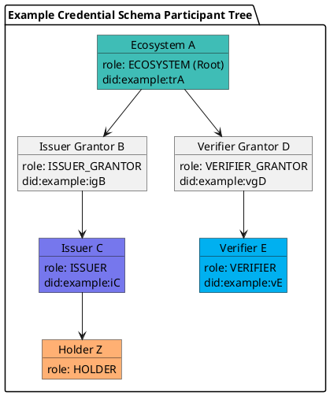

`ECOSYSTEM` Participants are created directly by the [[ref: credential schema]] owner. All other Participants are created by running an [[ref: onboarding process]], except under the `OPEN` and `CREDENTIAL` modes, where no entry is required at all:

- when `issuer_onboarding_mode` is `OPEN`, any service issues under its [VerifiableService](#verifiableservice) entry; it MAY self-create an `ISSUER` entry to declare fees ([[MOD-PP-MSG-14]](#mod-pp-msg-14-self-create-participant)), and one is created for it at its first fee-bearing session ([[MOD-PP-MSG-10]](#mod-pp-msg-10-create-or-update-participant-session));
- when `verifier_onboarding_mode` is `OPEN` or `CREDENTIAL`, any authorized service verifies under its `VerifiableService` entry; it MAY self-create a `VERIFIER` entry, and one is created for it at its first fee-bearing session.

An [[ref: onboarding process]] (OP) involves an [[ref: applicant]] (the [[ref: corporation]] of a given Participant entry) and a [[ref: validator]] Participant. It MAY require the applicant to pay `validation_fees` in addition to [[ref: transaction fees]].

An [[ref: onboarding process]] is run by [[ref: applicants]] that want to:

- be an [[ref: issuer]] of a specific [[ref: credential schema]];
- be a [[ref: verifier]] of a specific [[ref: credential schema]];
- be an [[ref: issuer grantor]] of a specific [[ref: credential schema]];
- be a [[ref: verifier grantor]] of a specific [[ref: credential schema]];
- get issued a credential of a specific [[ref: credential schema]];
- obtain a `HOLDER` Participant entry from an [[ref: issuer]] of a specific [[ref: credential schema]] and be issued a verifiable credential of that schema (the `HOLDER` Participant entry carries credential status — revoked, etc.).

In all cases, the process is very similar. Example execution of an [[ref: onboarding process]]:

1. The [[ref: applicant]] starts an [[ref: onboarding process]] by running [[MOD-PP-MSG-1]](#mod-pp-msg-1-start-participant-op). The process MAY be subject to paying `validation_fees`, as defined in the [[ref: validator]]'s Participant entry.
2. The [[ref: applicant]] connects to the [[ref: validator]]'s [[ref: VS]] (identified by its [[ref: DID]]) and executes the validation steps required for the [[ref: onboarding process]] to conclude.
3. If the [[ref: applicant]] qualifies, the [[ref: validator]] runs [[MOD-PP-MSG-3]](#mod-pp-msg-3-set-participant-op-to-validated) to update the Participant entry; the [[ref: applicant]] is then granted the new `Participant` entries and/or issued a credential.

Once in the `VALIDATED` state, a Participant entry remains valid for a specific period (e.g., 365 days), configured in the [[ref: credential schema]] for credential-schema-related onboarding, or set by the [[ref: ecosystem]] for user-agent onboarding.

:::note
Even when the Participant entry remains in the `VALIDATED` state for the configured period, the resulting `Participant` entry or issued credential MAY have a shorter expiration timestamp because the validated attribute(s) might expire earlier. In this case, the [[ref: applicant]] MUST provide updated information to the [[ref: validator]] before attribute expiration in order to be issued an updated `Participant` entry and/or credential.
:::

If the `VALIDATED` state is set to expire, an [[ref: applicant]] that wishes to extend the expiration timestamp MUST renew its [[ref: onboarding process]] (see [[MOD-PP-MSG-2]](#mod-pp-msg-2-renew-participant-op)).

At any time, the [[ref: applicant]] CAN cancel the [[ref: onboarding process]] (see [[MOD-PP-MSG-6]](#mod-pp-msg-6-cancel-participant-op-last-request)).

Some unexpected situations may arise and MUST be mitigated. Examples:

- if the selected [[ref: validator]] Participant entry is revoked while the [[ref: applicant]] is in `PENDING` state: applicant CAN cancel the [[ref: onboarding process]] (see [[MOD-PP-MSG-6]](#mod-pp-msg-6-cancel-participant-op-last-request));
- if the selected [[ref: validator]] Participant entry is revoked while the [[ref: applicant]] is in `VALIDATED` state: the applicant's entry stays effective until its own `effective_until` but cannot be renewed, since renewal requires the same validator ([[MOD-PP-MSG-2]](#mod-pp-msg-2-renew-participant-op)); to keep its role, the applicant performs a new [[ref: onboarding process]] with another validator.

#### [MOD-PP-MSG-1] Start Participant OP

Any authorized `operator` CAN execute this method on behalf of a `corporation`.

##### [MOD-PP-MSG-1-1] Start Participant OP parameters

An Applicant that would like to start an onboarding process MUST execute this method by specifying:

- `corporation` (account): (Signer) the `policy_address` of the corporation on whose behalf this message is executed.
- `operator` (account): (Signer) the account authorized by the `corporation` to run this Msg.
- `role` (ParticipantRole) (*mandatory*): (ISSUER_GRANTOR, VERIFIER_GRANTOR, ISSUER, VERIFIER, HOLDER): the Participant role that the applicant would like to get;
- `validator_participant_id` (uint64) (*mandatory*): the [[ref: validator]] participant (parent participant in the tree), chosen by the applicant.
- `validation_fees` (number) (*optional*): Requested validation_fees for this participant (can be modified by validator).
- `issuance_fees` (number) (*optional*): Requested issuance_fees for this `Participant` entry (can be modified by validator).
- `verification_fees` (number) (*optional*): Requested verification_fees for this `Participant` entry (can be modified by validator).
- `vs_id` (uint64) (*mandatory*): id of the `VerifiableService` entry of the [[ref: VS]] this `Participant` entry refers to, registered beforehand by [[MOD-VS-MSG-1]](#mod-vs-msg-1-register-verifiable-service) and owned by `corporation`.

Available compatible perms can be found by using an indexer and presented in a front-end so applicant can choose its validator.

##### [MOD-PP-MSG-1-2] Start Participant OP precondition checks

If any of these precondition checks fail, [[ref: transaction]] MUST abort.

###### [MOD-PP-MSG-1-2-1] Start Participant OP basic checks

if a mandatory parameter is not present, [[ref: transaction]] MUST abort.

- `corporation` (account): (Signer) signature must be verified.
- `operator` (account): (Signer) signature must be verified.
- [[AUTHZ-CHECK]](#authz-check-common-authorization-and-fee-grant-checks) MUST pass for this (`corporation`, `operator`) pair and this message type.
- `role` (ParticipantRole) (*mandatory*) MUST be a valid ParticipantRole: ISSUER_GRANTOR, VERIFIER_GRANTOR, ISSUER, VERIFIER, HOLDER.
- `validator_participant_id` (uint64) (*mandatory*): see [MOD-PP-MSG-1-2-2](#mod-pp-msg-1-2-2-start-participant-op-permission-checks).
- `validation_fees` (number) (*optional*): Requested validation_fees for this `Participant` entry (can be modified by validator).
- `issuance_fees` (number) (*optional*): Requested issuance_fees for this `Participant` entry (can be modified by validator).
- `verification_fees` (number) (*optional*): Requested verification_fees for this `Participant` entry (can be modified by validator).
- `vs_id` (uint64) (*mandatory*): a `VerifiableService` entry `vs` with this id MUST exist and `vs.corporation_id` MUST equal `co.id` (where `co` is the `Corporation` entry resolved from the signing `corporation` account); else method MUST abort ([VID ownership](#vid-ownership)).

:::note
A holder MAY directly connect to the DID VS of an issuer in order to get issued a credential. When the schema's `holder_onboarding_mode` is `ISSUER_ONBOARDING_PROCESS`, the onboarding process MUST have reached `VALIDATED` before the credential is issued: the Verifiable Trust specification requires an active `HOLDER` entry at issuance, and trust resolution requires it to stay active. When it is `PERMISSIONLESS`, no `HOLDER` entry exists and the issuer applies its own checks.
:::

###### [MOD-PP-MSG-1-2-2] Start Participant OP permission checks

- Load `Participant` entry `validator_participant` from `validator_participant_id`. It MUST be a [[ref: active participant]] else transaction MUST abort.
- Load `CredentialSchema` entry `cs` from `validator_participant.schema_id`. It MUST exist.

- if `role` (ParticipantRole) is equal to ISSUER:

  - if `cs.issuer_onboarding_mode` is equal to GRANTOR_ONBOARDING_PROCESS: `validator_participant.role` MUST be ISSUER_GRANTOR, else MUST abort.
  
  - else if `cs.issuer_onboarding_mode` is equal to ECOSYSTEM_ONBOARDING_PROCESS: `validator_participant.role` MUST be ECOSYSTEM, else MUST abort.

  - else MUST abort.

- else if `role` (ParticipantRole) is equal to ISSUER_GRANTOR:

  - if `cs.issuer_onboarding_mode` is equal to GRANTOR_ONBOARDING_PROCESS:  `validator_participant.role` MUST be ECOSYSTEM, else MUST abort.
  
  - else abort.

- else if `role` (ParticipantRole) is equal to VERIFIER:

  - if `cs.verifier_onboarding_mode` is equal to GRANTOR_ONBOARDING_PROCESS: `validator_participant.role` MUST be VERIFIER_GRANTOR, else MUST abort.
  
  - else if `cs.verifier_onboarding_mode` is equal to ECOSYSTEM_ONBOARDING_PROCESS: `validator_participant.role` MUST be ECOSYSTEM, else MUST abort.

  - else abort.

- else if `role` (ParticipantRole) is equal to VERIFIER_GRANTOR:

  - if `cs.verifier_onboarding_mode` is equal to GRANTOR_ONBOARDING_PROCESS: `validator_participant.role` MUST be ECOSYSTEM, else MUST abort.
  
  - else abort.

- else if `role` (ParticipantRole) is equal to HOLDER:

  - if `cs.holder_onboarding_mode` is equal to ISSUER_ONBOARDING_PROCESS: `validator_participant.role` MUST be ISSUER, else MUST abort.
  
  - else abort.

At the end, if a [[ref: active participant]] `validator_participant` is not found, [[ref: transaction]] MUST abort.

###### [MOD-PP-MSG-1-2-3] Start Participant OP fee checks

- Load `Participant` entry `validator_participant` from `validator_participant_id`.
- Load `CredentialSchema` entry `cs` from `validator_participant.schema_id`.

- Fee payer MUST have an available balance in its [[ref: account]], to cover the [[ref: estimated transaction fees]];

> If a conversion is needed below, use [Get Price](#mod-xr-qry-3-get-price) to convert amounts to [[ref: native denom]]:

- For trust fees:

if `(cs.pricing_asset_type, cs.pricing_asset)` is set to `(COIN, [[ref: native denom]])`:

- `corporation` MUST have an available balance in its [[ref: account]], to cover the following trust fees.
  - the required `validation_fees_in_denom` = `validator_participant.validation_fees` in [[ref: native denom]].
  - the required `validation_trust_deposit_in_native_denom`: `validation_fees_in_denom` * `GlobalVariables.trust_deposit_rate` in [[ref: native denom]].

else if `(cs.pricing_asset_type, cs.pricing_asset)` is set to `(TU, "tu")`:

- `corporation` MUST have an available balance in its [[ref: account]], to cover the following trust fees.
  - the required `validation_fees_in_denom` = getPrice(`cs.pricing_asset_type`, `cs.pricing_asset`, `COIN`, `[[ref: native denom]]`, `validator_participant.validation_fees`) in [[ref: native denom]];
  - the required `validation_trust_deposit_in_native_denom`: `validation_fees_in_denom` * `GlobalVariables.trust_deposit_rate` in [[ref: native denom]].

else if `(cs.pricing_asset_type, cs.pricing_asset)` is set to an arbitrary coin `(COIN, [[ref: denom]])`:

- `corporation` MUST have an available balance in its [[ref: account]], to cover the following trust fees.
  - the required `validation_fees_in_denom` = `validator_participant.validation_fees` in specified (cs.pricing_asset_type, cs.pricing_asset)
  - the required `validation_trust_deposit_in_native_denom`: getPrice(`cs.pricing_asset_type`, `cs.pricing_asset`, `COIN`, `[[ref: native denom]]`, `validation_fees_in_denom`) * `GlobalVariables.trust_deposit_rate` in [[ref: native denom]].

else if `(cs.pricing_asset_type, cs.pricing_asset)` is set to an arbitrary coin `(FIAT, [[ref: denom]])`:

- `corporation` MUST have an available balance in its [[ref: account]], to cover the following trust fees.
  - the required `validation_fees_in_denom` = 0 in [[ref: native denom]].
  - the required `validation_trust_deposit_in_native_denom`: getPrice(`cs.pricing_asset_type`, `cs.pricing_asset`, `COIN`, `[[ref: native denom]]`, `validator_participant.validation_fees`) * `GlobalVariables.trust_deposit_rate` in [[ref: native denom]].

:::note
Trust deposit MUST always be paid in [[ref: native denom]]
:::

###### [MOD-PP-MSG-1-2-4] Start Participant OP overlap checks

An applicant `corporation` MUST NOT have two onboarding processes running at the same time for the same `vs_id` and `role` with the same validator. This does not prevent a `corporation` from running concurrent OPs with different validators for the same `vs_id` and `role`, nor concurrent OPs with the same validator for different identifiers. A completed (VALIDATED) onboarding process does not prevent starting a new one: overlapping *effectiveness* of the resulting `Participant` entries is prevented at validation time by [MOD-PP-MSG-3-2-4](#mod-pp-msg-3-2-4-set-participant-op-to-validated-overlap-checks).

Find all `Participant` entries `participants[]` where:

- `p.validator_participant_id` = `validator_participant_id`,
- `p.role` = `role`,
- `p.corporation_id` = `co.id` (where `co` is the `Corporation` entry resolved from the signing `corporation` account),
- `p.vs_id` = `vs_id`,
- `p.revoked` is null and `p.unrepaid_slash` = 0,
- `p.op_state` = PENDING.

if size of `participants[]` > 0, an onboarding process is already running in this context, so [[ref: transaction]] MUST abort.

Additionally, if any `Participant` entry matches the same conditions except with `op_state` = VALIDATED, and has `effective_until` = NULL, [[ref: transaction]] MUST abort: that entry never expires, so a successor entry could never pass [MOD-PP-MSG-3-2-4](#mod-pp-msg-3-2-4-set-participant-op-to-validated-overlap-checks); `corporation` MUST first use [Set Participant Effective Until](#mod-pp-msg-8-set-participant-effective-until) to set an `effective_until`.

> Note: no `schema_id` condition is needed: all `Participant` entries sharing a `validator_participant_id` share its `schema_id` by construction. An entry whose slash has been repaid counts as running again.

###### [MOD-PP-MSG-1-2-5] Start Participant OP unrepaid slash checks

A `corporation` with an unrepaid slash MUST NOT start an onboarding process: in the ecosystem where it was slashed (ecosystem slash, see [MOD-PP-MSG-12](#mod-pp-msg-12-slash-participant-trust-deposit)), or anywhere on the VPR (network slash, see [MOD-TD-MSG-5](#mod-td-msg-5-slash-trust-deposit)).

- define `ecosystem_id` = `cs.ecosystem_id` (where `cs` is the `CredentialSchema` entry loaded from `validator_participant.schema_id`).
- if an `UnrepaidEcosystemSlashCount` entry exists for (`co.id`, `ecosystem_id`) (one of the corporation's `Participant` entries under this ecosystem carries an unrepaid slash, see [UnrepaidEcosystemSlashCount](#unrepaidecosystemslashcount)), [[ref: transaction]] MUST abort: `corporation` MUST first repay using [MOD-PP-MSG-13](#mod-pp-msg-13-repay-participant-slashed-trust-deposit).
- if a `TrustDeposit` entry `td` exists for `co.id` and `td.slashed_deposit` > `td.repaid_deposit`, [[ref: transaction]] MUST abort: `corporation` MUST first repay using [MOD-TD-MSG-6](#mod-td-msg-6-repay-slashed-trust-deposit).

> Note: the count follows `unrepaid_slash` > 0, which stays correct when an entry is slashed again after a previous repayment.

##### [MOD-PP-MSG-1-3] Start Participant OP execution

If all precondition checks passed, [[ref: transaction]] is executed.

Method execution MUST perform the following tasks in a [[ref: transaction]], and rollback if any error occurs.

- Load `Participant` entry `validator_participant` of the selected validator.

- calculate `validation_fees_in_denom` and `validation_trust_deposit_in_native_denom` as explained above in fee checks.
- use [MOD-TD-MSG-1] to increase by `validation_trust_deposit_in_native_denom` the [[ref: trust deposit]] of `co.id` (where `co` is the `Corporation` entry resolved from the signing `corporation` account) and transfer the corresponding amount to `TrustDeposit` module.
- send `validation_fees_in_denom` to validation escrow [[ref: account]], if greater than 0.

- define `now`: current timestamp.

- create an persist a new `Participant` entry `applicant_participant`:

  - `applicant_participant.id`: auto-incremented uint64.
  - `applicant_participant.schema_id` = `validator_participant.schema_id`
  - `applicant_participant.corporation_id`: `co.id`.
  - `applicant_participant.role`: `role`.
  - `applicant_participant.vs_id`: `vs_id`.
  - `applicant_participant.created`: `now`
  - `applicant_participant.deposit`: `validation_trust_deposit_in_native_denom`.
  - `applicant_participant.unrepaid_slash`: 0
  - `applicant_participant.validation_fees`: `validation_fees`.
  - `applicant_participant.issuance_fees`: `issuance_fees`.
  - `applicant_participant.verification_fees`: `verification_fees`.
  - `applicant_participant.validator_participant_id`: `validator_participant_id`.
  - `applicant_participant.op_last_state_change`: `now`
  - `applicant_participant.op_state`: PENDING.
  - `applicant_participant.op_current_fees` (number): `validation_fees_in_denom`.
  - `applicant_participant.op_current_deposit` (number): `validation_trust_deposit_in_native_denom`.
  - `applicant_participant.op_summary_digest`: null.
  - `applicant_participant.issuance_fee_discount`: 0 (overwritten at first validation by [[MOD-PP-MSG-3]](#mod-pp-msg-3-set-participant-op-to-validated)).
  - `applicant_participant.verification_fee_discount`: 0 (overwritten at first validation by [[MOD-PP-MSG-3]](#mod-pp-msg-3-set-participant-op-to-validated)).

> Note: the agent that will create sessions for this entry is `VerifiableService[vs_id].vs_operator`, and its authorization is the entry's `msg_types`: nothing is created here. It cannot be used in the context of `applicant_participant` until [[MOD-PP-MSG-3]](#mod-pp-msg-3-set-participant-op-to-validated) sets its `effective_from` ([[AUTHZ-CHECK-3]](#authz-check-3-vs-operator-authorization-checks) step 1).

#### Connecting to the VS of the Validator

*This section is non-normative, and provided for understanding only.*

This action must be initiated by the [[ref: applicant]].

During an onboarding process, if the associated `validator_participant` refers to a resolvable identifier (`VerifiableService[validator_participant.vs_id].vid`), the [[ref: applicant]] should establish a secure connection with the validator's [[ref: VS]] (Verifiable Service) using a secure communication protocol such as [[ref: DIDComm]].

Upon connecting to the [[ref: VS]], the [[ref: applicant]] should be required by the [[ref: validator]] to complete one or more of the following tasks:

1. **Prove control** over the `vs_operator` [[ref: account]] of the applicant's `VerifiableService` entry (e.g., via blind signature or cryptographic challenge).
2. **Provide requested information**, such as filling out forms, submitting documents, or other forms of disclosure as required by the validation [[ref: VS]].
3. The [[ref: applicant]] should prove control over the identifier of its `VerifiableService` entry to the validator's [[ref: VS]].

Once the [[ref: validator]] determines that the process is complete, they may terminate the onboarding process and create the `Participant` entry accordingly. This `Participant`-entry configuration usually includes:

- `validation_fees`  
- `issuance_fees`  
- `verification_fees`  
- `Participant` expiration

The [[ref: validator]] may compile a summary file of the onboarding process, documenting exchanged data, proofs, and decisions, and share it with the [[ref: applicant]] via the [[ref: VS]] connection or another secure channel.

For audit or governance purposes, the [[ref: validator]] should register a digest (e.g., hash or SRI) of this summary in `applicant_participant.op_summary_digest`.

#### [MOD-PP-MSG-2] Renew Participant OP

Any authorized `operator` CAN execute this method on behalf of a `corporation`.

*This section is non-normative.*

- Requesting a renewal has no effect on `Participant` expiration or issued credentials.
- Renewal is only possible with the same validator.
- Renewal only applies to entries managed by an [[ref: onboarding process]]: root ([[MOD-PP-MSG-7]](#mod-pp-msg-7-create-root-participant)) and self-created ([[MOD-PP-MSG-14]](#mod-pp-msg-14-self-create-participant)) entries cannot renew; use [[MOD-PP-MSG-8]](#mod-pp-msg-8-set-participant-effective-until) to adjust their `effective_until`.
- If validator `Participant` is not valid anymore, applicant MUST perform a new onboarding process with another validator.
- Renewal does not allow changing the `participant.validation_fees`, `participant.issuance_fees`, `participant.verification_fees`. To change these values, applicant MUST start a new onboarding process.
- if `applicant_participant` is revoked or carries an unrepaid slash (`unrepaid_slash` > 0), method MUST fail.
- if `corporation` has an unrepaid ecosystem slash in the ecosystem of the related schema, or an unrepaid network slash, method MUST fail (see [MOD-PP-MSG-2-2-4](#mod-pp-msg-2-2-4-renew-participant-op-unrepaid-slash-checks)).

##### [MOD-PP-MSG-2-1] Renew Participant OP parameters

- `corporation` (account): (Signer) the `policy_address` of the corporation on whose behalf this message is executed.
- `operator` (account): (Signer) the account authorized by the `corporation` to run this Msg.
- `id` (uint64) (*mandatory*): id of the `Participant` entry for which applicant would like to renew the onboarding process;

##### [MOD-PP-MSG-2-2] Renew Participant OP precondition checks

If any of these precondition checks fail, [[ref: transaction]] MUST abort.

###### [MOD-PP-MSG-2-2-1] Renew Participant OP basic checks

if a mandatory parameter is not present, [[ref: transaction]] MUST abort.

- `corporation` (account): (Signer) signature must be verified.
- `operator` (account): (Signer) signature must be verified.
- [[AUTHZ-CHECK]](#authz-check-common-authorization-and-fee-grant-checks) MUST pass for this (`corporation`, `operator`) pair and this message type.
- `id` MUST be a valid uint64 and a `Participant` entry with the same id MUST exist.

###### [MOD-PP-MSG-2-2-2] Renew Participant OP permission checks

- Load `Participant` entry `applicant_participant`. `co.id` MUST equal `applicant_participant.corporation_id` (where `co` is the `Corporation` entry resolved from the signing `corporation` account), else MUST abort. `applicant_participant` MUST be a [[ref: active participant]].
- Load `Participant` entry `validator_participant` from `applicant_participant.validator_participant_id`. It MUST exist, and be a [[ref: active participant]], else MUST abort.
- Load `CredentialSchema` entry `cs` from `validator_participant.schema_id`. It MUST exist.

- if `applicant_participant.role` (ParticipantRole) is equal to ISSUER:

  - if `cs.issuer_onboarding_mode` is equal to GRANTOR_ONBOARDING_PROCESS: `validator_participant.role` MUST be ISSUER_GRANTOR, else MUST abort.

  - else if `cs.issuer_onboarding_mode` is equal to ECOSYSTEM_ONBOARDING_PROCESS: `validator_participant.role` MUST be ECOSYSTEM, else MUST abort.

  - else MUST abort.

- else if `applicant_participant.role` (ParticipantRole) is equal to ISSUER_GRANTOR:

  - if `cs.issuer_onboarding_mode` is equal to GRANTOR_ONBOARDING_PROCESS:  `validator_participant.role` MUST be ECOSYSTEM, else MUST abort.

  - else abort.

- else if `applicant_participant.role` (ParticipantRole) is equal to VERIFIER:

  - if `cs.verifier_onboarding_mode` is equal to GRANTOR_ONBOARDING_PROCESS: `validator_participant.role` MUST be VERIFIER_GRANTOR, else MUST abort.

  - else if `cs.verifier_onboarding_mode` is equal to ECOSYSTEM_ONBOARDING_PROCESS: `validator_participant.role` MUST be ECOSYSTEM, else MUST abort.

  - else abort.

- else if `applicant_participant.role` (ParticipantRole) is equal to VERIFIER_GRANTOR:

  - if `cs.verifier_onboarding_mode` is equal to GRANTOR_ONBOARDING_PROCESS: `validator_participant.role` MUST be ECOSYSTEM, else MUST abort.

  - else abort.

- else if `applicant_participant.role` (ParticipantRole) is equal to HOLDER:

  - if `cs.holder_onboarding_mode` is equal to ISSUER_ONBOARDING_PROCESS: `validator_participant.role` MUST be ISSUER, else MUST abort.

  - else abort.

- else MUST abort.

> Note: these are the same mode/role compatibility checks as [MOD-PP-MSG-1-2-2](#mod-pp-msg-1-2-2-start-participant-op-permission-checks), with `role` read from `applicant_participant.role`. Because onboarding modes are immutable ([[MOD-CS-MSG-2]](#mod-cs-msg-2-update-credential-schema)), a self-created entry ([[MOD-PP-MSG-14]](#mod-pp-msg-14-self-create-participant)) can never renew: its mode is OPEN, which always falls through to abort. Root ECOSYSTEM entries are blocked by the `validator_participant` existence check above (`validator_participant_id` is null).

###### [MOD-PP-MSG-2-2-3] Renew Participant OP fee checks

- Load `Participant` entry `validator_participant` from `applicant_participant.validator_participant_id`.
- Load `CredentialSchema` entry `cs` from `validator_participant.schema_id`.

- Fee payer MUST have an available balance in its [[ref: account]], to cover the [[ref: estimated transaction fees]];

> If a conversion is needed below, use [Get Price](#mod-xr-qry-3-get-price) to convert amounts to [[ref: native denom]]:

- For trust fees:

if `(cs.pricing_asset_type, cs.pricing_asset)` is set to `(COIN, [[ref: native denom]])`:

- `corporation` MUST have an available balance in its [[ref: account]], to cover the following trust fees.
  - the required `validation_fees_in_denom` = `validator_participant.validation_fees` in [[ref: native denom]].
  - the required `validation_trust_deposit_in_native_denom`: `validation_fees_in_denom` * `GlobalVariables.trust_deposit_rate` in [[ref: native denom]].

else if `(cs.pricing_asset_type, cs.pricing_asset)` is set to `(TU, "tu")`:

- `corporation` MUST have an available balance in its [[ref: account]], to cover the following trust fees.
  - the required `validation_fees_in_denom` = getPrice(`cs.pricing_asset_type`, `cs.pricing_asset`, `COIN`, `[[ref: native denom]]`, `validator_participant.validation_fees`) in [[ref: native denom]];
  - the required `validation_trust_deposit_in_native_denom`: `validation_fees_in_denom` * `GlobalVariables.trust_deposit_rate` in [[ref: native denom]].

else if `(cs.pricing_asset_type, cs.pricing_asset)` is set to an arbitrary coin `(COIN, [[ref: denom]])`:

- `corporation` MUST have an available balance in its [[ref: account]], to cover the following trust fees.
  - the required `validation_fees_in_denom` = `validator_participant.validation_fees` in specified (cs.pricing_asset_type, cs.pricing_asset)
  - the required `validation_trust_deposit_in_native_denom`: getPrice(`cs.pricing_asset_type`, `cs.pricing_asset`, `COIN`, `[[ref: native denom]]`, `validation_fees_in_denom`) * `GlobalVariables.trust_deposit_rate` in [[ref: native denom]].

else if `(cs.pricing_asset_type, cs.pricing_asset)` is set to an arbitrary coin `(FIAT, [[ref: denom]])`:

- `corporation` MUST have an available balance in its [[ref: account]], to cover the following trust fees.
  - the required `validation_fees_in_denom` = 0 in [[ref: native denom]].
  - the required `validation_trust_deposit_in_native_denom`: getPrice(`cs.pricing_asset_type`, `cs.pricing_asset`, `COIN`, `[[ref: native denom]]`, `validator_participant.validation_fees`) * `GlobalVariables.trust_deposit_rate` in [[ref: native denom]].

:::note
Trust deposit MUST always be paid in [[ref: native denom]]
:::

###### [MOD-PP-MSG-2-2-4] Renew Participant OP unrepaid slash checks

Same as [MOD-PP-MSG-1-2-5](#mod-pp-msg-1-2-5-start-participant-op-unrepaid-slash-checks), with `ecosystem_id` resolved from the entry being renewed:

- define `ecosystem_id` = `cs.ecosystem_id` (where `cs` is the `CredentialSchema` entry loaded from `applicant_participant.schema_id`).
- if an `UnrepaidEcosystemSlashCount` entry exists for (`co.id`, `ecosystem_id`) (one of the corporation's `Participant` entries under this ecosystem carries an unrepaid slash, see [UnrepaidEcosystemSlashCount](#unrepaidecosystemslashcount)), [[ref: transaction]] MUST abort: `corporation` MUST first repay using [MOD-PP-MSG-13](#mod-pp-msg-13-repay-participant-slashed-trust-deposit).
- if a `TrustDeposit` entry `td` exists for `co.id` and `td.slashed_deposit` > `td.repaid_deposit`, [[ref: transaction]] MUST abort: `corporation` MUST first repay using [MOD-TD-MSG-6](#mod-td-msg-6-repay-slashed-trust-deposit).

##### [MOD-PP-MSG-2-3] Renew Participant OP execution

If all precondition checks passed, [[ref: transaction]] is executed.

Method execution MUST perform the following tasks in a [[ref: transaction]], and rollback if any error occurs.

- Load `Participant` entry `applicant_participant`. 
- Load `Participant` entry `validator_participant` from `applicant_participant.validator_participant_id`.

- calculate `validation_fees_in_denom` and `validation_trust_deposit_in_native_denom` as explained above in fee checks.
- use [MOD-TD-MSG-1] to increase by `validation_trust_deposit_in_native_denom` the [[ref: trust deposit]] of `co.id` (where `co` is the `Corporation` entry resolved from the signing `corporation` account) and transfer the corresponding amount to `TrustDeposit` module.
- send `validation_fees_in_denom` to validation escrow [[ref: account]], if greater than 0.

- define `now`: current timestamp.

- update `Participant` entry:

  - `applicant_participant.op_state`: PENDING.
  - `applicant_participant.op_last_state_change`: current timestamp.
  - `applicant_participant.deposit`: `applicant_participant.deposit` + `validation_trust_deposit_in_native_denom`.
  - `applicant_participant.op_current_fees` (number): `validation_fees_in_denom`.
  - `applicant_participant.op_current_deposit` (number): `validation_trust_deposit_in_native_denom`.

#### [MOD-PP-MSG-3] Set Participant OP to Validated

Any authorized `operator` CAN execute this method on behalf of a `corporation`.

##### [MOD-PP-MSG-3-1] Set Participant OP to Validated parameters

An [[ref: account]] that would like to set a validation entry to VALIDATED MUST execute this method by specifying:

- `corporation` (account): (Signer) the `policy_address` of the corporation on whose behalf this message is executed.
- `operator` (account): (Signer) the account authorized by the `corporation` to run this Msg.
- `id` (uint64) (*mandatory*): id of the onboarding process;
- `effective_until` (timestamp) (*optional*): timestamp until when (exclusive) this `Participant` is effective, null if no time limit should been set for this `Participant` entry or if we want it to be aligned with the onboarding process expiration timestamp calculated by this method.
- `validation_fees` (number) (*mandatory*): Agreed validation_fees for this `Participant` entry. Can be set only the first time this method is called (cannot be set for renewals). Use 0 for no fees.
- `issuance_fees` (number) (*mandatory*): Agreed issuance_fees for this `Participant` entry. Can be set only the first time this method is called (cannot be set for renewals). Use 0 for no fees.
- `verification_fees` (number) (*mandatory*): Agreed verification_fees for this `Participant` entry. Can be set only the first time this method is called (cannot be set for renewals). Use 0 for no fees.
- `op_summary_digest` (bytes, SRI form in the API) (*optional*): an optional digest, set by [[ref: validator]], of a summary of the information, proofs... provided by the [[ref: applicant]].
- `issuance_fee_discount`: (number) (*mandatory*): use 0 for no discount. Maximum 1 (100% discount). Can be set to an ISSUER_GRANTOR or ISSUER `Participant` entry (if GRANTOR_ONBOARDING_PROCESS mode) or to an ISSUER `Participant` entry (ECOSYSTEM_ONBOARDING_PROCESS mode) to reduce (or void) calculated issuance fees for the subtree of `Participant` entries. Note: this should generally not be used because it reduces or void commission of all related ecosystem participants.
- `verification_fee_discount`: (number) (*mandatory*): use 0 for no discount. Maximum 1 (100% discount). Can be set to a VERIFIER_GRANTOR or VERIFIER `Participant` entry (if GRANTOR_ONBOARDING_PROCESS mode) and/or to a VERIFIER `Participant` entry (ECOSYSTEM_ONBOARDING_PROCESS mode) to reduce (or void) calculated fees for the subtree of `Participant` entries. Note: this should generally not be used because it reduces or void commission of all related ecosystem participants.

##### [MOD-PP-MSG-3-2] Set Participant OP to Validated precondition checks

If any of these precondition checks fail, [[ref: transaction]] MUST abort.

###### [MOD-PP-MSG-3-2-1] Set Participant OP to Validated basic checks

if a mandatory parameter is not present, [[ref: transaction]] MUST abort.

- `corporation` (account): (Signer) signature must be verified.
- `operator` (account): (Signer) signature must be verified.
- `id` MUST be a valid uint64.
- Load `Participant` entry `applicant_participant` from `id`. If no entry found, abort.
- Load `Participant` entry `validator_participant` from `applicant_participant_validator_participant_id`.
- Authorization:

either (executed by any operator of corporation):
[[AUTHZ-CHECK-1]](#authz-check-1-operator-authorization-checks) MUST pass for this (`corporation`, `operator`) tuple and `SetParticipantOPtoValidated` message.
[[AUTHZ-CHECK-2]](#authz-check-2-fee-grant-checks) MUST pass for this (`corporation`, `operator`) tuple and `SetParticipantOPtoValidated` message.
OR (executed by the vs-agent of the validator's entry, `VerifiableService[validator_participant.vs_id].vs_operator`):
[[AUTHZ-CHECK-3]](#authz-check-3-vs-operator-authorization-checks) MUST pass for this (`corporation`, `operator`, `validator_participant`) tuple.
[[AUTHZ-CHECK-4]](#authz-check-4-vs-operator-fee-grant-checks) MUST pass for this (`corporation`, `operator`, `validator_participant`) tuple.
else MUST abort.

- `applicant_participant.op_state` MUST be equal to PENDING, else abort.
- `validation_fees` (number) (*mandatory*): MUST be zero or a positive integer. If `applicant_participant.effective_from` is not null (we are in renewal) `validation_fees` MUST be equal to `applicant_participant.validation_fees`, else abort.
- `issuance_fees` (number) (*mandatory*): MUST be zero or a positive integer.  If `applicant_participant.effective_from` is not null (we are in renewal) `issuance_fees` MUST be equal to `applicant_participant.issuance_fees` or, else abort.
- `verification_fees` (number) (*mandatory*): MUST be zero or a positive integer.  If `applicant_participant.effective_from` is not null (we are in renewal) `verification_fees` MUST be equal to `applicant_participant.verification_fees`, else abort.
- `op_summary_digest` (bytes, SRI form in the API) (*optional*): MUST be the digest of the summary computed with the `digest_algorithm` of the schema, given in SRI form (for example `sha384-GOp0dicJ4ufacOQxQfQojCyGoC7RJClOzqb23pJubmG2z3cqD/73j1+3kYNSrxUP`) and stored as the decoded bytes, 48 for `sha384` and 64 for `sha512`.

- Load `CredentialSchema` `cs` from `applicant_participant.schema_id`.
- Load `Participant` `validator_participant` from `applicant_participant.validator_participant_id`.

- `issuance_fee_discount` : (number) (*mandatory*):
  - if `applicant_participant.effective_from` is not null (renewal), then `issuance_fee_discount` must be equal to `applicant_participant.issuance_fee_discount` else MUST abort.
  - otherwise (first validation), the allowed range depends on `applicant_participant.role` (the onboarding mode of `cs` is implied by the existence of the onboarding process, see [[MOD-PP-MSG-1-2-2]](#mod-pp-msg-1-2-2-start-participant-op-permission-checks)):
    - if `applicant_participant.role` == ISSUER_GRANTOR: `issuance_fee_discount` MUST be between 0 (no discount) and 1 (100% discount) inclusive, else MUST abort.
    - if `applicant_participant.role` == ISSUER: `issuance_fee_discount` MUST be between 0 (no discount) and `max_discount` inclusive, else MUST abort, where `max_discount` is `validator_participant.issuance_fee_discount` if `cs.issuer_onboarding_mode` is GRANTOR_ONBOARDING_PROCESS (the validator is a ISSUER_GRANTOR) and 1 if it is ECOSYSTEM_ONBOARDING_PROCESS.
    - for any other role: `issuance_fee_discount` MUST be 0, else MUST abort.

- `verification_fee_discount` : (number) (*mandatory*):
  - if `applicant_participant.effective_from` is not null (renewal), then `verification_fee_discount` must be equal to `applicant_participant.verification_fee_discount` else MUST abort.
  - otherwise (first validation), the allowed range depends on `applicant_participant.role` (the onboarding mode of `cs` is implied by the existence of the onboarding process, see [[MOD-PP-MSG-1-2-2]](#mod-pp-msg-1-2-2-start-participant-op-permission-checks)):
    - if `applicant_participant.role` == VERIFIER_GRANTOR: `verification_fee_discount` MUST be between 0 (no discount) and 1 (100% discount) inclusive, else MUST abort.
    - if `applicant_participant.role` == VERIFIER: `verification_fee_discount` MUST be between 0 (no discount) and `max_discount` inclusive, else MUST abort, where `max_discount` is `validator_participant.verification_fee_discount` if `cs.verifier_onboarding_mode` is GRANTOR_ONBOARDING_PROCESS (the validator is a VERIFIER_GRANTOR) and 1 if it is ECOSYSTEM_ONBOARDING_PROCESS.
    - for any other role: `verification_fee_discount` MUST be 0, else MUST abort.

A HOLDER applicant, and any applicant whose `cs.issuer_onboarding_mode` (resp. `cs.verifier_onboarding_mode`) is OPEN, carries no issuance (resp. verification) discount: the mandatory parameter MUST be 0; a value of 0 MUST be accepted, and the method MUST NOT abort because of the schema's onboarding mode.

Calculation of `op_exp`, the onboarding process expiration timestamp, required to verify provided `effective_until`:

- let's define `validity_period` = `cs.issuer_grantor_validation_validity_period` (if `applicant_participant.role` is ISSUER_GRANTOR), `cs.verifier_grantor_validation_validity_period` (if `applicant_participant.role` is VERIFIER_GRANTOR), `cs.issuer_validation_validity_period` (if `applicant_participant.role` is ISSUER), `cs.verifier_validation_validity_period` (if `applicant_participant.role` is VERIFIER), or `cs.holder_validation_validity_period` (if `applicant_participant.role` is HOLDER).

- if `validity_period` is NULL:  `op_exp` = NULL.
- else if `applicant_participant.op_exp` is null, `op_exp` =  timestamp of now() plus `validity_period`.
- else `op_exp` =  `applicant_participant.op_exp` plus `validity_period`

Now, let's verify `effective_until`:

- if `effective_until` is NULL, no issue.
- else if `applicant_participant.effective_until` is NULL, `effective_until` MUST be greater than current current timestamp AND, if `op_exp` is not null, lower or equal to `op_exp`.
- else `effective_until` MUST be greater than `applicant_participant.effective_until` AND, if `op_exp` is not null, lower or equal to `op_exp`.

###### [MOD-PP-MSG-3-2-2] Set Participant OP to Validated validator perms

- load `validator_participant` from `applicant_participant.validator_participant_id`. `validator_participant` MUST be a [[ref: active participant]].
- `co.id` MUST equal `validator_participant.corporation_id` (where `co` is the `Corporation` entry resolved from the signing `corporation` account).

If `validator_participant` is not a [[ref: active participant]] (expired, revoked, slashed...) then applicant MUST start a new onboarding process.

###### [MOD-PP-MSG-3-2-3] Set Participant OP to Validated fee checks

- Fee payer MUST have the required [[ref: estimated transaction fees]] in its [[ref: account]], else [[ref: transaction]] MUST abort.
- if `applicant_participant.op_current_fees` is not in [[ref: native denom]], `corporation` account MUST have `applicant_participant.op_current_deposit` available in [[ref: native denom]] on its account for paying the trust deposit.

###### [MOD-PP-MSG-3-2-4] Set Participant OP to Validated overlap checks

Two `Participant` entries of the same applicant (`corporation_id`, `vs_id`) MUST NOT be effective at the same time under the same `validator_participant_id` for the same `role`. That should not occur if [MOD-PP-MSG-1-2-4](#mod-pp-msg-1-2-4-start-participant-op-overlap-checks) is enforced, but better do the check anyway.

Find all [[ref: active participants]] and [[ref: future participants]] `participants[]` where:

- `p.id` is not equal to `applicant_participant.id`,
- `p.validator_participant_id` = `applicant_participant.validator_participant_id`,
- `p.role` = `applicant_participant.role`,
- `p.corporation_id` = `applicant_participant.corporation_id`,
- `p.vs_id` = `applicant_participant.vs_id`.

for each `Participant` entry `p` from `participants[]`, [[ref: transaction]] MUST abort if:

- `p` is a [[ref: active participant]] (the entry being validated becomes effective at `now` and would overlap it), OR
- `p` is a [[ref: future participant]] and (`effective_until` is NULL or `p.effective_from` is lower than `effective_until`).

> Note: excluding `applicant_participant` itself is required: on a renewal, the entry being validated is itself a [[ref: active participant]] and would otherwise always match. No `schema_id` condition is needed: all `Participant` entries sharing a `validator_participant_id` share its `schema_id` by construction.

##### [MOD-PP-MSG-3-3] Set Participant OP to Validated execution

If all precondition checks passed, [[ref: transaction]] is executed.

Method execution MUST perform the following tasks in a [[ref: transaction]], and rollback if any error occurs.

- Load `Participant` entry `applicant_participant` from `id`.
- Load `Participant` entry `validator_participant` from `applicant_participant.validator_participant_id`.
- define `now` timestamp of now().

Calculate `op_exp`:

- Load `CredentialSchema` `cs` from `applicant_participant.schema_id`.
- let's define `validity_period` = `cs.issuer_grantor_validation_validity_period` (if `applicant_participant.role` is ISSUER_GRANTOR), `cs.verifier_grantor_validation_validity_period` (if `applicant_participant.role` is VERIFIER_GRANTOR), `cs.issuer_validation_validity_period` (if `applicant_participant.role` is ISSUER), `cs.verifier_validation_validity_period` (if `applicant_participant.role` is VERIFIER), or `cs.holder_validation_validity_period` (if `applicant_participant.role` is HOLDER).

- if `validity_period` is NULL:  `op_exp` = NULL.
- else if `applicant_participant.op_exp` is null, `op_exp` =  timestamp of now() plus `validity_period`.
- else `op_exp` =  `applicant_participant.op_exp` plus `validity_period`.

Change value of provided `effective_until` if needed, and abort if needed:

- if provided  `effective_until` is NULL:
  - change value of provided `effective_until` to `op_exp`.

- else if `applicant_participant.effective_until` is NULL:
  - verify that provided `effective_until` is greater than `now` else MUST abort
  - if `op_exp` is not null, verify that provided `effective_until` is lower or equal to `op_exp` else MUST abort

- else:
  - `effective_until` MUST be greater than `applicant_participant.effective_until` else MUST abort
  - if `op_exp` is not null, verify that provided `effective_until` is lower or equal to `op_exp` else MUST abort.

Fees and Trust Deposits:

- transfer the full amount `applicant_participant.op_current_fees` in the proper [[ref: denom]] from escrow [[ref: account]] to the validator corporation account `Corporation[validator_participant.corporation_id].policy_address`;
- Increase validator perm trust deposit: use [MOD-TD-MSG-1] to increase by `applicant_participant.op_current_deposit` the [[ref: trust deposit]] of `co.id` (where `co` is the `Corporation` entry resolved from the signing `corporation` account) and transfer the corresponding amount to `TrustDeposit` module.

> Important: if `applicant_participant.op_current_fees` is not in [[ref: native denom]], `corporation` account MUST have `applicant_participant.op_current_deposit` available for paying the trust deposit.

Update `Participant` `applicant_participant`:

- set `applicant_participant.op_state` to VALIDATED.
- set `applicant_participant.op_last_state_change` to `now`.
- set `applicant_participant.op_current_fees` to 0;
- set `applicant_participant.op_current_deposit` to 0;
- set `applicant_participant.op_summary_digest` to `op_summary_digest`.
- set `applicant_participant.op_exp` to `op_exp`.
- set `applicant_participant.effective_until` to `effective_until`.
- if `applicant_participant.effective_from` IS NULL (first time method is called for this perm, and thus we are not in a renewal):
  - set `applicant_participant.validation_fees` to `validation_fees`;
  - set `applicant_participant.issuance_fees` to `issuance_fees`;
  - set `applicant_participant.verification_fees` to `verification_fees`;
  - set `applicant_participant.effective_from` to `now`.
  - set `applicant_participant.issuance_fee_discount` to `issuance_fee_discount`.
  - set `applicant_participant.verification_fee_discount` to `verification_fee_discount`.

> Note: no VS Operator Authorization step is needed: the applicant's agent is `VerifiableService[applicant_participant.vs_id].vs_operator`, whose `msg_types` become usable in the context of this entry as soon as `effective_from` is set ([[AUTHZ-CHECK-3]](#authz-check-3-vs-operator-authorization-checks) step 1).

#### [MOD-PP-MSG-4] Void

#### [MOD-PP-MSG-5] Void

#### [MOD-PP-MSG-6] Cancel Participant OP Last Request

Any authorized `operator` CAN execute this method on behalf of a `corporation`.

At any time, [[ref: applicant]] of an onboarding process may request cancellation of the process, provided state is PENDING. Upon method execution, the pending validation is cancelled and escrewed [[ref: trust fees]] are refunded. If `op_exp` is not null, `op_state` is set back to VALIDATED, else `op_state` is set to TERMINATED.

##### [MOD-PP-MSG-6-1] Cancel Participant OP Last Request parameters

- `corporation` (account): (Signer) the `policy_address` of the corporation on whose behalf this message is executed.
- `operator` (account): (Signer) the account authorized by the `corporation` to run this Msg.
- `id` (uint64) (*mandatory*): id of the `Participant` entry;

##### [MOD-PP-MSG-6-2] Cancel Participant OP Last Request precondition checks

If any of these precondition checks fail, [[ref: transaction]] MUST abort.

###### [MOD-PP-MSG-6-2-1] Cancel Participant OP Last Request basic checks

if a mandatory parameter is not present, [[ref: transaction]] MUST abort.

- `corporation` (account): (Signer) signature must be verified.
- `operator` (account): (Signer) signature must be verified.
- [[AUTHZ-CHECK]](#authz-check-common-authorization-and-fee-grant-checks) MUST pass for this (`corporation`, `operator`) pair and this message type.
- `id` MUST be a valid uint64.
- Load `Participant` entry `applicant_participant` with this id. It MUST exist.
- `co.id` MUST equal `applicant_participant.corporation_id` (where `co` is the `Corporation` entry resolved from the signing `corporation` account).
- `applicant_participant.op_state` MUST be PENDING.
- if `applicant_participant.unrepaid_slash` > 0, MUST abort

###### [MOD-PP-MSG-6-2-2] Cancel Participant OP Last Request fee checks

Fee payer MUST have the required [[ref: estimated transaction fees]] in its [[ref: account]], else [[ref: transaction]] MUST abort.

##### [MOD-PP-MSG-6-3] Cancel Participant OP Last Request execution

If all precondition checks passed, [[ref: transaction]] is executed.

Method execution MUST perform the following tasks in a [[ref: transaction]], and rollback if any error occurs.

- Load `Participant` entry `applicant_participant` with `id`. It MUST exist.
- define `now`: current timestamp.

- if `applicant_participant.op_exp` is null (validation never completed), set `applicant_participant.op_state` to TERMINATED, else set `applicant_participant.op_state` to VALIDATED.
- set `applicant_participant.op_last_state_change` to `now`.
- if `applicant_participant.op_current_fees` > 0:
  - transfer `applicant_participant.op_current_fees` in proper [[ref: denom]] back from escrow [[ref: account]] to [[ref: applicant]] [[ref: account]], `applicant_participant.corporation_id`.
  - set `applicant_participant.op_current_fees` to 0;

- if `applicant_participant.op_current_deposit` > 0:
  - call [MOD-TD-MSG-1] to reduce trust deposit of `applicant_participant.corporation_id` by `applicant_participant.op_current_deposit`
  - set `applicant_participant.op_current_deposit` to 0.

#### [MOD-PP-MSG-7] Create Root Participant

Any authorized `operator` CAN execute this method on behalf of a `corporation`.

This method is used by controller authorities of Ecosystems. When they create a Credential Schema, they need to create (a) `Participant` entry(ies) of role ECOSYSTEM so that other participants can run onboarding processes (if schema mode is ECOSYSTEM) or self create their `Participant` entries (schema mode set to OPEN).

##### [MOD-PP-MSG-7-1] Create Root Participant parameters

An [[ref: account]] that would like to create a `Participant` entry MUST call this method by specifying:

- `corporation` (account): (Signer) the `policy_address` of the corporation on whose behalf this message is executed.
- `operator` (account): (Signer) the account authorized by the `corporation` to run this Msg.
- `schema_id` (uint64) (*mandatory*)
- `vs_id` (uint64) (*mandatory*): id of the `VerifiableService` entry of the [[ref: VS]] this `Participant` entry refers to, registered beforehand by [[MOD-VS-MSG-1]](#mod-vs-msg-1-register-verifiable-service) and owned by `corporation`.
- `effective_from` (timestamp) (*optional*): timestamp from which (inclusive) this `Participant` entry is effective. If present, MUST NOT be lower than the current block timestamp. If absent, the VPR MUST set it to the current block timestamp during execution.
- `effective_until` (timestamp) (*optional*): timestamp until when (exclusive) this Perm is effective, null if it doesn't expire. If not null, MUST be greater than `effective_from_r` (see [MOD-PP-MSG-7-2-1](#mod-pp-msg-7-2-1-create-root-participant-basic-checks)).
- `validation_fees` (number) (*mandatory*): price to pay by applicant to validator for running an onboarding process that uses this perm as validator, for a given validation period, in the denom specified in the credential schema. Default to 0. Note that setting validation fees for OPEN schemas has no effect and does not mean an onboarding process must take place. For enabling onboarding processes, at least one of the two issuer, verifier mode must be different than OPEN.
- `issuance_fees` (number) (*mandatory*): price to pay by the issuer of a credential of this schema to the grantee of this perm when a credential is issued, in the denom specified in the credential schema. Default to 0.
- `verification_fees` (number) (*mandatory*): price to pay by the verifier of a credential of this schema to the grantee of this perm when a credential is verified, in the denom specified in the credential schema. Default to 0.

##### [MOD-PP-MSG-7-2] Create Root Participant precondition checks

If any of these precondition checks fail, [[ref: transaction]] MUST abort.

###### [MOD-PP-MSG-7-2-1] Create Root Participant basic checks

if a mandatory parameter is not present, [[ref: transaction]] MUST abort.

- `corporation` (account): (Signer) signature must be verified.
- `operator` (account): (Signer) signature must be verified.
- [[AUTHZ-CHECK]](#authz-check-common-authorization-and-fee-grant-checks) MUST pass for this (`corporation`, `operator`) pair and this message type.
- `schema_id` MUST be a valid uint64 and a [[ref: credential schema]] entry with this id MUST exist.
- `vs_id` (uint64) (*mandatory*): a `VerifiableService` entry `vs` with this id MUST exist and `vs.corporation_id` MUST equal `co.id` (where `co` is the `Corporation` entry resolved from the signing `corporation` account); else method MUST abort ([VID ownership](#vid-ownership)).
- define `effective_from_r`: `effective_from` if present, else the current block timestamp.
- if `effective_from` is present, it MUST NOT be lower than the current block timestamp.
- `effective_until`, if not null, MUST be greater than `effective_from_r`.
- `validation_fees` (number) (*mandatory*): MUST be >= 0.
- `issuance_fees` (number) (*mandatory*): MUST be >= 0.
- `verification_fees` (number) (*mandatory*): MUST be >= 0.

###### [MOD-PP-MSG-7-2-2] Create Root Participant permission checks

To execute this method, [[ref: account]] MUST match at least one these rules, else [[ref: transaction]] MUST abort.

- The related `CredentialSchema` entry is loaded with `schema_id`, and will be named `cs` in this section.
- The related `Ecosystem` entry `ecosystem` is loaded from `cs.ecosystem_id`.
- `co.id` MUST equal `ecosystem.corporation_id` (where `co` is the `Corporation` entry resolved from the signing `corporation` account).
- else MUST abort.

###### [MOD-PP-MSG-7-2-3] Create Root Participant fee checks

Fee payer MUST have the required [[ref: estimated transaction fees]] available.

###### [MOD-PP-MSG-7-2-4] Create Root Participant overlap checks

Two root ECOSYSTEM `Participant` entries MUST NOT be effective at the same time for the same `schema_id`. If `corporation` wishes to create a new `Participant` entry but the existing one never expires (or expires too far from now), `corporation` MUST use first the [Set Participant Effective Until](#mod-pp-msg-8-set-participant-effective-until) to set or adjust the `effective_until` value.

Let `participants[]` be the entries of `cs.root_participant_ids` that are [[ref: active participants]] or [[ref: future participants]].

> Note: unlike overlap checks from other methods, here we do not need to check for `validator_participant_id`, as for ECOSYSTEM-role `Participant` entries it is NULL, nor for `vs_id` or `corporation_id`: a root entry represents the ecosystem itself for the schema, and only the corporation controlling the ecosystem creates one. The candidates are read from the schema, not from an index of entries.

for each `Participant` entry `p` from `participants[]`, [[ref: transaction]] MUST abort if:

- (`effective_until` is NULL or `p.effective_from` is lower than `effective_until`), AND
- (`p.effective_until` is NULL or `p.effective_until` is greater than `effective_from_r`).

##### [MOD-PP-MSG-7-3] Create Root Participant execution

If all precondition checks passed, method is executed.

Method execution MUST perform the following tasks in a [[ref: transaction]], and rollback if any error occurs.

- define `now`: current timestamp.

A new entry `Participant` `perm` MUST be created:

- `participant.id`: auto-incremented uint64.
- `participant.schema_id`: `schema_id`.
- `participant.role`: ECOSYSTEM.
- `participant.vs_id`: `vs_id`.
- `participant.corporation_id`: `co.id`.
- `participant.created`: `now`
- `participant.effective_from`: `effective_from_r` (`effective_from` if provided, else `now`)
- `participant.effective_until`: `effective_until`
- `participant.validation_fees`: `validation_fees`
- `participant.issuance_fees`: `issuance_fees`
- `participant.verification_fees`: `verification_fees`
- `participant.deposit`: 0
- `participant.unrepaid_slash`: 0
- `participant.op_state`: VALIDATED
- `participant.op_last_state_change`: `now`
- `participant.op_current_fees`: 0
- `participant.op_current_deposit`: 0
- `participant.issuance_fee_discount`: 0
- `participant.verification_fee_discount`: 0

Then append `participant.id` to `cs.root_participant_ids`.

> Note: an entry created by this method never runs an [[ref: onboarding process]]: `op_state` is `VALIDATED` from creation, never takes the `PENDING` or `TERMINATED` values, and the `op_*` escrow fields stay at 0. The fee discounts are 0: [[MOD-PP-MSG-3]](#mod-pp-msg-3-set-participant-op-to-validated) negotiates them for OP-managed entries only.

#### [MOD-PP-MSG-8] Set Participant Effective Until

Any authorized `operator` CAN execute this method on behalf of a `corporation`.

This method can be called:

- by the corporation that owns the `Participant` entry (i.e., `Corporation[participant.corporation_id]`), if the `Participant` entry has role ECOSYSTEM.
- by the corporation that owns the `Participant` entry (i.e., `Corporation[participant.corporation_id]`), if it is a self-created `Participant` entry (schema configuration is open).
- by the corporation of a validator `Participant`, if the `Participant` entry is managed by an OP.

##### [MOD-PP-MSG-8-1] Set Participant Effective Until parameters

- `corporation` (account): (Signer) the `policy_address` of the corporation on whose behalf this message is executed.
- `operator` (account): (Signer) the account authorized by the `corporation` to run this Msg.
- `id` (uint64) (*mandatory*): id of the `Participant` entry;
- `effective_until` (timestamp) (*mandatory*): timestamp until when (exclusive) this `Participant` will be effective.

##### [MOD-PP-MSG-8-2] Set Participant Effective Until precondition checks

If any of these precondition checks fail, [[ref: transaction]] MUST abort.

###### [MOD-PP-MSG-8-2-1] Set Participant Effective Until basic checks

if a mandatory parameter is not present, [[ref: transaction]] MUST abort.

- `corporation` (account): (Signer) signature must be verified.
- `operator` (account): (Signer) signature must be verified.
- [[AUTHZ-CHECK]](#authz-check-common-authorization-and-fee-grant-checks) MUST pass for this (`corporation`, `operator`) pair and this message type.
- `id` MUST be a valid uint64.
- Load `Participant` entry `applicant_participant` from `id`. If no entry found, abort.
- `applicant_participant` MUST be a [[ref: active participant]]
- `applicant_participant.effective_until` MUST be greater than now().
- else MUST abort.

> Note: This method can be used to both Extend or Reduce the `effective_until`, or set an `effective_until` if it was null.

###### [MOD-PP-MSG-8-2-2] Set Participant Effective Until advanced checks

1. ECOSYSTEM `Participant` entries

- if `applicant_participant.validator_participant_id` is null and `applicant_participant.role` is ECOSYSTEM, `co.id` MUST equal `applicant_participant.corporation_id` (where `co` is the `Corporation` entry resolved from the signing `corporation` account).

2. Self-created `Participant` entries

- load `validator_participant` from `applicant_participant.validator_participant_id`. `validator_participant` MUST be a [[ref: active participant]] of role ECOSYSTEM. `co.id` MUST equal `applicant_participant.corporation_id` (where `co` is the `Corporation` entry resolved from the signing `corporation` account).

3. OP-managed `Participant` entries

- `effective_until` MUST be lower or equal to `applicant_participant.op_exp` else MUST abort.
- load `validator_participant` from `applicant_participant.validator_participant_id`. `validator_participant` MUST be a [[ref: active participant]]. `co.id` MUST equal `validator_participant.corporation_id` (where `co` is the `Corporation` entry resolved from the signing `corporation` account).

###### [MOD-PP-MSG-8-2-3] Set Participant Effective Until fee checks

Fee payer MUST have the required [[ref: estimated transaction fees]] in its [[ref: account]], else [[ref: transaction]] MUST abort.

###### [MOD-PP-MSG-8-2-4] Set Participant Effective Until overlap checks

Adjusting `effective_until` MUST NOT make this entry's effectiveness period overlap the period of a sibling entry of the same applicant (`corporation_id`, `vs_id`) with the same `schema_id`, `role` and `validator_participant_id`.

Find all [[ref: active participants]] and [[ref: future participants]] `participants[]` where:

- `p.id` is not equal to `applicant_participant.id`,
- `p.schema_id` = `applicant_participant.schema_id`,
- `p.role` = `applicant_participant.role`,
- `p.validator_participant_id` = `applicant_participant.validator_participant_id` (both NULL for root ECOSYSTEM entries),
- `p.corporation_id` = `applicant_participant.corporation_id`,
- `p.vs_id` = `applicant_participant.vs_id`.

for each `Participant` entry `p` from `participants[]`, [[ref: transaction]] MUST abort if:

- `p.effective_from` is lower than `effective_until` (the new value being set), AND
- `p.effective_until` is NULL or `p.effective_until` is greater than `applicant_participant.effective_from`.

> Note: excluding `applicant_participant` itself is required, as the entry being adjusted would otherwise always match. `schema_id` is kept in this check's conditions because `validator_participant_id` is NULL for root ECOSYSTEM entries and therefore cannot imply the schema.

##### [MOD-PP-MSG-8-3] Set Participant Effective Until execution

If all precondition checks passed, [[ref: transaction]] is executed.

Method execution MUST perform the following tasks in a [[ref: transaction]], and rollback if any error occurs.

- define `now`: current timestamp.

- Load `Participant` entry `applicant_participant` from `id`.
- set `applicant_participant.effective_until` to `effective_until`

#### [MOD-PP-MSG-9] Revoke Participant

Any authorized `operator` CAN execute this method on behalf of a `corporation`.

This method can only be called:

- by an ancestor (`corporation` of a validator in the `Participant` branch until the root `Participant` entry (GRANTOR, ECOSYSTEM, OPEN schema mode)).
- by the grantee `corporation` (OPEN, GRANTOR, ECOSYSTEM schema mode).
- by the `Ecosystem` `corporation` (owner of the credential schema).

##### [MOD-PP-MSG-9-1] Revoke Participant parameters

- `corporation` (account): (Signer) the `policy_address` of the corporation on whose behalf this message is executed.
- `operator` (account): (Signer) the account authorized by the `corporation` to run this Msg.
- `id` (uint64) (*mandatory*): id of the `Participant` entry;

##### [MOD-PP-MSG-9-2] Revoke Participant precondition checks

If any of these precondition checks fail, [[ref: transaction]] MUST abort.

###### [MOD-PP-MSG-9-2-1] Revoke Participant basic checks

if a mandatory parameter is not present, [[ref: transaction]] MUST abort.

- `corporation` (account): (Signer) signature must be verified.
- `operator` (account): (Signer) signature must be verified.
- [[AUTHZ-CHECK]](#authz-check-common-authorization-and-fee-grant-checks) MUST pass for this (`corporation`, `operator`) pair and this message type.
- `id` MUST be a valid uint64.
- Load `Participant` entry `applicant_participant` from `id`. If no entry found, abort.
- `applicant_participant` MUST be a [[ref: active participant]]

###### [MOD-PP-MSG-9-2-2] Revoke Participant advanced checks

Either Option #1, #2 or #3 MUST return true, else abort.

*Option #1*: executed by a validator ancestor

if `applicant_participant.validator_participant_id` is defined:

- set `validator_participant` = `applicant_participant`
- while `validator_participant.validator_participant_id` is defined, 
  - load `validator_participant` from `validator_participant.validator_participant_id`.
  - if `validator_participant` is a [[ref: active participant]] and `validator_participant.corporation_id` equals `co.id` (where `co` is the `Corporation` entry resolved from the signing `corporation` account), => return true.
- end
- return false.

*Option #2*: executed by `Ecosystem` controller

- load `CredentialSchema` `cs` from `applicant_participant.schema_id`
- load `Ecosystem` `ecosystem` from `cs.ecosystem_id`
- if `co.id` equals `ecosystem.corporation_id` (where `co` is the `Corporation` entry resolved from the signing `corporation` account), return true.
- else return false.

*Option #3*: executed by the corporation that owns `applicant_participant` (i.e., `co.id` equals `applicant_participant.corporation_id`): return true.

Example:

In the following `Participant` tree, the "Verifier E" `Participant` entry can be revoked:

- by "Verifier E", if the corresponding `Participant` entry is a [[ref: active participant]];
- by "Verifier Grantor D", if the corresponding `Participant` entry is a [[ref: active participant]];
- by "Ecosystem A", if the corresponding root `Participant` entry is a [[ref: active participant]];
- by the `Ecosystem` object controller, obtained by resolving perm => credential schema => ecosystem.

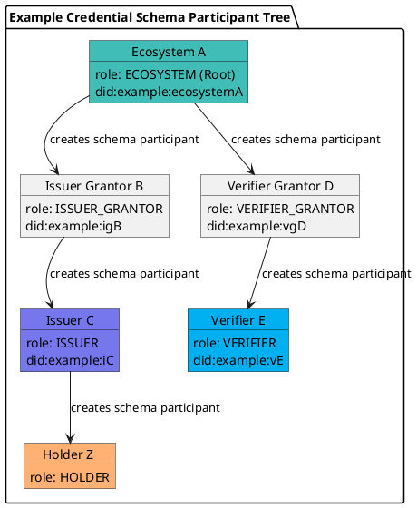

###### [MOD-PP-MSG-9-2-3] Revoke Participant fee checks

Fee payer MUST have the required [[ref: estimated transaction fees]] in its [[ref: account]], else [[ref: transaction]] MUST abort.

##### [MOD-PP-MSG-9-3] Revoke Participant execution

If all precondition checks passed, [[ref: transaction]] is executed.

Method execution MUST perform the following tasks in a [[ref: transaction]], and rollback if any error occurs.

- define `now`: current timestamp.

- Load `Participant` entry `applicant_participant` from `id`.
- set `applicant_participant.revoked` to `now`

#### [MOD-PP-MSG-10] Create or Update Participant Session

Only the `vs_operator` of the primary party's [VerifiableService](#verifiableservice) entry (the entry referenced by the primary `Participant` entry, or the entry given directly when the schema's mode requires no entry) CAN execute this method on behalf of a `corporation` (a VS Operator Authorization; [[MOD-DE-MSG-3]](#mod-de-msg-3-grant-operator-authorization) excludes this message from OperatorAuthorizations). The digest of a credential of a schema whose `credential_anchoring` is DIGEST is anchored through the issuance session only: such an issuer MUST hold a VS Operator Authorization for its agent.

Any credential exchange that requires issuer or verifier to pay fees, anchor a digest, or produce a proof implies the creation of a `ParticipantSession`. A Credential Verification of a credential whose schema sets `verification_session` to REQUIRED implies the creation of a `ParticipantSession` even when the fees computed for the verification are 0; when the schema sets WHEN_FEES, a session is required for a verification only when these fees are greater than 0 (see [CredentialSchema](#credentialschema)).

If the peer wants to issue a credential, the `agent`, the Verifiable User Agent or Verifiable Service that receive the request MUST send to peer:

- a `uuid` for session identification;
- *optional*: the `agent_participant_id` `Participant` id of the agent that will receive the credential, if peer is a **Verifiable User Agent**. it MUST NOT be set if peer is a **Verifiable Service**.
- *optional*: the `wallet_agent_participant_id` `Participant` id of the agent wallet that will store the credential. If this is the same software than the agent, then it should be equal to `agent_participant_id`. It MUST NOT be set if peer is a **Verifiable Service**.

If the peer wants to verify a credential, agent must send to peer:

- a `uuid` for session identification;
- *optional*: the `agent_participant_id` `Participant` id of the agent that will receive the credential, if peer is a **Verifiable User Agent**. it MUST NOT be set if peer is a **Verifiable Service**.
- *mandatory*: a map of compatible found credentials in available wallets for the requested schema_id, with at least one entry (an empty map means that the agent holds no matching credential and the exchange ends without a session): for each matching credential, the reference of its issuer (the id of the `ISSUER` `Participant` entry its digest was anchored under, or, for a credential anchored under a `VerifiableService` entry alone (OPEN issuer mode), the issuer's `vs_id`) and, for a VUA, the `wallet_agent_participant_id` of the wallet storing it. The payer selects from it the issuer reference of the session. wallet_agent_participant_id MUST NOT be set if the agent is a **Verifiable Service**.
- *mandatory*: whether the agent requires a `ParticipantSession` for this verification, from the `verification_session` of the schema read at that time (see [CredentialSchema](#credentialschema)); when the agent requires one, the payer MUST create it whatever its own reading.
- *mandatory* when the schema's `presentation_validity_period` is greater than 0 (the agent reads the `CredentialSchema` entry at the time of the verification, the VPR evaluates the value at the block), otherwise *optional* and only if the verifier asked for it in its request: the **presentation digest**, computed by the agent over the presentation it is about to send (the signed presentation as it will be transmitted: canonicalized with [JCS](https://www.rfc-editor.org/rfc/rfc8785) when it is a JSON document, its exact bytes otherwise; hashed with the `digest_algorithm` of the schema). The agent builds and signs the presentation first and sends only its digest at this step; the verifier anchors it through the `digest` parameter of the session transaction. When it sends a presentation digest, the agent has selected the credential it will present, and the map of compatible credentials above contains that single credential. Unless the schema's `presentation_validity_period` is greater than 0, anchoring a presentation digest is decided by the verifier: a verifier that did not ask for it MUST NOT expect one, and a verifier that asked for it MUST anchor it, since the agent sends the presentation only after checking the session transaction. The presentation MUST be a Verifiable Presentation signed by the holder and bound to the session identifier (or to the verifier's nonce), so that its digest differs from the credential's `digestJCS` and from any earlier presentation.

In case peer is a **Verifiable Service** and illegaly set `agent_participant_id` and/or `wallet_agent_participant_id`, the other end MUST refuse the request.

When a session is required (fees greater than 0; `verification_session` set to REQUIRED, see [CredentialSchema](#credentialschema); a `presentation_validity_period` of the schema greater than 0; a presentation digest requested by the verifier; or a Credential Issuance under a schema whose `credential_anchoring` is DIGEST, since the digest is anchored through the session), `payer` MUST create it using the above information, then `agent` MUST check, through the notification of an indexer of its whitelist ([[ref: VT spec]]), that the session transaction was included and is valid: signed for the payer's entry, carrying the session `id`, the schema and, in a Credential Verification, the issuer reference of the credential it is about to present (fees are routed by that reference) and the presentation digest it sent, before performing the action (storing the issued credential, or sending the presentation). The VPR stores no session: the transaction is the receipt ([ParticipantSession](#participantsession)).

```plantuml
scale max 800 width
actor "Agent\nVUA or VS" as Issued 
participant "Payer\nVS" as Issuer 
participant "VPR" as vpr 
participant "Indexer" as indexer


Issued <-- Issuer: I want to issue a credential from schema id ... to you
Issued --> Issuer: Here is the session uuid and the wallet_agent_participant_id
Issuer --> vpr: create session
Issued <-- Issuer: session created, you can verify
vpr --> indexer: session event
Issued <-- indexer: session notification
Issued --> Issuer: I verified the session transaction, you can send the credential
Issued <-- Issuer: Send credential
Issued <-- Issued: Store credential in wallet agent

```

See [[ref: VT spec]].

##### [MOD-PP-MSG-10-1] Create or Update Participant Session parameters

An [[ref: account]] that would like to record a `ParticipantSession` MUST send a Msg by specifying:

- `corporation` (account): (Signer) the `policy_address` of the corporation on whose behalf this message is executed.
- `operator` (account): (Signer) the account authorized by the `corporation` to run this Msg.
- `id` (uuid) (*mandatory*): the session identifier agreed with the peer, in canonical textual form; a correlation key carried by the event ([ParticipantSession](#participantsession)), not stored.
- `schema_id` (uint64) (*mandatory*): the id of the `CredentialSchema` entry of the credential.
- `issuer_participant_id` (uint64) (*conditional*): the id of the `ISSUER` `Participant` entry of the issuer of the credential: the payer's own entry in a Credential Issuance, the entry the credential was anchored under in a Credential Verification. Exactly one of `issuer_participant_id` and `issuer_vs_id` MUST be provided.
- `issuer_vs_id` (uint64) (*conditional*): the `VerifiableService` entry of the issuer, when the issuer holds no `ISSUER` entry (the schema's `issuer_onboarding_mode` is OPEN): the payer's own entry in a Credential Issuance, the entry the credential was anchored under in a Credential Verification.
- `verifier_participant_id` (uint64) (*conditional*): the id of the `VERIFIER` entry of the verifier, in a Credential Verification. At most one of `verifier_participant_id` and `verifier_vs_id` MAY be provided; the presence of either makes the operation a Credential Verification.
- `verifier_vs_id` (uint64) (*conditional*): the payer's own `VerifiableService` entry in a Credential Verification, when the verifier holds no `VERIFIER` entry (the schema's `verifier_onboarding_mode` is OPEN or CREDENTIAL).
- `agent_participant_id` (uint64) (*optional*): the agent credential issuer `Participant` id (extracted from the agent credential that VUA has in its wallet) of the agent that received the request (credential offer for issuance, presentation request for verification). Only set by VUAs, MUST NOT be specified when peer is a VS.
- `wallet_agent_participant_id` (uint64) (*optional*): the wallet credential issuer `Participant` id of the VUA where the credential will be or is stored. Can be the same perm than `agent_participant_id` if agent and wallet_agent are the same agent. Only set by VUAs, MUST NOT be specified when peer is a VS.
- `digest` (bytes, base64 in the API) (*conditional*): in a Credential Issuance, the credential digest defined by the Verifiable Trust specification for the container (the `digestJCS` of a W3C credential, the digest of the issuer-signed JWT of an SD-JWT credential), mandatory when the schema's `credential_anchoring` is DIGEST and absent when it is NONE (its anchoring fixes the effective issuance time, see [Digest](#digest)); in a Credential Verification, the presentation digest sent by the agent (see above): mandatory when `cs.presentation_validity_period` > 0 (see precondition checks), otherwise present when the verifier decided to anchor it.
- `credential_valid_until` (timestamp) (*conditional*): in a Credential Issuance under a schema whose `credential_revocation` is VPR, the expiry of the credential (`validUntil`, `exp` or `validityInfo.validUntil`, see the [[ref: VT spec]]), mandatory; absent otherwise. The `Digest` entry is kept until then ([Digests Module](#digests-module)).

##### [MOD-PP-MSG-10-2] Create or Update Participant Session precondition checks

If any of these precondition checks fail, [[ref: transaction]] MUST abort.

- `corporation` (account): (Signer) signature must be verified.
- `operator` (account): (Signer) signature must be verified.
- `id` MUST be a valid UUID.

- `schema_id` MUST refer to an existing `CredentialSchema` entry `cs`, else abort.
- exactly one of `issuer_participant_id` and `issuer_vs_id` MUST be provided, and at most one of `verifier_participant_id` and `verifier_vs_id`; else abort.

Determine the operation type from the provided ids:

- if `verifier_participant_id` or `verifier_vs_id` is provided, the operation is a **Credential Verification**: the caller is the `vs_operator` of the verifier, and the issuer reference identifies the issuer branch that is a fee beneficiary of the verification (see [[MOD-PP-QRY-4]](#mod-pp-qry-4-find-beneficiaries)).
- else, the operation is a **Credential Issuance**: the caller is the `vs_operator` of the issuer.

- define `issuer_participant`, `verifier_participant` as null.

Issuer reference:

- if `issuer_participant_id` is provided: load `issuer_participant` from it (abort if not found); `issuer_participant.role` MUST be ISSUER and `issuer_participant.schema_id` MUST equal `schema_id`, else abort; `issuer_participant.effective_from` MUST be non-null and not later than now (the entry has been validated and became effective), else abort; in a Credential Issuance, `issuer_participant` MUST be an [[ref: active participant]], else abort. In a Credential Verification no state is required of it: the validity of the credential is established by trust resolution at its issuance time, and the unrepaid-slash filter of [[MOD-PP-QRY-4]](#mod-pp-qry-4-find-beneficiaries) decides whether the issuer branch is paid.
- else (`issuer_vs_id` provided): a `VerifiableService` entry `issuer_vs` with this id MUST exist, and `cs.issuer_onboarding_mode` MUST be OPEN, else abort. In a Credential Issuance, `issuer_vs.corporation_id` MUST equal `co.id` and no [[ref: active participant]] with role ISSUER, `vs_id` = `issuer_vs_id` and `schema_id` = `schema_id` MAY exist (the caller MUST reference such an entry instead), else abort.

Verifier reference (Credential Verification only):

- if `verifier_participant_id` is provided: load `verifier_participant` from it (abort if not found); `verifier_participant.role` MUST be VERIFIER, `verifier_participant.schema_id` MUST equal `schema_id`, and `verifier_participant` MUST be an [[ref: active participant]], else abort.
- else (`verifier_vs_id` provided): a `VerifiableService` entry `verifier_vs` with this id MUST exist, `verifier_vs.corporation_id` MUST equal `co.id`, `cs.verifier_onboarding_mode` MUST be OPEN or CREDENTIAL, and no [[ref: active participant]] with role VERIFIER, `vs_id` = `verifier_vs_id` and `schema_id` = `schema_id` MAY exist, else abort.
- if `cs.presentation_validity_period` > 0 and `digest` is absent, abort: the ecosystem requires a dated receipt of every verification of this schema.

- in a Credential Issuance: if `cs.credential_anchoring` is DIGEST and `digest` is absent, abort (the credential digest is anchored through this session); if `cs.credential_anchoring` is NONE and `digest` is present, abort (no credential digest is anchored for this schema).
- in a Credential Issuance: if `cs.credential_revocation` is VPR, `credential_valid_until` MUST be present and later than `now()`, else abort; otherwise `credential_valid_until` MUST be absent.
- in a Credential Issuance under a schema whose `credential_revocation` is VPR, if a `Digest` entry with the value of `digest` already exists whose owner, the corporation of its `vs_id` entry, differs from `co.id` (where `co` is the `Corporation` entry resolved from the signing `corporation` account), abort: another corporation anchored this credential first and would control its revocation; the issuer re-issues the credential with changed content, as the Verifiable Trust specification requires.
- if `digest` is present, its decoded length MUST be the output size of `cs.digest_algorithm` (48 bytes for `sha384`, 64 for `sha512`), else abort.

Define the **primary party**: in a Credential Verification, `perm` = `verifier_participant` (null when `verifier_vs_id` was given) and `vs` = `VerifiableService[verifier_participant.vs_id]` or `verifier_vs`; in a Credential Issuance, `perm` = `issuer_participant` (null when `issuer_vs_id` was given) and `vs` = `VerifiableService[issuer_participant.vs_id]` or `issuer_vs`.

- `vs.corporation_id` MUST equal `co.id`, and `vs.vs_operator` MUST equal `operator`, else abort.

> Note: the `vs_operator` and `corporation_id` checks apply to the primary party only. In a Credential Verification, the issuer reference generally belongs to another [[ref: corporation]]: it is referenced so that the issuer branch receives its verification fees, and is checked for role, schema and prior validation only: an expired, revoked or slashed issuer entry does not prevent the verification of a credential it issued while authorized.

[[AUTHZ-CHECK-3]](#authz-check-3-vs-operator-authorization-checks) MUST pass for this (`corporation`, `operator`, `perm`, `vs`) tuple (`perm` MAY be null).
[[AUTHZ-CHECK-4]](#authz-check-4-vs-operator-fee-grant-checks) MUST pass for the same tuple.

agent:

- if `agent_participant_id` is set: load `agent_participant` from `agent_participant_id`; if `agent_participant.role` is not ISSUER, abort; if `agent_participant` is not a [[ref: active participant]], abort.

wallet_agent:

- if `wallet_agent_participant_id` is set: load `wallet_agent_participant` from `wallet_agent_participant_id`; if `wallet_agent_participant.role` is not ISSUER, abort; if `wallet_agent_participant` is not a [[ref: active participant]], abort.

:::warning
we might want to check that credential schema of agent and wallet_agent perms is an Essential Credential Schema of type UserAgent. At the moment there is no way of doing it. We consider User Agent will not report a `Participant` entry that is not controlled by its owner.
:::

##### [MOD-PP-MSG-10-3] Create or Update Participant Session fee checks

- Load `CredentialSchema` entry `cs` from `schema_id`.
- Fee payer MUST have sufficient available balance for the required [[ref: estimated transaction fees]].

For trust fees, `corporation` account MUST have sufficient available balance as explained below.

**Step 1: Calculate total beneficiary fees in credential schema pricing asset**

Use "Find Beneficiaries" ([[MOD-PP-QRY-4]](#mod-pp-qry-4-find-beneficiaries)) with `schema_id`, the issuer and verifier entries when provided, and `verification` = true for a Credential Verification, to get the set of beneficiary `Participant` entries `found_participant_set` (in a Credential Verification the issuer entry, when the issuer holds one, and the ancestors of both branches; in a Credential Issuance the ancestors of the issuer branch only; a party without an entry sits directly under the schema's root ECOSYSTEM entry; filtered as defined there).

- define `issuer_discount` = `issuer_participant.issuance_fee_discount` if `issuer_participant` is not null, else 0; define `verifier_discount` = `verifier_participant.verification_fee_discount` if `verifier_participant` is not null, else 0.

- define `total_beneficiary_fees` = 0

If **Credential Issuance** (no verifier reference was given):

- for each `perm` in `found_participant_set`:
  - `total_beneficiary_fees` = `total_beneficiary_fees` + `participant.issuance_fees` × (1 - `issuer_discount`)

If **Credential Verification** (a verifier reference was given):

- for each `perm` in `found_participant_set`:
  - `total_beneficiary_fees` = `total_beneficiary_fees` + `participant.verification_fees` × (1 - `verifier_discount`)

> Note: `total_beneficiary_fees` is expressed in the credential schema pricing asset `(cs.pricing_asset_type, cs.pricing_asset)`.

**Step 2: Calculate amounts payer must have available**

Based on the credential schema pricing configuration, calculate the total amounts the payer (the signing `corporation` account) must have available.

Define the following variables:

| Variable | Description |
|----------|-------------|
| `total_fees_in_pricing_asset` | Total fees to be distributed to beneficiaries (in pricing asset) |
| `total_fees_in_native_denom` | Total fees converted to [[ref: native denom]] (if needed) |
| `total_payer_trust_deposit` | Trust deposit payer must stake for themselves |
| `total_payees_trust_deposit` | Trust deposit payer must stake on behalf of payees |
| `total_payees_fees_to_account` | Fees to be transferred to payees' accounts |
| `total_user_agent_reward` | Reward for user agent (in [[ref: native denom]]) |
| `total_wallet_agent_reward` | Reward for wallet agent (in [[ref: native denom]]) |

Initialize:

- `total_fees_in_pricing_asset` = `total_beneficiary_fees`
- `total_fees_in_native_denom` = 0
- `total_payer_trust_deposit` = 0
- `total_payees_trust_deposit` = 0
- `total_payees_fees_to_account` = 0
- `total_user_agent_reward` = 0
- `total_wallet_agent_reward` = 0

> If a conversion is needed below, use [Get Price](#mod-xr-qry-3-get-price) to convert amounts.

---

**Case A: `(cs.pricing_asset_type, cs.pricing_asset)` = `(COIN, [[ref: native denom]])`**

Pricing is in native token. No conversion needed.

Calculate:

- `total_fees_in_native_denom` = `total_fees_in_pricing_asset`
- `total_payer_trust_deposit` = `total_fees_in_native_denom` × `GlobalVariables.trust_deposit_rate`
- `total_payees_trust_deposit` = `total_payer_trust_deposit`
- `total_payees_fees_to_account` = `total_fees_in_native_denom` × (1 - `GlobalVariables.trust_deposit_rate`)

if `agent_participant_id` is set:

- `total_user_agent_reward` = `total_fees_in_native_denom` × `GlobalVariables.user_agent_reward_rate`

if `wallet_agent_participant_id` is set:

- `total_wallet_agent_reward` = `total_fees_in_native_denom` × `GlobalVariables.wallet_user_agent_reward_rate`

Required balance check:

- `corporation` MUST have available balance ≥ `total_fees_in_native_denom` + `total_payer_trust_deposit` + `total_user_agent_reward` + `total_wallet_agent_reward` in [[ref: native denom]].

---

**Case B: `(cs.pricing_asset_type, cs.pricing_asset)` = `(TU, "tu")`**

Pricing is in Trust Units. Convert to native denom for all on-chain payments.

Calculate:

- `total_fees_in_native_denom` = getPrice(`TU`, `"tu"`, `COIN`, `[[ref: native denom]]`, `total_fees_in_pricing_asset`)
- `total_payer_trust_deposit` = `total_fees_in_native_denom` × `GlobalVariables.trust_deposit_rate`
- `total_payees_trust_deposit` = `total_payer_trust_deposit`
- `total_payees_fees_to_account` = `total_fees_in_native_denom` × (1 - `GlobalVariables.trust_deposit_rate`)

if `agent_participant_id` is set:

- `total_user_agent_reward` = `total_fees_in_native_denom` × `GlobalVariables.user_agent_reward_rate`

if `wallet_agent_participant_id` is set:

- `total_wallet_agent_reward` = `total_fees_in_native_denom` × `GlobalVariables.wallet_user_agent_reward_rate`

Required balance check:

- `corporation` MUST have available balance ≥ `total_fees_in_native_denom` + `total_payer_trust_deposit` + `total_user_agent_reward` + `total_wallet_agent_reward` in [[ref: native denom]].

---

**Case C: `(cs.pricing_asset_type, cs.pricing_asset)` = `(COIN, <arbitrary_denom>)`**

Pricing is in an arbitrary on-chain coin (e.g., USDC). Fees to payees are paid in that coin; deposits and agent rewards are converted to native denom.

Calculate:

- `total_fees_in_native_denom` = getPrice(`COIN`, `<arbitrary_denom>`, `COIN`, `[[ref: native denom]]`, `total_fees_in_pricing_asset`)
- `total_payer_trust_deposit` = `total_fees_in_native_denom` × `GlobalVariables.trust_deposit_rate`
- `total_payees_trust_deposit` = `total_payer_trust_deposit`
- `total_payees_fees_to_account` = `total_fees_in_pricing_asset` × (1 - `GlobalVariables.trust_deposit_rate`)

if `agent_participant_id` is set:

- `total_user_agent_reward` = `total_fees_in_native_denom` × `GlobalVariables.user_agent_reward_rate`

if `wallet_agent_participant_id` is set:

- `total_wallet_agent_reward` = `total_fees_in_native_denom` × `GlobalVariables.wallet_user_agent_reward_rate`

Required balance check:

- `corporation` MUST have available balance ≥ `total_payer_trust_deposit` + `total_payees_trust_deposit` + `total_user_agent_reward` + `total_wallet_agent_reward` in [[ref: native denom]].
- AND `corporation` MUST have available balance ≥ `total_payees_fees_to_account` in `<arbitrary_denom>`.

---

**Case D: `(cs.pricing_asset_type, cs.pricing_asset)` = `(FIAT, <fiat_denom>)`**

Pricing is in fiat currency (e.g., USD). Fiat fees are settled off-chain; only deposits and agent rewards are paid on-chain in native denom.

Calculate:

- `total_fees_in_native_denom` = getPrice(`FIAT`, `<fiat_denom>`, `COIN`, `[[ref: native denom]]`, `total_fees_in_pricing_asset`)
- `total_payer_trust_deposit` = `total_fees_in_native_denom` × `GlobalVariables.trust_deposit_rate`
- `total_payees_trust_deposit` = `total_payer_trust_deposit`
- `total_payees_fees_to_account` = 0 (FIAT payments are managed off-chain)

if `agent_participant_id` is set:

- `total_user_agent_reward` = `total_fees_in_native_denom` × `GlobalVariables.user_agent_reward_rate`

if `wallet_agent_participant_id` is set:

- `total_wallet_agent_reward` = `total_fees_in_native_denom` × `GlobalVariables.wallet_user_agent_reward_rate`

Required balance check:

- `corporation` MUST have available balance ≥ `total_payer_trust_deposit` + `total_payees_trust_deposit` + `total_user_agent_reward` + `total_wallet_agent_reward` in [[ref: native denom]].

---

:::warning
- Trust deposits MUST always be paid in [[ref: native denom]].
- When paying with COIN ≠ [[ref: native denom]] or with FIAT, payer pays trust deposits on behalf of payees (since payees receive non-native assets that cannot be directly staked).
:::

##### [MOD-PP-MSG-10-4] Create or Update Participant Session execution

If all precondition checks passed, method is executed.

- Load all `Participant` and `VerifiableService` entries as in basic checks.
- Load `CredentialSchema` entry `cs` from `schema_id`.
- define `now`: current timestamp.
- use "Find Beneficiaries" to build `found_participant_set`, as in fee checks.

> Note: All funds are transferred from the `corporation` account executing the method. The steps below describe what each recipient must receive. Implementation details (batching, order of transfers) are left to the implementer.

---

**Step 1: Process fee distribution to each beneficiary**

Initialize accumulators for agent rewards:

- `accumulated_user_agent_reward` = 0
- `accumulated_wallet_agent_reward` = 0

Determine the operation type and applicable discount:

- If **Credential Issuance** (no verifier reference was given):
  - `fee_field` = `issuance_fees`
  - `discount` = `issuer_discount`
  - `payer_participant` = `issuer_participant` (null when the issuer holds no entry)

- Else if **Credential Verification** (a verifier reference was given):
  - `fee_field` = `verification_fees`
  - `discount` = `verifier_discount`
  - `payer_participant` = `verifier_participant` (null when the verifier holds no entry)

**Materialize the payer's entry, if needed.** If `payer_participant` is null and `total_payer_trust_deposit` (fee checks) is greater than 0, the payer's deposit needs a ledger line: create a `Participant` entry exactly as [[MOD-PP-MSG-14]](#mod-pp-msg-14-self-create-participant) would, with `role` = ISSUER (Credential Issuance) or VERIFIER (Credential Verification), `validator_participant_id` = the id of the active root entry of `schema_id`, the entry of `cs.root_participant_ids` that is an [[ref: active participant]] (abort if none exists), `vs_id` = `vs.id`, `corporation_id` = `co.id`, all fees and discounts 0, `effective_from` = `now`, `effective_until` = the root entry's `effective_until`; set `payer_participant` and `perm` to it. The entry is created once: the next session of the same party references it.

**For each beneficiary `Participant` `perm` in `found_participant_set`:**

If `participant.[fee_field]` > 0:

1. Calculate the discounted fee for this beneficiary:
   - `beneficiary_fee_in_pricing_asset` = `participant.[fee_field]` × (1 - `discount`)

2. Calculate amounts based on pricing configuration (same logic as fee checks):

   **Case A: `(cs.pricing_asset_type, cs.pricing_asset)` = `(COIN, [[ref: native denom]])`**
   
   - `fee_in_native_denom` = `beneficiary_fee_in_pricing_asset`
   - `payer_trust_deposit` = `fee_in_native_denom` × `GlobalVariables.trust_deposit_rate`
   - `payee_trust_deposit` = `payer_trust_deposit`
   - `payee_fees_to_account` = `fee_in_native_denom` × (1 - `GlobalVariables.trust_deposit_rate`)

  if `agent_participant_id` is set:
    - `user_agent_reward_portion` = `fee_in_native_denom` × `GlobalVariables.user_agent_reward_rate`

  if `wallet_agent_participant_id` is set:
    - `wallet_agent_reward_portion` = `fee_in_native_denom` × `GlobalVariables.wallet_user_agent_reward_rate`

  
   **Case B: `(cs.pricing_asset_type, cs.pricing_asset)` = `(TU, "tu")`**
   
   - `fee_in_native_denom` = getPrice(`TU`, `"tu"`, `COIN`, `[[ref: native denom]]`, `beneficiary_fee_in_pricing_asset`)
   - `payer_trust_deposit` = `fee_in_native_denom` × `GlobalVariables.trust_deposit_rate`
   - `payee_trust_deposit` = `payer_trust_deposit`
   - `payee_fees_to_account` = `fee_in_native_denom` × (1 - `GlobalVariables.trust_deposit_rate`)

  if `agent_participant_id` is set:
    - `user_agent_reward_portion` = `fee_in_native_denom` × `GlobalVariables.user_agent_reward_rate`

  if `wallet_agent_participant_id` is set:
    - `wallet_agent_reward_portion` = `fee_in_native_denom` × `GlobalVariables.wallet_user_agent_reward_rate`

   **Case C: `(cs.pricing_asset_type, cs.pricing_asset)` = `(COIN, <arbitrary_denom>)`**
   
   - `fee_in_native_denom` = getPrice(`COIN`, `<arbitrary_denom>`, `COIN`, `[[ref: native denom]]`, `beneficiary_fee_in_pricing_asset`)
   - `payer_trust_deposit` = `fee_in_native_denom` × `GlobalVariables.trust_deposit_rate`
   - `payee_trust_deposit` = `payer_trust_deposit`
   - `payee_fees_to_account` = `beneficiary_fee_in_pricing_asset` × (1 - `GlobalVariables.trust_deposit_rate`) *(in `<arbitrary_denom>`)*

  if `agent_participant_id` is set:
    - `user_agent_reward_portion` = `fee_in_native_denom` × `GlobalVariables.user_agent_reward_rate`

  if `wallet_agent_participant_id` is set:
    - `wallet_agent_reward_portion` = `fee_in_native_denom` × `GlobalVariables.wallet_user_agent_reward_rate`


   **Case D: `(cs.pricing_asset_type, cs.pricing_asset)` = `(FIAT, <fiat_denom>)`**
   
   - `fee_in_native_denom` = getPrice(`FIAT`, `<fiat_denom>`, `COIN`, `[[ref: native denom]]`, `beneficiary_fee_in_pricing_asset`)
   - `payer_trust_deposit` = `fee_in_native_denom` × `GlobalVariables.trust_deposit_rate`
   - `payee_trust_deposit` = `payer_trust_deposit`
   - `payee_fees_to_account` = 0 *(FIAT payments are managed off-chain)*

  if `agent_participant_id` is set:
    - `user_agent_reward_portion` = `fee_in_native_denom` × `GlobalVariables.user_agent_reward_rate`

  if `wallet_agent_participant_id` is set:
    - `wallet_agent_reward_portion` = `fee_in_native_denom` × `GlobalVariables.wallet_user_agent_reward_rate`

3. Execute transfers and deposits for this beneficiary:

   - If `payee_fees_to_account` > 0: transfer `payee_fees_to_account` to `Corporation[participant.corporation_id].policy_address` (in the appropriate denom).
   - Use [MOD-TD-MSG-1] to increase the [[ref: trust deposit]] of `participant.corporation_id` by `payee_trust_deposit`. Increase `participant.deposit` by the same value.
   - Use [MOD-TD-MSG-1] to increase the [[ref: trust deposit]] of `co.id` (where `co` is the `Corporation` entry resolved from the signing `corporation` account, the payer) by `payer_trust_deposit`. Increase `payer_participant.deposit` by the same value (`payer_participant` is never null when `payer_trust_deposit` > 0, see above).

4. Accumulate agent rewards:

   - `accumulated_user_agent_reward` = `accumulated_user_agent_reward` + `user_agent_reward_portion`
   - `accumulated_wallet_agent_reward` = `accumulated_wallet_agent_reward` + `wallet_agent_reward_portion`

---

**Step 2: Process agent rewards**

After processing all beneficiaries, distribute accumulated rewards to agents.

**User Agent Reward:**

If `agent_participant_id` is set AND `accumulated_user_agent_reward` > 0 AND `agent_participant` has no unrepaid slash in the sense of [[MOD-PP-QRY-4]](#mod-pp-qry-4-find-beneficiaries) (otherwise the reward is not paid and no deposit is funded):

- `agent_trust_deposit` = `accumulated_user_agent_reward` × `GlobalVariables.trust_deposit_rate`
- `agent_fees_to_account` = `accumulated_user_agent_reward` - `agent_trust_deposit`
- Transfer `agent_fees_to_account` to `agent_participant.corporation_id` in [[ref: native denom]].
- Use [MOD-TD-MSG-1] to increase the [[ref: trust deposit]] of `agent_participant.corporation_id` by `agent_trust_deposit`. Increase `agent_participant.deposit` by the same value.

**Wallet Agent Reward:**

If `wallet_agent_participant_id` is set AND `accumulated_wallet_agent_reward` > 0 AND `wallet_agent_participant` has no unrepaid slash in the sense of [[MOD-PP-QRY-4]](#mod-pp-qry-4-find-beneficiaries):

- `wallet_agent_trust_deposit` = `accumulated_wallet_agent_reward` × `GlobalVariables.trust_deposit_rate`
- `wallet_agent_fees_to_account` = `accumulated_wallet_agent_reward` - `wallet_agent_trust_deposit`
- Transfer `wallet_agent_fees_to_account` to `wallet_agent_participant.corporation_id` in [[ref: native denom]].
- Use [MOD-TD-MSG-1] to increase the [[ref: trust deposit]] of `wallet_agent_participant.corporation_id` by `wallet_agent_trust_deposit`. Increase `wallet_agent_participant.deposit` by the same value.

---

**Step 3: Create or update session records**

> Now that all transfers have been done, the session is recorded.

The method MUST emit a `ParticipantSession` event ([ParticipantSession](#participantsession)) carrying `id`, `schema_id`, `issuer_participant_id` (the id of `issuer_participant`, or of the entry materialized in this session for an issuer that held none; null when `issuer_vs_id` was given and no entry was materialized) or `issuer_vs_id`, `verifier_participant_id` (the id of `verifier_participant`, the materialized entry if one was created in this session; null in a Credential Issuance) or `verifier_vs_id`, `agent_participant_id`, `wallet_agent_participant_id`, `digest` when present, and `now`. Nothing is written for the session.

In a Credential Issuance under a schema whose `credential_revocation` is VPR, persist `digest` by calling [[MOD-DI-MSG-1]](#mod-di-msg-1-store-digest) on behalf of the signing `corporation`, passing `participant_id` = the id of `perm` (the entry materialized in this session when one was created; null when the primary party still holds no entry), `vs_id` = `vs.id`, `schema_id` = `schema_id` and `expires` = `credential_valid_until`: when the `Digest` entry is created by this transaction, its `created` timestamp is the effective issuance time (a pre-existing entry, necessarily owned by `co.id` after the precondition checks, keeps its `created`, [[MOD-DI-MSG-1]](#mod-di-msg-1-store-digest) being a no-op). Under NONE revocation the credential digest is carried by the event only: the block time of the transaction is the effective issuance time, and nothing is written. In a Credential Verification the presentation digest is carried by the event only: the block time of the transaction is the effective presentation time, from which the reliance period of the presentation runs when `cs.presentation_validity_period` is greater than 0.

:::warning
a session event always carries `schema_id` and exactly one of `issuer_participant_id` and `issuer_vs_id`; `verifier_participant_id` or `verifier_vs_id` is set in a Credential Verification only
:::

#### [MOD-PP-MSG-11] Update Participant Module Parameters

Update Participant Module Parameters.

Can only be executed through a governance proposal.

##### [MOD-PP-MSG-11-1] Update Participant Module Parameters parameters

- `params` (KeySet<String, String>): the parameters to update and their values.

##### [MOD-PP-MSG-11-2] Update Participant Module Parameters precondition checks

If any of these precondition checks fail, [[ref: transaction]] MUST abort.

###### [MOD-PP-MSG-11-2-1] Update Participant Module Parameters basic checks

- `params`: size of `params` MUST be greater than 0. For each `param` <`key`, `value`> `key` MUST exist, else abort.

###### [MOD-PP-MSG-11-2-2] Update Participant Module Parameters fee checks

provided transaction fees MUST be sufficient for execution

##### [MOD-PP-MSG-11-3] Update Participant Module Parameters execution

If all precondition checks passed, [[ref: transaction]] is executed.

Method execution MUST perform the following tasks in a [[ref: transaction]], and rollback if any error occurs.

for each parameter `param` <`key`, `value`> in `parameters`:

- update parameter set value = `value` where key = `key`.

#### [MOD-PP-MSG-12] Slash Participant Trust Deposit

This method can only be called by either:

- a `corporation` ancestor validator of this `Participant` entry;
- the `corporation` controller of the `Ecosystem` object, owner of the corresponding credential schema.

##### [MOD-PP-MSG-12-1] Slash Participant Trust Deposit parameters

- `corporation` (account): (Signer) the `policy_address` of the corporation on whose behalf this message is executed.
- `operator` (account): (Signer) the account authorized by the `corporation` to run this Msg.
- `id` (uint64) (*mandatory*): id of the `Participant` entry;
- `amount` (number) (*mandatory*): the amount to slash

##### [MOD-PP-MSG-12-2] Slash Participant Trust Deposit precondition checks

If any of these precondition checks fail, [[ref: transaction]] MUST abort.

###### [MOD-PP-MSG-12-2-1] Slash Participant Trust Deposit basic checks

if a mandatory parameter is not present, [[ref: transaction]] MUST abort.

- `corporation` (account): (Signer) signature must be verified.
- `operator` (account): (Signer) signature must be verified.
- [[AUTHZ-CHECK]](#authz-check-common-authorization-and-fee-grant-checks) MUST pass for this (`corporation`, `operator`) pair and this message type.
- `id` MUST be a valid uint64.
- Load `Participant` entry `applicant_participant` from `id`. If no entry found, abort.
- `amount` MUST be lower or equal to `applicant_participant.deposit` else MUST abort.

:::note
Even if the `Participant` entry has expired or is revoked, it is still possible to slash it.
:::

###### [MOD-PP-MSG-12-2-2] Slash Participant Trust Deposit validator perms

Either Option #1, or #2 MUST return true, else abort.

*Option #1*: executed by a validator ancestor

if `applicant_participant.validator_participant_id` is defined:

- set `validator_participant` = `applicant_participant`
- while `validator_participant.validator_participant_id` is defined, 
  - load `validator_participant` from `validator_participant.validator_participant_id`.
  - if `validator_participant` is a [[ref: active participant]] and `validator_participant.corporation_id` equals `co.id` (where `co` is the `Corporation` entry resolved from the signing `corporation` account), => return true.
- end
- return false.

*Option #2*: executed by `Ecosystem` controller

- load `CredentialSchema` `cs` from `applicant_participant.schema_id`
- load `Ecosystem` `ecosystem` from `cs.ecosystem_id`
- if `co.id` equals `ecosystem.corporation_id` (where `co` is the `Corporation` entry resolved from the signing `corporation` account), return true.
- else return false.

###### [MOD-PP-MSG-12-2-3] Slash Participant Trust Deposit fee checks

Fee payer MUST have the required [[ref: estimated transaction fees]] in its [[ref: account]], else [[ref: transaction]] MUST abort.

##### [MOD-PP-MSG-12-3] Slash Participant Trust Deposit execution

If all precondition checks passed, [[ref: transaction]] is executed.

Method execution MUST perform the following tasks in a [[ref: transaction]], and rollback if any error occurs.

- define `now`: current timestamp.

- Load `Participant` entry `applicant_participant` from `id`.
- Load `Participant` entry `validator_participant` from `applicant_participant.validator_participant_id`.
- set `applicant_participant.unrepaid_slash` to `applicant_participant.unrepaid_slash` + `amount`
- if, before this slash, `applicant_participant.unrepaid_slash` was 0 (the entry carried no unrepaid slash), increment `UnrepaidEcosystemSlashCount[(applicant_participant.corporation_id, CredentialSchema[applicant_participant.schema_id].ecosystem_id)].count` by 1, creating the entry at 1 if absent.

use [MOD-TD-MSG-7](#mod-td-msg-7-burn-ecosystem-slashed-trust-deposit) to burn the slashed `amount` from the trust deposit of `applicant_participant.corporation_id`.

#### [MOD-PP-MSG-13] Repay Participant Slashed Trust Deposit

This method can only be called by the `corporation` that wants to repay the deposit of a slashed `Participant` entry they own. This won't make the `Participant` entry re-usable: it will be needed for the `corporation` associated to this `Participant` entry to request a new `Participant` entry, as slashed `Participant` entries cannot be revived (same happens for revoked, etc.). Repaying does restore the fee receipt of the entry as a beneficiary ([[MOD-PP-QRY-4]](#mod-pp-qry-4-find-beneficiaries)).

Nevertheless, to get a new `Participant` entry for a given ecosystem, it is needed, using this method, to repay the deposit of a slashed `Participant` entry first. This is enforced by the unrepaid slash checks of [MOD-PP-MSG-1-2-5](#mod-pp-msg-1-2-5-start-participant-op-unrepaid-slash-checks), [MOD-PP-MSG-2-2-4](#mod-pp-msg-2-2-4-renew-participant-op-unrepaid-slash-checks) and [MOD-PP-MSG-14-2-5](#mod-pp-msg-14-2-5-self-create-participant-unrepaid-slash-checks).

##### [MOD-PP-MSG-13-1] Repay Participant Slashed Trust Deposit parameters

- `corporation` (account): (Signer) the `policy_address` of the corporation on whose behalf this message is executed.
- `operator` (account): (Signer) the account authorized by the `corporation` to run this Msg.
- `id` (uint64) (*mandatory*): id of the `Participant` entry

##### [MOD-PP-MSG-13-2] Repay Participant Slashed Trust Deposit precondition checks

If any of these precondition checks fail, [[ref: transaction]] MUST abort.

###### [MOD-PP-MSG-13-2-1] Repay Participant Slashed Trust Deposit basic checks

if a mandatory parameter is not present, [[ref: transaction]] MUST abort.

- `corporation` (account): (Signer) signature must be verified.
- `operator` (account): (Signer) signature must be verified.
- [[AUTHZ-CHECK]](#authz-check-common-authorization-and-fee-grant-checks) MUST pass for this (`corporation`, `operator`) pair and this message type.
- `id` MUST be a valid uint64.
- Load `Participant` entry `applicant_participant` from `id`. If no entry found, abort.
- if `applicant_participant.corporation_id` is not equal to `co.id` (where `co` is the `Corporation` entry resolved from the signing `corporation` account), abort.
- `applicant_participant.unrepaid_slash` MUST be greater than 0, else abort (nothing to repay).

###### [MOD-PP-MSG-13-2-2] Repay Participant Slashed Trust Deposit fee checks

- Fee payer MUST have the required [[ref: estimated transaction fees]] in its [[ref: account]];
- `corporation` MUST have at least `applicant_participant.unrepaid_slash` in its account balance, else [[ref: transaction]] MUST abort.

##### [MOD-PP-MSG-13-3] Repay Participant Slashed Trust Deposit execution

If all precondition checks passed, [[ref: transaction]] is executed.

Method execution MUST perform the following tasks in a [[ref: transaction]], and rollback if any error occurs.

- define `now`: current timestamp.
- define `owed`: `applicant_participant.unrepaid_slash`.

use [Adjust Trust Deposit](#mod-td-msg-1-adjust-trust-deposit) to transfer `owed` to trust deposit of `applicant_participant.corporation_id`.

- Load `Participant` entry `applicant_participant` from `id`.
- set `applicant_participant.unrepaid_slash` to 0.
- if `owed` > 0, decrement `UnrepaidEcosystemSlashCount[(applicant_participant.corporation_id, CredentialSchema[applicant_participant.schema_id].ecosystem_id)].count` by 1, and delete the entry when it reaches 0.

#### [MOD-PP-MSG-14] Self Create Participant

Any authorized `operator` CAN execute this method on behalf of a `corporation`.

This simple `Participant`-creation method can be used to self-create an ISSUER (resp. VERIFIER) `Participant` entry if issuance mode (resp. verification mode) is set to `OPEN` (resp. `OPEN` or `CREDENTIAL`) for a given schema. Such an entry is **optional**: under these modes a service issues or verifies under its [VerifiableService](#verifiableservice) entry alone ([[MOD-PP-MSG-10]](#mod-pp-msg-10-create-or-update-participant-session)). An issuer self-creates an entry to declare the `verification_fees` and `validation_fees` it charges; either party may self-create one to carry a deposit the [[ref: ecosystem governance authority]] can slash, and [[MOD-PP-MSG-10]](#mod-pp-msg-10-create-or-update-participant-session) creates one automatically at the party's first fee-bearing session, so that the trust deposit it funds has its ledger line.

:::note
Even if a schema is OPEN, candidate MUST make sure they comply with the EGF else their `Participant` entry may be revoked by the [[ref: ecosystem governance authority]] and their deposit slashed.
:::

##### [MOD-PP-MSG-14-1] Self Create Participant parameters

- `corporation` (account): (Signer) the `policy_address` of the corporation on whose behalf this message is executed.
- `operator` (account): (Signer) the account authorized by the `corporation` to run this Msg.
- `role` (ParticipantRole) (*mandatory*): ISSUER or VERIFIER.
- `validator_participant_id` (uint64) (*mandatory*): MUST be an ECOSYSTEM [[ref: active participant]] or [[ref: future participant]].
- `vs_id` (uint64) (*mandatory*): id of the `VerifiableService` entry of the [[ref: VS]] this `Participant` entry refers to, registered beforehand by [[MOD-VS-MSG-1]](#mod-vs-msg-1-register-verifiable-service) and owned by `corporation`.
- `effective_from` (timestamp) (*optional*): timestamp from which (inclusive) this `Participant` entry is effective. If present, MUST NOT be lower than the current block timestamp. If absent, the VPR MUST set it to the current block timestamp during execution.
- `effective_until` (timestamp) (*optional*): timestamp until when (exclusive) this Perm is effective, null if it doesn't expire. If not null, MUST be greater than `effective_from_r` (see [MOD-PP-MSG-14-2-1](#mod-pp-msg-14-2-1-self-create-participant-basic-checks)).
- `verification_fees` (number) (*optional*): price to pay by the verifier of a credential of this schema to the grantee of this ISSUER perm when a credential is verified, in the denom specified in the credential schema. Default to 0.
- `validation_fees` (number) (*optional*): price to pay by the holder of a credential of this schema to the issuer when executing an onboarding process to obtain a credential, in the denom specified in the credential schema. Default to 0.

##### [MOD-PP-MSG-14-2] Self Create Participant precondition checks

If any of these precondition checks fail, [[ref: transaction]] MUST abort.

###### [MOD-PP-MSG-14-2-1] Self Create Participant basic checks

if a mandatory parameter is not present, [[ref: transaction]] MUST abort.

Load `Participant` `validator_participant` from `validator_participant_id`.

- `corporation` (account): (Signer) signature must be verified.
- `operator` (account): (Signer) signature must be verified.
- [[AUTHZ-CHECK]](#authz-check-common-authorization-and-fee-grant-checks) MUST pass for this (`corporation`, `operator`) pair and this message type.
- `role` (ParticipantRole) (*mandatory*): MUST be ISSUER or VERIFIER, else abort.
- `validator_participant_id` (uint64) (*mandatory*): `validator_participant` MUST be an ECOSYSTEM [[ref: active participant]] or [[ref: future participant]].
- `vs_id` (uint64) (*mandatory*): a `VerifiableService` entry `vs` with this id MUST exist and `vs.corporation_id` MUST equal `co.id` (where `co` is the `Corporation` entry resolved from the signing `corporation` account); else method MUST abort ([VID ownership](#vid-ownership)).
- define `effective_from_r`: `effective_from` if present, else the current block timestamp.
- if `effective_from` is present, it MUST NOT be lower than the current block timestamp.
- `effective_from_r` MUST be greater or equal to `validator_participant.effective_from` AND, if `validator_participant.effective_until` is not null, MUST be lower than `validator_participant.effective_until`. Note that when `effective_from` is absent and `validator_participant` is a [[ref: future participant]], this check aborts: the caller MUST pass an explicit `effective_from` greater or equal to `validator_participant.effective_from`.
- `effective_until`:
  - if null, `validator_participant.effective_until` MUST be NULL
  - else if not null, must be greater than `effective_from_r` AND if `validator_participant.effective_until` is not null, MUST be lower or equal to `validator_participant.effective_until`
- `verification_fees` (number) (*optional*): If specified, MUST be >= 0, and MUST be 0 when `role` is VERIFIER.
- `validation_fees` (number) (*optional*): If specified, MUST be >= 0, and MUST be 0 when `role` is VERIFIER.

###### [MOD-PP-MSG-14-2-2] Self Create Participant permission checks

To execute this method, [[ref: account]] MUST match at least one these rules, else [[ref: transaction]] MUST abort.

- The related `CredentialSchema` entry is loaded with `validator_participant.schema_id`, and will be named `cs` in this section.
- if `role` is equal to ISSUER: if `cs.issuer_onboarding_mode` is not equal to OPEN, MUST abort.
- if `role` is equal to VERIFIER: if `cs.verifier_onboarding_mode` is neither OPEN nor CREDENTIAL, MUST abort.
- if `role` is equal to VERIFIER and `validation_fees` is specified and different than 0, MUST abort.
- if `role` is equal to VERIFIER and `verification_fees` is specified and different than 0, MUST abort.

###### [MOD-PP-MSG-14-2-3] Self Create Participant fee checks

Fee payer MUST have the required [[ref: estimated transaction fees]] available.

###### [MOD-PP-MSG-14-2-4] Self Create Participant overlap checks

Two `Participant` entries of the same applicant (`corporation_id`, `vs_id`) MUST NOT be effective at the same time under the same `validator_participant_id` for the same `role`. If `corporation` wishes to create a new `Participant` entry but the existing one never expires (or expires too far from now), `corporation` MUST use first the [Set Participant Effective Until](#mod-pp-msg-8-set-participant-effective-until) to set or adjust the `effective_until` value.

Find all [[ref: active participants]] and [[ref: future participants]] `participants[]` where:

- `p.validator_participant_id` = `validator_participant_id`,
- `p.role` = `role`,
- `p.corporation_id` = `co.id` (where `co` is the `Corporation` entry resolved from the signing `corporation` account),
- `p.vs_id` = `vs_id`.

for each `Participant` entry `p` from `participants[]`, [[ref: transaction]] MUST abort if:

- (`effective_until` is NULL or `p.effective_from` is lower than `effective_until`), AND
- (`p.effective_until` is NULL or `p.effective_until` is greater than `effective_from_r`).

> Note: no `schema_id` condition is needed: all `Participant` entries sharing a `validator_participant_id` share its `schema_id` by construction.

###### [MOD-PP-MSG-14-2-5] Self Create Participant unrepaid slash checks

Same as [MOD-PP-MSG-1-2-5](#mod-pp-msg-1-2-5-start-participant-op-unrepaid-slash-checks):

- define `ecosystem_id` = `cs.ecosystem_id` (where `cs` is the `CredentialSchema` entry loaded from `validator_participant.schema_id`).
- if an `UnrepaidEcosystemSlashCount` entry exists for (`co.id`, `ecosystem_id`) (one of the corporation's `Participant` entries under this ecosystem carries an unrepaid slash, see [UnrepaidEcosystemSlashCount](#unrepaidecosystemslashcount)), [[ref: transaction]] MUST abort: `corporation` MUST first repay using [MOD-PP-MSG-13](#mod-pp-msg-13-repay-participant-slashed-trust-deposit).
- if a `TrustDeposit` entry `td` exists for `co.id` and `td.slashed_deposit` > `td.repaid_deposit`, [[ref: transaction]] MUST abort: `corporation` MUST first repay using [MOD-TD-MSG-6](#mod-td-msg-6-repay-slashed-trust-deposit).

##### [MOD-PP-MSG-14-3] Self Create Participant execution

If all precondition checks passed, method is executed.

Method execution MUST perform the following tasks in a [[ref: transaction]], and rollback if any error occurs.

- define `now`: current timestamp.
- Load `Participant` `validator_participant` from `validator_participant_id`.

A new entry `Participant` `perm` MUST be created:

- `participant.id`: auto-incremented uint64.
- `participant.validator_participant_id`: `validator_participant_id`
- `participant.schema_id`: `validator_participant.schema_id`
- `participant.role`: `role`.
- `participant.vs_id`: `vs_id`.
- `participant.corporation_id`: `co.id`.
- `participant.created`: `now`
- `participant.effective_from`: `effective_from_r` (`effective_from` if provided, else `now`)
- `participant.effective_until`: `effective_until`
- `participant.validation_fees`: `validation_fees` if specified and `role` is ISSUER, else 0.
- `participant.issuance_fees`: 0
- `participant.verification_fees`: `verification_fees` if specified and `role` is ISSUER, else 0.
- `participant.deposit`: 0
- `participant.unrepaid_slash`: 0
- `participant.op_state`: VALIDATED
- `participant.op_last_state_change`: `now`
- `participant.op_current_fees`: 0
- `participant.op_current_deposit`: 0
- `participant.issuance_fee_discount`: 0
- `participant.verification_fee_discount`: 0

> Note: an entry created by this method never runs an [[ref: onboarding process]]: `op_state` is `VALIDATED` from creation, never takes the `PENDING` or `TERMINATED` values, and the `op_*` escrow fields stay at 0. The fee discounts are 0: [[MOD-PP-MSG-3]](#mod-pp-msg-3-set-participant-op-to-validated) negotiates them for OP-managed entries only.

#### [MOD-PP-MSG-15] Trigger Resolver

This method CAN be executed, for a `VerifiableService` entry `vs` identified directly by `vs_id`:

- by the `vs_operator` of `vs`, acting on behalf of `Corporation[vs.corporation_id]` under the entry's `msg_types`; or
- by any `operator` authorized by `Corporation[vs.corporation_id]` for this message type.

and, for a `Participant` entry `perm` identified by `id`:

- by the `vs_operator` of `VerifiableService[perm.vs_id]`, acting on behalf of `Corporation[perm.corporation_id]`; or
- by any ancestor validator of `perm` in the `Participant` tree (from the direct parent up to the root `Participant` entry). For an ancestor validator `v`, the method CAN be executed by the `vs_operator` of `VerifiableService[v.vs_id]`, or by any `operator` authorized by `Corporation[v.corporation_id]` for this message type.

This method is intended to be used by external services (such as the Verana indexer) to be notified that a trust resolution must be performed for the identifier of `vs`, or of the `VerifiableService` entry referenced by `perm`. Typical use cases include:

- a service has been registered, or has published new credentials in its DID Document, and holds no `Participant` entry yet: its agent asks for trust to be (re-)evaluated by `vs_id`;
- a new [[ref: verifiable service]] has been onboarded and its credentials are now present in the DID Document, so trust can be (re-)evaluated;
- an issuer has revoked a credential issued to a holder: the issuer (acting as the validator of the corresponding HOLDER `Participant` entry) notifies the trust resolver to re-evaluate trust for the revoked HOLDER `Participant` entry;
- an issuer is no longer operating: a parent issuer grantor or root ecosystem `Participant` entry triggers a re-evaluation.

The method does not modify the [[ref: VPR]] state; it only emits an event that off-chain components MAY consume.

##### [MOD-PP-MSG-15-1] Trigger Resolver parameters

- `corporation` (account): (Signer) the `policy_address` of the corporation on whose behalf this message is executed.
- `operator` (account): (Signer) the account authorized by the `corporation` to run this Msg.
- `vs_id` (uint64) (*conditional*): id of the `VerifiableService` entry for which a trust resolution must be triggered. Exactly one of `vs_id` and `id` MUST be provided.
- `id` (uint64) (*conditional*): id of the `Participant` entry for which a trust resolution must be triggered.

##### [MOD-PP-MSG-15-2] Trigger Resolver precondition checks

If any of these precondition checks fail, [[ref: transaction]] MUST abort.

###### [MOD-PP-MSG-15-2-1] Trigger Resolver basic checks

if a mandatory parameter is not present, [[ref: transaction]] MUST abort.

- `corporation` (account): (Signer) signature must be verified.
- `operator` (account): (Signer) signature must be verified.
- exactly one of `vs_id` and `id` MUST be provided, else abort.
- if `vs_id` is provided: it MUST be a valid uint64, and a `VerifiableService` entry `vs` with this id MUST exist, else abort.
- if `id` is provided: it MUST be a valid uint64; load `Participant` entry `perm` from `id` (abort if no entry found); `perm` MUST be an [[ref: active participant]], else abort.

###### [MOD-PP-MSG-15-2-2] Trigger Resolver authorization checks

At least one of the authorization paths below MUST pass, else [[ref: transaction]] MUST abort.

*Path 1 — vs_operator of the target entry*

- Let `vs` be the given entry (`vs_id` form) or `VerifiableService[perm.vs_id]` (`id` form).
- `co.id` MUST equal `vs.corporation_id` (where `co` is the `Corporation` entry resolved from the signing `corporation` account).
- [[AUTHZ-CHECK-3]](#authz-check-3-vs-operator-authorization-checks) MUST pass for this (`corporation`, `operator`, `perm` or null, `vs`) tuple.
- [[AUTHZ-CHECK-4]](#authz-check-4-vs-operator-fee-grant-checks) MUST pass for the same tuple.

*Path 2 — operator of the owner (`vs_id` form only)*

- `co.id` MUST equal `vs.corporation_id`.
- [[AUTHZ-CHECK-1]](#authz-check-1-operator-authorization-checks) MUST pass for this (`corporation`, `operator`) tuple and message `TriggerResolver`, and [[AUTHZ-CHECK-2]](#authz-check-2-fee-grant-checks) MUST pass for the same tuple and message.

*Path 3 — ancestor validator in the `Participant` tree (`id` form only)*

The target `perm` itself is excluded from this walk; only its ancestors (from the direct parent up to the root) are considered. Walk the tree:

- set `v` = `perm`.
- while `v.validator_participant_id` is defined and != `perm.id` :
  - load `v` from `v.validator_participant_id`.
  - if `v` is not an [[ref: active participant]], continue with the next iteration.
  - if `co.id` != `v.corporation_id` (where `co` is the `Corporation` entry resolved from the signing `corporation` account), continue with the next iteration.
  - if [AUTHZ-CHECK-1](#authz-check-1-operator-authorization-checks) pass for this (`corporation`, `operator`) tuple and message `TriggerResolver` AND [AUTHZ-CHECK-2](#authz-check-2-fee-grant-checks) pass for this (`corporation`, `operator`) tuple and message `TriggerResolver`, then authorization is granted => match.
  - else if `operator` equals `VerifiableService[v.vs_id].vs_operator` and [[AUTHZ-CHECK-3]](#authz-check-3-vs-operator-authorization-checks) and [[AUTHZ-CHECK-4]](#authz-check-4-vs-operator-fee-grant-checks) pass for (`corporation`, `operator`, `v`, `VerifiableService[v.vs_id]`), authorization is granted => match.

If the walk terminates without a match, Path 3 fails.

###### [MOD-PP-MSG-15-2-3] Trigger Resolver fee checks

Fee payer MUST have the required [[ref: estimated transaction fees]] in its [[ref: account]], else [[ref: transaction]] MUST abort.

##### [MOD-PP-MSG-15-3] Trigger Resolver execution

If all precondition checks passed, [[ref: transaction]] is executed.

This method does not modify the state of the [[ref: VPR]]. It MUST emit an event signaling that a trust resolution has been triggered. The event MUST include at least:

- `vs_id`: the id of the `VerifiableService` entry concerned (`vs_id`, or `perm.vs_id`);
- `vid`: its current identifier string, `VerifiableService[vs_id].vid`;
- `participant_id`: equal to `id` when the `id` form was used, absent otherwise.

> Note: the identity of the signers (`corporation`, `operator`), the fee payer, the block height and timestamp, and the full Msg payload are already observable from the transaction itself. Indexers MAY use the `VerifiableService` entry and, when present, the `Participant` entry to resolve the owner `corporation`, the `vs_operator` and the ancestor chain without duplicating them in the event payload.

#### [MOD-PP-QRY-1] List Participants

Anyone CAN execute this method.

Returns the `Participant` entries of a `VerifiableService` entry, served by the index the sibling, session and materialization checks require ([[MOD-PP-MSG-1]](#mod-pp-msg-1-start-participant-op), [[MOD-PP-MSG-10]](#mod-pp-msg-10-create-or-update-participant-session)). Any other listing, by schema, by validator, by corporation, by state or by time, is an indexer function ([Indexes](#identifier-conventions)).

##### [MOD-PP-QRY-1-1] List Participants parameters

- `vs_id` (uint64) (*mandatory*): the `VerifiableService` entry the `Participant` entries refer to (to search by identifier string, resolve it first with [[MOD-VS-QRY-1]](#mod-vs-qry-1-get-verifiable-service)).
- `schema_id` (uint64) (*optional*): keep only the entries of this schema.
- `role` (ParticipantRole) (*optional*): keep only the entries of this role.
- `only_valid` (boolean) (*optional*): if true, keep only [[ref: active participants]].
- `response_max_size` (small number) (*optional*): limit to `response_max_size` results. Must be min 1, max 1,024. Default to 64.

##### [MOD-PP-QRY-1-2] List Participants checks

If any of these checks fail, [[ref: query]] MUST fail.

- `vs_id` MUST be provided.
- `response_max_size` must be between 1 and 1,024. Default to 64 if unspecified.

##### [MOD-PP-QRY-1-3] List Participants execution

Return the entries of `vs_id` that pass the filters, ordered by `id`, or an empty list if nothing found.

#### [MOD-PP-QRY-2] Get Participant

Anyone CAN execute this method.

##### [MOD-PP-QRY-2-1] Get Participant parameters

- `id` of the [[ref: credential schema participant]] (*mandatory*);

##### [MOD-PP-QRY-2-2] Get Participant checks

- `id` must be a uint64.

##### [MOD-PP-QRY-2-3] Get Participant execution

return found entry (if any).

#### [MOD-PP-QRY-3] Void

Obsoleted by [MOD-PP-QRY-1].

#### [MOD-PP-QRY-4] Find Beneficiaries

Anyone can execute this method.

To calculate the fees required for paying the beneficiaries, it is needed to recurse all involved perms until the root of the `Participant` tree (which is the ecosystem perm), starting from the 2 branches `issuer_participant` and `verifier_participant`, either of which MAY be reduced to the schema's root entry when the party holds no `Participant` entry (OPEN or CREDENTIAL modes). As both branches may have common ancestors, we can create a Set (unordered collection with no duplicates), and recurse over the 2 branches, adding found perms. If `verifier_participant` is null, `issuer_participant` is never added to the set. If `verifier_participant` is NOT null, `issuer_participant` is added to the set unless it has an unrepaid slash; `verifier_participant` itself is never added to the set.

Example 1: `verifier_participant`: is not set: it's a credential offer, schema configured to have Issuer Grantors.

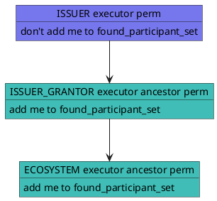

Example 2: `verifier_participant`: is not set: it's a credential offer. Schema configured to NOT have Issuer Grantors.

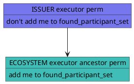

Example 3: `verifier_participant` is set, it's a presentation request. Schema configured to have Verifier and Issuer Grantors.

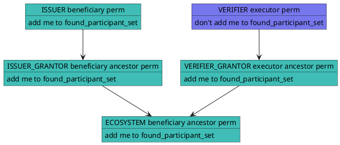

##### [MOD-PP-QRY-4-1] Find Beneficiaries parameters

- `schema_id` (uint64) (*mandatory*): id of the `CredentialSchema` entry.
- `verification` (boolean) (*mandatory*): true for a Credential Verification, false for a Credential Issuance.
- `issuer_participant_id` (uint64) (*optional*): id of the issuer `Participant` entry; absent when the issuer holds none (OPEN issuer mode).
- `verifier_participant_id` (uint64) (*optional*): id of the verifier `Participant` entry; absent in a Credential Issuance, and in a Credential Verification when the verifier holds none (OPEN or CREDENTIAL verifier mode).

##### [MOD-PP-QRY-4-2] Find Beneficiaries checks

- `schema_id` MUST refer to an existing `CredentialSchema` entry; if `issuer_participant_id` (resp. `verifier_participant_id`) is specified, the entry's `schema_id` MUST equal `schema_id`; if `verification` is false, `verifier_participant_id` MUST be absent.
- if `issuer_participant_id` is specified, load `issuer_participant` from `issuer_participant_id`; the `Participant` entry MUST exist. Its state does not matter: an expired, revoked or slashed issuer entry still identifies the branch to pay (see the unrepaid-slash rule below).
- if `verifier_participant_id` is specified, load `verifier_participant` from `verifier_participant_id`, Participant MUST exist and MUST be a [[ref: active participant]].

##### [MOD-PP-QRY-4-3] Find Beneficiaries execution

A `Participant` entry `p` has an **unrepaid slash** when its corporation carries one in the ecosystem of `p`'s schema or on the network, with the same scope as the onboarding gates ([[MOD-PP-MSG-1-2-5]](#mod-pp-msg-1-2-5-start-participant-op-unrepaid-slash-checks)): when an [UnrepaidEcosystemSlashCount](#unrepaidecosystemslashcount) entry exists for (`p.corporation_id`, `CredentialSchema[p.schema_id].ecosystem_id`), that is, when one of the corporation's entries under that ecosystem has `unrepaid_slash` > 0 (ecosystem slash, see [[MOD-PP-MSG-12]](#mod-pp-msg-12-slash-participant-trust-deposit)), or when the `TrustDeposit` entry `td` of `Corporation[p.corporation_id]` has `td.slashed_deposit` > `td.repaid_deposit` (network slash); both are single lookups, one read per beneficiary. A slash is a judgement on the corporation's conduct in that ecosystem, so one unrepaid slash stops the fees of all the corporation's entries under that ecosystem's schemas, exactly as it stops its onboarding processes there. An entry with an unrepaid slash receives no fees and funds no deposit as a beneficiary; it is paid again as soon as the slash is repaid ([[MOD-PP-MSG-13]](#mod-pp-msg-13-repay-participant-slashed-trust-deposit), [[MOD-TD-MSG-6]](#mod-td-msg-6-repay-slashed-trust-deposit)). No other state excludes a beneficiary: a revoked entry (revocation is not a sanction: a validator may revoke an entry to change its fee model, and each entry of the revoked entry's subtree keeps running until it expires) and an expired entry keep receiving the fees of the operations performed under their branch. An ecosystem that wants to stop paying a participant slashes it ([[MOD-PP-MSG-12]](#mod-pp-msg-12-slash-participant-trust-deposit)).


Algorithm. `Participant` entries with an unrepaid slash are not added to the set; revoked and expired `Participant` entries are.

- create Set `found_participant_set`.

- define `current_participant` as null.

- load the optional `issuer_participant` and `verifier_participant` as specified in basic checks above.
- define `root`: the active root entry of `schema_id`, the entry of `CredentialSchema[schema_id].root_participant_ids` that is an [[ref: active participant]]; null if none is.

Issuer branch:

- if `issuer_participant` is not null: set `current_participant` = `issuer_participant`; while `current_participant.validator_participant_id` is not null: `current_participant` = load(`current_participant.validator_participant_id`); unless `current_participant` has an unrepaid slash (see above), add it to `found_participant_set`.
- else (the issuer holds no entry): unless `root` is null or has an unrepaid slash, add `root` to `found_participant_set`.

Additionally, if `verification` is true:

- if `issuer_participant` is not null and has no unrepaid slash (see above), add `issuer_participant` to `found_participant_set` (an issuer without an entry has no fee terms and receives nothing).
- if `verifier_participant` is not null: set `current_participant` = `verifier_participant`; while `current_participant.validator_participant_id` is not null: `current_participant` = load(`current_participant.validator_participant_id`); unless `current_participant` has an unrepaid slash, add it to `found_participant_set`.
- else (the verifier holds no entry): unless `root` is null or has an unrepaid slash, add `root` to `found_participant_set`.

return `found_participant_set`.

:::note
A party without an entry sits directly under the root: it pays the ecosystem's fees and nothing to any grantor, and under OPEN or CREDENTIAL modes the schema has no grantors anyway.
:::

#### [MOD-PP-QRY-5] Void

> Note: sessions are not stored ([ParticipantSession](#participantsession)); indexers serve them from the events.

#### [MOD-PP-QRY-6] List Participant Module Parameters

##### [MOD-PP-QRY-6-2] List Participant Module Parameters parameters and query checks

##### [MOD-PP-QRY-6-3] List Participant Module Parameters execution of the query

Return the list of the existing parameters and their values.

##### [MOD-PP-QRY-6-4] List Participant Module Parameters API result example

```json
{
  "params": {
    "key1": "value1",
    "key2": "value2",
    ...
    ...
  }
}
```

#### Validation Examples

##### Getting a Credential from an Authorized Issuer

*This section is non-normative.*

Example of an Applicant that would like to get issued a credential (HOLDER):

```plantuml
scale max 800 width
actor "Applicant" as Applicant 
actor "Validator" as CE
participant "Verifiable Public Registry" as VPR #3fbdb6
autonumber "<font color='#7677ed'><b>(run start method)"
Applicant --> VPR #3fbdb6: Create Validation Entry (and pay required Trust Fees).
autonumber stop
VPR <-- VPR: Assign Validator (or use provided Validator).
autonumber "<font color='#7677ed'><b>(end start method)"
Applicant <-- VPR: Transaction completed and Validation entry created
autonumber stop
autonumber "<font color='#7677ed'><b>(connects to Certification Entity Validation VS)"
Applicant --> CE: share id of Participant
autonumber stop
Applicant <-- CE: Request proof of account and DID ownership (blind sign)
Applicant --> CE: send blind sign proofs 
note over Applicant, CE #EEEEEE: (*optional*) repeat the following until tasks completed
Applicant <-- CE: Form fill-ins, request proof documents
Applicant --> CE: fill-in forms, provides requested documents...
note over Applicant, CE #EEEEEE: tasks completed
autonumber "<font color='#7677ed'><b>(run validated method)"
CE --> VPR #3fbdb6: Update Validation Entry. Applicant VALIDATED, fees transferred to Validator.
autonumber stop
CE --> VPR #3fbdb6: Create or Update Participant Session (digest = credential digestJCS, anchored before delivery).
CE --> Applicant #3fbdb6: Issue Credential.
autonumber stop
```

##### Add a DID to the List of Granted Issuers of a Credential Schema

*This section is non-normative.*

```plantuml
scale max 800 width
actor "Applicant\n(issuer candidate)\nAccount" as ApplicantAccount 
actor "Applicant\n(issuer candidate)\nVS Browser" as ApplicantBrowser 

actor "Validator\n(issuer grantor)\nVS" as ValidatorVS
actor "Validator\n(issuer grantor)\nAccount" as ValidatorAccount

participant "Verifiable Public Registry" as VPR #3fbdb6

ApplicantAccount --> VPR: Start Participant OP
VPR <-- VPR: create `Participant` entry.
ApplicantAccount <-- VPR: `Participant` entry created,\nassigned participant.validator_participant_id from ISSUER_GRANTOR `Participant` entries.
ApplicantBrowser --> ValidatorVS: connect to validator VS DID found in VerifiableService[validator_participant.vs_id].vid\nby creating a DIDComm connection
ApplicantBrowser <-- ValidatorVS: DIDComm connection established.
ApplicantBrowser --> ValidatorVS: I want to proceed with participant.id=...
ValidatorVS --> ValidatorVS: load perm with id=...\nand verify the associated participant.validator_participant_id is referring to me
ApplicantBrowser <-- ValidatorVS: request proof of control\nof participant.applicant account (blind sign)
ApplicantBrowser --> ValidatorVS: send blind sign proof of account
ApplicantBrowser <-- ValidatorVS: proof accepted, you are the controller\nof validation entry, I trust you.
ApplicantBrowser <-- ValidatorVS: which DID do you want to register as an issuer?
ApplicantBrowser --> ValidatorVS: send DID
ValidatorVS --> ValidatorVS: resolve DID and get pub keys
ApplicantBrowser <-- ValidatorVS: request proof of ownership\nof the DID to be added in an ISSUER `Participant` entry (blind sign)
ApplicantBrowser --> ValidatorVS: send blind sign proofs
ApplicantBrowser <-- ValidatorVS: proof accepted, you are the controller of the DID, I trust you.
note over ApplicantBrowser, ValidatorVS #EEEEEE: (*optional*) repeat the following until tasks completed
ApplicantBrowser <-- ValidatorVS: Are you a legitimate issuer?\nProve it, by filling forms, sending documents...
ApplicantBrowser --> ValidatorVS: perform requested tasks...
note over ApplicantBrowser, ValidatorVS #EEEEEE: tasks completed
ApplicantBrowser <-- ValidatorVS: Your are a legitimate issuer. I'll now create an ISSUER `Participant` entry for your account and DID.
ValidatorAccount --> VPR #3fbdb6: Set Participant OP to Validated\nset validation.state to VALIDATED\n.
VPR --> ValidatorAccount: Receive trust fees.
ApplicantBrowser <-- ValidatorVS: notify `Participant` entry added for your DID.\nDID can now issue credentials of this schema.
```

### Trust Deposit Module

#### Trust Deposit Module Overview

*This section is non-normative.*

Concept: the [[ref: trust deposit]] is used to lock trust value as a stake. To process application messages that perform state changes, several modules methods are requiring a trust deposit to be sent, from the executing account, to the trust deposit module.

We will use a similar method [than the one described here](https://docs.cosmos.network/main/build/modules/staking#delegator-shares) to manage trust deposit and yield calculation and easy way.

*Example*:

In our example, we suppose a VPR is just starting and no trust transaction have taken place yet. For this reason:

- `TrustDeposit` module has a balance of `0`: `TrustDeposit.deposit` : `0`.
- `GlobalVariables.trust_deposit_share_value` has a value of `1`.

*Operation #1*:

an account `account1` wants to create a transaction that requires:

- 10 `denom` to be sent to the `account1` trust deposit;
- 5 `denom` for network fees.

*First, the Trust Deposit*: execution of the method will perform the following (we consider this account had no `TrustDeposit` entry yet):

- 10 `denom` are sent to the `TrustDeposit` module.
  - `TrustDeposit.deposit` = `TrustDeposit.deposit` + `10`

- a `TrustDeposit` entry `td1` is created for `account1` running the service with:
  - `td1.deposit` = `10`
  - `td1.shares` = `10` / `GlobalVariables.trust_deposit_share_value` = `10`

*Second, fee distribution*: let's suppose that `trust_deposit_block_reward_share` is set to `0.30` so that 70% of transaction fees are distributed to validators, and 30% of transaction fees are distributed to trust deposit holders. For this specific transaction:

- 30% * 5 = 1.5 `denom` will be sent to `TrustDeposit` module, which will increase the `GlobalVariables.trust_deposit_share_value`:

- `TrustDeposit.deposit` = `11.5`
- `GlobalVariables.trust_deposit_share_value` = `1.15`.

Now, `account1` can (optionally) reclaim the difference between the `GlobalVariables.trust_deposit_share_value` \* `tt.share` minus `tt.denom`, which represents the trust (yield) gains.

*Operation #2*:

Another account `account2` wants to create a transaction that requires:

- 20 `denom` to be sent to the `account2` trust deposit;
- 10 `denom` for network fees.

*First, Trust Deposit*:

- 20 `denom` are sent to the `TrustDeposit` module.
  - `TrustDeposit.deposit` = `31.5`

- a `TrustDeposit` entry `td2` is created for `account2`:
  - `td2.deposit` = `20`
  - `td2.shares` = `20` / `GlobalVariables.trust_deposit_share_value` = `20` / `1.15` ~=  `17.39...`

*Second, fee distribution*: let's suppose `trust_deposit_block_reward_share` is set to `0.30` so that 70% of transaction fees are distributed to validators, and 30% of transaction fees are distributed to trust deposit holders. For this specific transaction:

- 30% * 10 = 3 `denom` will be sent to `TrustDeposit` module, which will increase the `GlobalVariables.trust_deposit_share_value`:

- `TrustDeposit.deposit` = `34.5`
- `GlobalVariables.trust_deposit_share_value` = `1.15` * `34.5` / `31.5` ~= `1.2595...`

*After the 2 operations*:

- `account1` real deposit (based on share) is `account1.share` \* `GlobalVariables.trust_deposit_share_value` ~= `12.595...`, available withdrawable yield is `account1.share` \* `GlobalVariables.trust_deposit_share_value` - `account1.deposit` ~= `2.595...`
- `account2` real deposit (based on share) is `account2.share` \* `GlobalVariables.trust_deposit_share_value` ~= `21.90...`, available withdrawable yield is `account2.share` \* `GlobalVariables.trust_deposit_share_value` - `account2.deposit` ~= `1.90...`

#### Trust Deposit Yield

The following global parameters are used to tune the Trust Deposit yield generation, in case the VPR is implemented as a ledger:

- `trust_deposit_max_yield_rate`(number) (*mandatory*): Maximum yearly yield, in percent, that a trust deposit holder can obtain by receiving block rewards.
- `trust_deposit_block_reward_share`(number) (*mandatory*): Percentage of block reward that must be distributed to trust deposit holders. Default value: 20% (0.20)

Each time there is a block reward to be distributed, `trust_deposit_block_reward_share` percent MUST be directed to trust deposit holders, based on their trust deposit share.

Implementers MUST make sure, for each processed block reward, that the yearly effective yield is lower or equal than `trust_deposit_max_yield_rate`.

#### [MOD-TD-MSG-1] Adjust Trust Deposit

This method is used to increase or decrease the [[ref: trust deposit]] of a specific [[ref: corporation]] (identified by its `corporation_id`).

Only the modules that require trust deposit manipulation CAN call this method. If trust deposit has been slashed and not repaid, method execution MUST abort.

##### [MOD-TD-MSG-1-1] Adjust Trust Deposit method parameters

- `corporation_id` (uint64) (*mandatory*): id of the corporation owner of the [[ref: trust deposit]] we want to adjust.
- `augend` (number) (*mandatory*): value to add to the deposit, in [[ref: denom]].

##### [MOD-TD-MSG-1-2] Adjust Trust Deposit precondition checks

If any of these precondition checks fail, [[ref: transaction]] MUST abort.

###### [MOD-TD-MSG-1-2-1] Adjust Trust Deposit basic checks

- if a mandatory parameter is not present, [[ref: transaction]] MUST abort.

Value checks:

- `augend` (number) (*mandatory*): MUST be strictly positive or strictly negative.

- load `TrustDeposit` entry `td` whose `td.corporation_id` equals the supplied `corporation_id`.

  - if `td` does not exist:
    - if `augend` is negative, [[ref: transaction]] MUST abort.
  - else
    - if `augend` is negative and `td.refunded` - `augend` is greater than `td.deposit` transaction MUST abort. (`td.refunded` trust deposit cannot be greater than `td.deposit`).

###### [MOD-TD-MSG-1-2-2] Adjust Trust Deposit fee checks

- Fee payer the [[ref: transaction]] MUST have the required [[ref: estimated transaction fees]] in its [[ref: account]]

Additionally:

- load `TrustDeposit` entry `td` whose `td.corporation_id` equals the supplied `corporation_id`.
- if `td` exists:
  - if `augend` is positive:
    - calculate `needed_deposit` = `augend` - `td.refunded`. 
    - if `needed_deposit` < 0: `needed_deposit` = 0.
  - else `needed_deposit` = 0.
- else `needed_deposit` = `augend`.

- `Corporation[corporation_id].policy_address` MUST have `needed_deposit` in its [[ref: account]], else [[ref: transaction]] MUST abort.

##### [MOD-TD-MSG-1-3] Adjust Trust Deposit execution of the method

If all precondition checks passed, method is executed in a [[ref: transaction]].

Method execution MUST perform the following tasks in a [[ref: transaction]], and rollback if any error occurs.

- if a `TrustDeposit` entry `td` whose `td.corporation_id` equals the supplied `corporation_id` does not exist, create entry `td`:

  - transfer `augend` from `Corporation[corporation_id].policy_address` to `TrustDeposit` account.
  - calculate `augend_share` = `augend` / `GlobalVariables.trust_deposit_share_value`.
  - set `td.corporation_id` to `corporation_id`;
  - set `td.deposit` to `augend`;
  - set `td.share` to `augend_share`;
  - set `td.refunded` to 0.
  - set `td.slashed_deposit` to 0.
  - set `td.repaid_deposit` to 0.

- else if `td.slashed_deposit` > 0 and `td.repaid_deposit` < `td.slashed_deposit` => deposit has been slashed and not repaid, so MUST abort.

- else if `augend` > 0:
  
  - if `td.refunded` > 0:
    - if `td.refunded` >= `augend` :
      - set `td.refunded` to `td.refunded` - `augend`
    - else
      - use bank? to transfer `augend` - `td.refunded` from `Corporation[corporation_id].policy_address` to `TrustDeposit` account.
      - set `td.deposit` to `td.deposit` + `augend` - `td.refunded`
      - calculate `missing_augend_share` from missing tokens :  `missing_augend_share` = (`augend` - `td.refunded`) / `GlobalVariables.trust_deposit_share_value`.
      - set `td.share` to `td.share` + `missing_augend_share`
      - set `td.refunded` to 0
  
  - else
    - use bank? to transfer `augend` from `Corporation[corporation_id].policy_address` to `TrustDeposit` account.
    - calculate `augend_share` = `augend` / `GlobalVariables.trust_deposit_share_value`.
    - set `td.deposit` to `td.deposit` + `augend`
    - set `td.share` to `td.share` + `augend_share`

- else if `augend` < 0:
  - set `td.refunded` to `td.refunded` - `augend`

The last case, `augend` < 0, is to refund trust deposit (e.g. when canceling an onboarding process). The refunded amount is added to `td.refunded` and is reused for the next trust deposit spending.

#### [MOD-TD-MSG-2] Reclaim Trust Deposit Yield

This method is used to reclaim yield. If trust deposit has been slashed and not repaid, method execution MUST abort.

For a given `TrustDeposit` entry `td`, claimable yield is calculated like this:

`claimable_yield` = `td.share` * `GlobalVariables.trust_deposit_share_value` - `td.deposit`.

If `claimable_yield` is positive, it can be claimed.

##### [MOD-TD-MSG-2-1] Reclaim Trust Deposit Yield method parameters

- `corporation` (account): (Signer) the `policy_address` of the corporation on whose behalf this message is executed.
- `operator` (account): (Signer) the account authorized by the `corporation` to run this Msg.

##### [MOD-TD-MSG-2-2] Reclaim Trust Deposit Yield precondition checks

- `corporation` (account): (Signer) signature must be verified.
- `operator` (account): (Signer) signature must be verified.
- [[AUTHZ-CHECK]](#authz-check-common-authorization-and-fee-grant-checks) MUST pass for this (`corporation`, `operator`) pair and this message type.

###### [MOD-TD-MSG-2-2-1] Reclaim Trust Deposit Yield basic checks

- Load `TrustDeposit` entry `td` whose `td.corporation_id` equals `co.id` (where `co` is the `Corporation` entry resolved from the signing `corporation` account by [[AUTHZ-CHECK-5]](#authz-check-5-corporation-registration-check)).
- if `td.slashed_deposit` > 0 and `td.repaid_deposit` < `td.slashed_deposit` => deposit has been slashed and not repaid, so MUST abort.
- calculate `claimable_yield` = `td.share` * `GlobalVariables.trust_deposit_share_value` - `td.deposit`.
- if `claimable_yield` <= 0, [[ref: transaction]] MUST abort.

###### [MOD-TD-MSG-2-2-2] Reclaim Trust Deposit Yield fee checks

Fee payer running the [[ref: transaction]] MUST have the required [[ref: estimated transaction fees]] in its [[ref: account]], else [[ref: transaction]] MUST abort.

##### [MOD-TD-MSG-2-3] Reclaim Trust Deposit Yield execution of the method

Method execution MUST perform the following tasks in a [[ref: transaction]], and rollback if any error occurs.

For the `TrustDeposit` entry `td` linked to `co.id`:

- Load `TrustDeposit` entry `td` whose `td.corporation_id` equals `co.id` (where `co` is the `Corporation` entry resolved from the signing `corporation` account).
- calculate `claimable_yield` = `td.share` * `GlobalVariables.trust_deposit_share_value` - `td.deposit`.
- update `td.share` = `td.share` - `claimable_yield` / `GlobalVariables.trust_deposit_share_value`
- transfer `claimable_yield` from `TrustDeposit` account to `co.policy_address`.


#### [MOD-TD-MSG-3] Void

#### [MOD-TD-MSG-4] Update Module Parameters

Update Module Parameters.

Can only be executed through a governance proposal.

##### [MOD-TD-MSG-4-1] Update Module Parameters parameters

- `params` (KeySet<String, String>): the parameters to update and their values.

##### [MOD-TD-MSG-4-2] Update Module Parameters precondition checks

If any of these precondition checks fail, [[ref: transaction]] MUST abort.

###### [MOD-TD-MSG-4-2-1] Update Module Parameters basic checks

- `params`: size of `params` MUST be greater than 0. For each `param` <`key`, `value`> `key` MUST exist, else abort.

###### [MOD-TD-MSG-4-2-2] Update Module Parameters fee checks

provided transaction fees MUST be sufficient for execution

##### [MOD-TD-MSG-4-3] Update Module Parameters execution

If all precondition checks passed, [[ref: transaction]] is executed.

Method execution MUST perform the following tasks in a [[ref: transaction]], and rollback if any error occurs.

for each parameter `param` <`key`, `value`> in `parameters`:

- update parameter set value = `value` where key = `key`.

#### [MOD-TD-MSG-5] Slash Trust Deposit

This method is used by the network governance authority to **globally slash** a corporation `account` trust deposit.

This method can only be called by a governance proposal. A globally slashed account MUST repay the slashed deposit in order to continue to use the services provided by the VPR. When an account is slashed, and while the slashed deposit has not been repaid, the corporation's `Participant` entries can neither start nor renew an onboarding process ([[MOD-PP-MSG-1-2-5]](#mod-pp-msg-1-2-5-start-participant-op-unrepaid-slash-checks)) and receive no fees ([[MOD-PP-QRY-4]](#mod-pp-qry-4-find-beneficiaries)); the effect on credentials already issued is defined by the Verifiable Trust specification, not by this method.

This method is for network governance authority slash. For ecosystem slash, see [Slash Participant Trust Deposit](#mod-pp-msg-12-slash-participant-trust-deposit).

##### [MOD-TD-MSG-5-1] Slash Trust Deposit method parameters

- `corporation_id` (uint64) (*mandatory*): id of the corporation we want to slash.
- `amount` (number) (*mandatory*): value to slash, in [[ref: denom]].

##### [MOD-TD-MSG-5-2] Slash Trust Deposit precondition checks

If any of these precondition checks fail, [[ref: transaction]] MUST abort.

###### [MOD-TD-MSG-5-2-1] Slash Trust Deposit basic checks

if any of these conditions is not satisfied, [[ref: transaction]] MUST abort.

- `amount` must be > 0.
- `TrustDeposit` entry `td` whose `td.corporation_id` equals the supplied `corporation_id` MUST exist, and `td.deposit` MUST be greater or equal to `amount`.

###### [MOD-TD-MSG-5-2-2] Slash Trust Deposit fee checks

Fee payer MUST have the required [[ref: estimated transaction fees]] in its [[ref: account]], else [[ref: transaction]] MUST abort.

##### [MOD-TD-MSG-5-3] Slash Trust Deposit execution of the method

Method execution MUST perform the following tasks in a [[ref: transaction]], and rollback if any error occurs.

- define `now`: current timestamp.

For the `TrustDeposit` entry `td` whose `td.corporation_id` equals the supplied `corporation_id`:

- set `td.deposit` to `td.deposit` - `amount`.
- set `td.share` to `td.share` - `amount` / `GlobalVariables.trust_deposit_share_value`
- burn `amount` from `TrustDeposit` account.
- set `td.slashed_deposit` to `td.slashed_deposit` + `amount`

#### [MOD-TD-MSG-6] Repay Slashed Trust Deposit

Any authorized `operator` CAN execute this method on behalf of a `corporation`.

##### [MOD-TD-MSG-6-1] Repay Slashed Trust Deposit method parameters

- `corporation` (account): (Signer) the `policy_address` of the corporation on whose behalf this message is executed.
- `operator` (account): (Signer) the account authorized by the `corporation` to run this Msg.
- `amount` (number) (*mandatory*): value to repay, in [[ref: denom]].

##### [MOD-TD-MSG-6-2] Repay Slashed Trust Deposit precondition checks

If any of these precondition checks fail, [[ref: transaction]] MUST abort.

###### [MOD-TD-MSG-6-2-1] Repay Slashed Trust Deposit basic checks

if any of these conditions is not satisfied, [[ref: transaction]] MUST abort.

- `corporation` (account): (Signer) signature must be verified.
- `operator` (account): (Signer) signature must be verified.
- [[AUTHZ-CHECK]](#authz-check-common-authorization-and-fee-grant-checks) MUST pass for this (`corporation`, `operator`) pair and this message type.
- `amount` must be > 0.
- `TrustDeposit` entry `td` whose `td.corporation_id` equals `co.id` (where `co` is the `Corporation` entry resolved from the signing `corporation` account) MUST exist, and `amount` MUST be exactly equal to `td.slashed_deposit` - `td.repaid_deposit`.

###### [MOD-TD-MSG-6-2-2] Repay Slashed Trust Deposit fee checks

- Fee payer MUST have the required [[ref: estimated transaction fees]] in its [[ref: account]];
- `co.policy_address` MUST have the required `amount` in its account, else [[ref: transaction]] MUST abort.

##### [MOD-TD-MSG-6-3] Repay Slashed Trust Deposit execution of the method

Method execution MUST perform the following tasks in a [[ref: transaction]], and rollback if any error occurs.

- define `now`: current timestamp.

For the `TrustDeposit` entry `td` whose `td.corporation_id` equals `co.id` (where `co` is the `Corporation` entry resolved from the signing `corporation` account):

- set `td.deposit` to `td.deposit` + `amount`.
- set `td.share` to `td.share` + `amount` / `GlobalVariables.trust_deposit_share_value`
- add `amount` to `TrustDeposit` account.
- set `td.repaid_deposit` to `td.repaid_deposit` + `amount`

#### [MOD-TD-MSG-7] Burn Ecosystem Slashed Trust Deposit

Burn the portion of the trust deposit of a given account. This method can only be called by the permission module when performing an ecosystem-related slash.

:::warning
Make sure to **properly protect access to the execution of this method** else it may lead to very destructive actions.
:::

##### [MOD-TD-MSG-7-1] Burn Ecosystem Slashed Trust Deposit method parameters

- `corporation_id` (uint64) (*mandatory*): id of the corporation of the [[ref: trust deposit]] we want to burn.
- `amount` (number) (*mandatory*): value to burn, in [[ref: denom]].

:::warning
**Alternative approach**: For security and consistency, implementers MAY choose to reference the **ID of the slashed permission**, load it and use its `unrepaid_slash` as the slashing amount.
The decision between this method and specifying the amount directly is left to implementers.
:::

##### [MOD-TD-MSG-7-2] Burn Ecosystem Slashed Trust Deposit precondition checks

If any of these precondition checks fail, [[ref: transaction]] MUST abort.

###### [MOD-TD-MSG-7-2-1] Burn Ecosystem Slashed Trust Deposit basic checks

if any of these conditions is not satisfied, [[ref: transaction]] MUST abort.

- `amount` must be > 0.
- `TrustDeposit` entry `td` whose `td.corporation_id` equals the supplied `corporation_id` MUST exist, and `amount` MUST be lower or equal than `td.deposit`.

###### [MOD-TD-MSG-7-2-2] Burn Ecosystem Slashed Trust Deposit fee checks

Fee payer running the [[ref: transaction]] MUST have the required [[ref: estimated transaction fees]] in its [[ref: account]] else [[ref: transaction]] MUST abort.

##### [MOD-TD-MSG-7-3] Burn Ecosystem Slashed Trust Deposit execution of the method

Method execution MUST perform the following tasks in a [[ref: transaction]], and rollback if any error occurs.

- define `now`: current timestamp.

For the `TrustDeposit` entry `td` whose `td.corporation_id` equals the supplied `corporation_id`:

- set `td.deposit` to `td.deposit` - `amount`.
- set `td.share` to `td.share` - `amount` / `GlobalVariables.trust_deposit_share_value`
- burn `amount` from `TrustDeposit` account.

#### [MOD-TD-QRY-1] Get Trust Deposit

Any [[ref: account]] CAN run this [[ref: query]]. As this method does not modify data, it does not require a [[ref: transaction]].

##### [MOD-TD-QRY-1-1] Get Trust Deposit query parameters

- `corporation_id` (uint64) (*mandatory*): id of the [[ref: corporation]] for which we want to get the [[ref: trust deposit]] value.

##### [MOD-TD-QRY-1-2] Get Trust Deposit query checks

If any of these checks fail, [[ref: query]] MUST fail.

- `corporation_id` must be a valid uint64.

##### [MOD-TD-QRY-1-3] Get Trust Deposit execution of the query

Return the `TrustDeposit` entry whose `corporation_id` equals the supplied `corporation_id`, if any. If no entry exists, return not found.

#### [MOD-TD-QRY-2] List Module Parameters

Anyone CAN run this [[ref: query]].

##### [MOD-TD-QRY-2-2] List Module Parameters parameters and query checks

##### [MOD-TD-QRY-2-3] List Module Parameters execution of the query

Return the list of the existing parameters and their values.

##### [MOD-TD-QRY-2-4] List Module Parameters API result example

```json
{
  "params": {
    "key1": "value1",
    "key2": "value2",
    ...
    ...
  }
}
```

### Delegation Module

**Transaction-fee payment on behalf of a corporation (fee grants):** When a `corporation` pays the transaction fees for a grantee (an `operator` per [[AUTHZ-CHECK-2]](#authz-check-2-fee-grant-checks), or a `vs_operator` per [[AUTHZ-CHECK-4]](#authz-check-4-vs-operator-fee-grant-checks)), fee payment is handled directly via the Cosmos SDK `x/feegrant` module; VPR does not wrap the fee-deduction mechanism. Implementations MUST realize each on-chain `FeeGrant` as an `x/feegrant` allowance granted by the corporation's `policy_address` (the granter) to the `grantee`: an `AllowedMsgAllowance` (whose `allowed_messages` is the `FeeGrant.msg_types`) wrapping a `PeriodicAllowance` when both a `spend_limit` and a `period` are set — the operator path of [[MOD-DE-MSG-3]](#mod-de-msg-3-grant-operator-authorization), and always the `vs_operator` path, whose allowance is capped at the sum of the `fee_spend_limit` of the entries the account operates, per `GlobalVariables.vs_operator_fee_period` (see [[MOD-DE-MSG-5-5]](#mod-de-msg-5-5-adjust-vs-operator-fee-allowance)) — otherwise a `BasicAllowance`. The allowance is created (or updated) when the `FeeGrant` is granted ([[MOD-DE-MSG-1]](#mod-de-msg-1-grant-fee-allowance)) and removed when it is revoked ([[MOD-DE-MSG-2]](#mod-de-msg-2-revoke-fee-allowance)). A grantee elects corporation-paid fees by setting the transaction fee's `granter` field (the `--fee-granter`) to the corporation's `policy_address`; `x/feegrant` then validates the draw and enforces the `spend_limit`, the periodic reset, and the message-type filter, while the auth fee ante handler performs the actual debit from the corporation's account.

Mapping of the auto-renewing `FeeGrant.expiration`: when `period` is set, the cycle boundary maps to the allowance's `period_reset` (the allowance carries NO absolute `x/feegrant` expiration, so it auto-renews until revoked, matching `FeeGrant.expiration`); when `period` is unset, `FeeGrant.expiration` maps to the allowance's absolute expiration. If multiple periods elapse with no activity, the `period_reset` skips ahead per the `x/feegrant` `PeriodicAllowance` rule rather than accumulating each skipped period. Accordingly, `FeeGrant.remaining_spend` MAY be sourced from the underlying allowance's running balance (it tracks the fees the allowance has paid) rather than persisted and decremented as a separate field; the normative requirement is the balance's behaviour (initialize at the limit, decrement per fee payment, reset at the end of each cycle), not its physical storage. It is queryable via the standard `x/feegrant` allowance query. On the `vs_operator` path, per-entry `fee_spend_limit` values are **summands** of the account allowance's per-period limit; there is no separate VPR-side fee ledger ([[AUTHZ-CHECK-4]](#authz-check-4-vs-operator-fee-grant-checks)). Design rule: **cycling that gates fee payment lives in `x/feegrant` (fee-processing side); the VPR side hard-gates operations only.**

Authority and scope: the `x/feegrant` allowance is created and revoked by the VPR Delegation module **on the corporation's behalf** — from within [[MOD-DE-MSG-1]](#mod-de-msg-1-grant-fee-allowance) / [[MOD-DE-MSG-2]](#mod-de-msg-2-revoke-fee-allowance), which are module calls invoked only after the corporation has authorized the enclosing operation (e.g. the group proposal that authorizes [[MOD-DE-MSG-3]](#mod-de-msg-3-grant-operator-authorization)); no separate `MsgGrantAllowance` is submitted. Corporation-paid fees apply to **operator-signed** delegable transactions, where the signing `operator`/`vs_operator` sets `fee_granter` to the corporation's `policy_address`; operations executed through the corporation's group (`MsgSubmitProposal` → `MsgVote` → `MsgExec`) are paid by the proposer / policy account directly and do not use a fee grant. Because the allowance is an `AllowedMsgAllowance`, **every** message in a fee-granted transaction MUST be in `FeeGrant.msg_types`, or the fee draw is rejected.

#### [MOD-DE-MSG-1] Grant Fee Allowance

This method can only be called directly by the following methods:

- [Grant Operator Authorization](#mod-de-msg-3-grant-operator-authorization)
- the VS Operator Authorization feegrant subroutine [[MOD-DE-MSG-5-5]](#mod-de-msg-5-5-adjust-vs-operator-fee-allowance) (invoked by [[MOD-DE-MSG-5]](#mod-de-msg-5-set-vs-operator-authorization), [[MOD-DE-MSG-6]](#mod-de-msg-6-revoke-vs-operator-authorization))

##### [MOD-DE-MSG-1-1] Grant Fee Allowance method parameters

- `grantor_corporation_id` (uint64) (*mandatory*): id of the corporation that grants the fees.
- `grantee` (account) (*mandatory*): the account that receives the fee grant from `grantor_corporation_id`.
- `msg_types` ([MsgType](#msgtype)[]) (*mandatory*): the type of messages for which we want to grant the fee allowance.
- `expiration` (timestamp) (*optional*): when the grant expires.
- `spend_limit` (DenomAmount[]) (*optional*): maximum spendable
- `period` (duration) (*optional*): can be combined with `spend_limit`

##### [MOD-DE-MSG-1-2] Grant Fee Allowance basic checks

if any of these conditions is not satisfied, [[ref: transaction]] MUST abort.

- `msg_types` ([MsgType](#msgtype)[]) (*mandatory*): MUST be a list of **VPR delegable messages only**.
- `expiration` (timestamp): if specified, MUST be in the future
- `spend_limit` (DenomAmount[]) if specified, MUST be a list of valid DenomAmounts
- `period` (duration): if specified MUST be a valid period.
- if `period` is specified, `expiration` MUST also be specified.

##### [MOD-DE-MSG-1-3] Grant Fee Allowance fee checks

- Fee payer MUST have the required [[ref: estimated transaction fees]] in its [[ref: account]];

##### [MOD-DE-MSG-1-4] Grant Fee Allowance execution of the method

Method execution MUST perform the following tasks in a [[ref: transaction]], and rollback if any error occurs.

Create (or update if it already exist) FeeGrant `feegrant`:

- set `feegrant.grantor_corporation_id` to `grantor_corporation_id`
- set `feegrant.grantee` to `grantee`
- set `feegrant.msg_types` to `msg_types`
- set `feegrant.expiration` to `expiration`
- set `feegrant.spend_limit` to `spend_limit`
- if `spend_limit` is set, set `feegrant.remaining_spend` to `spend_limit`
- set `feegrant.period` to `period`

Additionally, realize the on-chain allowance (see the [Delegation Module](#delegation-module) note): create (or update if one already exists) the `x/feegrant` allowance granted by the corporation's `policy_address` (resolved from `grantor_corporation_id`) to `grantee`, as an `AllowedMsgAllowance` over `msg_types` wrapping:

- a `PeriodicAllowance` (`period`; per-period limit `period_spend_limit = spend_limit`; initial `period_can_spend = spend_limit`; first `period_reset = expiration`; no absolute expiration, so it auto-renews until revoked) when both `spend_limit` and `period` are set; or
- a `BasicAllowance` (`spend_limit` when set, otherwise unlimited; `expiration` when set) otherwise.

#### [MOD-DE-MSG-2] Revoke Fee Allowance

This method can only be called directly by the following methods:

- [Grant Operator Authorization](#mod-de-msg-3-grant-operator-authorization)
- [Revoke Operator Authorization](#mod-de-msg-4-revoke-operator-authorization)
- the VS Operator Authorization feegrant subroutine [[MOD-DE-MSG-5-5]](#mod-de-msg-5-5-adjust-vs-operator-fee-allowance) (invoked by [[MOD-DE-MSG-5]](#mod-de-msg-5-set-vs-operator-authorization), [[MOD-DE-MSG-6]](#mod-de-msg-6-revoke-vs-operator-authorization))

##### [MOD-DE-MSG-2-1] Revoke Fee Allowance method parameters

- `grantor_corporation_id` (uint64) (*mandatory*): id of the corporation that originally granted the fees.
- `grantee` (account) (*mandatory*): the grantee we want to revoke.

##### [MOD-DE-MSG-2-2] Revoke Fee Allowance basic checks

MUST abort if one of these conditions fails:

- `grantor_corporation_id` (uint64) (*mandatory*): MUST be specified.
- `grantee` (account) (*mandatory*): MUST be specified.

##### [MOD-DE-MSG-2-3] Revoke Fee Allowance fee checks

- Fee payer MUST have the required [[ref: estimated transaction fees]] in its [[ref: account]];

##### [MOD-DE-MSG-2-4] Revoke Fee Allowance execution of the method

If FeeGrant entry for this (`grantor_corporation_id`, `grantee`) exist, delete it, else do nothing.

In the same [[ref: transaction]], also revoke the corresponding `x/feegrant` allowance granted by the corporation's `policy_address` (resolved from `grantor_corporation_id`) to `grantee`, if one exists (see the [Delegation Module](#delegation-module) note).

#### [MOD-DE-MSG-3] Grant Operator Authorization

- Any authorized `operator` CAN execute this method on behalf of a `corporation`.
- `corporation` CAN execute this method alone through a group proposal

##### [MOD-DE-MSG-3-1] Grant Operator Authorization method parameters

- `corporation` (account) (*mandatory*): (Signer) the `policy_address` of the corporation on whose behalf this message is executed.
- `operator` (account) (*mandatory*): (Signer) the account authorized by the `corporation` to run this Msg.
- `grantee` (account) (*mandatory*): the account that receives the authorization from `corporation`.
- `msg_types` ([MsgType](#msgtype)[]) (*mandatory*): the type of messages for which we want to grant the fee allowance.
- `expiration` (timestamp) (*optional*): when the authorization (and its optional feegrant) expires.
- `authz_spend_limit` (DenomAmount[]) (*optional*): maximum spendable
- `authz_spend_limit_period` (duration) (*optional*): can be combined with `spend_limit`
- `with_feegrant` (boolean) (*mandatory*): means this authorization grants feegrant, too
- `feegrant_spend_limit` (DenomAmount[]) (*optional*): maximum spendable
- `feegrant_spend_limit_period` (duration) (*optional*): can be combined with `feegrant_spend_limit`

##### [MOD-DE-MSG-3-2] Grant Operator Authorization basic checks

if any of these conditions is not satisfied, [[ref: transaction]] MUST abort.

- `corporation` (account): (Signer) signature must be verified.
- `operator` (account): (Signer) signature must be verified.
- [[AUTHZ-CHECK]](#authz-check-common-authorization-and-fee-grant-checks) MUST pass for this (`corporation`, `operator`) pair and this message type.
- `msg_types` ([MsgType](#msgtype)[]) (*mandatory*): MUST be a list of **VPR delegable messages only**, excepted `CreateOrUpdateParticipantSession` which is not allowed.
- `expiration` (timestamp): if specified, MUST be in the future
- `authz_spend_limit` (DenomAmount[]) if specified, MUST be a list of valid DenomAmounts
- `authz_spend_limit_period` (duration): if specified MUST be a valid period. Ignored if `authz_spend_limit` is not set.
- `feegrant_spend_limit` (DenomAmount[]) if specified, MUST be a list of valid DenomAmounts. Ignored if `with_feegrant` is false.
- `feegrant_spend_limit_period` (duration): if specified MUST be a valid period. Ignored if `feegrant_spend_limit` is not set or if `with_feegrant` is false.
- if `authz_spend_limit_period` or `feegrant_spend_limit_period` is specified, `expiration` MUST also be specified.

- `grantee` MUST NOT be the `vs_operator` of any `VerifiableService` entry of the corporation (index of entries by operator account); else abort.

::: warning
An **Operator Authorization** CAN be granted ONLY IF no **VS Operator Authorization** exists for the same (`corporation_id`, `operator`) pair, that is, if `operator` is not the `vs_operator` of any `VerifiableService` entry of the corporation. **Operator Authorization** and **VS Operator Authorization** are mutually exclusive for a given grantee.
:::

##### [MOD-DE-MSG-3-3] Grant Operator Authorization fee checks

- Fee payer MUST have the required [[ref: estimated transaction fees]] in its [[ref: account]];

##### [MOD-DE-MSG-3-4] Grant Operator Authorization execution of the method

Method execution MUST perform the following tasks in a [[ref: transaction]], and rollback if any error occurs.

Look up an existing `OperatorAuthorization` `authz` whose `authz.corporation_id` equals `co.id` (where `co` is the `Corporation` entry resolved from the signing `corporation` account) AND `authz.operator` equals `grantee`.

If no such entry exists, create it; otherwise reuse it.

Then set / overwrite the following fields on `authz`:

- set `authz.corporation_id` to `co.id`
- set `authz.operator` to `grantee`
- set `authz.msg_types` to `msg_types`
- set `authz.expiration` to `expiration`
- set `authz.spend_limit` to `authz_spend_limit`
- if `authz_spend_limit` is set, set `authz.remaining_spend` to `authz_spend_limit`
- set `authz.period` to `authz_spend_limit_period`

if `with_feegrant` is false:

- call Revoke Fee Allowance (`co.id`, `grantee`).

else if `with_feegrant` is true:

- grant Fee Allowance (`co.id`, `grantee`, `msg_types`, `expiration`, `feegrant_spend_limit`, `feegrant_spend_limit_period`).

#### [MOD-DE-MSG-4] Revoke Operator Authorization

- Any authorized `operator` CAN execute this method on behalf of a `corporation`.
- `corporation` CAN execute this method alone through a group proposal

##### [MOD-DE-MSG-4-1] Revoke Operator Authorization method parameters

- `corporation` (account) (*mandatory*): (Signer) the `policy_address` of the corporation on whose behalf this message is executed.
- `operator` (account) (*mandatory*): (Signer) the account authorized by the `corporation` to run this Msg.
- `grantee` (account) (*mandatory*): the account that will be revoked its authorization`.

##### [MOD-DE-MSG-4-2] Revoke Operator Authorization basic checks

MUST abort if one of these conditions fails:

- `corporation` (account): (Signer) signature must be verified.
- `operator` (account): (Signer) signature must be verified.
- [[AUTHZ-CHECK]](#authz-check-common-authorization-and-fee-grant-checks) MUST pass for this (`corporation`, `operator`) pair and this message type.
- An `OperatorAuthorization` entry MUST exist for this (`co.id`, `grantee`) (where `co` is the `Corporation` entry resolved from the signing `corporation` account by [[AUTHZ-CHECK-5]](#authz-check-5-corporation-registration-check)).

##### [MOD-DE-MSG-4-3] Revoke Operator Authorization fee checks

- Fee payer MUST have the required [[ref: estimated transaction fees]] in its [[ref: account]];

##### [MOD-DE-MSG-4-4] Revoke Operator Authorization execution of the method

- Delete the `OperatorAuthorization` entry for this (`co.id`, `grantee`).
- revoke Fee Allowance (`co.id`, `grantee`).

#### [MOD-DE-MSG-5] Set VS Operator Authorization

This method can only be called directly by the following methods, with no signer check:

- [Register Verifiable Service](#mod-vs-msg-1-register-verifiable-service)
- [Create Corporation](#mod-co-msg-1-create-corporation)
- [Update Verifiable Service](#mod-vs-msg-2-update-verifiable-service)
- [Accept Verifiable Service Transfer](#mod-vs-msg-5-accept-verifiable-service-transfer)

It applies an operator configuration to a `VerifiableService` entry, incrementally: it writes `vs_operator`, `msg_types`, `period` and `fee_spend_limit`, keeps the balance of the [VsOperatorBudget](#vsoperatorbudget) when the spend limit is unchanged, and adjusts the on-chain `FeeGrant` only by what changed, on the former account when the operator changes. Called with unchanged values, it writes the entry and nothing else.

All authorization configuration is provided by the caller, which has already checked that `VerifiableService[vs_id]` is owned by `corporation_id`. `vs_operator` is the account to set: it MAY differ from the entry's current one ([[MOD-VS-MSG-2]](#mod-vs-msg-2-update-verifiable-service)).

##### [MOD-DE-MSG-5-1] Set VS Operator Authorization method parameters

- `corporation_id` (uint64) (*mandatory*): id of the corporation delegating the authorization.
- `vs_operator` (account) (*mandatory*): the account receiving the authorization; becomes the entry's `vs_operator`.
- `vs_id` (uint64) (*mandatory*): id of the `VerifiableService` entry.
- `msg_types` ([MsgType](#msgtype)[]) (*mandatory*): the message types to authorize.
- `spend_limit` (DenomAmount[]) (*optional*): the operation budget, creating an [VsOperatorBudget](#vsoperatorbudget).
- `period` (duration) (*optional*): the operation-budget cycle; requires `spend_limit`.
- `fee_spend_limit` (DenomAmount[]) (*optional*): the contribution; empty when the corporation does not pay the agent's fees.

##### [MOD-DE-MSG-5-2] Set VS Operator Authorization basic checks

If any of these conditions is not satisfied, [[ref: transaction]] MUST abort.

- `corporation_id` and `vs_operator` MUST NOT be null.
- `msg_types` MUST be non-empty and MUST contain only VPR delegable message types.
- if `fee_spend_limit` is set, every amount MUST be strictly positive (the fee allowance is never unlimited nor zero).
- if `period` is set, `spend_limit` MUST be set.
- No `OperatorAuthorization` `oauthz` where `oauthz.corporation_id` = `corporation_id` and `oauthz.operator` = `vs_operator` MUST exist.
- No `VerifiableService` entry owned by a corporation other than `corporation_id` MAY have `vs_operator` as its `vs_operator` (implementations keep an index of entries by operator account). In other words, a vs-agent account cannot be controlled by multiple corporations.

::: warning
A **VS Operator Authorization** CAN be set ONLY IF no **OperatorAuthorization** exists for the same `(corporation, vs_operator)` pair. **VS Operator Authorization** and **Operator Authorization** are mutually exclusive for a given grantee.
:::

##### [MOD-DE-MSG-5-3] Set VS Operator Authorization fee checks

- Fee payer MUST have the required [[ref: estimated transaction fees]] in its [[ref: account]].

##### [MOD-DE-MSG-5-4] Set VS Operator Authorization execution of the method

Method execution MUST perform the following tasks in a [[ref: transaction]], and rollback if any error occurs.

- Define `vs` = `VerifiableService[vs_id]`, `old_operator` = `vs.vs_operator`, `old_contribution` = `vs.fee_spend_limit` and `new_contribution` = `fee_spend_limit` (empty when not set).
- Fee allowance. If `old_operator` is not null and differs from `vs_operator`: if `old_contribution` is not empty, call **[Adjust VS Operator Fee Allowance](#mod-de-msg-5-5-adjust-vs-operator-fee-allowance)** for (`corporation_id`, `old_operator`, −`old_contribution`); if `new_contribution` is not empty, call it for (`corporation_id`, `vs_operator`, +`new_contribution`). Otherwise, if `new_contribution` differs from `old_contribution`, call it once for (`corporation_id`, `vs_operator`, `new_contribution` − `old_contribution`), per denom. Otherwise the allowance is not touched.
- Operation budget. Let `budget` = the [VsOperatorBudget](#vsoperatorbudget) of `vs_id`, if any. If `spend_limit` is not set: delete `budget` if it exists. Else if `budget` does not exist: create it with `spend_limit` := `spend_limit`, `remaining_spend` := `spend_limit`, `expiration` := `now() + period` if `period` is set, else null. Else if `budget.spend_limit` differs from `spend_limit`: set `budget.spend_limit` := `spend_limit`, `budget.remaining_spend` := `spend_limit` and `budget.expiration` := `now() + period` if `period` is set, else null (the corporation re-budgeted, the balance restarts). Else if `period` differs from `vs.period`: set `budget.expiration` := `now() + period` if `period` is set, else null, keeping `budget.remaining_spend`. Otherwise `budget` is not touched.
- Set `vs.vs_operator` := `vs_operator`, `vs.msg_types` := `msg_types`, `vs.period` := `period`, `vs.fee_spend_limit` := `fee_spend_limit`.

##### [MOD-DE-MSG-5-5] Adjust VS Operator Fee Allowance

This is a shared subroutine taking a `corporation_id`, a `vs_operator` and a signed contribution `delta` (DenomAmount[]): the `fee_spend_limit` of an entry with a non-empty `fee_spend_limit`, positive when it is set ([[MOD-DE-MSG-5]](#mod-de-msg-5-set-vs-operator-authorization)) and negative when it is cleared ([[MOD-DE-MSG-6]](#mod-de-msg-6-revoke-vs-operator-authorization), invoked before it is cleared). It maintains the `x/feegrant` allowance that realizes [[AUTHZ-CHECK-4]](#authz-check-4-vs-operator-fee-grant-checks) for (`corporation_id`, `vs_operator`). The VPR keeps no aggregate of its own: the running total is the `spend_limit` of the [FeeGrant](#feegrant) entry of (`corporation_id`, `vs_operator`).

- load the `FeeGrant` entry `fg` of (`corporation_id`, `vs_operator`); define `total` = `fg.spend_limit` if `fg` exists, else empty; set `total` := `total` + `delta`, per denom, dropping a denom whose amount reaches zero. `total` MUST NOT contain a negative amount; abort otherwise.
- if `total` is empty: call [Revoke Fee Allowance](#mod-de-msg-2-revoke-fee-allowance)(`corporation_id`, `vs_operator`) (no-op when none exists).
- else: call [Grant Fee Allowance](#mod-de-msg-1-grant-fee-allowance)(`corporation_id`, `vs_operator`, every [MsgType](#msgtype) value, `now() + GlobalVariables.vs_operator_fee_period`, `total`, `GlobalVariables.vs_operator_fee_period`).

The resulting allowance is an `AllowedMsgAllowance` over every delegable message, wrapping a `PeriodicAllowance` with `period = GlobalVariables.vs_operator_fee_period` and a per-period limit equal to `total`. Which messages the account may execute, and in the context of which entries, is decided by the entries' configuration at execution ([[AUTHZ-CHECK-3]](#authz-check-3-vs-operator-authorization-checks), [[AUTHZ-CHECK-4]](#authz-check-4-vs-operator-fee-grant-checks) step 1): the allowance only pays the fees, and a transaction that fails those checks has still consumed its fee, within the period limit (see the ordering caveat of [[AUTHZ-CHECK-4]](#authz-check-4-vs-operator-fee-grant-checks)).

The `PeriodicAllowance` resets itself during fee deduction, so no VPR action is needed at fee-cycle boundaries. Re-granting mid-cycle resets the running `period_can_spend`: any change of a contribution refreshes the current period's fee budget early — **accepted slack**, bounded by one period's budget per mutation, and mutations are corporation-controlled.

> Note: a mutation costs one `FeeGrant` read and one write, whatever the number of entries the account operates: there is no aggregate entity and no scan. Because the configuration is bound to the `VerifiableService` entry and not to `Participant` entries, no entry expiry can silently change the total. Whether a given `Participant` entry may be operated is decided at use time by [[AUTHZ-CHECK-3]](#authz-check-3-vs-operator-authorization-checks) step 1.

#### [MOD-DE-MSG-6] Revoke VS Operator Authorization

This method can only be called directly by the following methods, with no signer check:

- [Update Verifiable Service](#mod-vs-msg-2-update-verifiable-service) (when the operator or its authorization is changed or cleared)
- [Accept Verifiable Service Transfer](#mod-vs-msg-5-accept-verifiable-service-transfer)

It clears the operator configuration of the `VerifiableService` entry `vs_id` (`msg_types`, `period`, `fee_spend_limit`), deletes its [VsOperatorBudget](#vsoperatorbudget) if any and, when the configuration contributed to it, adjusts the on-chain `FeeGrant` of the entry's `vs_operator` by subtracting the contribution.

##### [MOD-DE-MSG-6-1] Revoke VS Operator Authorization method parameters

- `vs_id` (uint64) (*mandatory*): id of the `VerifiableService` entry whose operator configuration is cleared.

##### [MOD-DE-MSG-6-2] Revoke VS Operator Authorization basic checks

- `vs_id` MUST be a valid uint64.

> Note: an empty `msg_types` is NOT an error. The method is a no-op in that case (the entry was never VS-operator-authorized, or was already revoked).

##### [MOD-DE-MSG-6-3] Revoke VS Operator Authorization fee checks

- Fee payer MUST have the required [[ref: estimated transaction fees]] in its [[ref: account]].

##### [MOD-DE-MSG-6-4] Revoke VS Operator Authorization execution of the method

- Define `vs` = `VerifiableService[vs_id]`. If `vs.msg_types` is empty, EXIT (no-op).
- Define `vs_operator` = `vs.vs_operator`: the configuration applies to the entry's current operator, and the callers clear it before the owner changes ([[MOD-VS-MSG-5]](#mod-vs-msg-5-accept-verifiable-service-transfer)) or when the operator is cleared ([[MOD-VS-MSG-2]](#mod-vs-msg-2-update-verifiable-service)); a change of account with a new configuration goes through [[MOD-DE-MSG-5]](#mod-de-msg-5-set-vs-operator-authorization), which moves the allowance itself.
- If `vs.fee_spend_limit` is not empty, call **[Adjust VS Operator Fee Allowance](#mod-de-msg-5-5-adjust-vs-operator-fee-allowance)** for (`vs.corporation_id`, `vs_operator`, −`vs.fee_spend_limit`).
- Delete the [VsOperatorBudget](#vsoperatorbudget) of `vs_id` if it exists; set `vs.msg_types` := [], `vs.period` := null, `vs.fee_spend_limit` := null.

#### [MOD-DE-MSG-7] Void

#### [MOD-DE-MSG-8] Void

#### [MOD-DE-MSG-9] Void

#### [MOD-DE-QRY-1] List Operator Authorizations

Anyone CAN execute this method.

##### [MOD-DE-QRY-1-1] List Operator Authorizations parameters

- `corporation_id` (uint64) (*mandatory*): the corporation whose authorizations are listed (key prefix).
- `response_max_size` (small number) (*optional*): limit to `response_max_size` results. Must be min 1, max 1,024. Default to 64.

##### [MOD-DE-QRY-1-2] List Operator Authorizations checks

Basic type check arg SHOULD be applied.

If any of these checks fail, [[ref: query]] MUST fail.

- `response_max_size` must be between 1 and 1,024. Default to 64 if unspecified.

##### [MOD-DE-QRY-1-3] List Operator Authorizations execution

Return a list of `OperatorAuthorization` entries matching the filter criteria, or an empty list if nothing found.

#### [MOD-DE-QRY-2] Void

#### [MOD-DE-QRY-3] Get Operator Authorization

Anyone CAN execute this method.

##### [MOD-DE-QRY-3-1] Get Operator Authorization parameters

- `corporation_id` (uint64) (*mandatory*) and `operator` (account) (*mandatory*): the key of the `OperatorAuthorization` entry to retrieve.

##### [MOD-DE-QRY-3-2] Get Operator Authorization checks

If any of these checks fail, [[ref: query]] MUST fail.

- if a mandatory parameter is not present, [[ref: query]] MUST fail.
- an `OperatorAuthorization` entry MUST exist for (`corporation_id`, `operator`).

##### [MOD-DE-QRY-3-3] Get Operator Authorization execution

Return the `OperatorAuthorization` entry of (`corporation_id`, `operator`).

#### [MOD-DE-QRY-4] Void

### Digests Module

The Digests module keeps the [Digest](#digest) entries: the credential digests of schemas whose `credential_revocation` is VPR, written by the issuance session so that the credential can be revoked ([[MOD-DI-MSG-2]](#mod-di-msg-2-revoke-digest)), and the notarizations of [[MOD-DI-MSG-1]](#mod-di-msg-1-store-digest). An entry lives until its `expires`: at the end of every block, the module deletes the entries whose `expires` is not null and not later than the block time (implementations keep an expiry queue, bucketed by time, written when the entry is created). A credential digest therefore exists exactly while the credential it anchors can be valid, revoked ones included, as a tombstone that stops the identical credential from being re-anchored; after expiry the credential is rejected on its own expiry and its anchoring remains in the transaction history. Credential digests of schemas whose `credential_revocation` is NONE are never written: the event of the issuance session anchors them.

#### [MOD-DI-MSG-1] Store Digest

- Any authorized `operator` CAN execute this method on behalf of a `corporation`, in the context of one of the corporation's [VerifiableService](#verifiableservice) entries: a corporation operator under an OperatorAuthorization, or the vs-agent of that entry under a VS Operator Authorization whose entry's `msg_types` include `StoreDigest`.
- This method can be called directly by [Create or Update Participant Session](#mod-pp-msg-10-create-or-update-participant-session) module with no checks.

The agent of an issuer does not call this method itself: it anchors the digest of a credential it issues through the issuance session ([[MOD-PP-MSG-10]](#mod-pp-msg-10-create-or-update-participant-session), `digest` parameter), which it creates even when no fees are due, so that the anchoring entry of the digest is recorded; the entry is written only under a schema whose `credential_revocation` is VPR. Called directly, this method anchors a digest for the owner's other needs (a dated proof of the existence of a document, a retention record): such a digest has no anchoring context of a credential.

##### [MOD-DI-MSG-1-1] Store Digest method parameters

- `corporation` (account) (*mandatory*): (Signer) the `policy_address` of the corporation on whose behalf this message is executed.
- `operator` (account) (*mandatory*): (Signer) the account authorized by the `corporation` to run this Msg.
- `vs_id` (uint64) (*mandatory*): the `VerifiableService` entry under which the digest is anchored; MUST be owned by `corporation`.
- `digest` (bytes, base64 in the API) (*mandatory*): digest to store.
- `expires` (timestamp) (*optional*): block time after which the entry is deleted ([Digests Module](#digests-module)); null keeps it indefinitely.

Module-call inputs, set only when the method is called by [[MOD-PP-MSG-10]](#mod-pp-msg-10-create-or-update-participant-session) and MUST be absent on a direct Msg: `participant_id` (the primary participant of the session, if any) and `schema_id` (the schema of the session); `vs_id` is then the primary party's `VerifiableService` entry, `expires` the credential's expiry, and the authorization checks below are those of the session message.

##### [MOD-DI-MSG-1-2] Store Digest precondition checks

If any of these precondition checks fail, [[ref: transaction]] MUST abort.

###### [MOD-DI-MSG-1-2-1] Store Digest basic checks

if any of these conditions is not satisfied, [[ref: transaction]] MUST abort.

- `corporation` (account): (Signer) signature must be verified.
- `operator` (account): (Signer) signature must be verified.
- `vs_id` (uint64): a `VerifiableService` entry `vs` with this id MUST exist and `vs.corporation_id` MUST equal `co.id` (where `co` is the `Corporation` entry resolved from the signing `corporation` account by [[AUTHZ-CHECK-5]](#authz-check-5-corporation-registration-check)), else abort.
- Authorization: either [[AUTHZ-CHECK-1]](#authz-check-1-operator-authorization-checks) and [[AUTHZ-CHECK-2]](#authz-check-2-fee-grant-checks) MUST pass for this (`corporation`, `operator`) pair and `StoreDigest`; or [[AUTHZ-CHECK-3]](#authz-check-3-vs-operator-authorization-checks) and [[AUTHZ-CHECK-4]](#authz-check-4-vs-operator-fee-grant-checks) MUST pass for the (`corporation`, `operator`, null, `vs`) tuple; else abort.
- if `digest` is not present, abort.
- if `digest` decodes to neither 48 nor 64 bytes, abort.
- if `expires` is present, it MUST be later than `now()`, else abort.

###### [MOD-DI-MSG-1-2-2] Store Digest fee checks

- Fee payer MUST have the required [[ref: estimated transaction fees]] in its [[ref: account]];

##### [MOD-DI-MSG-1-3] Store Digest execution of the method

Method execution MUST perform the following tasks in a [[ref: transaction]], and rollback if any error occurs.

- define `now`: current timestamp.
- if a `Digest` entry `d` already exists with `d.digest` = `digest`, the method is a no-op (idempotent): execution returns success without modifying state (the existing entry keeps its `vs_id` and its `expires`, even if its owner differs from `co.id`).
- else create `Digest` entry `d`:
  - set `d.digest` to `digest`.
  - set `d.participant_id` to the primary participant of the session when called by [[MOD-PP-MSG-10]](#mod-pp-msg-10-create-or-update-participant-session), else null.
  - set `d.vs_id` to `vs_id` (the primary party's entry when called by [[MOD-PP-MSG-10]](#mod-pp-msg-10-create-or-update-participant-session)).
  - set `d.schema_id` to the value passed by [[MOD-PP-MSG-10]](#mod-pp-msg-10-create-or-update-participant-session), else null.
  - set `d.created` to `now`.
  - set `d.revoked` to null.
  - set `d.expires` to `expires` (the `credential_valid_until` of the session when called by [[MOD-PP-MSG-10]](#mod-pp-msg-10-create-or-update-participant-session)), null when absent, and file the entry in the expiry queue when not null.

#### [MOD-DI-MSG-2] Revoke Digest

This method revokes a digest. It can be executed on behalf of:

- the `corporation` that owns the `Digest` entry (the corporation of the anchoring `VerifiableService` entry `d.vs_id`): by any of its operators under an OperatorAuthorization, or by the vs-agent of the anchoring `VerifiableService` entry `d.vs_id` under a VS Operator Authorization whose entry's `msg_types` include `RevokeDigest`, while the anchoring `Participant` entry `d.participant_id`, if there is one, is an [[ref: active participant]] (an `ISSUER` entry, or none under an OPEN schema);
- the `corporation` of an **ancestor** of the anchoring entry (a validator in the branch of `d.participant_id`, up to the root ECOSYSTEM entry), while that ancestor is an [[ref: active participant]]: by any of its operators under an OperatorAuthorization, or by the vs-agent of that ancestor entry under a VS Operator Authorization whose entry's `msg_types` include `RevokeDigest`;
- the `corporation` controlling the `Ecosystem` of the schema of the session (`d.schema_id`), by any of its operators under an OperatorAuthorization, whatever the state of the tree (as for [[MOD-PP-MSG-9]](#mod-pp-msg-9-revoke-participant)).

Revoking a digest is the on-chain revocation mechanism for an individual credential whose issuance was anchored through its issuance session ([[MOD-PP-MSG-10]](#mod-pp-msg-10-create-or-update-participant-session)); revoking the holder's `HOLDER` `Participant` entry ([[MOD-PP-MSG-9]](#mod-pp-msg-9-revoke-participant)) withdraws trust from every credential of that relationship instead. The authority structure mirrors [[MOD-PP-MSG-9]](#mod-pp-msg-9-revoke-participant): the issuer, its grantors and the ecosystem can revoke, and the ecosystem governance framework bounds the use of the ancestor path. Trust resolution of a credential whose `digestJCS` has a `Digest` entry with a non-null `revoked` timestamp MUST consider the credential revoked as of that timestamp, whoever set it. Revocation is irreversible.

Since any corporation may store any digest and the first to store it owns it, the Verifiable Trust specification requires the issuer of a credential of a schema whose `credential_anchoring` is DIGEST to anchor its digest through the issuance session before delivering the credential, so that no other corporation can anchor it first and hold the right to revoke it.

##### [MOD-DI-MSG-2-1] Revoke Digest method parameters

- `corporation` (account) (*mandatory*): (Signer) the `policy_address` of the corporation on whose behalf this message is executed.
- `operator` (account) (*mandatory*): (Signer) the account authorized by the `corporation` to run this Msg.
- `participant_id` (uint64) (*optional*): the `Participant` entry in whose context a `vs_operator` executes this message: the anchoring entry `d.participant_id`, or one of its ancestors (VS Operator Authorization path). Absent when the operator acts under an OperatorAuthorization, or when the vs-agent acts in the context of `d.vs_id` alone (anchoring without a `Participant` entry).
- `digest` (bytes, base64 in the API) (*mandatory*): digest to revoke.

##### [MOD-DI-MSG-2-2] Revoke Digest precondition checks

If any of these precondition checks fail, [[ref: transaction]] MUST abort.

###### [MOD-DI-MSG-2-2-1] Revoke Digest basic checks

- `corporation` (account): (Signer) signature must be verified.
- `operator` (account): (Signer) signature must be verified.
- if `digest` is not present, abort.
- if `digest` decodes to neither 48 nor 64 bytes, abort.
- a `Digest` entry `d` with `d.digest` = `digest` MUST exist, else abort.
- `d.expires` MUST be null or later than `now()`, else abort (the credential it anchored has expired and the entry is about to be swept).
- [[AUTHZ-CHECK-5]](#authz-check-5-corporation-registration-check) MUST pass: `co` is the `Corporation` entry whose `policy_address` is the signing `corporation` account.
- define `authority_set`: the empty set if `d.participant_id` is null; else the anchoring entry `Participant[d.participant_id]` and every ancestor reached from it by following `validator_participant_id` until null, keeping only the entries that are [[ref: active participants]] (an expired, revoked or slashed entry confers no authority).
- Authorization:

either (executed by an operator under an OperatorAuthorization; `participant_id` absent):
- `co.id` (where `co` is the `Corporation` entry resolved from the signing `corporation` account) MUST equal `VerifiableService[d.vs_id].corporation_id`, or equal the `corporation_id` of an entry of `authority_set`, or, when `d.schema_id` is not null, equal `Ecosystem[cs.ecosystem_id].corporation_id` where `cs` is `CredentialSchema[d.schema_id]`, else abort.
[[AUTHZ-CHECK-1]](#authz-check-1-operator-authorization-checks) MUST pass for this (`corporation`, `operator`) tuple and `RevokeDigest` message.
[[AUTHZ-CHECK-2]](#authz-check-2-fee-grant-checks) MUST pass for this (`corporation`, `operator`) tuple and `RevokeDigest` message.
OR (executed by a vs-agent under a VS Operator Authorization):
- if `participant_id` is present: `Participant[participant_id]` MUST be an entry of `authority_set`, else abort; define it as `context_participant`, and `context_vs` = `VerifiableService[context_participant.vs_id]`. `context_participant.corporation_id` MUST equal `co.id`, else abort. Else (`participant_id` absent): `VerifiableService[d.vs_id].corporation_id` MUST equal `co.id`, else abort; define `context_participant` as null and `context_vs` = `VerifiableService[d.vs_id]`.
[[AUTHZ-CHECK-3]](#authz-check-3-vs-operator-authorization-checks) MUST pass for this (`corporation`, `operator`, `context_participant`, `context_vs`) tuple.
[[AUTHZ-CHECK-4]](#authz-check-4-vs-operator-fee-grant-checks) MUST pass for the same tuple.
else MUST abort.

> Note: a digest stored directly with [[MOD-DI-MSG-1]](#mod-di-msg-1-store-digest) has no anchoring context of a credential (`d.schema_id` and `d.participant_id` are null): only the owner corporation can revoke it, through its operators or the vs-agent of `d.vs_id`. Such a digest is not a valid anchor of a Verifiable Trust credential, whose digest is anchored through the issuance session; it serves other uses. A credential anchored by an issuer without an `ISSUER` entry (OPEN schema) is revocable by that issuer's operators or vs-agent and by the ecosystem controlling the schema, which is the whole governance path of an entry-less issuer.

###### [MOD-DI-MSG-2-2-2] Revoke Digest fee checks

- Fee payer MUST have the required [[ref: estimated transaction fees]] in its [[ref: account]];

##### [MOD-DI-MSG-2-3] Revoke Digest execution of the method

Method execution MUST perform the following tasks in a [[ref: transaction]], and rollback if any error occurs.

- define `now`: current timestamp.
- if `d.revoked` is not null, the method is a no-op (idempotent): execution returns success without modifying state.
- else set `d.revoked` to `now`.

#### [MOD-DI-QRY-1] Get Digest

Anyone CAN execute this method.

##### [MOD-DI-QRY-1-1] Get Digest parameters

- `digest` (bytes, base64 in the API) (*mandatory*): the digest to look up.

##### [MOD-DI-QRY-1-2] Get Digest checks

If any of these checks fail, [[ref: query]] MUST fail.

- `digest` MUST not be empty.

##### [MOD-DI-QRY-1-3] Get Digest execution

If all checks passed, [[ref: query]] is executed.

Return found `Digest` entry (if any) matching `digest`.

##### [MOD-DI-QRY-1-4] Get Digest API result example

```json
{
  "digest": {
    "digest": "GOp0dicJ4ufacOQxQfQojCyGoC7RJClOzqb23pJubmG2z3cqD/73j1+3kYNSrxUP",
    "participant_id": 601,
    "vs_id": 77,
    "schema_id": 3,
    "created": "2025-01-14T19:40:37.967Z",
    "revoked": null,
    "expires": "2026-01-14T19:40:37.967Z"
  }
}
```

### Exchange Rate Module

#### [MOD-XR-MSG-1] Create Exchange Rate

The **Create Exchange Rate** method allows creating an `ExchangeRate` entry for a given `(base_asset_type, base_asset, quote_asset_type, quote_asset)` pair.

- Only a governance proposal CAN execute this method.

##### [MOD-XR-MSG-1-1] Create Exchange Rate method parameters

- `base_asset_type` (PricingAssetType) (*mandatory*)  
- `base_asset` (string) (*mandatory*)  
- `quote_asset_type` (PricingAssetType) (*mandatory*)  
- `quote_asset` (string) (*mandatory*)  
- `rate` (uint64) (*mandatory*)
- `rate_scale` (uint32) (*mandatory*)  
- `validity_duration` (duration) (*mandatory*)

##### [MOD-XR-MSG-1-2] Create Exchange Rate precondition checks

If any of these precondition checks fail, [[ref: transaction]] MUST abort.

###### [MOD-XR-MSG-1-2-1] Create Exchange Rate basic checks

If any of the following conditions is not satisfied, [[ref: transaction]] MUST abort.

- if a mandatory parameter is not present, method MUST abort.
- **Asset type validity**
  - `base_asset_type` MUST be a valid `PricingAssetType` value.
  - `quote_asset_type` MUST be a valid `PricingAssetType` value.

- **Asset identifier basic validity**
  - `base_asset` MUST be non-empty.
  - `quote_asset` MUST be non-empty.
  
- **Asset type / identifier consistency**
  - If `base_asset_type = TU`:
    - `base_asset` MUST equal `"tu"`.
  - If `quote_asset_type = TU`:
    - `quote_asset` MUST equal `"tu"`.

  - If `base_asset_type = COIN`:
    - `base_asset` MUST be a valid Cosmos-SDK denom string.
    - `base_asset` MUST correspond to an asset that exists on-chain (i.e., denom is recognized by the chain and can be held in balances).
    - If `base_asset` starts with `ibc/`, a denom trace for this denom MUST exist in the IBC transfer module store.
    - If `base_asset` starts with `factory/`, the denom MUST be a valid tokenfactory denom and the corresponding token MUST exist.
  - If `quote_asset_type = COIN`:
    - `quote_asset` MUST be a valid Cosmos-SDK denom string.
    - `quote_asset` MUST correspond to an asset that exists on-chain.
    - If `quote_asset` starts with `ibc/`, a denom trace for this denom MUST exist in the IBC transfer module store.
    - If `quote_asset` starts with `factory/`, the denom MUST be a valid tokenfactory denom and the corresponding token MUST exist.

  - If `base_asset_type = FIAT`:
    - `base_asset` MUST be a valid ISO-4217 currency code.
  - If `quote_asset_type = FIAT`:
    - `quote_asset` MUST be a valid ISO-4217 currency code.

- **Pair validity**
  - The pair `(base_asset_type, base_asset, quote_asset_type, quote_asset)` MUST NOT be identical on both sides (base and quote MUST NOT represent the same asset).
  - The pair `(base_asset_type, base_asset, quote_asset_type, quote_asset)` MUST be unique in storage. If an entry already exists, execution MUST abort.

- **Rate validity**
  - `rate` MUST be a base-10 encoded unsigned integer string.
  - `rate` MUST be strictly greater than `"0"`.
  - `rate_scale` MUST be within protocol-defined limits (e.g., `rate_scale <= 18`).

- **validity_duration**
  - `validity_duration` MUST be greater or equal to `1 minute`.
  
###### [MOD-XR-MSG-1-2-2] Create Exchange Rate fee checks

Fee payer MUST have sufficient [[ref: estimated transaction fees]].

##### [MOD-XR-MSG-1-3] Create Exchange Rate execution of the method

Create `ExchangeRate` entry `xr`:

- `xr.id` = auto generated id
- `xr.base_asset_type` = `base_asset_type`
- `xr.base_asset` = `base_asset`
- `xr.quote_asset_type` = `quote_asset_type`
- `xr.quote_asset` = `quote_asset`
- `xr.rate` = `rate`
- `xr.rate_scale` = `rate_scale`
- `xr.validity_duration` = `validity_duration`
- `xr.expires` = block timestamp + `validity_duration`
- `xr.state` = false
- `xr.updated` = block timestamp

#### [MOD-XR-MSG-2] Update Exchange Rate

The **Update Exchange Rate** method allows an operator authorized by network governance (via an `ExchangeRateAuthorization`) to push a fresh `rate` for a given `ExchangeRate` entry.

- Only the `operator` designated in an `ExchangeRateAuthorization` matching the target `ExchangeRate` CAN execute this method.

##### [MOD-XR-MSG-2-1] Update Exchange Rate method parameters

- `operator` (account) (*mandatory*): (Signer) the account pushing the new rate.
- `id` (uint64) (*mandatory*): id of the target `ExchangeRate` entry.
- `rate` (uint64) (*mandatory*): the new fixed-point integer rate value.

##### [MOD-XR-MSG-2-2] Update Exchange Rate precondition checks

If any of these precondition checks fail, [[ref: transaction]] MUST abort.

###### [MOD-XR-MSG-2-2-1] Update Exchange Rate basic checks

If any of the following conditions is not satisfied, [[ref: transaction]] MUST abort.

- if a mandatory parameter is not present, method MUST abort.
- `operator` (account): (Signer) signature must be verified.
- `id` MUST refer to an existing `ExchangeRate` entry `xr` with `xr.state` = true.
- `rate` MUST be strictly greater than `"0"`.
- **Authorization**:
  - An `ExchangeRateAuthorization` `xrauthz` MUST exist where `xrauthz.xr_id` = `id` and `xrauthz.operator` = `operator`.
  - `xrauthz.expiration` MUST be in the future (`now() < xrauthz.expiration`).
  - If `xrauthz.min_interval` is set, then `now() - xr.updated` MUST be greater than or equal to `xrauthz.min_interval`.
  - If `xrauthz.max_deviation_bps` is set, then `|rate - xr.rate| * 10000` MUST be less than or equal to `xrauthz.max_deviation_bps * xr.rate` (i.e., the relative change between the new `rate` and `xr.rate` MUST NOT exceed `xrauthz.max_deviation_bps` basis points). Both values share the same `xr.rate_scale`, since `MOD-XR-MSG-2` does not update the scale.

###### [MOD-XR-MSG-2-2-2] Update Exchange Rate fee checks

Fee payer MUST have sufficient [[ref: estimated transaction fees]].

##### [MOD-XR-MSG-2-3] Update Exchange Rate execution of the method

Load `ExchangeRate` `xr`.

- `xr.rate` = `rate`
- `xr.expires` = block time + `xr.validity_duration`
- `xr.updated` = block time

#### [MOD-XR-MSG-3] Set Exchange Rate State

The **Set Exchange Rate State** method allows an authorized actor to enable or disable an exchange rate.

##### [MOD-XR-MSG-3-1] Set Exchange Rate State method parameters

- `id` (uint64) (*mandatory*): id of the exchange rate.
- `state` (boolean) (*mandatory*): true to set enabled, false to set disabled.

##### [MOD-XR-MSG-3-2] Set Exchange Rate State precondition checks

If any of these precondition checks fail, [[ref: transaction]] MUST abort.

###### [MOD-XR-MSG-3-2-1] Set Exchange Rate State basic checks

If any of the following conditions is not satisfied, [[ref: transaction]] MUST abort.

- if a mandatory parameter is not present, method MUST abort.
- **Authorization**
  - Only a governance proposal can enable or disable an exchange rate.
- `id` MUST refer to an existing `ExchangeRate` entry.

###### [MOD-XR-MSG-3-2-2] Set Exchange Rate State fee checks

Fee payer MUST have sufficient [[ref: estimated transaction fees]].

##### [MOD-XR-MSG-3-3] Set Exchange Rate State execution of the method

Load `ExchangeRate` `xr`.

- set `xr.state` to `state`.
- set `xr.updated` to block time.

#### [MOD-XR-MSG-4] Grant Exchange Rate Authorization

The **Grant Exchange Rate Authorization** method creates (or updates) an `ExchangeRateAuthorization` record designating a network-level operator allowed to push fresh rates for a given `ExchangeRate` via [[MOD-XR-MSG-2]](#mod-xr-msg-2-update-exchange-rate).

- Only a governance proposal CAN execute this method.

##### [MOD-XR-MSG-4-1] Grant Exchange Rate Authorization method parameters

- `xr_id` (uint64) (*mandatory*): id of the target `ExchangeRate`.
- `operator` (account) (*mandatory*): the account receiving the authorization.
- `expiration` (timestamp) (*mandatory*): authorization end-of-life.
- `min_interval` (duration) (*optional*): minimum time between two successive [[MOD-XR-MSG-2]](#mod-xr-msg-2-update-exchange-rate) calls under this authorization.
- `max_deviation_bps` (uint32) (*optional*): maximum relative change per update, in basis points.

##### [MOD-XR-MSG-4-2] Grant Exchange Rate Authorization precondition checks

If any of these precondition checks fail, [[ref: transaction]] MUST abort.

###### [MOD-XR-MSG-4-2-1] Grant Exchange Rate Authorization basic checks

If any of the following conditions is not satisfied, [[ref: transaction]] MUST abort.

- if a mandatory parameter is not present, method MUST abort.
- **Authorization**
  - Only a governance proposal can grant an `ExchangeRateAuthorization`.
- `xr_id` MUST refer to an existing `ExchangeRate` entry.
- `operator` MUST be a valid account.
- `expiration` MUST be in the future.
- `min_interval`, if specified, MUST be a valid, strictly positive duration.
- `max_deviation_bps`, if specified, MUST be strictly greater than `0` and less than or equal to `10000`.

###### [MOD-XR-MSG-4-2-2] Grant Exchange Rate Authorization fee checks

Fee payer MUST have sufficient [[ref: estimated transaction fees]].

##### [MOD-XR-MSG-4-3] Grant Exchange Rate Authorization execution of the method

Create (or update if it already exists) `ExchangeRateAuthorization` `xrauthz` keyed by (`xr_id`, `operator`):

- `xrauthz.xr_id` = `xr_id`
- `xrauthz.operator` = `operator`
- `xrauthz.expiration` = `expiration`
- `xrauthz.min_interval` = `min_interval` (if provided, else unset)
- `xrauthz.max_deviation_bps` = `max_deviation_bps` (if provided, else unset)

#### [MOD-XR-MSG-5] Revoke Exchange Rate Authorization

The **Revoke Exchange Rate Authorization** method deletes an existing `ExchangeRateAuthorization` record, immediately preventing the designated operator from executing further [[MOD-XR-MSG-2]](#mod-xr-msg-2-update-exchange-rate) calls on the target `ExchangeRate`.

- Only a governance proposal CAN execute this method.

##### [MOD-XR-MSG-5-1] Revoke Exchange Rate Authorization method parameters

- `xr_id` (uint64) (*mandatory*): id of the target `ExchangeRate`.
- `operator` (account) (*mandatory*): the account whose authorization is revoked.

##### [MOD-XR-MSG-5-2] Revoke Exchange Rate Authorization precondition checks

If any of these precondition checks fail, [[ref: transaction]] MUST abort.

###### [MOD-XR-MSG-5-2-1] Revoke Exchange Rate Authorization basic checks

If any of the following conditions is not satisfied, [[ref: transaction]] MUST abort.

- if a mandatory parameter is not present, method MUST abort.
- **Authorization**
  - Only a governance proposal can revoke an `ExchangeRateAuthorization`.
- An `ExchangeRateAuthorization` entry MUST exist for (`xr_id`, `operator`).

###### [MOD-XR-MSG-5-2-2] Revoke Exchange Rate Authorization fee checks

Fee payer MUST have sufficient [[ref: estimated transaction fees]].

##### [MOD-XR-MSG-5-3] Revoke Exchange Rate Authorization execution of the method

- Delete `ExchangeRateAuthorization` entry for (`xr_id`, `operator`).

#### [MOD-XR-QRY-1] Get Exchange Rate

Any [[ref: account]] CAN run this [[ref: query]].

##### [MOD-XR-QRY-1-1] Get Exchange Rate query parameters

- `state` (boolean) (*optional*): to force state, enabled or disabled.
- `expires` (timestamp) (*optional*): only return entries whose `xr.expires` is strictly greater than `expires` (i.e., entries still valid at this timestamp).

AND:

(

- `id` (uint64) (*mandatory*): the id of the exchange rate to get

OR:

- `base_asset_type` (PricingAssetType) (*mandatory*)  
- `base_asset` (string) (*mandatory*)  
- `quote_asset_type` (PricingAssetType) (*mandatory*)  
- `quote_asset` (string) (*mandatory*)  
)

##### [MOD-XR-QRY-1-2] Get Exchange Rate query checks

If any of these checks fail, [[ref: query]] MUST fail.

- `id` (uint64) (*mandatory*): MUST exist,

OR

an ExchangeRate entry with `base_asset_type`, `base_asset`, `quote_asset_type`, `quote_asset` MUST exist.

##### [MOD-XR-QRY-1-3] Get Exchange Rate execution of the query

If found, returns ExchangeRate entry, else return not found.

#### [MOD-XR-QRY-2] Void

> Note: listing is an indexer function; the chain keeps no index for it ([Indexes](#identifier-conventions)).

#### [MOD-XR-QRY-3] Get Price

Anyone CAN run this [[ref: query]], through module call or using the API.

##### Get Price Example

```text
base_asset_type  = TU
base_asset       = "tu"
quote_asset_type = COIN
quote_asset      = "uvna"
rate             = R
rate_scale       = S
```

If a valid `ExchangeRate` entry exists with:

- `base_asset_type = TU`
- `base_asset = "tu"`
- `quote_asset_type = COIN`
- `quote_asset = "uvna"`

then the price of **`amount` Trust Unit expressed in uvna** MUST be computed using the following formula:

```text
price_uvna = floor(amount * rate / 10^rate_scale)
```

Where:

- `rate` and `rate_scale` are the values stored in the corresponding `ExchangeRate` entry.
- `price_uvna` is expressed in **micro-denominated VNA units (`uvna`)**.
- Rounding MUST always be performed **downwards**.

If the corresponding `ExchangeRate` entry is expired or missing, the conversion MUST fail, except for an `amount` of 0, which converts to 0 in any asset, and for identical base and quote assets, which need no `ExchangeRate` entry.

##### [MOD-XR-QRY-3-1] Get Price parameters

- `base_asset_type` (PricingAssetType) (*mandatory*): type of the base asset.
- `base_asset` (string) (*conditional*): identifier of the base asset. MUST be set when `base_asset_type` is COIN or FIAT, MUST be null when `base_asset_type` is TU.
- `quote_asset_type` (PricingAssetType) (*mandatory*): type of the quote asset.
- `quote_asset` (string) (*conditional*): identifier of the quote asset. MUST be set when `quote_asset_type` is COIN or FIAT, MUST be null when `quote_asset_type` is TU.
- `amount` (number) (*mandatory*): amount in base-asset units to convert into quote-asset units.

##### [MOD-XR-QRY-3-2] Get Price query checks

If the corresponding `ExchangeRate` entry is expired or missing, the conversion MUST fail and an error is returned — unless `amount` is 0 or the base and quote assets are identical (see execution).

##### [MOD-XR-QRY-3-3] Get Price execution of the query

- if `amount` is 0: `price` = 0, whatever the assets and whether or not an `ExchangeRate` entry exists (a zero fee or deposit on a FIAT-priced schema MUST NOT require an exchange rate).
- if (base_asset_type, base_asset) == (quote_asset_type, quote_asset): `price` = `amount`.
- else load (base_asset_type, base_asset, quote_asset_type, quote_asset).
  - if entry doesn't exist or is not active or expired, abort and generate an error.
  - else return `price` = floor(amount * rate / 10^rate_scale)

::: warning

- Conversions use base units only.
- Integer arithmetic MUST be used.
- `quote_amount = floor(base_amount × rate / 10^rate_scale)`.
- Expired rates MUST NOT be used.

:::

## Initial Data Requirements

### [GLO] Global Variables

Global variables CAN only be changed by the [[ref: governance authority]] through proposals.

Default values MUST be set at VPR initialization (genesis). Below you'll find some possible values. These values will have to be defined in the [[ref: governance framework]].

**Credential Schema:**

- `credential_schema_schema_max_size` (number) (*mandatory*): 8192.
- `credential_schema_issuer_grantor_validation_validity_period_max_days` (number) (*mandatory*): 3650.
- `credential_schema_verifier_grantor_validation_validity_period_max_days` (number) (*mandatory*): 3650.
- `credential_schema_issuer_validation_validity_period_max_days` (number) (*mandatory*): 3650.
- `credential_schema_verifier_validation_validity_period_max_days` (number) (*mandatory*): 3650.
- `credential_schema_holder_validation_validity_period_max_days` (number) (*mandatory*): 3650.

**Trust Deposit:**

- `trust_deposit_share_value`(number) (*mandatory*): 1.
- `trust_deposit_rate`(number) (*mandatory*): 0.05.
- `trust_deposit_max_yield_rate`(number) (*mandatory*): 0.20
- `trust_deposit_block_reward_share`(number) (*mandatory*): 0.20

- `wallet_user_agent_reward_rate`(number) (*mandatory*): 0.05.
- `user_agent_reward_rate`(number) (*mandatory*): 0.05.

**Delegation:**

- `vs_operator_fee_period` (duration) (*mandatory*): 1 day.

**Verifiable Service:**

- `vs_registration_deposit` (number) (*mandatory*): to be defined in the governance framework, as a state fee: low enough for an integrator to register the identifiers of every service it hosts, and restated in the network's main fiat currency once fiat-denominated parameters exist.
- `ecosystem_creation_deposit` (number) (*mandatory*): to be defined in the governance framework.
- `vid_rotation_max_transition` (duration) (*mandatory*): 180 days.

## References

### Normative References

[[spec-norm]]
